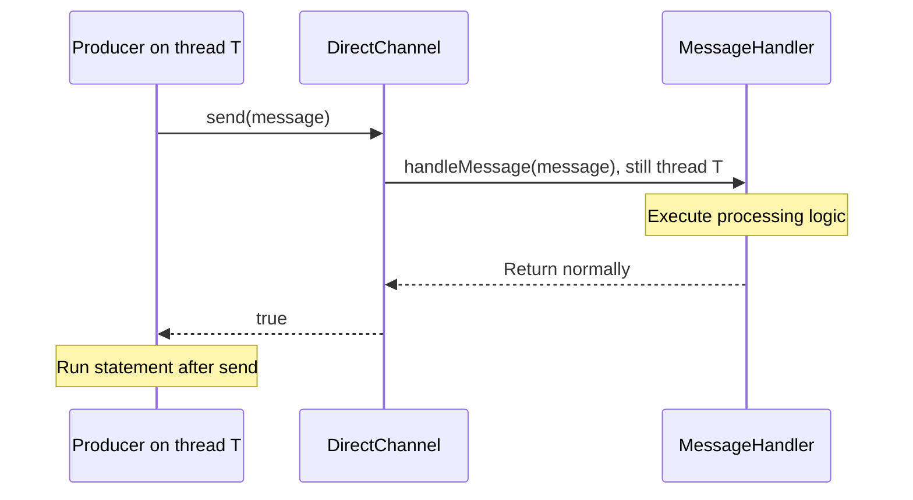

# Handler Is Invoked on the Sender Thread

## 1. Objectives and Scope

In the **SPRING_INTEGRATION_CORE** module, `DirectChannel` connects components of a message flow while preserving synchronous execution. This lesson belongs to the **DirectChannel** chapter and focuses on the question: when a producer calls `send(message)`, which thread actually runs the handler and when does the producer resume?

After this lesson, you can:

- Describe the path from a `Message` through a `MessageChannel` to an endpoint's handler.
- Prove that the handler runs on the same sending thread using a Java example.
- Read a Java DSL flow and identify which processing segments remain synchronous.
- Explain the impact on latency, exception propagation, transactions, and concurrent access.

The examples require `org.springframework.integration:spring-integration-core` on the classpath. If the project uses Spring Boot, use the compatible dependency set managed by the project; the testing section at the end requires JUnit Jupiter as well. No broker or network connection is needed to observe this mechanism.

## 2. Core Rule of DirectChannel

`DirectChannel` invokes the handler directly on **the thread executing the `send(...)` call**. The channel does not spawn threads on its own and does not place messages into an internal queue for later processing. The official API defines this as a channel that invokes a single subscriber for each message, with the invocation taking place on the sender thread. [DirectChannel API](https://docs.spring.io/spring-integration/api/org/springframework/integration/channel/DirectChannel.html)

Example of an HTTP thread sending a message:

```text
http-thread-7:
  controller.submit()
    -> inputChannel.send(message)
      -> dispatcher.dispatch(message)
        -> handler.handleMessage(message)
      <- handler returns
    <- send returns
  controller continues
```

This is a conceptual call-path model; the framework also includes interceptors and other management layers. The key takeaway is that the handler resides on the call stack of `send`.

"Sender thread" is a role at the send site, not the name of a fixed thread:

| Where `send` is called | Sender thread at the channel |
| --- | --- |
| Controller handling an HTTP request | Thread running the controller |
| Task triggered by a scheduler | Thread running that task |
| A poller sending newly read data | Thread executing that poll |
| Work running inside an executor | Thread executing the task |
| Example program called from `main` | The `main` thread |

If a poller has already read a message from another channel and then sends it into a `DirectChannel`, the handler still runs synchronously with the poller. That does not make the handler run back on the thread that sent the message into the earlier channel.

### Participating Components

- **`Message<?>`** carries payload and headers.
- **`MessageChannel`** serves as the send endpoint so the producer does not need to call the business component directly.
- **Dispatcher** inside the channel selects the subscriber.
- **`MessageHandler`** receives the `handleMessage(...)` call.
- **Endpoint** connects a processing role, such as a transformer or service activator, to the channel.

`DirectChannel` is a `SubscribableChannel`: handlers register via `subscribe(...)`. It is not a `PollableChannel`, so it has no `receive()` for consumers to pull messages and requires no poller at this input. [AbstractSubscribableChannel API](https://docs.spring.io/spring-integration/api/org/springframework/integration/channel/AbstractSubscribableChannel.html)

## 3. Execution Sequence of a Single Send

Assume the channel has one handler, no interceptor blocks the message, and the handler does not create asynchronous work:



If the handler throws an error and it is not handled internally, the normal return path is replaced by exception propagation. The producer cannot execute the statement immediately after `send` as if the call had succeeded.

Two ideas should be kept distinct:

1. A channel decouples the producer from the consumer's class name and implementation.
2. Decoupling via messages does not automatically introduce asynchronous execution.

You can swap a handler or add an endpoint without modifying the producer, yet the execution time of synchronous handlers remains part of the producer's call duration.

## 4. Java Example: Verifying the Exact Thread Object

The following example only requires `spring-integration-core` and its transitive dependencies. The handler is registered manually to demonstrate the mechanism without starting a Spring application context.

```java
import java.util.ArrayList;
import java.util.List;
import java.util.concurrent.atomic.AtomicReference;

import org.springframework.integration.channel.DirectChannel;
import org.springframework.messaging.Message;
import org.springframework.messaging.support.MessageBuilder;

public class DirectChannelThreadDemo {

    public static void main(String[] args) {
        DirectChannel input = new DirectChannel();

        Thread senderThread = Thread.currentThread();
        AtomicReference<Thread> handlerThread = new AtomicReference<>();
        List<String> events = new ArrayList<>();

        input.subscribe(message -> {
            handlerThread.set(Thread.currentThread());
            events.add("handler");

            System.out.printf(
                    "handler: payload=%s, thread=%s%n",
                    message.getPayload(),
                    Thread.currentThread().getName());
        });

        Message<String> message = MessageBuilder
                .withPayload("order-1001")
                .setHeader("source", "thread-demo")
                .build();

        events.add("before-send");
        System.out.printf("sender: thread=%s%n", senderThread.getName());

        boolean sent = input.send(message);

        events.add("after-send");

        if (!sent) {
            throw new IllegalStateException("Message was not sent");
        }
        if (handlerThread.get() != senderThread) {
            throw new IllegalStateException("Handler ran on a different thread");
        }
        if (!events.equals(
                List.of("before-send", "handler", "after-send"))) {
            throw new IllegalStateException("Unexpected order: " + events);
        }

        System.out.println("sent=" + sent);
        System.out.println("sameThread=" + (handlerThread.get() == senderThread));
        System.out.println("events=" + events);
    }
}
```

Expected output when run directly from `main`:

```text
sender: thread=main
handler: payload=order-1001, thread=main
sent=true
sameThread=true
events=[before-send, handler, after-send]
```

Thread names may differ if the runtime environment uses another thread. Comparing `handlerThread.get() == senderThread` is what proves it is the exact same `Thread` object; two distinct threads can still be given the same name.

`AtomicReference` is used here to pass the value written inside the lambda back out. `ArrayList` is also suitable for this example because only a single thread mutates the list. You cannot rely on this example to conclude that `ArrayList` is safe when multiple concurrent senders exist.

There is no need for `Thread.sleep(...)` to wait for the handler: by the time `send` returns in this example, the handler has already finished.

## 5. Java DSL Preserves the Same Execution Model

Java DSL describes a flow using builders; when Spring initializes the context, channels and endpoints are registered. Chaining steps in the DSL does not automatically add an executor. [Java DSL](https://docs.spring.io/spring-integration/reference/dsl.html)

The following example explicitly declares two `DirectChannel` beans to clearly show the connection point between the transformer and the final handler.

```java
import java.util.Locale;

import org.springframework.context.annotation.AnnotationConfigApplicationContext;
import org.springframework.context.annotation.Bean;
import org.springframework.context.annotation.Configuration;
import org.springframework.integration.config.EnableIntegration;
import org.springframework.integration.channel.DirectChannel;
import org.springframework.integration.dsl.IntegrationFlow;
import org.springframework.messaging.support.MessageBuilder;

@Configuration
@EnableIntegration
public class OrderFlowDemo {

    @Bean
    public DirectChannel orderInput() {
        return new DirectChannel();
    }

    @Bean
    public DirectChannel normalizedOrders() {
        return new DirectChannel();
    }

    @Bean
    public IntegrationFlow orderFlow() {
        return IntegrationFlow.from("orderInput")
                .<String, String>transform(raw -> {
                    System.out.printf(
                            "transform: thread=%s%n",
                            Thread.currentThread().getName());
                    return raw.trim().toUpperCase(Locale.ROOT);
                })
                .channel("normalizedOrders")
                .handle(String.class, (orderId, headers) -> {
                    System.out.printf(
                            "handle: orderId=%s, thread=%s%n",
                            orderId,
                            Thread.currentThread().getName());
                    return null;
                })
                .get();
    }

    public static void main(String[] args) {
        try (AnnotationConfigApplicationContext context =
                     new AnnotationConfigApplicationContext(OrderFlowDemo.class)) {

            DirectChannel input =
                    context.getBean("orderInput", DirectChannel.class);

            System.out.printf(
                    "before-send: thread=%s%n",
                    Thread.currentThread().getName());

            boolean sent = input.send(
                    MessageBuilder.withPayload("  order-1001  ").build());

            System.out.printf(
                    "after-send: sent=%s, thread=%s%n",
                    sent,
                    Thread.currentThread().getName());
        }
    }
}
```

Relevant output for the example, omitting Spring startup logs:

```text
before-send: thread=main
transform: thread=main
handle: orderId=ORDER-1001, thread=main
after-send: sent=true, thread=main
```

The execution flow is:

```text
sender
  -> orderInput (DirectChannel)
    -> transformer
      -> normalizedOrders (DirectChannel)
        -> final handler
  <- send returns
```

The transformer produces the normalized payload and forwards it. The `handle` lambda returns `null` to terminate the processing branch without emitting a reply.

If the input is replaced with a messaging gateway, the gateway can provide a method interface instead of manual message construction. You should also review the gateway's reply contract; a gateway method's return type is a separate concern from the thread used by `DirectChannel`.

## 6. What Does the `send` Call Duration Include?

In the flow above, the producer bears the execution time of both the transformer and the final handler. For a chained synchronous processing path, you can approximate:

```text
T_send ≈ T_transformer + T_handler + T_other_synchronous_steps + T_overhead
```

Hypothetical example:

| Work | Duration |
| --- | ---: |
| Normalize order ID | 2 ms |
| Validate data in memory | 3 ms |
| Call external service from handler | 400 ms |
| Approximate minimum total | 405 ms |

These are illustrative numbers, not benchmark results. If a controller invokes this flow, the request-handling thread is also occupied for roughly that duration. The name `DirectChannel` does not turn a 400 ms network call into a background task.

Backpressure-like slowdowns can occur: a slow handler slows down sequential sending by a sender. However, the channel does not provide a buffer or limit the number of concurrent senders. Multiple requests can still enter the handler simultaneously and overload downstream resources.

### `send` Returning Does Not Always Mean the Entire Business Process Is Complete

In the example with only synchronous steps and a final handler performing all the work, `send` returns after those steps. When the design changes, its meaning must be re-examined:

- The handler dispatches work to an executor itself: the handler call may finish before the background work.
- The flow encounters a `QueueChannel`: the remainder may be processed later by a consumer.
- A filter drops the message according to configuration: the call may finish normally even though business steps after the filter do not run.
- An aggregator only stores the message in an incomplete group: the current receive may finish before the group is released.

Therefore, do not use a `true` return value from `send` as general proof that "the order has been paid", "the email was sent", or "every branch has finished processing". It is simply a confirmation of delivery under the channel's contract. [MessageChannel API](https://docs.spring.io/spring-framework/docs/current/javadoc-api/org/springframework/messaging/MessageChannel.html)

## 7. `send` Timeout Is Not a Handler Deadline

Calling:

```java
boolean sent = input.send(message, 100);
```

does not mean the handler is guaranteed to stop after 100 ms.

`DirectChannel` has no queue-capacity wait step for this timeout to govern. Once the dispatcher invokes the handler, it is a synchronous Java call; the `send` timeout parameter does not create a timer to interrupt the handler. The timeout contract belongs to the send operation and does not automatically become a cancellation mechanism for business logic. [MessageChannel API](https://docs.spring.io/spring-framework/docs/current/javadoc-api/org/springframework/messaging/MessageChannel.html)

If the handler makes HTTP calls or database queries, appropriate timeouts must be configured on that client or resource. If a time limit is applied at an orchestration layer, you must also check whether the running work is actually cancelled or whether only the caller stops waiting.

Similarly, a reply timeout on a gateway does not guarantee interrupting a synchronous handler currently running inside the send call.

## 8. Exceptions Propagate Back to the Sender Along the Call Stack

When sending directly to a `DirectChannel`, errors from synchronous processing segments can be caught by the caller at the `send` call. The framework may wrap business errors in a `MessagingException`; you should inspect the cause chain rather than always assuming you will catch the exact original exception class. Setting the `errorChannel` header does not cause the channel to automatically turn every synchronous error into an `ErrorMessage`. [Error Handling](https://docs.spring.io/spring-integration/reference/error-handling.html)

This example uses one handler and intentionally throws a `MessageHandlingException`:

```java
import org.springframework.integration.channel.DirectChannel;
import org.springframework.messaging.MessageHandlingException;
import org.springframework.messaging.MessagingException;
import org.springframework.messaging.support.MessageBuilder;

public class DirectChannelErrorDemo {

    public static void main(String[] args) {
        DirectChannel input = new DirectChannel();

        input.subscribe(message -> {
            throw new MessageHandlingException(
                    message, "Invalid order");
        });

        try {
            input.send(
                    MessageBuilder.withPayload("invalid-order").build());

            throw new IllegalStateException(
                    "Should not reach here when the handler throws an error");
        }
        catch (MessagingException ex) {
            System.out.println("Sender received error: " + ex.getMessage());
        }
    }
}
```

In the example, the handler fails so `send` does not return `true` or `false` for the caller to branch on. Control flow enters the `catch` block.

Several situations should be distinguished:

| Situation | Behavior to understand |
| --- | --- |
| Channel has no subscribers yet | Send fails; it does not buffer the message to wait for a subscriber to appear |
| Handler catches the error and returns normally | The caller cannot know an error was swallowed merely by waiting on `send` |
| Gateway has an error channel configured | The gateway may change how errors are reported according to the gateway's configuration |

Message-based error reporting is typically used across asynchronous boundaries or via a component configured for error handling. `DirectChannel` by itself does not replace an error-handling policy.

## 9. Same Thread Supports Preserving Transaction Context

With standard Spring transactions bound to a thread, synchronous steps can continue using the active transaction. `DirectChannel` does not open a transaction on its own; the application must still define where the transaction starts and which resources participate. [Transaction Support](https://docs.spring.io/spring-integration/reference/transactions.html)

Consider a design scenario:

```text
Spring proxy opens transaction
  -> service method sends message
    -> DirectChannel
      -> handler updates data using a transaction-participating resource
  -> service method completes
Spring proxy decides to commit or rollback
```

To participate in the same transaction, ensure the call passes through Spring's transaction mechanism, resources use the appropriate transaction manager, and propagation settings allow joining the current transaction.

If an error propagates out to the transaction boundary, the rollback decision also depends on the configured rollback rules. If the handler swallows the error, there may no longer be an exception outside for those rules to apply.

Switching to a step that executes on a different thread loses the implicit ability to share the sending thread's transaction context. This does not mean the sender's transaction ends immediately at the handoff statement; when it finishes is still governed by the sender's transaction boundary. Nor can an external side effect, such as an already sent email, be rolled back merely because the steps run on the same thread.

## 10. Multiple Subscribers and Multiple Senders Are Two Different Things

### Multiple Subscribers: Point-to-Point Delivery

A message is delivered point-to-point, not broadcast to every subscriber. By default, the channel uses round-robin to pick a handler. When the selected handler throws an error, default failover may try the next subscriber; thus a failing message can be attempted across multiple handlers. [Message Channel Implementations](https://docs.spring.io/spring-integration/reference/channel/implementations.html)

These attempts still occur on the sender thread. Failover does not create parallel processing on its own and is not equivalent to retrying the same handler multiple times.

Example configuration when you do not want the dispatcher to try another handler after an error:

```java
DirectChannel input = new DirectChannel();
input.setFailover(false);
```

This only disables dispatcher failover; it does not disable retry advice or retries configured by other components.

A design risk: handler A produces a side effect and then throws an error; the dispatcher forwards the same message to handler B. If B performs the side effect again, data may be duplicated. Idempotency policies must originate from the business logic and data write points, and cannot be inferred from the same-thread characteristic.

### Multiple Senders: Handlers Can Still Run Concurrently

Suppose two requests call the same channel at the same time:

```text
thread-A -> input.send(message-A) -> handler(message-A) on thread-A
thread-B -> input.send(message-B) -> handler(message-B) on thread-B
```

"Runs on the sender thread" holds true for both sends, while the two handler invocations can overlap.

Example of error-prone shared state:

```java
// Example illustrating state that is NOT safe under concurrent updates.
private int processedCount;

public void countOne() {
    processedCount++;
}
```

Incrementing involves multiple operations, so the same handler invoked by two senders can lose increments. If a shared counter is needed, `AtomicInteger` can be used; for business updates, synchronization or transactions appropriate to the data are required.

`DirectChannel` provides no system-wide ordering guarantee. With multiple senders, you also cannot infer that a message arriving earlier in wall-clock time will always finish first.

## 11. Identifying Thread-Switching Boundaries in a Flow

The following table helps when reading configuration, though it does not replace checking the actual executor and consumer:

| Channel | Handoff mechanism | Processing thread |
| --- | --- | --- |
| `DirectChannel` | Invokes subscriber directly | Thread executing `send` |
| `ExecutorChannel` | Submits work to an executor | Decided by the executor; typically a pool worker |
| `QueueChannel` | Stores message in a queue for consumer pickup | Thread performing receive and processing |

`ExecutorChannel` does not guarantee a thread switch in every case: a synchronous executor or a caller-runs policy under saturation can cause work to run right on the sending thread. `QueueChannel` uses memory by default; durability requirements need additional configuration. [Message Channel Implementations](https://docs.spring.io/spring-integration/reference/channel/implementations.html)

Example of a processing path with a handoff point:

```text
Sending thread:
  input DirectChannel -> validate -> ExecutorChannel -> send returns

Thread chosen by executor, if the executor actually switches threads:
  enrich -> result DirectChannel -> save
```

`result DirectChannel` invokes `save` on the thread sending into it, which is the thread running `enrich` in this branch. It does not look up and restore `input`'s original thread.

When considering changing a channel to be asynchronous, you must redefine where results are awaited, where errors are received, and where transaction boundaries lie. This changes the flow's behavior, not just the time measured around `send`.

## 12. Verifying Same-Thread Execution with JUnit Jupiter

A test verifying this mechanism requires no timed waits, no broker, and no need to boot an entire Spring Boot application.

```java
import java.util.ArrayList;
import java.util.List;
import java.util.concurrent.atomic.AtomicReference;

import org.junit.jupiter.api.Test;
import org.springframework.integration.channel.DirectChannel;
import org.springframework.messaging.support.MessageBuilder;

import static org.junit.jupiter.api.Assertions.assertEquals;
import static org.junit.jupiter.api.Assertions.assertSame;
import static org.junit.jupiter.api.Assertions.assertTrue;

class DirectChannelThreadTest {

    @Test
    void invokesHandlerOnSenderThreadBeforeSendReturns() {
        DirectChannel input = new DirectChannel();

        Thread sender = Thread.currentThread();
        AtomicReference<Thread> actual = new AtomicReference<>();
        List<String> steps = new ArrayList<>();

        input.subscribe(message -> {
            actual.set(Thread.currentThread());
            steps.add("handler");
        });

        steps.add("before");
        boolean sent = input.send(
                MessageBuilder.withPayload("order-1001").build());
        steps.add("after");

        assertTrue(sent);
        assertSame(sender, actual.get());
        assertEquals(List.of("before", "handler", "after"), steps);
    }
}
```

`assertSame` checks for the exact thread instance. The ordering of `steps` verifies that the handler ran before the statement following `send`. Checking only `sent == true` would miss what needs to be proven about the thread.

This is a test example for learners to apply in a project; the console output in earlier sections shows the expected output of the examples.

## 13. How to Read a Flow Using DirectChannel

When encountering a configuration with `DirectChannel`, trace these five points:

1. **Who is sending?** Identify the thread at that exact `send` call.
2. **Which handlers are subscribed?** Distinguish a single endpoint from multiple competing subscribers.
3. **Where does synchronous execution stop?** Look for queues, executors, or background work created by a handler.
4. **Where do errors return?** Check the direct caller, gateways, and error-handling configuration.
5. **Which resources are bound to the thread?** Evaluate transactions, shared state, and thread hold duration.

In this lesson's Java DSL flow, both the transformer and the final handler run on the thread calling `orderInput.send(...)`. From that rule, you can accurately determine execution order and the sender's responsibilities before introducing more complex integration patterns.
