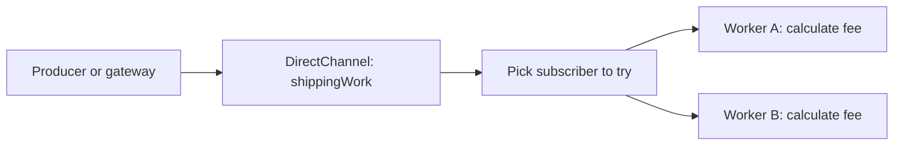

# Load Balancing Between Subscribers

## 1. The Problem: Multiple Consumers Performing the Same Work

In Spring Integration Core, a `Message` carries the data to be processed, a `MessageChannel` connects components, and an endpoint binds business logic to an input channel. When multiple endpoints are equally capable of handling a given kind of work, you can subscribe them to the same `DirectChannel` to distribute the work.

Suppose an application has two processors for shipping fee calculation requests, A and B. Both accept the same data structure, follow the same contract, and are interchangeable. Each request only needs one processor to complete it.



The two branches represent candidates. This is not a diagram of broadcasting every message to both A and B.

After this lesson, you should be able to explain:

- Which subscriber is tried first when using round-robin.
- Why adding subscribers does not create additional execution threads.
- When failover routes a message to another subscriber.
- How to declare multiple consumers with Java DSL and verify the behavior with JUnit.

A suitable design looks like: normalizing data with a transformer, validating input preconditions, and sending valid work to a group of equally capable workers. If selection by delivery region or service type is needed, route before distributing within each group.

## 2. Who Is a Subscriber in an Integration Flow?

`DirectChannel` implements `SubscribableChannel`. The directly registered object is a `MessageHandler`. In an application configured with Java DSL, the endpoint created by `.handle(...)` connects the handler to the input channel; registration follows the endpoint's lifecycle.

Example:

```text
shippingWork
    ├── endpointA → serviceA.calculate(...)
    └── endpointB → serviceB.calculate(...)
```

`endpointA` and `endpointB` are two competing consumers for work. By contrast, the following configuration describes sequential steps:

```java
IntegrationFlow.from("input")
        .handle(serviceA, "calculate")
        .handle(serviceB, "persist")
        .get();
```

In a sequential configuration, the result from the previous step moves to the next step according to the flow's contract. You cannot infer that there are two competing subscribers on `input` merely because there are two `.handle(...)` calls.

Java DSL creates integration components from an `IntegrationFlow` bean; `.handle(...)` represents a service activator. See [Java DSL](https://docs.spring.io/spring-integration/reference/dsl.html) and [Service Activator](https://docs.spring.io/spring-integration/reference/service-activator.html).

A common design mistake is attaching "save order" and "send email" to the same `DirectChannel` expecting both to always run. Those two tasks are not interchangeable. Chain them as appropriate steps or use a structure that dispatches messages to multiple branches if the business logic requires it.

## 3. Dispatch Mechanism and Round-Robin

### 3.1. Distinguishing Candidate Selection from Successful Processing

`DirectChannel` uses `UnicastingDispatcher` to invoke handlers. You can picture the algorithm as follows:

```text
retrieve the handler list in the order defined by the strategy

if there are no handlers:
    report a message delivery failure

for each handler in the list:
    attempt to invoke the handler with the message
    if the call finishes normally:
        finish dispatch successfully
    if the handler throws an exception:
        if the policy does not allow failover:
            throw the error back to the sender
        if there are remaining candidates:
            continue trying the next candidate

if all attempts fail:
    report a message delivery failure
```

This is an explanatory model, not copied source code. In this model, "success" simply means the handler call does not throw an exception outward. The dispatcher does not inspect a business flag in the payload to decide whether to try another worker. See the contract of [UnicastingDispatcher](https://docs.spring.io/spring-integration/api/org/springframework/integration/dispatcher/UnicastingDispatcher.html).

From this stopping mechanism, we can deduce:

- If A catches an error and returns normally, the dispatcher has no error signal to try B.
- If a filter consumes a message by discarding it normally, that does not cause the dispatcher to select the next worker.
- A worker that writes data and then throws an exception can still leave side effects before another worker is tried.

Therefore, define the worker's success and failure contract right from the design stage.

### 3.2. Round-Robin Rotates the Starting Point of Each Dispatch

The `new DirectChannel()` constructor uses `RoundRobinLoadBalancingStrategy` by default. With a fresh channel, a stable list of A, B, C, sequential sends, and no errors, we can observe:

| Message | First subscriber tried | Successful subscriber |
|---|---|---|
| M1 | A | A |
| M2 | B | B |
| M3 | C | C |
| M4 | A | A |
| M5 | B | B |
| M6 | C | C |

What matters is the rotating starting point. When failover is needed, the candidate list continues from that point and can wrap around to earlier elements. For example, starting from B for list A, B, C gives the attempt order B, C, A. See [RoundRobinLoadBalancingStrategy](https://docs.spring.io/spring-integration/api/org/springframework/integration/dispatcher/RoundRobinLoadBalancingStrategy.html).

The table above assumes all subscribers were registered before M1 and do not change during sending. With multiple concurrent producers, you should not assume a rigid rule such as "all odd order IDs go to A". Order IDs do not participate in the default round-robin algorithm.

### 3.3. Balancing Turn Counts Does Not Reflect Work Heaviness

Consider six orders with the following expected processing durations:

| Order | Worker by rotation | Assumed duration |
|---|---|---|
| 1 | A | 10 ms |
| 2 | B | 500 ms |
| 3 | A | 10 ms |
| 4 | B | 500 ms |
| 5 | A | 10 ms |
| 6 | B | 500 ms |

Each worker receives three turns, yet B's total work duration is much larger. This is an example deduced from rotation behavior: distributing turn counts evenly does not automatically distribute processing time evenly.

If a worker is calling a slow external service, do not assume round-robin will automatically shift to an idle worker. Solving that problem requires an appropriate load-measurement model, coordination, or queue.

## 4. Load Balancing and Failover Are Two Separate Decisions

Load balancing determines the order in which subscribers are tried. Failover determines whether to keep trying when the just-invoked subscriber throws an exception.

`DirectChannel` enables failover by default. Common configurations:

| Load balancing | Failover | Behavior |
|---|---|---|
| Round-robin | `true` | Rotates the first candidate; on error, may try other candidates |
| Round-robin | `false` | Rotates the first candidate; an error on that attempt is thrown back to the sender |
| No strategy | `true` | Always starts in fixed order; uses subsequent candidates as backups |
| No strategy | `false` | Always tries the first subscriber in the fixed order |

You can pass `null` to the constructor to disable load balancing:

```java
DirectChannel primaryThenBackup = new DirectChannel(null);
primaryThenBackup.setFailover(true);
```

The fixed order depends on the handler ordering: the order value if present, or registration order when no distinct order value exists. Do not rely on bean declaration order to express business priority. See [DirectChannel API](https://docs.spring.io/spring-integration/api/org/springframework/integration/channel/DirectChannel.html).

### Example: Subscriber A Frequently Fails

Suppose there are two workers, A always throws an exception and B always finishes normally:

| Message | First candidate | Actual invocations | Successful worker |
|---|---|---|---|
| M1 | A | A fails → B succeeds | B |
| M2 | B | B succeeds | B |
| M3 | A | A fails → B succeeds | B |
| M4 | B | B succeeds | B |

Round-robin still distributes the starting point. Completed work accumulates on B. Over four messages, A is called twice and B is called four times.

From this example, when observing the system you should separate three metrics: times chosen first, times the handler was invoked, and times processing succeeded. Counting only final outcomes can mask a worker that is continuously failing.

Failover also does not automatically isolate A from subsequent messages. If you want to temporarily stop using a failing service, you need a separate lifecycle policy, routing, or circuit breaker.

### Selecting Failover by Exception Type

Since Spring Integration 6.3, `DirectChannel` provides `setFailoverStrategy(Predicate<Exception>)`. This API allows decisions based on the exception. It and `setFailover(boolean)` override each other's configuration; pick one approach per configuration and avoid calling both and depending on setter order. See [setFailoverStrategy](https://docs.spring.io/spring-integration/api/org/springframework/integration/channel/DirectChannel.html#setFailoverStrategy(java.util.function.Predicate)).

From a business perspective, an error like "fee calculation service temporarily unreachable" may warrant trying a backup provider. An error like "shipping address missing province/city" usually needs to be returned to fix the data. When writing the predicate, also check whether the business exception is wrapped inside an endpoint exception.

## 5. DirectChannel Preserves the Sending Thread

Adding three subscribers to a `DirectChannel` does not create three worker threads. The channel invokes the handler directly on the thread calling `send(...)`. The sender must wait for the synchronous handler call to finish before `send(...)` returns. This characteristic is described in [Message Channel Implementations](https://docs.spring.io/spring-integration/reference/channel/implementations.html#channel-implementations-directchannel).

With a single producer sending in a loop:

```text
thread T:
send(M1) → A finishes processing → returns
send(M2) → B finishes processing → returns
send(M3) → A finishes processing → returns
```

With two producers active concurrently:

```text
thread T1: send(M1) → A
thread T2: send(M2) → B
```

The two calls can execute concurrently because there are two sending threads. The second model does not involve a separate pool created by `DirectChannel`.

Design implications:

- Use concurrency-safe data structures inside handlers if multiple producers exist.
- A single handler can receive multiple concurrent calls; the subscriber count is not a concurrency limit.
- `setMaxSubscribers(2)` only limits the number of subscriptions, not "allow only two tasks to run".
- There is no queue inside the channel to hold work when downstream is slow.

If each message takes 100 ms and a producer only sends the next message after the previous one completes, adding subscribers does not turn that loop into three tasks running in parallel. This is a consequence of synchronous invocation.

### Send Timeout Is Not a Processing Time Limit

Do not use `channel.send(message, timeout)` as a way to interrupt a handler that runs too long. In `AbstractSubscribableChannel`, the synchronous dispatch path does not use the timeout to cut off the handler call. Configure timeouts on the HTTP client, JDBC, or the resource that can actually be slow. See [AbstractSubscribableChannel 6.5.0 source](https://github.com/spring-projects/spring-integration/blob/v6.5.0/spring-integration-core/src/main/java/org/springframework/integration/channel/AbstractSubscribableChannel.java).

## 6. Java DSL Example: Two Flows Receiving from the Same Channel

The following example uses APIs present in Spring Integration 6.5. It requires `org.springframework.integration:spring-integration-core` along with a compatible Spring library suite. The test section below uses JUnit Jupiter.

This is a one-way send example. Each handler prints the received work and returns `null` so no reply is produced. In a request–reply problem, both workers must follow the same reply contract and configure appropriate output/reply channels.

Save the example into `OrderLoadBalancingConfig.java` in a sample application:

```java
import org.springframework.context.annotation.AnnotationConfigApplicationContext;
import org.springframework.context.annotation.Bean;
import org.springframework.context.annotation.Configuration;
import org.springframework.integration.channel.DirectChannel;
import org.springframework.integration.config.EnableIntegration;
import org.springframework.integration.dsl.IntegrationFlow;
import org.springframework.messaging.support.MessageBuilder;

@Configuration
@EnableIntegration
public class OrderLoadBalancingConfig {

    @Bean
    public DirectChannel shippingWork() {
        DirectChannel channel = new DirectChannel();
        channel.setFailover(false);
        return channel;
    }

    @Bean
    public IntegrationFlow workerA(DirectChannel shippingWork) {
        return IntegrationFlow.from(shippingWork)
                .handle(String.class, (orderId, headers) -> {
                    System.out.println("A: " + orderId + " @ "
                            + Thread.currentThread().getName());
                    return null;
                }, endpoint -> endpoint.id("workerAEndpoint").order(10))
                .get();
    }

    @Bean
    public IntegrationFlow workerB(DirectChannel shippingWork) {
        return IntegrationFlow.from(shippingWork)
                .handle(String.class, (orderId, headers) -> {
                    System.out.println("B: " + orderId + " @ "
                            + Thread.currentThread().getName());
                    return null;
                }, endpoint -> endpoint.id("workerBEndpoint").order(20))
                .get();
    }

    public static void main(String[] args) {
        try (AnnotationConfigApplicationContext context =
                new AnnotationConfigApplicationContext(
                        OrderLoadBalancingConfig.class)) {

            DirectChannel channel =
                    context.getBean("shippingWork", DirectChannel.class);

            System.out.println("Subscribers: " + channel.getSubscriberCount());

            for (int i = 1; i <= 4; i++) {
                channel.send(MessageBuilder
                        .withPayload("ORDER-" + i)
                        .build());
            }
        }
    }
}
```

Both `IntegrationFlow` beans start from the exact same `shippingWork` object. This is what forms the competing consumer group. The `IntegrationFlow.from(MessageChannel)` API lets you use a declared channel as the flow's input; see [IntegrationFlow API](https://docs.spring.io/spring-integration/api/org/springframework/integration/dsl/IntegrationFlow.html).

With a fresh context and no other components sending to the channel, the illustrative output is:

```text
Subscribers: 2
A: ORDER-1 @ main
B: ORDER-2 @ main
A: ORDER-3 @ main
B: ORDER-4 @ main
```

`order(10)` puts A before B in the underlying order; it does not make A receive all messages while round-robin remains enabled. The example intentionally disables failover to make it easy to observe one selection per message. Switch to `setFailover(true)` when you want to explore backup behavior.

If you change the constructor to `new DirectChannel(null)`, keep A with a lower order than B, and have no errors, A will receive all four messages.

### Comparing Against a Processing Pipeline

Suppose the process needs "normalize address → calculate fee → save quote". Only the fee calculation step has two interchangeable implementations. The design should separate:

```text
normalize address
        ↓
shippingWork → one of the fee calculation workers
        ↓
save quote from worker result
```

In a real flow, both worker branches must pass their result to the save-quote input. The one-way send example above stops after printing, so it does not implement that step yet.

If the producer is a messaging gateway, the gateway is only the entry point into the flow. The worker selection strategy still belongs to the channel; using a gateway does not automatically turn `DirectChannel` into asynchronous execution.

## 7. Testing Behavior with JUnit

The tests below use a standalone channel to focus on the dispatch contract. They do not require starting a Spring context, a poller, or using `Thread.sleep(...)`. After `send(...)`, the handler's synchronous side effects can be verified immediately.

Save the following snippet to `DirectChannelLoadBalancingTest.java` in the sample application. This filename is simply a practice guide for learners.

```java
import java.util.ArrayList;
import java.util.List;
import java.util.concurrent.atomic.AtomicInteger;
import java.util.concurrent.atomic.AtomicReference;

import org.junit.jupiter.api.Test;
import org.springframework.integration.channel.DirectChannel;
import org.springframework.messaging.MessageDeliveryException;
import org.springframework.messaging.MessageHandlingException;
import org.springframework.messaging.MessagingException;
import org.springframework.messaging.support.GenericMessage;

import static org.junit.jupiter.api.Assertions.assertEquals;
import static org.junit.jupiter.api.Assertions.assertSame;
import static org.junit.jupiter.api.Assertions.assertThrows;
import static org.junit.jupiter.api.Assertions.assertTrue;

class DirectChannelLoadBalancingTest {

    @Test
    void roundRobinDistributesMessagesWithoutBroadcasting() {
        DirectChannel channel = new DirectChannel();
        channel.setFailover(false);
        List<String> received = new ArrayList<>();

        channel.subscribe(message ->
                received.add("A:" + message.getPayload()));
        channel.subscribe(message ->
                received.add("B:" + message.getPayload()));

        for (int i = 1; i <= 4; i++) {
            assertTrue(channel.send(new GenericMessage<>(i)));
        }

        assertEquals(List.of("A:1", "B:2", "A:3", "B:4"), received);
    }

    @Test
    void handlerRunsOnTheSendingThread() {
        DirectChannel channel = new DirectChannel();
        AtomicReference<Thread> actualThread = new AtomicReference<>();
        Thread sender = Thread.currentThread();

        channel.subscribe(message ->
                actualThread.set(Thread.currentThread()));

        assertTrue(channel.send(new GenericMessage<>("ORDER-1")));
        assertSame(sender, actualThread.get());
    }

    @Test
    void failoverTriesBackupAfterPrimaryThrows() {
        DirectChannel channel = new DirectChannel(null);
        channel.setFailover(true);
        List<String> attempts = new ArrayList<>();

        channel.subscribe(message -> {
            attempts.add("A");
            throw new MessageHandlingException(
                    message, "A temporarily unavailable");
        });
        channel.subscribe(message -> attempts.add("B"));

        assertTrue(channel.send(new GenericMessage<>("ORDER-1")));
        assertEquals(List.of("A", "B"), attempts);
    }

    @Test
    void disabledFailoverDoesNotInvokeBackup() {
        DirectChannel channel = new DirectChannel(null);
        channel.setFailover(false);
        AtomicInteger backupCalls = new AtomicInteger();

        channel.subscribe(message -> {
            throw new MessageHandlingException(message, "Primary failed");
        });
        channel.subscribe(message -> backupCalls.incrementAndGet());

        assertThrows(MessagingException.class,
                () -> channel.send(new GenericMessage<>("ORDER-1")));
        assertEquals(0, backupCalls.get());
    }

    @Test
    void noLoadBalancingKeepsStartingWithPrimary() {
        DirectChannel channel = new DirectChannel(null);
        AtomicInteger primaryCalls = new AtomicInteger();
        AtomicInteger backupCalls = new AtomicInteger();

        channel.subscribe(message -> primaryCalls.incrementAndGet());
        channel.subscribe(message -> backupCalls.incrementAndGet());

        for (int i = 1; i <= 4; i++) {
            assertTrue(channel.send(new GenericMessage<>(i)));
        }

        assertEquals(4, primaryCalls.get());
        assertEquals(0, backupCalls.get());
    }

    @Test
    void noSubscribersProducesDeliveryFailure() {
        DirectChannel channel = new DirectChannel();

        assertThrows(MessageDeliveryException.class,
                () -> channel.send(new GenericMessage<>("ORDER-1")));
    }
}
```

The first test uses a fresh channel, two handlers normally registered as A then B, no concurrent sending, and no subscriber changes. Those conditions make the expectation of sequence A, B meaningful. When testing concurrent load, verify processing counts, errors, and data correctness, and avoid forcing log order into a fixed sequence.

Standalone channel tests do not verify the endpoint lifecycle of the Java DSL example. For an application using a context, also verify that both endpoints have started and that `shippingWork.getSubscriberCount()` actually equals 2.

For additional practice, add a scenario where both workers fail and inspect the retained causes. In the 6.5.0 implementation, a single failure is thrown directly; multiple collected failures may be combined into an `AggregateMessageDeliveryException`. See [UnicastingDispatcher 6.5.0 source](https://github.com/spring-projects/spring-integration/blob/v6.5.0/spring-integration-core/src/main/java/org/springframework/integration/dispatcher/UnicastingDispatcher.java).

## 8. Errors, Transactions, and Duplicate Business Side Effects

### 8.1. Synchronous Errors Return to the Caller

When sending directly to a `DirectChannel` and an error is not successfully handled via failover, the exception travels back up the call stack to the sender. Merely attaching an `errorChannel` header to the message does not make a direct `send(...)` call automatically convert the error into an `ErrorMessage`.

A gateway or error-handling advice can configure different handling. Distinguish their mechanisms from the channel's dispatch behavior. See [Error Handling](https://docs.spring.io/spring-integration/reference/error-handling.html).

If there are no subscribers, the dispatcher reports no target receiver; at the channel API, this error is wrapped as a `MessageDeliveryException`. Because the channel does not maintain a queue, sending while endpoints are inactive does not create queued work for them to process later.

### 8.2. Failover Does Not Guarantee a Single Business Side Effect

Consider a payment worker:

```text
1. A sends a charge request to the payment gateway.
2. The payment gateway charges the account.
3. A times out waiting for the response and throws an exception.
4. The dispatcher fails over to B.
5. B sends the charge request again.
```

The dispatcher only sees the exception at step 3. It does not know step 2 already succeeded at the external system. Consequently, the same request can produce duplicate side effects.

For such business flows, you need a stable idempotency key per payment request and a mechanism to record or reject duplicate processing where the side effect occurs. Do not use round-robin as an exactly-once guarantee.

Similarly, avoid mutating a mutable payload in A and then letting B receive the altered state upon failover. Prefer immutable data, or clearly define how new data is created between steps.

### 8.3. Same Thread Supports Preserving Transaction Context

If the sender has already opened a suitable Spring transaction and the handler uses resources participating in that transaction, processing across `DirectChannel` can remain in the same transaction context. The channel does not open a transaction on its own just because it runs synchronously. See [Transaction Support](https://docs.spring.io/spring-integration/reference/transactions.html).

Do not treat attempt B as a clean transaction by default. If A's call passed through a transaction interceptor and marked the shared transaction as rollback-only, B finishing normally does not automatically restore commit capability. Nor can you infer that an HTTP request already completed against an external system will be rolled back by a local JDBC transaction.

Transaction boundaries and failover policies must jointly reflect actual business side effects.

## 9. When Is Another Solution Needed?

| Specific need | Design direction |
|---|---|
| A task processed by one of the synchronous consumers in the same JVM | `DirectChannel` with interchangeable subscribers |
| Every message must go to multiple business branches | `PublishSubscribeChannel` or an appropriate branching construct |
| Need to decouple sending and processing threads | `ExecutorChannel` with a properly configured executor |
| Need to hold work for a consumer to pick up later | `QueueChannel` and a consumer with a poller |
| Need to select by payload type, region, or business header | Router to the appropriate channel |
| Need to distribute work across multiple processes or machines | Design over a broker or distributed infrastructure |

Fundamental differences among channels are presented in [Message Channel Implementations](https://docs.spring.io/spring-integration/reference/channel/implementations.html).

This table offers design suggestions based on assumed requirements and does not replace defining the application's data durability, ordering, and failure recovery. For example, choosing `QueueChannel` does not automatically provide durable storage; choosing `ExecutorChannel` also requires sizing executor capacity and handling overload.

A `DirectChannel` is an object inside a running application. Spawning an additional application instance with a channel of the same name does not automatically merge subscribers across the two processes into a shared round-robin ring.

### Extending the Dispatch Strategy

The extension contract is:

```java
Iterator<MessageHandler> getHandlerIterator(
        Message<?> message,
        Collection<MessageHandler> handlers);
```

`LoadBalancingStrategy` supplies the iteration order over candidates; it does not turn the channel into a task scheduler. You can pass an implementation of this interface into the `DirectChannel` constructor. See [LoadBalancingStrategy API](https://docs.spring.io/spring-integration/api/org/springframework/integration/dispatcher/LoadBalancingStrategy.html).

If you write a custom strategy, clearly design:

- How to behave when the list is empty or has only one handler.
- The order in which backup candidates are tried.
- Thread safety when multiple threads invoke it concurrently.
- How state updates when subscribers are added or removed.
- The meaning of any weights or load signals the strategy uses.

For a requirement like "domestic orders to A, international orders to B", a router expresses the business contract more directly than hiding the rule inside a dispatch strategy.

## 10. Diagnosing Common Symptoms

| Symptom | What to check |
|---|---|
| Only A receives messages | Is load balancing disabled on the channel; has B actually subscribed |
| B processes more results than A | Is A throwing exceptions causing failover to B |
| Two flows exist but subscriber count is 1 | Do both flows use the exact same channel instance; are endpoints running |
| Multiple workers exist yet a send loop is still slow | The producer is waiting for synchronous processing after each `send(...)` |
| One order ID is processed in multiple places | Failover attempts, external retries, and idempotency keys |
| `errorChannel` header is present yet caller still gets an exception | Direct send to the channel vs. gateway/advice configuration |
| "Dispatcher has no subscribers" error | Endpoint lifecycle, channel name, and timing of the first send |

When logging for investigation, record at least the job ID, worker name, thread, start timestamp, duration, and outcome. In the example where A fails and B succeeds, two log lines starting processing for the same job ID are evidence of two attempts; that alone is not enough to conclude there were two successful business outcomes.

`getSubscriberCount()` and `setMaxSubscribers(...)` help observe or limit subscriptions. They do not replace metrics on the number of in-flight calls. Management of the handler set is shown in [AbstractDispatcher 6.5.0 source](https://github.com/spring-projects/spring-integration/blob/v6.5.0/spring-integration-core/src/main/java/org/springframework/integration/dispatcher/AbstractDispatcher.java).

## 11. Practice Exercises

1. Run the DSL example with six messages and two non-failing workers. Record the worker and thread for each execution.
2. Switch to `new DirectChannel(null)`. Keep the same order values and compare the number of tasks A and B receive.
3. Have A throw an exception before performing any side effect. Enable failover and distinguish the invocation count from the completed task count.
4. Disable failover. Identify the exception the sender receives and confirm B is not invoked for that failed send.
5. Place an address validation step before the worker group. Explain why trying multiple workers cannot fix invalid input data.
6. Design adding worker C without assuming messages for a given customer ID always go to the same worker.

The completion criterion is being able to explain the execution trace from the channel configuration, subscriber order, and error policy. A sound design must also clearly state which parts run synchronously, where external side effects occur, and how duplicate requests are identified.
