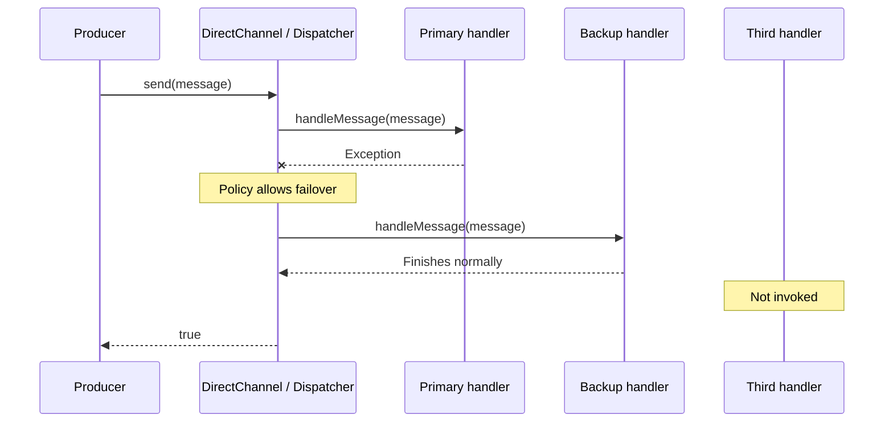

# Failover Between Handlers

## 1. The Problem: Switching to a Backup Processor When the First Fails

In the **DirectChannel** chapter of the **SPRING_INTEGRATION_CORE** module, this lesson focuses on how a channel routes a message to another handler when the current processing attempt fails. This is a useful mechanism when designing integration flows with multiple interchangeable processors.

Suppose a price lookup system has two sources:

- The primary source provides up-to-date prices.
- The backup source provides prices sufficient to satisfy the business contract when the primary source is temporarily unavailable.

The producer simply sends a `Message` to the price lookup channel. It does not need to call the primary source itself, catch errors, and then call the backup source. Handler selection lives at the message dispatch layer.

After this lesson, you should be able to do four things: explain the conditions that trigger failover; configure an ordered primary/backup setup; restrict which error types fail over to backup; and identify cases where this mechanism can repeat business side effects.

The examples use APIs from `spring-integration-core`. The `setFailoverStrategy(...)` section requires **Spring Integration 6.3 or later**. The Java DSL example uses Java 17 or later and assumes the required Spring dependencies are on the classpath; this lesson does not mandate a specific project dependency version.

## 2. Where Does Failover Actually Happen?

`DirectChannel` is a point-to-point channel. Handlers subscribed to the channel are candidates to receive messages; they do not form a list of mandatory steps that must all run.

The channel uses `UnicastingDispatcher` for dispatching. When failover is allowed, a single send may try multiple handlers in order. The dispatcher stops as soon as one handler completes the `handleMessage(...)` call without throwing an exception. Subsequent handlers are no longer invoked. The default mechanism operates synchronously on the sender's thread. [DirectChannel Documentation](https://docs.spring.io/spring-integration/reference/channel/implementations.html#directchannel).



A single dispatch can have **multiple attempts, stopping at the first processing invocation that does not throw an exception**. That does not guarantee earlier attempts produced no side effects.

Distinguish three cases:

| Outcome from the currently invoked handler | What the dispatcher observes | Subsequent behavior |
| --- | --- | --- |
| Finishes normally | Processing call succeeded | Stop dispatching |
| Throws exception and policy allows failover | Attempt failed, eligible to continue | Try next handler if any remain |
| Throws exception and policy forbids failover | Error must propagate outward | Stop, throw error back to sender |

Here, "success" is observed at the boundary of the handler call. To guarantee business outcomes, you must also design reply contracts, transactions, and deduplication mechanisms.

## 3. Load Balancing and Failover Are Two Separate Decisions

Load balancing chooses **which handler is tried first** for each message. Failover decides **whether to try another handler when the current attempt throws an exception**.

`new DirectChannel()` uses round-robin and enables failover by default. If you need to always try primary first, use `new DirectChannel(null)` to omit the load balancing strategy. Removing load balancing does not disable failover on its own. [DirectChannel API](https://docs.spring.io/spring-integration/docs/6.3.2/api/org/springframework/integration/channel/DirectChannel.html).

| Configuration | Handler tried first | If the first attempt fails |
| --- | --- | --- |
| Round-robin, failover enabled | Rotates according to strategy | May try the next candidate |
| Round-robin, failover disabled | Rotates according to strategy | Stops and propagates error |
| No load balancing, failover enabled | First handler in established order | Continues trying in that order |
| No load balancing, failover disabled | First handler in established order | Stops and propagates error |

For example, with three handlers A, B, C and no concurrent sending:

```text
Load distribution goal:
  message-1 starts at A
  message-2 starts at B
  message-3 starts at C

Fixed primary/backup goal:
  every message starts at A
  A fails and failover is allowed -> try B
  B also fails and failover is allowed -> try C
```

Therefore, setting `order` on handlers while leaving round-robin enabled is not enough to build a fixed primary/backup setup.

## 4. Minimal Example with Two Direct Subscribers

The following example uses only a channel and `MessageHandler`, letting you observe the mechanism without needing a Spring ApplicationContext or Java DSL.

```java
import java.util.ArrayList;
import java.util.List;

import org.springframework.integration.channel.DirectChannel;
import org.springframework.messaging.Message;
import org.springframework.messaging.support.MessageBuilder;

public class DirectChannelFailoverDemo {

    public static void main(String[] args) {
        DirectChannel channel = new DirectChannel(null);
        channel.setFailover(true);

        List<String> attempts = new ArrayList<>();

        // Two lambdas without explicit order: register primary first.
        channel.subscribe(message -> {
            attempts.add("primary");
            throw new IllegalStateException("Primary price source temporarily failing");
        });

        channel.subscribe(message -> {
            attempts.add("backup");
            System.out.println("Backup received: " + message.getPayload());
        });

        Message<String> request = MessageBuilder
                .withPayload("SKU-42")
                .setHeader("requestId", "price-request-42")
                .build();

        boolean sent = channel.send(request);

        System.out.println("sent=" + sent);
        System.out.println("attempts=" + attempts);
    }
}
```

Output printed by the program, excluding framework logs:

```text
Backup received: SKU-42
sent=true
attempts=[primary, backup]
```

The `send(...)` call waits for both the primary and backup attempts. `true` here indicates that dispatch completed via backup; it is not the quote data. To receive data back from a handler, use the request-reply model.

The `ArrayList` in the example is only for observing a single send on a single thread. In a real application where multiple producers call `send(...)` concurrently, a handler can still be invoked concurrently by different threads.

Try changing the configuration to:

```java
channel.setFailover(false);
```

When re-running the entire example, only primary is invoked; `send(...)` throws an exception so the print statements after it do not execute. If you want to observe `attempts`, catch the error outside the send call and print the list in a `finally` block.

## 5. Selecting Which Error Types Are Allowed to Fail Over

Not every error should be resolved by switching to another handler. Invalid input data usually needs to be rejected immediately. A lookup source that is temporarily unavailable may be a valid reason to use an alternative source.

Since Spring Integration 6.3, `DirectChannel` provides `setFailoverStrategy(Predicate<Exception>)`. The predicate returns `true` to allow trying the next candidate, or `false` to stop. `setFailover(boolean)` and `setFailoverStrategy(...)` overwrite each other's configuration; choose one clear configuration style. [Channel Configuration Documentation](https://www.springframework.org/spring-integration/reference/6.3/channel/configuration.html).

Examples of business-level policies:

| Situation | Suggested decision | Conditions to consider |
| --- | --- | --- |
| Read source confirmed temporarily unavailable | Allow backup | Backup satisfies the same result contract |
| Product code empty or malformed | Stop | Switching providers cannot fix bad data |
| Unauthorized to perform operation | Stop | Flow must honor authorization decisions |
| Timeout after sending a write command | Must handle unknown state | Must verify outcome or deduplicate across providers |

The decisions in the table are design suggestions, not classifications applied automatically by the framework.

An endpoint or advice may wrap the root error inside another exception. Therefore, the policy often needs to inspect the entire `cause` chain. Checking only `exception instanceof ProviderUnavailableException` can miss wrapped errors.

The Java DSL example in the next section defines a dedicated exception and a helper to walk `cause`. This clarifies the contract: the integration layer only marks an error as eligible for source switching when it understands what that error means.

Do not use `Throwable` as a category of errors to automatically fail over. The dispatcher's failover loop handles `Exception`; `Error` types are not business fallback scenarios, so simulating with a thrown `Error` will not test this same mechanism. [UnicastingDispatcher 6.3.2 Source](https://github.com/spring-projects/spring-integration/blob/v6.3.2/spring-integration-core/src/main/java/org/springframework/integration/dispatcher/UnicastingDispatcher.java).

## 6. Primary/Backup with Java DSL and Request-Reply

This example sets up two endpoints both receiving from `priceRequests`. The primary handler is prioritized via `order(10)` and backup has `order(20)`. The channel has no load balancing.

To make it easy to observe, primary simulates unavailability for every valid SKU. Blank SKUs are treated as data errors and do not fail over to backup.

```java
import java.util.Collections;
import java.util.IdentityHashMap;
import java.util.Set;

import org.springframework.beans.factory.annotation.Qualifier;
import org.springframework.context.annotation.AnnotationConfigApplicationContext;
import org.springframework.context.annotation.Bean;
import org.springframework.context.annotation.Configuration;
import org.springframework.integration.annotation.EnableIntegration;
import org.springframework.integration.channel.DirectChannel;
import org.springframework.integration.core.MessagingTemplate;
import org.springframework.integration.dsl.IntegrationFlow;
import org.springframework.messaging.Message;
import org.springframework.messaging.support.MessageBuilder;

@Configuration
@EnableIntegration
public class PriceFailoverConfiguration {

    @Bean
    public DirectChannel priceRequests() {
        DirectChannel channel = new DirectChannel(null);
        channel.setFailoverStrategy(PriceFailoverConfiguration::canFailover);
        return channel;
    }

    @Bean
    public IntegrationFlow primaryPriceFlow(
            @Qualifier("priceRequests") DirectChannel input) {
        return IntegrationFlow.from(input)
                .handle(String.class, (sku, headers) -> {
                    if (sku.isBlank()) {
                        throw new IllegalArgumentException("SKU must not be blank");
                    }
                    // Simulate infrastructure failure of a read-only operation.
                    throw new ProviderUnavailableException(
                            "Primary price source unavailable");
                }, endpoint -> endpoint
                        .id("primaryPriceEndpoint")
                        .order(10)
                        .requiresReply(true))
                .get();
    }

    @Bean
    public IntegrationFlow backupPriceFlow(
            @Qualifier("priceRequests") DirectChannel input) {
        return IntegrationFlow.from(input)
                .handle(String.class, (sku, headers) -> "BACKUP_PRICE:" + sku,
                        endpoint -> endpoint
                                .id("backupPriceEndpoint")
                                .order(20)
                                .requiresReply(true))
                .get();
    }

    private static boolean canFailover(Exception exception) {
        Set<Throwable> visited = Collections.newSetFromMap(
                new IdentityHashMap<Throwable, Boolean>());
        for (Throwable current = exception;
                current != null && visited.add(current);
                current = current.getCause()) {
            if (current instanceof ProviderUnavailableException) {
                return true;
            }
        }
        return false;
    }

    public static final class ProviderUnavailableException
            extends RuntimeException {

        public ProviderUnavailableException(String message) {
            super(message);
        }
    }

    public static void main(String[] args) {
        try (AnnotationConfigApplicationContext context =
                new AnnotationConfigApplicationContext(
                        PriceFailoverConfiguration.class)) {
            MessagingTemplate template = new MessagingTemplate();
            DirectChannel input = context.getBean(
                    "priceRequests", DirectChannel.class);

            Message<?> reply = template.sendAndReceive(input,
                    MessageBuilder.withPayload("SKU-42").build());

            if (reply == null) {
                throw new IllegalStateException("No reply received");
            }
            System.out.println(reply.getPayload());
        }
    }
}
```

Expected output:

```text
BACKUP_PRICE:SKU-42
```

`MessagingTemplate.sendAndReceive(...)` sets up the reply-receiving mechanism for the request. Neither flow configures a separate output channel, so the reply from the successful handler is sent to the request's reply channel.

Replacing the payload with an all-whitespace string causes primary to throw a data validation error. The policy returns `false`, backup does not run, and the caller receives an exception. In a real application, you can validate input even before this channel so both sources share one validation rule.

A smaller `order` has higher priority. With the DSL, set the order on the endpoint configuration as shown above; the corresponding API is `ConsumerEndpointSpec.order(int)`. Do not rely on the declaration order of `@Bean` methods to determine primary. [ConsumerEndpointSpec API](https://docs.spring.io/spring-integration/docs/6.3.2/api/org/springframework/integration/dsl/ConsumerEndpointSpec.html).

These are **two alternative endpoints subscribed to the same channel**, not one flow that calls primary and then always calls backup. If using a messaging gateway as the Java API on the producer side, the gateway still sends requests to `priceRequests`; the dispatch policy continues to live on the channel.

In a real implementation, primary returns data when the primary source is operating normally. In that case, backup is not called. The data types and result semantics of both sources must be compatible; if the backup source uses stale data, the result should indicate data freshness when that affects the caller's decision.

## 7. When Do Errors Not Lead to Switching Handlers?

### 7.1. Handler Catches the Error and Finishes Normally

```java
channel.subscribe(message -> {
    try {
        callPrimary(message);
    }
    catch (RuntimeException ex) {
        logFailure(ex);
        // Do not rethrow the error.
    }
});
```

The snippet above is illustrative code; `callPrimary` and `logFailure` represent application functions. The dispatcher only observes the handler finishing normally. Logging an error does not produce a failover signal.

Similarly, if an advice turns an error into a default value or a recovery handler finishes and returns normally, the channel may conclude dispatch at that endpoint. Clearly decide which errors should be recovered in place and which should propagate to switch sources.

### 7.2. Business Result Reports Failure Without an Exception

A response like `accepted=false` can still be a valid return value of the handler call. The dispatcher does not automatically inspect payload fields to decide whether to call backup.

If "not found in source A" must lead to looking in source B, explicitly model that as a business branch. You can use a router or a dedicated orchestration service instead of using exceptions for every not-found result.

### 7.3. Filter Drops a Message or Endpoint Produces No Reply

A filter can discard a message by configuration without throwing an error. A request-reply handler can return `null` when a reply is not required. These normal completion behaviors do not cause the dispatcher to move to the next subscriber.

The DSL example above uses `requiresReply(true)` so a missing reply becomes an explicit error. However, the predicate still only allows `ProviderUnavailableException`, so not every missing-reply error will fail over to backup. The policy must match the endpoint's specific contract.

### 7.4. Error Occurs After an Asynchronous Boundary

```text
DirectChannel -> primary handler -> QueueChannel -> worker fails later
```

If primary has already placed the message onto the queue and completed normally, a worker error occurring later does not turn back time to trigger backup on the initial `DirectChannel`. Errors and redelivery must be handled at that asynchronous boundary.

Conversely, if primary continues through a synchronous channel chain and downstream throws an error back, the input dispatcher may treat the entire primary call as failed. Backup may then re-execute a business branch that already partially ran. This is a deduction from synchronous call boundaries and must be factored into deduplication design.

## 8. What If All Handlers Fail?

With multiple candidates, the dispatcher retains information about failed attempts. When multiple handlers have been tried and all throw exceptions, errors may be aggregated into an `AggregateMessageDeliveryException`. If only a single attempt failed—for instance, the policy rejected failover right at primary—the error is propagated as a single-failure case; do not assume every failure carries an aggregate wrapper. [UnicastingDispatcher API](https://docs.spring.io/spring-integration/docs/6.3.2/api/org/springframework/integration/dispatcher/UnicastingDispatcher.html).

Three situations to distinguish when diagnosing:

| Situation | Direction to check |
| --- | --- |
| Channel has no subscribers | Has the endpoint started yet, is the input channel correct |
| Subscribers exist but policy stops on the first error | Do the exception type and cause chain match the policy |
| Multiple attempts all fail | Inspect individual component exceptions, not only the aggregate message |

Having no subscribers is a configuration or endpoint lifecycle error, not an opportunity to fail over to an unregistered handler. Having only one subscriber also leaves no other candidate to switch to; enabling failover does not synthesize extra consumers. [Subscriber management and single-handler dispatch source](https://github.com/spring-projects/spring-integration/blob/v6.3.2/spring-integration-core/src/main/java/org/springframework/integration/dispatcher/AbstractDispatcher.java).

With direct `channel.send(...)` or `MessagingTemplate` calls on a synchronous flow, the error ultimately propagates back to the caller. Merely adding an `errorChannel` header does not make `DirectChannel` automatically catch all errors and publish an `ErrorMessage`. A gateway or a component with its own error-handling configuration can alter behavior at its boundary. [Error Handling Documentation](https://docs.spring.io/spring-integration/reference/error-handling.html).

Example of catching errors at the application boundary, with `input` and `request` already constructed:

```java
try {
    input.send(request);
}
catch (org.springframework.messaging.MessagingException ex) {
    // Attach requestId to the log and translate the error to the application's API contract.
    // If it is an aggregate error, also inspect each attempt's exception.
    throw ex;
}
```

There is no need to wrap in try/catch just to rethrow like this in every real function; the purpose of this illustration is to show where errors are observed after the dispatch policy has concluded.

## 9. Distinguishing Failover, Retry, Circuit Breaker, and Router

| Mechanism | Main question | Effect in the data source problem |
| --- | --- | --- |
| Failover between subscribers | Should an alternative handler be tried after an exception? | Switch from primary source to backup source |
| Retry at endpoint | Should the current operation be invoked again? | Retry primary source within configured limits |
| Circuit breaker | Should calls to a failing dependency be paused temporarily? | Avoid continuing to wait on a broken primary source |
| Router | Which branch should the payload/header follow? | Choose source by region, customer type, or request type |
| Error flow | How is an error turned into a message for handling? | Log, classify, alert, or compensate after failure |

`DirectChannel` failover does not automatically add backoff or store primary health state. With fixed order, the next message still starts at primary, even if primary just failed on the previous message.

If each handler is wrapped with a retry of up to three attempts including the initial call, and there are two handlers, a single request can trigger up to six business calls when both keep throwing errors. That is the calculation for this illustrative configuration; actual counts depend on advice placement, retry conditions, and recovery.

Set a time budget for the whole request, not only per endpoint. When trying A then B synchronously, total wait time may include A's timeout, retries, backoff, and then B's call duration. The timeout parameter of `send(message, timeout)` is not a tool to forcibly interrupt a hung synchronous handler; I/O operation timeouts must be configured on the client or component executing that operation.

## 10. Impact on Business Logic, Payload, and Transactions

### 10.1. A Failed Attempt May Have Already Caused Side Effects

Consider a handler sending a charge request:

```text
1. Primary sends a charge command to provider A.
2. A charges the customer, but the response is lost.
3. Primary throws a timeout.
4. Backup sends a charge command to provider B.
```

At step 4, the customer may be charged twice. The dispatcher stopping after one handler completes normally does not provide an exactly-once guarantee for external systems.

For write operations, the design must answer: where is the idempotency key checked; is the key shared across sources; can the result of an earlier request be looked up; and who is responsible for reconciliation or compensation when the outcome is uncertain. A key effective only inside provider A will not necessarily prevent a duplicate operation at provider B.

### 10.2. Do Not Assume Each Attempt Receives an Independent Copy

The dispatcher passes the message to candidates; it does not automatically deep-copy the payload for each attempt. Therefore, designs should prefer immutable payloads and handlers should avoid mutating shared data in place.

For example, if primary mutates a `List` in the payload and then throws an error, backup may observe the mutated state. Create new intermediate data inside each handler, or transform messages using a transformer at a point with a clear contract.

Similarly, local changes in an object or writes to an external service are not automatically undone just because the dispatcher caught an exception.

### 10.3. Same Thread Alone Is Not Enough to Conclude a Transaction Succeeded

`DirectChannel` allows the handler call to execute within an active transaction on the sending thread. However, the transaction manager configuration, participating resources, and proxy/advice boundaries determine commit or rollback.

One scenario to watch out for: primary calls a service participating in the shared transaction; the service throws an error and the transaction is marked rollback-only; the dispatcher proceeds to call backup and backup returns normally. The outer transaction may still roll back when it ends. `send(...)` or the backup handler finishing normally does not automatically clear the rollback-only flag.

This is a consequence that must be analyzed per specific transaction configuration. Do not arbitrarily switch to an independent transaction just to make backup "work" without first defining data consistency requirements.

## 11. Observing and Testing Required Behavior

When writing tests for a flow like the example, use counters or a list recording invocations. If checking the thread or shared data, record them right inside each handler. This verifies the message's actual path rather than only looking at the final result.

| Scenario | Key expectation |
| --- | --- |
| Primary returns result normally | Only primary runs; reply comes from primary |
| Primary throws eligible error, backup succeeds | Order is primary then backup; only one final reply |
| Primary throws data error, predicate rejects | Backup does not run; caller receives error |
| Both primary and backup fail | Caller receives error; attempt details are retained for diagnosis |
| Failover disabled | Backup does not run even if primary fails |
| Sequential sends while primary always fails, fixed order | Every message tries primary first; no memory to skip primary |
| Primary catches error and finishes normally | Backup does not run; watch for missing-reply risk |
| Handler passes work to queue and worker fails | No backward failover on the input channel |
| Multiple producers send concurrently | Handlers and shared resources remain safe under concurrent access |

To prove the synchronous mechanism, you can assert inside primary and backup that the thread matches the sending thread for a direct call. To prove business safety, you must also assert the number of side effects on the real resource or its mock.

In operations, a "successful" final outcome can hide that primary is continuously failing. You should monitor attempts per handler, failovers to backup, error causes, and end-to-end request duration. Attach `requestId` or a business key to logs to correlate attempts for the same request.

If framework logs already emit failover messages, use them as a technical trace; business metrics should still be placed at handler boundaries or appropriate observability components. A channel send-success counter is not enough to know how many requests had to use backup. Avoid logging full payloads when they contain sensitive data.

## 12. Practice Exercises

1. Run the minimal example in an environment with the dependencies available, then add a third handler. Have both primary and backup throw exceptions to observe the last candidate.
2. Disable failover and record the list of handlers invoked when primary fails. Compare with the failover-enabled case.
3. In the DSL example, replace the simulated primary with a function returning a normal price. Confirm backup does not run and the reply comes from primary.
4. Send a blank SKU. Keep the predicate as-is and confirm data errors are not masked by a result from backup.
5. Switch to `new DirectChannel()` in a practice copy, make both handlers succeed, and send multiple messages sequentially. Observe round-robin's effect on which handler is tried first.
6. Simulate primary producing a side effect and then throwing an error. Add a request key and identify where deduplication must be checked before using failover for write operations.

When explaining your design, cover all four points: whether the handlers are interchangeable; where the attempt order is established; which exception types are allowed to switch sources; and what side effects may have already occurred before switching to backup.
