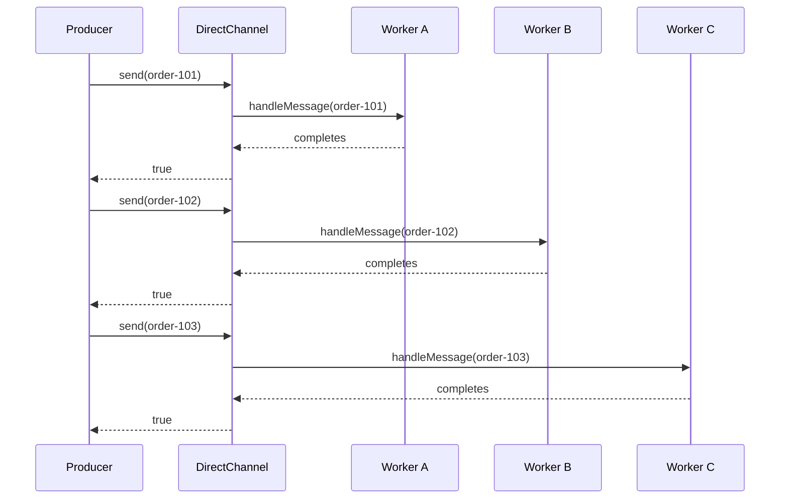

# RoundRobinLoadBalancingStrategy

In the **SPRING_INTEGRATION_CORE** module, this lesson explains how `DirectChannel` distributes messages across multiple endpoints serving the same role using `RoundRobinLoadBalancingStrategy`. The running example uses three workers receiving order-processing requests. Each request needs one worker to succeed; all workers provide the same business capability.

After this lesson, you can explain the worker selection order, configure round-robin in Java, attach multiple Java DSL branches to the same channel, and predict what happens when a worker throws an exception.

The examples use Spring Integration 6.x APIs, using 6.5 as the reference baseline, along with Java 17 and JUnit Jupiter for the illustrative tests. The project needs the `org.springframework.integration:spring-integration-core` dependency; its version should be managed by the project's BOM. Plain Java examples do not require booting Spring Boot.

## 1. Where Does the Strategy Sit in the Message Flow?

A `Message<?>` contains a payload and headers. When `send(message)` is called on a `DirectChannel`, the channel delegates dispatching to `UnicastingDispatcher`. The dispatcher obtains an ordering of `MessageHandler` instances from the strategy, invokes a handler, and decides whether to stop or try another handler on error.

| Component | Responsibility in the order example |
| --- | --- |
| Producer or messaging gateway | Creates the request and sends it to the channel |
| `DirectChannel` | Connects the producer with in-process subscribers |
| `UnicastingDispatcher` | Executes message delivery in candidate order |
| `RoundRobinLoadBalancingStrategy` | Rotates the starting position of the candidate list |
| Endpoint / `MessageHandler` | Performs the order-processing business logic |

The contract of `LoadBalancingStrategy` returns an `Iterator<MessageHandler>` via `getHandlerIterator(Message<?> message, Collection<MessageHandler> handlers)`. Thus, the strategy describes **the order in which handlers may be tried**, while the dispatcher is what invokes the handlers. See [LoadBalancingStrategy API](https://docs.spring.io/spring-integration/docs/6.5.0/api/org/springframework/integration/dispatcher/LoadBalancingStrategy.html).

When there are no errors, sending three messages can proceed as follows:



The diagram assumes three subscribers were registered in order A, B, C, no prior messages were sent, all remain registered throughout sending, and all process successfully.

## 2. Starting-Point Rotation Mechanism

Suppose the stable subscriber set is `[A, B, C]`. The strategy produces the following candidate orders:

| Dispatch turn | Candidate order | Handler invoked if first candidate succeeds |
| --- | --- | --- |
| 1 | A → B → C | A |
| 2 | B → C → A | B |
| 3 | C → A → B | C |
| 4 | A → B → C | A |
| 5 | B → C → A | B |
| 6 | C → A → B | C |

With `n >= 2` subscribers and turns numbered from `k = 0`, you can model the first position as `k mod n`. This is a learning model under a fixed subscriber set; do not use it to hold business state.

The starting point advances by one position each time the strategy is asked to generate a new ordering. A failover from A to B still happens within the current message's iterator. It does not turn into a new dispatch turn.

For instance, if the first message tries A and then succeeds on B, the next message still starts at B according to the established cycle. Consequently, actual handler invocation counts can skew even when first-chosen turn counts are nearly equal. Iterator rotation is shown in [RoundRobinLoadBalancingStrategy 6.5.0 source](https://raw.githubusercontent.com/spring-projects/spring-integration/v6.5.0/spring-integration-core/src/main/java/org/springframework/integration/dispatcher/RoundRobinLoadBalancingStrategy.java).

### 2.1. Understanding "Balancing" Correctly

With six requests that all succeed immediately, each worker in the example receives two requests. If only eight requests are sent, the distribution might be three for A, three for B, and two for C. This is distribution by selection turn.

If A's average processing time is 10 ms while B's is 500 ms, the same number of requests still produces different workloads and latencies. Deduced from the turn-based selection model: round-robin is not enough to solve capacity disparities between workers. You must evaluate processing time, resource limits, and the execution model of the entire flow.

Another business requirement might be "every message with the same `orderId` must go to the same worker". A rotating starting position does not satisfy that. When that requirement exists, design routing or partitioning by business key and clearly define ordering requirements.

### 2.2. Subscriber Count and Lifecycle

| Channel state | Interpretation |
| --- | --- |
| No subscribers yet | No worker receives messages; sending raises a dispatch error |
| One subscriber | Every message goes to that subscriber; no multi-worker distribution effect yet |
| Multiple subscribers | Rotation of selection becomes observable |
| Subscribers added or removed | Stop predicting based on the old A, B, C cycle |
| Channel and strategy recreated | Do not treat the previous cycle's position as restored state |

In the reference source code, the dispatcher has an optimized fast path when there is only one handler. Therefore, do not try to infer the internal position after transitioning from one to multiple subscribers simply by counting every `send()` call. Examples needing deterministic order should register all subscribers before starting to send. See [UnicastingDispatcher 6.5.0](https://raw.githubusercontent.com/spring-projects/spring-integration/v6.5.0/spring-integration-core/src/main/java/org/springframework/integration/dispatcher/UnicastingDispatcher.java).

## 3. Java Configuration and Standalone Runnable Example

`new DirectChannel()` already uses `RoundRobinLoadBalancingStrategy` by default. You can pass the strategy to the constructor when you want to express the choice explicitly. Each channel should have its own strategy instance so distribution cycles remain independent. See [DirectChannel API](https://docs.spring.io/spring-integration/docs/current/api/org/springframework/integration/channel/DirectChannel.html).

The following example directly registers three `MessageHandler` instances. Disabling failover helps isolate rotation behavior in a first hands-on run.

```java
import org.springframework.integration.channel.DirectChannel;
import org.springframework.integration.dispatcher.RoundRobinLoadBalancingStrategy;
import org.springframework.messaging.MessageHandler;
import org.springframework.messaging.support.GenericMessage;

public final class OrderRoundRobinDemo {

    public static void main(String[] args) {
        DirectChannel orders = new DirectChannel(
                new RoundRobinLoadBalancingStrategy());
        orders.setFailover(false);

        orders.subscribe(worker("A"));
        orders.subscribe(worker("B"));
        orders.subscribe(worker("C"));

        for (int number = 101; number <= 106; number++) {
            boolean delivered = orders.send(
                    new GenericMessage<>("order-" + number));
            if (!delivered) {
                throw new IllegalStateException("Message was not delivered");
            }
        }
    }

    private static MessageHandler worker(String workerId) {
        return message -> System.out.printf(
                "%s processed %s on thread %s%n",
                workerId,
                message.getPayload(),
                Thread.currentThread().getName());
    }
}
```

Expected output when run directly from `main`:

```text
A processed order-101 on thread main
B processed order-102 on thread main
C processed order-103 on thread main
A processed order-104 on thread main
B processed order-105 on thread main
C processed order-106 on thread main
```

Replacing the constructor with `new DirectChannel()` still lets you observe the distribution cycle in an error-free example. Calling `setFailover(false)` is an intentional practice setting; by default, the channel allows failover. See [DirectChannel Configuration](https://docs.spring.io/spring-integration/reference/channel/configuration.html#channel-configuration-directchannel).

The `true` value returned from `send()` in the example indicates that dispatch succeeded. It does not contain business computation results. If you need to return an order-processing result, design a request-reply flow and use a gateway with an appropriate return type.

## 4. Round-Robin Does Not Automatically Create Parallel Processing

`DirectChannel` invokes the handler directly on the sending thread and only returns from `send()` when synchronous processing finishes or throws an exception. In the example of a single producer sending in a loop, `order-102` is only sent after sending `order-101` has returned. See [DirectChannel Semantics](https://docs.spring.io/spring-integration/reference/6.5/channel/implementations.html#channel-implementations-directchannel).

You can verify the difference with two scenarios:

| Scenario | Consequence for the example |
| --- | --- |
| One producer sending sequentially, worker B takes a long time | The send loop must wait for B; the next message has not started yet |
| Multiple producers sending from multiple threads | Handler invocations may overlap across different sends |

From this come two design requirements:

1. Do not increase the number of subscribers and assume a sequential producer will automatically process faster. Measure total send time because business logic runs inside that call.
2. If there are multiple concurrent producers, ensure workers and shared resources can tolerate concurrent calls. Three subscribers does not mean the system has at most three in-flight calls.

The reference strategy source uses an atomic counter for the rotation index. That protects selecting the position; it does not lock the whole handler, does not enforce business completion order, and does not make a shared `ArrayList` thread-safe. This is a consequence of combining positional selection with the channel's synchronous invocation.

For example, two threads pick A and B in turn, yet A takes 800 ms and B takes 20 ms. Completion logs may show B before A. When testing concurrency, reading completion logs alone is not enough to conclude the strategy chose the wrong order.

If the problem requires offloading processing to an executor, consider `ExecutorChannel`; if buffering is needed, consider a queue-backed channel. Changing the channel must be accompanied by redesigning error flows, ordering, and transactions. In particular, keeping the same thread via `DirectChannel` allows participating in an existing transaction; the channel does not open a business transaction on its own.

## 5. Combining Round-Robin with Failover

Round-robin determines the first candidate and subsequent order. Failover determines whether to keep trying remaining candidates after an exception. The dispatcher stops when one handler returns normally. This is a unicast mechanism: one successful handler ends the dispatch, even if earlier handlers were invoked and failed. See [UnicastingDispatcher](https://raw.githubusercontent.com/spring-projects/spring-integration/v6.5.0/spring-integration-core/src/main/java/org/springframework/integration/dispatcher/UnicastingDispatcher.java).

### 5.1. An Example with Failures

```java
import java.util.ArrayList;
import java.util.List;

import org.springframework.integration.channel.DirectChannel;
import org.springframework.messaging.support.GenericMessage;

public final class OrderFailoverDemo {

    public static void main(String[] args) {
        DirectChannel orders = new DirectChannel();
        orders.setFailover(true);
        List<String> attempts = new ArrayList<>();

        orders.subscribe(message -> {
            attempts.add("A:" + message.getPayload());
            throw new IllegalStateException("Worker A is failing");
        });
        orders.subscribe(message ->
                attempts.add("B:" + message.getPayload()));
        orders.subscribe(message ->
                attempts.add("C:" + message.getPayload()));

        orders.send(new GenericMessage<>("order-201"));
        orders.send(new GenericMessage<>("order-202"));
        orders.send(new GenericMessage<>("order-203"));

        attempts.forEach(System.out::println);
    }
}
```

Omitting error logs written by the framework, the expected `attempts` list is:

```text
A:order-201
B:order-201
B:order-202
C:order-203
```

Explanation according to the model in section 2:

- `order-201` starts at A, A throws an exception, the dispatcher tries B and stops when B succeeds.
- `order-202` starts at B according to the rotation cycle, even though B just processed `order-201`.
- `order-203` starts at C.

`ArrayList` here is only for the single-threaded sequential send example. If switching to multiple producers, replace the recording structure with a concurrency-safe one.

If changed to `orders.setFailover(false)`, `order-201` fails at A and the exception propagates to the caller. The program as written would halt on the first send without a `try/catch`.

### 5.2. Common Configurations

| Configuration | Starting point | When a handler throws an exception |
| --- | --- | --- |
| `new DirectChannel()` | Rotates | May try remaining candidates |
| Round-robin with `setFailover(false)` | Rotates | Stops that dispatch and reports error |
| `new DirectChannel(null)` with default failover | Always starts in subscriber order | May move to next candidate |
| No load balancing and failover disabled | Always starts in subscriber order | Reports error immediately from first handler |

When you want a primary worker always prioritized before a backup worker, disable load balancing, define explicit endpoint ordering, and configure failover. If round-robin remains enabled, the backup worker will still take initial turns even while the primary worker is healthy.

Since Spring Integration 6.3, you can use `setFailoverStrategy(Predicate<Exception>)` to decide based on the exception. Configuring a predicate and `setFailover(boolean)` overwrite each other; choose one deliberately. The predicate should inspect both wrapped exceptions and root causes if your endpoints wrap errors. See [DirectChannel failover configuration API](https://docs.spring.io/spring-integration/docs/current/api/org/springframework/integration/channel/DirectChannel.html#setFailoverStrategy(java.util.function.Predicate)).

### 5.3. Side-Effect Risks and Swallowing Errors

Suppose worker A successfully calls a shipment creation service, then fails while writing a business log. When the exception reaches the dispatcher and failover is enabled, worker B may call the shipment creation service again for the same order. Thus, a successful dispatch does not prove every side effect occurred only once.

In this situation, use a business-request idempotency key, identify which operations can be repeated, and decide whether failover should be allowed after that operation. Disabling failover also does not replace idempotency design if callers or upstream systems can still resend messages.

Another case: A catches the exception, logs it, and returns normally. The dispatcher sees the handler finished normally and has no signal to try B. The same applies when an endpoint hands work off asynchronously and returns before an error happens: a later error no longer belongs to the original handler call to trigger failover here.

Failover only switches to another subscriber within a single dispatch. If you need to call the same handler again after a delay, that is a separate retry requirement needing an appropriate policy and bounds.

## 6. Multiple Java DSL Branches Receiving from One DirectChannel

In a Spring application, workers are typically endpoints created from `IntegrationFlow`. To have them compete for messages, the flows must start from **the exact same channel instance**. Java DSL registers channels and endpoints into the application context; see [Java DSL](https://docs.spring.io/spring-integration/reference/dsl.html).

```java
import org.springframework.context.annotation.Bean;
import org.springframework.context.annotation.Configuration;
import org.springframework.integration.channel.DirectChannel;
import org.springframework.integration.config.EnableIntegration;
import org.springframework.integration.dsl.IntegrationFlow;
import org.springframework.messaging.MessageHandler;

@Configuration
@EnableIntegration
public class OrderWorkersConfiguration {

    @Bean
    public DirectChannel orderWork() {
        DirectChannel channel = new DirectChannel();
        channel.setFailover(false);
        return channel;
    }

    @Bean
    public IntegrationFlow workerAFlow(DirectChannel orderWork) {
        return IntegrationFlow.from(orderWork)
                .handle((MessageHandler) message ->
                        process("A", (String) message.getPayload()))
                .get();
    }

    @Bean
    public IntegrationFlow workerBFlow(DirectChannel orderWork) {
        return IntegrationFlow.from(orderWork)
                .handle((MessageHandler) message ->
                        process("B", (String) message.getPayload()))
                .get();
    }

    @Bean
    public IntegrationFlow workerCFlow(DirectChannel orderWork) {
        return IntegrationFlow.from(orderWork)
                .handle((MessageHandler) message ->
                        process("C", (String) message.getPayload()))
                .get();
    }

    private static void process(String workerId, String orderId) {
        System.out.printf("Worker %s received %s%n", workerId, orderId);
    }
}
```

After the context starts and the endpoints have subscribed, you can obtain the `orderWork` bean and send `GenericMessage<String>` instances as in the earlier example. In an error-free cycle with a stable set of endpoints, workers will receive turns in rotation. To test the exact order A → B → C, control subscriber order explicitly; do not treat the declaration order of `@Bean` methods as a business ordering contract.

The `process` methods simulate the same business logic across three workers. In real deployment, replace them with a processing service and ensure all workers accept the same payload type. The handlers in the example are one-way consumers; they do not produce reply messages.

You can place a messaging gateway on the producer side:

```java
import org.springframework.integration.annotation.MessagingGateway;

@MessagingGateway(defaultRequestChannel = "orderWork")
public interface OrderSubmissionGateway {
    void submit(String orderId);
}
```

Register this interface using `@IntegrationComponentScan` in the appropriate package or your application's gateway registration mechanism. The gateway sends to `orderWork`; the worker selection mechanism still belongs to the channel and dispatcher. The `void` return type fits the one-way consumers above. If you change the gateway to another return type, you must design the corresponding reply path.

### 6.1. Distinguishing Competition from a Pipeline

The following two structures have different meanings:

```text
Competing processing:
orderWork ── pick one ──> workerAFlow
                      ├> workerBFlow
                      └> workerCFlow

Business pipeline:
input -> transform -> filter -> service activator -> output
```

In a pipeline, each step performs one stage on the same message along a designed path. With multiple subscribers on `orderWork`, round-robin picks one worker among the candidates. If A is an order-validation step and B is an inventory-deduction step, placing A and B in competition on the same `DirectChannel` would make each request go through only one stage when there are no errors.

A filter that is selected and discards a message without throwing an exception also does not cause the dispatcher to forward the message to the next worker. The handler's normal completion is enough for the dispatcher to stop that delivery. If you need to choose a branch based on payload or headers, use a router; if every branch must receive the event, design publish-subscribe.

## 7. Where Do Errors Propagate?

With a direct `orderWork.send(message)` call, unhandled synchronous errors propagate back to the caller. Merely setting the `errorChannel` header does not make `DirectChannel` catch every exception and publish an `ErrorMessage`. A gateway or other error-handling mechanisms can add custom behavior; distinguish them from the channel itself. See [Error Handling](https://docs.spring.io/spring-integration/reference/error-handling.html).

One way to observe errors at the producer:

```java
import org.springframework.messaging.MessagingException;
import org.springframework.messaging.support.GenericMessage;

// orderWork is the DirectChannel bean injected into the producer.
try {
    orderWork.send(new GenericMessage<>("order-301"));
}
catch (MessagingException exception) {
    System.err.println("Could not deliver order-301: " + exception.getMessage());
    // Business decision: notify caller, record error, or send to recovery flow.
}
```

Distinguish at least three situations when diagnosing: no subscribers yet, first handler fails with failover disabled, or all tried candidates fail. The outer exception type also depends on framework wrapping and aggregation across attempts; inspect the root cause instead of relying on a fixed message string.

If the flow downstream of a worker performs further synchronous processing and throws an exception back to the handler call, failover may try another worker even though part of the earlier work already ran. When defining recovery boundaries, examine the entire synchronous segment following the subscriber.

## 8. Testing Behavior with Small Examples

The tests below are practice code for a project with JUnit Jupiter. They create a separate channel in each test, send sequentially, keep subscribers unchanged, and observe external behavior. Starting an application context is unnecessary to test the basic dispatch algorithm.

```java
import java.util.ArrayList;
import java.util.List;

import org.junit.jupiter.api.Test;
import org.springframework.integration.channel.DirectChannel;
import org.springframework.messaging.MessagingException;
import org.springframework.messaging.support.GenericMessage;

import static org.junit.jupiter.api.Assertions.assertEquals;
import static org.junit.jupiter.api.Assertions.assertThrows;
import static org.junit.jupiter.api.Assertions.assertTrue;

class OrderRoundRobinTest {

    @Test
    void rotatesAcrossThreeStableSubscribers() {
        DirectChannel channel = new DirectChannel();
        channel.setFailover(false);
        List<String> accepted = new ArrayList<>();

        channel.subscribe(message -> accepted.add("A:" + message.getPayload()));
        channel.subscribe(message -> accepted.add("B:" + message.getPayload()));
        channel.subscribe(message -> accepted.add("C:" + message.getPayload()));

        for (int number = 1; number <= 6; number++) {
            assertTrue(channel.send(new GenericMessage<>(number)));
        }

        assertEquals(List.of("A:1", "B:2", "C:3", "A:4", "B:5", "C:6"),
                accepted);
    }

    @Test
    void failoverDoesNotMoveTheNextMessagesStartingPoint() {
        DirectChannel channel = new DirectChannel();
        channel.setFailover(true);
        List<String> attempts = new ArrayList<>();

        channel.subscribe(message -> {
            attempts.add("A:" + message.getPayload());
            throw new IllegalStateException("A unavailable");
        });
        channel.subscribe(message -> attempts.add("B:" + message.getPayload()));
        channel.subscribe(message -> attempts.add("C:" + message.getPayload()));

        assertTrue(channel.send(new GenericMessage<>(1)));
        assertTrue(channel.send(new GenericMessage<>(2)));
        assertTrue(channel.send(new GenericMessage<>(3)));

        assertEquals(List.of("A:1", "B:1", "B:2", "C:3"), attempts);
    }

    @Test
    void disabledFailoverDoesNotInvokeAnotherSubscriber() {
        DirectChannel channel = new DirectChannel();
        channel.setFailover(false);
        List<String> attempts = new ArrayList<>();

        channel.subscribe(message -> {
            attempts.add("A");
            throw new IllegalStateException("A unavailable");
        });
        channel.subscribe(message -> attempts.add("B"));

        assertThrows(MessagingException.class,
                () -> channel.send(new GenericMessage<>("order-401")));
        assertEquals(List.of("A"), attempts);
    }
}
```

The first test checks the distribution cycle under an explicit subscriber order. The second test distinguishes rotating the starting point from selecting a backup candidate. The last test verifies that disabling failover changes error behavior without coupling to exception message wording.

To expand practice, you can test sending with no subscribers, all workers failing, and changing the subscriber count between two send batches. For concurrency tests, collect results using thread-safe structures and wait for task completion with an appropriate synchronization mechanism; do not use completion log order as proof of worker selection order.

## 9. When Should You Choose Round-Robin?

Round-robin fits situations where workers provide the same service, accept the same valid message types, and have no requirement to pin messages to a fixed worker by key. Also define error handling before enabling failover for operations with side effects.

| Business need | Design direction |
| --- | --- |
| Share turns among workers with the same role in one process | `DirectChannel` with round-robin |
| Always prioritize primary worker before backup worker | Disable load balancing, define ordering, and configure failover |
| Choose a flow by order status or order type | Router based on payload/headers |
| Let every subscriber receive the same event | `PublishSubscribeChannel` |
| Offload processing to a thread pool | Consider `ExecutorChannel` and executor policies |
| Absorb request bursts | Design a queue, capacity, and overflow policy |
| Preserve affinity by business key | Design key-based partitioning/routing |
| Distribute across multiple application instances | Use messaging infrastructure or cross-process distribution |

The table is a design guide derived from the analyzed differences; each choice must also meet the application's data durability, latency, and ordering requirements.

`RoundRobinLoadBalancingStrategy` operates on a channel's local handler list. If three application instances run, each instance has its own channel and distribution cycle. Balancing requests across three instances must be designed at the inter-process boundary; a selection cycle within one JVM does not provide that.

## 10. Key Takeaways

- The strategy rotates which handler is tried first and supplies the candidate ordering to the dispatcher.
- `DirectChannel` defaults to round-robin and failover enabled; these two behaviors can be configured independently.
- A message can be tried on multiple handlers on error, but the dispatcher stops at the first successful handler.
- Turn-based distribution does not guarantee equal processing time, completion order, or key-pinned worker affinity.
- The same channel instance must be shared among competing endpoints; sequential business steps need an explicit pipeline.
- Side effects, retries, and idempotency must be designed per business requirements; successful dispatch does not guarantee exactly-once processing.
