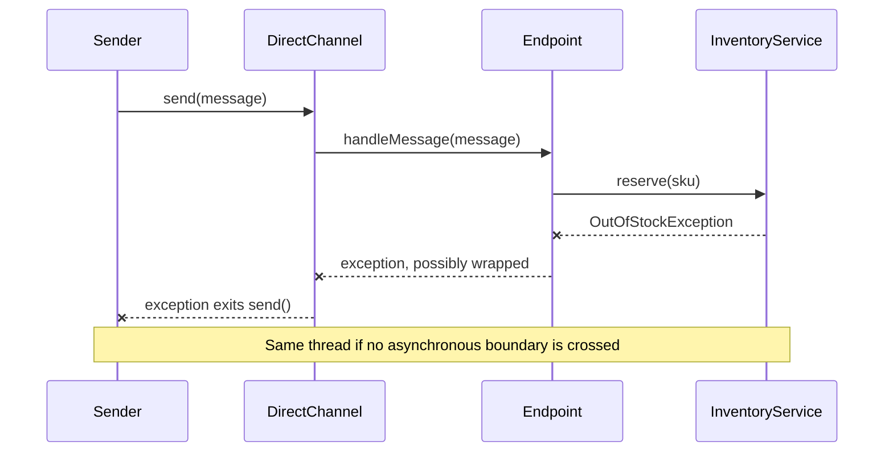

# Exceptions Propagate Back to the Sender

## Objectives and Scope

In the **DirectChannel** chapter of the **SPRING_INTEGRATION_CORE** module, this lesson explains why errors in a consumer can surface directly at the message send call. You will practice with `Message`, `MessageChannel`, endpoints, and Java DSL, while also identifying the error-handling responsibilities of senders and gateways.

After this lesson, you can:

- Trace the path of an exception in a synchronous flow.
- Catch errors at `send()`, preserve the root cause, and locate the failing message.
- Distinguish thrown exceptions from an `ErrorMessage` sent over a channel.
- Recognize the impact of failover, retry, transactions, and asynchronous boundaries.
- Write tests that express the error contract callers actually observe.

The Spring examples use Spring Integration 6.5.x APIs and Java 17 or later. The JUnit examples use JUnit Jupiter. When applying these to a project, use the compatible Spring dependency set managed by your project.

## 1. Mechanism: `send()` Is on the Consumer's Call Stack

`DirectChannel` invokes subscribers on the exact thread sending the message; `send()` waits for the handler call to finish. Therefore, unhandled exceptions have a direct path back to the sender through the Java call stack. [DirectChannel API](https://docs.spring.io/spring-integration/docs/6.5.1/api/org/springframework/integration/channel/DirectChannel.html)

Consider an inventory reservation flow:

```text
OrderService.submit()
  └─ orders.send(message)
       └─ dispatcher
            └─ endpoint.handleMessage(message)
                 └─ InventoryService.reserve(sku)
                      └─ throw OutOfStockException
```

If intermediate layers do not recover from or swallow the error, `submit()` observes the failure during the `send()` call. No other thread is needed to relay the exception back.



In the diagram, the error arrows represent unwinding the call stack, not a message traveling through a separate channel.

Conditions to check when reasoning that "errors propagate back to the sender":

1. The handler is executing synchronously within the current call chain.
2. The error occurs before that call chain finishes.
3. No component catches the error and recovers successfully.
4. No other subscriber succeeds via failover.

In the initial examples, there is only one subscriber and failover is disabled so the direct error path can be observed.

## 2. Minimal Example: Catching Errors Right at `send()`

The following example constructs `MessageHandlingException` explicitly to separate exception propagation from endpoint wrapping mechanics.

```java
import org.springframework.integration.channel.DirectChannel;
import org.springframework.messaging.Message;
import org.springframework.messaging.MessageHandlingException;
import org.springframework.messaging.MessagingException;
import org.springframework.messaging.support.MessageBuilder;

public class DirectExceptionDemo {

    public static void main(String[] args) {
        DirectChannel orders = new DirectChannel();
        orders.setFailover(false);

        Thread senderThread = Thread.currentThread();

        orders.subscribe(message -> {
            System.out.println(
                    "Same thread: "
                            + (Thread.currentThread() == senderThread));

            throw new MessageHandlingException(
                    message,
                    "Reservation failed",
                    new IllegalStateException("SKU-404 is out of stock"));
        });

        Message<String> request = MessageBuilder
                .withPayload("SKU-404")
                .setHeader("orderId", "ORD-1001")
                .build();

        try {
            orders.send(request);
            System.out.println("This line does not run when the handler throws");
        }
        catch (MessagingException ex) {
            Message<?> failed = ex.getFailedMessage();

            System.out.println(
                    "Error type: " + ex.getClass().getSimpleName());
            System.out.println(
                    "Cause: " + ex.getCause().getMessage());
            System.out.println(
                    "Order: " + failed.getHeaders().get("orderId"));
        }
    }
}
```

Expected primary output:

```text
Same thread: true
Error type: MessageHandlingException
Cause: SKU-404 is out of stock
Order: ORD-1001
```

Internal framework log lines, if enabled, may also appear.

Two points should be distinguished:

- In this example, the lambda itself constructs `MessageHandlingException`.
- In an application using a service activator, the service typically throws a business exception; the endpoint may wrap it before the sender receives it.

Thus, the example does not imply that every `RuntimeException` in every kind of handler exits with the exact same wrapper class.

### Does Returning a `boolean` from `send()` Replace `try/catch`?

No. Distinguish returning a value from terminating with an exception:

```java
try {
    boolean sent = orders.send(request);

    if (!sent) {
        // Runs only if send() finishes normally and returns false.
    }
}
catch (MessagingException ex) {
    // When an exception exits, there is no return value to inspect.
    throw ex;
}
```

Do not build an error-handling contract solely on `if (!sent)`. Depending on the channel and interceptors, `false` can mean delivery could not occur or sending was blocked; it does not substitute for exceptions.

Similarly, the timeout parameter in `send(message, timeout)` is not a mechanism to forcibly terminate a synchronous handler after that duration. If a handler makes network calls, timeouts must be configured on the corresponding network client.

## 3. Distinguishing Business Errors from Messaging Errors

`MessagingException` is a `RuntimeException`. It can carry `failedMessage` and a cause chain via `getCause()`. `getFailedMessage()` may return `null`, so general-purpose code should check before using it. [MessagingException API](https://docs.spring.io/spring-framework/docs/current/javadoc-api/org/springframework/messaging/MessagingException.html)

Examples of common error classes:

| Error class | Meaning to investigate |
| --- | --- |
| Application-defined `OutOfStockException` | Business rule rejected the reservation |
| `MessageHandlingException` | Failure while an endpoint processed a message |
| `MessageDeliveryException` | Failure related to delivering the message |
| `MessageDispatchingException` | Dispatcher could not dispatch the message |
| `AggregateMessageDeliveryException` | Multiple failures occurred across subscriber attempts |

This table guides diagnosis; it does not guarantee the outermost exception class in every configuration. For instance, a dispatcher may throw an error and the channel layer may wrap it further.

### Do Not Assume `cause` Has Only One Level

One way to locate a business error in the cause chain:

```java
static <T extends Throwable> T findCause(
        Throwable failure, Class<T> expectedType) {

    Throwable current = failure;

    while (current != null) {
        if (expectedType.isInstance(current)) {
            return expectedType.cast(current);
        }

        Throwable next = current.getCause();
        if (next == current) {
            break;
        }
        current = next;
    }

    return null;
}
```

This helper handles standard cause chains; it does not traverse component error lists inside an aggregate exception. When using failover with multiple consumers, also inspect the failures exposed by the aggregate exception.

Do not classify business errors by comparing `ex.getMessage()` against a fixed string. That text is meant for diagnostics and can change due to wrappers.

### Is `failedMessage` Always the Original Message?

Not necessarily. In the flow:

```text
Message<OrderRequest>
  → transformer
  → Message<ReservationCommand>
  → service activator throws error
```

The message attached to the error at the final endpoint may contain `ReservationCommand`. When traceability is needed, place `orderId` or `correlationId` in headers and preserve them across transformation steps.

When logging, typically only the business ID, endpoint name, and cause are needed. Do not log entire payloads or headers containing credentials by default.

## 4. Practice with Endpoints and Java DSL

In Java DSL, `.handle(service, "method")` represents a service activator. The service can be a POJO that receives the payload and throws a business exception when a request is invalid. [Service Activator](https://docs.spring.io/spring-integration/reference/6.5/service-activator.html)

### Configuring the Reservation Flow

Place the following configuration class in `DirectErrorConfig.java`:

```java
import org.springframework.beans.factory.annotation.Qualifier;
import org.springframework.context.annotation.Bean;
import org.springframework.context.annotation.Configuration;
import org.springframework.integration.channel.DirectChannel;
import org.springframework.integration.config.EnableIntegration;
import org.springframework.integration.dsl.IntegrationFlow;

@Configuration
@EnableIntegration
public class DirectErrorConfig {

    @Bean
    public DirectChannel orders() {
        DirectChannel channel = new DirectChannel();
        channel.setFailover(false);
        return channel;
    }

    @Bean
    public InventoryService inventoryService() {
        return new InventoryService();
    }

    @Bean
    public IntegrationFlow reserveFlow(
            @Qualifier("orders") DirectChannel orders,
            InventoryService inventoryService) {

        return IntegrationFlow
                .from(orders)
                .handle(inventoryService, "reserve")
                .get();
    }

    public static class InventoryService {

        public void reserve(String sku) {
            if ("SKU-404".equals(sku)) {
                throw new OutOfStockException(
                        "Out of stock for " + sku);
            }

            System.out.println("Reserved inventory: " + sku);
        }
    }

    public static class OutOfStockException extends RuntimeException {

        public OutOfStockException(String message) {
            super(message);
        }
    }
}
```

In this simulation, `SKU-404` is always out of stock; other SKUs are accepted. This is a data rule for observing errors, not a real inventory implementation.

The `reserve()` method returns `void`, because this flow only executes a reservation command. It produces no reply and does not need a `replyChannel` to finish normally.

### Calling the Flow from a Sender

The following class uses the configuration above and the `findCause()` helper from section 3:

```java
import org.springframework.context.annotation.AnnotationConfigApplicationContext;
import org.springframework.messaging.Message;
import org.springframework.messaging.MessageChannel;
import org.springframework.messaging.MessagingException;
import org.springframework.messaging.support.MessageBuilder;

public class ReserveSender {

    public static void main(String[] args) {
        try (var context =
                     new AnnotationConfigApplicationContext(
                             DirectErrorConfig.class)) {

            MessageChannel orders =
                    context.getBean("orders", MessageChannel.class);

            Message<String> request = MessageBuilder
                    .withPayload("SKU-404")
                    .setHeader("orderId", "ORD-1002")
                    .build();

            try {
                orders.send(request);
            }
            catch (MessagingException ex) {
                DirectErrorConfig.OutOfStockException businessFailure =
                        findCause(
                                ex,
                                DirectErrorConfig.OutOfStockException.class);

                if (businessFailure == null) {
                    throw ex;
                }

                System.out.println(
                        "Order rejected: " + businessFailure.getMessage());
            }
        }
    }

    // Place the findCause() helper from section 3 here.
}
```

The example catches the out-of-stock error and treats it as a rejection outcome handled by the sender. For unrecognized errors, the sender rethrows the wrapper to preserve context.

If the requirement is "any reservation failure must fail the outer operation", the sender must rethrow even the out-of-stock error. The policy inside `catch` is part of the business contract.

### Java DSL Does Not Automatically Create Separate Threads

`IntegrationFlow` describes wiring between endpoints and channels. Using the DSL does not decide whether a flow is synchronous or asynchronous; you must examine the actual channels and components in the flow. [DSL Basics](https://docs.spring.io/spring-integration/reference/dsl/java-basics.html)

Two diagrams lead to two different ways of observing errors:

```text
Sender → DirectChannel → transform → DirectChannel → handle
         └──────── synchronous call chain continues ──────────┘

Sender → DirectChannel → handle → QueueChannel → poller → handle
         └── initial call chain ──┘              └─ separate call
```

In the second diagram, an error in the handler after the poller cannot unwind a sender call stack that has already finished. Errors before the enqueue step can still propagate back to the current send call.

## 5. `errorChannel` Does Not Automatically Catch Errors for Every DirectChannel

Sending directly via `MessageChannel` or `MessagingTemplate` still returns errors to the caller when a synchronous consumer throws. Publishing an `ErrorMessage` requires an error-handling component to participate; the `errorChannel` header alone does not install such a component. [Error Handling](https://docs.spring.io/spring-integration/reference/error-handling.html)

For example, attaching an error-receiving channel to a message:

```java
import org.springframework.integration.channel.QueueChannel;
import org.springframework.messaging.Message;
import org.springframework.messaging.support.MessageBuilder;

QueueChannel errors = new QueueChannel();

Message<String> request = MessageBuilder
        .withPayload("SKU-404")
        .setErrorChannel(errors)
        .build();

// orders is the DirectChannel from DirectErrorConfig.
// This call still throws MessagingException.
orders.send(request);
```

In the configuration under consideration, there is no gateway or advice catching the error to route it to `errors`. Therefore, the sender must use `try/catch`; it cannot simply wait for an `ErrorMessage` to appear.

`ErrorMessage` is a message whose payload is a `Throwable`. It is data sent by a component, distinct from a Java `throw` operation.

### You Can Both Send an `ErrorMessage` and Rethrow

When explicitly choosing a policy of "report the error separately, while the current call still fails", the sender can write:

```java
import org.springframework.messaging.MessagingException;
import org.springframework.messaging.support.ErrorMessage;

try {
    orders.send(request);
}
catch (MessagingException processingFailure) {
    try {
        boolean published =
                errors.send(new ErrorMessage(processingFailure));

        if (!published) {
            processingFailure.addSuppressed(
                    new IllegalStateException(
                            "Could not send error notification"));
        }
    }
    catch (RuntimeException reportingFailure) {
        if (reportingFailure != processingFailure) {
            processingFailure.addSuppressed(reportingFailure);
        }
    }

    throw processingFailure;
}
```

This is a policy written explicitly by the application. It also preserves the original processing error if the notification step fails. If notification errors need different priority, define that contract before changing the code.

For `errors` to be useful in a real application, there must be a consumer or process reading it. Enqueuing successfully only confirms the notification entered the queue, not that anyone processed it.

## 6. Going Through a Gateway: Same Execution Path, Additional Error Policy

A messaging gateway creates a business-facing call interface. Example:

```java
import org.springframework.integration.annotation.MessagingGateway;

@MessagingGateway(defaultRequestChannel = "orders")
public interface OrderGateway {

    void reserve(String sku);
}
```

When using annotations in an application, configure gateway scanning, such as `@IntegrationComponentScan` on a configuration class for the package containing the interface. The interface alone is not enough to create a proxy.

With a synchronous gateway, a `void` method does not mean background execution. The call can still fail before returning.

By default, a gateway can unwrap wrappers to throw the business error to the caller. `throws` declarations participate in deciding which exception is surfaced. A gateway also supports `errorChannel` to turn errors into appropriate responses or handle them with a dedicated policy. [Messaging Gateways — Error Handling](https://docs.spring.io/spring-integration/reference/gateway.html#error-handling)

With the gateway above and the reservation configuration shown, calling code can catch the business exception:

```java
try {
    gateway.reserve("SKU-404");
}
catch (DirectErrorConfig.OutOfStockException ex) {
    // Decide to reject the request at the application boundary.
}
```

Do not blindly copy the expected exception type from an `orders.send()` test into a `gateway.reserve()` test. The two entry points can surface errors differently.

If the gateway turns an error into a business response, test the returned data as well. If an error flow merely logs and finishes, determine what happens to a call waiting for a reply. A `void` reservation flow is also incompatible with a gateway expecting a receipt unless a reply-producing step is added.

## 7. Failover: One Failing Consumer Does Not Always Mean Sender Failure

`DirectChannel` defaults to round-robin and enables failover. Failover can be disabled with `setFailover(false)`. Disabling load balancing via constructor `new DirectChannel(null)` is a separate action. [DirectChannel Configuration](https://docs.spring.io/spring-integration/reference/channel/configuration.html)

When multiple subscribers exist, the dispatcher can try another consumer if the previous one fails. One consumer accepting the message ends dispatch successfully. [UnicastingDispatcher API](https://docs.spring.io/spring-integration/docs/6.5.1/api/org/springframework/integration/dispatcher/UnicastingDispatcher.html)

Example intentionally fixing the attempt order:

```java
DirectChannel processing = new DirectChannel(null);
processing.setFailover(true);

processing.subscribe(message -> {
    System.out.println("Consumer A failed");
    throw new MessageHandlingException(
            message, "A could not process");
});

processing.subscribe(message -> {
    System.out.println("Consumer B succeeded");
});

boolean sent = processing.send(
        MessageBuilder.withPayload("ORD-1003").build());

// sent == true; sender does not receive A's error through this call.
```

Observation points at the sender:

| Situation | What the sender may see |
| --- | --- |
| Single subscriber, error exits handler | Exception at `send()` |
| Multiple subscribers, failover disabled, chosen subscriber fails | Exception; next subscriber is not tried |
| Failover enabled, next subscriber succeeds | `send()` returns success |
| Failover enabled, all tried subscribers fail | Exception, possibly carrying multiple failures |
| Handler catches error and finishes normally | Channel does not know business processing just failed |

Failover is not retrying the same operation. It picks a different subscriber for the same message. If subscribers perform different business actions, using them as alternatives breaks the design.

For example, if A already recorded one reservation before failing, B may perform the reservation again. From this, you must examine idempotency and partial side effects before enabling failover on write operations.

## 8. Transactions and Retries Change How Errors Are Interpreted

### DirectChannel Preserves the Call Path, Does Not Open a Transaction Itself

A transaction already opened at the sender can span a synchronous consumer. You must configure the transaction manager, resources, and propagation rules appropriately; using `DirectChannel` alone does not create a transaction. [Transaction Support](https://docs.spring.io/spring-integration/reference/transactions.html)

Compare the two styles below, inside a service invoked through a Spring transaction proxy:

```java
@Transactional
public void submit(Order order) {
    orderRepository.insert(order);
    orders.send(toMessage(order));
}
```

```java
@Transactional
public void submit(Order order) {
    orderRepository.insert(order);

    try {
        orders.send(toMessage(order));
    }
    catch (MessagingException ex) {
        log.warn("Reservation failed", ex);
    }
}
```

This is illustrative code; `Order`, the repository, and `toMessage()` belong to a hypothetical application.

In the first style, the error passes through to the transaction interceptor so it can evaluate rollback. In the second style, the outer interceptor sees the method finish normally. Do not assume logging guarantees a rollback.

Spring's default rule rolls back on `RuntimeException` and `Error`; checked exceptions need explicit rules. Inspect the exception actually crossing the transaction boundary: a checked error wrapped inside a `MessagingException` crosses the boundary as a runtime exception. [Rolling Back a Declarative Transaction](https://docs.spring.io/spring-framework/reference/data-access/transaction/declarative/rolling-back.html)

If an inner component already marked the transaction rollback-only, catching the error at the sender does not clear that mark. When committing at the end, the commit operation can still fail. Therefore, verify database state after the transaction, not just whether the call threw an exception.

A database transaction also does not automatically undo sent emails or HTTP requests already executed by another system. For such side effects, the design needs mechanisms like idempotent commands, outbox, or compensating actions.

### Retries Can Delay or Alter the Outcome Seen by the Sender

`RequestHandlerRetryAdvice` can retry a handler. With synchronous stateless retry, the sender waits through the attempts; if attempts are exhausted without a recovery handler succeeding, the error reaches the caller. Recovery can send an `ErrorMessage` or produce another result per configuration. [Provided Advice Classes — 6.5](https://docs.spring.io/spring-integration/reference/6.5/handler-advice/classes.html)

As a latency deduction example, suppose an application configures:

```text
Attempt 1: times out after 200 ms
Wait: 100 ms
Attempt 2: times out after 200 ms
Wait: 200 ms
Attempt 3: times out after 200 ms
```

The sender may wait around 900 ms plus overhead before observing the error. This is a calculation for a hypothetical configuration, not Spring Integration default timings.

Before adding retry, answer:

- Is the error transient, or a stable business rejection like out of stock?
- Will retrying produce duplicate side effects?
- How long in total is the caller willing to wait?
- After recovery, should the caller see an exception or a business result?

## 9. Testing the Error Contract

The tests below are examples to run in a project with Spring Integration and JUnit Jupiter. The second test uses `DirectErrorConfig` from section 4. You do not need to boot an entire Spring Boot application to verify these behaviors.

```java
import java.util.concurrent.atomic.AtomicInteger;
import java.util.concurrent.atomic.AtomicReference;

import org.junit.jupiter.api.Test;
import org.springframework.context.annotation.AnnotationConfigApplicationContext;
import org.springframework.integration.channel.DirectChannel;
import org.springframework.integration.channel.QueueChannel;
import org.springframework.messaging.Message;
import org.springframework.messaging.MessageChannel;
import org.springframework.messaging.MessageHandlingException;
import org.springframework.messaging.MessagingException;
import org.springframework.messaging.support.MessageBuilder;

import static org.junit.jupiter.api.Assertions.*;

class DirectChannelExceptionTest {

    @Test
    void failureReturnsToSenderOnTheSameThread() {
        DirectChannel channel = new DirectChannel();
        channel.setFailover(false);

        Thread caller = Thread.currentThread();
        AtomicReference<Thread> handlingThread = new AtomicReference<>();
        IllegalStateException cause =
                new IllegalStateException("Out of stock");

        Message<String> request = MessageBuilder
                .withPayload("SKU-404")
                .build();

        channel.subscribe(message -> {
            handlingThread.set(Thread.currentThread());
            throw new MessageHandlingException(
                    message, "Reservation failed", cause);
        });

        MessagingException failure = assertThrows(
                MessagingException.class,
                () -> channel.send(request));

        assertSame(caller, handlingThread.get());
        assertSame(cause, failure.getCause());
        assertSame(request, failure.getFailedMessage());
    }

    @Test
    void errorChannelHeaderAloneDoesNotPublishTheFailure() {
        try (var context =
                     new AnnotationConfigApplicationContext(
                             DirectErrorConfig.class)) {

            MessageChannel orders =
                    context.getBean("orders", MessageChannel.class);
            QueueChannel errors = new QueueChannel();

            Message<String> request = MessageBuilder
                    .withPayload("SKU-404")
                    .setHeader("orderId", "ORD-TEST")
                    .setErrorChannel(errors)
                    .build();

            MessagingException failure = assertThrows(
                    MessagingException.class,
                    () -> orders.send(request));

            assertTrue(failure.contains(
                    DirectErrorConfig.OutOfStockException.class));
            assertNotNull(failure.getFailedMessage());
            assertEquals(
                    "ORD-TEST",
                    failure.getFailedMessage()
                            .getHeaders().get("orderId"));
            assertNull(errors.receive(0));
        }
    }

    @Test
    void successfulFailoverHidesTheFirstFailureFromSender() {
        DirectChannel channel = new DirectChannel(null);
        channel.setFailover(true);
        AtomicInteger secondCalls = new AtomicInteger();

        channel.subscribe(message -> {
            throw new MessageHandlingException(
                    message, "First consumer failed");
        });

        channel.subscribe(message -> {
            secondCalls.incrementAndGet();
        });

        boolean sent = channel.send(
                MessageBuilder.withPayload("ORD-TEST").build());

        assertTrue(sent);
        assertEquals(1, secondCalls.get());
    }
}
```

Meaning of each test:

| Test | Protected behavior |
| --- | --- |
| `failureReturnsToSenderOnTheSameThread` | Error surfaces at sender; thread and message context are preserved in the example |
| `errorChannelHeaderAloneDoesNotPublishTheFailure` | Real endpoint throws error back to `send()`; does not automatically publish to header channel |
| `successfulFailoverHidesTheFirstFailureFromSender` | First consumer fails but next consumer succeeds, making the entire send succeed |

`receive(0)` does not wait. In the second test, this is appropriate because all processing is synchronous and already ended with an exception. If switching to an asynchronous flow, use a bounded wait and observe the actual error-handling path.

When adding transactions, also verify repository state after the transaction completes. When adding retries, check invocation counts and final outcome. When adding a gateway, test through the exact gateway interface used by business code.

## 10. Diagnostics and Practice

### When the Sender Does Not Receive an Expected Exception

Trace from the call site into the flow:

1. Identify whether the calling code uses `send()`, `MessagingTemplate`, or a gateway.
2. Identify which endpoint throws the error and which thread runs that endpoint.
3. Look for places where the flow crosses a queue, executor, `@Async` method, or background mechanism.
4. Check whether the consumer catches the error and returns normally.
5. Check whether failover routed to a succeeding subscriber.
6. Check whether an advice or gateway converted the error into another result.

With `ExecutorChannel`, handlers are typically handed off to an executor; do not rely on the sender's call stack for downstream error handling. Some executors can run tasks right on the calling thread, so verify the actual executor behavior. [Message Channel Implementations](https://docs.spring.io/spring-integration/reference/channel/implementations.html)

An HTTP response returning success while a background consumer fails later is a sign to revisit the contract: does the response confirm receipt or confirm completion? Choose wording and business states that match actual events.

### Misconceptions to Correct

| Misconception | Correct application |
| --- | --- |
| "Using messages is always asynchronous" | Determine the thread from the channel and components |
| "Having `errorChannel` means no `catch` is needed" | Identify which component catches and publishes errors |
| "A failing `send()` returns `false`" | Handle the exception-throwing path as well |
| "If `send()` succeeds, the whole system finished" | Check which steps still run in background or were discarded |
| "A gateway always throws the exact channel wrapper" | Check the gateway's unwrapping policy and error flow |
| "If the first consumer fails, the sender always fails" | Check failover and tried subscribers |
| "Catching and logging still always rolls back" | Check transaction boundaries and rollback-only state |
| "Resending is always safe" | Check side effects already performed and idempotency keys |

### Short Practice Exercises

1. Run the reservation configuration with `SKU-001` and `SKU-404`. Record which call finishes normally and which throws an error.
2. In the failover test, set `setFailover(false)`. Update expectations to an exception and `secondCalls.get() == 0`.
3. Make the second consumer throw an error as well. Observe the outer error structure and attempt details; do not couple the test to literal stack trace text.
4. Insert a `QueueChannel` with a poller into the middle of the flow. Identify which errors still return to the send call and which belong to the poller task and its error handler.
5. If adding a gateway, write a test catching errors from the gateway rather than guessing exception types from `send()` results.

In a pure synchronous `DirectChannel` flow with no error recovery and no successful failover, the natural place to catch errors is the message send call. As the design evolves, track both the call stack and each entry point's error-handling contract to determine what the caller actually receives.
