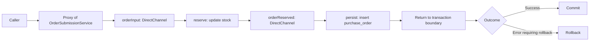

# DirectChannel and Transaction Context

In the **DirectChannel** chapter of the `SPRING_INTEGRATION_CORE` module, this lesson explains how to design a message flow where data operations participate in the caller's transaction. `Message`, `MessageChannel`, endpoints, gateways, and Java DSL are placed into a concrete scenario: reserving inventory and creating an order must succeed or fail together.

After this lesson, you can identify where transactions begin and end, explain why changing the channel type can alter consistency, and write tests verifying data after commit or rollback.

## 1. DirectChannel Preserves Synchronous Execution

`DirectChannel` invokes the handler directly on the thread executing `send()`. The handler executes before the `send()` call returns. Therefore, if the sender is inside a thread-bound transaction, compatible data operations in the handler can use that transaction. This is a key purpose of `DirectChannel`'s design. [Message Channel Implementations](https://docs.spring.io/spring-integration/reference/channel/implementations.html#channel-implementations-directchannel).

Example call path:

```text
Thread request-1
  -> transaction interceptor: begin T1
     -> OrderSubmissionService.place()
        -> orderInput.send(message)
           -> reserveStock()
              -> orderReserved.send(message)
                 -> insertOrder()
        <- synchronous handlers have returned
     <- place() returns
  -> transaction interceptor: commit T1
```

If `insertOrder()` throws an error matching the rollback rules and the error propagates out of the transaction-managed method, T1 rolls back instead of committing.

The distinction to keep in mind is that **the channel keeps the call synchronous**, while **the transaction manager manages the transaction**. Declaring a `DirectChannel` bean does not automatically create a transaction for every message sent through it.

A `DirectChannel` chain can also be called concurrently by multiple threads. Each call follows its corresponding sender thread; the channel does not serialize the entire application into a single sequential execution stream.

## 2. Where Does the Transaction Context Live?

Within the scope of this lesson, we examine imperative transactions using `PlatformTransactionManager`, typically JDBC. The context relates to transaction-participating resources and transaction management state bound to the executing thread. This mechanism differs from reactive transactions based on Reactor context.

| Component | Responsibility in the example |
| --- | --- |
| `Message<OrderCommand>` | Carries the order command and message metadata |
| `DirectChannel` | Delivers the message to the handler on the sender's thread |
| Service activator endpoint | Invokes the business method and forwards the result to the next step |
| Java DSL | Declares the structure of flow steps and channels |
| `@Transactional` or `TransactionTemplate` | Defines the scope of work to be transactionally managed |
| `DataSourceTransactionManager` | Manages JDBC transactions for a `DataSource` |
| `JdbcTemplate` | Accesses JDBC via Spring's transaction-aware connection acquisition |

With `DataSourceTransactionManager`, Spring binds a `DataSource` connection to the current thread. `JdbcTemplate` uses this mechanism when accessing data. If a handler obtains an independent connection via `dataSource.getConnection()` and manages it manually, you cannot assume that connection belongs to the active transaction. [DataSourceTransactionManager API](https://docs.spring.io/spring-framework/docs/current/javadoc-api/org/springframework/jdbc/datasource/DataSourceTransactionManager.html).

Transaction context is not a header to be copied when building a new `Message`. Adding a `transactionId` header only supplies application data or observability tracing; it does not make another thread share the same JDBC transaction. Similarly, a message correlation ID is not a database connection or transaction.

## 3. Conditions for Steps to Share One Transaction

Before concluding a flow is atomic, verify all of the following conditions:

1. **The transaction started before the first operation requiring protection.** For example, the caller passes through the proxy of a `@Transactional` method, or the entire send call sits inside a `TransactionTemplate` callback.
2. **Operations occur while the transaction is still active.** Keeping the same thread preserves context, yet the transaction must still span the execution window of those steps.
3. **Resources actually participate in the chosen transaction.** In the JDBC example, operations use the same `DataSource` and corresponding transaction manager.
4. **No execution boundary splits the context.** For example, an executor handing work to a worker thread, a poller picking up the message later, or a handler spawning threads.
5. **Propagation settings do not intentionally separate transactions.** `REQUIRES_NEW` and `NOT_SUPPORTED` alter participation scope even on the same thread.
6. **Failure outcomes reach the transaction boundary.** If the flow swallows the error and returns normally, the transaction interceptor may not receive a rollback signal.

Spring Integration uses Spring's transaction mechanisms for application-initiated flows; you can place the boundary on the calling service or configure appropriate transaction support on the initiating component. [Transaction Support](https://docs.spring.io/spring-integration/reference/transactions.html).

You do not need to annotate every handler with `@Transactional`. An unannotated handler can still use resources already bound to an outer transaction. Conversely, putting an annotation on one handler is not enough to conclude every step after that handler stays within the same scope.

## 4. JDBC Example: Deducting Stock and Creating an Order

### 4.1. Requirements and Assumptions of the Example

An order request must perform:

1. Deduct the product quantity available in stock.
2. Insert a new order record.
3. If inserting the order fails after deducting stock, restore the stock change via rollback.

The flow explicitly declares two `DirectChannel` beans:



The public types below are placed in separate Java files in the same `demo.directtx` package. They are illustrative lesson code; integrate them into a project with compatible Spring versions before running.

Required dependencies:

| Dependency | Purpose |
| --- | --- |
| `org.springframework.integration:spring-integration-core` | Channels, endpoints, and Java DSL |
| `org.springframework:spring-jdbc` | `JdbcTemplate`, JDBC transaction manager, and embedded database |
| `org.springframework:spring-tx` | Transaction annotations and APIs; usually pulled in transitively by Spring JDBC |
| `com.h2database:h2` | In-memory database for the lab |
| `org.springframework:spring-test` | Starting the application context during tests |
| `org.junit.jupiter:junit-jupiter` | JUnit 5 tests |

Use the project's version management mechanism, such as a compatible Spring Boot BOM, to align Spring dependencies. The examples use `record` and text blocks, requiring Java 17 or later; a given Spring release may require a newer JDK. No separate Java DSL library is needed for this configuration style.

### 4.2. Immutable Payload

```java
package demo.directtx;

public record OrderCommand(long orderId, String sku, int quantity) {

    public OrderCommand {
        if (orderId <= 0) {
            throw new IllegalArgumentException("orderId must be greater than 0");
        }
        if (sku == null || sku.isBlank()) {
            throw new IllegalArgumentException("sku must not be blank");
        }
        if (quantity <= 0) {
            throw new IllegalArgumentException("quantity must be greater than 0");
        }
    }
}
```

Input validation avoids stock-deduction requests with negative quantities. Payload immutability keeps how steps interpret the same request consistent; rollback is still handled by the JDBC transaction.

### 4.3. Two Business Steps

```java
package demo.directtx;

import org.springframework.jdbc.core.JdbcTemplate;

public class OrderSteps {

    private final JdbcTemplate jdbc;

    public OrderSteps(JdbcTemplate jdbc) {
        this.jdbc = jdbc;
    }

    public OrderCommand reserve(OrderCommand command) {
        int changed = jdbc.update("""
                update stock
                   set available = available - ?
                 where sku = ? and available >= ?
                """,
                command.quantity(),
                command.sku(),
                command.quantity());

        if (changed != 1) {
            throw new IllegalStateException("Product does not exist or insufficient stock");
        }

        return command;
    }

    public void persist(OrderCommand command) {
        jdbc.update("""
                insert into purchase_order(order_id, sku, quantity)
                values (?, ?, ?)
                """,
                command.orderId(),
                command.sku(),
                command.quantity());
    }
}
```

The stock deduction statement combines checking availability and updating in a single SQL operation. The lesson avoids reading quantity into Java and updating afterward, because that pattern also has to resolve contention between concurrent requests.

`reserve()` returns the payload so the flow continues. `persist()` returns `void`, ending the one-way flow. Both methods use the same `JdbcTemplate` bean.

### 4.4. Service Defining the Transaction Boundary

```java
package demo.directtx;

import org.springframework.messaging.MessageChannel;
import org.springframework.messaging.support.MessageBuilder;
import org.springframework.transaction.annotation.Transactional;

public class OrderSubmissionService {

    private final MessageChannel orderInput;

    public OrderSubmissionService(MessageChannel orderInput) {
        this.orderInput = orderInput;
    }

    @Transactional(transactionManager = "orderTxManager")
    public void place(OrderCommand command) {
        boolean accepted = orderInput.send(
                MessageBuilder.withPayload(command).build());

        if (!accepted) {
            throw new IllegalStateException("Order message was not accepted");
        }
    }
}
```

Callers must obtain `OrderSubmissionService` from the Spring context and invoke the method through the bean's proxy. Creating the object manually with `new OrderSubmissionService(...)` outside the context will not activate the transaction annotation.

In standard proxy mode, another method on the same object calling `this.place(...)` also bypasses the transaction interceptor. Therefore, the transaction boundary here is placed on a public method invoked by another bean or by the lab caller. [Using @Transactional](https://docs.spring.io/spring-framework/reference/data-access/transaction/declarative/annotations.html).

`send()` returning `true` indicates the send was accepted under channel semantics. It is not a database commit receipt. In the example, the transaction interceptor must still perform the commit after `place()`'s method body returns; commit can still fail.

### 4.5. Spring and Java DSL Configuration

```java
package demo.directtx;

import javax.sql.DataSource;

import org.springframework.beans.factory.annotation.Qualifier;
import org.springframework.context.annotation.Bean;
import org.springframework.context.annotation.Configuration;
import org.springframework.integration.channel.DirectChannel;
import org.springframework.integration.config.EnableIntegration;
import org.springframework.integration.dsl.IntegrationFlow;
import org.springframework.jdbc.core.JdbcTemplate;
import org.springframework.jdbc.datasource.DataSourceTransactionManager;
import org.springframework.jdbc.datasource.embedded.EmbeddedDatabase;
import org.springframework.jdbc.datasource.embedded.EmbeddedDatabaseBuilder;
import org.springframework.jdbc.datasource.embedded.EmbeddedDatabaseType;
import org.springframework.messaging.MessageChannel;
import org.springframework.transaction.PlatformTransactionManager;
import org.springframework.transaction.annotation.EnableTransactionManagement;

@Configuration
@EnableIntegration
@EnableTransactionManagement
public class DirectTxConfig {

    @Bean(destroyMethod = "shutdown")
    public EmbeddedDatabase dataSource() {
        return new EmbeddedDatabaseBuilder()
                .generateUniqueName(true)
                .setType(EmbeddedDatabaseType.H2)
                .build();
    }

    @Bean
    public JdbcTemplate jdbcTemplate(DataSource dataSource) {
        JdbcTemplate jdbc = new JdbcTemplate(dataSource);

        // Initialize schema so the lab example is self-contained.
        jdbc.execute("""
                create table stock (
                    sku varchar(64) primary key,
                    available integer not null check (available >= 0)
                )
                """);
        jdbc.execute("""
                create table purchase_order (
                    order_id bigint primary key,
                    sku varchar(64) not null,
                    quantity integer not null check (quantity > 0)
                )
                """);

        return jdbc;
    }

    @Bean
    public PlatformTransactionManager orderTxManager(DataSource dataSource) {
        return new DataSourceTransactionManager(dataSource);
    }

    @Bean
    public DirectChannel orderInput() {
        DirectChannel channel = new DirectChannel();
        channel.setFailover(false);
        return channel;
    }

    @Bean
    public DirectChannel orderReserved() {
        DirectChannel channel = new DirectChannel();
        channel.setFailover(false);
        return channel;
    }

    @Bean
    public OrderSteps orderSteps(JdbcTemplate jdbcTemplate) {
        return new OrderSteps(jdbcTemplate);
    }

    @Bean
    public OrderSubmissionService orderSubmissionService(
            @Qualifier("orderInput") MessageChannel orderInput) {
        return new OrderSubmissionService(orderInput);
    }

    @Bean
    public IntegrationFlow orderFlow(OrderSteps orderSteps) {
        return IntegrationFlow.from("orderInput")
                .handle(orderSteps, "reserve")
                .channel("orderReserved")
                .handle(orderSteps, "persist")
                .get();
    }
}
```

`@EnableIntegration` enables Spring Integration infrastructure in a non-Boot configuration. `@EnableTransactionManagement` enables transaction annotation processing. The `orderFlow` bean describes endpoint wiring; declaring a Java DSL flow by itself does not create a transaction per message. [Java DSL](https://docs.spring.io/spring-integration/reference/dsl.html).

The example declares each step on its own channel. Do not subscribe `reserve()` and `persist()` as two competing subscribers on the same `DirectChannel` expecting both to always run in order.

`setFailover(false)` makes error-handling intent clearer if subscribers are added later. It is not a transaction-enabling setting; with one subscriber per channel, the main processing path remains a synchronous chain.

### 4.6. Analyzing Success and Failure Cases

Suppose initial stock has `SI-BOOK = 10`, and the order table already has `order_id = 100`.

| Call | Sequence of events | Data after caller receives result |
| --- | --- | --- |
| `place(new OrderCommand(101, "SI-BOOK", 2))` | Deduct 2 from stock, insert order 101, commit | Stock is 8, order 101 added |
| `place(new OrderCommand(100, "SI-BOOK", 2))` | Deduct 2 from stock, duplicate key on order insert, rollback | Stock remains 10, only initial order 100 remains |
| `place(new OrderCommand(101, "SI-BOOK", 11))` | Stock update affects zero rows, throws error | Stock remains 10, no order 101 |

In the duplicate-key case, stock holds value 8 inside the transaction after `reserve()`. After rollback, that change is not persisted. Specifically, failure in the second step verifies that both operations are protected together.

## 5. Testing via Post-Transaction Data State

Tests should invoke the Spring-managed service, wait for the call to finish, and query data after the service's transaction completes.

```java
package demo.directtx;

import org.junit.jupiter.api.BeforeEach;
import org.junit.jupiter.api.Test;
import org.springframework.beans.factory.annotation.Autowired;
import org.springframework.jdbc.core.JdbcTemplate;
import org.springframework.test.context.junit.jupiter.SpringJUnitConfig;
import org.springframework.transaction.support.TransactionSynchronizationManager;

import static org.junit.jupiter.api.Assertions.assertEquals;
import static org.junit.jupiter.api.Assertions.assertFalse;
import static org.junit.jupiter.api.Assertions.assertThrows;

@SpringJUnitConfig(DirectTxConfig.class)
class DirectChannelTransactionTest {

    @Autowired
    OrderSubmissionService service;

    @Autowired
    JdbcTemplate jdbc;

    @BeforeEach
    void resetData() {
        jdbc.update("delete from purchase_order");
        jdbc.update("delete from stock");
        jdbc.update("insert into stock(sku, available) values (?, ?)",
                "SI-BOOK", 10);
        jdbc.update("""
                insert into purchase_order(order_id, sku, quantity)
                values (?, ?, ?)
                """, 100L, "SI-BOOK", 1);
    }

    @Test
    void commitsStockAndOrderTogether() {
        assertFalse(TransactionSynchronizationManager.isActualTransactionActive());

        service.place(new OrderCommand(101L, "SI-BOOK", 2));

        assertFalse(TransactionSynchronizationManager.isActualTransactionActive());
        assertEquals(8, available());
        assertEquals(2, orderCount());
        assertEquals(1, countOrder(101L));
    }

    @Test
    void rollsBackStockWhenOrderInsertFails() {
        assertFalse(TransactionSynchronizationManager.isActualTransactionActive());

        assertThrows(RuntimeException.class,
                () -> service.place(new OrderCommand(100L, "SI-BOOK", 2)));

        assertFalse(TransactionSynchronizationManager.isActualTransactionActive());
        assertEquals(10, available());
        assertEquals(1, orderCount());
        assertEquals(1, countOrder(100L));
    }

    @Test
    void createsNoOrderWhenStockIsInsufficient() {
        assertThrows(RuntimeException.class,
                () -> service.place(new OrderCommand(101L, "SI-BOOK", 11)));

        assertEquals(10, available());
        assertEquals(1, orderCount());
        assertEquals(0, countOrder(101L));
    }

    private int available() {
        return jdbc.queryForObject(
                "select available from stock where sku = ?",
                Integer.class, "SI-BOOK");
    }

    private int orderCount() {
        return jdbc.queryForObject(
                "select count(*) from purchase_order", Integer.class);
    }

    private int countOrder(long orderId) {
        return jdbc.queryForObject(
                "select count(*) from purchase_order where order_id = ?",
                Integer.class, orderId);
    }
}
```

The test class is not annotated with `@Transactional`. If the test opens a transaction itself and the service joins it, the actual commit/rollback boundary can be masked by the test's transaction; even removing the annotation from the service might still let handlers use the transaction created by the test. The approach above lets you observe the service's own boundary. [Transaction Management in Spring TestContext](https://docs.spring.io/spring-framework/reference/testing/testcontext-framework/tx.html).

Checking for an exception alone does not prove atomicity. The decisive check is that stock is restored after the order insert fails. The concrete exception type may be wrapped by Spring Integration in `MessagingException` or a subclass; inspect the inner cause chain when diagnosing.

## 6. How Do Errors Reach the Transaction Interceptor?

### 6.1. Synchronous Errors Unwind the Call Stack

With the lesson's main configuration, an error in `persist()` follows this path:

```text
persist() throws data-access error
  -> service activator / endpoint
  -> orderReserved.send()
  -> endpoint calling reserve() and forwarding result
  -> orderInput.send()
  -> OrderSubmissionService.place()
  -> transaction interceptor
  -> rollback according to applicable rules
  -> caller receives exception
```

An `errorChannel` consumer is not needed for this transaction to roll back. When sending directly through the channel on the same thread, the error is thrown back to the caller; message-based error handling must be evaluated according to the initiating component or actual executor. [Error Handling](https://docs.spring.io/spring-integration/reference/error-handling.html).

### 6.2. Rollback Rules Inspect the Exception Reaching the Boundary

Under Spring's standard defaults, `RuntimeException` and `Error` trigger rollback; checked exceptions do not automatically cause rollback merely by being exceptions. This can be adjusted using `rollbackFor` or appropriate configuration rules. [Rolling Back a Declarative Transaction](https://docs.spring.io/spring-framework/reference/data-access/transaction/declarative/rolling-back.html).

In an integration flow, a business exception may be wrapped in a messaging runtime exception. Therefore, inspect **the exception actually exiting the transactional method**, rather than looking only at the exception type declared on a handler method. The `rollbackFor` rule matches the exception reaching the interceptor; do not assume it always searches every nested cause type.

The following example is appropriate when the service contract actually lets this checked exception propagate out:

```java
@Transactional(
        transactionManager = "orderTxManager",
        rollbackFor = BusinessCheckedException.class)
public void placeWithBusinessCheck(OrderCommand command)
        throws BusinessCheckedException {
    // Perform business checks and send message within the same scope.
}
```

`BusinessCheckedException` is an application-defined exception type. This snippet illustrates the rollback rule and does not replace the classes in the JDBC lab above.

### 6.3. Catching and Ignoring Errors Can Lead to Commit

This is dangerous code if the caller still expects the entire order to roll back:

```java
@Transactional(transactionManager = "orderTxManager")
public void placeIgnoringFailure(OrderCommand command) {
    try {
        orderInput.send(MessageBuilder.withPayload(command).build());
    } catch (RuntimeException ex) {
        // Only log and return normally.
    }
}
```

If no component has marked rollback-only and the resource still permits commit, the interceptor may commit the updates already executed. Some database errors or inner transaction layers may have already rendered the transaction uncommittable, so swallowing the error does not guarantee a successful commit either.

The clearest approach when an operation fails is to let the appropriate error propagate outward. If you need to return a business result instead of throwing an exception, explicitly design the rollback—such as `status.setRollbackOnly()` in `TransactionTemplate`—and inform the caller that the request failed.

## 7. Messaging Gateways Still Need a Clear Transaction Boundary

You can replace the direct `Message`-sending API with a gateway interface:

```java
package demo.directtx;

import org.springframework.integration.annotation.MessagingGateway;

@MessagingGateway(defaultRequestChannel = "orderInput")
public interface OrderGateway {

    void place(OrderCommand command);
}
```

To create the gateway proxy via annotation scanning in Java configuration, enable `@IntegrationComponentScan(basePackageClasses = OrderGateway.class)` on an appropriate configuration class; this annotation belongs to package `org.springframework.integration.annotation`. [Annotation Support](https://docs.spring.io/spring-integration/reference/configuration/annotations.html).

An outer service can hold the transaction boundary as follows; this is an alternative to the direct-sending service:

```java
package demo.directtx;

import org.springframework.transaction.annotation.Transactional;

public class GatewayOrderSubmissionService {

    private final OrderGateway gateway;

    public GatewayOrderSubmissionService(OrderGateway gateway) {
        this.gateway = gateway;
    }

    @Transactional(transactionManager = "orderTxManager")
    public void place(OrderCommand command) {
        gateway.place(command);
    }
}
```

Register this alternative service class as a Spring bean and invoke it through its proxy as in the main example. A gateway with a `void` return type expresses a one-way contract, yet does not automatically move a `DirectChannel` flow onto a background thread. With synchronous configuration and no custom gateway error handling, downstream errors are returned to the caller. [Messaging Gateways](https://docs.spring.io/spring-integration/reference/gateway.html).

If the gateway is configured to route errors to `errorChannel` and the error flow finishes normally or supplies a fallback, the caller may not receive an exception. In that case, you must determine whether the transaction was marked rollback-only. Having an `errorChannel` does not mean automatic rollback; test both the gateway result and the database state.

## 8. Synchronous Boundaries and Transaction Boundaries Are Related Concerns

### 8.1. `ExecutorChannel` Can Move Work to Another Thread

```text
Thread request-1, transaction T1:
  update A -> ExecutorChannel.send() -> continues -> T1 ends

Thread worker-1:
  picks up work -> update B -> may fail later
```

When an executor actually hands work off to a worker thread, thread-bound transaction T1 does not follow automatically. If B opens a transaction, that is a transaction on B's processing side, not implicitly the same transaction as A.

A thread switch stops context propagation along this call path, but it does not mean T1 commits immediately at the `send()` statement. T1 still finishes at the sender's transaction boundary.

Do not treat accidental same-thread execution—such as a direct executor or a caller-runs policy under saturation—as the basis for business guarantees. Design for the execution paths that the executor configuration can produce.

### 8.2. `QueueChannel` Decouples Send Time from Processing Time

With `QueueChannel`, `send()` may only enqueue the message. A poller receiving and processing later typically has its own transaction scope. To make processing transactional on the poller side, configure transactions on the poller and corresponding resources.

An in-memory default `QueueChannel` does not become a transactional queue merely because the sender is `@Transactional`. If T1 sends to the queue and then rolls back, do not assume the in-memory message will be automatically retracted. A transactional queue or message store requires a separate design. [Transaction Support — Transaction Boundaries](https://docs.spring.io/spring-integration/reference/transactions.html#transaction-boundaries).

### 8.3. Waiting for a Result Does Not Reattach a Transaction

A handler invoking `CompletableFuture`, `@Async`, or an executor can shift JDBC work to another thread. Calling `join()` on the sender side to wait does not give the worker the connection bound to the sender's thread.

Errors from the worker can still be awaited and rethrown outward to roll back T1, yet that does not undo a separate transaction that the worker already committed. Distinguish **propagating errors** from **sharing a transaction**.

### 8.4. Routers, Filters, and Aggregators Must Be Evaluated by Behavior

| Component | What to determine about transactions |
| --- | --- |
| Transformer returning a new payload | If processed synchronously within the active scope, creating a new `Message` does not separate the transaction |
| Router | Do the target channel and execution style of the selected branch stay on the current call path? |
| Filter | Is a discarded message treated as a valid outcome, or must an error be thrown to request rollback? |
| Aggregator | Does it store groups waiting for future messages, timeouts, or release groups in another call? |

For example, a filter normally discarding a message after the stock-deduction step can end the flow without creating an order, while producing no exception to trigger rollback. With an aggregator, you cannot assume every message in a group shares one transaction simply because all input channels are `DirectChannel`. These are design consequences to evaluate along the application's complete execution path.

## 9. Propagation Can Change Transactions Even on the Same Thread

`DirectChannel` does not override Spring's propagation rules. [Transaction Propagation](https://docs.spring.io/spring-framework/reference/data-access/transaction/declarative/tx-propagation.html).

| Propagation of a method invoked through a proxy | When outer T1 is active |
| --- | --- |
| `REQUIRED` | Usually joins T1 when using the matching transaction manager |
| `MANDATORY` | Requires an existing transaction |
| `REQUIRES_NEW` | Suspends T1 and creates an independent transaction T2 |
| `NOT_SUPPORTED` | Suspends any existing transaction for the scope of the method |
| `NESTED` | Uses a nested scope with a savepoint if supported by the transaction manager and resource |

For example, an audit-logging bean using `REQUIRES_NEW` can commit the audit record and then T1 rolls back. Being on the same thread does not merge those two transactions into one. Opening T2 may also require an additional connection while T1's connection is still held.

If an inner `REQUIRED` method marks T1 rollback-only and the outer code catches the error and tries to finish normally, the caller may receive `UnexpectedRollbackException` when the outer boundary concludes.

Scope placement also matters: if only `reserve()` is marked transactional and no outer transaction exists, the transaction surrounding that method may end as soon as `reserve()` returns. Only afterward does the endpoint forward the result to `persist()`. To protect both steps as in the lab, place the boundary on the service enclosing the entire send call.

## 10. `TransactionTemplate` When Expressing Scope in Code

An alternative is wrapping the send call in `TransactionTemplate`. With default propagation, the template starts a transaction if none exists or joins a compatible existing one. [Programmatic Transaction Management](https://docs.spring.io/spring-framework/reference/data-access/transaction/programmatic.html).

```java
package demo.directtx;

import org.springframework.messaging.MessageChannel;
import org.springframework.messaging.support.MessageBuilder;
import org.springframework.transaction.PlatformTransactionManager;
import org.springframework.transaction.support.TransactionTemplate;

public class ProgrammaticOrderSubmissionService {

    private final TransactionTemplate transactionTemplate;
    private final MessageChannel orderInput;

    public ProgrammaticOrderSubmissionService(
            PlatformTransactionManager transactionManager,
            MessageChannel orderInput) {
        this.transactionTemplate = new TransactionTemplate(transactionManager);
        this.orderInput = orderInput;
    }

    public void place(OrderCommand command) {
        transactionTemplate.executeWithoutResult(status -> {
            boolean accepted = orderInput.send(
                    MessageBuilder.withPayload(command).build());
            if (!accepted) {
                throw new IllegalStateException("Message send failed");
            }
        });
    }
}
```

When creating a bean for this option, pass the exact `orderTxManager` and `orderInput`. This is an alternative to the annotation-based service; you do not need to combine both styles around the same call.

The callback clearly highlights what needs to be transactional. Operations running on worker threads inside the callback still do not automatically join the template-calling thread's transaction.

## 11. Multiple Subscribers and Failover Can Alter Error Observation

`DirectChannel` uses a point-to-point model. Multiple subscribers on one channel are competing candidates to receive a message, not a list of sequential business steps. The dispatcher has a load-balancing strategy and enables failover by default; when one handler throws an error, it can try the next handler. [DirectChannel configuration](https://docs.spring.io/spring-integration/reference/channel/configuration.html).

In a flow that writes data, consider these consequences:

- The first handler may have already modified data before failing.
- Trying another handler does not implicitly roll back just the first handler's partial work.
- If the second handler succeeds and the transaction was not marked rollback-only, the first error may not reach the outer boundary.
- If the transaction was already marked rollback-only, the second handler succeeding does not clear that mark.

The lab uses one subscriber per channel and disables failover to keep the error contract clear. In a real application, if retries or backup routing are needed, you must design each attempt's transaction scope, safe re-execution, and how failures are reported to the caller.

## 12. Atomicity Limits and Diagnostics

### 12.1. JDBC Transactions Do Not Undo Every Side Effect

In the lab, the atomic scope covers JDBC changes using the same managed resource. If you insert a step calling a payment API, sending an email, or writing a file, JDBC rollback does not automatically reverse those side effects.

Similarly, using two databases with two local transaction managers does not create a distributed transaction, even if all handlers run on one thread.

For requirements to write data and reliably emit an event, you can design a transactional outbox: store the business change and an event record in the same database transaction, followed by a separate event-publishing process with duplicate-handling safeguards. This is an additional design direction when you need to go beyond the lesson's local transaction scope.

### 12.2. Observing Thread and Transaction State

During the lab, you can temporarily place the following snippet in the service before `send()` and inside each handler:

```java
import org.springframework.transaction.support.TransactionSynchronizationManager;

System.out.printf(
        "thread=%s, txActive=%s, txName=%s%n",
        Thread.currentThread().getName(),
        TransactionSynchronizationManager.isActualTransactionActive(),
        TransactionSynchronizationManager.getCurrentTransactionName());
```

Matching thread names and `txActive=true` are useful observation signals, yet they do not prove all operations use the exact same physical transaction. You still must verify `DataSource`, transaction manager, propagation, and data state after the call completes.

| Symptom | What to check first |
| --- | --- |
| Handler runs on same thread but has no transaction | Was the service invoked via proxy and is transaction management enabled? |
| Stock deduction does not roll back after order creation fails | Do both steps share the same resource? Was the error caught or turned into a normal result? |
| Only part of the data rolls back | Is there `REQUIRES_NEW`, a manual connection, or a different transaction manager? |
| Caller gets success and worker fails later | Is there an `ExecutorChannel`, `QueueChannel`, `@Async`, or future? |
| Test always passes yet application fails | Is a test transaction masking a missing transaction on the service? |
| Receiving `UnexpectedRollbackException` | Did an inner participating scope mark rollback-only and then get its error caught? |

### 12.3. Practice Exercises

1. Run the three scenarios in the testing section, recording stock quantity and order row count after each call.
2. In a copy of the lab, remove the annotation from the service and observe the duplicate order ID case. Explain why the two SQL statements are no longer protected together.
3. Add thread and transaction-state logging to both steps. Compare results when using `DirectChannel` versus intentionally moving the order-insert step onto an executor with its own worker thread.
4. When testing the asynchronous variant, wait for the worker to finish using an appropriate test synchronization mechanism, then query the database; do not use arbitrary sleep durations to conclude rollback behavior.
5. Try placing a filter after the stock-deduction step: once discarding the message normally, and once rejecting via an exception. Compare the final data and define the desired business contract.

Each experiment should answer three questions: where does the transaction begin, which operations actually participate, and along what path does an error reach the transaction boundary. That is the basis for using `DirectChannel` properly when building integration flows with data consistency requirements.
