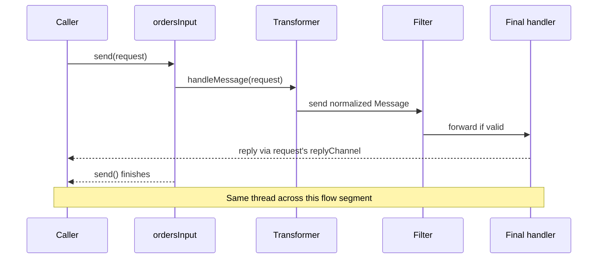

# DirectChannel as the Default Channel

In the **SPRING_INTEGRATION_CORE** module, **DirectChannel** chapter, this lesson explains how to use `DirectChannel` as the starting choice when connecting components in a message flow. The focus is on understanding execution behavior and knowing when to declare a different channel type.

An order-code normalization flow will be used throughout: receiving a `Message<String>`, transforming the payload, filtering invalid codes, and returning a result. The example connects the concepts of `Message`, `MessageChannel`, endpoints, gateways, and Java DSL in one cohesive scenario.

## 1. What Does "Default Channel" Mean?

`DirectChannel` is the default channel type in standard Spring Integration configuration contexts. For example, an XML element without special internal configuration:

```xml
<int:channel id="ordersInput"/>
```

creates a `DirectChannel`. In Java, you can express that choice explicitly:

```java
@Bean
public MessageChannel ordersInput() {
    return new DirectChannel();
}
```

The XML snippet is an excerpt inside a configuration declaring the Spring Integration namespace; the Java snippet goes in an appropriate configuration class. See [Configuring Message Channels](https://docs.spring.io/spring-integration/reference/channel/configuration.html).

"Default" here means **the default channel type when the framework creates a channel in supported contexts**. It does not mean every message automatically finds a single bean named `defaultChannel`. Producers must still know the flow's entry point, via channel name, bean reference, or gateway configuration.

Also distinguish:

| Concept | Role |
| --- | --- |
| `DirectChannel` as the default type | Determines how messages are delivered when creating channels by default |
| Name `ordersInput` | Identifies a specific connection point in the flow |
| `@Primary` | Helps Spring pick a bean when dependency injection has multiple candidates |
| Gateway's `defaultRequestChannel` | Selects the default send destination for the gateway's methods |

For example, putting `@Primary` on one `DirectChannel` does not change the type of other channels created by Java DSL. Similarly, a gateway pointing to `ordersInput` can still send to a `QueueChannel` if the bean with that name is declared as one.

## 2. Execution Mechanics That Make DirectChannel Suitable as a Starting Point

`DirectChannel` is a `SubscribableChannel` with point-to-point semantics. A consumer registers a `MessageHandler` with the channel; the channel hands messages directly to the handler on the sender's thread. It does not provide a `receive()` API like `PollableChannel`.

Along the synchronous path, the handler invocation happens before `send()` finishes. This execution model allows processing on both sides of the channel to share the transaction bound to that thread, provided the remaining components also meet transaction requirements. See [Message Channel Implementations — DirectChannel](https://docs.spring.io/spring-integration/reference/channel/implementations.html#channel-implementations-directchannel).



The diagram omits intermediate channels to clarify the call stack. In the actual flow, an endpoint sends its result to the next channel; that channel then invokes the next endpoint.

Each component has its own responsibility:

- **Message** carries payload and headers.
- **Channel** defines the connection point and how messages are handed off.
- **Endpoint** attaches a handler to the flow; transformers, filters, routers, and service activators are common processing forms.
- **Gateway** provides a convenient calling interface for business code and translates between method calls and messages.

For example, business code sends `"  dh-042  "` without needing to know which specific endpoint normalizes the string. The channel decouples dependency on the consumer object, while the call can still remain synchronous.

### 2.1. Having No Queue Does Not Mean Non-Blocking

Suppose a call passes through three sequential steps:

| Step | Assumed duration |
| --- | ---: |
| Normalize data | 2 ms |
| Call validation service | 80 ms |
| Persist data | 18 ms |

If all three steps run directly, the caller must wait roughly the sum of the step durations, plus framework and system overhead. `DirectChannel` does not automatically make a service call asynchronous.

Place timeouts where I/O actually happens. Passing a timeout to `send(message, timeout)` does not turn the channel into a mechanism to interrupt a slow-running handler.

### 2.2. Synchronicity Is a Property of a Path Segment

A flow can start with `DirectChannel` and then transition to an `ExecutorChannel`, a queue, or an adapter performing work out-of-process. At that point, you must re-evaluate what "finished processing" means at the new boundary.

Even without switching threads, a filter can discard a message; an aggregator can hold a message in a group whose release condition is not yet met. Therefore, do not infer "the business process is complete and a reply exists" solely because the input channel is a `DirectChannel`.

## 3. Where Does Java DSL Create DirectChannel Instances?

In Java DSL, consecutive endpoints are typically wired together using `DirectChannel` instances created by the framework. With name references like `IntegrationFlow.from("ordersInput")` or `.channel("someChannel")`, the DSL uses an existing channel bean if present; otherwise, it can create the corresponding channel.

Auto-generated names for intermediate channels generally follow the form `[flowName].channel#[index]`. See the rules and examples at [Java DSL — Message Channels](https://docs.spring.io/spring-integration/reference/dsl/java-channels.html).

You can read configurations in three cases:

| Configuration | Interpretation |
| --- | --- |
| `IntegrationFlow.from("ordersInput")` | Starts from the channel named `ordersInput`; check whether the bean is already declared |
| `.transform(...).filter(...).handle(...)` | Endpoints are wired together by the DSL; no need to declare every intermediate channel manually |
| `.channel(MessageChannels.queue(...))` | Explicitly requests a different channel type at that position |

When reading a flow, not seeing a `.channel(...)` call between two steps **does not mean the two steps are disconnected**. The DSL has handled that connection.

Give explicit names to entry points, branching points, and important execution boundaries. For a simple internal processing segment, auto-generated channels often keep configuration concise. Avoid letting external calling code depend on framework-generated channel index numbers: adding an endpoint can shift intermediate names.

## 4. Complete Example: Normalizing and Validating Order Codes

The example below uses Java 17+ and the Spring Integration 6.x Java DSL API. The project needs `spring-integration-core` along with compatible Spring dependencies; let the project's BOM manage aligned versions.

```java
import java.util.Locale;

import org.springframework.context.annotation.Bean;
import org.springframework.context.annotation.Configuration;
import org.springframework.integration.config.EnableIntegration;
import org.springframework.integration.dsl.IntegrationFlow;

@Configuration
@EnableIntegration
public class OrderFlowConfiguration {

    @Bean
    public IntegrationFlow orderAcceptanceFlow() {
        return IntegrationFlow.from("ordersInput")
                .transform(String.class,
                        code -> code.trim().toUpperCase(Locale.ROOT))
                .filter(String.class,
                        code -> code.matches("DH-[0-9]+"),
                        filter -> filter.throwExceptionOnRejection(true))
                .handle(String.class,
                        (code, headers) -> "ACCEPTED:" + code)
                .get();
    }
}
```

`@EnableIntegration` enables Spring Integration infrastructure for the application context in this standalone example. The flow is a bean so the framework can register and manage its components.

Processing steps:

1. `ordersInput` receives a message containing the order code.
2. The transformer trims leading and trailing whitespace and converts to uppercase.
3. The filter checks that the normalized code matches `DH-` followed by at least one digit.
4. The handler produces the response string.

For example, input `"  dh-042  "` yields `"ACCEPTED:DH-042"`. The `ACCEPTED` prefix only indicates passing this example's validation step; the flow does not persist an order or process payment yet.

We do not declare a separate `ordersInput` bean in this configuration so we can observe how the DSL creates the input channel. The connections between transformer, filter, and handler are also created by default.

### 4.1. Calling the Flow with `MessagingTemplate`

Place the following invocation snippet inside a method, such as `main` or a test:

```java
try (var context = new AnnotationConfigApplicationContext(
        OrderFlowConfiguration.class)) {

    MessageChannel input =
            context.getBean("ordersInput", MessageChannel.class);

    MessagingTemplate template = new MessagingTemplate();
    template.setReceiveTimeout(1_000);

    Message<?> reply = template.sendAndReceive(
            input,
            new GenericMessage<>("  dh-042  "));

    if (reply == null) {
        throw new IllegalStateException("No reply received");
    }

    System.out.println(reply.getPayload());
}
```

Additional imports for the snippet:

```java
import org.springframework.context.annotation.AnnotationConfigApplicationContext;
import org.springframework.integration.core.MessagingTemplate;
import org.springframework.messaging.Message;
import org.springframework.messaging.MessageChannel;
import org.springframework.messaging.support.GenericMessage;
```

`sendAndReceive` sets up the reply-receiving mechanism for the request. The final handler returns a payload; the endpoint routes the result back to the request's reply destination when no separate output channel is set.

A plain `input.send(message)` call only returns a `boolean` about the send operation; it does not directly return the business result string. If a flow produces a reply while the request lacks an appropriate reply destination, you may encounter an error indicating no output channel or reply channel could be resolved.

In this synchronous example, `receiveTimeout` is not a hard cap on total handler execution time. If the handler blocks the thread, the request-sending phase can still take longer before the reply-waiting step even runs.

### 4.2. Calling Through a Gateway

In an application, you can expose an interface:

```java
import org.springframework.integration.annotation.MessagingGateway;

@MessagingGateway(defaultRequestChannel = "ordersInput")
public interface OrderGateway {

    String accept(String orderCode);
}
```

For the interface to be created as a gateway bean, configure `@IntegrationComponentScan` for the package containing it, such as `@IntegrationComponentScan(basePackageClasses = OrderGateway.class)` on the configuration class. This annotation belongs to package `org.springframework.integration.annotation`.

Business code can then call `gateway.accept("  dh-042  ")` and receive a string result. The gateway manages building the request and waiting for the reply; typically it uses a temporary reply channel in the request headers. See [Messaging Gateways](https://docs.spring.io/spring-integration/reference/gateway.html).

The word `default` in `defaultRequestChannel` refers to the gateway's send destination. It does not require the `ordersInput` bean to be of class `DirectChannel`.

## 5. When Should You Declare a Channel Explicitly?

Create a separate bean when the channel is an important architectural element: multiple flows reference it, it needs interceptors, subscriber limits are required, or you want readers to immediately see the delivery semantics.

The example below is an alternative to letting the DSL auto-create `ordersInput`:

```java
import org.springframework.context.annotation.Bean;
import org.springframework.integration.channel.DirectChannel;

@Bean
public DirectChannel ordersInput() {
    DirectChannel channel = new DirectChannel();
    channel.setMaxSubscribers(1);
    return channel;
}
```

Place this method in `OrderFlowConfiguration`. The flow keeps `IntegrationFlow.from("ordersInput")` unchanged and uses the declared bean.

`setMaxSubscribers(1)` is useful when the design allows only one endpoint to receive requests at the entry point. This is a limit on **the number of registered handlers**, not a limit on message count, thread count, or concurrent requests. This API is documented in [DirectChannel Javadoc](https://docs.spring.io/spring-integration/api/org/springframework/integration/channel/DirectChannel.html#setMaxSubscribers(int)).

If two callers send to the channel concurrently, the handler can still be invoked concurrently on those two threads. Therefore, a handler using shared mutable state still requires concurrency-safe design.

### 5.1. Auto-Creating Input Channels and the Risk of Typos

Spring Integration has a global property `spring.integration.channels.autoCreate`, defaulting to `true`, which supports auto-creating undeclared input channels as `DirectChannel`. You can set this global property to `false` through the framework's global properties mechanism, such as classpath resource `META-INF/spring.integration.properties`:

```properties
spring.integration.channels.autoCreate=false
```

This is a configuration example for projects enforcing explicit channel declaration; this lesson does not require creating this resource. Do not assume every channel auto-creation behavior in Java DSL is governed by that property. See the property's scope in [Global Properties](https://docs.spring.io/spring-integration/reference/configuration/global-properties.html).

For example, a producer sends to `ordersInput` while a consumer mistakenly references `orderInput`. In a context that allows creating channels from names, the typo can silently form two separate connection points. The application context booting cleanly does not prove producer and consumer are wired together.

To reduce errors, explicitly declare channels at flow boundaries and write tests that send messages through the real entry point.

## 6. Consequences to Consider Before Keeping the Default

### 6.1. Multiple Subscribers Create Competing Consumers

A `DirectChannel` can have multiple subscribers. The default configuration uses round-robin to choose a handler and enables failover; if the chosen handler throws an exception, the dispatcher may try another handler. See [DirectChannel Configuration](https://docs.spring.io/spring-integration/reference/channel/configuration.html#channel-configuration-directchannel).

Suppose both `validateOrder` and `saveOrder` subscribe directly to `ordersInput`. That configuration does not express "validate then save". It describes two competing consumers at the same receiving point.

To process sequentially, chain the steps:

```text
ordersInput -> validate endpoint -> validatedOrders -> save endpoint
```

If both persistence and notification must receive the same event, design a broadcast or explicit branches. Switching to `PublishSubscribeChannel` also does not automatically establish a "notify only after save succeeds" relationship; business ordering must be expressed in the flow.

Failover between subscribers is neither a backoff-based retry mechanism nor an exactly-once guarantee. If the first handler already performed a side effect before throwing an error, the next handler may receive a message that has already caused partial side effects. Therefore, competing consumers should serve the same role and follow appropriate idempotency rules.

### 6.2. Transactions Must Start from a Real Mechanism

Keeping the same thread lets an existing transaction flow through synchronous endpoints. However, `DirectChannel` does not open a transaction by itself.

For example, a service invoked through a Spring `@Transactional` proxy sends a request into a chain of synchronous endpoints. Repository operations can join that transaction when using a matching transaction manager and propagation settings.

Re-examine boundaries when:

- An endpoint uses `REQUIRES_NEW` or a resource outside the same transaction manager.
- The flow hands off to an executor, poller, or external system.
- Code catches an exception and returns a normal result, leaving the caller unaware an error occurred.

An HTTP request or email-sending operation is not automatically undone simply because a downstream database operation rolls back. For flows with multiple kinds of side effects, clearly define ordering and compensating mechanisms or appropriate event publishing.

### 6.3. Synchronous Errors Return to the Caller

When sending directly into a synchronous flow, exceptions from handlers propagate back to the caller, possibly wrapped by the framework in a messaging exception. Subscribing a consumer to the global `errorChannel` does not automatically divert every `DirectChannel` error there.

A gateway can configure its own error-handling mechanism. Therefore, distinguish direct sending, gateway paths with error configuration, and asynchronous processing segments. See [Error Handling](https://docs.spring.io/spring-integration/reference/error-handling.html).

In the order-code example, `throwExceptionOnRejection(true)` turns invalid data into an error observable by the caller. If a filter simply drops requests without producing a reply, a caller waiting for a response will need timeout behavior or an explicitly designed rejection branch.

When reading a stack trace, inspect the outermost exception, root cause, and failed message; do not assume every error arrives as the same exception class.

## 7. Choosing a Channel Type per Boundary Requirement

| Requirement | Typically suitable choice | Additional design considerations |
| --- | --- | --- |
| Direct processing, caller needs result, no buffering needed | `DirectChannel` | Latency and errors affect the caller directly |
| Offload processing to an executor | `ExecutorChannel` | Executor capacity, work queue, errors, and transactions |
| Buffer messages for later consumer pickup | `QueueChannel` | Capacity, poller for consuming endpoint, consumption rate |
| Broadcast the same message to multiple subscribers | `PublishSubscribeChannel` | Ordering, errors, and synchronicity per configuration |
| Durable storage or inter-process exchange | Broker and matching adapter/channel | Delivery semantics, recovery, security, and operations |

This table is a design guide; each channel type has its own configuration options. A typical `QueueChannel` holds messages in memory, so adding a queue does not automatically provide data durability. Executor configurations can also cause the caller to run work under certain overload-rejection policies. See [Message Channel Implementations](https://docs.spring.io/spring-integration/reference/channel/implementations.html).

For example, a flow accepting data for a long-running report may transition to background processing after acknowledging the request. In that case, the "request accepted" response and the "report completed" event are two distinct outcomes requiring two explicit contracts.

With a router, inspect the channel type of each branch because a flow can contain multiple execution boundaries. With an aggregator, also evaluate correlation, release conditions, and group storage; channel defaults do not replace those decisions.

## 8. Test Pattern for Default Behavior

The following tests target the `OrderFlowConfiguration` from section 4 before any asynchronous boundaries are added. They use JUnit Jupiter; the configuration class and test class should reside in the same package or have matching imports.

```java
import java.util.ArrayList;
import java.util.List;

import org.junit.jupiter.api.Test;
import org.springframework.context.annotation.AnnotationConfigApplicationContext;
import org.springframework.integration.channel.DirectChannel;
import org.springframework.integration.core.MessagingTemplate;
import org.springframework.messaging.Message;
import org.springframework.messaging.MessageChannel;
import org.springframework.messaging.MessageDeliveryException;
import org.springframework.messaging.MessagingException;
import org.springframework.messaging.support.ChannelInterceptor;
import org.springframework.messaging.support.GenericMessage;

import static org.junit.jupiter.api.Assertions.*;

class OrderFlowConfigurationTest {

    @Test
    void defaultChannelsProcessRequestOnCallerThread() {
        try (var context = new AnnotationConfigApplicationContext(
                OrderFlowConfiguration.class)) {

            MessageChannel input =
                    context.getBean("ordersInput", MessageChannel.class);
            assertInstanceOf(DirectChannel.class, input);

            Thread callerThread = Thread.currentThread();
            List<Thread> observedThreads = new ArrayList<>();

            ChannelInterceptor probe = new ChannelInterceptor() {
                @Override
                public Message<?> preSend(
                        Message<?> message, MessageChannel channel) {
                    observedThreads.add(Thread.currentThread());
                    return message;
                }
            };

            context.getBeansOfType(DirectChannel.class)
                    .values()
                    .forEach(channel -> channel.addInterceptor(probe));

            MessagingTemplate template = new MessagingTemplate();
            template.setReceiveTimeout(1_000);

            Message<?> reply = template.sendAndReceive(
                    input,
                    new GenericMessage<>("  dh-042  "));

            assertNotNull(reply);
            assertEquals("ACCEPTED:DH-042", reply.getPayload());

            // Entry point and intermediate channels connecting the three endpoints.
            assertTrue(observedThreads.size() >= 3);
            assertTrue(observedThreads.stream()
                    .allMatch(thread -> thread == callerThread));
        }
    }

    @Test
    void rejectedRequestThrowsToCaller() {
        try (var context = new AnnotationConfigApplicationContext(
                OrderFlowConfiguration.class)) {

            MessageChannel input =
                    context.getBean("ordersInput", MessageChannel.class);
            MessagingTemplate template = new MessagingTemplate();
            template.setReceiveTimeout(1_000);

            assertThrows(MessagingException.class,
                    () -> template.sendAndReceive(
                            input,
                            new GenericMessage<>("invalid-code")));
        }
    }

    @Test
    void channelWithoutSubscriberDoesNotBufferRequest() {
        DirectChannel channel = new DirectChannel();

        assertThrows(MessageDeliveryException.class,
                () -> channel.send(new GenericMessage<>("DH-042")));
    }
}
```

The three tests verify distinct contracts:

1. **Success path:** receives the expected payload after transformation and filtering; channel sends are observed on the caller's thread.
2. **Rejection path:** an invalid request raises an error directly on the send call in a synchronous configuration.
3. **Missing consumer:** sending to a `DirectChannel` with no subscribers causes a message delivery error rather than holding the request until a consumer subscribes later.

Inspecting all flow channels avoids depending on auto-generated intermediate names. The `ArrayList` in the probe is only valid under the assumption that every tested call is synchronous; if switching the flow to multiple threads, use a concurrency-safe probe and a result-waiting mechanism.

This pattern verifies the example's messaging contract. When adding real repositories, transactions, or adapters, also test side effects and corresponding failure behaviors.

## 9. Diagnosing Common Misconceptions

| Symptom | Hypothesis to check | Remediation |
| --- | --- | --- |
| Caller slows down with downstream service | Entire path is still processing directly | Measure handler and I/O times; set appropriate timeouts or design a background boundary |
| "Dispatcher has no subscribers" error | No handler is subscribed to the target channel | Check channel name, whether endpoints started, and whether flow beans are registered |
| Only one of two tasks runs | Two endpoints both subscribed to `DirectChannel` | Chain sequentially if ordered, or design broadcast if both must receive |
| Errors not seen in global `errorChannel` | Errors are propagating along the synchronous call stack | Check direct call path and gateway error configuration |
| Flow stops running as before after switching to `QueueChannel` | Missing consuming endpoint with a poller or incomplete new config | Declare a poller and re-verify the request-reply contract after adding the queue |
| Send succeeds yet no reply arrives | Filter dropped request, aggregator has not released, or no reply target | Trace each endpoint and clearly define reply-producing conditions |

When designing a new flow, start with a clearly named entry point, a single consumer with a specific responsibility, and an easily observable synchronous path. Keep `DirectChannel` where it fits the requirements; change channel types at boundaries that need buffering, thread switching, broadcasting, or durable storage. With each change, re-verify when the caller receives results, how errors propagate, and where transaction boundaries lie.
