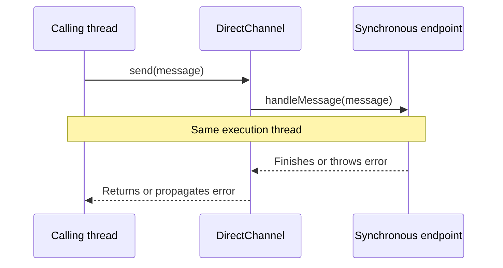
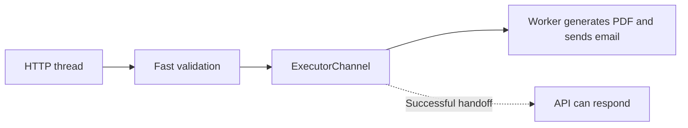

# When Not to Use DirectChannel

In the `SPRING_INTEGRATION_CORE` module, choosing a `MessageChannel` is part of message flow design: that choice determines who executes the endpoint, how long the sender must wait, and where errors go. This lesson belongs to the **DirectChannel** chapter and focuses on requirements where direct message delivery is no longer suitable.

After this lesson, you should be able to explain why a flow with `Message`, gateways, and Java DSL can still run entirely synchronously; pick a thread-switching or buffering boundary; and identify the additional guarantees you must design when changing channels.

## 1. Understand the Contract Before Changing the Channel

`DirectChannel` invokes the handler directly on the thread executing `send()`. With a synchronously processing handler, the send call only returns after the handler finishes or throws an error. This is a point-to-point mechanism: the message is delivered to one processor rather than broadcast to every subscriber. See [DirectChannel Javadoc](https://docs.spring.io/spring-integration/api/org/springframework/integration/channel/DirectChannel.html).



A minimal snippet lets us observe that contract:

```java
import org.springframework.integration.channel.DirectChannel;
import org.springframework.messaging.support.GenericMessage;

public class DirectChannelThreadDemo {

    public static void main(String[] args) {
        DirectChannel channel = new DirectChannel();

        channel.subscribe(message -> {
            System.out.println("handler: " + Thread.currentThread().getName());
            System.out.println("payload: " + message.getPayload());
        });

        System.out.println("before: " + Thread.currentThread().getName());
        channel.send(new GenericMessage<>("ORDER-814"));
        System.out.println("after: " + Thread.currentThread().getName());
    }
}
```

When run directly from `main`, the handler body executes between the `before` and `after` lines on the `main` thread. The channel does not spawn workers merely because data was wrapped in a `Message`.

From this mechanism, three design consequences follow:

- The runtime of a synchronous endpoint becomes part of the duration the sender must wait.
- If multiple threads send simultaneously, they can enter the same handler concurrently. Running on each sender's thread does not mean the whole application uses only one thread.
- A chain of transformers, filters, routers, and service activators connected by direct channels can still sit on the same call stack. Splitting into multiple endpoints does not create a background-processing boundary.

These consequences explain the situations requiring different channels in the sections ahead.

## 2. Do Not Use as a Background-Processing Boundary for Slow Work

Suppose an order-intake API must respond within about 200 ms. After validating data, the system generates a PDF and calls an email service; those two operations can take several seconds.

If the controller calls a gateway that flows through `DirectChannel` to the PDF-generation endpoint, the HTTP serving thread must execute that work. Bean names like `backgroundJobs` or method names like `submitAsync` do not change the invocation mechanism.

In this hypothetical example:

```text
Validate data:         15 ms
Generate PDF:       1,400 ms
Call email service:   650 ms
Minimum total:      2,065 ms, excluding resource waits and framework overhead
```

Placing the latter two operations into separate endpoints still keeps the combined duration on the call path if no thread-switching boundary exists.

When the requirement is releasing the sender right after handing off the task within the same process, you can use `ExecutorChannel` with an appropriate executor. This channel delegates dispatching to the executor; whether work runs on a worker thread depends on the supplied executor. See [ExecutorChannel Javadoc](https://docs.spring.io/spring-integration/api/org/springframework/integration/channel/ExecutorChannel.html).



**Successful handoff** and **completed business process** must have distinct meanings. If the API replies that the order's email has been sent as soon as the executor accepts the task, the returned information can be wrong if the worker fails afterward. For long-running work, return a job ID with an initial status such as `ACCEPTED`, then update the status when processing finishes.

Switching threads only solves where execution runs. If the work must survive restarts or be processed by another application, design persistent storage or a broker as in section 5.

## 3. Do Not Use When Traffic Spikes Must Be Absorbed by a Queue

An ingestion system may receive 600 requests per second for 10 seconds while downstream can only process 200 requests per second. If you want to accept the entire burst and process it gradually, you need a place to hold unprocessed work.

`DirectChannel` provides no backlog queue. When the handler is slow, sending threads are held on the call path; work can pile up at the HTTP server, thread pools, or upstream systems. Pushing backpressure onto the upstream caller can be an intentional choice, but it does not meet this problem's requirement for decoupled buffering.

With the hypothetical figures above, the approximate backlog buildup is:

```text
(600 - 200) requests/second × 10 seconds = 4,000 requests
```

This is only an initial estimate assuming steady rates during the burst. You must also account for payload size, available memory, acceptable wait times, and how long it takes to drain the backlog afterward.

`QueueChannel` lets you configure capacity. Senders put messages into the queue while receivers pull them with `receive()`; consuming endpoints typically need a poller. See [QueueChannel Javadoc](https://docs.spring.io/spring-integration/api/org/springframework/integration/channel/QueueChannel.html).

A complete example configuring a queue in a Spring application with the Spring Integration Core dependency:

```java
import java.time.Duration;

import org.springframework.context.annotation.Bean;
import org.springframework.context.annotation.Configuration;
import org.springframework.integration.channel.QueueChannel;
import org.springframework.integration.config.EnableIntegration;
import org.springframework.integration.dsl.IntegrationFlow;
import org.springframework.integration.dsl.Pollers;

@Configuration
@EnableIntegration
public class BufferedImportConfiguration {

    @Bean
    public QueueChannel importRequests() {
        return new QueueChannel(500);
    }

    @Bean
    public IntegrationFlow importFlow(QueueChannel importRequests) {
        return IntegrationFlow.from(importRequests)
                .handle(String.class, (payload, headers) -> {
                    // Replace with the application's data import operation.
                    System.out.println("Importing " + payload);
                    return null;
                }, endpoint -> endpoint.poller(
                        Pollers.fixedDelay(Duration.ofMillis(100))
                                .maxMessagesPerPoll(5)))
                .get();
    }
}
```

`maxMessagesPerPoll(5)` limits the number of messages per poll; this value does not create five parallel workers. Numbers like 500, 100 ms, and 5 only illustrate configuration and must be tuned to actual load.

On the sending side, set a wait bound when the queue is full and handle the outcome:

```java
boolean accepted = importRequests.send(
        new org.springframework.messaging.support.GenericMessage<>("batch-814"),
        100L);

if (!accepted) {
    // Return an overload status or switch to another intake mechanism.
    throw new IllegalStateException("Import queue is full");
}
```

You need an explicit policy when the queue is full: reject, wait with a bound, or spill to another store. A larger queue only extends burst-absorption capacity; if the arrival rate permanently exceeds the processing rate, the system still heads toward overload.

## 4. Do Not Use Expecting a Send Timeout to Interrupt the Handler

This is a common design mistake:

```java
// Does not mean the handler must finish within 100 ms.
directChannel.send(message, 100L);
```

In `DirectChannel`'s superclass, `doSend(message, timeout)` dispatches directly to the handler without using the timeout parameter to create a cancellation timer. You can inspect [AbstractSubscribableChannel source](https://raw.githubusercontent.com/spring-projects/spring-integration/main/spring-integration-core/src/main/java/org/springframework/integration/channel/AbstractSubscribableChannel.java).

If the handler invokes a synchronous HTTP client for 5 seconds, the send call can be blocked accordingly. Calling `send(..., 100)` does not close sockets, cancel database queries, or stop tasks.

Similarly, a gateway's `replyTimeout` does not interrupt an endpoint executing on the same calling thread. Only when the flow has an asynchronous boundary can the gateway wait for a reply with a timeout after handoff. See the section on long-running downstream processes in [Messaging Gateways](https://docs.spring.io/spring-integration/reference/gateway.html#gateway-behavior-no-response).

Distinguish three kinds of timeouts in design:

| Limit | Question to answer | Where to configure |
| --- | --- | --- |
| Queue acceptance wait time | Under overload, how long does the sender wait for space? | Buffering channel and send call |
| Reply wait time | After handoff, how long does the caller wait for a result? | Gateway or request-reply component |
| I/O execution time | How long can an HTTP, JDBC, or external service call last at most? | Client, driver, and endpoint executing the I/O |

If you need to bound the caller's response time independently of background work, design an asynchronous boundary paired with a wait timeout. The caller timing out does not guarantee the task was cancelled; the task may still finish or produce business side effects later.

A gateway returning `void` only expresses a contract with no business return value. When it sends into a synchronous flow over `DirectChannel`, the caller still executes that flow. To achieve background processing, inspect both the gateway configuration and downstream execution boundaries.

## 5. Do Not Use as a Durable Delivery or Inter-Process Communication Mechanism

Consider the requirement: "Once the API confirms receiving a task, if the application crashes abruptly, the task must still be processed." An in-process channel invoking handlers in memory does not provide this guarantee on its own.

Replacing `DirectChannel` with an in-memory queue or executor does not satisfy the requirement either. Unfinished tasks can be lost when the process terminates. That change solves handoff while the application is alive, without creating a durable delivery log.

Two directions to evaluate based on system requirements:

- Use a channel backed by a persistent message store. For JDBC-backed channel storage, Spring Integration provides `JdbcChannelMessageStore`; you must prepare the schema and query provider matching your database. See [JDBC Message Store](https://docs.spring.io/spring-integration/reference/jdbc/message-store.html).
- Communicate through an external broker or messaging platform via the corresponding adapter; additionally design persistence, delivery acknowledgments, redelivery, and deduplication according to the chosen system's characteristics.

A persistent store also requires proper transaction boundaries. For instance, with a transactional store and a properly transacted poller, pulling a message from the store can roll back when processing fails. See [Configuring a Queue with a Message Store](https://docs.spring.io/spring-integration/reference/channel/configuration.html#channel-configuration-queuechannel).

One business scenario needing separate analysis:

```text
1. Writing the order to the database succeeds.
2. The process stops before publishing the email-request event.
3. The order exists, yet the email-sending request was never recorded.
```

With two independent writes like that, changing the channel does not make them atomic automatically. One design approach is writing the order record and an outbox record in the same database transaction; a separate process relays outbox records to the messaging system with deduplication safeguards.

For tasks that may be redelivered, use business keys such as `orderId` or `jobId` to design idempotency. The case where a worker sent the email but crashed before saving the completed status shows that durable message storage must still be paired with business side-effect design.

If producer and consumer run in two different JVMs, containers, or machines, a `DirectChannel` bean living inside one application context is not a transport link between them. You need appropriate adapters and protocols or a broker; two identically named beans in two processes do not connect to each other.

## 6. Do Not Use When One Event Must Go to Multiple Receivers

Suppose an `OrderCreated` event must reach all three branches:

```text
OrderCreated
    ├── Send notification
    ├── Write audit log
    └── Update statistics
```

If all three endpoints subscribe to one `DirectChannel`, they become competing receivers for dispatch rather than three branches each receiving every event. That configuration easily leads to one order only being audited while another only triggers a notification.

`PublishSubscribeChannel` provides delivery to all subscribers. You can create an event-broadcasting channel and attach receiving flows to it. See [PublishSubscribeChannel Javadoc](https://docs.spring.io/spring-integration/api/org/springframework/integration/channel/PublishSubscribeChannel.html).

Example Java DSL snippet; `notificationService`, `auditService`, and `statisticsService` are business beans supplied by the application:

```java
@Bean
IntegrationFlow orderCreatedFanOut(
        NotificationService notificationService,
        AuditService auditService,
        StatisticsService statisticsService) {

    return IntegrationFlow.from("orderCreatedEvents")
            .publishSubscribeChannel(subscribers -> subscribers
                    .subscribe(flow -> flow
                            .handle(notificationService, "send"))
                    .subscribe(flow -> flow
                            .handle(auditService, "record"))
                    .subscribe(flow -> flow
                            .handle(statisticsService, "update")))
            .get();
}
```

Fan-out and background execution are two distinct requirements. Without supplying an executor, a publish-subscribe channel can still invoke branches synchronously; one slow branch continues impacting total execution time. Branch failures also need their own policy, because configuring broadcast to multiple subscribers does not guarantee all business side effects complete.

When auditing must be durable while statistics can tolerate delayed processing, design each branch according to its requirements. If results from branches need to be combined with an aggregator, design correlation, release conditions, and missing-reply handling; a broadcasting channel alone does not provide those business decisions.

## 7. Do Not Use to Automatically Create Parallelism, Global Ordering, or Content-Based Branching

### Multiple Subscribers Do Not Create Additional Workers

Subscribing multiple handlers to a `DirectChannel` supports distributing work across receivers, yet a sequential sender still executes each send on its own thread. To increase concurrency, you need a multi-threaded sending source or a controlled parallel execution mechanism.

Because multiple senders can enter a handler simultaneously, handlers must also be concurrency-safe. For instance, an instance field used as a counter or a shared collection does not become thread-safe merely by sitting behind a `DirectChannel`.

### Same Thread per Send Does Not Create Global Ordering Across All Producers

Suppose two threads send status updates for the same order. Thread A sends `PAID`, thread B sends `CANCELLED`. Completion order still depends on scheduling and processing time; you cannot infer business ordering guarantees solely from the channel type.

If sequential processing per `orderId` is needed, you can use key-based partitioning. Spring Integration provides `PartitionedChannel` since version 6.1 to route messages with the same key onto the same processing thread. This mechanism must be chosen based on your actual version and topology. See [PartitionedChannel section](https://docs.spring.io/spring-integration/reference/channel/implementations.html#channel-implementations-partitionedchannel).

Routing to the same partition does not fix events that arrived out of order from the source and does not create global ordering across multiple application instances. For critical state updates, you may also need business version numbers or valid state-transition checks.

### Load Balancing Does Not Replace a Router

If the requirement is "international orders go through customs check, domestic orders go through domestic fee calculation", use a router and explicit target channels. Subscribing two handlers to one `DirectChannel` does not express content-based branch selection conditions.

### Failover Does Not Replace Policy-Driven Retry

By default, the dispatcher can try the next subscriber when an earlier subscriber throws an exception; that is failover between receivers. You must explicitly configure this if handlers are not interchangeable. See [DirectChannel and failover configuration](https://docs.spring.io/spring-integration/reference/channel/configuration.html#channel-configuration-directchannel).

A dangerous example is handler A calling a payment gateway successfully and then failing while reading the response; the dispatcher next tries handler B and B executes the payment again. Receivers in a failover setup must have compatible interchangeable roles and protect business side effects against duplicate processing.

If you want an error to stop dispatch immediately rather than trying another handler:

```java
DirectChannel paymentCommands = new DirectChannel();
paymentCommands.setFailover(false);
```

This setting does not create retries, retry schedules, or dead-letter queues. Policies such as retrying only transient errors, attempt limits, backoff, and routing failed tasks to dedicated handling must be designed in the appropriate components.

## 8. Do Not Use Assuming Errors Automatically Go to `errorChannel`

When sending directly to a `DirectChannel`, processing errors that escape the flow normally propagate back to the caller via the call stack. Merely adding an `errorChannel` header does not automatically turn this call into message-based error handling. A gateway or advice can add error-catching and routing behavior depending on configuration.

When processing runs inside a Spring Integration asynchronous task or a poller, errors can be converted into an `ErrorMessage` through the corresponding error-handler mechanism. Error flows typically check the `errorChannel` header and then fall back to the global error channel. See [Error Handling](https://docs.spring.io/spring-integration/reference/error-handling.html).

Hypothetical example: an API only needs to accept an email-sending job, while a worker will attempt sending later. When switching from direct to executor, how outcomes are observed must also change:

| Situation | What the sender must understand | Next design step |
| --- | --- | --- |
| Handoff rejected because executor is full | The task was not accepted across this boundary | Handle rejection errors on the calling side |
| Worker accepts then fails calling email service | Error occurs after the sender has already moved on | Handle via an error flow or task-tracking mechanism |
| Worker finishes | Final business outcome exists | Update status by `jobId` |
| Caller times out waiting | Result has not yet been received by the caller | Check status instead of blindly resending |

Catching exceptions only around the producer's send call will miss errors happening later on the worker. Conversely, subscribing a flow only to `errorChannel` while still sending directly and synchronously may fail to catch errors the way the author expects.

## 9. Example: Creating a Load-Bounded Asynchronous Boundary

The following configuration targets a Spring application with the Spring Integration Core dependency. It accepts a string payload, normalizes whitespace, rejects empty strings with an error, and then invokes the illustrative endpoint on a dedicated executor. In a real application, replace the console output with actual notification-sending logic.

```java
import java.util.concurrent.ThreadPoolExecutor;

import org.springframework.beans.factory.annotation.Qualifier;
import org.springframework.context.annotation.Bean;
import org.springframework.context.annotation.Configuration;
import org.springframework.integration.channel.ExecutorChannel;
import org.springframework.integration.config.EnableIntegration;
import org.springframework.integration.dsl.IntegrationFlow;
import org.springframework.scheduling.concurrent.ThreadPoolTaskExecutor;

@Configuration
@EnableIntegration
public class NotificationFlowConfiguration {

    @Bean
    public ThreadPoolTaskExecutor notificationExecutor() {
        ThreadPoolTaskExecutor executor = new ThreadPoolTaskExecutor();
        executor.setCorePoolSize(4);
        executor.setMaxPoolSize(4);
        executor.setQueueCapacity(200);
        executor.setThreadNamePrefix("notification-");
        executor.setRejectedExecutionHandler(
                new ThreadPoolExecutor.AbortPolicy());
        return executor;
    }

    @Bean
    public ExecutorChannel notificationRequests(
            @Qualifier("notificationExecutor")
            ThreadPoolTaskExecutor executor) {
        return new ExecutorChannel(executor);
    }

    @Bean
    public IntegrationFlow notificationFlow(
            ExecutorChannel notificationRequests) {
        return IntegrationFlow.from(notificationRequests)
                .<String, String>transform(String::trim)
                .filter(String.class, text -> !text.isEmpty(),
                        endpoint -> endpoint.throwExceptionOnRejection(true))
                .handle(String.class, (text, headers) -> {
                    System.out.println("Sending " + text + " on "
                            + Thread.currentThread().getName());
                    return null;
                })
                .get();
    }
}
```

The executor is declared as a Spring bean so startup and shutdown lifecycle are managed by the container. `ThreadPoolTaskExecutor` lets you configure pool size, queue capacity, and rejection policy. See [ThreadPoolTaskExecutor Javadoc](https://docs.spring.io/spring-framework/docs/current/javadoc-api/org/springframework/scheduling/concurrent/ThreadPoolTaskExecutor.html).

Decisions in this example should be read against the business contract:

- Four workers cap this executor's concurrency; the queue holds up to 200 pending tasks in addition to active tasks.
- `AbortPolicy` rejects tasks when intake capacity is exhausted. The caller must handle rejection errors, such as returning an appropriate overload response.
- The transformer and filter sit after the executor channel. Thus, empty-payload errors here occur during background processing. If the API must reject invalid data before confirming acceptance, move that validation step before the executor boundary.
- The example does not persist tasks. It cannot be used to promise recovery of all work after a process crash.

If you replace the rejection policy with `CallerRunsPolicy`, under overload, tasks can fall back to running on the sending thread. This alters response latency and the intended isolation. Similarly, supplying a synchronous executor does not create a true worker boundary. This behavior is explained in [ExecutorChannel section](https://docs.spring.io/spring-integration/reference/channel/implementations.html#channel-implementations-executorchannel).

## 10. Only Change Channels After Determining Transaction and Context Needs

A valid reason to keep `DirectChannel` is needing synchronous execution inside the caller's transaction scope. However, sharing a thread only makes transaction participation possible; there must still be an active transaction, a transaction manager, and compatible participating resources.

When switching to a worker-backed executor, stop assuming a thread-bound transaction on the calling thread automatically moves to the handler. Example:

```text
Calling thread:
    open transaction A
    write order status
    hand off message to worker
    roll back transaction A

Worker:
    may have already received the message and executed another side effect
```

To resolve this, pick a clear business boundary: execute synchronously within an appropriate transaction, publish after commit, or use an outbox if requirements also include recovery across process crashes. Publishing only after commit still requires analyzing the failure window right before publishing.

Beyond transactions, thread-bound data such as MDC, security context, and request details must also be reviewed when moving to a worker. Put necessary, permitted metadata into message headers; if using executor context-propagation mechanisms, configure and verify them according to application needs.

Avoid passing a session-bound entity or a shared mutable payload to a worker while continuing to mutate it on the sender side. A DTO holding the needed data, along with a business key, usually makes the handoff contract much clearer.

## 11. Do Not Use as a Reactive Streams Backpressure Mechanism

`DirectChannel` invokes endpoints imperatively. Holding back a producer because of a slow handler creates pressure along the synchronous call path, yet it is not equivalent to Reactive Streams' `request(n)` protocol.

If the problem requires consumers to regulate data demand via Reactive Streams, consider `FluxMessageChannel` and matching reactive endpoints. Placing a single reactive channel amid blocking I/O operations does not turn the whole flow non-blocking. See [Reactive Streams Support](https://docs.spring.io/spring-integration/reference/reactive-streams.html).

The decision should start from the data source, downstream client type, and how demand is managed. Do not replace every `DirectChannel` with a reactive channel merely because the system needs to handle many concurrent requests.

## 12. Solution Selection Table by Requirement

This table is a design decision tool. The accompanying constraints must be written into the system's intake and processing contracts.

| Primary requirement | Direction of choice | Additional design considerations |
| --- | --- | --- |
| Fast, synchronous in-process execution | `DirectChannel` | I/O duration, thread safety, error propagation |
| Handoff to an in-process worker | `ExecutorChannel` with suitable executor | Pool/queue bounds, rejection, background errors, task status |
| Hold backlog for gradual processing | Bounded `QueueChannel` | Poller, peak load, wait time, full-queue policy |
| Tasks survive process restarts | Persistent channel store or durable messaging system | Transactions, acknowledgments, redelivery, deduplication |
| One event goes to multiple branches | `PublishSubscribeChannel` or broker fan-out | Branch isolation, per-branch errors, durability needs |
| Branch selection by content | Router and target channels | Unmatched cases and default path |
| Key-based ordering within a suitable scope | `PartitionedChannel` or source partitioning mechanism | Version, partition key, multiple instances, ordering at source |
| Demand regulation via Reactive Streams | `FluxMessageChannel` and reactive components | Blocking I/O, schedulers, error handling, and demand |
| Inter-application communication | Adapters, protocol gateways, or brokers | Data contracts, timeouts, connection security, delivery |

Multiple options can appear in the same flow: keep direct for fast validation and transformation, use a durable boundary for task intake, and then continue direct between endpoints inside each worker.

## 13. Verifying Contracts with Small Examples

The JUnit 5 examples below focus on behaviors you need to understand when choosing a channel. They require Spring Integration Core and JUnit Jupiter on the classpath; their assertions do not rely on sleeping for a few milliseconds and guessing thread order.

```java
import java.util.concurrent.atomic.AtomicInteger;
import java.util.concurrent.atomic.AtomicReference;

import org.junit.jupiter.api.Test;
import org.springframework.integration.channel.DirectChannel;
import org.springframework.integration.channel.QueueChannel;
import org.springframework.messaging.MessagingException;
import org.springframework.messaging.support.GenericMessage;

import static org.junit.jupiter.api.Assertions.*;

class DirectChannelContractTest {

    @Test
    void handlerRunsOnTheSendingThreadBeforeSendReturns() {
        DirectChannel channel = new DirectChannel();
        Thread caller = Thread.currentThread();
        AtomicReference<Thread> handlerThread = new AtomicReference<>();

        channel.subscribe(message ->
                handlerThread.set(Thread.currentThread()));

        assertTrue(channel.send(new GenericMessage<>("ORDER-814")));
        assertSame(caller, handlerThread.get());
    }

    @Test
    void successfulDispatchDoesNotBroadcastToBothSubscribers() {
        DirectChannel channel = new DirectChannel();
        AtomicInteger firstCalls = new AtomicInteger();
        AtomicInteger secondCalls = new AtomicInteger();

        channel.subscribe(message -> firstCalls.incrementAndGet());
        channel.subscribe(message -> secondCalls.incrementAndGet());

        channel.send(new GenericMessage<>("OrderCreated"));

        assertEquals(1, firstCalls.get() + secondCalls.get());
    }

    @Test
    void handlerFailureReachesTheSynchronousSender() {
        DirectChannel channel = new DirectChannel();
        channel.setFailover(false);
        channel.subscribe(message -> {
            throw new IllegalStateException("Email provider unavailable");
        });

        assertThrows(MessagingException.class,
                () -> channel.send(new GenericMessage<>("ORDER-814")));
    }

    @Test
    void boundedQueueCanAcceptBeforeAnyConsumerReceives() {
        QueueChannel channel = new QueueChannel(1);

        assertTrue(channel.send(new GenericMessage<>("first"), 0));
        assertFalse(channel.send(new GenericMessage<>("second"), 0));
        assertEquals("first", channel.receive(0).getPayload());
    }
}
```

When moving a design to workers or persistent storage, observe the corresponding scenarios:

| Verification scenario | Expected sign |
| --- | --- |
| Executor not saturated | Handler runs on configured worker; outcome is tracked independently |
| Executor pool and queue both full | Rejection is observable on the calling side, without silently dropping tasks |
| Worker throws error after intake | Error record or failed status attached to `jobId` exists |
| Queue has no remaining capacity | Producer honors wait timeout and overload policy |
| Process stops mid-work | Recovery behavior matches the configured store or broker |
| Two tasks with the same key arrive concurrently | Ordering and state constraints match the business contract |

These are behaviors to verify in the real application; standalone channel configuration snippets alone do not prove them.

## 14. Practice Exercise: Splitting an Order-Intake Flow

An API currently runs the following flow:

```text
Gateway
  → DirectChannel
  → Order validation filter
  → Data normalization transformer
  → Save order
  → Generate PDF invoice
  → Send email
```

New requirements: invalid data must be rejected immediately; once an accepted status is returned, invoice generation must be recoverable; email failures must not lose order information.

Decide where to keep direct execution and where to introduce other boundaries before writing configuration. One possible solution:

```text
Synchronous intake flow:
    Gateway
      → DirectChannel
      → Fast Filter/Transformer
      → Transaction saving order and outbox record
      → Return orderId and accepted status after commit

Background work flow:
    Outbox relay
      → Durable messaging system
      → Invoice generation worker
      → Update status by orderId
      → Send email with retry and deduplication policy
```

Here, `DirectChannel` continues serving short synchronous steps that require direct feedback. An outbox boundary and messaging system are added to satisfy the acceptance and recovery contract for long-running work.

To complete the solution, describe how to handle three failures: the outbox relay publishes the same record twice; the PDF worker generates the invoice and then crashes before updating status; the email service returns transient errors multiple times. For each failure, specify the business key, where state is stored, and under what conditions retries are allowed.
