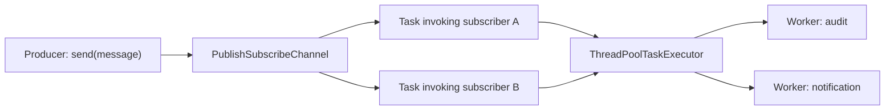

# TaskExecutor for Publish-Subscribe

In the **PublishSubscribeChannel** chapter of the **SPRING_INTEGRATION_CORE** module, this lesson explains how to control the execution of branches in a messaging flow using a `TaskExecutor`. The running scenario is publishing an order-created event to two independent subscribers: audit logging and sending notifications.

After this lesson, you will be able to:

- Distinguish synchronous broadcast from executor-backed broadcast.
- Configure a `ThreadPoolTaskExecutor` and attach it to a `PublishSubscribeChannel` or Java DSL.
- Explain the meaning of `send()`, asynchronous errors, overload conditions, and processing order.
- Design payloads, retries, and tests suited for concurrent execution across multiple branches.

## 1. What Does TaskExecutor Change?

`PublishSubscribeChannel` distributes a message to registered subscribers. The executor determines how handler invocations are executed; it does not turn broadcast into a mechanism that picks a single subscriber.

Without passing an executor:

```java
PublishSubscribeChannel events = new PublishSubscribeChannel();
```

Handlers are invoked on the sending thread. When branches do not introduce another asynchronous boundary, a slow handler blocks the sending thread while processing.

Passing an executor:

```java
PublishSubscribeChannel events = new PublishSubscribeChannel(executor);
```

The channel delegates invoking each subscriber to the executor. With a suitable thread pool, subscribers can run concurrently on different workers. This mechanism is described in [PublishSubscribeChannel configuration](https://docs.spring.io/spring-integration/reference/channel/configuration.html#channel-configuration-publishsubscribechannel).

The name `TaskExecutor` does not itself guarantee a new thread. `SyncTaskExecutor` still runs on the calling thread; `ThreadPoolTaskExecutor` uses a thread pool. The channel's constructor accepts `java.util.concurrent.Executor`, so a Spring `TaskExecutor` can be passed directly. See [TaskExecutor in Spring Framework](https://docs.spring.io/spring-framework/reference/integration/scheduling.html#scheduling-task-executor).

| Configuration | Where Handlers Run | Key Consequence |
| --- | --- | --- |
| No executor | Sending thread | Handler calls run sequentially on this thread |
| `SyncTaskExecutor` | Sending thread | Has an executor, yet still synchronous |
| `ThreadPoolTaskExecutor` | Typically pool workers | Can execute concurrently when resources allow |
| Pool using `CallerRunsPolicy` | May fall back to sending thread under saturation | Send-side latency varies with load |

You do not need to add `@Async` or `@EnableAsync` just for the channel to use the executor passed via its constructor.

## 2. One Message Creates Multiple Tasks

With two subscribers, the channel creates a separate dispatch task for each subscriber:



The queue in the diagram is the executor's work queue. `PublishSubscribeChannel` remains a subscribable channel; you do not add a poller just because you configured a thread pool.

A task's scope covers the handler invocation and any synchronous downstream steps that follow. For example, if a subscriber is a subflow consisting of a transformer followed by a service activator, the worker may execute both endpoints. Only when reaching the next asynchronous boundary is subsequent processing handed off to another mechanism.

Per-subscriber task splitting is shown in [Spring Integration's BroadcastingDispatcher](https://github.com/spring-projects/spring-integration/blob/main/spring-integration-core/src/main/java/org/springframework/integration/dispatcher/BroadcastingDispatcher.java).

### Three Distinct Milestones

For the `OrderCreated` event, distinguish:

1. The producer sends the message.
2. The executor accepts the dispatch tasks.
3. Each subscriber completes its business work.

In an asynchronous flow, `send()` returning `true` is not a business confirmation from all subscribers. One handler may finish very quickly before `send()` even returns; another handler may still be waiting in the queue or running.

If you need a reply stating "every branch succeeded", you must design a separate result-collecting flow and completion condition. Adding an executor does not provide that mechanism on its own.

## 3. Java Configuration Example

The example uses Java 17 or later with Spring Integration 6.x and a compatible Spring Framework managed by the project. It requires `spring-integration-core`, `spring-context`, and related libraries managed at compatible versions; in a Spring Boot application, you can use `spring-boot-starter-integration`.

The following class is a standalone configuration. Both handlers simply log for observation; the notification branch intentionally throws an error if the total is negative so you can test the error-handling path.

```java
import java.math.BigDecimal;
import java.util.concurrent.ThreadPoolExecutor;
import java.util.logging.Level;
import java.util.logging.Logger;

import org.springframework.beans.factory.annotation.Qualifier;
import org.springframework.context.annotation.Bean;
import org.springframework.context.annotation.Configuration;
import org.springframework.integration.annotation.ServiceActivator;
import org.springframework.integration.channel.DirectChannel;
import org.springframework.integration.channel.PublishSubscribeChannel;
import org.springframework.integration.config.EnableIntegration;
import org.springframework.messaging.MessageChannel;
import org.springframework.messaging.MessageHandler;
import org.springframework.scheduling.concurrent.ThreadPoolTaskExecutor;

@Configuration(proxyBeanMethods = false)
@EnableIntegration
public class OrderFanOutConfig {

    private static final Logger LOG =
            Logger.getLogger(OrderFanOutConfig.class.getName());

    public record OrderCreated(
            String eventId,
            String orderId,
            BigDecimal total) {
    }

    @Bean
    public ThreadPoolTaskExecutor orderFanOutExecutor() {
        ThreadPoolTaskExecutor executor = new ThreadPoolTaskExecutor();
        executor.setCorePoolSize(4);
        executor.setMaxPoolSize(8);
        executor.setQueueCapacity(64);
        executor.setThreadNamePrefix("order-fanout-");
        executor.setRejectedExecutionHandler(
                new ThreadPoolExecutor.AbortPolicy());
        executor.setWaitForTasksToCompleteOnShutdown(true);
        executor.setAwaitTerminationSeconds(15);
        return executor;
    }

    @Bean
    public PublishSubscribeChannel orderEvents(
            @Qualifier("orderFanOutExecutor")
            ThreadPoolTaskExecutor executor) {

        return new PublishSubscribeChannel(executor, true);
    }

    @Bean
    public MessageChannel orderEventErrors() {
        return new DirectChannel();
    }

    @Bean
    @ServiceActivator(inputChannel = "orderEvents")
    public MessageHandler auditOrder() {
        return message -> {
            OrderCreated event = (OrderCreated) message.getPayload();

            LOG.info(() -> "audit eventId=" + event.eventId()
                    + ", orderId=" + event.orderId()
                    + ", thread=" + Thread.currentThread().getName());
        };
    }

    @Bean
    @ServiceActivator(inputChannel = "orderEvents")
    public MessageHandler notifyCustomer() {
        return message -> {
            OrderCreated event = (OrderCreated) message.getPayload();

            if (event.total().signum() < 0) {
                throw new IllegalArgumentException(
                        "Total must not be negative: " + event.eventId());
            }

            LOG.info(() -> "notify eventId=" + event.eventId()
                    + ", orderId=" + event.orderId()
                    + ", thread=" + Thread.currentThread().getName());
        };
    }

    @Bean
    @ServiceActivator(inputChannel = "orderEventErrors")
    public MessageHandler recordOrderFailure() {
        return message -> {
            Throwable failure = (Throwable) message.getPayload();
            LOG.log(Level.SEVERE, "Order subscriber failed", failure);
        };
    }
}
```

Key points to read accurately:

- `@EnableIntegration` registers the Spring Integration infrastructure in an example that does not rely on Boot auto-configuration.
- `@ServiceActivator` registers two endpoints that both receive from `orderEvents`.
- The `true` argument in the constructor requires the channel to have subscribers when sending. It does not require every subscriber to process successfully.
- Because the pool is a Spring bean, Spring handles initialization and lifecycle management. Do not call `initialize()` again inside this `@Bean` method.
- `eventId` is the stable business identifier of the event; it will be useful for retries.

The constructor semantics and `requireSubscribers` option are documented in the [PublishSubscribeChannel API](https://docs.spring.io/spring-integration/api/org/springframework/integration/channel/PublishSubscribeChannel.html).

### Sending an Event

The following snippet sits inside a method that already has `ApplicationContext context`. It builds a message and specifies the error channel for this event:

```java
import java.math.BigDecimal;

import org.springframework.messaging.Message;
import org.springframework.messaging.MessageChannel;
import org.springframework.messaging.support.MessageBuilder;

// Inside a method using ApplicationContext:
MessageChannel events =
        context.getBean("orderEvents", MessageChannel.class);
MessageChannel failures =
        context.getBean("orderEventErrors", MessageChannel.class);

Message<OrderFanOutConfig.OrderCreated> message =
        MessageBuilder.withPayload(
                new OrderFanOutConfig.OrderCreated(
                        "evt-1001",
                        "order-42",
                        new BigDecimal("250000")))
                .setErrorChannel(failures)
                .setHeader("traceId", "trace-1001")
                .build();

boolean dispatched = events.send(message);
```

You should expect two logs corresponding to audit and notify, typically with thread names starting with `order-fanout-`. Do not rely on the order of those two log lines to infer business ordering.

Change the total to `new BigDecimal("-1")` to test the notification failure. When executor resources remain available, audit can still run; the notification error is routed to `orderEventErrors`. The `dispatched` value does not become `false` just because notification fails later.

## 4. Expressing It with Java DSL

If you prefer seeing every branch clearly within a single flow, you can use `publishSubscribeChannel(executor, ...)`.

The snippet below is an **alternative** to the `orderEvents`, `auditOrder`, and `notifyCustomer` beans in the previous configuration. Keep the executor bean, error-handling bean, and `OrderCreated` record. Place this method in the same configuration class, sharing the `LOG` field:

```java
import org.springframework.integration.dsl.IntegrationFlow;

@Bean
public IntegrationFlow orderEventsFlow(
        @Qualifier("orderFanOutExecutor")
        ThreadPoolTaskExecutor executor) {

    return IntegrationFlow.from("orderEvents")
            .publishSubscribeChannel(executor, subscribers -> subscribers
                    .subscribe(flow -> flow.handle(message -> {
                        OrderCreated event =
                                (OrderCreated) message.getPayload();
                        LOG.info("audit eventId=" + event.eventId());
                    }))
                    .subscribe(flow -> flow.handle(message -> {
                        OrderCreated event =
                                (OrderCreated) message.getPayload();

                        if (event.total().signum() < 0) {
                            throw new IllegalArgumentException(
                                    "Total must not be negative");
                        }

                        LOG.info("notify eventId=" + event.eventId());
                    })))
            .get();
}
```

In this variant, `orderEvents` is the input channel created by the DSL if no bean with that name exists; the broadcast point is the subsequent `publishSubscribeChannel(...)`. Each `subscribe(...)` declares a subflow receiving the event.

The overload accepting an executor is documented in the [Java DSL API](https://docs.spring.io/spring-integration/api/org/springframework/integration/dsl/BaseIntegrationFlowDefinition.html#publishSubscribeChannel(java.util.concurrent.Executor,java.util.function.Consumer)).

If you need a transformer or filter, place them inside the respective branch:

```java
.subscribe(flow -> flow
        .<OrderCreated>filter(event -> event.total().signum() > 0)
        .<OrderCreated, String>transform(
                event -> "Order " + event.orderId() + " was created")
        .handle(message -> LOG.info((String) message.getPayload())))
```

This is a replacement fragment for one `subscribe` call in the DSL above. The filter only affects the branch containing it. If the filter drops a message, that branch produces no result; this must be accounted for when designing an aggregator.

Placing multiple endpoints sequentially inside a subflow creates a processing chain in that branch. If one handler must always run after another, express the dependency via an endpoint chain rather than expecting two broadcast subscribers to wait for each other.

## 5. Sizing Pool and Queue for Fan-Out Load

`ThreadPoolTaskExecutor` wraps a thread pool with properties such as `corePoolSize`, `maxPoolSize`, and `queueCapacity`. Its defaults are not a multi-worker pool with a bounded queue, so explicitly configure values matching the flow's goals. See the [ThreadPoolTaskExecutor API](https://docs.spring.io/spring-framework/docs/current/javadoc-api/org/springframework/scheduling/concurrent/ThreadPoolTaskExecutor.html).

With `core = 4`, `max = 8`, and `queue = 64`, when all running workers are busy:

1. The pool creates workers up to the core size as needed.
2. Subsequent tasks are placed into the queue while space remains.
3. Once the queue is full, the pool may grow workers beyond core up to max.
4. When both the pool and queue are exhausted, the rejection policy takes effect.

This is the task acceptance order of [ThreadPoolExecutor](https://docs.oracle.com/en/java/javase/17/docs/api/java.base/java/util/concurrent/ThreadPoolExecutor.html). Increasing `maxPoolSize` alone may not improve latency if a large queue keeps the pool queuing at the core size.

### Sizing by Tasks, Not Just Messages

Suppose a workload measures:

- 100 events per second.
- Two subscribers always receive every event.
- Audit occupies a worker for 20 ms on average.
- Notification occupies a worker for 80 ms on average.

Estimated worker occupancy load:

```text
Tasks submitted to the pool per second ≈ 100 × 2 = 200 tasks/second

Worker time occupied per event:
20 ms + 80 ms = 100 ms

Average concurrency needed to keep up with load:
100 events/second × 0.1 seconds/event ≈ 10 workers
```

This is an illustrative estimate, not a universal pool-sizing formula. A pool with max 8 cannot keep up with this assumed load if processing times remain the same. A queue only delays the point of saturation; it does not increase sustained throughput.

When choosing configuration values, also evaluate:

| Factor | Practical Question |
| --- | --- |
| CPU | Are handlers doing heavy computation across a finite number of cores? |
| External services | Does the target API enforce concurrency limits or timeouts? |
| Database | Is the connection pool large enough for the workers that access the DB? |
| Memory | Do queued tasks hold references to large payloads? |
| Latency | How long can the queue allow events to wait? |
| Traffic spikes | How long must the system absorb peak bursts? |

Increasing workers beyond a downstream service's limits can slow the system down due to contention or timeouts.

## 6. Overload and Partial Delivery

The main example uses `AbortPolicy` so rejection surfaces as an error instead of silently dropping tasks. With `ThreadPoolTaskExecutor`, rejection errors follow Spring's `TaskRejectedException` contract; when traversing a message channel, the caller may encounter a wrapping messaging exception. Do not couple business logic to assuming a single exact outer exception class.

Common policies:

| Policy | When No More Work Can Be Accepted | Impact on the Flow |
| --- | --- | --- |
| `AbortPolicy` | Throws a rejection error | Caller has an opportunity to detect failed task submission |
| `CallerRunsPolicy` | Caller executes the task while the executor is still active | Producer slows down because it must execute the work |
| `DiscardPolicy` | Drops the new task | Can lose one subscriber's processing without throwing an error to the caller |
| `DiscardOldestPolicy` | Drops the oldest queued task and retries accepting the new one | Can drop a branch of an earlier event |

Saturation behavior and choosing `CallerRunsPolicy` are explained in [Spring Framework executor configuration](https://docs.spring.io/spring-framework/reference/integration/scheduling.html#scheduling-task-namespace-executor).

`CallerRunsPolicy` can cause a handler to execute on the producer thread. As a result, a flow configured with an executor can still block an HTTP thread during processing under heavy load. Nor does this policy guarantee accepting tasks after the executor has shut down.

### Why Retrying the Entire Message Can Cause Duplicates

Consider a channel with subscribers A, B, and C:

```text
Task A is accepted by the executor.
Task B is accepted by the executor.
Task C is rejected because the pool and queue are full.
send(message) throws an error.
A and B may still continue running.
```

Broadcast does not provide an atomic transaction across submitting all tasks. An error when submitting task C does not automatically cancel or roll back A and B.

If the producer resends the entire event, A and B can run again. When retries are needed, design each subscriber to be idempotent, for example using a key:

```text
(eventId, subscriberName)

(evt-1001, audit)
(evt-1001, notification)
```

Including the subscriber name in the key lets each branch be processed once according to its own business semantics; a shared "event processed" record could cause one branch to inadvertently block another branch from running.

Recording the key and updating a branch's data should happen in the same transaction when sharing the same database. For external side effects such as sending emails, rely on the target service's idempotency mechanism or design appropriate send-state persistence.

## 7. Separating Task Submission Errors from Handler Errors

These two error groups occur at different times:

| Error Group | Example | How to Observe |
| --- | --- | --- |
| Submission error | No subscribers when required; executor rejects task | Can surface during the `send()` call |
| Processing error | Subscriber throws an error on a worker | Goes through the channel's error-handling mechanism |

When an executor is present, `PublishSubscribeChannel` defaults to `MessagePublishingErrorHandler`. It sends an `ErrorMessage` to the channel in the original message's `errorChannel` header, or to the global `errorChannel` bean if absent. Without an executor, the channel's `ErrorHandler` is not used this way and handler errors are thrown on the sending thread. See [PublishSubscribeChannel error handling](https://docs.spring.io/spring-integration/api/org/springframework/integration/channel/PublishSubscribeChannel.html#setErrorHandler(org.springframework.util.ErrorHandler)).

### Why try/catch Around send() Is Not Enough

```java
try {
    events.send(message);
} catch (RuntimeException ex) {
    // Can handle errors occurring during send/task submission.
    // Not the place receiving errors that happen later on workers.
}
```

The producer's call stack is no longer waiting for the worker's business outcome. To observe processing errors, there must be a consumer on the error channel. `ErrorMessage` has a `Throwable` payload; messaging exceptions typically provide `failedMessage` to trace back to the failing message. This mechanism is described in [Spring Integration Error Handling](https://docs.spring.io/spring-integration/reference/error-handling.html).

In the example, `orderEventErrors` is a `DirectChannel`. The error-logging handler runs synchronously on the thread publishing the error, which is usually the failing worker itself. If error logging is slow, it also occupies the worker. If you need to decouple error handling, design an additional asynchronous boundary and dedicated capacity for the error flow.

The example only logs for easy observation. In a system requiring recovery, you can persist a failure record containing `eventId`, branch name, timestamp, and cause to support selective retries.

### ignoreFailures Does Not Replace an Error Flow

`ignoreFailures` defaults to `false`. When enabled, the dispatcher may log a warning and ignore handler errors to continue dispatching; you should not expect ignored errors to still traverse the default error path as before.

With an executor, branches already submitted to workers can still continue even if one branch fails. You do not need to enable `ignoreFailures` just to get this independence. If you want clear retries and error tracking, keeping the default policy and handling errors deliberately is usually easier to observe.

## 8. Ordering, Thread Safety, and Transactions

### Submission Order Does Not Guarantee Completion Order

Suppose the producer sends `E1` then `E2`. In a multi-worker pool, a subscriber may finish `E2` before `E1`. Within a single event, audit is also not guaranteed to finish before notification.

Endpoint `@Order`, if used to influence the order in which the dispatcher iterates handlers, does not create a "second handler runs only after the first handler finishes" relationship in a multi-worker pool.

If the business requires "record audit successfully before notifying", chain those endpoints in the same branch. If ordering per `orderId` is required, partition work by key and process sequentially within each partition, or use a storage/queue mechanism with appropriate ordering guarantees.

### One Handler Can Process Multiple Messages Concurrently

Handler beans are typically singletons. When multiple events enter the channel together, the same handler can be invoked concurrently by multiple workers.

Avoid holding per-execution state in shared fields:

```java
// Wrong if the same bean receives multiple messages concurrently:
private String currentOrderId;
```

Use local variables, immutable values, and data-access components with appropriate thread-safety contracts. If state must be shared, explicitly define synchronization locks or a consistent storage mechanism.

### Immutable Message Does Not Mean Deeply Copied Payload

Subscribers typically receive the same payload reference. The `OrderCreated` record in the example contains `String` and `BigDecimal`, making it safe to share.

A record containing a mutable `List` does not automatically become deeply immutable. One branch modifying a shared list can cause a race condition for another branch. Build immutable data or make necessary defensive copies before broadcasting.

When `applySequence` is enabled, the channel may create messages with different headers while still sharing the same payload reference. See [apply-sequence configuration](https://docs.spring.io/spring-integration/reference/channel/configuration.html#channel-configuration-publishsubscribechannel).

### Thread Boundaries Are Transaction Design Boundaries

A transaction bound to the producer's thread does not automatically propagate to workers. If a subscriber needs a database transaction, have the worker call a Spring bean with a properly proxied transactional method, or use `TransactionTemplate` inside the branch.

Do not rely on `CallerRunsPolicy` occasionally running on the producer thread for transaction design: such behavior changes with load. Additionally, if an event is published before the order-creation transaction commits, a subscriber may run early and fail to read the newly created data. Publish after commit; when you need to tie data persistence to event replayability, consider a transactional outbox.

MDC, security context, and other `ThreadLocal` values also require an explicit context-propagation mechanism. A `TaskDecorator` can wrap tasks to set up and restore execution context; always clean up context after each task to avoid leaking into subsequent work.

## 9. Using applySequence When Aggregating Results

The executor only controls execution. If you need to aggregate results from branches, you need a reply-message model and a separate aggregator.

Example enabling sequence metadata on the declared channel bean:

```java
@Bean
public PublishSubscribeChannel orderEvents(
        @Qualifier("orderFanOutExecutor")
        ThreadPoolTaskExecutor executor) {

    PublishSubscribeChannel channel =
            new PublishSubscribeChannel(executor, true);
    channel.setApplySequence(true);
    return channel;
}
```

Correlation and sequence headers help identify the group and expected item count. They do not force branches to complete in order.

With two subscribers, a completion condition expecting two results only makes sense if each branch actually sends one result to the gathering point. If one branch filters out a message, ends with a `void` handler, fails, or has its task rejected, the aggregator may never receive enough items. In that case, design timeouts, error results, or an appropriate release strategy.

The two handlers in the main example only log, so enabling `applySequence` alone does not turn that flow into a result-aggregating flow.

## 10. Gateway and What Accepting an Event Means

A gateway decouples callers from depending directly on a channel. For one-way notification broadcasts, a `void` signature usually expresses the intent well:

```java
import org.springframework.integration.annotation.MessagingGateway;
import org.springframework.messaging.Message;

@MessagingGateway(defaultRequestChannel = "orderEvents")
public interface OrderEventsGateway {
    void publish(Message<OrderFanOutConfig.OrderCreated> event);
}
```

When using this interface, register the gateway with `@IntegrationComponentScan` on a configuration class in an appropriate package. Accepting a `Message` lets the caller preserve the `errorChannel` header just like in the direct-send example.

Returning from `publish` does not mean audit and notification have finished. If an external API needs completion status, return an event tracking ID and provide a place to query results, or design a request/reply flow with a single explicit response aggregator. Do not let multiple branches reply arbitrarily to the same request and treat the first reply as the outcome of the entire broadcast.

## 11. Asynchronous Testing with Observable Conditions

The JUnit 5 example below uses a dedicated context to test two properties:

1. Both subscribers can start concurrently and still be waiting when `send()` has already returned.
2. A subscriber exception is published as an error message.

Do not use `Thread.sleep(...)` to guess when workers run. `CountDownLatch` and timeouts express the conditions to verify.

```java
import java.util.concurrent.CountDownLatch;
import java.util.concurrent.ExecutorService;
import java.util.concurrent.Executors;
import java.util.concurrent.Future;

import org.junit.jupiter.api.Test;
import org.springframework.context.annotation.AnnotationConfigApplicationContext;
import org.springframework.context.annotation.Bean;
import org.springframework.context.annotation.Configuration;
import org.springframework.integration.channel.PublishSubscribeChannel;
import org.springframework.integration.channel.QueueChannel;
import org.springframework.integration.config.EnableIntegration;
import org.springframework.messaging.Message;
import org.springframework.messaging.MessagingException;
import org.springframework.messaging.support.ErrorMessage;
import org.springframework.messaging.support.GenericMessage;
import org.springframework.messaging.support.MessageBuilder;
import org.springframework.scheduling.concurrent.ThreadPoolTaskExecutor;

import static java.util.concurrent.TimeUnit.SECONDS;
import static org.junit.jupiter.api.Assertions.*;

class PublishSubscribeExecutorTest {

    @Configuration(proxyBeanMethods = false)
    @EnableIntegration
    static class TestConfig {

        @Bean
        ThreadPoolTaskExecutor testExecutor() {
            ThreadPoolTaskExecutor executor = new ThreadPoolTaskExecutor();
            executor.setCorePoolSize(2);
            executor.setMaxPoolSize(2);
            executor.setQueueCapacity(4);
            executor.setThreadNamePrefix("test-fanout-");
            executor.setWaitForTasksToCompleteOnShutdown(true);
            executor.setAwaitTerminationSeconds(3);
            return executor;
        }

        @Bean
        PublishSubscribeChannel testEvents(
                ThreadPoolTaskExecutor executor) {
            return new PublishSubscribeChannel(executor, true);
        }

        @Bean
        QueueChannel testErrors() {
            return new QueueChannel(4);
        }
    }

    @Test
    void sendReturnsWhileBothSubscribersAreStillWorking() throws Exception {
        try (var context =
                     new AnnotationConfigApplicationContext(TestConfig.class)) {

            PublishSubscribeChannel channel =
                    context.getBean(PublishSubscribeChannel.class);
            CountDownLatch started = new CountDownLatch(2);
            CountDownLatch release = new CountDownLatch(1);
            CountDownLatch completed = new CountDownLatch(2);

            channel.subscribe(message -> block(started, release, completed));
            channel.subscribe(message -> block(started, release, completed));

            ExecutorService producer = Executors.newSingleThreadExecutor();
            try {
                Future<Boolean> sent = producer.submit(
                        () -> channel.send(new GenericMessage<>("evt-1")));

                assertTrue(sent.get(3, SECONDS));
                assertTrue(started.await(3, SECONDS));
                assertEquals(2L, completed.getCount());
            } finally {
                release.countDown();
                producer.shutdownNow();
            }

            assertTrue(completed.await(3, SECONDS));
        }
    }

    @Test
    void subscriberFailureIsPublishedToTheRequestedErrorChannel() {
        try (var context =
                     new AnnotationConfigApplicationContext(TestConfig.class)) {

            PublishSubscribeChannel channel =
                    context.getBean(PublishSubscribeChannel.class);
            QueueChannel errors =
                    context.getBean("testErrors", QueueChannel.class);

            channel.subscribe(message -> {
                throw new IllegalArgumentException("boom");
            });

            Message<String> event = MessageBuilder.withPayload("evt-2")
                    .setErrorChannel(errors)
                    .build();

            assertTrue(channel.send(event));

            Message<?> received = errors.receive(3_000);
            assertNotNull(received);
            assertInstanceOf(ErrorMessage.class, received);

            MessagingException failure = assertInstanceOf(
                    MessagingException.class, received.getPayload());
            assertNotNull(failure.getFailedMessage());
            assertEquals("evt-2", failure.getFailedMessage().getPayload());
        }
    }

    private static void block(
            CountDownLatch started,
            CountDownLatch release,
            CountDownLatch completed) {

        started.countDown();
        try {
            if (!release.await(10, SECONDS)) {
                throw new IllegalStateException("Timed out waiting for release");
            }
        } catch (InterruptedException ex) {
            Thread.currentThread().interrupt();
            throw new IllegalStateException("Interrupted", ex);
        } finally {
            completed.countDown();
        }
    }
}
```

The producer thread in the first test ensures the `send()` call itself also has an observable timeout. If the configuration accidentally becomes synchronous, the test will not hang indefinitely on the JUnit runner thread. The `finally` block always releases the handlers and shuts down the producer executor.

Do not assert that a specific worker name must handle subscriber A. What needs verification is concurrent execution capability and the distinction between send completion and processing completion.

Additional scenarios worth testing when applying this to a real system:

| Scenario | What to Verify |
| --- | --- |
| Pool and queue full | Task submission error is observed; branches that already received the task are not assumed unexecuted |
| Resending the same `eventId` | Business side effects of each subscriber are not duplicated |
| One slow branch | Queue depth and wait times stay within acceptable limits |
| Shutting down while tasks remain | Waiting for and persisting unfinished work meet recovery requirements |
| A branch filters out its result | Aggregator can finish or time out according to the chosen policy |

To reproduce saturation in a test, use a one-worker pool, a one-element queue, hold the worker with a latch, and submit additional work. Wait for the worker to actually start before sending more so the scenario does not depend on machine speed.

## 12. Operations and Guarantee Boundaries

A shared pool can let a slow notification branch occupy all workers, forcing audit to wait. If two branches have different latency budgets or priorities, use a synchronous broadcast to quickly forward messages into separate asynchronous channels per branch. Each branch channel uses an executor with appropriate limits; at the same time, still handle task submission errors at those points.

Useful signals to monitor:

- Active worker count and queue length.
- Count of rejected tasks.
- Queue wait time before a handler starts.
- Processing duration and error rate per subscriber.
- Number of failure records awaiting retry and age of the oldest event.

A short `send()` duration only indicates the producer submits tasks quickly under the measured conditions. Measure business completion latency separately using `eventId` or a correlation ID.

Configuring `setWaitForTasksToCompleteOnShutdown(true)` and `setAwaitTerminationSeconds(15)` in the example expresses the intent to wait for tasks when closing the context. That wait limit is not a guarantee that all work will finish within 15 seconds. Configure timeouts for downstream I/O and coordinate the lifecycle of resources used by handlers.

The queue inside `ThreadPoolTaskExecutor` lives in memory. It does not automatically provide durable storage, does not guarantee replay after a process crash, and does not turn the channel into a message broker topic. If events must survive crashes, design additional durable storage or a broker along with retry and idempotency mechanisms.

## 13. Practice Exercise

Use the example configuration to complete each step in order:

1. Send a valid event and observe the thread names of both subscribers.
2. Use a latch to hold one subscriber while running; verify the send completes before releasing the latch.
3. Send an event with a negative total and observe the error flow; cross-check against the audit log.
4. Lower the pool and queue limits, induce controlled saturation, and record which events entered each branch.
5. Add a store recording outcomes by `(eventId, subscriberName)` and resend the same event to verify idempotency.
6. Change one branch into a result-producing transformer, add an aggregator, and specify how to terminate when one branch returns no result.

The takeaway you should be able to explain is: the executor controls how branches execute; business success, error handling, ordering, load limits, and event durability each require their own explicit contract in the flow design.
