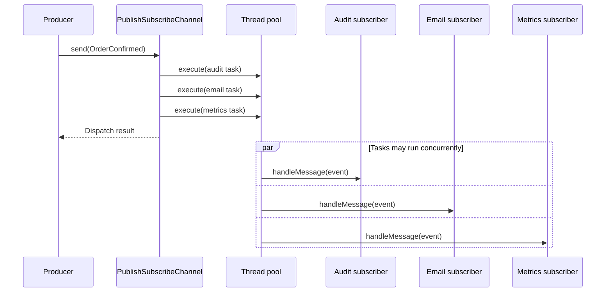

# Asynchronous Broadcast with PublishSubscribeChannel

In the **SPRING_INTEGRATION_CORE** module, `PublishSubscribeChannel` lets you represent an event as a `Message` and distribute that event to multiple endpoints. **Asynchronous broadcast** performs this distribution through an executor so subscribers can process on worker threads and the producer can continue its work before they finish.

For example, after an order is confirmed, the application needs to record audit logs, send an email, and update metrics. All three tasks care about the same event, yet have different processing durations and failure modes. This is a good scenario for exploring asynchronous broadcasting, error handling, and Java DSL in Spring Integration.

## 1. Objectives and Prerequisites

After this lesson, you will be able to:

- Distinguish synchronous broadcast, asynchronous broadcast, and single-consumer message delivery.
- Configure `PublishSubscribeChannel` with a Spring-managed executor.
- Understand the exact meaning of `send()`, `minSubscribers`, and errors when an executor rejects tasks.
- Design concurrency-safe subscribers and track failures with `ErrorMessage`.
- Write flows using Java DSL and test final outcomes using timeout-bounded waits.

You should know Spring beans, `Message<T>`, `MessageChannel`, `MessageHandler`, and thread pools at a basic level. Examples use Java 17 and APIs available in Spring Integration 6.5; use a compatible Spring Boot / Spring Integration set managed by your project's BOM.

## 2. How Does Asynchronous Broadcast Work?

### 2.1. The Executor Creates an Execution Boundary

Without passing an executor:

```java
PublishSubscribeChannel synchronous = new PublishSubscribeChannel();
```

By default, handlers are invoked sequentially on the thread sending the message. Slow handlers make the producer wait; exceptions can propagate back up the producer's call stack.

Passing a thread pool:

```java
PublishSubscribeChannel asynchronous =
        new PublishSubscribeChannel(executor);
```

The channel creates a task to invoke each subscriber and submits those tasks to the executor. With a genuinely background thread pool, handlers execute on worker threads. Branches can overlap in time if the executor has enough workers. An executor with only one worker still decouples from the producer, but does not run handlers in parallel. The default mechanism and executor-accepting constructor are described in [PublishSubscribeChannel configuration](https://docs.spring.io/spring-integration/reference/channel/configuration.html#channel-configuration-pubsubchannel).

Seeing the `Executor` type alone is not enough to guarantee work always runs in the background: an executor can execute tasks directly on its calling thread. `CallerRunsPolicy` can also cause the producer to execute a task when the pool is overloaded. When reading a flow, inspect both the channel and the executor configuration.



The diagram shows two independent processes: task submission and business processing. A worker may start, or even finish a branch, before `send()` returns; there is no guarantee that all workers wait for the producer to receive the dispatch result.

### 2.2. Distinguishing Related Channels

| Channel | Who Receives a Message? | Typical Processing Thread | Direct Polling? |
| --- | --- | --- | --- |
| `DirectChannel` | One selected subscriber | Sending thread | No |
| `ExecutorChannel` | One selected subscriber | Thread chosen by executor | No |
| `PublishSubscribeChannel` without executor | Registered subscribers | Sending thread | No |
| `PublishSubscribeChannel` with thread pool | Registered subscribers | Pool workers | No |
| `QueueChannel` | One consumer pulling from queue | Receiver or poller thread | Yes |

`ExecutorChannel` does not replace broadcast: having multiple subscribers still does not mean every subscriber receives the same message. `PublishSubscribeChannel` does not provide `receive()`; subscribers receive messages via `handleMessage()`. See [MessageChannel implementations](https://docs.spring.io/spring-integration/reference/channel/implementations.html).

A thread pool may have a queue holding tasks, but that queue does not turn the channel into a `QueueChannel` and does not provide event retention for late-registering subscribers.

### 2.3. Meaning of send()

With a background executor and a throwing rejection policy, `send(message)` returning `true` indicates that the dispatch step met the subscriber-count check and the task submission calls returned normally. It is not a receipt for the business outcome of each branch.

| Observation | What Can Be Concluded | What Cannot Be Concluded Yet |
| --- | --- | --- |
| `send()` returns `true` | The channel considers the dispatch step successful | Email was sent, audit committed |
| An `ErrorMessage` is received | One processing task encountered an error | All remaining branches failed |
| Audit result received | The audit branch reached the milestone that result represents | Email and metrics branches finished |
| Producer catches no exception | No exception propagated along that call stack | No error occurred on workers |

`minSubscribers` defaults to `0`. With an executor, checking this threshold does not wait for handlers' business results. If `setMinSubscribers(3)` is configured when only two subscribers exist, the channel can still submit tasks to those two subscribers and return `false`. This is neither an atomic "send only if three exist" check nor a business success quorum. Details of the contract are in the [PublishSubscribeChannel API](https://docs.spring.io/spring-integration/docs/6.5.0/api/org/springframework/integration/channel/PublishSubscribeChannel.html).

Similarly, passing `send(message, 1000)` does not establish a one-second deadline for all subscribers to finish. To wait for results, you need a reply protocol or a separate result-gathering flow.

## 3. Complete Example: Three Subscribers and an Error Channel

### 3.1. Practice Scenario

The `OrderConfirmed` event is sent to three branches:

| Branch | Simulated Work | Branch Name in Result |
| --- | --- | --- |
| Audit | Record order confirmation | `audit` |
| Email | Simulate sending notification, can intentionally fail | `email` |
| Analytics | Record statistics event | `analytics` |

The example uses a thread-safe queue to collect simulated results. It allows observing broadcast without needing SMTP, a database, or an external analytics system. Adding a `Receipt` to the queue only confirms the simulated branch ran up to that recording point.

In a Spring Boot project with a suitable parent or BOM, add the following application and test dependencies:

```xml
<dependencies>
    <dependency>
        <groupId>org.springframework.boot</groupId>
        <artifactId>spring-boot-starter-integration</artifactId>
    </dependency>
    <dependency>
        <groupId>org.springframework.boot</groupId>
        <artifactId>spring-boot-starter-test</artifactId>
        <scope>test</scope>
    </dependency>
</dependencies>
```

This is the dependency fragment to add to a Boot project, not a complete standalone `pom.xml`. Do not manually mix incompatible lines of Spring Framework, Spring Integration, and Spring Boot versions.

### 3.2. Java Configuration

Place the following configuration in package `example.broadcast`. `@EnableAsync` is not needed because the channel itself uses the executor to dispatch.

```java
package example.broadcast;

import java.math.BigDecimal;
import java.util.concurrent.BlockingQueue;
import java.util.concurrent.LinkedBlockingQueue;
import java.util.concurrent.ThreadPoolExecutor;
import java.util.concurrent.TimeUnit;

import org.springframework.beans.factory.annotation.Qualifier;
import org.springframework.context.annotation.Bean;
import org.springframework.context.annotation.Configuration;
import org.springframework.integration.channel.MessagePublishingErrorHandler;
import org.springframework.integration.channel.PublishSubscribeChannel;
import org.springframework.integration.channel.QueueChannel;
import org.springframework.integration.config.EnableIntegration;
import org.springframework.integration.dsl.IntegrationFlow;
import org.springframework.scheduling.concurrent.ThreadPoolTaskExecutor;

@Configuration
@EnableIntegration
public class AsyncBroadcastConfig {

    public record OrderConfirmed(
            String eventId,
            String orderId,
            BigDecimal total,
            boolean simulateEmailFailure) {
    }

    public record Receipt(
            String eventId,
            String branch,
            String threadName) {
    }

    public static final class DemoEffects {
        private final BlockingQueue<Receipt> receipts =
                new LinkedBlockingQueue<>();

        public void audit(OrderConfirmed event) {
            record(event, "audit");
        }

        public void email(OrderConfirmed event) {
            if (event.simulateEmailFailure()) {
                throw new IllegalStateException(
                        "Simulated SMTP failure: " + event.orderId());
            }
            record(event, "email");
        }

        public void analytics(OrderConfirmed event) {
            record(event, "analytics");
        }

        public Receipt awaitReceipt(long timeout, TimeUnit unit)
                throws InterruptedException {
            return receipts.poll(timeout, unit);
        }

        private void record(OrderConfirmed event, String branch) {
            receipts.add(new Receipt(
                    event.eventId(),
                    branch,
                    Thread.currentThread().getName()));
        }
    }

    @Bean
    public DemoEffects demoEffects() {
        return new DemoEffects();
    }

    @Bean
    public ThreadPoolTaskExecutor broadcastExecutor() {
        ThreadPoolTaskExecutor executor = new ThreadPoolTaskExecutor();
        executor.setCorePoolSize(3);
        executor.setMaxPoolSize(6);
        executor.setQueueCapacity(100);
        executor.setThreadNamePrefix("order-broadcast-");
        executor.setRejectedExecutionHandler(
                new ThreadPoolExecutor.AbortPolicy());
        executor.setWaitForTasksToCompleteOnShutdown(true);
        executor.setAwaitTerminationSeconds(10);
        return executor;
    }

    @Bean
    public QueueChannel broadcastErrors() {
        return new QueueChannel(100);
    }

    @Bean
    public MessagePublishingErrorHandler broadcastErrorHandler(
            @Qualifier("broadcastErrors") QueueChannel errors) {
        MessagePublishingErrorHandler handler =
                new MessagePublishingErrorHandler();
        handler.setDefaultErrorChannel(errors);
        handler.setSendTimeout(1000);
        return handler;
    }

    @Bean
    public PublishSubscribeChannel orderEvents(
            @Qualifier("broadcastExecutor")
            ThreadPoolTaskExecutor executor,
            @Qualifier("broadcastErrorHandler")
            MessagePublishingErrorHandler errorHandler) {

        PublishSubscribeChannel channel =
                new PublishSubscribeChannel(executor, true);
        channel.setMinSubscribers(3);
        channel.setErrorHandler(errorHandler);
        return channel;
    }

    @Bean
    public IntegrationFlow auditFlow(
            @Qualifier("orderEvents") PublishSubscribeChannel events,
            DemoEffects effects) {
        return IntegrationFlow.from(events)
                .handle(OrderConfirmed.class, (event, headers) -> {
                    effects.audit(event);
                    return null;
                })
                .get();
    }

    @Bean
    public IntegrationFlow emailFlow(
            @Qualifier("orderEvents") PublishSubscribeChannel events,
            DemoEffects effects) {
        return IntegrationFlow.from(events)
                .handle(OrderConfirmed.class, (event, headers) -> {
                    effects.email(event);
                    return null;
                })
                .get();
    }

    @Bean
    public IntegrationFlow analyticsFlow(
            @Qualifier("orderEvents") PublishSubscribeChannel events,
            DemoEffects effects) {
        return IntegrationFlow.from(events)
                .handle(OrderConfirmed.class, (event, headers) -> {
                    effects.analytics(event);
                    return null;
                })
                .get();
    }
}
```

Key points to read accurately in the configuration:

- `@EnableIntegration` registers the Spring Integration infrastructure for a plain Java context.
- `ThreadPoolTaskExecutor` is a bean; Spring initializes it and manages its lifecycle. Do not call `initialize()` manually inside this `@Bean` method.
- `new PublishSubscribeChannel(executor, true)` enables `requireSubscribers`: sending when no subscribers exist raises an error rather than being ignored.
- `setMinSubscribers(3)` expresses the dispatch threshold for this three-branch example; it does not wait for all three branches to succeed.
- `@Qualifier` selects the intended channel and error handler because the context may also contain other infrastructure beans of the same type.
- The lambdas return `null` because these are one-way event-handling endpoints. The example does not yet build a response-aggregation flow.

`MessagePublishingErrorHandler` can send errors to the channel configured via `setDefaultErrorChannel`. `setSendTimeout(1000)` bounds how long it tries to send the error when the target channel might block if full; it does not limit subscriber execution time. See the [MessagePublishingErrorHandler API](https://docs.spring.io/spring-integration/api/org/springframework/integration/channel/MessagePublishingErrorHandler.html).

The result queue in `DemoEffects` is strictly for demo purposes and is drained by the observer. When replacing it with a real implementation, subscribers should invoke their respective services rather than accumulating unbounded results in memory.

### 3.3. Sending a Message and Observing Results

You can run the following class in the same package as the configuration:

```java
package example.broadcast;

import java.math.BigDecimal;
import java.util.concurrent.TimeUnit;

import org.springframework.context.annotation.AnnotationConfigApplicationContext;
import org.springframework.messaging.MessageChannel;
import org.springframework.messaging.support.MessageBuilder;

public class AsyncBroadcastDemo {

    public static void main(String[] args) throws InterruptedException {
        try (var context =
                new AnnotationConfigApplicationContext(
                        AsyncBroadcastConfig.class)) {

            MessageChannel events =
                    context.getBean("orderEvents", MessageChannel.class);

            var event = new AsyncBroadcastConfig.OrderConfirmed(
                    "evt-1001",
                    "order-1001",
                    new BigDecimal("350000"),
                    false);

            boolean dispatched = events.send(
                    MessageBuilder.withPayload(event)
                            .setHeader("eventId", event.eventId())
                            .build());

            System.out.println("Dispatch accepted: " + dispatched);

            var effects =
                    context.getBean(AsyncBroadcastConfig.DemoEffects.class);

            for (int i = 0; i < 3; i++) {
                var receipt = effects.awaitReceipt(5, TimeUnit.SECONDS);
                if (receipt == null) {
                    throw new IllegalStateException(
                            "Timed out waiting for a branch result");
                }
                System.out.println(receipt);
            }
        }
    }
}
```

All three receipts must carry the same `eventId` and cover `audit`, `email`, and `analytics`. Thread names carry the `order-broadcast-` prefix. Receipt order can vary across runs; multiple receipts can also share the same worker name if the pool reuses threads.

In the demo, polling for all three receipts is an observation wait explicitly performed by the program. `events.send(...)` does not perform that wait.

## 4. Expressing Broadcast with Java DSL

When branches belong to the same flow configuration, you can declare them with `publishSubscribeChannel(executor, ...)`. This creates a broadcast channel and registers sub-flows as subscribers.

The following snippet is an alternative to the `orderEvents` bean and the three separate flow beans in the previous example. Keep the executor, error handler, and `DemoEffects`; send messages to `dslOrderInput` when using this option.

```java
@Bean
public IntegrationFlow dslOrderFlow(
        @Qualifier("broadcastExecutor")
        ThreadPoolTaskExecutor executor,
        @Qualifier("broadcastErrorHandler")
        MessagePublishingErrorHandler errorHandler,
        DemoEffects effects) {

    return IntegrationFlow.from("dslOrderInput")
            .publishSubscribeChannel(executor, spec -> spec
                    .id("dslOrderBroadcast")
                    .applySequence(false)
                    .minSubscribers(3)
                    .errorHandler(errorHandler)
                    .subscribe(flow -> flow
                            .handle(OrderConfirmed.class,
                                    (event, headers) -> {
                                        effects.audit(event);
                                        return null;
                                    }))
                    .subscribe(flow -> flow
                            .handle(OrderConfirmed.class,
                                    (event, headers) -> {
                                        effects.email(event);
                                        return null;
                                    }))
                    .subscribe(flow -> flow
                            .handle(OrderConfirmed.class,
                                    (event, headers) -> {
                                        effects.analytics(event);
                                        return null;
                                    })))
            .get();
}
```

This snippet sits inside `AsyncBroadcastConfig` so it can directly reference the nested types `DemoEffects` and `OrderConfirmed`. Options `applySequence`, `minSubscribers`, `errorHandler`, and `subscribe` are provided by [PublishSubscribeSpec](https://docs.spring.io/spring-integration/api/org/springframework/integration/dsl/PublishSubscribeSpec.html).

Pay attention to two things when reading the DSL:

1. The `subscribe(...)` calls register independent branches. They are not sequential steps on the same message.
2. Writing another step after `publishSubscribeChannel(...)` does not create a barrier waiting for all branches to finish; the continuation can become another subscriber to the broadcast. For "fan-out then fan-in", build an explicit result-collecting flow. See [sub-flow support in Java DSL](https://docs.spring.io/spring-integration/reference/dsl/java-subflows.html).

For three one-way side effects, ending the flow right after subscriber registration keeps the flow's contract easy to read.

## 5. Error Handling Across Thread Boundaries

### 5.1. Separating Dispatch Errors and Business Errors

The two error categories originate in different places:

| Error Type | Example | Where to Observe |
| --- | --- | --- |
| Error during task submission | Executor already shut down, pool and queue full under `AbortPolicy` | The send call may throw an exception |
| Business error on a worker | SMTP failure, database timeout, invalid data in handler | Error handler and error channel |
| Error while forwarding error info | Error queue full, error consumer stopped | Logs, metrics, and health of the error-handling flow |

A `try/catch` around `send()` is still necessary for errors arising immediately at dispatch time. However, it cannot catch exceptions occurring later on another worker.

Spring Integration represents asynchronous failures using an `ErrorMessage` whose payload is a `Throwable`. With the standard mechanism, the request's `errorChannel` header takes priority; if absent, the default channel is used. When no custom default channel is configured on the error handler, the standard mechanism looks up the global `errorChannel`. See [Error Handling](https://docs.spring.io/spring-integration/reference/error-handling.html).

In the example, `broadcastErrorHandler` selected `broadcastErrors` as its default channel. Messages without an `errorChannel` header follow that choice.

### 5.2. Inspecting the Failing Message

When `simulateEmailFailure=true` is set, you can read the error as follows:

```java
QueueChannel errors =
        context.getBean("broadcastErrors", QueueChannel.class);

org.springframework.messaging.Message<?> received =
        errors.receive(5000);

if (received instanceof
        org.springframework.messaging.support.ErrorMessage error) {

    Throwable failure = error.getPayload();

    if (failure instanceof
            org.springframework.messaging.MessagingException messaging) {

        org.springframework.messaging.Message<?> failed =
                messaging.getFailedMessage();

        if (failed != null) {
            System.out.println(
                    "Failed payload: " + failed.getPayload());
        }
    }

    System.err.println("Asynchronous failure: " + failure);
}
```

`MessagingException.getFailedMessage()` is an important source for retrieving the payload and headers attached to the error by the framework. Do not assume every `Throwable` has a failed message; handle the case where this information is absent.

In the example, the email error does not cancel the audit and analytics tasks already submitted to the executor. The normal outcome is two successful receipts and one `ErrorMessage`, rather than three receipts.

### 5.3. The Error Channel Is Also a Flow That Must Be Consumed

`broadcastErrors` is a `QueueChannel`; it does not execute handlers on its own. The demo and tests actively call `receive(timeout)`. In a long-running application, attach a polled consumer, or replace it with a channel that has an appropriate error-handling subscriber.

Failure records should capture `eventId`, `orderId`, branch name, root exception, and attempt information. Do not merely log "message send failed" because the same event may have succeeded in two branches and failed in the remaining one.

Do not enable `ignoreFailures=true` just so the flow "stops reporting errors". That option can cause handler errors to be logged and skipped, changing the path through the error handler. If retries or failed-event storage are needed, design those behaviors directly.

If the error queue stays full beyond the timeout, failure details may fail to reach their destination. Therefore, error-handling capacity must be sized alongside message-processing capacity, especially when a dependent service fails in bulk.

## 6. Choosing Pool Size and Overload Behavior

### 6.1. Counting Tasks by Subscriber Count

With one message and three subscribers, a broadcast typically submits three tasks. The queue capacity of `100` in the example is room for waiting tasks, not a guarantee of storing one hundred complete events.

An initial estimate for worker load is:

```text
task arrival rate ≈ event rate × subscriber count

average busy workers
    ≈ event rate × sum of average processing times across branches
```

Assume the following lesson example:

- Input rate: 40 events/second.
- Audit: 20 ms/event.
- Email: 40 ms/event.
- Analytics: 10 ms/event.

Total worker time demand is roughly `40 × 0.07 = 2.8` worker-seconds per second, equivalent to 2.8 busy workers on average. Targeting around 70% worker utilization suggests starting around four workers. This is only an estimate for simple blocking workloads; measure latency, processing-time distribution, retries, and downstream service limits before finalizing configuration.

Increasing threads beyond database connection pool or SMTP limits can increase wait times further. For CPU-bound tasks, also account for core count and context-switching overhead.

### 6.2. How Queue and maxPoolSize Interact

`ThreadPoolTaskExecutor` provides `corePoolSize`, `maxPoolSize`, and `queueCapacity`. Default values are not suitable for every workload; see [ThreadPoolTaskExecutor](https://docs.spring.io/spring-framework/docs/current/javadoc-api/org/springframework/scheduling/concurrent/ThreadPoolTaskExecutor.html).

With a standard `ThreadPoolExecutor`-style pool, task acceptance follows these rules:

1. Below core workers: a new worker can be created.
2. At core size: tasks are queued first.
3. Queue full: the pool attempts to grow workers up to max size.
4. At max size and unable to enqueue: the rejection policy applies.

Therefore, `corePoolSize=3`, `maxPoolSize=6`, and a large queue does not mean the pool immediately grows to six workers when the fourth task arrives. This rule is described in the [JDK ThreadPoolExecutor](https://docs.oracle.com/en/java/javase/17/docs/api/java.base/java/util/concurrent/ThreadPoolExecutor.html).

A long queue absorbs short bursts but can cause messages to wait for a long time. An in-memory queue also retains references to payloads; even a moderate number of tasks can hold significant memory if payloads are large.

### 6.3. Rejection Policies Change the Contract

| Policy | Behavior When No More Tasks Fit | Impact on Broadcast |
| --- | --- | --- |
| `AbortPolicy` | Signals failure via exception | Producer gets a dispatch-failure signal |
| `CallerRunsPolicy` | May run task on calling thread while executor is active | Creates backpressure, making the producer wait |
| `DiscardPolicy` | Drops task without throwing exception | `send()` may appear successful even though a branch never ran |
| `DiscardOldestPolicy` | Drops oldest queued task to retry accepting new one | Risks losing work for an earlier event |

`CallerRunsPolicy` does not guarantee every task will run after the executor has shut down. For critical business data, understand both full-load behavior and application shutdown behavior.

Broadcast is also not atomic at submission time. Suppose the audit task was accepted while the email task was rejected; `send()` throwing an exception does not revoke the audit task. If the producer resends the whole event, audit may run again.

The design consequence is that each subscriber needs a suitable deduplication strategy, such as a business key `(eventId, branch)` stored durably. Do not rely solely on a newly generated message ID per retry as the deduplication key, since two messages can represent the same business event.

## 7. Data Safety, Ordering, and Transactions

### 7.1. Do Not Mutate Shared Payloads

`Message` and its header map are immutable at the reference level, yet objects placed in the payload or a header can still be mutable. Subscribers of an internal channel can hold references to the same payload.

Dangerous example:

```java
// Do not do this with a payload shared across workers.
Map<String, Object> event = new HashMap<>();
event.put("orderId", "order-1001");

// If one subscriber calls event.put(...),
// another subscriber may observe changing state.
```

Prefer immutable payloads, snapshot data, and fresh outputs per branch. `OrderConfirmed` in the example uses `String`, `BigDecimal`, and `boolean`, making it safe to share for reading.

Java records are only shallowly immutable. If a record contains a mutable `List` or `Map`, make appropriate copies and consider elements inside as well. When a branch needs to transform data, the transformer should produce a new payload rather than mutating an object used by other branches.

### 7.2. Do Not Infer Business Order from Registration Order

Registering audit before email does not guarantee audit finishes writing before email starts. Two events for the same order can also finish out of order when multiple workers process them.

If business rules require "write audit before sending email", express the dependency with sequential steps or a result-coordinating mechanism. If per-`orderId` ordering is required while processing multiple orders concurrently, consider key-based partitioning with sequential processing per partition.

A shared pool also risks a slow branch occupying all workers. As load and isolation needs grow, separate executors per branch or introduce dedicated queue/broker boundaries. This separation requires real configuration; one `PublishSubscribeChannel` with one executor does not automatically create independent pools per subscriber.

### 7.3. Transactions Do Not Automatically Propagate Across Worker Threads

An imperative transaction bound to the sending thread does not automatically become the transaction of workers. Once the event is submitted to the pool, rolling back the producer's transaction does not automatically undo a sent email or an independent transaction committed by a subscriber.

A concrete risk is publishing inside the order-creation transaction: a worker may run before the order record commits. A subscriber reading the database may not see the data yet or may see stale state.

Define event publish timing, per-branch transactions, and compensation mechanisms for side effects clearly. Publishing after commit avoids dirty/pre-commit reads, though you still need to handle the gap between commit and message delivery if events must not be lost. Flows with durability requirements often need an outbox or equivalent store-and-forward mechanism. See [transaction boundaries in Spring Integration](https://docs.spring.io/spring-integration/reference/transactions.html#transaction-boundaries).

MDC, locale, or security context should not be assumed available on workers either. Pass needed identifiers in headers and use an appropriate context-propagation mechanism when the application requires it; do not arbitrarily copy transaction contexts.

## 8. When All Branches Must Be Awaited

### 8.1. applySequence Assists Result Correlation

If you need to collect results from multiple branches, you can enable:

```java
channel.setApplySequence(true);
```

The channel adds correlation and sequence-order information, including `correlationId`, `sequenceNumber`, and `sequenceSize`. Messages for each subscriber carry headers ready for an aggregator to group.

`applySequence` does not force handlers to run in order and does not deep-copy the payload. Nor does it automatically add an aggregator to the flow.

### 8.2. Fan-Out Must Pair with Fan-In Design

To know when a request has all results, you need:

1. Each branch sends its result or completion status to a shared channel.
2. An aggregator groups by correlation key.
3. A release strategy determines when a group is ready to complete.
4. Timeouts and policies for branches that fail, are filtered out, or return no result.

Under default strategies, an aggregator can use `correlationId` for grouping and `sequenceSize` to determine when all elements have arrived. See [Aggregator](https://docs.spring.io/spring-integration/reference/aggregator.html).

The three handlers in the demo return `null`, so enabling `applySequence` alone will not produce three results for an aggregator. You must change branch contracts to emit result messages.

Furthermore, if there are three subscribers and a filter drops a message, the aggregator does not automatically know that branch "completed by skipping". Emit an explicit status or design a matching release strategy/timeout to prevent indefinite waiting.

A gateway does not solve this on its own either. A one-way gateway hides message sending from business code, but adds no completion confirmation across subscribers. A request-reply gateway must be wired to a flow that produces the proper return result and has an appropriate timeout.

## 9. Asynchronous Testing with Completion Conditions

### 9.1. Do Not Use Sleep Durations as Proof

`Thread.sleep(200)` only stalls the test. On fast machines it slows tests down; on busy CI runners, two hundred milliseconds may not be enough.

In the example, `BlockingQueue.poll(timeout, unit)` waits for receipts and `QueueChannel.receive(timeout)` waits for errors. Tests have concrete completion conditions and bounded timeouts. Compare the set of branch names rather than receipt order.

The following test class uses the configuration from section 3 directly, not the alternative DSL option:

```java
package example.broadcast;

import java.math.BigDecimal;
import java.util.HashSet;
import java.util.Set;
import java.util.concurrent.TimeUnit;

import org.junit.jupiter.api.Test;
import org.springframework.context.annotation.AnnotationConfigApplicationContext;
import org.springframework.integration.channel.QueueChannel;
import org.springframework.messaging.MessageChannel;
import org.springframework.messaging.MessagingException;
import org.springframework.messaging.support.ErrorMessage;
import org.springframework.messaging.support.MessageBuilder;

import static org.junit.jupiter.api.Assertions.*;

class AsyncBroadcastTest {

    @Test
    void broadcastsToAllThreeBranchesOnWorkerThreads() throws Exception {
        try (var context =
                new AnnotationConfigApplicationContext(
                        AsyncBroadcastConfig.class)) {

            MessageChannel events =
                    context.getBean("orderEvents", MessageChannel.class);
            var effects =
                    context.getBean(AsyncBroadcastConfig.DemoEffects.class);

            var event = new AsyncBroadcastConfig.OrderConfirmed(
                    "evt-success", "order-1",
                    new BigDecimal("100000"), false);

            assertTrue(events.send(
                    MessageBuilder.withPayload(event).build()));

            Set<String> branches = new HashSet<>();

            for (int i = 0; i < 3; i++) {
                var receipt =
                        effects.awaitReceipt(5, TimeUnit.SECONDS);

                assertNotNull(receipt, "Missing branch result");
                assertEquals(event.eventId(), receipt.eventId());
                assertTrue(
                        receipt.threadName()
                                .startsWith("order-broadcast-"));
                assertNotEquals(
                        Thread.currentThread().getName(),
                        receipt.threadName());

                branches.add(receipt.branch());
            }

            assertEquals(
                    Set.of("audit", "email", "analytics"),
                    branches);
        }
    }

    @Test
    void routesWorkerFailureToErrorChannel() throws Exception {
        try (var context =
                new AnnotationConfigApplicationContext(
                        AsyncBroadcastConfig.class)) {

            MessageChannel events =
                    context.getBean("orderEvents", MessageChannel.class);
            QueueChannel errors =
                    context.getBean("broadcastErrors", QueueChannel.class);
            var effects =
                    context.getBean(AsyncBroadcastConfig.DemoEffects.class);

            var event = new AsyncBroadcastConfig.OrderConfirmed(
                    "evt-failure", "order-2",
                    new BigDecimal("200000"), true);

            boolean dispatched = assertDoesNotThrow(
                    () -> events.send(
                            MessageBuilder.withPayload(event).build()));
            assertTrue(dispatched);

            ErrorMessage error = assertInstanceOf(
                    ErrorMessage.class, errors.receive(5000));

            MessagingException failure = assertInstanceOf(
                    MessagingException.class, error.getPayload());

            assertNotNull(failure.getFailedMessage());
            assertEquals(
                    event, failure.getFailedMessage().getPayload());

            Throwable root = failure;
            while (root.getCause() != null) {
                root = root.getCause();
            }
            assertInstanceOf(IllegalStateException.class, root);

            Set<String> successfulBranches = new HashSet<>();

            for (int i = 0; i < 2; i++) {
                var receipt =
                        effects.awaitReceipt(5, TimeUnit.SECONDS);

                assertNotNull(receipt, "Missing successful branch");
                assertEquals(event.eventId(), receipt.eventId());
                successfulBranches.add(receipt.branch());
            }

            assertEquals(
                    Set.of("audit", "analytics"),
                    successfulBranches);
        }
    }
}
```

Each test creates a fresh context, so receipts and errors from one run do not leak into the next. The context is closed to release resources. Both tests verify actual fan-out and error routing; they do not measure throughput or prove the system meets a particular SLA.

### 9.2. Verifying send() Does Not Wait for Completion

To test this timing contract specifically, use a gated subscriber:

1. The subscriber signals it has started via a `CountDownLatch`.
2. The subscriber waits on another latch held by the test.
3. The test verifies the send call returned while the completion latch is still closed.
4. The test opens the gate in `finally`, then waits for subscriber completion with a timeout.

Run the send call in a future with a timeout so the test will not hang if the channel is accidentally switched to synchronous. Set timeouts on worker waits as well and shut down the executor at the end of the test. `CountDownLatch` provides waiting by completion signals rather than guessing execution duration; see [JDK CountDownLatch](https://docs.oracle.com/en/java/javase/17/docs/api/java.base/java/util/concurrent/CountDownLatch.html).

### 9.3. Scenarios to Add for Production Deployment

| Scenario | What to Verify |
| --- | --- |
| No subscribers with `requireSubscribers=true` | Producer receives dispatch error |
| Fewer subscribers than `minSubscribers` | Do not confuse `false` with "no branch ran" |
| One branch blocked | Other branches still progress within the designed pool limits |
| Pool saturated | Rejection signal or backpressure behavior matches contract |
| Retry after partial dispatch | Already-succeeded side effects are not unexpectedly duplicated |
| Error queue full | Failure to deliver errors is observable |
| Shutdown with remaining tasks | Producer stops accepting work promptly and drain deadline is clear |

When testing saturation, use a latch to hold workers and control the number of queued tasks. Do not generate load in a loop and assume the pool is definitely full at a fixed point in time.

## 10. Guarantee Limits and Operational Design

### 10.1. In-Process Channels Do Not Provide Broker Durability

`PublishSubscribeChannel` with a thread pool in this example is a single-process mechanism. It does not by itself provide:

- Durable persistence of messages or tasks across restarts.
- Replay for late-subscribing consumers.
- Broadcast across other application instances.
- Automatic retries or dead-lettering for every subscriber.
- Business-level exactly-once guarantees.

If the process crashes abruptly, tasks in memory can be lost. Waiting for tasks on shutdown only helps during graceful shutdown; it does not replace persistence.

When durable cross-service event delivery is needed, design an appropriate broker/topic and state-persistence mechanism. Internal channels remain useful for processing steps inside each service, but delivery guarantees must be defined at the right boundary.

### 10.2. Per-Branch Retries and Per-Branch Observability

Placing retry around the email operation alone limits the scope of re-execution. Retrying at the producer by resending the entire event can repeat audit and analytics. Spring Integration provides handler advice such as `RequestHandlerRetryAdvice`; see [available advice classes](https://docs.spring.io/spring-integration/reference/handler-advice/classes.html).

Even per-branch retries require idempotency: the SMTP service may have accepted the request before the client timed out. Account for "unknown whether it succeeded" outcomes, not only clear failures.

Observe at least these metrics and signals:

| Group | Example Information |
| --- | --- |
| Executor | Active worker count, queue depth, rejected task count |
| Per subscriber | Success/failure counts, processing duration, retry counts |
| Business event | `eventId`, branch, start/end timestamps |
| Error flow | Error ingress/egress rate, oldest error age, undelivered errors |
| Lifecycle | Tasks remaining at shutdown, drain duration |

Keep `eventId` in logs or traces to follow an event across branches. Do not use individual `eventId` or `orderId` values as metric labels because cardinality grows without bound.

## 11. Extended Practice Exercise

1. Run the example with `simulateEmailFailure=false`, collect all three receipts, and observe thread names.
2. Change it to `true`, verify two successful receipts and one error tied to the right payload.
3. Use a single-worker pool and a latch gate to observe the difference between thread decoupling and parallel execution.
4. Replace recording with transformers producing per-branch results; enable `applySequence` and add an aggregator.
5. Add a filter to one branch and design a "skipped" status so the aggregator does not wait forever.
6. Simulate a rejected dispatch after one task was already accepted, then add deduplication by `eventId` and branch name.

When explaining your design, clearly answer three questions: what does the producer confirm after `send()`, where do errors from each branch get stored or routed, and what happens if the same event is resent? Those three answers define the practical contract of asynchronous broadcast in an application.
