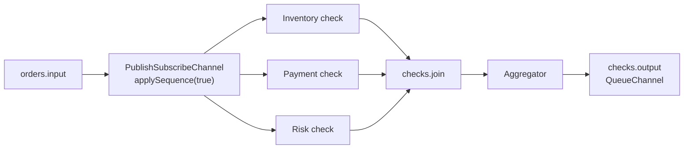

# apply-sequence in PublishSubscribeChannel

**Module:** `SPRING_INTEGRATION_CORE`  
**Chapter:** `PublishSubscribeChannel`

An order may need inventory, payment-limit, and risk checks before it can be accepted. `PublishSubscribeChannel` broadcasts the input message to the checking branches; an aggregator gathers the results so a downstream step can make a decision. The `apply-sequence` property supplies metadata that links replies belonging to the same broadcast.

This lesson focuses on the relationship between `Message`, the broadcast channel, branch-processing endpoints, and the reply-gathering aggregator. You will configure it in Java and Java DSL, read the relevant headers, diagnose causes of missing replies, and write tests for the result-aggregation flow.

## 1. The Problem apply-sequence Solves

Suppose two orders `O-100` and `O-200` enter three branches together. When branches execute asynchronously, replies can arrive interleaved:

| Arrival Order | Order | Branch Result |
| --- | --- | --- |
| 1 | O-100 | Inventory |
| 2 | O-200 | Risk |
| 3 | O-100 | Payment |
| 4 | O-200 | Inventory |
| 5 | O-100 | Risk |
| 6 | O-200 | Payment |

The aggregator needs to know two things:

1. Which replies belong to the same processing round.
2. How many replies must arrive before producing a combined result.

`apply-sequence=true` tells the channel to attach group and sequence-position metadata to messages sent to each subscriber. The default value is `false`. This is a channel configuration option, not a header named `apply-sequence`. See [PublishSubscribeChannel configuration](https://docs.spring.io/spring-integration/reference/channel/configuration.html#channel-configuration-pubsubchannel).

In this lesson's flow, each branch commits to returning exactly one result to the same aggregator. That commitment is what makes subscriber count equal the number of expected replies.

## 2. The Headers Generated

For an input message with `id=M0` and three direct subscribers, the metadata on the dispatched copies looks like this:

| Sent Copy | correlationId | sequenceNumber | sequenceSize |
| --- | --- | --- | --- |
| To first subscriber | M0 | 1 | 3 |
| To second subscriber | M0 | 2 | 3 |
| To third subscriber | M0 | 3 | 3 |

The names used in Java are:

| Constant in IntegrationMessageHeaderAccessor | Header Name | Role |
| --- | --- | --- |
| `CORRELATION_ID` | `correlationId` | Key linking messages in a group |
| `SEQUENCE_NUMBER` | `sequenceNumber` | Position of the copy in the sequence |
| `SEQUENCE_SIZE` | `sequenceSize` | Size of the sequence |

`sequenceNumber` and `sequenceSize` are of type `Integer`. From an API standpoint, `correlationId` can be an `Object`; for this typical broadcast, the value comes from the ID of the message entering the channel. Using constants or getters on [IntegrationMessageHeaderAccessor](https://docs.spring.io/spring-integration/api/org/springframework/integration/IntegrationMessageHeaderAccessor.html) prevents misspelling header names.

### 2.1. The Group Key Belongs to the Broadcast Dispatch

For a standard message with an ID, the dispatcher uses the input ID as the key for the new sequence layer. The sequence size is taken from the number of handlers registered at dispatch time; the sequence number is assigned as the dispatcher iterates over the handlers. These details appear in [BroadcastingDispatcher of Spring Integration 6.5.10](https://github.com/spring-projects/spring-integration/blob/v6.5.10/spring-integration-core/src/main/java/org/springframework/integration/dispatcher/BroadcastingDispatcher.java).

Therefore:

- Two new `Message` instances with the same `orderId` will still usually form two separate groups because their message IDs differ.
- Resending the exact same `Message` object can repeat the group key. Design retries and late-reply handling accordingly.
- If you need to group by a specific business attempt, you can add a `requestId` or `attemptId` and use a custom correlation strategy.

Keep the order ID in the payload or a business header such as `orderId`. Do not assume the `correlationId` generated by broadcast is the order ID.

### 2.2. Sequence Size Counts Direct Subscribers

The channel only sees its direct subscribers. The channel does not know whether a branch downstream:

- Gets dropped by a filter.
- Routes away into a flow that does not reach the aggregator.
- Produces multiple results.
- Completes an external task successfully.

For example, if three checking subscribers and one logging subscriber all subscribe directly to the channel, `sequenceSize` is 4. If the logging branch sends no reply to the aggregator, the checking group receives only 3 results.

This is a consequence of topology: you must reconcile the number of counted branches with the number of replies actually arriving at the convergence point.

### 2.3. Nested Flows Have Multiple Sequence Layers

If the input already carries sequence metadata, components supporting nested sequences can preserve the outer context in `sequenceDetails` before creating a new layer. Do not strip this header yourself to "clean up" the message.

When a branch itself contains a splitter or another broadcast, aggregate the inner group first before returning a single reply to the outer group. Treating all sequence headers across the entire system as a single flat layer corrupts group boundaries.

## 3. New Messages Are Created, but Payloads Are Not Deep-Copied

When `apply-sequence` is enabled, the channel creates `Message` instances carrying distinct headers for subscribers; they still reference the exact same input payload. While `Message` itself fixes the payload reference and header structure, the payload object can still be mutable. See [Message model and immutability](https://docs.spring.io/spring-integration/reference/message.html).

Example unsuitable when branches mutate data:

```java
Map<String, Object> order = new HashMap<>();
order.put("id", "O-100");
// Branches all receive a reference to this map.
// One branch mutating the map can affect another branch.
```

Use immutable payloads, or create a separate data copy in branches that need modifications. The `record` types in the examples below contain only `String` and primitive fields.

Creating multiple `Message` wrappers does not create independent copies of all business data.

## 4. Configuration in Java and XML

### 4.1. Java Configuration

```java
import org.springframework.context.annotation.Bean;
import org.springframework.integration.channel.PublishSubscribeChannel;

@Bean
public PublishSubscribeChannel orderChecksChannel() {
    PublishSubscribeChannel channel = new PublishSubscribeChannel();
    channel.setApplySequence(true);
    return channel;
}
```

This is a bean method placed inside a Spring configuration class. Endpoints subscribed to this channel bean will receive messages containing the broadcast's sequence metadata.

### 4.2. XML Configuration

In an XML configuration declaring the Spring Integration namespace with the `int` prefix:

```xml
<int:publish-subscribe-channel
        id="orderChecksChannel"
        apply-sequence="true"/>
```

Both configuration styles express the same intent. In Java DSL, the corresponding option is `.applySequence(true)`, provided by [PublishSubscribeChannelSpec](https://docs.spring.io/spring-integration/api/org/springframework/integration/dsl/PublishSubscribeChannelSpec.html).

## 5. Java DSL Example: Three Order-Checking Branches

### 5.1. Flow Design



Each transformer receives the full order and produces a `CheckResult`. Results are sent to the shared `checks.join` channel; the aggregator is the consumer of this channel.

To keep behavior easy to follow, the example uses simple in-memory checks. In a real application, an endpoint might call an inventory service or payment gateway, while still honoring the branch's reply contract.

### 5.2. Complete Configuration

The example uses Java 17 or later with the `spring-integration-core` dependency. Place the following class in your application's Java sources and adjust the package to fit your project.

```java
import org.springframework.context.annotation.Bean;
import org.springframework.context.annotation.Configuration;
import org.springframework.integration.channel.QueueChannel;
import org.springframework.integration.config.EnableIntegration;
import org.springframework.integration.dsl.IntegrationFlow;

@Configuration
@EnableIntegration
public class ApplySequenceConfig {

    public record Order(String id, int quantity, long amount) {
    }

    public record CheckResult(
            String orderId,
            String branch,
            boolean approved) {
    }

    @Bean
    public QueueChannel checksOutput() {
        return new QueueChannel();
    }

    @Bean
    public IntegrationFlow orderChecks() {
        return IntegrationFlow.from("orders.input")
                .publishSubscribeChannel(channel -> channel
                        .applySequence(true)
                        .subscribe(flow -> flow
                                .<Order, CheckResult>transform(order ->
                                        new CheckResult(
                                                order.id(),
                                                "inventory",
                                                order.quantity() > 0
                                                        && order.quantity() <= 10))
                                .channel("checks.join"))
                        .subscribe(flow -> flow
                                .<Order, CheckResult>transform(order ->
                                        new CheckResult(
                                                order.id(),
                                                "payment",
                                                order.amount() >= 0
                                                        && order.amount() <= 5_000_000))
                                .channel("checks.join"))
                        .subscribe(flow -> flow
                                .<Order, CheckResult>transform(order ->
                                        new CheckResult(
                                                order.id(),
                                                "risk",
                                                !order.id().startsWith("RISK-")))
                                .channel("checks.join")))
                .get();
    }

    @Bean
    public IntegrationFlow collectChecks() {
        return IntegrationFlow.from("checks.join")
                .aggregate()
                .channel(checksOutput())
                .get();
    }
}
```

Named channel references are resolved by Java DSL in the Spring context. For names without an existing bean, the DSL can create a `DirectChannel`; the flows here both reference `checks.join`. The `checksOutput` bean is declared explicitly because it needs to be a `QueueChannel` so the consumer side can pull results. See [channels in Java DSL](https://docs.spring.io/spring-integration/reference/dsl/java-channels.html).

### 5.3. Why Does the Aggregator Produce a Single Result?

The flow adheres to the contract:

1. Each input order reaches exactly three subscribers.
2. The channel attaches the same `correlationId`, sequence numbers 1–3, and `sequenceSize=3`.
3. Each transformer returns a result payload and lets the framework build the reply message.
4. All three replies enter the same aggregator.

By default, the aggregator groups by `correlationId` and uses sequence size metadata to decide when a group is complete. The default output processor builds a message whose payload is the list of payloads in the group. See [Aggregator correlation and release](https://docs.spring.io/spring-integration/reference/aggregator.html#aggregator-functionality).

For `Order("O-100", 2, 1_000_000)`, the result contains three elements:

```text
CheckResult[orderId=O-100, branch=inventory, approved=true]
CheckResult[orderId=O-100, branch=payment, approved=true]
CheckResult[orderId=O-100, branch=risk, approved=true]
```

This is the expected result set; do not rely on list position as a business identifier for the branch. The `branch` field lets downstream steps identify each result unambiguously.

If the order quantity is 20, the inventory branch still returns `CheckResult(..., false)`. The group still completes; the downstream step has enough information to reject the order.

### 5.4. Placing the Convergence Point in the Right Spot

The flow above ends right after `.publishSubscribeChannel(...)`; the aggregator sits in a separate flow reading from `checks.join`.

Do not assume that placing `.aggregate()` immediately after `.publishSubscribeChannel(...)` will automatically wire the outputs of all subflows into the aggregator. The continuation of the main flow can become another subscriber to the channel, receiving a copy of the input message.

With the design used here, explicitly route each branch's output to `checks.join`. Whenever you add a new branch, re-check the reply-count contract.

## 6. Distinguishing Sequence from Execution Order

The name `apply-sequence` can easily mislead learners into thinking it orchestrates execution order. In reality, the headers describe relationships among the broadcast messages.

| Need | Suitable Mechanism |
| --- | --- |
| Attach group and position metadata during broadcast | `applySequence(true)` |
| Run branches on an executor | Configure an executor on the channel |
| Combine multiple results into one result | Aggregator |
| Re-emit messages in sequence order | Resequencer |
| Force step B to use step A's result | Chain endpoints into a pipeline |

In the example without an executor, dispatch occurs on the sending thread. If you add an asynchronous executor, the branch carrying `sequenceNumber=3` can still finish before the branch carrying 1.

A resequencer can use sequence metadata to reorder messages before forwarding them. An aggregator serves group collection; business ordering requirements must be modeled separately. See [Aggregator and Resequencer in Java DSL](https://docs.spring.io/spring-integration/reference/dsl/java-aggregators.html).

If you need to call service A, use A's result to call B, and only then emit notification C, wire the steps according to that dependency. Enabling sequence on a broadcast channel cannot express that dependency.

## 7. Preserving Headers Across Branches

What must be protected is the path from the channel's dispatch copy to the reply entering the aggregator.

### 7.1. Prefer Payload-Returning Endpoints When Appropriate

In the example, transformers return `CheckResult` and the framework builds the reply message. There is no need to manually construct a `GenericMessage` in each branch just to change the payload.

A common mistake in hand-written handlers:

```java
// Creating a new message from scratch can lose correlation and sequence headers.
Message<CheckResult> reply = new GenericMessage<>(result);
```

When you do need to build a message manually, carry over the headers from that branch's input message:

```java
import org.springframework.messaging.Message;
import org.springframework.messaging.support.MessageBuilder;

// input is the message that passed through PublishSubscribeChannel.
Message<ApplySequenceConfig.CheckResult> reply =
        MessageBuilder.withPayload(result)
                .copyHeaders(input.getHeaders())
                .build();
```

This snippet sits inside a handler that already has `input` and `result`. The new message's ID header is managed by the framework; what must be preserved here are correlation, sequence, and any required routing headers.

### 7.2. Be Careful at System Boundaries

If a branch sends a message over HTTP, a broker, or a database and receives a response later, do not assume all internal headers pass across that boundary intact.

Design explicitly:

- Which metadata is mapped outbound and restored when the response arrives.
- Which key distinguishes multiple requests for the same order.
- Whether each branch outputs exactly one valid reply.
- How duplicate or expired replies are handled.

`apply-sequence` on the upstream channel does not replace a correlation protocol between two systems.

## 8. Missing Replies, Branch Failures, and Timeouts

### 8.1. Common Scenarios

| Scenario | Consequence for Result Aggregation | Mitigation |
| --- | --- | --- |
| A filter drops a message after broadcast | Actual replies received may be fewer than sequence size | Return a "not applicable/failed" business result, or redesign the release condition |
| Handler only logs or returns `null` | Branch produces no reply to aggregate | Separate the observer task or have the branch return an acknowledgment result |
| Router sends result away from the join path | Aggregator misses one reply | Ensure all participating routes return to the join point |
| Branch returns a new message missing headers | Lacks metadata needed by default aggregation | Copy relevant headers from the branch's input message |
| Adding a direct subscriber just for audit | Sequence size increases while business replies do not | Separate observation path from the counted reply group |
| One branch emits multiple messages | Breaks the one-branch–one-reply contract | Aggregate inside the branch first or design custom correlation/release |

A check result with `approved=false` is a valid business reply. It is different from a message being dropped completely and never reaching the aggregator.

### 8.2. Execution Errors Do Not Automatically Become Business Replies

Without an executor and under the default error setting, a handler failure can stop dispatch early, leaving subsequent handlers uninvoked. With an executor, other tasks may already have been submitted and continue running. See [BroadcastingDispatcher failure behavior](https://docs.spring.io/spring-integration/api/org/springframework/integration/dispatcher/BroadcastingDispatcher.html).

Choose the business meaning of an error:

- If a non-responding service means "cannot decide yet", handle the incomplete group via timeout or an error route.
- If the domain allows representing errors as branch results, translate the error into a result object carrying failure details while preserving correlation metadata.
- If partial results are acceptable, the output must clearly indicate which branches are missing.

`ignoreFailures=true` does not synthesize a fallback reply for the failing branch. Having other branches keep running is not enough for the group to receive all replies.

### 8.3. Aggregator Timeout Is a Separate Decision

You can replace `.aggregate()` in `collectChecks()` with the following illustrative configuration:

```java
.aggregate(aggregator -> aggregator
        .groupTimeout(5_000)
        .sendPartialResultOnExpiry(false)
        .discardChannel("checks.discard"))
```

In an application, provide a consumer on `checks.discard` to record and handle messages from discarded groups. The 5-second value is an example and must be chosen according to business SLA.

With a duration-based `groupTimeout`, the timer is rescheduled whenever the group receives another message and still has not met its release condition. `sendPartialResultOnExpiry(false)` discards incomplete groups instead of emitting partial results. These options belong to the aggregator, separate from `apply-sequence`. See [Aggregator and Group Timeout](https://docs.spring.io/spring-integration/reference/aggregator.html#aggregator-and-group-timeout).

If none of the three branches sends any reply to the aggregator, no group is ever created there to schedule a timeout. When you need an end-to-end deadline from request start, enforce tracking at the caller or orchestration layer.

## 9. Testing apply-sequence Behavior

Tests should prove both the broadcast metadata and result convergence. Checking only that `send()` returns `true` does not prove all branches completed their business work.

The class below uses JUnit Jupiter and the configuration class from section 5. Both classes reside in the same project package.

```java
import java.util.ArrayList;
import java.util.Collection;
import java.util.List;
import java.util.Set;
import java.util.stream.Collectors;

import org.junit.jupiter.api.Test;
import org.springframework.context.annotation.AnnotationConfigApplicationContext;
import org.springframework.integration.IntegrationMessageHeaderAccessor;
import org.springframework.integration.channel.PublishSubscribeChannel;
import org.springframework.integration.channel.QueueChannel;
import org.springframework.messaging.Message;
import org.springframework.messaging.MessageChannel;
import org.springframework.messaging.support.MessageBuilder;

import static org.junit.jupiter.api.Assertions.*;

class ApplySequenceTest {

    @Test
    void sequenceHeadersDescribeOneBroadcast() {
        PublishSubscribeChannel channel = new PublishSubscribeChannel();
        channel.setApplySequence(true);

        List<Message<?>> received = new ArrayList<>();
        channel.subscribe(received::add);
        channel.subscribe(received::add);
        channel.subscribe(received::add);

        List<String> payload = List.of("SKU-1", "SKU-2");
        Message<List<String>> original =
                MessageBuilder.withPayload(payload).build();

        assertTrue(channel.send(original));
        assertEquals(3, received.size());

        Set<Integer> sequenceNumbers = received.stream()
                .map(message ->
                        new IntegrationMessageHeaderAccessor(message)
                                .getSequenceNumber())
                .collect(Collectors.toSet());

        assertEquals(Set.of(1, 2, 3), sequenceNumbers);

        for (Message<?> message : received) {
            IntegrationMessageHeaderAccessor headers =
                    new IntegrationMessageHeaderAccessor(message);

            assertEquals(original.getHeaders().getId(),
                    headers.getCorrelationId());
            assertEquals(3, headers.getSequenceSize());
            assertNotSame(original, message);
            assertSame(payload, message.getPayload());
        }

        assertFalse(original.getHeaders().containsKey(
                IntegrationMessageHeaderAccessor.SEQUENCE_NUMBER));
    }

    @Test
    void defaultChannelDoesNotAddSequenceHeaders() {
        PublishSubscribeChannel channel = new PublishSubscribeChannel();

        List<Message<?>> received = new ArrayList<>();
        channel.subscribe(received::add);
        channel.subscribe(received::add);

        Message<String> original =
                MessageBuilder.withPayload("order-created").build();

        assertTrue(channel.send(original));
        assertEquals(2, received.size());

        for (Message<?> message : received) {
            assertFalse(message.getHeaders().containsKey(
                    IntegrationMessageHeaderAccessor.CORRELATION_ID));
            assertFalse(message.getHeaders().containsKey(
                    IntegrationMessageHeaderAccessor.SEQUENCE_NUMBER));
            assertFalse(message.getHeaders().containsKey(
                    IntegrationMessageHeaderAccessor.SEQUENCE_SIZE));
        }
    }

    @Test
    void threeBranchesProduceOneAggregatedResult() {
        try (AnnotationConfigApplicationContext context =
                     new AnnotationConfigApplicationContext(
                             ApplySequenceConfig.class)) {

            MessageChannel input = context.getBean(
                    "orders.input", MessageChannel.class);
            QueueChannel output = context.getBean(
                    "checksOutput", QueueChannel.class);

            ApplySequenceConfig.Order order =
                    new ApplySequenceConfig.Order(
                            "O-100", 2, 1_000_000);

            assertTrue(input.send(
                    MessageBuilder.withPayload(order).build()));

            Message<?> result = output.receive(1_000);
            assertNotNull(result);

            Collection<?> checks = assertInstanceOf(
                    Collection.class, result.getPayload());

            assertEquals(3, checks.size());

            Set<ApplySequenceConfig.CheckResult> actual =
                    checks.stream()
                            .map(ApplySequenceConfig.CheckResult.class::cast)
                            .collect(Collectors.toSet());

            assertEquals(Set.of(
                    new ApplySequenceConfig.CheckResult(
                            "O-100", "inventory", true),
                    new ApplySequenceConfig.CheckResult(
                            "O-100", "payment", true),
                    new ApplySequenceConfig.CheckResult(
                            "O-100", "risk", true)), actual);

            assertNull(output.receive(0));
        }
    }
}
```

The first test uses a synchronous channel, so `ArrayList` is sufficient for collecting messages in the test. If switched to an asynchronous executor, use a thread-safe collection and a bounded wait mechanism, such as a latch or queue, before checking results.

The second test starts with a message that has no sequence headers. Disabling `apply-sequence` means the channel does not add a new sequence layer itself; do not infer that the channel strips pre-existing sequence headers from the input.

Scenarios to expand when bringing this flow into an application:

| Case | What to Prove |
| --- | --- |
| Two new messages for two orders | Two aggregated results, no cross-talk between replies |
| Two new messages with the same order ID | Both processing rounds remain distinct per key design |
| One business check fails | Still produces all three elements, including the `false` result |
| One branch sends no reply | Does not mistakenly emit a complete result |
| With timeout and discard route | Incomplete group routes to expiration handling |
| Adding an observer subscriber | Does not accidentally alter the reply-count contract |
| One reply is delivered twice | Does not produce a wrong business decision by double-counting duplicates |

For asynchronous tests, introduce controlled differences in completion timing to verify grouping. Do not assume that the branch with the lower sequence number must finish first.

## 10. Choosing When to Enable apply-sequence

| Design | Consideration |
| --- | --- |
| Broadcast events to independent consumers without aggregating | Usually leave at default `false` |
| Each subscriber returns one reply to an aggregator using default strategy | Enable `true` and preserve metadata along the reply path |
| Need a resequencer to process the sequence after broadcast | Enable `true`, and clearly define intake and re-emission points |
| Some subscribers only observe and do not reply | Separate observation paths from counted branches |
| Reply count per branch varies by business logic | Design a custom completion rule or aggregate inside each branch |
| Flow already has custom correlation/release strategy | Clarify which sequence layer is still needed |

Before using it in a reply-gathering flow, ask yourself:

1. Which subscribers is `sequenceSize` counting?
2. Does every subscriber return exactly one result to the gathering point?
3. Does the group key distinguish separate requests and retry attempts?
4. Are headers preserved across transformers, handlers, and system boundaries?
5. How are incomplete groups, duplicate replies, and late replies handled?

In the order-checking example, enabling sequence fits because all three branches share a convergence target and follow the one-reply-per-broadcast contract. Whenever this topology or contract changes, review both the channel configuration and how the aggregator decides completion.
