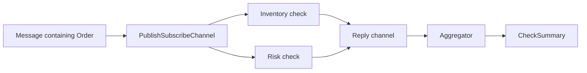

# Sequence Headers for an Aggregator

In the **PublishSubscribeChannel** chapter of **SPRING_INTEGRATION_CORE**, this lesson explains how to connect a multi-branch broadcast point to an aggregator that collects results. The focus is on the contract among `Message`, `MessageChannel`, and endpoints: which messages belong to the same processing round, how many replies must be awaited, and when results can be combined.

After this lesson, you will be able to:

- Enable `applySequence` in the right place in Java configuration and Java DSL.
- Distinguish `correlationId`, `sequenceNumber`, and `sequenceSize` from business identifiers and individual message IDs.
- Design a broadcast-and-aggregate flow without accidentally waiting for a reply that never exists.
- Recognize the effects of filters, errors, retries, duplicate messages, and nested sequences.

## 1. The Problem: Broadcast One Request, Collect Multiple Results

An order needs inventory and risk checks before returning a result to the next processing step. Both branches receive the same order information, yet each branch produces its own result.



For this design, three rules must be agreed upon:

1. The inventory result and risk result for the same request must enter the same group.
2. Each group requires two results for normal completion.
3. Results from two different requests must go into two separate groups, even if replies arrive interleaved.

This combines the Publish-Subscribe and Aggregator enterprise integration patterns. Broadcasting to multiple branches does not determine whether they execute in parallel; that depends on the execution configuration.

## 2. Three Headers Forming the Grouping Contract

Standard header names are declared in [`IntegrationMessageHeaderAccessor`](https://docs.spring.io/spring-integration/docs/current/api/org/springframework/integration/IntegrationMessageHeaderAccessor.html).

| Message Header | Java Constant | Meaning Within a Sequence |
| --- | --- | --- |
| `correlationId` | `CORRELATION_ID` | Key linking members of the same group |
| `sequenceNumber` | `SEQUENCE_NUMBER` | Member position, starting at 1 |
| `sequenceSize` | `SEQUENCE_SIZE` | Expected number of members in the group |

With two subscribers, the messages at the start of each branch can be represented as:

```text
Inventory branch: correlationId=M42, sequenceNumber=1, sequenceSize=2
Risk branch: correlationId=M42, sequenceNumber=2, sequenceSize=2
```

`M42` is just a readable notation for the lesson. For ordinary messages, the actual ID is a UUID.

### Distinguishing Three Kinds of Identifiers

| Identifier | Example | What Is It Used For? |
| --- | --- | --- |
| `MessageHeaders.ID` of a message | UUID of the request or of a reply | Identifying a specific message |
| `correlationId` of a broadcast round | ID of the message entering the broadcast channel | Linking replies belonging to that broadcast round |
| Business ID in payload or custom header | `orderId=ORD-42` | Identifying the order in the business domain |

When `applySequence=true`, the dispatcher uses the input message's ID at the broadcast point as the correlation key for the new sequence, then assigns sequence numbers per subscriber. If the message already carries correlation from an outer layer, that metadata is managed via nested sequence handling, covered later. You can inspect this behavior in [`BroadcastingDispatcher.dispatch()`](https://raw.githubusercontent.com/spring-projects/spring-integration/main/spring-integration-core/src/main/java/org/springframework/integration/dispatcher/BroadcastingDispatcher.java).

Do not use `sequenceNumber=1` to infer that a branch is always "inventory". When subscriber configuration changes, positions can change. Use a business field like `branch="stock"` to identify the result type.

## 3. Enabling `applySequence` at the Broadcast Point

By default, `PublishSubscribeChannel` does not add sequence headers. This suits flows that simply publish events to independent consumers without gathering replies. When downstream uses the aggregator's default correlation and release strategies, enable this property. See [`PublishSubscribeChannel.setApplySequence()`](https://docs.spring.io/spring-integration/docs/current/api/org/springframework/integration/channel/PublishSubscribeChannel.html#setApplySequence(boolean)).

```java
@Bean
public PublishSubscribeChannel checks() {
    PublishSubscribeChannel channel = new PublishSubscribeChannel();
    channel.setApplySequence(true);
    return channel;
}
```

`applySequence` is a **channel configuration property**, not a header name you manually add to messages. In XML, the same setting is written as `apply-sequence="true"`; in Java DSL, it is `.applySequence(true)`.

When sequence is enabled, the framework creates separate messages for subscribers to hold their distinct headers. These messages still share the input payload reference; the framework does not deep-copy business objects. Therefore, pass immutable payloads or ensure each branch does not mutate shared objects. This behavior is described in [PublishSubscribeChannel configuration](https://docs.spring.io/spring-integration/reference/channel/configuration.html#publishsubscribechannel-configuration).

## 4. How Does the Aggregator Use These Headers?

An aggregator has three distinct responsibilities:

| Component | Question to Answer | Choice in This Lesson |
| --- | --- | --- |
| `CorrelationStrategy` | Which group does this message belong to? | Read `correlationId` |
| `ReleaseStrategy` | Is the group ready to aggregate? | Wait for message count equal to `sequenceSize` |
| `MessageGroupProcessor` | What result should be produced from the collected messages? | Build `CheckSummary` |

Default correlation relies on the `correlationId` header. Replies with the same correlation key go into the same `MessageGroup`; different keys form separate groups. The aggregator holds group state in a message store while waiting. See [Aggregator functionality](https://docs.spring.io/spring-integration/reference/aggregator.html#functionality).

In standard mode without partial sequence release, the default release strategy is `SimpleSequenceSizeReleaseStrategy`. This strategy compares the number of messages in the group against the expected sequence size; it **does not check for duplicate sequence numbers**. Thus, `sequenceNumber` does not automatically turn a flow into an exactly-once mechanism. See [`SimpleSequenceSizeReleaseStrategy`](https://docs.spring.io/spring-integration/docs/current/api/org/springframework/integration/aggregator/SimpleSequenceSizeReleaseStrategy.html).

In the two-branch example, assuming no duplicates:

```text
Receive stock(M42, 1/2): group M42 has 1 message -> keep waiting.
Receive fraud(M42, 2/2): group M42 has 2 messages -> build CheckSummary.
```

If the risk branch arrives first, the group still waits until two messages are received. Sequence numbers are not a requirement that replies arrive in order, nor a guarantee that the output list is automatically sorted by sequence number.

## 5. Complete Java Configuration and Java DSL Example

The example uses Java 17 or later and APIs from `spring-integration-core`. In a Spring Boot project with a parent or BOM managing versions, you can use the following dependency; keep Spring dependencies aligned with the application's version set.

```xml
<dependency>
    <groupId>org.springframework.boot</groupId>
    <artifactId>spring-boot-starter-integration</artifactId>
</dependency>
```

The class below defines the channel, both branches, the aggregator, and a `main()` method that sends a test request. No external broker is needed. `IntegrationFlow` instances must be registered as beans so the framework creates and wires endpoints, as described in the [Java DSL guide](https://docs.spring.io/spring-integration/reference/dsl.html).

```java
import java.util.Comparator;
import java.util.List;

import org.springframework.context.annotation.AnnotationConfigApplicationContext;
import org.springframework.context.annotation.Bean;
import org.springframework.context.annotation.Configuration;
import org.springframework.integration.channel.DirectChannel;
import org.springframework.integration.channel.PublishSubscribeChannel;
import org.springframework.integration.channel.QueueChannel;
import org.springframework.integration.config.EnableIntegration;
import org.springframework.integration.dsl.IntegrationFlow;
import org.springframework.integration.store.MessageGroup;
import org.springframework.integration.support.MessageBuilder;
import org.springframework.messaging.Message;
import org.springframework.messaging.MessageChannel;

@Configuration
@EnableIntegration
public class SequenceAggregationDemo {

    public record Order(String orderId, int quantity) {
    }

    public record CheckResult(
            String orderId, String branch, boolean accepted) {
    }

    public record CheckSummary(
            String orderId, List<CheckResult> results) {
    }

    @Bean
    public PublishSubscribeChannel checks() {
        PublishSubscribeChannel channel = new PublishSubscribeChannel();
        channel.setApplySequence(true);
        return channel;
    }

    @Bean
    public DirectChannel replies() {
        return new DirectChannel();
    }

    @Bean
    public QueueChannel results() {
        return new QueueChannel();
    }

    @Bean
    public IntegrationFlow stockCheck(
            PublishSubscribeChannel checks, DirectChannel replies) {
        return IntegrationFlow.from(checks)
                .<Order, CheckResult>transform(order -> new CheckResult(
                        order.orderId(),
                        "stock",
                        order.quantity() > 0 && order.quantity() <= 10))
                .channel(replies)
                .get();
    }

    @Bean
    public IntegrationFlow fraudCheck(
            PublishSubscribeChannel checks, DirectChannel replies) {
        return IntegrationFlow.from(checks)
                .<Order, CheckResult>transform(order -> new CheckResult(
                        order.orderId(),
                        "fraud",
                        order.quantity() > 0 && order.quantity() <= 5))
                .channel(replies)
                .get();
    }

    @Bean
    public IntegrationFlow aggregateReplies(
            DirectChannel replies, QueueChannel results) {
        return IntegrationFlow.from(replies)
                .aggregate(spec -> spec.outputProcessor(
                        SequenceAggregationDemo::summarize))
                .channel(results)
                .get();
    }

    private static CheckSummary summarize(MessageGroup group) {
        List<CheckResult> checks = group.getMessages().stream()
                .map(message -> (CheckResult) message.getPayload())
                .sorted(Comparator.comparing(CheckResult::branch))
                .toList();

        return new CheckSummary(checks.get(0).orderId(), checks);
    }

    public static void main(String[] args) {
        try (var context = new AnnotationConfigApplicationContext(
                SequenceAggregationDemo.class)) {
            MessageChannel input = context.getBean(
                    "checks", MessageChannel.class);
            QueueChannel output = context.getBean(
                    "results", QueueChannel.class);

            Message<Order> request = MessageBuilder
                    .withPayload(new Order("ORD-42", 2))
                    .build();

            if (!input.send(request)) {
                throw new IllegalStateException("Failed to send request");
            }

            Message<?> response = output.receive(1000);
            if (response == null) {
                throw new IllegalStateException("Did not receive summary");
            }

            System.out.println(response.getPayload());
        }
    }
}
```

Expected output:

```text
CheckSummary[orderId=ORD-42, results=[CheckResult[orderId=ORD-42, branch=fraud, accepted=true], CheckResult[orderId=ORD-42, branch=stock, accepted=true]]]
```

Key takeaways from the configuration:

- `checks` has two direct subscribers: the starting endpoints of `stockCheck` and `fraudCheck`. Therefore, the sequence size is 2.
- Each transformer returns a `CheckResult` payload; the framework's reply handling preserves required headers from the request unless configured to drop or overwrite them.
- Both branches forward results to `replies`. That channel has one consumer, the aggregator, so all replies reach the same gathering point.
- `outputProcessor` shapes the final output. The lesson does not customize correlation or release strategies, so the default sequence contract applies.
- `summarize()` explicitly sorts by branch name for readable output rather than relying on the group's collection order.
- The `accepted` condition merely simulates business logic. Both accepted and rejected checks are valid replies that must be aggregated.

The aggregator configuration API is documented at [`AggregatorSpec.outputProcessor()`](https://docs.spring.io/spring-integration/docs/current/api/org/springframework/integration/dsl/AggregatorSpec.html#outputProcessor(org.springframework.integration.aggregator.MessageGroupProcessor)).

### Variant: Declaring Subscribers Directly in Java DSL

You can replace the three beans `checks`, `stockCheck`, and `fraudCheck` in the example above with the flow below. Keep the `replies`, `results`, and `aggregateReplies` beans, the records, and `summarize()`. When using this variant, send input to the `requestInput` channel bean instead of `checks`.

```java
@Bean
public IntegrationFlow requestFlow(DirectChannel replies) {
    return IntegrationFlow.from("requestInput")
            .publishSubscribeChannel(spec -> spec
                    .applySequence(true)
                    .subscribe(branch -> branch
                            .<Order, CheckResult>transform(order ->
                                    new CheckResult(order.orderId(), "stock",
                                            order.quantity() > 0
                                                    && order.quantity() <= 10))
                            .channel(replies))
                    .subscribe(branch -> branch
                            .<Order, CheckResult>transform(order ->
                                    new CheckResult(order.orderId(), "fraud",
                                            order.quantity() > 0
                                                    && order.quantity() <= 5))
                            .channel(replies)))
            .get();
}
```

`subscribe(...)` registers a subflow as a subscriber; `applySequence(true)` sits on the broadcast channel spec. Both branches must still route replies to `replies`. See [`PublishSubscribeSpec`](https://docs.spring.io/spring-integration/docs/current/api/org/springframework/integration/dsl/PublishSubscribeSpec.html).

## 6. Observing an Aggregation Round

Suppose two requests A and B are sent. `MA` and `MB` are the IDs of the two messages entering the broadcast channel. In an asynchronous execution setup, arrival order at the aggregator might look like:

| Receipt | Payload | `correlationId` | `sequenceNumber` | `sequenceSize` | State After Receipt |
| --- | --- | --- | --- | --- | --- |
| 1 | Risk result for A | MA | 2 | 2 | Group MA has 1 result |
| 2 | Stock result for B | MB | 1 | 2 | Group MB has 1 result |
| 3 | Stock result for A | MA | 1 | 2 | Group MA reaches 2, emits summary for A |
| 4 | Risk result for B | MB | 2 | 2 | Group MB reaches 2, emits summary for B |

This table is an illustrative scenario, not a guarantee of subscriber order. It shows why checking "two messages arrived" against a global list is wrong: by the second receipt, the two messages belong to two different requests.

When debugging, log at the start of each branch and right before the aggregator:

```text
messageId, correlationId, sequenceNumber, sequenceSize,
orderId, branch, timestamp received, thread name
```

If multiple runs occur for the same order, add a dedicated run ID for business reconciliation. `sequenceNumber` only makes sense alongside its correlation.

## 7. Preserving Metadata When Building Replies

A common bug is a branch sending its result using a brand-new message:

```java
// incoming is the message the branch just received from PublishSubscribeChannel.
CheckResult result = new CheckResult("ORD-42", "stock", true);

// No header copying from incoming.
replies.send(new org.springframework.messaging.support.GenericMessage<>(result));
```

Here, the new `GenericMessage` does not carry the correlation and sequence headers from `incoming`. An aggregator using default correlation cannot link it properly with the other branch.

If you write code that builds and sends messages manually, copy the needed headers:

```java
Message<CheckResult> reply = MessageBuilder.withPayload(result)
        .copyHeaders(incoming.getHeaders())
        .build();

replies.send(reply);
```

Do not try to preserve the input message's `id` by mutating system headers. The default builder treats `id` and `timestamp` as read-only during copying; the reply gets its own identity while retaining correlation. Copying behavior is implemented in [`BaseMessageBuilder`](https://raw.githubusercontent.com/spring-projects/spring-integration/6.5.x/spring-integration-core/src/main/java/org/springframework/integration/support/BaseMessageBuilder.java).

In a standard transformer, returning the payload as in the main example lets the framework build the reply. If you return a full `Message` yourself, filter headers, or cross an out-of-process transport, verify the metadata that actually survives. See [Transformer input and output contract](https://docs.spring.io/spring-integration/reference/transformer.html#configuring-a-transformer-with-xml).

## 8. When Reply Count Does Not Match `sequenceSize`

### 8.1. Adding an Audit-Only Subscriber

Suppose a third subscriber is added to `checks` that only logs and finishes. Now the channel broadcasts to three subscribers, so each branch carries `sequenceSize=3`. However, only stock and fraud send replies to the aggregator.

```text
Subscribers at broadcast point:    3
Replies sent to aggregator:        2
Expected replies per header:       3
```

Under the wait-for-all-replies contract, the group will never complete. Choose one of these designs:

- Separate audit from the aggregated branch set, such as placing a wire tap before the check broadcast point.
- Have audit return a reply if business rules genuinely require waiting for audit confirmation.
- Use a custom release strategy that expresses the exact set of results to await.

Do not arbitrarily edit `sequenceSize` in individual branches to "make the numbers match"; replies in the same sequence must agree on the completion contract.

### 8.2. A Filter Drops a Reply

An order rejected for insufficient stock still needs an `accepted=false` result. If a filter drops negative outcomes completely, the aggregator receives only the risk reply and keeps waiting.

In the example's design, model every branch's outcome as data, including rejected, intentionally skipped, or not-applicable statuses. A branch disagreeing in business terms does not mean that branch fails to reply.

If business rules truly remove a member from the set to aggregate, change the release design or emit a compensating message instead of still relying on the original sequence size.

### 8.3. One Branch Produces Multiple Replies or Duplicates

Suppose a sequence expects two members, yet the aggregator receives:

```text
first stock:     correlationId=M42, sequenceNumber=1, sequenceSize=2
duplicate stock: correlationId=M42, sequenceNumber=1, sequenceSize=2
fraud:           not arrived yet
```

If both stock results are separate messages accepted into the group, the message count reaches 2. The simple strategy can release the group even without the risk reply. This is a consequence of counting messages, not a mechanism verifying distinct branch types. You can verify this comparison in [`SimpleSequenceSizeReleaseStrategy` source](https://raw.githubusercontent.com/spring-projects/spring-integration/6.5.x/spring-integration-core/src/main/java/org/springframework/integration/aggregator/SimpleSequenceSizeReleaseStrategy.java).

In a system with retries or duplicate deliveries, define a deduplication key such as `(executionId, branch)`, and release based on required branches if that is a business rule. Also decide whether to keep the first result, keep the latest, or reject duplicates.

For a branch with an internal splitter, aggregate internal results into one branch reply before sending it to the outer gathering point. That preserves the "each subscriber contributes one reply" contract.

## 9. Execution Errors and Timeouts Are Two Separate Issues

Without an executor, `PublishSubscribeChannel` calls handlers on the sender's thread. A handler exception can prevent subsequent handlers from being invoked under the default error mode. With an executor, other handlers may still run on separate threads. `ignoreFailures=true` does not generate a fallback reply for the failing branch. See [`BroadcastingDispatcher`](https://docs.spring.io/spring-integration/docs/current/api/org/springframework/integration/dispatcher/BroadcastingDispatcher.html).

In asynchronous flows, errors may be routed to `errorChannel` by the framework's error-handling mechanism. An `ErrorMessage` on the error channel does not automatically become a `CheckResult` in the waiting group; if recovering with an error reply, the recovery flow must build a result preserving the right correlation, sequence, and branch identifier. See [Error Handling](https://docs.spring.io/spring-integration/reference/error-handling.html).

### Adding a Group Timeout Policy

You can replace the `aggregateReplies` bean with the configuration below and add an `expiredReplies` bean. Keep the remaining parts as in the main example:

```java
@Bean
public QueueChannel expiredReplies() {
    return new QueueChannel();
}

@Bean
public IntegrationFlow aggregateReplies(
        DirectChannel replies,
        @org.springframework.beans.factory.annotation.Qualifier("results")
        QueueChannel results,
        @org.springframework.beans.factory.annotation.Qualifier("expiredReplies")
        QueueChannel expiredReplies) {
    return IntegrationFlow.from(replies)
            .aggregate(spec -> spec
                    .groupTimeout(3000)
                    .sendPartialResultOnExpiry(false)
                    .expireGroupsUponTimeout(false)
                    .discardChannel(expiredReplies)
                    .outputProcessor(SequenceAggregationDemo::summarize))
            .channel(results)
            .get();
}
```

`groupTimeout(3000)` sets a per-group wait duration. When it expires while the group still has not met its release condition, this setup sends already-received messages to the discard channel instead of emitting an incomplete `CheckSummary`. `.expireGroupsUponTimeout(false)` keeps the group marker after timeout completion so late replies do not immediately reopen the group. DSL options are described in [`CorrelationHandlerSpec`](https://docs.spring.io/spring-integration/docs/current/api/org/springframework/integration/dsl/CorrelationHandlerSpec.html).

Understand the scope of timeouts accurately:

- A constant duration timeout is rescheduled when a new message arrives at an incomplete group; it is not automatically a deadline measured from request send time.
- If every branch is silent and no message ever reaches the aggregator, no group exists for the aggregator timeout to act upon.
- Group timeout does not cancel in-flight work inside branches; connection or service call timeouts must be configured at those call sites.
- A partial summary is only suitable when the output explicitly indicates missing branches and the consumer accepts that state.

Scheduling and group completion are explained in [Aggregator and Group Timeout](https://docs.spring.io/spring-integration/reference/aggregator.html#aggregator-and-group-timeout).

The example uses a queue for easy discard observation. In a real application, provide a consumer reading that queue and a policy to clean up completed group metadata, such as a reaper with an appropriate retention window. Do not retain group state forever solely to block late replies.

## 10. Nested Sequences and `sequenceDetails`

A more complex flow might split an order into line items, then broadcast each line to two checking branches:

```text
Order
  -> Splitter: produces N line items
      -> PublishSubscribeChannel: two checks per line
          -> Inner aggregator: one result per line
              -> Outer aggregator: one result for the whole order
```

Two correlation layers exist here:

| Position | Active Correlation | Number and Size |
| --- | --- | --- |
| After splitter | Group of order lines | `i/N` |
| Inside both check branches for line i | Check group specific to line i | `1/2` and `2/2` |
| After inner aggregator | Restores order-line context | `i/N` |
| After outer aggregator | Completes line-aggregation layer | Do not reuse inner sequence as a new job's sequence |

The framework uses `sequenceDetails` to store earlier sequence layers. `pushSequenceDetails()` and `popSequenceDetails()` push and pop the current layer. Do not manually overwrite the outer header trio and drop the context needed by the next aggregator. See [`MessageBuilder`](https://docs.spring.io/spring-integration/docs/current/api/org/springframework/integration/support/MessageBuilder.html).

A normal aggregator pops the sequence context when producing output. The `popSequence` option controls this behavior; restoration also depends on output shape, especially if the aggregator returns a `Message` directly or a collection of messages. When customizing deeply, preserve the contract expected by the next layer. The [`AbstractCorrelatingMessageHandler.setPopSequence()`](https://docs.spring.io/spring-integration/docs/current/api/org/springframework/integration/aggregator/AbstractCorrelatingMessageHandler.html#setPopSequence(boolean)) API describes the purpose of this option.

For beginners, the easiest setup to reason about is giving each layer its matching split/broadcast point and aggregator, with aggregators returning a business payload like `CheckSummary`. Do not disable `popSequence` just to keep headers for logging; store business tracking IDs in a dedicated field instead.

## 11. Technical Correlation vs. Business Correlation

In the example, two new request messages for the same `orderId=ORD-42` have different IDs. Each message is broadcast as its own sequence, so results from two rounds do not mix.

If you customize the aggregator by order ID:

```java
// Illustrative snippet; only use when orderId truly identifies a single group.
.aggregate(spec -> spec
        .correlationExpression("payload.orderId")
        .outputProcessor(SequenceAggregationDemo::summarize))
```

then concurrent processing rounds for the same order can fall into the same group. A key like `orderId + executionId` usually expresses intent better when the system allows re-checks. Changing the correlation strategy does not automatically solve missing or duplicate replies either; release policy remains an independent decision.

Choose the key by asking: "Does one aggregated result represent the order across its entire lifetime, or one execution of a task on that order?"

## 12. Testing Sequence and Aggregation Behavior

The following snippets are practice code for learners; they require JUnit Jupiter in test dependencies. They use in-memory channels and the context from the main example without calling real external services.

### 12.1. Testing Headers Created at the Broadcast Point

```java
import java.util.ArrayList;
import java.util.List;
import java.util.Set;
import java.util.stream.Collectors;

import org.junit.jupiter.api.Test;
import org.springframework.integration.IntegrationMessageHeaderAccessor;
import org.springframework.integration.channel.PublishSubscribeChannel;
import org.springframework.integration.support.MessageBuilder;
import org.springframework.messaging.Message;

import static org.junit.jupiter.api.Assertions.*;

class PublishSubscribeSequenceTest {

    @Test
    void createsOneSequenceWithTwoMembers() {
        PublishSubscribeChannel channel = new PublishSubscribeChannel();
        channel.setApplySequence(true);

        // No executor: callbacks run on the message-sending thread.
        List<Message<?>> received = new ArrayList<>();
        channel.subscribe(message -> received.add(message));
        channel.subscribe(message -> received.add(message));

        Message<String> request = MessageBuilder.withPayload("ORD-42").build();
        assertTrue(channel.send(request));
        assertEquals(2, received.size());

        for (Message<?> message : received) {
            assertEquals(request.getHeaders().getId(),
                    message.getHeaders().get(
                            IntegrationMessageHeaderAccessor.CORRELATION_ID));
            assertEquals(Integer.valueOf(2), message.getHeaders().get(
                    IntegrationMessageHeaderAccessor.SEQUENCE_SIZE,
                    Integer.class));
            assertSame(request.getPayload(), message.getPayload());
        }

        Set<Integer> numbers = received.stream()
                .map(message -> message.getHeaders().get(
                        IntegrationMessageHeaderAccessor.SEQUENCE_NUMBER,
                        Integer.class))
                .collect(Collectors.toSet());

        assertEquals(Set.of(1, 2), numbers);
        assertNotSame(received.get(0), received.get(1));
    }
}
```

Checking the set of sequence numbers avoids coupling a business branch to a specific callback order. `assertSame` on the payload notes the reference-sharing behavior without encouraging mutating that object.

### 12.2. Testing Receipt of a Summary Containing Both Branches

```java
import java.util.Set;
import java.util.stream.Collectors;

import org.junit.jupiter.api.Test;
import org.springframework.context.annotation.AnnotationConfigApplicationContext;
import org.springframework.integration.channel.QueueChannel;
import org.springframework.integration.support.MessageBuilder;
import org.springframework.messaging.Message;
import org.springframework.messaging.MessageChannel;

import static org.junit.jupiter.api.Assertions.*;

class SequenceAggregationFlowTest {

    @Test
    void returnsOneSummaryContainingBothBranches() {
        try (var context = new AnnotationConfigApplicationContext(
                SequenceAggregationDemo.class)) {
            MessageChannel input = context.getBean(
                    "checks", MessageChannel.class);
            QueueChannel output = context.getBean(
                    "results", QueueChannel.class);

            assertTrue(input.send(MessageBuilder.withPayload(
                    new SequenceAggregationDemo.Order("ORD-42", 2)).build()));

            Message<?> reply = output.receive(1000);
            assertNotNull(reply);
            var summary = assertInstanceOf(
                    SequenceAggregationDemo.CheckSummary.class,
                    reply.getPayload());

            assertEquals("ORD-42", summary.orderId());
            assertEquals(2, summary.results().size());
            assertEquals(Set.of("stock", "fraud"), summary.results().stream()
                    .map(SequenceAggregationDemo.CheckResult::branch)
                    .collect(Collectors.toSet()));

            // Synchronous sample flow: all branches already ran when send() returned.
            assertNull(output.receive(0));
        }
    }
}
```

### Scenarios to Add for Real-World Applications

| Scenario | Expectation to Verify |
| --- | --- |
| Branch 2 reply arrives before branch 1 | Only one summary is emitted after both arrive |
| Two requests have interleaved replies | Each summary contains results for the matching request |
| Two check rounds for the same order | Rounds do not mix if business rules require separating them |
| One branch does not reply | Configured timeout, discard, or partial-result policy runs properly |
| One branch returns `accepted=false` | All replies still arrive and the negative result is preserved in the summary |
| A branch sends a duplicate reply | Duplicate is not mistaken for the missing branch per chosen deduplication policy |
| An audit subscriber is added | Does not cause the group to wait for the wrong size |
| A reply arrives after group expiry | Does not produce a second result violating group lifecycle policy |

Tests with reordered or interleaved arrival can be written by feeding messages with controlled headers directly into `replies` in a dedicated test context. With an executor, collect results in a thread-safe structure and use bounded waits; do not use the synchronous test's `ArrayList` to receive concurrent callbacks.

## 13. Design Practice

Starting from the main example, complete these steps in order:

1. Send an order with quantity 7. Keep both replies and observe `fraud.accepted=false` instead of filtering out that reply.
2. Add a `pricing` branch that sends a result to `replies`. Verify both sequence size and the summary count become 3.
3. Add a subscriber that only records audit without sending a reply. Explain why the original counting contract breaks, then separate audit from the checks to be aggregated.
4. Simulate losing one reply and apply the timeout configuration. Observe the discard channel and behavior for late replies.
5. Simulate two results from the same branch. Define a deduplication key and completion condition before changing the release strategy.

The goal is to be able to explain both the normal path and incomplete-group cases, rather than only observing a single successful run.

## 14. Key Principles to Remember

- Enable `applySequence` at the broadcast point when using an aggregator that relies on sequence metadata.
- `correlationId` answers "which round"; `sequenceSize` answers "how many expected"; `sequenceNumber` identifies the position within that round.
- Keep a strict correspondence between subscribers counted in the sequence and replies actually sent back to the gathering point.
- Preserve metadata across branches; do not treat filtered or failed messages as already-collected replies.
- Specify deduplication, timeouts, and late-reply handling explicitly; sequence headers do not replace those policies.
- When multiple broadcast and aggregation layers exist, keep each layer's sequence context intact.
