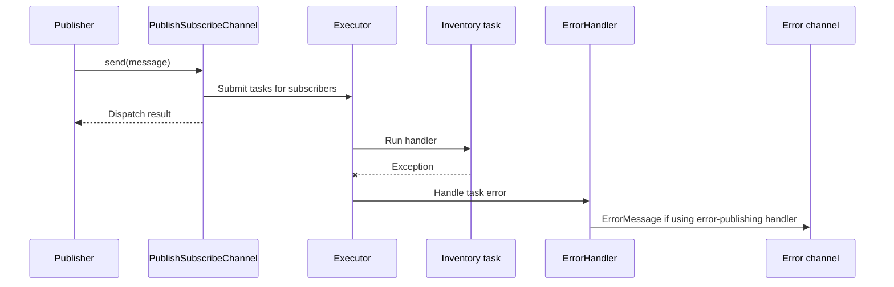

# Exceptions from Subscribers

In the **PublishSubscribeChannel** chapter of **SPRING_INTEGRATION_CORE**, this lesson explains what happens when a subscriber throws an exception and how to design an appropriate error-handling branch. The goal is to connect the behavior of `MessageChannel`, endpoints, and Java DSL to practical requirements: whether one failing branch is allowed to block other branches, who receives failure notifications, and which branch needs to be retried.

Examples use Java 17 and Spring Integration 6.5.x APIs. The retry section uses Spring Retry compatible with this release line. When integrating into an application, use a compatible dependency set managed by your project; do not mix retry examples across release lines that use different retry mechanisms.

## 1. Asking Questions at the Right Execution Boundary

Suppose the application publishes an `OrderCreated` event to three subscribers:

- **Audit** records the event.
- **Inventory** reserves stock.
- **Email** sends a confirmation message.

If Inventory throws an exception, three outcomes must be distinguished: how far Audit got, whether Email is invoked, and what result the `send()` call sees. `PublishSubscribeChannel` broadcasts messages to subscribed handlers, yet the broadcast mechanism itself does not provide a single business transaction spanning all three tasks.

The first thing to check is whether the channel has an executor:

| Configuration | Where Directly-Invoked Handlers Run | Main Consequence When a Handler Throws |
| --- | --- | --- |
| No executor, `ignoreFailures=false` | Thread calling `send()` | Exception propagates to caller; can block remaining subscribers |
| No executor, `ignoreFailures=true` | Thread calling `send()` | Dispatcher logs a warning for the ignored failure and continues trying other subscribers |
| Executor running on workers, `ignoreFailures=false` | Worker task | Processing error goes to `ErrorHandler`; other tasks can still run |
| Executor running on workers, `ignoreFailures=true` | Worker task | Failures ignored by the dispatcher do not continue to `ErrorHandler` |

The table assumes the error is a `RuntimeException` thrown while invoking a handler. Failures when submitting a task to an executor are a separate case. Fail-fast and ignore-failures rules are described in the [BroadcastingDispatcher API](https://docs.spring.io/spring-integration/api/org/springframework/integration/dispatcher/BroadcastingDispatcher.html).

A flow can also switch threads deeper inside a subscriber, such as passing through another `ExecutorChannel`. In that case, locate the actual asynchronous boundary rather than reasoning about the whole flow solely from the first channel.

## 2. Synchronous: Exceptions Return to the Caller

With `new PublishSubscribeChannel()`, the channel invokes handlers on the sending thread. If one handler throws an exception and `ignoreFailures` remains `false`, the dispatcher stops at that failure. Handlers that already ran earlier are not automatically undone.

In this example, order is established by direct consecutive `subscribe()` calls. That order is illustrative; do not rely on bean declaration order to model business dependencies.

```java
import java.util.ArrayList;
import java.util.List;

import org.springframework.integration.channel.PublishSubscribeChannel;
import org.springframework.messaging.MessageHandlingException;
import org.springframework.messaging.MessagingException;
import org.springframework.messaging.support.GenericMessage;

public class SubscriberFailureDemo {

    public static void main(String[] args) throws Exception {
        demonstrate(false);
        demonstrate(true);
    }

    private static void demonstrate(boolean ignoreFailures) throws Exception {
        List<String> trace = new ArrayList<>();

        PublishSubscribeChannel channel = new PublishSubscribeChannel();
        channel.setIgnoreFailures(ignoreFailures);
        channel.afterPropertiesSet();

        channel.subscribe(message -> trace.add("audit"));

        channel.subscribe(message -> {
            trace.add("inventory");
            throw new MessageHandlingException(
                    message, "Inventory temporarily unavailable");
        });

        channel.subscribe(message -> trace.add("email"));

        try {
            boolean sent = channel.send(new GenericMessage<>("ORDER-42"));
            System.out.println("sent=" + sent);
        }
        catch (MessagingException ex) {
            System.out.println("exception=" + ex.getClass().getSimpleName());
        }

        System.out.println("ignoreFailures=" + ignoreFailures);
        System.out.println("trace=" + trace);
    }
}
```

Outcomes to observe:

| Run | Trace | Caller |
| --- | --- | --- |
| `ignoreFailures=false` | `[audit, inventory]` | Receives `MessagingException`; does not receive a boolean return value from the failed call |
| `ignoreFailures=true` | `[audit, inventory, email]` | `send()` returns `true` with default `minSubscribers` |

In the second run, `true` does not prove Inventory succeeded. One task failed and was ignored. Nor should you assume the caller always receives the exact original business exception type: endpoints and channels can add context via messaging exceptions. When investigating, inspect both `cause` and the failed message.

### The errorChannel Header Does Not Automatically Catch Synchronous Errors

The snippet below merely attaches an error destination to the message:

```java
Message<?> request = MessageBuilder.withPayload("ORDER-42")
        .setHeader(MessageHeaders.ERROR_CHANNEL, errors)
        .build();
```

It does not turn a synchronous call into an error-catching mechanism that emits `ErrorMessage`. Without an executor on `PublishSubscribeChannel`, an `ErrorHandler` configured on the channel is not applied. Either the caller must handle the exception or an enclosing component—such as a gateway configured with error handling—must translate errors according to its own contract. This distinction is noted in the [PublishSubscribeChannel API](https://docs.spring.io/spring-integration/api/org/springframework/integration/channel/PublishSubscribeChannel.html).

If entry into the flow goes through a `@MessagingGateway`, also check the gateway's error configuration and reply contract. Do not equate direct `MessageChannel.send()` calls with all calls going through a gateway.

## 3. ignoreFailures Is a Policy for Ignoring Failures

`ignoreFailures=true` is useful when product requirements allow a branch to fail while event broadcasting continues. For example, a synchronous failure in a metrics-update branch may be acceptable once the primary operation has completed.

Understand the exact cost of that choice:

- The failing handler is not automatically retried by the channel.
- No fallback result is automatically produced for the failing branch.
- An ignored error no longer propagates out of the dispatcher for an outer error-catching mechanism to handle.
- There is no guarantee every kind of error is ignored. In the 6.5.0 implementation, `invokeHandler()` catches `RuntimeException`, not every `Throwable`.

That last point matches the [BroadcastingDispatcher 6.5.0 source](https://raw.githubusercontent.com/spring-projects/spring-integration/v6.5.0/spring-integration-core/src/main/java/org/springframework/integration/dispatcher/BroadcastingDispatcher.java). Do not use this flag as a recovery mechanism for serious JVM errors.

A common configuration mistake is enabling `ignoreFailures=true` on an executor-backed channel and then expecting an `ErrorMessage` from that very ignored failure. That flag eliminates that error route. If you need structured failure records for investigation or retry, keep `ignoreFailures=false` and design an error flow.

## 4. Asynchronous: Separating Send Outcome from Processing Outcome

With an executor that genuinely hands tasks off to workers, the caller is no longer on the same call stack as the failing handler:



The diagram shows only one possible execution schedule. Workers can start or fail before `send()` returns. The key point is that the return value does not wait to gather business outcomes from all workers.

When the channel is a Spring-initialized bean, the default mechanism wraps tasks and forwards failures to an error handler. This initialization matters in practice: do not instantiate an asynchronous channel with `new`, skip lifecycle setup, and still expect full error-handling infrastructure. You can inspect executor wrapping in the [PublishSubscribeChannel 6.5.0 source](https://raw.githubusercontent.com/spring-projects/spring-integration/v6.5.0/spring-integration-core/src/main/java/org/springframework/integration/channel/PublishSubscribeChannel.java).

With the default `MessagePublishingErrorHandler`, failures are represented as `ErrorMessage` with a `Throwable` payload. The destination is chosen from the `errorChannel` header on the failed request if present; otherwise, the default mechanism uses the global bean named `errorChannel`. See [Error Handling](https://docs.spring.io/spring-integration/reference/error-handling.html).

Two operational rules follow:

1. A `try/catch` around `send()` is still needed for message-dispatch errors, but is not the place that receives all worker processing errors.
2. You need an error-intake path with a consumer, investigation context, and an explicit handling policy.

## 5. Complete Example: Three Branches and an Error Channel

The example below uses `spring-integration-core` and Spring Context infrastructure. You can place the entire class in a test application with Java 17 and a compatible Spring Integration 6.5.x dependency set.

Illustrative design:

- The `orderEvents` channel uses a three-worker pool and requires subscribers.
- Three endpoints subscribe via Java DSL.
- Inventory intentionally fails for order `FAIL-42`.
- The message carries a reference to `orderErrors` in its header.
- The program reads one error with `receive(timeout)`, without using `Thread.sleep()`.

```java
import java.util.concurrent.Executor;

import org.springframework.beans.factory.annotation.Qualifier;
import org.springframework.context.annotation.AnnotationConfigApplicationContext;
import org.springframework.context.annotation.Bean;
import org.springframework.context.annotation.Configuration;
import org.springframework.integration.channel.PublishSubscribeChannel;
import org.springframework.integration.channel.QueueChannel;
import org.springframework.integration.config.EnableIntegration;
import org.springframework.integration.dsl.IntegrationFlow;
import org.springframework.messaging.Message;
import org.springframework.messaging.MessageHeaders;
import org.springframework.messaging.MessagingException;
import org.springframework.messaging.support.ErrorMessage;
import org.springframework.messaging.support.MessageBuilder;
import org.springframework.scheduling.concurrent.ThreadPoolTaskExecutor;

@Configuration
@EnableIntegration
public class AsyncSubscriberFailureDemo {

    public record OrderCreated(String eventId, String orderId) {
    }

    @Bean
    public ThreadPoolTaskExecutor eventsExecutor() {
        ThreadPoolTaskExecutor executor = new ThreadPoolTaskExecutor();
        executor.setCorePoolSize(3);
        executor.setMaxPoolSize(3);
        executor.setQueueCapacity(100);
        executor.setThreadNamePrefix("order-event-");
        executor.setWaitForTasksToCompleteOnShutdown(true);
        executor.setAwaitTerminationSeconds(5);
        return executor;
    }

    @Bean
    public PublishSubscribeChannel orderEvents(
            @Qualifier("eventsExecutor") Executor executor) {
        PublishSubscribeChannel channel =
                new PublishSubscribeChannel(executor, true);
        channel.setIgnoreFailures(false);
        return channel;
    }

    @Bean
    public QueueChannel orderErrors() {
        return new QueueChannel(50);
    }

    @Bean
    public IntegrationFlow auditBranch(
            @Qualifier("orderEvents") PublishSubscribeChannel channel) {
        return IntegrationFlow.from(channel)
                .handle(OrderCreated.class, (event, headers) -> {
                    System.out.println("audit: " + event.eventId());
                    return null;
                }, endpoint -> endpoint.id("auditHandler"))
                .get();
    }

    @Bean
    public IntegrationFlow inventoryBranch(
            @Qualifier("orderEvents") PublishSubscribeChannel channel) {
        return IntegrationFlow.from(channel)
                .handle(OrderCreated.class, (event, headers) -> {
                    if (event.orderId().startsWith("FAIL-")) {
                        throw new IllegalStateException(
                                "Inventory unavailable for " + event.orderId());
                    }
                    System.out.println("inventory: " + event.orderId());
                    return null;
                }, endpoint -> endpoint.id("inventoryHandler"))
                .get();
    }

    @Bean
    public IntegrationFlow emailBranch(
            @Qualifier("orderEvents") PublishSubscribeChannel channel) {
        return IntegrationFlow.from(channel)
                .handle(OrderCreated.class, (event, headers) -> {
                    System.out.println("email: " + event.orderId());
                    return null;
                }, endpoint -> endpoint.id("emailHandler"))
                .get();
    }

    public static void main(String[] args) {
        try (AnnotationConfigApplicationContext context =
                new AnnotationConfigApplicationContext(
                        AsyncSubscriberFailureDemo.class)) {

            PublishSubscribeChannel events =
                    context.getBean("orderEvents", PublishSubscribeChannel.class);
            QueueChannel errors =
                    context.getBean("orderErrors", QueueChannel.class);

            OrderCreated event = new OrderCreated("evt-42", "FAIL-42");
            Message<OrderCreated> request = MessageBuilder.withPayload(event)
                    .setHeader("eventId", event.eventId())
                    .setHeader(MessageHeaders.ERROR_CHANNEL, errors)
                    .build();

            boolean dispatched = events.send(request);
            System.out.println("dispatched=" + dispatched);

            Message<?> received = errors.receive(5_000);
            if (!(received instanceof ErrorMessage error)) {
                throw new IllegalStateException(
                        "Expected an ErrorMessage within the demo timeout");
            }

            Throwable failure = error.getPayload();
            Message<?> failedMessage =
                    failure instanceof MessagingException messagingException
                            ? messagingException.getFailedMessage()
                            : null;

            Object eventId = failedMessage == null
                    ? "unknown"
                    : failedMessage.getHeaders().get("eventId");

            System.out.println("failed eventId=" + eventId);
            System.out.println("failure=" + failure.getClass().getSimpleName());
            failure.printStackTrace(System.out);
        }
    }
}
```

### Interpreting the Output

When the pool accepts all tasks, `dispatched=true` can appear alongside one `ErrorMessage` for Inventory. Audit and Email can still run. There is no fixed order among worker print lines.

All handlers return `null` because the example only consumes events rather than producing replies to aggregate. Receiving the Inventory error also does not prove the two succeeding branches have finished; those are two separate observable conditions.

The asynchronous channel is initialized by Spring before endpoints become active. Do not call `subscribe()` directly inside the `@Bean` method that creates an executor-backed channel. Registering endpoints via `IntegrationFlow` follows the proper lifecycle.

### Why Check failedMessage for Null?

An endpoint error is typically wrapped in a `MessagingException` carrying a failed message, yet you should not assume every `Throwable` has this structure. The error-reading snippet checks types and values before reading headers. In a real system, you may need to walk the cause chain or use context provided by an error strategy.

Do not look up `eventId` by blindly reading headers of `ErrorMessage`: that is a separate error message. Retrieve context from the failed message or inject it into failure records via a deliberate strategy.

### QueueChannel Here Is an Illustrative Buffer

`orderErrors` has a capacity of 50 messages and is read only once by the program for one event. In a long-running service, attach a continuously running consumer, monitor backlog depth, and define a policy for when the error channel fills up.

This channel does not provide durable persistence. If recovery across restarts is required, persist error records or forward to infrastructure with suitable durability. Nor does a consumer successfully receiving an error mean the business operation has been recovered.

## 6. Custom ErrorHandler Changes Error-Handling Responsibility

When calling `setErrorHandler(...)`, you choose the task error-handling strategy for the channel. A callback that merely logs and returns will not automatically also send errors to `errorChannel`.

If you still want to publish errors and choose a custom default destination, use `MessagePublishingErrorHandler`. The example below is configuration inside the channel factory method, with `executor`, `errors`, and `beanFactory` injected by Spring:

```java
MessagePublishingErrorHandler errorPublisher =
        new MessagePublishingErrorHandler();
errorPublisher.setBeanFactory(beanFactory);
errorPublisher.setDefaultErrorChannel(errors);
errorPublisher.setSendTimeout(1_000);

PublishSubscribeChannel channel =
        new PublishSubscribeChannel(executor, true);
channel.setIgnoreFailures(false);
channel.setErrorHandler(errorPublisher);
return channel;
```

Additional imports are `org.springframework.beans.factory.BeanFactory` and `org.springframework.integration.channel.MessagePublishingErrorHandler`. This snippet replaces channel creation in the previous example rather than defining a second bean with the same name.

`setDefaultErrorChannel(errors)` selects the default destination; the request's `errorChannel` header can still select a specific destination. `setSendTimeout(...)` limits how long sending the error waits on channels that support send timeouts. It does not set a runtime timeout on business handlers. Configuration capabilities are described in the [MessagePublishingErrorHandler API](https://docs.spring.io/spring-integration/api/org/springframework/integration/channel/MessagePublishingErrorHandler.html) and [ErrorMessagePublisher API](https://docs.spring.io/spring-integration/api/org/springframework/integration/core/ErrorMessagePublisher.html).

The error-handling branch itself can also fail. For example, the error store may be unreachable or the error channel may stop accepting messages. Design a way to detect secondary failures and avoid loops that send errors back into the very flow that is broken.

## 7. Writing Fan-Out Directly with Java DSL

Instead of declaring one channel bean and multiple input flows as above, you can describe the branches with `publishSubscribeChannel`:

```java
@Bean
public IntegrationFlow compactOrderFlow(
        @Qualifier("eventsExecutor") Executor executor) {

    return IntegrationFlow.from("orderInput")
            .publishSubscribeChannel(executor, subscribers -> subscribers
                    .ignoreFailures(false)
                    .subscribe(flow -> flow
                            .handle(OrderCreated.class, (event, headers) -> {
                                System.out.println("audit: " + event.eventId());
                                return null;
                            }))
                    .subscribe(flow -> flow
                            .handle(OrderCreated.class, (event, headers) -> {
                                throw new IllegalStateException(
                                        "Inventory unavailable");
                            }))
                    .subscribe(flow -> flow
                            .handle(OrderCreated.class, (event, headers) -> {
                                System.out.println("email: " + event.orderId());
                                return null;
                            })))
            .get();
}
```

This is an alternative to the fan-out portion of the previous example; it reuses `OrderCreated` and the executor bean. The publisher sends requests carrying error headers to `orderInput`. Three `subscribe(...)` calls create three subflows; one branch throwing an exception still follows the executor and `ignoreFailures` rules.

The API used to register subflows can be checked in [PublishSubscribeSpec 6.5.0](https://raw.githubusercontent.com/spring-projects/spring-integration/v6.5.0/spring-integration-core/src/main/java/org/springframework/integration/dsl/PublishSubscribeSpec.java).

Switching to DSL syntax does not create a mechanism that gathers all exceptions back to the caller. Likewise, placing a logging step after the fan-out is not proof that all branches finished. If business rules require waiting for all results, design replies and an aggregator explicitly.

## 8. Retrying at the Failing Branch

In a scenario where Audit saved data, Inventory failed, and Email already sent, resending the entire event can cause Audit or Email to execute a second time. When only Inventory needs retrying, place the retry on Inventory's handler.

With Spring Integration 6.5.x, you can create an advice as follows; a compatible `spring-retry` dependency is required:

```java
import org.springframework.integration.handler.advice.RequestHandlerRetryAdvice;
import org.springframework.retry.backoff.FixedBackOffPolicy;
import org.springframework.retry.policy.SimpleRetryPolicy;
import org.springframework.retry.support.RetryTemplate;

@Bean
public RequestHandlerRetryAdvice inventoryRetry() {
    RetryTemplate template = new RetryTemplate();
    template.setRetryPolicy(new SimpleRetryPolicy(3));

    FixedBackOffPolicy backOff = new FixedBackOffPolicy();
    backOff.setBackOffPeriod(200);
    template.setBackOffPolicy(backOff);

    RequestHandlerRetryAdvice advice = new RequestHandlerRetryAdvice();
    advice.setRetryTemplate(template);
    return advice;
}
```

In the `inventoryBranch` method, accept the `RequestHandlerRetryAdvice inventoryRetry` bean parameter and change the endpoint configuration to:

```java
endpoint -> endpoint
        .id("inventoryHandler")
        .advice(inventoryRetry)
```

Three attempts mean the initial call plus up to two retries. This is an illustrative configuration; the default `SimpleRetryPolicy(3)` does not classify business errors. In production, restrict retries to potentially transient failures instead of repeating bad data or invalid requests.

Without a recovery callback configured, after exhausting retries the exception continues through the flow's error mechanism. With a worker-backed channel and `ignoreFailures=false`, that leads to the error handler. Retries with backoff also hold the worker while waiting, so factor that into pool capacity. See [Spring Integration 6.5 Retry Advice](https://docs.spring.io/spring-integration/reference/6.5/handler-advice/classes.html).

At the design level, store idempotency keys keyed by the pair `(eventId, subscriber)`. For instance, `(evt-42, inventory)` and `(evt-42, email)` represent two different tasks. A single shared "event processed" flag can cause another branch's missing work to be skipped.

## 9. Additional Guarantees That Must Be Designed

### Transactions Do Not Automatically Span a Broadcast

In a synchronous flow, operations on resources participating in an existing transaction can roll back according to transaction settings. However, calling an external API or sending an email is usually not undone simply because a later subscriber throws an exception.

When using workers, a transaction bound to the sending thread does not automatically become a shared transaction across tasks. If each branch needs a transaction, establish appropriate transaction boundaries inside that branch. Message-flow transaction mechanisms and boundaries are presented in [Transaction Support](https://docs.spring.io/spring-integration/reference/transactions.html).

For example, "email sent" is a side effect that must be weighed independently from "database update rolled back". If three tasks have mandatory before/after dependencies, model that relationship in the flow or business workflow rather than relying on subscriber order.

### minSubscribers Is Not the Count of Completed Business Branches

`minSubscribers` determines the dispatch success condition. With asynchronous processing, you cannot use it to conclude that many business results succeeded. Details on the meaning of `send()` return values are given in [Message Channel Implementations](https://docs.spring.io/spring-integration/reference/channel/implementations.html).

If you need to detect a channel with no subscribers, use the appropriate `requireSubscribers` option, such as `new PublishSubscribeChannel(executor, true)` in the example. This checks subscriber presence, not the health of every downstream system a subscriber will call.

### Aggregators Need a Policy for Missing Results

When a fan-out feeds an aggregator, a branch failing before sending a reply can leave the group short of the results needed to release. `applySequence=true` adds sequence and correlation metadata; it does not automatically synthesize a reply for a failing branch. Configuring sequences is described in [Configuring Message Channels](https://docs.spring.io/spring-integration/reference/channel/configuration.html).

Consequently, the designer must choose a business policy:

| Requirement | Design Direction |
| --- | --- |
| Every branch must succeed | Provide an overall failure state and a termination path for incomplete results |
| Partial results are acceptable | Provide a timeout and a release rule for received data |
| Both successes and failures of every branch must be recorded | Normalize into a result containing `eventId`, branch name, and status |

This table is a design guideline, not default behavior of `PublishSubscribeChannel` or an aggregator. An `ErrorMessage` sent to a separate error channel does not automatically become a result item inside the aggregation group.

## 10. Separating Subscriber Errors from Task Submission Errors

Having an executor does not mean every error occurs after sending. When an executor rejects a task, the `execute()` call can throw an error right during dispatch. Earlier accepted tasks can still run, while subsequent subscribers may not have had tasks submitted.

Distinguish clearly:

| Incident | Primary Observation Point | What Needs to Be Determined |
| --- | --- | --- |
| Handler throws inside worker | Error handler and error flow | Which message, which branch, what cause |
| Pool rejects task | Caller and executor monitoring | How many tasks were already accepted before failure |
| Branch spawns async work outside the flow | That work's own error mechanism | Who captures exceptions or completion outcomes |
| Error channel consumer fails | Error flow monitoring | Whether the original error was preserved and recoverable |

In particular, if a subscriber itself calls `CompletableFuture.runAsync(...)` and returns, the channel only observes that the handler call ended. Failures inside the future must be wired into their own completion or error-handling mechanism.

An executor can also run tasks right on the calling thread. For example, `CallerRunsPolicy` executes a rejected task on the caller while the executor is active; once the executor has shut down, this policy drops the task. Thus, rejection policy configuration affects both latency and how lost work is detected. See [JDK 17 CallerRunsPolicy](https://docs.oracle.com/en/java/javase/17/docs/api/java.base/java/util/concurrent/ThreadPoolExecutor.CallerRunsPolicy.html).

Running a task on the caller does not automatically bypass the error-handling wrapper Spring places around tasks. When investigating a specific setup, inspect executor, wrapper, and error handler together rather than guessing from the word "async".

## 11. Practicing Tests Based on Observable Behavior

Test failure requirements of a flow directly rather than only checking that the application starts up. The scenarios below can be implemented with JUnit and Spring Test in a practice project:

| Scenario | What to Prove |
| --- | --- |
| Synchronous, `ignoreFailures=false` | Caller receives exception; subscribers after the failure point were not called |
| Synchronous, `ignoreFailures=true` | Subsequent subscribers still run; failing task is still recognized as failed |
| Worker, `ignoreFailures=false` | Error channel receives `ErrorMessage` and can trace back to failing request |
| Worker, `ignoreFailures=true` | Ignored failure does not emit an error via the channel's error handler |
| Custom error channel header present | Error arrives at the chosen channel |
| No custom error channel header | Error arrives at the error handler's default destination |
| One branch retries three times then fails | Exactly three invocations counted for that branch; other branches are not re-invoked by this advice |
| Executor rejects task | Caller sees dispatch failure; previously accepted tasks are accounted for |
| No subscribers when required | Message send fails according to configured policy |

For asynchronous branches, use `CountDownLatch`, an observation queue, or another synchronization primitive to wait for a concrete condition with a finite timeout. For example, use two latches to confirm Audit and Email completed, then `orderErrors.receive(timeout)` to inspect the Inventory failure.

Guidelines to keep in mind when writing tests:

- Do not use log line ordering as proof of worker completion order.
- Do not use a shared `ArrayList` to record traces concurrently; choose a thread-safe structure.
- Do not conclude "no errors" just because you checked the error channel too early. Wait for a signal that the failing task crossed the handling boundary.
- For negative assertions expecting no message, always bound wait times and establish controlled execution conditions.
- Use a Spring context or perform full lifecycle initialization when testing the default error mechanism of an executor-backed channel.

The synchronous demo could use `ArrayList` because handlers ran on a single thread. Copying that same trace structure into a pooled example changes the safety conditions.

## 12. Quick Diagnosis of Real Incidents

If the publisher receives an exception and some subscribers did not run, first check whether the channel is invoking synchronously, whether `ignoreFailures` is still at its default `false`, and where the flow switches threads.

If the publisher returns normally yet business work is missing, look in the error flow and check each branch's state. Also verify whether tasks were rejected, discarded by policy, or handed off to an untracked future.

If no `ErrorMessage` appears, inspect channel initialization, the `ignoreFailures` flag, any custom error handler, the `errorChannel` header, and the error channel's consumer in order. Do not treat the absence of an exception on the caller as proof that every subscriber succeeded.

If retries create duplicate data, determine whether the retry scope is the entire event or only the failing branch. Then reconcile idempotency keys, per-branch results, and external side effects that already occurred.

When designing a new flow, write down three decisions explicitly: which branches are mandatory, who receives failures, and which work is safe to rerun. These decisions guide selecting `ignoreFailures`, executors, error flows, and retries based on concrete business needs.
