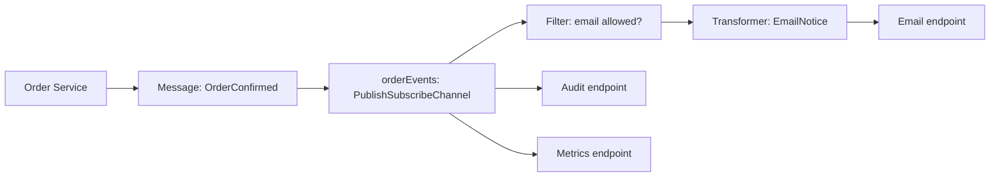

# Publish-Subscribe and Notification Events

## Objectives and Scope

In Spring Integration Core, `PublishSubscribeChannel` is the point that distributes one message to multiple subscribers. This lesson uses an order-confirmed event to connect the core building blocks: `Message`, `MessageChannel`, endpoints, filters, transformers, and Java DSL.

After this lesson, you will be able to:

- Distinguish publishing a notification event from sending a command to a single handler.
- Design multiple branches that react to the same event.
- Explain execution boundaries, errors, and the meaning of `send()` results.
- Choose ways to detect missing subscribers, test fan-out, and prevent duplicate notifications.

Examples use Java 17 and Spring Integration 6.5 APIs. Extension snippets explicitly note where to add or replace code; they are not configurations to enable all at once.

## 1. From Direct Calls to Event Publishing

Suppose after confirming an order, the system needs to:

1. Send an email if the customer opted in to notifications.
2. Record a business audit trail.
3. Update metrics.

If the order service calls all three services directly, it must know the list of recipients and how to call each one. With publish-subscribe, the service emits an `OrderConfirmed` event; branches decide their own reactions independently.



The diagram illustrates distribution structure. Branching arrows do not yet indicate which branches run on separate threads.

A **notification event** announces that something has occurred. For instance, `OrderConfirmed` expresses a past fact; `SendConfirmationEmail` expresses a request to perform an action. Making this distinction lets the publisher announce business facts without dictating every reaction.

| Aspect | Notification Event | Command |
| --- | --- | --- |
| Meaning | Something has happened | Something must be done |
| Example | `OrderConfirmed` | `SendConfirmationEmail` |
| Recipients | May have multiple interested parties | Has one clear processing responsibility |
| Relationship to publisher | Subscribers can be added independently | Sender must know the command-handling contract |
| Reply | Usually does not need one combined result | May need an execution result |

Naming alone does not create delivery guarantees. A notification event can still be processed synchronously, can still fail, and can still be lost if held only in memory.

## 2. The PublishSubscribeChannel Contract

`PublishSubscribeChannel` implements broadcasting to registered `MessageHandler`s. It is a `SubscribableChannel`, not a `PollableChannel`: subscribers are invoked via `handleMessage()`, rather than pulling messages with `receive()`. See [Message Channel Implementations](https://docs.spring.io/spring-integration/reference/6.5/channel/implementations.html).

The publisher typically only needs a `MessageChannel` reference and calls `send(message)`. Each `IntegrationFlow`'s endpoint handles registering its handler with the channel when the context runs.

### 2.1. Distinguishing Related Mechanisms

| Mechanism | Delivery Behavior | Application to the Order Example |
| --- | --- | --- |
| `DirectChannel` | One handler selected per dispatch; may try another handler on failover | Pick one worker to process a command |
| `PublishSubscribeChannel` | Distributes to the channel's subscribers | Email, audit, and metrics all observe one event |
| `QueueChannel` | Each message is received once from the queue | Buffers work for competing consumers |
| Router | Selects target channel based on content or rules | Sends domestic and international orders to matching flows |
| Filter | Accepts or drops messages at its point in the flow | Blocks only the email branch when consent is absent |

Placing a filter before the broadcast channel would drop the event from all branches. In this example, consent governs only email, so the filter sits inside the email branch.

A content-based router can be configured to return multiple targets. The deciding factor here is design intent: broadcasting fits when subscribers observe a shared event stream; routing fits when rules determine destinations.

### 2.2. Delivery Boundaries

This channel does not automatically provide a history log, replay mechanism, or durable subscriptions. A subscriber added after an event was published does not automatically receive past events. An application instance holds that instance's subscribers; creating a same-named bean on another instance does not form a cross-host topic.

Three configured subscribers represent three intake points at the heads of branches. If the email branch intentionally filters an event out, that does not mean the channel forgot to deliver to the email subscriber.

## 3. Designing Messages for Notifications

An appropriate payload should capture the event and data needed to understand it, avoiding passing an entity actively managed by a persistence context.

In the example, `OrderConfirmed` contains:

| Field | Role |
| --- | --- |
| `eventId` | Identifier of the business event, preserved when replaying the same event |
| `orderId` | Order key |
| `occurredAt` | Timestamp when the event occurred |
| `customerEmail` | Address used in the practice exercise |
| `emailAllowed` | Notification permission decision at the time the event was emitted |

In a real system, clarify whether consent inside the event is a snapshot at occurrence time or whether the sending branch must re-check current opt-in status. If you do not want every subscriber seeing the email address, emit only the customer key and let the email branch fetch required data under its own authorization.

Distinguish two identifiers:

- `MessageHeaders.ID` identifies a technical message.
- `eventId` identifies the business event carried by the message.

When a retry or replay constructs a new `Message`, do not rely on the message ID to conclude it is a new business event.

### Immutable Payloads When Shared Across Branches

`Message` does not allow arbitrarily swapping its payload and headers, yet the payload object itself can still be a mutable `List`, `Map`, or entity. Sharing that same reference across branches can expose mutations from one branch to another.

The example uses a `record` with `UUID`, `String`, `Instant`, and `boolean` to avoid this issue. If a record contains collections, copy them or use immutable collections; a record does not make nested objects immutable automatically.

## 4. Complete Example: Three Subscribers in Java DSL

### 4.1. Preparing Dependencies

In a Maven project already managing versions with a compatible Spring BOM, the dependency needed for the main practice exercise is:

```xml
<dependency>
    <groupId>org.springframework.integration</groupId>
    <artifactId>spring-integration-core</artifactId>
</dependency>
```

The example needs no broker, database, or email account. If your project lacks a BOM, configure compatible Spring Integration and dependency versions before compiling; the dependency snippet above is not a standalone `pom.xml`.

Place the following code in `NotificationDemo.java`. Endpoints write to memory to observe delivery without sending real emails.

```java
import java.time.Instant;
import java.util.List;
import java.util.UUID;
import java.util.concurrent.CopyOnWriteArrayList;

import org.springframework.beans.factory.annotation.Qualifier;
import org.springframework.context.annotation.Bean;
import org.springframework.context.annotation.Configuration;
import org.springframework.context.annotation.AnnotationConfigApplicationContext;
import org.springframework.integration.channel.PublishSubscribeChannel;
import org.springframework.integration.config.EnableIntegration;
import org.springframework.integration.dsl.IntegrationFlow;
import org.springframework.messaging.Message;
import org.springframework.messaging.MessageChannel;
import org.springframework.messaging.support.MessageBuilder;

public class NotificationDemo {

    public record OrderConfirmed(
            UUID eventId,
            String orderId,
            Instant occurredAt,
            String customerEmail,
            boolean emailAllowed) {
    }

    public record EmailNotice(
            UUID eventId,
            String orderId,
            String recipient,
            String subject) {
    }

    public static class DeliveryLog {
        public final List<EmailNotice> emails =
                new CopyOnWriteArrayList<>();
        public final List<String> audits =
                new CopyOnWriteArrayList<>();
        public final List<String> metrics =
                new CopyOnWriteArrayList<>();
    }

    @Configuration
    @EnableIntegration
    public static class Config {

        @Bean
        public PublishSubscribeChannel orderEvents() {
            // true: treat having no subscribers as a configuration error.
            return new PublishSubscribeChannel(true);
        }

        @Bean
        public DeliveryLog deliveryLog() {
            return new DeliveryLog();
        }

        @Bean
        public IntegrationFlow emailFlow(
                @Qualifier("orderEvents") MessageChannel input,
                DeliveryLog log) {

            return IntegrationFlow.from(input)
                    .<OrderConfirmed>filter(OrderConfirmed::emailAllowed)
                    .<OrderConfirmed, EmailNotice>transform(event ->
                            new EmailNotice(
                                    event.eventId(),
                                    event.orderId(),
                                    event.customerEmail(),
                                    "Order confirmation " + event.orderId()))
                    .handle(EmailNotice.class, (notice, headers) -> {
                        log.emails.add(notice);
                        return null;
                    })
                    .get();
        }

        @Bean
        public IntegrationFlow auditFlow(
                @Qualifier("orderEvents") MessageChannel input,
                DeliveryLog log) {

            return IntegrationFlow.from(input)
                    .handle(OrderConfirmed.class, (event, headers) -> {
                        log.audits.add(event.orderId());
                        return null;
                    })
                    .get();
        }

        @Bean
        public IntegrationFlow metricsFlow(
                @Qualifier("orderEvents") MessageChannel input,
                DeliveryLog log) {

            return IntegrationFlow.from(input)
                    .handle(OrderConfirmed.class, (event, headers) -> {
                        log.metrics.add(event.orderId());
                        return null;
                    })
                    .get();
        }
    }

    public static void publish(
            MessageChannel channel, OrderConfirmed event) {

        Message<OrderConfirmed> message =
                MessageBuilder.withPayload(event)
                        .setHeader("eventType", "OrderConfirmed")
                        .setHeader("eventId", event.eventId().toString())
                        .build();

        if (!channel.send(message)) {
            throw new IllegalStateException(
                    "Channel did not accept event " + event.eventId());
        }
    }

    public static void main(String[] args) {
        try (var context =
                     new AnnotationConfigApplicationContext(Config.class)) {

            MessageChannel events =
                    context.getBean("orderEvents", MessageChannel.class);

            publish(events, new OrderConfirmed(
                    UUID.randomUUID(), "ORD-1001", Instant.now(),
                    "customer@example.test", true));

            publish(events, new OrderConfirmed(
                    UUID.randomUUID(), "ORD-1002", Instant.now(),
                    "customer@example.test", false));

            DeliveryLog log = context.getBean(DeliveryLog.class);
            System.out.printf(
                    "email=%d, audit=%d, metrics=%d%n",
                    log.emails.size(),
                    log.audits.size(),
                    log.metrics.size());
        }
    }
}
```

Expected output for this synchronous configuration:

```text
email=1, audit=2, metrics=2
```

This is the output for learners to verify when running the example. `CopyOnWriteArrayList` is only an observation aid in the lesson; it does not replace a real audit store or metrics system.

### 4.2. Reading the Execution Flow

`@EnableIntegration` enables the integration infrastructure. Each `IntegrationFlow` bean is parsed into channels and endpoints inside the Spring context.

All three flows start from the same `orderEvents` instance. The direct subscriber of the email branch is the filter endpoint; the channel does not need to know that a transformer and handler follow the filter.

The email branch creates a new `EmailNotice` from `OrderConfirmed`. The audit and metrics branches still receive the original event payload. Transforming only changes the message continuing within that branch.

The final handler returns `null` because the branch ends with a side effect. If it returned another value, the endpoint could continue routing that value as a reply and require an appropriate next destination.

### 4.3. Writing Branches Inside One Flow

When branches belong to a small configuration, Java DSL supports `publishSubscribeChannel(...)` with `subscribe(...)` subflows. This is an alternative to the split-flow structure; do not enable both approaches simultaneously if each reaction should occur only once. See [Java DSL API for publishSubscribeChannel](https://docs.spring.io/spring-integration/docs/6.5.0/api/org/springframework/integration/dsl/BaseIntegrationFlowDefinition.html#publishSubscribeChannel(java.util.function.Consumer)).

The compact example below has two subscribers and requires a `DeliveryLog` bean as above. If used instead of the main configuration, send to the `notificationInput` channel bean and remove the three old flows:

```java
@Bean
public IntegrationFlow compactNotifications(
        NotificationDemo.DeliveryLog log) {

    return IntegrationFlow.from("notificationInput")
            .publishSubscribeChannel(spec -> spec
                    .subscribe(email -> email
                            .<NotificationDemo.OrderConfirmed>filter(
                                    NotificationDemo.OrderConfirmed::emailAllowed)
                            .handle(
                                    NotificationDemo.OrderConfirmed.class,
                                    (event, headers) -> {
                                        log.emails.add(
                                                new NotificationDemo.EmailNotice(
                                                        event.eventId(),
                                                        event.orderId(),
                                                        event.customerEmail(),
                                                        "Order confirmation "
                                                                + event.orderId()));
                                        return null;
                                    }))
                    .subscribe(audit -> audit
                            .handle(
                                    NotificationDemo.OrderConfirmed.class,
                                    (event, headers) -> {
                                        log.audits.add(event.orderId());
                                        return null;
                                    })))
            .get();
}
```

`subscribe(...)` describes a branch of the broadcast. It does not imply spawning threads, retrying, or waiting for branches to finish. Notification examples terminate inside each branch so the contract does not require a combined reply.

## 5. Synchronous, Asynchronous, and the Meaning of send()

### 5.1. Default Configuration Uses the Sender's Thread

The constructor without an executor invokes subscribers on the sending thread. One slow branch can slow down `publish()`; three branches do not automatically run in parallel.

In the main example, when `publish()` returns normally, the synchronous handlers have already returned. The simulated email was added immediately to the list, so the list can be read right afterward.

If a handler merely calls an email API and receives acceptance from the API, that still does not prove the email reached the customer's inbox. Guarantees at the end of a branch depend on the receiving system's contract.

Details on constructors and executor choices are in the [PublishSubscribeChannel API](https://docs.spring.io/spring-integration/docs/6.5.0/api/org/springframework/integration/channel/PublishSubscribeChannel.html).

### 5.2. Switching to a Thread Pool

Replace the `orderEvents()` bean in `Config` with the following two beans. Add import `org.springframework.scheduling.concurrent.ThreadPoolTaskExecutor`; the remaining imports are already in the main example.

```java
@Bean
public ThreadPoolTaskExecutor notificationExecutor() {
    ThreadPoolTaskExecutor executor = new ThreadPoolTaskExecutor();
    executor.setCorePoolSize(3);
    executor.setMaxPoolSize(6);
    executor.setQueueCapacity(100);
    executor.setThreadNamePrefix("notification-");
    executor.setWaitForTasksToCompleteOnShutdown(true);
    executor.setAwaitTerminationSeconds(10);
    return executor;
}

@Bean
public PublishSubscribeChannel orderEvents(
        @Qualifier("notificationExecutor")
        ThreadPoolTaskExecutor executor) {

    return new PublishSubscribeChannel(executor, true);
}
```

Spring manages initializing and destroying `ThreadPoolTaskExecutor` because it is a bean. The numbers above are for the practice exercise; measure load to size them for a real application.

With this executor, subscribers can run on different workers. `send()` can return while work is still unfinished; reading the lists immediately after two `publish()` calls is no longer a reliable check.

Both the thread pool and queue have limits. When no more tasks can be accepted, the rejection policy can cause the send call to fail. If some branches were already submitted earlier, failure to submit a later branch does not roll back work already accepted.

`CallerRunsPolicy`, if chosen, can run tasks directly on the sending thread under overload. Therefore, evaluate publisher-side latency too when selecting this policy. See [Task Execution and Scheduling](https://docs.spring.io/spring-framework/reference/integration/scheduling.html).

### 5.3. Distinguishing Levels of Success

| Observation | What Can Be Concluded | What Cannot Be Concluded Yet |
| --- | --- | --- |
| `send()` returns `true` in synchronous setup | Channel accepted per dispatch settings and invoked handlers returned | External side effects will never fail later |
| `send()` returns `true` with thread pool | Dispatch satisfied criteria at send time | All branches finished and succeeded |
| Success response received from email provider | Provider acknowledged per API contract | Customer read the email |
| Per-branch success status exists | Data is available to track each reaction's progress | An atomic transaction covers all systems |

The first row assumes the default `ignoreFailures=false` and no endpoint deliberately catching and swallowing errors. Do not turn the channel's boolean into a notification delivery status in a business UI.

### 5.4. Do Not Use Subscriber Order as a Business Condition

If metrics may only update after audit succeeds, those two operations have a dependency. Place them in an explicit processing chain within one branch or model an appropriate orchestration step.

Invocation order during a synchronous send is not completion order when running with a pool. With multiple concurrent publishers, there is also no automatic global ordering for all events of the same order.

## 6. Missing Subscribers and Control Settings

### 6.1. Sending Can Succeed with No Subscribers

With `new PublishSubscribeChannel()`, `minSubscribers` defaults to 0. Therefore, sending to a channel with no subscribers can return `true` without triggering any business reaction.

The main example uses `new PublishSubscribeChannel(true)` to enable `requireSubscribers`. If the channel has no subscribers, dispatch is rejected and the caller encounters a messaging exception. Dispatcher-layer errors may be wrapped by the channel; in tests, rely on the `MessagingException` contract rather than assuming the caller always receives an exact internal exception class.

This option helps detect situations like unstarted consumer endpoints or a configuration missing receiving branches. It does not prove all three business-required branches are present.

### 6.2. minSubscribers Is Not Business Verification

You can configure:

```java
PublishSubscribeChannel channel = new PublishSubscribeChannel(true);
channel.setMinSubscribers(3);
```

`minSubscribers` affects the dispatch success condition; with asynchronous processing, this check relies on subscriber count and does not wait for each task's result. See [PublishSubscribeChannel configuration](https://docs.spring.io/spring-integration/reference/6.5/channel/configuration.html).

Do not treat this setting as an atomic check before any side effects. A send failing to meet the threshold may still have delivered the message to some subscribers. Retrying the whole send in that situation can re-run branches that already succeeded.

If you specifically need email, audit, and metrics branches, verify which endpoints are active during startup and track progress individually. Any three subscribers do not prove they are the three intended responsibilities.

## 7. Error Handling Across Thread Boundaries

### 7.1. Synchronous: Failures Can Stop Later Subscribers

By default, `ignoreFailures=false`. If a synchronous handler throws an exception, the caller can receive the error and handlers not yet invoked may not receive the event.

Suppose in one dispatch, audit wrote data, email failed, and metrics was not called yet. When the caller retries the event, audit may write a second time. The channel does not automatically undo audit or remember which branches already completed.

Setting `setIgnoreFailures(true)` lets the dispatcher attempt to continue to other handlers when one handler fails. This is a dispatch-level error-ignoring option; it does not create retries, durable failure records, or a guarantee that all reactions succeed. Fail-fast rules and differences with an executor are described in the [BroadcastingDispatcher API](https://docs.spring.io/spring-integration/docs/6.5.0/api/org/springframework/integration/dispatcher/BroadcastingDispatcher.html).

If you need independent branches while still knowing about each error, design error handling per endpoint or use an asynchronous boundary with an observable error flow. Do not use an ignore-failures flag as a substitute for a notification tracking contract.

### 7.2. Asynchronous: Routing Errors to an Error Flow

When subscribers run on worker threads, processing exceptions cannot unwind back through the sender's already-returned call stack.

Inside a Spring context, an executor-backed `PublishSubscribeChannel` uses `MessagePublishingErrorHandler` by default unless another error handler is configured. Errors are represented as `ErrorMessage`; the default destination is looked up from the message's `errorChannel` header, then the global `errorChannel` bean. See [Error Handling](https://docs.spring.io/spring-integration/reference/6.5/error-handling.html).

To give notifications a dedicated error flow, add the following beans to `Config`. Add imports for `org.springframework.integration.channel.DirectChannel` and `org.springframework.messaging.MessagingException`.

```java
@Bean
public DirectChannel notificationErrors() {
    return new DirectChannel();
}

@Bean
public IntegrationFlow notificationErrorFlow(
        @Qualifier("notificationErrors") MessageChannel errors) {

    return IntegrationFlow.from(errors)
            .handle(Throwable.class, (failure, headers) -> {
                Message<?> failedMessage =
                        failure instanceof MessagingException exception
                                ? exception.getFailedMessage()
                                : null;

                Object eventId = failedMessage == null
                        ? "unknown"
                        : failedMessage.getHeaders().get("eventId");

                System.getLogger("notifications").log(
                        System.Logger.Level.ERROR,
                        "notification_failed eventId=" + eventId,
                        failure);
                return null;
            })
            .get();
}
```

Then, inside `publish()`, add the following line to the `MessageBuilder` chain before `.build()`:

```java
.setHeader(
        org.springframework.messaging.MessageHeaders.ERROR_CHANNEL,
        "notificationErrors")
```

The channel name in the header is resolved in the example's Spring context. `ErrorMessage` has the error as its payload; its headers are not necessarily a full copy of the original event headers. The handler extracts the failed message from `MessagingException` to read `eventId`, while handling the case where that message is absent.

The error flow above illustrates error routing via logs. For operational needs, you can also persist failure records containing `eventId`, branch name, attempt count, and cause in an appropriate store.

### 7.3. Limitations to Understand When Using an Error Flow

- The `errorChannel` header does not automatically turn a synchronous channel into a message-based error-handling mechanism. In the main configuration without an executor, exceptions still propagate to the caller unless an endpoint or gateway has its own error-handling mechanism.
- Task submission rejection errors can occur right on the sending thread; handle them at the publish boundary rather than assuming every error enters the async error flow.
- An already-accepted task is not canceled simply because another task failed.
- The error handler itself can fail. Monitor the error flow and avoid creating loops that route errors back into the failing flow itself.
- If a branch passes through another asynchronous channel, downstream errors depend on that boundary's error-handling mechanism.

There is no implicit atomic transaction spanning email, audit, metrics, and the error flow.

## 8. Gateways and Spring ApplicationEvent

### 8.1. Gateways as Calling Boundaries for Business Code

Instead of letting business services construct `Message` objects directly, use `@MessagingGateway` to hide messaging APIs behind an interface. Proxy creation and interface scanning are presented in [Messaging Gateways](https://docs.spring.io/spring-integration/reference/6.5/gateway.html). Once the project enables gateway scanning via `@IntegrationComponentScan`, an illustrative contract can be written as:

```java
import org.springframework.integration.annotation.MessagingGateway;

@MessagingGateway(defaultRequestChannel = "orderEvents")
public interface OrderEventGateway {
    void publish(NotificationDemo.OrderConfirmed event);
}
```

The `void` method expresses publishing a notification without waiting for a shared business reply. This does not force it to run asynchronously: with a synchronous channel, calling the gateway still executes branches on the calling thread and can throw errors according to gateway settings.

If the `errorChannel` header is needed, configure header mapping or a header-enricher step at the appropriate gateway boundary. The illustrative gateway above does not automatically add the custom headers from `NotificationDemo.publish()`.

If the requirement is "wait for all branches and return a combined report", model replies, correlation, wait timeouts, and missing outcomes. That is a different contract from one-way notification.

### 8.2. Spring Events Do Not Automatically Enter a MessageChannel

`ApplicationEventPublisher.publishEvent(...)` and `MessageChannel.send(...)` belong to two separate event-publishing mechanisms. A `PublishSubscribeChannel` bean does not automatically subscribe to all Spring application events.

If a system already emits Spring events and wants to feed them into an integration flow, Spring Integration provides `ApplicationEventListeningMessageProducer`. This adapter requires the additional `spring-integration-event` module, outside the main example's core dependency. See [Spring ApplicationEvent Support](https://docs.spring.io/spring-integration/reference/6.5/event.html).

Place the following optional snippet in `Config` after adding that dependency and importing `org.springframework.integration.event.inbound.ApplicationEventListeningMessageProducer`:

```java
@Bean
public ApplicationEventListeningMessageProducer orderEventBridge(
        @Qualifier("orderEvents") MessageChannel output) {

    var bridge = new ApplicationEventListeningMessageProducer();
    bridge.setEventTypes(NotificationDemo.OrderConfirmed.class);
    bridge.setOutputChannel(output);
    return bridge;
}
```

The adapter only accepts the selected event types. For matching event payloads, it wraps the payload in a message sent to `orderEvents`.

Choose one publishing path for the same event: call the gateway/channel directly or go through the Spring event bridge. If the publisher calls both paths, subscribers can receive events twice. If both inbound and outbound bridges exist, separate types or flows to avoid event loops.

## 9. applySequence and Limitations When Aggregating Results

Notifications typically let branches finish independently, so `applySequence` is unnecessary.

If an aggregator is needed downstream of the branches, enable:

```java
PublishSubscribeChannel channel = new PublishSubscribeChannel(true);
channel.setApplySequence(true);
```

The channel attaches correlation and sequence headers to distributed messages. In Java, commonly observed headers are `correlationId`, `sequenceNumber`, and `sequenceSize`. This option is off by default; when enabled, messages may differ in headers while still sharing the same payload reference. See [apply-sequence configuration](https://docs.spring.io/spring-integration/reference/6.5/channel/configuration.html).

Applied to the three-subscriber example:

- Sequence describes three dispatch targets, not three successfully sent notifications.
- The email branch may filter out the event and send no message to the aggregator.
- The audit and metrics branches end with `return null`, so they produce no replies to aggregate either.

Adding `applySequence=true` alone does not turn the example into a complete scatter-gather flow. If the aggregator waits for three replies while one branch sends none, the group can wait forever without a timeout or alternative release strategy.

When aggregation is needed, design each branch to return a clear result such as `SENT`, `SKIPPED`, or `FAILED`; preserve correlation, define wait deadlines, and specify late-arrival handling. Do not treat sequence headers as notification business status.

## 10. Transactions, Replay, and Deduplication

### 10.1. Publishing Before Commit Can Emit Premature Notifications

Suppose a service executes inside a transaction:

```text
Save order status
→ Publish OrderConfirmed
→ Email branch sends notification
→ A later step fails
→ Transaction rolls back
```

An email already sent externally may be impossible to recall. Running branches on the same thread does not make an email API participate in the database transaction either.

You can attach a Spring event listener with `@TransactionalEventListener(phase = AFTER_COMMIT)` to forward the event into the integration flow only after the transaction commits. By default, this kind of listener does not run when no transaction is active unless fallback is enabled. See [Transaction-bound Events](https://docs.spring.io/spring-framework/reference/data-access/transaction/event.html).

Publishing after commit still leaves a gap: the database has committed, yet the process stops before the notification is saved or sent. When business rules require surviving process crashes, a common design is:

```text
Database transaction:
    update order + insert outbox event
                 ↓ commit
Worker reads committed outbox
                 ↓
Publish to notification flow or appropriate messaging infrastructure
                 ↓
Track results and retry mechanism
```

This is a complementary design direction to guarantee recovery. `PublishSubscribeChannel` itself does not write an outbox, persist delivery state, or distribute durably across processes.

### 10.2. Retrying the Right Branch and Preserving eventId

Scenario:

```text
event E
  email   → succeeds
  audit   → succeeds
  metrics → fails
```

If all of E is resent to `orderEvents`, the email could be sent a second time. If the failure is only in metrics, prefer retrying the metrics endpoint under its own policy rather than always re-broadcasting the entire event across all branches.

To detect duplicate processing, design a key:

```text
(eventId, subscriberName)
```

For example, `(E, email)` differs from `(E, metrics)`. Storing only a shared "event E processed" status across all subscribers can let a succeeding branch mask an unfinished branch.

A tracking table might contain:

| eventId | subscriberName | status | attempt |
| --- | --- | --- | --- |
| E | email | SENT | 1 |
| E | audit | RECORDED | 1 |
| E | metrics | FAILED | 2 |

Unique constraints and update operations must handle concurrency when multiple workers encounter the same event. A check-via-`contains()`-then-write using an in-memory collection is insufficient across multiple instances or restarts.

With external side effects, there is also a failure window between "provider accepted" and "application persisted success". If the provider supports an idempotency key, use a key stable per event and branch. Without that support, define reconciliation and handling for ambiguous outcomes; never claim exactly-once solely from a channel and retries.

## 11. Testing Fan-Out Behavior

The following tests use JUnit Jupiter 5 and the `NotificationDemo` class from section 4. Place `NotificationDemoTest.java` in the same package as that class and configure matching test dependencies in your project. No SMTP server is required because endpoints were replaced with in-memory outputs.

The tests use the original synchronous configuration, without replacing `orderEvents` with the executor-backed version.

```java
import static org.junit.jupiter.api.Assertions.assertEquals;
import static org.junit.jupiter.api.Assertions.assertThrows;
import static org.junit.jupiter.api.Assertions.assertTrue;

import java.time.Instant;
import java.util.UUID;
import java.util.concurrent.atomic.AtomicInteger;

import org.junit.jupiter.api.Test;
import org.springframework.context.annotation.AnnotationConfigApplicationContext;
import org.springframework.integration.channel.PublishSubscribeChannel;
import org.springframework.messaging.MessageChannel;
import org.springframework.messaging.MessagingException;
import org.springframework.messaging.support.GenericMessage;

class NotificationDemoTest {

    private NotificationDemo.OrderConfirmed event(
            String orderId, boolean emailAllowed) {

        return new NotificationDemo.OrderConfirmed(
                UUID.randomUUID(),
                orderId,
                Instant.parse("2026-01-01T00:00:00Z"),
                "customer@example.test",
                emailAllowed);
    }

    @Test
    void everyEligibleBranchReactsToTheSameEvent() {
        try (var context = new AnnotationConfigApplicationContext(
                NotificationDemo.Config.class)) {

            MessageChannel channel =
                    context.getBean("orderEvents", MessageChannel.class);
            var log = context.getBean(NotificationDemo.DeliveryLog.class);
            var input = event("ORD-1", true);

            NotificationDemo.publish(channel, input);

            assertEquals(1, log.emails.size());
            assertEquals(input.eventId(), log.emails.get(0).eventId());
            assertEquals("ORD-1", log.emails.get(0).orderId());
            assertEquals("Order confirmation ORD-1", log.emails.get(0).subject());
            assertEquals(1, log.audits.size());
            assertEquals("ORD-1", log.audits.get(0));
            assertEquals(1, log.metrics.size());
            assertEquals("ORD-1", log.metrics.get(0));
        }
    }

    @Test
    void optingOutOfEmailDoesNotSuppressOtherSubscribers() {
        try (var context = new AnnotationConfigApplicationContext(
                NotificationDemo.Config.class)) {

            MessageChannel channel =
                    context.getBean("orderEvents", MessageChannel.class);
            var log = context.getBean(NotificationDemo.DeliveryLog.class);

            NotificationDemo.publish(channel, event("ORD-2", false));

            assertTrue(log.emails.isEmpty());
            assertEquals(1, log.audits.size());
            assertEquals(1, log.metrics.size());
        }
    }

    @Test
    void requiringSubscribersRejectsAnUnobservedEvent() {
        var permissive = new PublishSubscribeChannel();
        assertTrue(permissive.send(new GenericMessage<>("event")));

        var strict = new PublishSubscribeChannel(true);
        assertThrows(
                MessagingException.class,
                () -> strict.send(new GenericMessage<>("event")));
    }

    @Test
    void synchronousFailureCanPreventLaterDelivery() {
        var channel = new PublishSubscribeChannel(true);
        var laterInvocations = new AtomicInteger();

        channel.subscribe(message -> {
            throw new IllegalStateException("Simulated first subscriber failure");
        });
        channel.subscribe(message -> laterInvocations.incrementAndGet());

        assertThrows(
                MessagingException.class,
                () -> channel.send(new GenericMessage<>("event")));

        assertEquals(0, laterInvocations.get());
    }
}
```

The first test checks both transformed data and that all branches react together. The second test verifies filter placement: if the consent filter were placed before broadcast, this test would reveal that audit and metrics also lost the event.

The last test registers two handlers directly with no custom order, in order in code, to observe fail-fast in synchronous mode. It does not assert business ordering across flow beans.

### Additional Tests When Switching to Asynchronous Execution

Do not keep the expectation "reading the list immediately is enough" when switching to a thread pool. Use a `CountDownLatch` or receive messages from a test output `QueueChannel` with a finite timeout.

| Scenario | How to Control in Test | What to Verify |
| --- | --- | --- |
| Handler still processing | Have handler signal start then wait on a test-held latch | `send()` has returned while handler is not yet finished |
| One branch throws an error | Set `errorChannel` to a test `QueueChannel` | Receive `ErrorMessage`, find cause and failed message |
| Both branches complete | Each branch decrements a shared latch | Latch reaches 0 before deadline; do not assert order |
| No subscribers | Create channel with `requireSubscribers=true` | Event is not treated as successfully accepted |
| Replaying the same event | Send two messages carrying the same `eventId` | Behavior matches each branch's deduplication policy |
| Executor rejects task | Use a test executor that intentionally rejects submissions | Caller sees error and does not assume earlier branches were canceled |

When using a latch to block handlers, always release the latch in `finally` and shut down the executor after the test so workers are not left hanging when an assertion fails. Avoid `Thread.sleep(...)` as pass/fail test logic: machine speed is not a flow contract.

## 12. Step-by-Step Practice

1. **Observe the synchronous setup.** Run `NotificationDemo.main()` and verify expected output. Log thread names in each handler to see them running on the sending thread.
2. **Check filter placement.** Set `emailAllowed=false` and verify only email is skipped. Keep audit and metrics active to reflect the event accurately.
3. **Add a new subscriber.** Create a dashboard-update branch subscribing to the same `orderEvents`. The publisher still emits the same event type.
4. **Simulate an independent failure.** Make the dashboard branch throw an exception. In default synchronous mode, observe the error at the publisher; do not guess which branches ran without explicitly recording them.
5. **Try a thread pool.** Replace the channel bean with an executor-backed version, adding an error flow and error header. Use deadline-bounded waits to measure each branch's outcome.
6. **Replay an event.** Keep `eventId` unchanged, send twice, and observe duplication in the in-memory output. Then design state keyed by `(eventId, subscriberName)` for branches requiring deduplication.

Each step extends the practice exercise one behavior at a time. Do not enable both the three-flow setup and the compact setup at the same time when measuring reaction counts.

## 13. Common Design Mistakes

| Symptom | Common Cause | How to Fix |
| --- | --- | --- |
| Only one branch receives the event | Using `DirectChannel` or a queue with competing consumers | Use a channel with broadcast semantics where fan-out is needed |
| Audit also loses events when email is disabled | Consent filter placed before broadcast | Move the filter inside the email branch |
| Send succeeds yet no reactions occur | No subscribers and configuration still allows it | Require subscribers, verify endpoints, and monitor branches |
| Publisher is slow despite "notification" naming | Handlers run synchronously and one branch is slow | Measure each branch; choose explicit executor/queue boundaries |
| Duplicate emails after retry | Retried entire broadcast after a local failure | Retry the specific failing branch and use stable business keys |
| Caller sees no errors when using a pool | Handler failed on a worker thread | Configure and monitor an error flow |
| One branch sees mutated payload | Multiple branches share a mutable object | Use immutable payloads or create branch-local data |
| Aggregator never releases | A branch filtered out or returned no result | Design complete replies, timeouts, and release rules |
| Notifications lost after restart | Work existed only in memory or executor queue | Add durable storage and an appropriate recovery strategy |
| Same event processed twice | Published via both direct channel and Spring event bridge | Choose one publishing path, combined with deduplication on replay |

A clear notification design must state what the event represents, who is subscribed, what loss/duplication tolerance each branch accepts, and how outcomes are observed. `PublishSubscribeChannel` handles the distribution point in the flow; completion, recovery, and side-effect guarantees must be expressed through complementary components and contracts.
