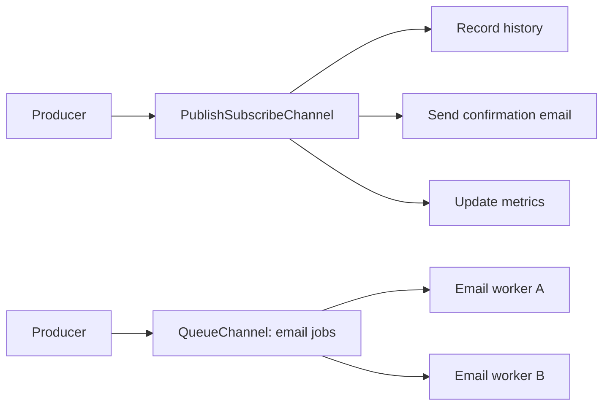
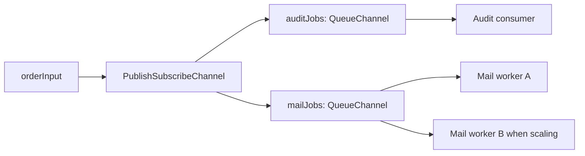

# Differences from QueueChannel

In Spring Integration Core, `PublishSubscribeChannel` and `QueueChannel` answer two different design questions: **which branches need to receive a message** and **how work is buffered and pulled for processing**. Switching from one channel type to the other can change business outcomes, not just performance.

This lesson belongs to the **PublishSubscribeChannel** chapter and focuses on comparing both channel types through `Message`, how endpoints receive messages, execution boundaries, error handling, and Java DSL configuration. After this lesson, you will be able to choose the right channel for an event-broadcast flow, a load-sharing worker group, or a combined design.

## 1. One Event for Many Branches or One Task for One Worker?

Suppose the system just confirmed order `ORDER-1042`. Three functions need to react: recording history, sending a confirmation email, and updating business metrics.

With `PublishSubscribeChannel`, registered handlers are interested parties sharing the event. When delivery succeeds, every handler is invoked with that message. This is the **broadcast** mechanism, often called **fan-out**. With `QueueChannel`, consumers reading the same queue **compete to pull messages**; an item pulled by one consumer is no longer in the queue for another consumer to pull again. Both mechanisms are described in [Message Channel Implementations](https://docs.spring.io/spring-integration/reference/channel/implementations.html).



In the bottom half of the diagram, two arrows from the queue show two consumers that can pull work. They do not mean each item is broadcast to both workers.

If there are 10 messages and 3 handlers subscribed to pub-sub, the case where every delivery succeeds produces 30 handler invocations. With 10 items in a shared queue and 3 consumers, draining the queue produces 10 successful receives in total, assuming no re-sends or other replay mechanisms. This example illustrates delivery; it is not yet a business guarantee of exactly-once processing.

**Design consequence:** if sending email and recording history must both happen, do not make those two functions competing consumers on the same `QueueChannel`. One order might only get its history recorded, while another only gets its email sent.

## 2. Comparison Table for Choosing Flow Structure

| Criterion | `PublishSubscribeChannel` | `QueueChannel` |
| --- | --- | --- |
| Delivery semantics | Broadcasts to registered handlers | Each item is pulled by one consumer |
| Receiving contract | `SubscribableChannel`, register `MessageHandler` | `PollableChannel`, call `receive()` |
| Typical endpoint behavior | Invoked by channel when a message arrives | Polling consumer actively pulls messages |
| Built-in message buffer by default? | No | Yes, in-memory by default |
| No consumer present at send time | Does not retain for future subscribers | Retains item if queue has capacity |
| Default execution | Invokes handlers on sender's thread | `send()` enqueues the message |
| To process on another thread | Configure an executor or add an async boundary in a branch | Use a poller/receiver running on another thread |
| Under rising load | Synchronous sender waits for handlers; executor has its own bounds | Queue accumulates items up to capacity limit |
| Adding a consumer of the same function | Adds another recipient of the same event | Increases contenders sharing work |
| Ordering considerations | Do not use branch completion order as a business rule | Queue is FIFO on dequeue by default; completion may differ in order |
| Typical need | Multiple functions reacting to an event | Multiple workers sharing a pool of tasks |

The two message-receiving interfaces are distinguished in [MessageChannel contracts](https://docs.spring.io/spring-integration/reference/channel/interfaces.html). Creating an `EventDrivenConsumer` or `PollingConsumer` based on channel type is explained in the [Poller documentation](https://docs.spring.io/spring-integration/reference/polling-consumer.html).

Consumer count and thread count are two distinct quantities. Three subscribers can be called sequentially on one thread; one queue can be read by only a single poller. Examine both channel structure and endpoint configuration to understand a flow's concurrency.

## 3. API Differences and the Meaning of send()

### 3.1. Pub-Sub Accepts Subscriptions, Does Not Provide receive()

A `PublishSubscribeChannel` accepts `MessageHandler` via `subscribe(handler)` and delivers by calling handlers. Consumers do not call `receive()` on this channel. Conversely, `QueueChannel` provides `receive()` to pull messages and is not a channel for registering handlers under the `SubscribableChannel` contract.

That explains why a service activator wired directly to pub-sub typically runs in event-driven mode, whereas a service activator wired to a queue needs a poller, configured on the endpoint or via the application's default poller.

### 3.2. Both Return true Yet Confirm Different Things

For a queue, a successful `send()` indicates the message was accepted into the queue. You cannot infer that a worker sent an email, persisted data, or completed a transaction.

For synchronous pub-sub, when `send()` finishes normally, handler calls executed directly during that dispatch have returned under the current configuration. If a handler merely forwards to another queue, processing behind that queue may still not have run.

For pub-sub with an executor running on other threads, the sender can proceed before handlers finish processing. Do not treat `send()`'s return value as confirmation of business completion across all branches. The `minSubscribers` property defaults to `0`; it tunes the dispatch threshold, not a business-result waiting mechanism. See the [PublishSubscribeChannel API](https://docs.spring.io/spring-integration/api/org/springframework/integration/channel/PublishSubscribeChannel.html).

### 3.3. Having No Subscribers Does Not Mean Sending Fails

Under default configuration, sending to a pub-sub channel with no subscribers can still return `true`. The message is not queued to wait for a subscriber registering later.

If the application requires recipients to exist at send time, declare the bean as:

```java
@Bean
public PublishSubscribeChannel orderEvents() {
    return new PublishSubscribeChannel(true);
}
```

The `true` argument here is `requireSubscribers`. When no subscribers exist, sending raises a dispatch error. This option was introduced in Spring Integration 5.4.3; use it to catch configurations missing recipients, not as an event-storage mechanism. Behavior and version notes are documented in the [pub-sub configuration guide](https://docs.spring.io/spring-integration/reference/channel/configuration.html#channel-configuration-pubsubchannel).

The declaration snippet above assumes `org.springframework.context.annotation.Bean` and `org.springframework.integration.channel.PublishSubscribeChannel` are imported in the configuration class.

## 4. Java Example: Seeing Both Delivery Models

The example below uses the channels directly without creating a Spring application context. The classpath needs `org.springframework.integration:spring-integration-core` along with compatible Spring dependencies managed in sync with the project. Do not add an arbitrary library version into an application using Spring Boot.

```java
import java.util.ArrayList;
import java.util.List;

import org.springframework.integration.channel.PublishSubscribeChannel;
import org.springframework.integration.channel.QueueChannel;
import org.springframework.messaging.Message;
import org.springframework.messaging.support.GenericMessage;

public class ChannelSemanticsDemo {

    public static void main(String[] args) {
        Message<String> event = new GenericMessage<>("ORDER-1042");

        PublishSubscribeChannel events = new PublishSubscribeChannel();
        List<String> audit = new ArrayList<>();
        List<String> mail = new ArrayList<>();

        events.subscribe(message ->
                audit.add((String) message.getPayload()));
        events.subscribe(message ->
                mail.add((String) message.getPayload()));

        require(events.send(event), "Failed to broadcast event");
        require(audit.size() == 1, "Audit branch must be invoked");
        require(mail.size() == 1, "Mail branch must be invoked");

        QueueChannel jobs = new QueueChannel(2);
        require(jobs.send(event, 0), "Failed to enqueue job");

        Message<?> receivedByA = jobs.receive(0);
        Message<?> receivedByB = jobs.receive(0);

        require(receivedByA != null, "First receive must get the message");
        require(receivedByB == null, "Queue has no items left");

        System.out.println("pubsub: audit=" + audit + ", mail=" + mail);
        System.out.println("queue: A=" + receivedByA.getPayload()
                + ", B=" + receivedByB);
    }

    private static void require(boolean condition, String description) {
        if (!condition) {
            throw new IllegalStateException(description);
        }
    }
}
```

Expected output of the example:

```text
pubsub: audit=[ORDER-1042], mail=[ORDER-1042]
queue: A=ORDER-1042, B=null
```

Two `receive(0)` calls run sequentially to deterministically observe that a pulled item is not re-delivered on the next receive. The example does not simulate scheduling of two parallel workers. When multiple workers run concurrently, which worker receives an item depends on receive timing and execution configuration; do not infer an even-split rule from this example.

The `ArrayList` instances fit here because pub-sub has no executor and the entire example runs on one thread. If moving handlers to other threads, replace result storage and completion-waiting mechanisms accordingly.

## 5. Buffering, Capacity, and Timeouts

### 5.1. Queues Absorb Rate Mismatches for a Finite Window

Suppose a producer generates 120 jobs/second while the worker group's total capacity is 100 jobs/second. Under steady rates, the queue grows by roughly 20 items/second. If the queue has 200 slots left, it can fill up in roughly 10 seconds. This is a design estimate, ignoring load fluctuations and scheduling overhead.

A queue helps absorb a short burst, but cannot solve a sustained arrival rate exceeding processing capacity. Once full, the system must wait, reject, shed input, or spill to another store according to the chosen policy.

The standalone snippet below uses the same `QueueChannel` and `GenericMessage` imports as the previous example:

```java
QueueChannel backlog = new QueueChannel(1);

boolean firstAccepted = backlog.send(new GenericMessage<>("JOB-1"), 0);
boolean secondAccepted = backlog.send(new GenericMessage<>("JOB-2"), 0);

System.out.println(firstAccepted);   // true
System.out.println(secondAccepted);  // false: queue full, no wait

System.out.println(backlog.receive(0).getPayload()); // JOB-1
System.out.println(backlog.receive(0));              // null: queue empty
```

Timeouts are in milliseconds. For a queue, `send(message, 0)` tries to enqueue immediately, while `receive(0)` tries to dequeue immediately. If no item is present, `receive(0)` returns `null`; if space is exhausted, `send(message, 0)` returns `false` under normal conditions without interceptors or other errors. Overloads without a timeout can block indefinitely when the queue is full or empty. Capacity observation APIs and operations are in the [QueueChannel Javadoc](https://docs.spring.io/spring-integration/api/org/springframework/integration/channel/QueueChannel.html).

In applications, always check the send return value when using a finite timeout. Ignoring `false` can drop work right at the intake boundary.

### 5.2. Synchronous Pub-Sub Makes the Sender Wait for Branches

Suppose a broadcast invokes three synchronous handlers taking 20 ms, 300 ms, and 15 ms respectively. `send()` takes roughly 335 ms plus dispatching overhead, assuming handlers do not hand work off across another asynchronous boundary.

When adding a thread-pool executor, branches can run concurrently depending on free threads and executor policy. An executor's task queue is a different resource from `QueueChannel`: it does not automatically provide replay, durable storage, or business retry policies for events.

An executor can also run tasks directly on the calling thread, such as under an overload policy. Therefore, inspect both the executor type and task rejection policy before concluding the sender is always decoupled from processing.

## 6. Where Do Threads and Transactions Change?

```text
Synchronous pub-sub:
producer thread -> send -> handler A -> handler B -> return to producer

Queue with polling consumer:
producer thread -> send -> enqueue -> return to producer
poller thread   -> receive -> handler

Pub-sub with thread pool:
producer thread -> send -> submit tasks to executor -> return to producer
executor thread -> handler A or handler B
```

In the first setup, handlers can participate in a transaction bound to the producer thread if resources and the transaction manager match. However, HTTP calls or emails already sent are not automatically undone by a database rollback.

In the latter two setups, do not assume a transaction bound to the producer thread carries over to the processing thread. If a consumer needs a transaction, establish the transaction at the consumer/poller boundary with matching resources. `PollerSpec` supports configuring transactions and executors; see the [PollerSpec API](https://docs.spring.io/spring-integration/api/org/springframework/integration/dsl/PollerSpec.html).

A `QueueChannel` itself does not spawn processing threads. You can still send and then call `receive()` on that exact same thread as in the Java example above. Decoupling send time from receive time is a property of buffering; decoupling threads comes from how the application arranges receivers or polling endpoints.

## 7. How Do Consumer Errors Affect the Sender?

### 7.1. Errors in Synchronous Pub-Sub

By default, `ignoreFailures=false`. If a handler throws an exception, the sender receives the error via the call stack; handlers not yet invoked during that dispatch may not run. Side effects in handlers that already ran before the error do not vanish automatically.

For example, the history-recording branch succeeds and then the email branch fails. If the sender retries the entire broadcast, the history branch may receive the same event again. Therefore, design handlers to be idempotent using a stable event key or business key.

Setting `ignoreFailures=true` lets the dispatcher continue when a handler fails, yet creates neither durable failure records nor automatic retries. Do not rely on it as the sole mechanism to satisfy a requirement that every branch must succeed. How the dispatcher runs each handler and handles errors is shown in [BroadcastingDispatcher source](https://github.com/spring-projects/spring-integration/blob/main/spring-integration-core/src/main/java/org/springframework/integration/dispatcher/BroadcastingDispatcher.java).

### 7.2. Errors in Executor-Backed Pub-Sub

With an executor running asynchronously, a handler can fail after `send()` has already ended. Pub-sub supports an `ErrorHandler`; the default mechanism sends an `ErrorMessage` to the channel specified by the `errorChannel` header, or the global `errorChannel` if no matching header exists. Pub-sub's `ErrorHandler` does not substitute for the direct call stack when no executor is configured.

A task-submission error to the executor, such as the executor rejecting a task, can still happen directly on the sending thread. Thus, distinguish **submission** errors from **handler execution** errors instead of lumping everything into asynchronous errors.

### 7.3. Errors After Pulling a Message from a Queue

With a polling endpoint managed by Spring Integration, processing errors go through the poller's error-handling mechanism. Separate error channels can be configured per work group. The producer having previously received `true` from `send()` does not allow a later exception to travel back to that finished call.

If you call `receive()` manually and invoke a service outside framework endpoints, the application must catch errors itself and decide whether to retry or persist failures. A queue does not automatically turn manual code into an error flow. Principles separating synchronous and asynchronous errors are in [Error Handling](https://docs.spring.io/spring-integration/reference/error-handling.html).

In both models, an error flow typically needs to record the event key, branch name, cause, and attempt count. To avoid duplicate emails or duplicate writes, tie deduplication keys to business work; do not rely solely on `MessageHeaders.ID` if retries may create a new `Message`.

## 8. Combining Pub-Sub and Queues with Java DSL

An appropriate design for the order example is broadcasting the event to two branches, then placing a dedicated queue in each branch:



Both queues hold distinct sets of jobs. Email workers share reading `mailJobs` to split work, while the audit branch keeps its own message set in `auditJobs`.

The complete configuration example below uses a `String` payload as the order ID to keep focus on channel structure. Use Java 17 or later with Spring Integration 6.x; if using another release line, satisfy that line's JDK requirement and manage compatible dependencies. Java DSL is part of `spring-integration-core`.

```java
import org.springframework.beans.factory.annotation.Qualifier;
import org.springframework.context.annotation.Bean;
import org.springframework.context.annotation.Configuration;
import org.springframework.integration.channel.DirectChannel;
import org.springframework.integration.channel.QueueChannel;
import org.springframework.integration.config.EnableIntegration;
import org.springframework.integration.dsl.IntegrationFlow;
import org.springframework.integration.dsl.Pollers;

@Configuration
@EnableIntegration
public class OrderEventFlowConfiguration {

    @Bean
    public DirectChannel orderInput() {
        return new DirectChannel();
    }

    @Bean
    public QueueChannel auditJobs() {
        return new QueueChannel(100);
    }

    @Bean
    public QueueChannel mailJobs() {
        return new QueueChannel(100);
    }

    @Bean
    public IntegrationFlow orderFanOut(
            @Qualifier("orderInput") DirectChannel input,
            @Qualifier("auditJobs") QueueChannel audit,
            @Qualifier("mailJobs") QueueChannel mail) {

        return IntegrationFlow.from(input)
                .publishSubscribeChannel(spec -> spec
                        .subscribe(branch -> branch
                                .bridge(endpoint -> endpoint.sendTimeout(500))
                                .channel(audit))
                        .subscribe(branch -> branch
                                .bridge(endpoint -> endpoint.sendTimeout(500))
                                .channel(mail)))
                .get();
    }

    @Bean
    public IntegrationFlow auditWorker(
            @Qualifier("auditJobs") QueueChannel audit) {

        return IntegrationFlow.from(audit)
                .handle(String.class, (orderId, headers) -> {
                    System.out.println("AUDIT " + orderId);
                    return null;
                }, endpoint -> endpoint.poller(Pollers.fixedDelay(100)
                        .receiveTimeout(0)
                        .maxMessagesPerPoll(10)))
                .get();
    }

    @Bean
    public IntegrationFlow mailWorker(
            @Qualifier("mailJobs") QueueChannel mail) {

        return IntegrationFlow.from(mail)
                .handle(String.class, (orderId, headers) -> {
                    System.out.println("MAIL " + orderId);
                    return null;
                }, endpoint -> endpoint.poller(Pollers.fixedDelay(100)
                        .receiveTimeout(0)
                        .maxMessagesPerPoll(10)))
                .get();
    }
}
```

`publishSubscribeChannel(...subscribe(...))` registers subflows as recipients. Inside each branch, `bridge()` forwards the message to a queue with a 500 ms send timeout. Each initial `.handle(...)` after a queue has its own poller, pulling up to 10 items per poll. `return null` indicates the handler ends the branch without producing a reply. Building flows is introduced in [Java DSL](https://docs.spring.io/spring-integration/reference/dsl.html), subflows are documented in [PublishSubscribeSpec](https://docs.spring.io/spring-integration/api/org/springframework/integration/dsl/PublishSubscribeSpec.html), and bridge endpoints can be customized via [BaseIntegrationFlowDefinition](https://docs.spring.io/spring-integration/api/org/springframework/integration/dsl/BaseIntegrationFlowDefinition.html).

To observe it, place the configuration class in a started Spring context, fetch the `orderInput` bean, and send a `GenericMessage<String>` containing `ORDER-1042`. After pollers run, expected output includes both `AUDIT ORDER-1042` and `MAIL ORDER-1042`; the order of the two lines is not a business contract. Print statements merely stand in for real service handlers.

To add more email workers in the same application, create another polling flow reading the same `mailJobs` bean and invoking the same email-sending function. To keep audit receiving its own copy of work, keep audit reading `auditJobs`.

### Limitations to Understand in the Combined Design

Pub-sub in the example distributes synchronously into both bridges; business logic behind the queues is handled later by pollers. If the audit queue is full, waiting to send into that queue still slows the producer for up to the configured timeout before failing. Dedicated queues decouple business processing times, yet do not make enqueuing across branches completely independent.

In particular, fanning out into two queues is not an atomic transaction just because they live inside one DSL flow. One branch may enqueue successfully while the other fails. If both destinations must be guaranteed across failures, design storage, transactions, or appropriate messaging infrastructure, and still handle potential duplicates on retry.

## 9. Ordering, Payloads, and Aggregators

### 9.1. Dequeuing in Order Does Not Guarantee Completing in Order

With a default queue, `JOB-1` arriving before `JOB-2` is dequeued first. If worker A takes 3 seconds to process `JOB-1` while worker B takes 100 ms for `JOB-2`, `JOB-2` can finish first.

With thread-pooled pub-sub, the email branch may finish before the audit branch on one event and vice versa on the next. If step B requires data produced by step A, express that as a sequential chain of endpoints or an explicit synchronization mechanism. Do not use two independent subscribers to implicitly enforce a dependency.

### 9.2. Fan-Out Does Not Deep-Copy Payloads Automatically

Pub-sub branches may hold references to the same payload. Do not let one handler directly mutate a `Map`, `List`, or domain object that another handler is also reading. Immutable payloads prevent order-dependent outputs and race conditions.

If a branch needs different data, use a transformer to create a new payload for that branch. When creating new objects, still watch for nested components that might continue sharing references.

### 9.3. applySequence Assists Result Collection, Not Adding Recipients

If branches emit results for an aggregator to gather, `setApplySequence(true)` on pub-sub can attach correlation and sequence metadata for the default strategy. In that case message wrappers differ across branches, while payloads are not deep-copied. This option is off by default on `PublishSubscribeChannel`; see [pub-sub sequence configuration](https://docs.spring.io/spring-integration/reference/channel/configuration.html).

An aggregator also needs a timeout or appropriate release strategy if a branch fails, a filter drops a message, or no reply is returned. Enabling sequence does not supply the aggregator with a reply that was never produced.

If you replace pub-sub with a single shared queue, an aggregator will not automatically receive results from all functions: a queue only distributes items among consumers. You must generate the right jobs for each branch before expecting an aggregated set of results from them.

## 10. Memory, Durability, and Delivery Guarantees

`new QueueChannel(100)` in the example uses in-process memory. If the application crashes abruptly, unprocessed items can be lost. A late-subscribing consumer on pub-sub does not automatically receive events already broadcast earlier either.

A queue can be configured to persist messages via a persistent message store. With a transactional store and properly transacted poller, rollback can restore the dequeued message. However, this does not automatically undo external side effects such as sent emails. Storage and transactions are described in [Persistent QueueChannel Configuration](https://docs.spring.io/spring-integration/reference/channel/configuration.html#channel-configuration-queuechannel).

Therefore, do not infer the following properties solely from channel names:

- Every message survives a process crash.
- Each job causes side effects exactly once.
- Consumer errors automatically return messages to a default queue.
- All fan-out branches either succeed together or roll back together.
- Multiple application instances automatically share the same in-memory Java queue.

When cross-process communication, durable persistence, or replay is needed, integrate an appropriate broker or persistent store via matching adapters and configuration. That is additional design work; declaring a channel bean in each instance does not create a shared messaging system.

A gateway with a return value also needs an explicit reply contract. Putting a request into a queue is not enough to produce a gateway reply; broadcasting via pub-sub to multiple branches does not aggregate into a single reply either. If the caller needs one combined result, design a reply path and aggregator/scatter-gather matching the requirement.

## 11. Observation Practice and Self-Checks

The scenarios below can be tried using the two examples without building a large business application:

| Change | What to Observe | Conclusion to Draw |
| --- | --- | --- |
| Add a third subscriber to the Java example | New subscriber receives the same event when registered before sending | Pub-sub increases the number of reacting branches |
| Send one message to the queue then call `receive(0)` twice | Second call returns `null` | A queue does not broadcast each item to every receiver |
| Use a queue of capacity 1 and send twice with timeout 0 | Second send returns `false` when nothing was received yet | You must have a policy for full queues |
| Send to default pub-sub before registering handlers | Handler registered later does not receive old events | Pub-sub has no default replay history |
| Use `new PublishSubscribeChannel(true)` with no subscribers | Send raises a dispatch error | Missing recipients can be detected |
| Have a synchronous pub-sub handler throw an exception | Sender sees the error; uncalled branches may not run | Synchronous fan-out can stop mid-way |
| Pause the mail consumer while keeping the audit consumer running | `mailJobs` accumulates work while audit still processes its received jobs | Separate queues isolate per-function backlogs |
| Add another mail worker reading the same `mailJobs` | Total receives equal item count, without forcing equal split per worker | Workers share work rather than each receiving every item |

When writing tests for synchronous pub-sub, you can assert results immediately after `send()` because direct handlers have already returned. With queues or executors, use bounded timeouts, latches, or condition-based awaits. Avoid treating a fixed `Thread.sleep(...)` as proof that consumers finished processing.

In tests with multiple workers, assert the set of received job keys and total processing count on success. Do not assert that worker A always receives the first item or that each worker always receives half, as that is not a queue contract.

## 12. Rules for Applying to Real Flows

Before choosing a channel, determine whether each message represents **an event multiple functions need to know about** or **a job one worker needs to perform**.

- Choose `PublishSubscribeChannel` when every registered branch needs to be notified, such as audit and email both reacting to a confirmed order.
- Choose `QueueChannel` when jobs must be buffered while waiting and one or more workers pull tasks from the pool.
- Combine pub-sub with per-branch queues when you need both multi-function broadcast and independent buffering per function.
- If the caller needs to know all business work finished, design explicit replies/results instead of inferring completion from `send()` returning `true`.

The order example therefore has two decision levels: pub-sub determines that both audit and mail get work; the queue in each branch determines where work is buffered and which worker pulls it. Separating these two levels lets Java DSL flows express business requirements accurately right from their structure.
