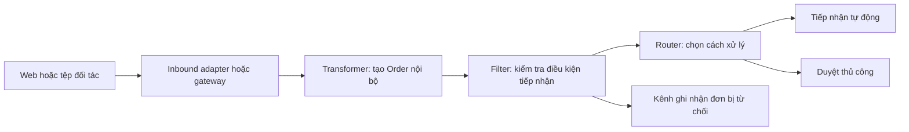

# Spring Integration là gì

## Mục tiêu bài học

Trong chương **Nền tảng Spring Integration** của module `SPRING_INTEGRATION_CORE`, bài này giới thiệu cách xây dựng luồng xử lý thông điệp ngay trong ứng dụng Spring. Sau khi học, bạn có thể:

- Giải thích Spring Integration giải quyết vấn đề tích hợp nào.
- Phân biệt `Message`, `MessageChannel`, endpoint và gateway.
- Đọc một luồng Java DSL và mô tả đường đi của dữ liệu.
- Nhận biết vai trò của transformer, filter, router, splitter và aggregator.
- Phân biệt gửi thông điệp với hoàn tất xử lý, đồng thời xác định điểm cần kiểm thử và xử lý lỗi.

Bạn nên biết Java cơ bản, Spring bean, dependency injection và cách đọc cấu hình `@Configuration`/`@Bean`. Chưa cần Kafka, RabbitMQ hay một hệ thống phân tán để bắt đầu.

## 1. Bài toán: khi tích hợp trở thành một luồng xử lý

Giả sử một cửa hàng nhận đơn hàng từ giao diện web và tệp do đối tác gửi. Dữ liệu đi vào có thể khác định dạng, nhưng đều cần qua các bước:

1. Chuyển thành mô hình đơn hàng nội bộ.
2. Kiểm tra dữ liệu bắt buộc và số lượng.
3. Phân loại đơn thường hoặc đơn cần duyệt thủ công.
4. Gọi nghiệp vụ tiếp nhận đơn.
5. Trả kết quả hoặc ghi nhận lý do thất bại.

Có thể viết tất cả bằng các lời gọi Java. Khó khăn xuất hiện khi mỗi nguồn tự làm lại việc chuyển đổi, chọn nhánh, xử lý lỗi và gọi hệ thống ngoài. Một thay đổi về đầu ra dễ kéo theo thay đổi ở nhiều đầu vào.

Spring Integration cho phép biểu diễn các bước đó thành **message flow**: dữ liệu được đóng gói thành thông điệp, đi qua các kênh và được xử lý bởi những thành phần có trách nhiệm rõ ràng. Nhờ vậy, quy tắc kết nối các bước được tách khỏi phương thức nghiệp vụ.

Ví dụ, phương thức `acceptOrder(order)` vẫn tập trung vào việc tiếp nhận đơn. Cấu hình luồng quyết định thông điệp nào được phép đi đến phương thức đó, sau bước chuyển đổi nào và kết quả đi đâu.

## 2. Định nghĩa và vị trí trong hệ sinh thái Spring

**Spring Integration là framework mở rộng mô hình lập trình Spring để xây dựng ứng dụng tích hợp theo thông điệp và các Enterprise Integration Patterns, thường viết tắt là EIP.** Thành phần của luồng được quản lý trong Spring `ApplicationContext`; framework hỗ trợ tích hợp hệ thống ngoài thông qua adapter. [Nguồn: Overview of Spring Integration Framework](https://docs.spring.io/spring-integration/reference/overview.html).

EIP là các mẫu giải quyết những vấn đề lặp lại khi tích hợp: chuyển định dạng, định tuyến, chia thông điệp, gom kết quả hoặc kết nối hệ thống. Thay vì tự tạo một bộ quy ước khác cho từng dự án, nhóm phát triển có thể dùng cùng cách gọi tên và cùng mô hình tư duy.

Một luồng có thể chỉ chạy trong một JVM. Khi cần giao tiếp với hệ thống ngoài, ta bổ sung thành phần hỗ trợ giao thức tương ứng. Việc sử dụng `Message` không tự biến ứng dụng thành microservice hay làm mọi thao tác trở thành bất đồng bộ.

| Thành phần | Trách nhiệm điển hình | Quan hệ với Spring Integration |
| --- | --- | --- |
| Spring Framework | Quản lý bean, dependency injection, transaction và hạ tầng ứng dụng | Là nền tảng để cấu hình và thực thi các thành phần của luồng |
| Spring Boot | Cấu hình và khởi động ứng dụng Spring theo quy ước | Có thể dùng để đóng gói, khởi động ứng dụng chứa integration flow |
| Spring Integration | Kết nối các bước xử lý theo thông điệp và EIP | Là phần đang được học trong module này |
| Kafka hoặc RabbitMQ | Vận chuyển thông điệp giữa các tiến trình theo khả năng của từng sản phẩm | Có thể được kết nối ở biên luồng; không bắt buộc cho ví dụ nội bộ |
| Service nghiệp vụ | Thực thi quy tắc như tiếp nhận đơn hoặc tính phí | Được endpoint gọi khi thông điệp đi đến bước tương ứng |

Ví dụ học tập trong bài dùng luồng nội bộ để nhìn rõ cơ chế cốt lõi. Việc xác nhận thông điệp từ broker, lưu trữ bền vững hoặc giao tiếp mạng phải được thiết kế thêm theo hạ tầng thực tế.

## 3. Bốn khái niệm cần phân biệt

### 3.1. Message: dữ liệu cùng ngữ cảnh xử lý

`Message<T>` chứa hai phần: **payload** là dữ liệu, **headers** là thông tin kèm theo. Các kiểu nền tảng như `Message` và `MessageChannel` nằm trong package `org.springframework.messaging`, còn nhiều triển khai và endpoint nằm trong Spring Integration.

Ví dụ tạo thông điệp:

```java
import org.springframework.messaging.Message;
import org.springframework.messaging.support.MessageBuilder;

Message<String> message = MessageBuilder
        .withPayload("  order-1001  ")
        .setHeader("source", "partner-file")
        .setHeader("businessRequestId", "request-2026-001")
        .build();
```

Ở đây, payload là chuỗi mã đơn chưa được chuẩn hóa. `source` cho biết nguồn vào; `businessRequestId` là mã do ứng dụng đặt để lần theo một yêu cầu nghiệp vụ.

Cấu trúc headers không cho sửa trực tiếp, và không thể thay tham chiếu payload trên một message đã tạo. Tuy nhiên, nếu payload là một `ArrayList` thì nội dung danh sách vẫn có thể bị sửa. Bất biến của lớp vỏ không có nghĩa mọi object bên trong đều bất biến. [Nguồn: Message](https://docs.spring.io/spring-integration/reference/message.html).

Khi cần thay payload hoặc header, hãy tạo message mới, chẳng hạn qua `MessageBuilder.fromMessage(...)`. Với dữ liệu dùng chung giữa nhiều nhánh, nên ưu tiên kiểu dữ liệu bất biến hoặc có chiến lược sao chép phù hợp.

Một số header đáng nhận biết:

| Header | Ý nghĩa |
| --- | --- |
| `id` | Định danh của message instance; không nên coi là mã đơn nghiệp vụ ổn định xuyên suốt các bước tạo message mới |
| `replyChannel` | Đường trả lời khi thành phần có phản hồi và không có đầu ra tường minh phù hợp |
| `errorChannel` | Đường nhận lỗi khi cơ chế xử lý lỗi tương ứng sử dụng header này |
| `businessRequestId` | Header tùy biến trong ví dụ để truy vết yêu cầu nghiệp vụ |

Payload cần chứa đủ dữ liệu để bước tiếp theo hiểu hợp đồng nghiệp vụ. Header hữu ích cho ngữ cảnh truyền dẫn và xử lý, nhưng không nên trở thành nơi cất giấu những dữ liệu bắt buộc mà người đọc hợp đồng không biết đến.

### 3.2. MessageChannel: đường chuyển giao thông điệp

Channel là điểm kết nối giữa bên gửi và bên xử lý. Bên gửi biết kênh đích thay vì phải nắm trực tiếp tất cả thành phần phía sau.

Bốn loại thường gặp:

| Loại channel | Cách chuyển giao | Điều cần nhớ |
| --- | --- | --- |
| `DirectChannel` | Chuyển cho một handler trên thread của bên gửi | Gửi thông điệp có thể dẫn đến xử lý đồng bộ ngay trong lời gọi đó |
| `QueueChannel` | Đệm thông điệp để bên nhận lấy ra | Endpoint tiêu thụ thường cần poller; hàng đợi mặc định nằm trong bộ nhớ |
| `ExecutorChannel` | Giao việc cho executor | Cần xét thread pool, lỗi và giới hạn tải; không mặc định kế thừa transaction của thread gửi |
| `PublishSubscribeChannel` | Phát đến các subscriber | Không phải hàng đợi cạnh tranh; có thể cấu hình executor để thay đổi cách thực thi |

Các đặc tính chuyển giao trên được mô tả trong [Message Channel Implementations](https://docs.spring.io/spring-integration/reference/channel/implementations.html).

Với `DirectChannel`, nhiều subscriber không có nghĩa mỗi subscriber đều nhận một bản sao như broadcast. Với `QueueChannel`, gửi thành công có thể mới chỉ là đã đưa dữ liệu vào hàng đợi; nghiệp vụ chưa chắc đã chạy.

Vì vậy, khi thiết kế luồng hãy hỏi hai câu riêng biệt: **thông điệp đã được nhận vào kênh chưa** và **nghiệp vụ đã hoàn tất chưa**. Một giá trị trả về từ thao tác gửi không phải bằng chứng chung cho việc cập nhật cơ sở dữ liệu hay giao hàng thành công.

### 3.3. Endpoint: nơi nối kênh với hành vi xử lý

Endpoint gắn logic xử lý vào luồng. Có thể hiểu endpoint là phần chịu trách nhiệm tiếp nhận thông điệp từ kênh theo cơ chế phù hợp và chuyển nó đến handler hoặc logic tương ứng.

Một ví dụ là **service activator**: khi có thông điệp đến, nó gọi phương thức trên một bean nghiệp vụ. Bean nghiệp vụ không nhất thiết phải nhận `Message<?>`; có thể chỉ nhận object payload như `Order`.

Tách hai trách nhiệm này giúp việc kiểm thử rõ ràng:

- Kiểm thử phương thức nghiệp vụ để xác nhận quy tắc tiếp nhận đơn.
- Kiểm thử integration flow để xác nhận dữ liệu được chuyển đổi, chọn nhánh và đưa đến đúng phương thức.

Nếu kênh đầu vào hỗ trợ subscription, endpoint có thể được kích hoạt theo sự kiện gửi. Nếu tiêu thụ từ kênh dạng pollable, cần cấu hình polling phù hợp. Hàng đợi không tự tạo một tiến trình xử lý nghiệp vụ chỉ vì đã có dữ liệu bên trong.

### 3.4. Gateway: cửa vào có hợp đồng Java

Messaging gateway có thể cung cấp một interface Java cho mã gọi. Proxy do framework tạo sẽ chuyển lời gọi phương thức thành trao đổi thông điệp. Nhờ đó, phía sử dụng gateway có thể chỉ biết kiểu đầu vào và kiểu kết quả. [Nguồn: Messaging Gateways](https://docs.spring.io/spring-integration/reference/gateway.html).

Ví dụ về hình dạng hợp đồng:

```java
public interface OrderGateway {
    String submit(String rawOrderId);
}
```

Interface này thể hiện kiểu trao đổi request–reply: bên gọi mong nhận một chuỗi phản hồi. Để hoạt động, nó còn cần được đăng ký làm messaging gateway và gắn với kênh yêu cầu; phần thực hành bên dưới cung cấp đủ cấu hình đó.

Đừng đồng nhất gateway với channel. Gateway là hợp đồng ở biên giao tiếp; channel là đường chuyển message bên trong. Một outbound gateway ở biên hệ thống ngoài cũng có ý nghĩa trao đổi yêu cầu–phản hồi, còn channel adapter thường phục vụ một chiều vào hoặc ra.

## 4. Nhìn luồng qua các Enterprise Integration Patterns

Một luồng tiếp nhận đơn hàng có thể được mô tả như sau. Đây là sơ đồ ý tưởng cho tình huống đơn hàng, độc lập với ví dụ chuẩn hóa chuỗi ở phần sau.



| Thành phần | Câu hỏi nó trả lời | Ví dụ trong cửa hàng |
| --- | --- | --- |
| Transformer | Cần đổi biểu diễn dữ liệu như thế nào? | Đổi dữ liệu đối tác thành `Order` nội bộ |
| Filter | Thông điệp có được tiếp tục đi qua không? | Loại yêu cầu có số lượng không hợp lệ |
| Router | Thông điệp cần đi đến nhánh nào? | Chuyển đơn giá trị cao sang duyệt thủ công |
| Service activator | Cần gọi hành vi nghiệp vụ nào? | Gọi service tiếp nhận đơn |
| Splitter | Cần tách thông điệp thành các phần nào? | Tách đơn thành các dòng hàng |
| Aggregator | Khi nào và bằng cách nào gom các phần liên quan? | Gom kết quả kiểm tra từng dòng thành kết quả cho cả đơn |
| Channel adapter | Cần nối luồng với nguồn hoặc đích một chiều nào? | Đọc tệp đầu vào hoặc ghi dữ liệu ra hệ thống đích |

Filter khác router ở quyết định chính: filter chọn cho đi tiếp hay từ chối, còn router chọn đích. Transformer đổi dữ liệu, trong khi service activator dùng để gọi hành vi. Các bước này có thể cùng xuất hiện nhưng nên giữ trách nhiệm dễ đọc.

Aggregator có trạng thái vì phải nhớ các thông điệp đã đến. Nếu dùng để gom kiểm tra dòng hàng, cần biết khóa liên kết với đơn nào, điều kiện đủ để trả kết quả, cách xử lý khi thiếu dòng và cách dọn nhóm hết hạn. Nó không đơn giản là phép `collect()` trên một danh sách đã đầy đủ.

Ở bài nhập môn, mục tiêu là nhận diện đúng vai trò. Cấu hình chi tiết router, aggregator, kho trạng thái và retry cần được học cùng các bài chuyên sâu tương ứng.

## 5. Thực hành: luồng chuẩn hóa mã đơn bằng Java DSL

### 5.1. Phạm vi và chuẩn bị

Ta xây dựng hợp đồng:

```text
"  order-1001  "  ->  "ACCEPTED:ORDER-1001"
"     "          ->  bị từ chối bằng exception
```

Ví dụ dùng Java 17 trở lên, Spring Integration **6.x** được quản lý phiên bản nhất quán cùng Spring Framework tương thích. Đây là mốc API cho ví dụ, không phải yêu cầu nâng cấp một dự án hiện có. Không ghép tùy ý các phiên bản Spring Framework, Spring Boot và Spring Integration.

Nếu dự án Maven đã dùng dependency management của Spring Boot phù hợp, khai báo:

```xml
<dependency>
    <groupId>org.springframework.boot</groupId>
    <artifactId>spring-boot-starter-integration</artifactId>
</dependency>
```

Đoạn dependency này giả định BOM hoặc parent của Boot đã được cấu hình. Nếu dùng Spring thuần, cần dependency `org.springframework.integration:spring-integration-core` và cơ chế quản lý phiên bản tương thích. Java DSL đã có trong core; không cần tìm một thư viện Java DSL riêng cho ví dụ này.

### 5.2. Cấu hình đầy đủ

Tạo lớp `OrderIntegrationConfig.java` trong mã nguồn của ứng dụng thực hành:

```java
package example.integration;

import java.util.Locale;

import org.springframework.context.annotation.Bean;
import org.springframework.context.annotation.Configuration;
import org.springframework.integration.annotation.IntegrationComponentScan;
import org.springframework.integration.annotation.MessagingGateway;
import org.springframework.integration.channel.DirectChannel;
import org.springframework.integration.config.EnableIntegration;
import org.springframework.integration.dsl.IntegrationFlow;
import org.springframework.messaging.MessageChannel;

@Configuration
@EnableIntegration
@IntegrationComponentScan(basePackageClasses = OrderIntegrationConfig.class)
public class OrderIntegrationConfig {

    @MessagingGateway(defaultRequestChannel = "orderInput")
    public interface OrderGateway {
        String submit(String rawOrderId);
    }

    @Bean
    public MessageChannel orderInput() {
        return new DirectChannel();
    }

    @Bean
    public IntegrationFlow orderFlow() {
        return IntegrationFlow.from("orderInput")
                .transform(String.class, String::trim)
                .filter(String.class,
                        value -> !value.isEmpty(),
                        spec -> spec.throwExceptionOnRejection(true))
                .transform(String.class,
                        value -> value.toUpperCase(Locale.ROOT))
                .handle(String.class,
                        (orderId, headers) -> "ACCEPTED:" + orderId)
                .get();
    }
}
```

`@IntegrationComponentScan` đăng ký interface `@MessagingGateway`. Không nên mặc nhiên cho rằng component scan thông thường sẽ tạo proxy cho một interface. `@EnableIntegration` bật hạ tầng integration trong cấu hình Spring thuần của ví dụ.

Java DSL là API cấu hình fluent: `IntegrationFlow` mô tả các channel và endpoint để Spring đăng ký vào context. Những lời gọi `.transform(...)` ở đây khai báo các bước của luồng; chúng không thực thi việc biến đổi mã đơn ngay lúc tạo bean. [Nguồn: Java DSL](https://docs.spring.io/spring-integration/reference/dsl.html).

### 5.3. Gọi thử bằng Spring context

Lớp `Demo.java` dưới đây dùng Spring context trực tiếp, không cần HTTP server:

```java
package example.integration;

import org.springframework.context.annotation.AnnotationConfigApplicationContext;
import org.springframework.messaging.MessagingException;

public class Demo {

    public static void main(String[] args) {
        try (var context = new AnnotationConfigApplicationContext(
                OrderIntegrationConfig.class)) {

            var gateway = context.getBean(
                    OrderIntegrationConfig.OrderGateway.class);

            System.out.println(gateway.submit("  order-1001  "));

            try {
                gateway.submit("     ");
            } catch (MessagingException ex) {
                System.out.println("REJECTED");
            }
        }
    }
}
```

Kết quả kỳ vọng:

```text
ACCEPTED:ORDER-1001
REJECTED
```

Hai lớp là ví dụ để người học đưa vào dự án có dependency phù hợp. Kết quả trên là kỳ vọng để đối chiếu khi thực hành, không phải báo cáo một lần chạy trong repository hiện tại.

### 5.4. Theo dấu một lần gọi

Khi gọi `gateway.submit("  order-1001  ")`:

1. Proxy gateway tạo thông điệp từ đối số và thiết lập đường nhận phản hồi.
2. Thông điệp được gửi vào `orderInput`, một `DirectChannel`.
3. Transformer đầu tiên bỏ khoảng trắng hai đầu payload.
4. Filter cho phép chuỗi không rỗng đi tiếp.
5. Transformer thứ hai chuyển mã sang chữ hoa với `Locale.ROOT`.
6. Handler cuối tạo chuỗi `ACCEPTED:ORDER-1001`.
7. Phản hồi quay về gateway và trở thành giá trị trả về của `submit`.

Các channel nối ngầm giữa những bước trong luồng này là direct channel. Không có bước chuyển sang executor hoặc hàng đợi nên việc xử lý diễn ra trên thread gọi. Cú pháp nối các bước không ngụ ý chạy song song.

Chuỗi `ACCEPTED:` chỉ minh họa việc tạo phản hồi. Ví dụ chưa kiểm tra sự tồn tại của đơn, chưa lưu cơ sở dữ liệu và chưa gọi kho hàng. Khi phát triển thành luồng thực tế, thay phần handler cuối bằng lời gọi service có hợp đồng nghiệp vụ rõ ràng.

### 5.5. Tại sao filter được cấu hình ném lỗi?

Với chuỗi chỉ có khoảng trắng, bước `trim()` tạo chuỗi rỗng. Filter từ chối và `throwExceptionOnRejection(true)` làm đường này kết thúc bằng lỗi rõ ràng.

Nếu một filter âm thầm bỏ thông điệp trong luồng request–reply, phía gọi sẽ không nhận được phản hồi thành công từ nhánh đó. Khi thiết kế gateway cần xác định đầy đủ nhánh trả lời, nhánh từ chối và chính sách chờ. `replyTimeout` quản lý thời gian chờ phản hồi; không nên coi nó là cơ chế ngắt một handler đồng bộ đang chạy lâu. [Nguồn: Messaging Gateways](https://docs.spring.io/spring-integration/reference/gateway.html).

## 6. Hiểu lỗi và ranh giới thực thi ngay từ đầu

Trong ví dụ, handler chạy trên thread gọi thông qua các direct channel. Lỗi xử lý mặc định truyền ngược về caller qua cơ chế messaging/gateway. Không có bảo đảm rằng mọi exception trong luồng đều tự động được gửi đến global `errorChannel`.

Khi có poller hoặc thực thi bất đồng bộ bằng executor, không thể dựa đơn thuần vào `try/catch` quanh thao tác gửi để bắt lỗi phát sinh sau đó trên thread khác. Cơ chế xử lý lỗi của framework có thể tạo `ErrorMessage`, ưu tiên kênh từ header `errorChannel` rồi đến kênh lỗi toàn cục khi áp dụng. Cấu hình gateway cũng có thể thiết lập đường xử lý lỗi riêng. [Nguồn: Error Handling](https://docs.spring.io/spring-integration/reference/7.0/error-handling.html).

Với ứng dụng đơn hàng, nên xác định trước ba nhóm tình huống:

| Tình huống | Ý nghĩa | Hướng xử lý cần thiết kế |
| --- | --- | --- |
| Mã đơn rỗng | Dữ liệu không hợp lệ | Từ chối có lý do; retry cùng dữ liệu thường không giúp ích |
| Dịch vụ kho tạm thời không khả dụng | Có thể là lỗi hạ tầng tạm thời | Cân nhắc retry có giới hạn và kiểm soát tác dụng phụ |
| Đã ghi nhận đơn nhưng phản hồi bị thất lạc | Caller có thể gửi lại yêu cầu | Cần khóa nghiệp vụ hoặc chiến lược idempotency để tránh ghi nhận hai lần |

Chuyển từ `DirectChannel` sang `ExecutorChannel` là thay đổi mô hình thực thi, không chỉ là chỉnh hiệu năng. Cần xem lại transaction, thông tin gắn với thread, thứ tự xử lý, chính sách hàng đợi của executor và cách quan sát lỗi. Transaction đang gắn với thread gửi không tự được chia sẻ sang thread xử lý. [Nguồn: Configuring Message Channels](https://docs.spring.io/spring-integration/reference/channel/configuration.html).

## 7. Kiểm thử đúng điều cần bảo vệ

Học Spring Integration Core cần cả kiểm thử logic lẫn kiểm thử cách ghép luồng. Một transformer đúng nhưng được đặt sai nhánh vẫn có thể tạo ra luồng sai.

Với ví dụ hiện tại, các trường hợp thực hành tối thiểu là:

| Đầu vào | Điều cần xác nhận |
| --- | --- |
| `"  order-1001  "` | Trả đúng `"ACCEPTED:ORDER-1001"` |
| `"OrDeR-2"` | Chuẩn hóa chữ hoa nhất quán |
| `"     "` | Bị từ chối bằng lỗi, không đi đến handler thành công |

Khi mở rộng ví dụ thành nhận đơn thực tế, kiểm thử thêm các điểm nối: dữ liệu đối tác được ánh xạ đúng, đơn giá trị cao vào nhánh duyệt, đơn bị từ chối có lý do và các kết quả từng dòng được gom về đúng đơn.

Không cần broker cho việc kiểm tra một flow chỉ dùng channel nội bộ. Nếu sau này thêm adapter giao tiếp mạng, cần kiểm thử thêm hợp đồng và tình huống lỗi của adapter đó. Kiểm thử logic thuần không chứng minh được rằng cấu hình kết nối hệ thống ngoài đã đúng.

## 8. Khi nào nên áp dụng?

Spring Integration phù hợp khi bài toán có những bước xử lý cần kết nối và thay đổi độc lập: nhận nhiều nguồn dữ liệu, đổi định dạng, định tuyến, gọi hệ thống ngoài, gom kết quả hoặc tổ chức một đường xử lý lỗi.

Ví dụ, cửa hàng bổ sung nguồn đơn từ SFTP. Nếu đã có hợp đồng `Order` nội bộ rõ ràng, phần mới có thể tập trung vào đọc tệp và chuyển đổi thành hợp đồng đó, rồi đưa dữ liệu vào điểm thích hợp của luồng tiếp nhận. Những bước kiểm tra và chọn nhánh phía sau có cơ hội được tái sử dụng.

Đổi lại, nhóm phải đọc được topology của luồng và hiểu quy tắc message/channel. Với một thao tác CRUD đơn giản, lời gọi service trực tiếp có thể đã đủ rõ. Hãy chọn framework dựa trên độ phức tạp tích hợp thực tế và khả năng bảo trì của nhóm.

## 9. Những hiểu nhầm thường gặp

| Hiểu nhầm | Cách hiểu chính xác hơn |
| --- | --- |
| Có message là có bất đồng bộ | Channel và endpoint quyết định cách thực thi; ví dụ trong bài chạy đồng bộ |
| Channel là topic trên broker | Channel có thể chỉ là bean nội bộ trong JVM |
| `QueueChannel` mặc định giữ dữ liệu qua restart | Cần cấu hình lưu trữ bền vững thích hợp nếu có yêu cầu đó |
| Gateway bảo đảm nghiệp vụ thành công | Gateway cung cấp hợp đồng giao tiếp; tính đúng của nghiệp vụ phụ thuộc các bước xử lý |
| Luồng tự bảo đảm exactly-once | Cần thiết kế theo nguồn dữ liệu, transaction, cơ chế giao nhận và idempotency |
| Transformer nên kiêm mọi thao tác | Trách nhiệm chuyển đổi nên rõ; việc ghi dữ liệu và gọi nghiệp vụ cần được thể hiện dễ hiểu |
| Aggregator cứ nhận message là trả kết quả | Nó cần quy tắc liên kết, giải phóng nhóm và xử lý trường hợp thiếu dữ liệu |

## 10. Tự kiểm tra mức độ hiểu

Hãy thử giải thích bằng lời của bạn:

1. Nếu thay nguồn đơn từ web sang tệp, phần nào của luồng có thể giữ lại?
2. Vì sao `DirectChannel` vẫn tạo liên kết lỏng về cấu trúc dù chạy đồng bộ?
3. Vì sao payload là object mutable có thể gây vấn đề khi chia nhánh?
4. Nếu filter bỏ message mà caller đang chờ kết quả, hợp đồng request–reply bị ảnh hưởng thế nào?
5. Khi tách đơn thành nhiều dòng, aggregator cần thông tin gì để không gom nhầm hai đơn?

Bạn đã nắm nền tảng khi có thể chỉ ra **dữ liệu đang nằm trong message nào, được chuyển qua channel nào, endpoint nào xử lý, caller mong phản hồi gì và lỗi sẽ được quan sát ở đâu**. Đó là cơ sở để học sâu Java DSL, transformer, router, filter, aggregator và kiểm thử các mẫu tích hợp trong module này.