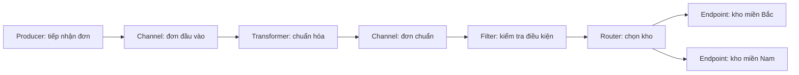

# Bài toán tích hợp hướng message

## 1. Mục tiêu và bối cảnh

Trong chương **Nền tảng Spring Integration** của module `SPRING_INTEGRATION_CORE`, bài học này trả lời câu hỏi: khi nhiều thành phần hoặc hệ thống phải trao đổi dữ liệu, vì sao nên biểu diễn việc trao đổi bằng message và một luồng xử lý rõ ràng?

Sau bài học, bạn có thể:

- Nhận diện các điểm phụ thuộc về định dạng, giao thức, thời gian và lỗi trong một quy trình tích hợp.
- Phân tách dữ liệu nghiệp vụ, thông tin điều phối, đường truyền và nơi xử lý thành Message, MessageChannel và endpoint.
- Chọn vai trò của gateway, transformer, filter, router và aggregator trong một luồng.
- Đọc một ví dụ Java DSL đơn giản và giải thích thời điểm gửi thành công, xử lý thành công và hoàn tất nghiệp vụ.
- Đặt câu hỏi về timeout, retry, trùng lặp, transaction và kiểm thử trước khi đưa luồng vào vận hành.

Trọng tâm là cách mô hình hóa bài toán tích hợp. Ví dụ dùng các thành phần cốt lõi trong tiến trình Java; việc kết nối tới HTTP, broker hay cơ sở dữ liệu cần adapter và cấu hình tương ứng.

## 2. Từ một lời gọi hàm đến một bài toán tích hợp

Giả sử một cửa hàng nhận đơn hàng từ website và từ tệp của đối tác. Sau khi tiếp nhận, hệ thống cần chuẩn hóa dữ liệu, kiểm tra điều kiện, chuyển đơn tới kho phù hợp và thông báo kết quả.

Phiên bản đầu tiên thường là một phương thức điều phối:

```java
public void receive(PartnerOrder input) {
    Order order = convert(input);
    validate(order);
    warehouseClient.reserve(order);
    accountingClient.record(order);
    notificationClient.send(order);
}
```

Đoạn mã này dễ hiểu khi tất cả thao tác đều ngắn và ổn định. Bài toán thay đổi khi xuất hiện các yêu cầu sau:

| Tình huống | Câu hỏi thiết kế phát sinh |
| --- | --- |
| Website gửi JSON, đối tác gửi CSV | Chuẩn hóa ở đâu để nghiệp vụ không phụ thuộc từng định dạng? |
| Kho phản hồi chậm trong giờ cao điểm | Bên nhận đơn có cần chờ kho không? Dữ liệu chờ được giữ ở đâu? |
| Một đơn gồm hàng từ nhiều kho | Tách công việc, theo dõi kết quả từng kho và ghép kết quả thế nào? |
| Kế toán đã ghi nhận nhưng gửi thông báo thất bại | Có cần chạy lại toàn bộ quy trình không? |
| Đối tác gửi lại cùng một đơn | Làm sao tránh giữ hàng hoặc ghi nhận hai lần? |
| Cần thêm kênh tiếp nhận mới | Bao nhiêu mã điều phối phải thay đổi? |

Vấn đề không chỉ là gọi được API của hệ thống khác. Đó là quản lý **hợp đồng dữ liệu, đường đi, tiến độ và kết quả xử lý** giữa các bên có đặc điểm khác nhau.

### 2.1. Các dạng phụ thuộc cần nhận diện

**Phụ thuộc định dạng:** consumer hiểu trực tiếp cấu trúc riêng của từng nguồn. Mỗi thay đổi ở nguồn có thể lan vào nghiệp vụ.

**Phụ thuộc địa chỉ và giao thức:** mã nghiệp vụ tự biết URL, thư mục, cách xác thực hoặc API của nơi nhận.

**Phụ thuộc thời gian:** bên gửi chỉ tiếp tục được khi bên nhận xử lý xong. Điều này có thể phù hợp với truy vấn tức thời, nhưng gây khó khăn nếu tác vụ mất nhiều thời gian.

**Phụ thuộc vào trình tự và kết quả:** các bước gắn với nhau trong một call stack, trong khi yêu cầu thực tế có thể cần phân nhánh, chờ nhiều kết quả hoặc phục hồi riêng từng bước.

Tích hợp hướng message giúp biểu diễn các phụ thuộc này thành những quyết định có tên và có nơi cấu hình. Nó không xóa bỏ hợp đồng giữa các bên; nó giúp làm hợp đồng và cách phối hợp trở nên rõ ràng.

## 3. Mô hình message: dữ liệu đi qua một luồng

Trong mô hình này, producer tạo dữ liệu cần trao đổi, gửi dữ liệu qua channel, rồi consumer tiếp nhận để xử lý. Một consumer có thể tạo message tiếp theo cho bước sau.



Sơ đồ thể hiện hướng di chuyển dữ liệu, chưa quy định các bước chạy cùng thread hay khác thread, có broker hay không, hoặc dữ liệu có được lưu bền vững hay không. Những thuộc tính đó phải được thiết kế riêng.

Spring Integration hiện thực các mẫu Enterprise Integration Patterns bằng các thành phần có thể nối với nhau. Mục đích là tách logic tích hợp khỏi nghiệp vụ thuần Java, để các đối tượng nghiệp vụ không phải tự thao tác với hạ tầng truyền message. Xem [tổng quan chính thức của Spring Integration](https://docs.spring.io/spring-integration/reference/overview.html).

### 3.1. Message gồm payload và headers

Một message có hai phần chính:

- **Payload:** dữ liệu cần xử lý, ví dụ một đơn hàng.
- **Headers:** metadata phục vụ trao đổi và điều phối, ví dụ nguồn gửi hoặc mã yêu cầu.

Ví dụ về hợp đồng do ứng dụng tự quy định:

```text
Message<Order>
  payload:
    orderId = "ORD-2048"
    amount = 1250000
    currency = "VND"
  headers:
    sourceSystem = "partner-portal"
    requestId = "REQ-731"
    schemaVersion = "1"
```

`sourceSystem`, `requestId` và `schemaVersion` ở đây là header tùy biến, không tự có ý nghĩa đặc biệt đối với framework. Hai bên phải thống nhất cách đọc và truyền tiếp chúng. Các header kỹ thuật như `replyChannel` hoặc `errorChannel` có vai trò riêng trong Spring Integration.

Hãy giữ dữ liệu quyết định nghiệp vụ, chẳng hạn số tiền và loại tiền, trong mô hình nghiệp vụ. Không chuyển chúng vào header chỉ vì header dễ truy cập khi routing.

Trong Spring Messaging, cấu trúc message và bản đồ headers không được sửa trực tiếp sau khi tạo. Điều này không làm mọi đối tượng bên trong trở nên bất biến sâu: payload là một `List` có thể thay đổi thì phần tử vẫn có thể bị sửa. Vì vậy, hãy ưu tiên payload bất biến và tạo message mới khi cần thay đổi cấu trúc. Xem [Message](https://docs.spring.io/spring-integration/reference/message.html).

### 3.2. Phân biệt command, event và document

Đây là ba cách hiểu thường gặp về ý nghĩa của message, không phải ba lớp Java bắt buộc:

| Loại ý nghĩa | Ví dụ | Điều cần thống nhất |
| --- | --- | --- |
| Command: yêu cầu thực hiện việc gì | `ReserveStock` | Ai chịu trách nhiệm thực hiện và phản hồi kết quả? |
| Event: thông báo việc đã xảy ra | `OrderAccepted` | Sự kiện khẳng định điều gì đã hoàn tất? |
| Document: mang dữ liệu trao đổi | Danh sách đơn hàng từ đối tác | Định dạng, phiên bản và phạm vi dữ liệu là gì? |

Không đặt tên `OrderCompleted` cho một message chỉ mới được đưa vào hàng đợi. Tên đó khiến consumer hiểu rằng nghiệp vụ đã hoàn tất trong khi thực tế mới chỉ tiếp nhận công việc.

### 3.3. Message ID không thay thế khóa nghiệp vụ

Một lần gửi lại cùng đơn có thể tạo message mới với ID mới. Nếu mục tiêu là tránh giữ hàng hai lần cho `ORD-2048`, khóa kiểm soát cần dựa trên nghiệp vụ, chẳng hạn cặp `(orderId, operation)` hoặc một idempotency key được thống nhất từ đầu.

Tương tự, mã truy vết dùng để nối log của nhiều bước không nhất thiết là khóa chống trùng. Một yêu cầu có thể tạo nhiều message và nhiều thao tác nghiệp vụ khác nhau.

## 4. MessageChannel, endpoint và gateway giải quyết việc gì?

### 4.1. MessageChannel là điểm kết nối giữa các bước

Producer gửi tới channel thay vì giữ tham chiếu trực tiếp tới consumer cụ thể. Nhờ vậy, có thể thay nơi xử lý hoặc thêm bước trung gian thông qua cấu hình luồng.

Một số lựa chọn thường gặp:

| Channel | Cách chuyển giao | Hệ quả cần hiểu |
| --- | --- | --- |
| `DirectChannel` | Gọi một subscriber trên thread gửi | Downstream thường chạy ngay trong lời gọi `send()` |
| `QueueChannel` | Giữ message để consumer lấy ra | Phải có bên `receive()` hoặc polling consumer; mặc định là hàng đợi trong bộ nhớ |
| `ExecutorChannel` | Dispatch thông qua `TaskExecutor` | Cách thực thi phụ thuộc executor; thường dùng để chuyển việc sang worker |
| `PublishSubscribeChannel` | Phát tới các subscriber | Không tương đương cơ chế chia mỗi message cho một worker |

`QueueChannel` có thể nhận giới hạn dung lượng; `PublishSubscribeChannel` có thể dùng executor. Một channel trong JVM không tự trở thành hàng đợi phân tán. Xem [các triển khai MessageChannel](https://docs.spring.io/spring-integration/reference/channel/implementations.html).

Ví dụ thiết kế: nếu cần phản hồi ngay rằng dữ liệu có hợp lệ hay không, một đoạn luồng đồng bộ có thể phù hợp. Nếu cần tích lũy công việc để xử lý sau, phải quyết định thêm dung lượng chờ, thời gian chờ và cách khôi phục khi tiến trình dừng.

### 4.2. Endpoint nối hành vi xử lý với channel

Endpoint là nơi hành vi được gắn vào luồng: nhận từ đâu, xử lý thế nào và chuyển tiếp kết quả ra đâu. Với channel hỗ trợ đăng ký subscriber, consumer có thể được gọi theo sự kiện gửi. Với channel cần lấy dữ liệu chủ động, một polling consumer phải được cấu hình nếu muốn framework tự nhận và xử lý.

Service activator là một vai trò thường gặp: gọi phương thức trên service nghiệp vụ khi có message. Một phương thức như `reserve(Order order)` có thể tiếp tục nhận một đối tượng Java thông thường, trong khi cấu hình tích hợp lo việc kết nối nó với channel. Xem [Message Endpoints](https://docs.spring.io/spring-integration/reference/7.0/endpoint.html).

### 4.3. Gateway tạo biên gọi từ mã ứng dụng

Gateway cho phép caller làm việc qua một interface Java thay vì tự xây message và gọi channel. Ví dụ về hình dạng hợp đồng:

```java
@MessagingGateway(defaultRequestChannel = "reserveRequests")
public interface StockGateway {
    ReservationResult reserve(Order order);
}
```

Đây là minh họa hợp đồng, chưa phải cấu hình hoàn chỉnh: ứng dụng cần đăng ký gateway, chẳng hạn qua `@IntegrationComponentScan`, và có luồng nhận tại `reserveRequests` trả về `ReservationResult`. Gateway không tự triển khai thao tác giữ hàng.

Phương thức trả về kết quả thể hiện nhu cầu request–reply. Nếu một nhánh của luồng không tạo reply, caller có thể phải đợi tới khi cơ chế chờ kết thúc. Cần xác định timeout, hành vi không có kết quả và đường phản hồi của mọi nhánh. Xem [Messaging Gateways](https://docs.spring.io/spring-integration/reference/gateway.html).

## 5. Ánh xạ nhu cầu tích hợp sang các mẫu xử lý

Không phải mọi bước đều nên được viết thành một service điều phối lớn. Có thể đặt tên cho trách nhiệm của từng bước:

| Nhu cầu trong luồng đơn hàng | Vai trò phù hợp | Câu hỏi bước đó trả lời |
| --- | --- | --- |
| Đổi DTO đối tác thành mô hình nội bộ | Transformer | Dữ liệu cần có hình dạng nào? |
| Loại bản ghi không thuộc phạm vi tiếp nhận | Filter | Message có được đi tiếp không? |
| Chọn kho theo khu vực giao hàng | Router | Message cần đi tới channel nào? |
| Thực hiện giữ hàng | Service activator | Hành vi nghiệp vụ nào cần được gọi? |
| Chia đơn thành các phần công việc | Splitter | Một message tạo ra những message con nào? |
| Kết hợp kết quả từ các kho | Aggregator | Những kết quả nào thuộc cùng nhóm và khi nào đủ? |

### 5.1. Transformer: tách định dạng nguồn khỏi mô hình nội bộ

Giả sử đối tác dùng `total_amount` dạng chuỗi và `currency_code` viết thường. Transformer có thể chuyển chúng thành `BigDecimal` và mã tiền tệ chuẩn trước khi đi vào xử lý nghiệp vụ.

Việc chuẩn hóa không nên tự suy diễn dữ liệu thiếu. Nếu nguồn không gửi loại tiền, cần một quy tắc hợp đồng rõ ràng thay vì mặc định tùy tiện. Transformer cũng không nên âm thầm giữ hàng hoặc thanh toán: những tác động đó cần một bước nghiệp vụ có thể quan sát riêng. Xem [Transformer](https://docs.spring.io/spring-integration/reference/transformer.html).

### 5.2. Filter và router: hai quyết định khác nhau

Filter trả lời “có đi tiếp hay không”. Nếu message bị từ chối, thiết kế cần chỉ rõ sẽ bỏ có chủ đích, chuyển tới discard channel hay ném lỗi. Trong ví dụ thực hành bên dưới, dữ liệu sai bị từ chối bằng exception để người gửi biết ngay. Xem [Filter](https://docs.spring.io/spring-integration/reference/filter.html).

Router trả lời “đi tới đâu”, có thể chọn một hoặc nhiều channel tùy loại router và điều kiện. Ví dụ, đơn nội địa chuyển tới kho nội địa, đơn quốc tế chuyển tới luồng kiểm tra xuất khẩu. Nếu không khớp nhánh nào, hãy xác định đường mặc định hoặc kết quả lỗi. Xem [tổng quan Routers](https://docs.spring.io/spring-integration/reference/router/overview.html).

### 5.3. Aggregator: cần trạng thái và điều kiện hoàn thành

Nếu một đơn tách thành yêu cầu cho hai kho, aggregator cần biết kết quả nào thuộc cùng đơn và khi nào có thể phát kết quả tổng hợp. Đây là xử lý có trạng thái, cần nơi giữ nhóm message cùng quy tắc correlation và release. Xem [Aggregator](https://docs.spring.io/spring-integration/reference/aggregator.html).

Ví dụ thiết kế của cửa hàng:

- Correlation key là mã lần xử lý đơn, tránh trộn kết quả của lần xử lý cũ với lần mới.
- Hai kho phải phản hồi bằng kết quả nghiệp vụ rõ ràng, kể cả khi từ chối giữ hàng.
- Nếu một kho không phản hồi, cần kết thúc chờ theo chính sách đã thống nhất và ghi nhận trạng thái thiếu kết quả.
- Nếu tiến trình có thể khởi động lại trong lúc chờ, phải quyết định nhóm đang giữ có cần tồn tại sau khởi động lại không.

Đặt một aggregator vào sơ đồ không tự giải quyết tình huống một nhánh mất kết quả hoặc gửi kết quả trùng.

## 6. Bốn thuộc tính không được đánh đồng

### 6.1. Hướng message không đồng nghĩa bất đồng bộ

Một luồng qua `DirectChannel` vẫn có thể chạy toàn bộ trên thread caller. Giá trị của cách tổ chức này là tách trách nhiệm và mô hình hóa luồng, ngay cả khi không có thread mới.

Ngược lại, thêm queue hoặc executor có thể thay đổi thời điểm caller tiếp tục, cách lỗi quay về, thứ tự xử lý và ranh giới transaction. Đây là thay đổi về ngữ nghĩa thực thi, không chỉ là tối ưu tốc độ.

### 6.2. Bất đồng bộ không đồng nghĩa dữ liệu bền vững

Đưa message vào hàng đợi trong bộ nhớ giúp tách thời điểm gửi và nhận. Nếu tiến trình mất dữ liệu trong bộ nhớ, message chưa xử lý có thể mất theo.

Nếu yêu cầu là “đã chấp nhận đơn thì không được mất”, thiết kế cần có nơi lưu bền vững, quy tắc xác nhận tiếp nhận và cách phục hồi. Lựa chọn có thể là message store phù hợp, broker hoặc lưu công việc trong cơ sở dữ liệu; mỗi lựa chọn cần cấu hình và kiểm chứng theo hợp đồng mong muốn.

### 6.3. Gửi thành công không luôn là nghiệp vụ thành công

Hãy tách ba mốc:

1. **Tiếp nhận:** hệ thống đã nhận trách nhiệm đối với dữ liệu theo một điều kiện cụ thể.
2. **Chuyển giao:** message đã được chuyển tới channel hoặc hạ tầng tiếp theo.
3. **Hoàn tất:** tác động nghiệp vụ cần thiết đã xảy ra và kết quả được ghi nhận.

Với queue, `send()` có thể kết thúc khi message mới được xếp hàng. Với đoạn luồng đồng bộ, `send()` có thể chỉ kết thúc sau khi handler đã chạy. Không nên xây API phản hồi thành công chỉ dựa vào cùng một cách hiểu cho hai trường hợp này.

### 6.4. Channel không tạo transaction phân tán

Transaction theo thread của Spring có thể đi cùng một đoạn luồng đồng bộ. Khi chuyển sang thread khác, transaction đó không tự đi theo để bao trùm toàn bộ công việc downstream. Xem [Transaction Support](https://docs.spring.io/spring-integration/reference/transactions.html).

Trong tình huống kho đã giữ hàng nhưng kế toán lỗi, rollback cơ sở dữ liệu cục bộ không tự hủy tác động tại kho. Nhóm thiết kế cần quyết định thử lại bước kế toán, hủy giữ hàng bằng thao tác bù, hoặc chuyển sang trạng thái cần xử lý tiếp. Việc phát message và ghi dữ liệu nghiệp vụ cũng cần một phương án nhất quán nếu hai thao tác phải cùng được bảo đảm.

## 7. Thực hành: một luồng tiếp nhận đơn trong bộ nhớ

Ví dụ này cố ý nhỏ: nhận một `Order`, kiểm tra dữ liệu, chuẩn hóa loại tiền, tạo kết quả tiếp nhận và đưa kết quả vào một `QueueChannel` để đọc lại. Nó chưa gọi kho, chưa ghi database và chưa bảo đảm lưu trữ bền vững.

### 7.1. Điều kiện sử dụng

Ví dụ dùng Java 17 trở lên cho cú pháp `record`, Spring Integration 6.x và các dependency Spring tương thích. Trong dự án Spring Boot, có thể dùng starter sau với phiên bản do dependency management của dự án quản lý:

```xml
<dependency>
    <groupId>org.springframework.boot</groupId>
    <artifactId>spring-boot-starter-integration</artifactId>
</dependency>
```

Nếu dùng dòng Spring mới hơn, tuân thủ yêu cầu JDK và bộ phiên bản của dòng đó; việc dùng cú pháp Java 17 trong ví dụ không có nghĩa mọi phiên bản Spring đều chạy được trên JDK 17.

### 7.2. Cấu hình và chạy minh họa

Lớp sau có thể chạy bằng `main` khi các dependency đã có trên classpath. Không cần broker hoặc poller trong ví dụ vì chương trình tự gọi `receive()` trên channel kết quả.

```java
import java.math.BigDecimal;
import java.util.Locale;

import org.springframework.context.annotation.AnnotationConfigApplicationContext;
import org.springframework.context.annotation.Bean;
import org.springframework.context.annotation.Configuration;
import org.springframework.integration.channel.DirectChannel;
import org.springframework.integration.channel.QueueChannel;
import org.springframework.integration.config.EnableIntegration;
import org.springframework.integration.dsl.IntegrationFlow;
import org.springframework.messaging.Message;
import org.springframework.messaging.MessageChannel;
import org.springframework.messaging.MessagingException;
import org.springframework.messaging.support.MessageBuilder;

@Configuration
@EnableIntegration
public class OrderIntegrationExample {

    public record Order(String orderId, BigDecimal amount, String currency) {}

    public record Acceptance(String orderId, String status, String currency) {}

    @Bean
    public MessageChannel ordersIn() {
        return new DirectChannel();
    }

    @Bean
    public QueueChannel orderResults() {
        return new QueueChannel(10);
    }

    @Bean
    public IntegrationFlow orderFlow() {
        return IntegrationFlow.from("ordersIn")
                .filter(Order.class,
                        order -> order.orderId() != null
                                && !order.orderId().isBlank()
                                && order.amount() != null
                                && order.amount().signum() > 0
                                && order.currency() != null
                                && !order.currency().isBlank(),
                        spec -> spec.throwExceptionOnRejection(true))
                .<Order, Order>transform(order -> new Order(
                        order.orderId().trim(),
                        order.amount(),
                        order.currency().trim().toUpperCase(Locale.ROOT)))
                .<Order, Acceptance>transform(order -> new Acceptance(
                        order.orderId(), "ACCEPTED", order.currency()))
                .channel("orderResults")
                .get();
    }

    public static void main(String[] args) {
        try (var context = new AnnotationConfigApplicationContext(
                OrderIntegrationExample.class)) {
            MessageChannel input = context.getBean("ordersIn", MessageChannel.class);
            QueueChannel results = context.getBean("orderResults", QueueChannel.class);

            Message<Order> valid = MessageBuilder.withPayload(
                            new Order(" ORD-2048 ", new BigDecimal("1250000"), " vnd "))
                    .setHeader("sourceSystem", "website")
                    .setHeader("requestId", "REQ-731")
                    .build();

            boolean sent = input.send(valid, 1000);
            Message<?> result = results.receive(1000);

            if (!sent || result == null) {
                throw new IllegalStateException("Không nhận được kết quả trong ví dụ");
            }

            System.out.println(result.getPayload());
            System.out.println(result.getHeaders().get("requestId"));

            Message<Order> invalid = MessageBuilder.withPayload(
                    new Order("ORD-2049", new BigDecimal("-100"), "VND")).build();

            try {
                input.send(invalid, 1000);
                throw new IllegalStateException("Đơn không hợp lệ đã không bị từ chối");
            }
            catch (MessagingException ex) {
                System.out.println("Đơn bị từ chối: " + ex.getClass().getSimpleName());
            }
        }
    }
}
```

Java DSL biểu diễn cấu hình luồng thông qua `IntegrationFlow`; framework đăng ký các channel và endpoint cần thiết trong application context. Chuỗi builder không phải một broker hay một cơ chế transaction riêng. Xem [Java DSL](https://docs.spring.io/spring-integration/reference/dsl.html).

### 7.3. Lần theo một message hợp lệ

Với dữ liệu mẫu, diễn tiến mong đợi là:

1. `ordersIn` nhận `Message<Order>` trên thread `main`.
2. Filter chấp nhận vì mã đơn, số tiền và loại tiền thỏa điều kiện minh họa.
3. Transformer tạo `Order` mới với `orderId = "ORD-2048"` và `currency = "VND"`.
4. Transformer tiếp theo tạo `Acceptance` với trạng thái `ACCEPTED`.
5. Kết quả được đưa vào `orderResults`, rồi `receive(1000)` lấy ra để in.

Hai dòng kết quả chính có dạng:

```text
Acceptance[orderId=ORD-2048, status=ACCEPTED, currency=VND]
REQ-731
```

Các transformer trả payload mới và framework chuyển tiếp các header thông thường, nên `requestId` vẫn dùng để liên kết kết quả với yêu cầu. Trạng thái `ACCEPTED` chỉ có nghĩa dữ liệu đã qua điều kiện tiếp nhận của ví dụ; chưa có giữ hàng, thanh toán hay lưu đơn bền vững.

### 7.4. Lần theo một message không hợp lệ

Đơn có số tiền âm bị filter từ chối. Vì cấu hình `throwExceptionOnRejection(true)` và đoạn luồng chạy đồng bộ, caller nhận một `MessagingException` thuộc nhóm lỗi từ chối message hoặc lỗi được bao bọc tương ứng. Đơn này không tạo `Acceptance` trong `orderResults`.

Nếu bỏ cấu hình ném lỗi, không nên tiếp tục giả định caller luôn biết dữ liệu đã bị loại. Khi thay bằng discard channel, phải có consumer xử lý nhánh bị loại và một hợp đồng phản hồi phù hợp nếu caller đang chờ kết quả.

### 7.5. Những giới hạn chủ động của ví dụ

Filter chỉ minh họa điều kiện tối thiểu, chưa kiểm tra danh mục mã tiền tệ hoặc độ dài mã đơn. Queue kết quả có dung lượng 10 và dữ liệu chỉ nằm trong bộ nhớ. Nếu mở rộng thành nhiều lần gửi mà không đọc kết quả, cần thiết kế chính sách khi queue đầy; timeout trên lời gọi gửi vào `DirectChannel` không phải hạn chót cho toàn bộ luồng downstream.

Ví dụ cũng chưa có chống trùng. Gửi lại `ORD-2048` sẽ tạo thêm kết quả tiếp nhận. Việc kiểm soát thao tác nghiệp vụ lặp phải được bổ sung tại nơi có tác động thực tế.

## 8. Thiết kế đường lỗi cùng với đường thành công

Một luồng tích hợp chưa hoàn chỉnh nếu chỉ mô tả dữ liệu hợp lệ. Hãy xét ít nhất ba nhóm tình huống:

| Nhóm tình huống | Ví dụ | Hướng xử lý trong bài toán đơn hàng |
| --- | --- | --- |
| Sai dữ liệu đầu vào | Số tiền âm, thiếu loại tiền | Từ chối rõ nguyên nhân; yêu cầu sửa dữ liệu |
| Lỗi hạ tầng tạm thời | Kho quá tải, kết nối chập chờn | Thử lại có giới hạn nếu thao tác an toàn để lặp |
| Kết quả chưa xác định | Kho có thể đã giữ hàng nhưng response bị mất | Tra cứu trạng thái hoặc dùng khóa chống lặp trước khi gửi lại |

Với xử lý đồng bộ, exception downstream có thể truyền về caller. Với công việc chạy trong hạ tầng tác vụ bất đồng bộ của Spring Integration, lỗi có thể được xuất bản thành `ErrorMessage` tới đường lỗi được cấu hình; việc chọn `errorChannel` tùy ngữ cảnh và cấu hình. Không nên giả định mọi exception trên mọi thread tự động đi tới `errorChannel`. Xem [Error Handling](https://docs.spring.io/spring-integration/reference/7.0/error-handling.html).

Trong thiết kế của cửa hàng, mỗi lỗi cần đi kèm đủ thông tin để biết đơn nào, bước nào và lần xử lý nào. Một bản ghi chỉ ghi “timeout” không đủ để quyết định có được giữ hàng lại hay không.

### 8.1. Retry cần đi cùng khả năng xử lý lặp

Giả sử request giữ hàng đã tới kho, nhưng response bị mất trên đường về. Caller timeout không chứng minh rằng kho chưa xử lý. Thử lại mù có thể giữ hàng lần thứ hai.

Một phương án thiết kế là yêu cầu kho nhận `reservationRequestId` ổn định cho cùng một thao tác. Khi nhận lại khóa đó, kho trả kết quả đã ghi nhận thay vì thực hiện thêm tác động. Việc kiểm tra khóa và cập nhật tồn kho cần có tính nhất quán phù hợp, kể cả khi hai worker cùng xử lý.

Không dùng retry để sửa dữ liệu chắc chắn sai. Với lỗi tạm thời, hãy giới hạn số lần, khoảng chờ và tổng thời gian; khi hết khả năng tự phục hồi, chuyển việc sang trạng thái có thể theo dõi và xử lý tiếp.

### 8.2. Theo dõi cả lượng công việc đang chờ

Ngoài tỷ lệ thành công, thiết kế vận hành nên trả lời được:

- Có bao nhiêu đơn đang chờ và đơn lâu nhất đã chờ bao lâu?
- Một yêu cầu đã tới bước nào, hay đang chờ hệ thống nào?
- Có bao nhiêu lần thử lại cho cùng thao tác?
- Có đơn bị từ chối nhưng chưa được thông báo kết quả không?
- Có nhóm tổng hợp nào đã chờ quá lâu hoặc thiếu phản hồi không?

Không ghi toàn bộ payload chứa dữ liệu nhạy cảm chỉ để hỗ trợ truy vết. Chọn mã liên kết, trạng thái và thông tin lỗi đủ dùng cho việc điều tra.

## 9. Cách tiếp cận khi thiết kế một luồng mới

Một trình tự thực hành cho bài toán đơn hàng:

1. **Định nghĩa kết quả:** “tiếp nhận đơn” và “đặt hàng thành công” khác nhau thế nào?
2. **Xác định biên:** dữ liệu vào từ đâu, ai sở hữu mỗi tác động và nơi nào có thể lỗi độc lập?
3. **Chốt hợp đồng:** kiểu payload, đơn vị tiền, phiên bản, khóa nghiệp vụ và metadata truy vết.
4. **Vẽ đường đi:** chuẩn hóa, chọn lọc, phân nhánh, gọi nghiệp vụ và ghép kết quả nếu cần.
5. **Đánh dấu ranh giới thực thi:** đoạn nào đồng bộ, đoạn nào giao việc; nơi nào thực sự lưu bền vững?
6. **Vẽ đường không thành công:** sai dữ liệu, timeout, retry, trùng lặp, thiếu kết quả và thao tác bù.
7. **Chọn điểm quan sát và kiểm thử:** chứng minh được kết quả của từng trường hợp, kể cả khi chưa gọi hệ thống thật.

Đừng bắt đầu từ việc chọn một loại channel rồi buộc yêu cầu nghiệp vụ phải phù hợp với nó. Hãy bắt đầu từ trách nhiệm tiếp nhận và tiêu chí hoàn tất.

### 9.1. Khi nào cách tổ chức này có giá trị?

Hướng message hữu ích khi có nhiều định dạng hoặc nguồn dữ liệu, nhiều bước biến đổi và định tuyến, nhiều nhịp xử lý, hoặc nhu cầu theo dõi và phục hồi riêng từng công đoạn.

Nếu chỉ có một thao tác nội bộ đơn giản, một service gọi service khác có thể dễ hiểu và đủ đáp ứng yêu cầu. Thêm gateway, channel và endpoint làm tăng số thành phần cần nắm; lợi ích cần đến từ việc biểu diễn rõ một bài toán tích hợp thực sự.

Spring Integration có thể vận hành trong một ứng dụng và kết nối ra hệ thống khác qua adapter. Nó không yêu cầu chia hệ thống thành microservice, và dùng framework này không tự cung cấp mọi bảo đảm của một nền tảng nhắn tin phân tán.

## 10. Kiểm chứng hành vi và bài tập thực hành

Ở giai đoạn học nền tảng, hãy mô tả tiêu chí kiểm chứng trước khi mở rộng luồng:

| Trường hợp | Điều cần quan sát |
| --- | --- |
| Đơn hợp lệ, loại tiền có khoảng trắng | Nhận một kết quả, mã loại tiền đã được chuẩn hóa |
| Đơn có số tiền bằng 0 hoặc âm | Bị từ chối; không tạo kết quả tiếp nhận |
| Có `requestId` trên đầu vào | Kết quả vẫn liên kết được với đúng yêu cầu |
| Gửi lại cùng mã đơn | Nhận diện rằng ví dụ hiện chưa chống trùng |
| Queue kết quả đầy | Hành vi chờ hoặc thất bại phải được xác định trước khi tăng tải |
| Thay một đoạn đồng bộ bằng xử lý giao việc | Xem lại cách lỗi quay về và tiêu chí báo thành công |

Đây là các tiêu chí để người học kiểm chứng ví dụ trong dự án của mình, không phải khẳng định đã chạy kiểm thử trên một bộ dependency cụ thể.

### Bài tập 1: mở rộng theo loại tiền

Sau bước chuẩn hóa, thêm router: `VND` đi tới luồng nội địa, `USD` đi tới luồng ngoại tệ và các mã khác đi tới nhánh từ chối. Nêu rõ mỗi nhánh tạo kết quả gì; không để nhánh không khớp biến mất mà không có quyết định.

### Bài tập 2: phân biệt tiếp nhận và hoàn tất

Giả sử cửa hàng cần trả mã yêu cầu ngay, rồi xử lý kho sau. Hãy vẽ hai luồng: tiếp nhận và xử lý công việc. Chỉ ra dữ liệu được lưu bền vững ở đâu trước khi trả lời khách, cách tra cứu tiến độ và điều gì xảy ra khi tiến trình dừng giữa hai bước.

### Bài tập 3: tổng hợp kết quả hai kho

Thiết kế payload kết quả từng kho, correlation key, điều kiện phát kết quả tổng hợp và chính sách thiếu phản hồi. Thêm tình huống một kho gửi lại kết quả hoặc phản hồi sau khi đơn đã hết thời gian chờ.

### Câu hỏi tự kiểm tra

1. Vì sao producer biết tên channel vẫn ít phụ thuộc vào consumer cụ thể hơn việc tự gọi từng client?
2. Đổi từ `DirectChannel` sang một bước giao việc có thể làm thay đổi điều gì ngoài tốc độ?
3. Tại sao `send()` thành công chưa đủ để khẳng định đơn đã được giữ hàng?
4. Khi nào cần transformer, khi nào cần router và khi nào cần aggregator?
5. Caller timeout có chứng minh tác động nghiệp vụ chưa xảy ra không?
6. Message ID, mã truy vết và khóa chống trùng có thể khác nhau vì sao?

Điểm cần nắm là khả năng lần theo một yêu cầu từ khi tiếp nhận đến kết quả cuối: dữ liệu mang ý nghĩa gì, mỗi bước chịu trách nhiệm gì, và hệ thống có thể giải thích được chuyện gì xảy ra khi một bước không hoàn tất.
