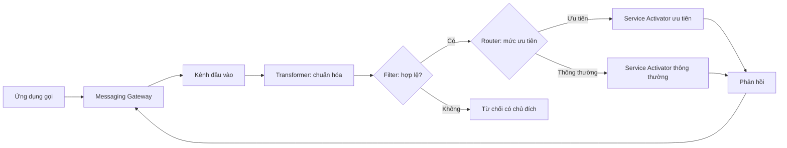
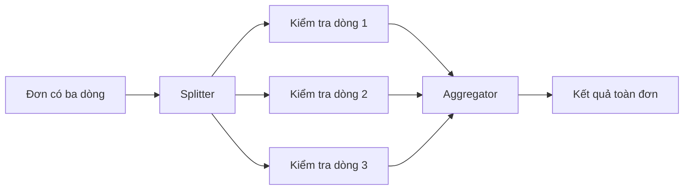

# Enterprise Integration Patterns trong Spring

## Mục tiêu và bối cảnh

Bài học thuộc chương **Nền tảng Spring Integration** của module `SPRING_INTEGRATION_CORE`. Mục tiêu là dùng Enterprise Integration Patterns (EIP) để mô tả bài toán tích hợp, rồi ánh xạ thiết kế đó thành `Message`, `MessageChannel`, endpoint, gateway và Java DSL. Sau bài học, bạn cần đọc được một luồng thông điệp, chọn đúng transformer/router/filter, nhận ra khi nào cần splitter/aggregator và xác định nơi xử lý lỗi.

Xét một hệ thống nhận đơn hàng từ website và đối tác. Hai nguồn dùng định dạng khác nhau; đơn hợp lệ phải được chuẩn hóa, phân tuyến theo mức ưu tiên, gọi dịch vụ nghiệp vụ và trả kết quả. Nếu toàn bộ công việc nằm trong một phương thức lớn, quy tắc định tuyến dễ bị trộn với mã chuyển đổi dữ liệu, gọi mạng và ghi nhận lỗi. Khi thêm nguồn mới, nhiều phần không liên quan có thể phải sửa cùng lúc.

EIP cung cấp ngôn ngữ chung để phân chia trách nhiệm: bước nào đổi dữ liệu, bước nào chọn đường đi, bước nào gọi nghiệp vụ, bước nào gom kết quả. Spring Integration hiện thực các pattern thành thành phần do Spring quản lý. Đây là cách xây dựng tầng tích hợp bên trong ứng dụng Spring và kết nối hệ thống ngoài qua adapter. [Tài liệu tổng quan Spring Integration](https://docs.spring.io/spring-integration/reference/overview.html).

## 1. Từ yêu cầu nghiệp vụ đến luồng thông điệp

EIP là các mẫu giải quyết vấn đề thường gặp khi nhiều thành phần trao đổi thông tin. Pattern mô tả ý định thiết kế; class, annotation và DSL là cách hiện thực ý định đó.

Ví dụ, yêu cầu “đơn ưu tiên đi vào bộ xử lý riêng” dẫn đến **Content-Based Router**. Yêu cầu “đổi dữ liệu đối tác thành mô hình đơn hàng nội bộ” dẫn đến **Message Translator**, thường hiện thực bằng transformer. Hai yêu cầu này độc lập: thay quy tắc ưu tiên không nên buộc phải sửa bộ chuyển đổi định dạng.

Một luồng đơn giản có thể được thiết kế như sau:



Sơ đồ thể hiện đường đi logic. Nó chưa cho biết bước nào chạy trên thread nào, dữ liệu có bền vững không, hoặc lỗi được thử lại bao nhiêu lần. Các đặc tính này phải được thiết kế thêm bằng loại channel, executor, transaction, message store và chính sách xử lý lỗi.

## 2. Ba thành phần nền tảng: Message, Channel và Endpoint

### 2.1. Message: dữ liệu đi cùng ngữ cảnh

Có thể hình dung một message gồm:

```text
Message<T>
├── payload: dữ liệu được xử lý
└── headers: thông tin hỗ trợ xử lý và vận chuyển
```

Payload có thể là `Order`, chuỗi JSON hoặc dữ liệu nhị phân. Header có thể mang `orderId`, nguồn tiếp nhận, khóa gom nhóm hay địa chỉ phản hồi. Hợp đồng dữ liệu cần nói rõ kiểu payload và những header bắt buộc tại mỗi ranh giới.

Ví dụ tạo message trong Spring:

```java
import org.springframework.messaging.Message;
import org.springframework.messaging.support.MessageBuilder;

Message<String> message = MessageBuilder
        .withPayload("ORDER-1042")
        .setHeader("sourceSystem", "partner-a")
        .setHeader("businessRequestId", "request-781")
        .build();
```

`businessRequestId` là khóa do ứng dụng quy định. Đừng mặc nhiên dùng ID kỹ thuật của một message làm khóa chống trùng cho nghiệp vụ: cùng một yêu cầu có thể được gửi lại trong một message mới.

Thiết kế payload nên tránh việc nhiều nhánh cùng sửa một đối tượng mutable. Khi một đơn hàng đi đến cả nhánh kiểm toán và nhánh xử lý nghiệp vụ, dữ liệu bất biến hoặc bản sao có chủ đích giúp các nhánh không gây tác động ngoài ý muốn cho nhau.

### 2.2. MessageChannel: hợp đồng bàn giao

Producer gửi vào channel; consumer nhận từ channel. Producer cần biết hợp đồng đầu vào của channel, không cần gọi trực tiếp implementation của consumer.

| Loại channel | Cách bàn giao | Hệ quả khi thiết kế |
|---|---|---|
| `DirectChannel` | Gọi handler trên thread gửi; một handler xử lý trong lần phân phối thành công thông thường | Phù hợp chuỗi đồng bộ; nhiều subscriber không có nghĩa là broadcast |
| `QueueChannel` | Lưu message trong hàng đợi để consumer nhận | Tách thời điểm gửi và nhận; endpoint tiêu thụ theo cơ chế polling cần poller |
| `PublishSubscribeChannel` | Phát đến các subscriber | Dùng khi nhiều bên đều cần thông báo; mặc định không tự tạo xử lý song song |
| `ExecutorChannel` | Bàn giao qua `TaskExecutor` | Tạo ranh giới thực thi; phải xét executor, lỗi và transaction |

Một `QueueChannel` mặc định trong bộ nhớ không bảo đảm phục hồi message sau khi tiến trình dừng. Pub/sub có executor có thể xử lý bất đồng bộ, nhưng thứ tự hoàn tất các nhánh cần được xem xét riêng. [Các implementation của MessageChannel](https://docs.spring.io/spring-integration/reference/channel/implementations.html).

Khi chọn channel, hãy bắt đầu bằng câu hỏi cụ thể: caller có cần chờ kết quả không; có cần đệm tải không; một hay nhiều consumer phải nhận message; và khi tiến trình dừng thì dữ liệu đang chờ sẽ ra sao.

### 2.3. Message Endpoint: nối logic với hạ tầng

Endpoint nhận message từ channel và thực hiện một trách nhiệm. Trách nhiệm đó có thể là chuyển đổi dữ liệu, lựa chọn đường đi, gọi dịch vụ hoặc kết nối hệ thống ngoài.

Ví dụ, phương thức `reserveStock(Order order)` chứa nghiệp vụ giữ hàng. Service activator làm cầu nối để một message đến channel có thể kích hoạt phương thức đó. Nhờ vậy, nghiệp vụ có thể được kiểm thử trực tiếp với `Order` mà không phải dựng toàn bộ luồng tích hợp.

Trong kiến trúc **Pipes and Filters**, “pipes” là đường nối và “filters” là các bước xử lý nói chung. Từ “filters” ở đây có nghĩa rộng hơn endpoint **Message Filter**, vốn chuyên quyết định message có được đi tiếp hay không.

## 3. Bản đồ EIP sang Spring Integration

Bảng dưới đây là bản đồ định hướng. Một pattern có thể có nhiều cách cấu hình, và một method DSL có thể nhận nhiều loại handler khác nhau.

| Pattern hoặc vai trò | Câu hỏi giải quyết | Thành phần thường dùng |
|---|---|---|
| Message | Trao đổi đơn vị dữ liệu nào? | `Message<T>`, payload, headers |
| Message Channel | Các bước bàn giao qua đâu? | `MessageChannel` và các implementation |
| Message Endpoint | Logic ứng dụng tham gia luồng thế nào? | Consumer endpoint và handler |
| Message Translator | Đổi biểu diễn dữ liệu thế nào? | Transformer, `.transform(...)` |
| Content Enricher | Bổ sung dữ liệu còn thiếu thế nào? | Enricher, header enricher |
| Message Filter | Message có đủ điều kiện đi tiếp không? | Filter, `.filter(...)` |
| Content-Based Router | Message phải đến nhánh nào? | Router, `.route(...)` |
| Splitter | Tách một công việc thành nhiều phần thế nào? | Splitter, `.split(...)` |
| Aggregator | Ghép các kết quả liên quan thế nào? | Aggregator, `.aggregate(...)` |
| Resequencer | Khôi phục thứ tự xử lý đầu ra thế nào? | Resequencer |
| Service Activator | Gọi logic nghiệp vụ từ message thế nào? | `.handle(...)`, `@ServiceActivator` |
| Messaging Gateway | Mã gọi tương tác với luồng qua API nào? | `@MessagingGateway` |
| Channel Adapter | Đưa dữ liệu vào hoặc ra một hệ thống thế nào? | Inbound/outbound channel adapter |
| Wire Tap | Quan sát một luồng qua nhánh phụ thế nào? | `.wireTap(...)` |
| Idempotent Receiver | Tránh lặp tác động nghiệp vụ thế nào? | Idempotent receiver interceptor và kho metadata |

Các động từ `.transform()`, `.filter()`, `.route()`, `.split()`, `.aggregate()` và `.handle()` trong Java DSL giúp tên bước xử lý gần với ý định của pattern. `IntegrationFlow` là cấu hình để Spring dựng các thành phần thực thi trong application context. [Java DSL Basics](https://docs.spring.io/spring-integration/reference/dsl/java-basics.html).

## 4. Phân biệt các pattern dễ nhầm

### 4.1. Transformer, enricher và service activator

**Transformer** phù hợp khi cần đổi biểu diễn dữ liệu. Ví dụ: từ `PartnerOrder` sang `Order`, đổi đơn vị khối lượng hoặc chuẩn hóa mã quốc gia. Đầu ra là dữ liệu đã chuyển đổi.

**Enricher** phù hợp khi cần thêm thông tin mà message ban đầu chưa có. Ví dụ: dùng `customerId` để tra hạng khách hàng trước khi định tuyến. Đừng dùng header làm nơi cất toàn bộ dữ liệu nghiệp vụ chỉ để tránh thiết kế lại payload.

**Service activator** phù hợp khi gọi một năng lực nghiệp vụ, chẳng hạn giữ hàng hoặc tạo hóa đơn. `.handle(...)` có thể gọi POJO; khi có kết quả và không cấu hình output channel, cơ chế phản hồi có thể dùng header `replyChannel`. Một handler kết thúc bằng `void` không tự tạo kết quả cho caller đang chờ. [Service Activator](https://docs.spring.io/spring-integration/reference/service-activator.html).

Để chọn pattern, hãy mô tả tác động của bước xử lý. “Đổi cấu trúc đơn hàng” là chuyển đổi dữ liệu. “Tạo yêu cầu giữ hàng trong kho” là tác động nghiệp vụ. Việc cả hai đều có thể viết bằng một lambda Java không làm cho trách nhiệm của chúng giống nhau.

### 4.2. Filter và router

**Filter** trả lời câu hỏi “message này có đi tiếp không?”. Ví dụ: đơn có tổng tiền dương mới được chấp nhận. Message không đạt có thể bị loại, chuyển sang discard channel hoặc làm phát sinh lỗi theo cấu hình.

**Router** trả lời câu hỏi “message này đi đến đâu?”. Ví dụ: đơn ưu tiên đến `priorityOrders`, đơn thường đến `standardOrders`. Khi không tìm được đường phù hợp, cần có chính sách rõ ràng: nhánh mặc định, từ chối hoặc lỗi.

Với filter trong luồng request-reply, việc loại message mà không tạo phản hồi có thể khiến caller chờ hết timeout. Vì thế, trường hợp bị loại cũng cần một hợp đồng kết thúc. [Message Filter](https://docs.spring.io/spring-integration/reference/filter.html).

Ví dụ thiết kế cho đơn không hợp lệ:

- API đồng bộ: trả lỗi đầu vào rõ ràng cho caller.
- Luồng nhập dữ liệu theo lô: đưa bản ghi vào nhánh từ chối và ghi lý do.
- Luồng sự kiện chấp nhận bỏ qua: ghi metric phù hợp với nhu cầu vận hành.

Không nên biến mọi trường hợp “không muốn xử lý” thành một lần bỏ message im lặng. Người vận hành cần phân biệt bản ghi bị từ chối có chủ đích với lỗi mất dữ liệu.

### 4.3. Router và publish-subscribe

Router lựa chọn đích theo quy tắc; tùy loại router, kết quả có thể là một hoặc nhiều đích. Publish-subscribe biểu đạt việc các subscriber đều cần nhận thông báo.

Đối với yêu cầu “chọn một trong hai tuyến giao hàng”, dùng router là phù hợp. Đối với yêu cầu “sau khi đơn được chấp nhận, đồng thời cho kế toán và kiểm toán biết”, pub/sub diễn đạt ý định rõ hơn.

Tách hai bước này giúp tránh lỗi phát sinh hai tác động nghiệp vụ: nếu cùng một lệnh giữ hàng được broadcast cho hai bộ xử lý giữ hàng, đơn có thể bị giữ hàng hai lần.

### 4.4. Gateway và channel adapter

Gateway cung cấp ranh giới trao đổi, thường là request-reply. Với `@MessagingGateway`, mã ứng dụng có thể gọi một interface Java mà không tự tạo và gửi `Message`. Gateway quản lý kênh phản hồi tạm thời cho lời gọi thông thường. Interface cũng có thể khai báo phương thức `void` cho trường hợp không yêu cầu kết quả trả về. [Messaging Gateways](https://docs.spring.io/spring-integration/reference/gateway.html).

Channel adapter thường phục vụ trao đổi một chiều. Một inbound adapter đọc dữ liệu từ hệ thống ngoài và đưa message vào flow; một outbound adapter nhận message và thực hiện thao tác gửi ra ngoài. “Inbound” và “outbound” được nhìn từ phía ứng dụng tích hợp.

Ví dụ thiết kế:

| Nhu cầu | Lựa chọn theo ý định |
|---|---|
| Service Java gửi đơn và nhận mã tiếp nhận | Messaging gateway |
| Đọc file trong thư mục theo lịch | Inbound channel adapter |
| Ghi báo cáo ra file, không nhận nội dung phản hồi nghiệp vụ | Outbound channel adapter |
| Gửi yêu cầu đến hệ thống khác và dùng nội dung phản hồi để xử lý tiếp | Outbound gateway |

Một giao thức có cơ chế trả response không đồng nghĩa mọi endpoint dùng giao thức đó đều có cùng hợp đồng nghiệp vụ. Hãy kiểm tra endpoint cụ thể cung cấp adapter hay gateway và đầu ra của nó là gì.

## 5. Ví dụ Java DSL: tiếp nhận và định tuyến đơn hàng

Ví dụ này hiện thực **Gateway → Filter → Router → Transformer → Reply**. Hai nhánh chỉ tạo chuỗi xác nhận để làm rõ đường đi của message; khi nối hệ thống thật, bước tạo xác nhận có thể được thay bằng service activator gọi nghiệp vụ.

Điều kiện để ghép ví dụ vào dự án:

- Có Spring Integration Core và Spring Context trên classpath; phiên bản do dự án quản lý nhất quán.
- Dùng Java hỗ trợ `record`, chẳng hạn Java 17 trở lên; phiên bản Spring được chọn có thể yêu cầu Java cao hơn.
- Các lớp dưới đây đặt trong cùng package `example.integration`.
- `@IntegrationComponentScan` đăng ký proxy cho interface gateway; `@EnableIntegration` bật hạ tầng tích hợp trong context Spring thuần.

### 5.1. Hợp đồng dữ liệu

Tệp minh họa `Order.java`:

```java
package example.integration;

import java.math.BigDecimal;
import java.util.Objects;

public record Order(String id, BigDecimal total, boolean priority) {
    public Order {
        Objects.requireNonNull(id, "id");
        Objects.requireNonNull(total, "total");
        if (id.isBlank()) {
            throw new IllegalArgumentException("id must not be blank");
        }
    }
}
```

Constructor bảo đảm cấu trúc tối thiểu. Quy tắc tổng tiền dương được đặt trong flow để minh họa Message Filter. Trong ứng dụng thật, vị trí kiểm tra cần nhất quán với hợp đồng domain và ranh giới tiếp nhận dữ liệu.

### 5.2. API cho bên gọi

Tệp minh họa `OrderGateway.java`:

```java
package example.integration;

import org.springframework.integration.annotation.MessagingGateway;

@MessagingGateway(
        defaultRequestChannel = "orderRequests",
        defaultReplyTimeout = "2000")
public interface OrderGateway {
    String submit(Order order);
}
```

Caller chỉ biết `submit(Order)`. Timeout được khai báo tường minh cho việc đợi reply; giá trị này không tạo cơ chế hủy một phương thức đồng bộ đang chạy trên thread caller. Nếu sau này handler gọi HTTP hoặc cơ sở dữ liệu, cần cấu hình timeout tương ứng cho tài nguyên đó.

### 5.3. Các channel và flow

Tệp minh họa `OrderIntegrationConfiguration.java`:

```java
package example.integration;

import org.springframework.context.annotation.Bean;
import org.springframework.context.annotation.Configuration;
import org.springframework.integration.channel.DirectChannel;
import org.springframework.integration.config.EnableIntegration;
import org.springframework.integration.annotation.IntegrationComponentScan;
import org.springframework.integration.dsl.IntegrationFlow;
import org.springframework.messaging.MessageChannel;

@Configuration
@EnableIntegration
@IntegrationComponentScan(basePackageClasses = OrderGateway.class)
public class OrderIntegrationConfiguration {

    @Bean
    public MessageChannel orderRequests() {
        return new DirectChannel();
    }

    @Bean
    public MessageChannel priorityOrders() {
        return new DirectChannel();
    }

    @Bean
    public MessageChannel standardOrders() {
        return new DirectChannel();
    }

    @Bean
    public IntegrationFlow orderRoutingFlow() {
        return IntegrationFlow.from("orderRequests")
                .filter(Order.class,
                        order -> order.total().signum() > 0,
                        filter -> filter.throwExceptionOnRejection(true))
                .<Order, String>route(
                        order -> order.priority() ? "PRIORITY" : "STANDARD",
                        router -> router
                                .channelMapping("PRIORITY", "priorityOrders")
                                .channelMapping("STANDARD", "standardOrders"))
                .get();
    }

    @Bean
    public IntegrationFlow priorityOrderFlow() {
        return IntegrationFlow.from("priorityOrders")
                .<Order, String>transform(
                        order -> "PRIORITY:" + order.id())
                .get();
    }

    @Bean
    public IntegrationFlow standardOrderFlow() {
        return IntegrationFlow.from("standardOrders")
                .<Order, String>transform(
                        order -> "STANDARD:" + order.id())
                .get();
    }
}
```

Có thể đọc cấu hình theo từng hợp đồng:

1. `orderRequests` nhận payload `Order`.
2. Filter chấp nhận khi `total > 0`; nếu không, ném lỗi từ chối để lời gọi có kết quả kết thúc rõ ràng.
3. Router tạo khóa `PRIORITY` hoặc `STANDARD` và ánh xạ sang channel tương ứng.
4. Mỗi flow đích tạo payload `String` làm xác nhận.
5. Không đặt output channel sau transformer cuối; phản hồi được gửi theo `replyChannel` của request do gateway tạo.

Do ví dụ dùng `DirectChannel`, xử lý chạy đồng bộ trên thread gọi. Cấu hình này không tạo hàng đợi bền vững, không tự thử lại và không phát sinh một dịch vụ chạy riêng bên ngoài tiến trình.

### 5.4. Hành vi mong đợi và cách kiểm thử

Bảng kiểm thử chức năng của ví dụ:

| Đầu vào | Kết quả mong đợi |
|---|---|
| `Order("A-01", 100, true)` | `PRIORITY:A-01` |
| `Order("A-02", 100, false)` | `STANDARD:A-02` |
| `Order("A-03", 0, false)` | Lỗi từ chối message; không đi vào hai nhánh |
| `Order("A-04", -10, true)` | Lỗi từ chối message |

Các giá trị số trong bảng là cách viết rút gọn; mã Java dùng `BigDecimal`.

Ví dụ kiểm thử bằng JUnit 5, khi dự án đã có dependency kiểm thử tương ứng:

```java
package example.integration;

import java.math.BigDecimal;
import org.junit.jupiter.api.Test;
import org.springframework.context.annotation.AnnotationConfigApplicationContext;
import org.springframework.integration.MessageRejectedException;

import static org.junit.jupiter.api.Assertions.assertEquals;
import static org.junit.jupiter.api.Assertions.assertThrows;

class OrderIntegrationTest {
    @Test
    void routesOrdersAndRejectsInvalidTotals() {
        try (var context = new AnnotationConfigApplicationContext(
                OrderIntegrationConfiguration.class)) {
            OrderGateway gateway = context.getBean(OrderGateway.class);

            assertEquals("PRIORITY:A-01", gateway.submit(
                    new Order("A-01", new BigDecimal("100"), true)));

            assertEquals("STANDARD:A-02", gateway.submit(
                    new Order("A-02", new BigDecimal("100"), false)));

            assertThrows(MessageRejectedException.class,
                    () -> gateway.submit(new Order(
                            "A-03", BigDecimal.ZERO, false)));
        }
    }
}
```

Đây là kiểm thử đường đi và kết quả của message qua context thật, thay vì chỉ kiểm tra rằng một lambda trả về `true`. Khi thêm adapter bên ngoài, nên tách kiểm thử logic flow khỏi kiểm thử giao thức để lỗi định tuyến không bị lẫn với lỗi kết nối.

## 6. Splitter và aggregator: xử lý một yêu cầu gồm nhiều phần

Giả sử đơn hàng có ba dòng sản phẩm. Mỗi dòng cần kiểm tra tồn kho rồi tổng hợp thành một kết quả cho toàn đơn.



Sơ đồ thể hiện ba phần công việc; nó không khẳng định chúng được thực thi song song. Muốn chạy song song phải thiết kế ranh giới executor hoặc cơ chế điều phối phù hợp.

Splitter tạo các message con và thông tin sequence để hỗ trợ theo dõi, thường gồm `correlationId`, `sequenceNumber`, `sequenceSize`. Với nguồn không biết trước kích thước, chẳng hạn một iterator, không nên giả định luôn có sequence size hữu dụng cho điều kiện hoàn tất mặc định. [Splitter](https://docs.spring.io/spring-integration/reference/splitter.html).

Aggregator cần phân biệt ba trách nhiệm:

| Trách nhiệm | Câu hỏi | Ví dụ thiết kế |
|---|---|---|
| Correlation strategy | Message nào cùng một nhóm? | Cùng lần kiểm tra của một đơn |
| Release strategy | Khi nào nhóm có thể xuất kết quả? | Đã có kết quả cho mọi dòng cần kiểm tra |
| Output processing | Tạo đầu ra gì từ nhóm đã sẵn sàng? | Danh sách kết quả hoặc quyết định chấp nhận đơn |

Aggregator giữ trạng thái nhóm trong message store. Cấu hình mặc định dùng correlation header và thông tin kích thước sequence để xác định nhóm đủ dữ liệu; chính sách timeout, hết hạn và lưu trạng thái cần được cân nhắc khi sử dụng thực tế. [Aggregator](https://docs.spring.io/spring-integration/reference/aggregator.html).

### 6.1. Khóa nhóm phải phân biệt được một lần xử lý

Giả sử đơn `A-01` được kiểm tra lại sau khi sửa số lượng. Nếu chỉ dùng `orderId` làm khóa nhóm, kết quả cũ và kết quả mới có nguy cơ cùng rơi vào một nhóm do thiết kế tùy chỉnh không phân biệt lần chạy.

Một khóa nghiệp vụ phù hợp có thể là `(orderId, validationRunId)`. Cần thống nhất cách tạo và truyền khóa này trước khi phân tán xử lý qua nhiều worker.

### 6.2. Filter sau splitter có thể làm nhóm không hoàn tất

Ví dụ splitter phát ba message nhưng một filter loại bỏ dòng có dữ liệu không hợp lệ. Aggregator còn hai kết quả trong khi hợp đồng nhóm vẫn đợi ba. Nhóm có thể chờ đến khi chính sách timeout hoặc hết hạn được áp dụng.

Một cách thiết kế tốt hơn cho trường hợp cần kết quả toàn đơn là luôn tạo một kết quả cho mỗi dòng:

```text
Dòng hợp lệ       -> LineResult(status = AVAILABLE)
Dòng sai dữ liệu   -> LineResult(status = INVALID_INPUT)
Dòng hết hàng     -> LineResult(status = OUT_OF_STOCK)
```

Sau đó aggregator vẫn nhận đủ số kết quả và bước quyết định nghiệp vụ xác định toàn đơn có được chấp nhận hay không. Nếu muốn bỏ bớt phần tử, phải thiết kế lại điều kiện hoàn tất thay vì chỉ thêm filter.

### 6.3. Thứ tự, message trùng và message đến muộn

Nếu kết quả dòng 3 về trước dòng 1, việc nhận đủ dữ liệu không tự nói lên thứ tự nghiệp vụ của đầu ra. Nếu caller cần thứ tự dòng gốc, hãy giữ chỉ số dòng và sắp xếp kết quả theo hợp đồng đó, hoặc dùng resequencer khi thích hợp.

Tương tự, “nhận ba message” chưa đủ chứng minh “đã có kết quả của ba dòng khác nhau” khi cơ chế phân phối có thể gửi lại. Thiết kế cần khóa nhận diện từng phần, chính sách chống trùng và cách xử lý dữ liệu đến sau khi một lần tổng hợp đã hoàn tất.

## 7. Lỗi, retry và tính đúng đắn của tác động nghiệp vụ

### 7.1. Ranh giới thread quyết định đường đi của lỗi

Với chuỗi đồng bộ dùng `DirectChannel`, exception có thể truyền về caller theo call stack. Với thành phần thực thi bất đồng bộ do framework quản lý, lỗi cần được chuyển về cơ chế xử lý thích hợp; `ErrorMessage` mang exception trong payload. Khi cơ chế error handler đó phân giải đích, header `errorChannel` có thể chỉ định kênh riêng, nếu không thì dùng kênh lỗi chung `errorChannel`. [Error Handling](https://docs.spring.io/spring-integration/reference/error-handling.html).

Đừng suy ra rằng chỉ cần đặt header `errorChannel` thì mọi exception đồng bộ sẽ tự biến thành message lỗi. Gateway và endpoint có cấu hình xử lý lỗi riêng, và một tác vụ do ứng dụng tự tạo ngoài hạ tầng tích hợp cũng cần cơ chế xử lý lỗi của nó.

### 7.2. Phân loại kết quả trước khi quyết định thử lại

| Tình huống | Hướng xử lý trong thiết kế đơn hàng |
|---|---|
| Tổng tiền âm hoặc thiếu dữ liệu bắt buộc | Từ chối hoặc yêu cầu sửa dữ liệu |
| Dịch vụ kho tạm thời không truy cập được | Thử lại có giới hạn khi thao tác cho phép |
| Hết hàng | Trả kết quả nghiệp vụ, không coi là lỗi mạng |
| Đã thử lại hết giới hạn | Ghi nhận thất bại để điều tra hoặc xử lý tiếp |
| Caller hết thời gian chờ nhưng trạng thái bên nhận chưa rõ | Tra cứu theo khóa nghiệp vụ trước khi gửi lại |

Retry có thể lặp tác động. Ví dụ kho đã giữ hàng nhưng response bị mất; lần gửi tiếp theo có thể giữ hàng thêm lần nữa nếu bên nhận không có hợp đồng idempotency.

Với thao tác có tác động, hãy xác định khóa chống trùng và nơi lưu kết quả xử lý. Khi thiết kế idempotent receiver, phải xét tính nguyên tử giữa kiểm tra khóa và thực hiện nghiệp vụ: chỉ lưu một cờ “đã thấy message” trước khi nghiệp vụ hoàn tất có thể khiến yêu cầu thất bại không được thực hiện lại đúng cách.

### 7.3. Timeout không phải rollback

Caller nhận timeout chỉ cho biết caller không nhận được kết quả trong khoảng chờ. Nó không đủ để kết luận nghiệp vụ chưa chạy, đã dừng hay đã được hoàn tác.

Tương tự, transaction cục bộ gắn với thread không tự mở rộng qua executor, broker hoặc một lời gọi hệ thống khác. Khi tác động trải qua nhiều hệ thống, cần hợp đồng xác nhận, idempotency hoặc bước bù trừ phù hợp với nghiệp vụ.

## 8. Cách thiết kế một flow từ yêu cầu thực tế

Có thể dùng trình tự sau cho yêu cầu “nhận đơn đối tác, kiểm tra và phản hồi”:

1. **Xác định đầu vào và đầu ra.** Nguồn gửi gì, caller cần phản hồi ngay hay nhận kết quả sau, lỗi đầu vào được biểu diễn ra sao?
2. **Chốt hợp đồng message.** Payload nào là mô hình nội bộ; header nào mang nguồn, khóa yêu cầu và thông tin liên kết?
3. **Chia trách nhiệm bằng pattern.** Đổi định dạng dùng transformer; chọn đích dùng router; gọi giữ hàng dùng service activator.
4. **Chọn cơ chế bàn giao.** Bước nào đồng bộ, bước nào cần hàng đợi, hàng đợi có giới hạn và chính sách khi đầy như thế nào?
5. **Thiết kế mọi đường kết thúc.** Thành công, từ chối, không có tuyến, lỗi tạm thời, quá thời gian chờ và dữ liệu đến muộn.
6. **Xác định trạng thái cần giữ.** Nhóm aggregator, khóa chống trùng và yêu cầu phục hồi sau khi tiến trình dừng.
7. **Kiểm thử bằng tình huống nghiệp vụ.** Kiểm tra cả kết quả nhận được lẫn tác động được phép xảy ra.

Một flow dễ đọc thường có tên channel nói lên vai trò, chẳng hạn `validatedOrders` hoặc `stockCheckRequests`. Những tên như `channel1` và `nextStep` không cho người đọc biết hợp đồng dữ liệu hay ý nghĩa bàn giao.

## 9. Những lỗi thiết kế thường gặp

| Sai lầm | Hậu quả | Điều cần làm rõ |
|---|---|---|
| Dùng `DirectChannel` rồi cho rằng producer không bị chặn | Caller chịu thời gian xử lý của handler | Thread nào thực thi từng bước? |
| Dùng pub/sub để chọn đúng một bộ xử lý nghiệp vụ | Nhiều nhánh có thể tạo nhiều tác động | Đây là thông báo cho nhiều bên hay chọn một tuyến? |
| Filter loại request nhưng gateway vẫn đợi reply | Caller hết timeout mà thiếu lý do | Nhánh từ chối kết thúc lời gọi thế nào? |
| Handler trả `void` ở cuối luồng cần phản hồi | Không tạo kết quả nghiệp vụ mong đợi | Hợp đồng request-reply được đáp ứng ở đâu? |
| Bỏ một message con nhưng giữ điều kiện gom đủ nhóm cũ | Aggregator không đủ dữ liệu hoàn tất | Mỗi phần có kết quả cuối hay không? |
| Cho rằng hàng đợi trong bộ nhớ là lưu trữ bền vững | Mất dữ liệu đang chờ khi dừng tiến trình | Trạng thái cần được phục hồi bằng cách nào? |
| Thử lại vô hạn với lệnh có tác động | Lặp tác động và tăng tải khi hệ thống lỗi | Giới hạn retry và khóa idempotency là gì? |
| Đưa mọi nghiệp vụ vào một handler lớn | Flow không còn thể hiện ý định xử lý | Có thể tách các trách nhiệm độc lập nào? |

## 10. Bài tập tự thực hành

Mở rộng ví dụ đơn hàng theo các yêu cầu sau:

1. Thêm đầu vào `PartnerOrder` với trường mã đơn có khoảng trắng. Chuẩn hóa thành `Order` trước khi đi vào filter và router.
2. Thay transformer tạo chuỗi xác nhận bằng service activator gọi một service giả lập. Service vẫn trả xác nhận để gateway có reply.
3. Thêm nhánh từ chối có kết quả mang lý do thay cho exception. Xác định lại kiểu trả về gateway để biểu diễn cả thành công và từ chối.
4. Mô tả cách kiểm tra tồn kho từng dòng rồi gom kết quả theo một lần kiểm tra; xử lý cả trường hợp có một dòng không hợp lệ.
5. Liệt kê điều cần thay đổi nếu chuyển bước kiểm tra tồn kho sang thực thi bất đồng bộ.

Tiêu chí hoàn thành: giải thích được pattern của từng bước; xác định được payload và thread ở các ranh giới chính; mọi yêu cầu đều có đường kết thúc; không xem timeout là bằng chứng rollback; và có tình huống kiểm thử cho nhánh từ chối, lỗi kỹ thuật lẫn nhóm thiếu dữ liệu.

## Ghi nhớ

EIP giúp diễn đạt trách nhiệm và cách các bước hợp tác trong một luồng tích hợp. Trong Spring Integration, message mang dữ liệu, channel tổ chức bàn giao, endpoint thực hiện công việc và gateway cung cấp hợp đồng cho bên gọi. Khi đọc một flow, hãy kiểm tra đồng thời đường đi của dữ liệu, ranh giới thực thi, trạng thái đang giữ và cách từng nhánh kết thúc.