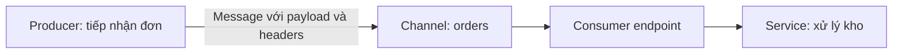
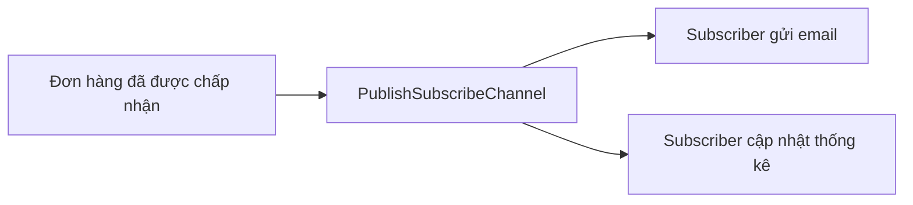

# Producer, channel và consumer

## Mục tiêu bài học

Trong chương **Nền tảng Spring Integration** của module `SPRING_INTEGRATION_CORE`, bài này xây dựng mô hình để đọc và thiết kế một luồng thông điệp: thành phần nào tạo dữ liệu, thông điệp đi qua đâu và thành phần nào xử lý nó. Đây là cơ sở để học gateway, Java DSL, transformer, router, filter, aggregator, xử lý lỗi và kiểm thử các mẫu tích hợp doanh nghiệp.

Sau bài học, bạn có thể:

- Nhận diện producer, channel và consumer trong một luồng tích hợp.
- Phân biệt gửi thông điệp, tiếp nhận thông điệp và hoàn tất nghiệp vụ.
- Chọn giữa giao trực tiếp, đệm hàng đợi và phát đến nhiều subscriber.
- Đọc cấu hình Java DSL để xác định cách consumer nhận thông điệp.
- Giải thích ảnh hưởng của lựa chọn channel đến thread, lỗi và tốc độ xử lý.

## 1. Bắt đầu từ một yêu cầu nghiệp vụ

Giả sử hệ thống tiếp nhận đơn hàng từ một màn hình bán hàng. Mỗi đơn cần được chuyển tới bộ phận xử lý kho. Nếu màn hình gọi thẳng một lớp xử lý kho, điểm tiếp nhận phải phụ thuộc vào cách gọi của lớp đó. Khi cần thêm bước chuẩn hóa dữ liệu hoặc đổi cách phân phối công việc, đường gọi cũng phải thay đổi.

Một thiết kế dùng thông điệp có thể biểu diễn như sau:



Producer gửi vào channel. Consumer được kết nối với channel thông qua endpoint. Channel tạo điểm nối giữa các thành phần; endpoint đưa thông điệp vào phần xử lý. Mô hình này phù hợp với cách Spring Integration tổ chức các thành phần trong ứng dụng Spring. [Nguồn: Overview of Spring Integration](https://docs.spring.io/spring-integration/reference/overview.html).

Ví dụ về hợp đồng dữ liệu cho đơn hàng:

```text
payload:
  orderId: ORD-1001
  quantity: 2

headers:
  source: checkout
```

Khi thảo luận thiết kế, hãy hỏi rõ `ORD-1001` là yêu cầu phải xử lý hay sự kiện thông báo một việc đã xảy ra. Yêu cầu xử lý kho thường cần một nơi chịu trách nhiệm. Sự kiện “đơn đã được chấp nhận” có thể cần cả bộ phận gửi email và bộ phận thống kê.

## 2. Ba vai trò và hợp đồng giữa chúng

| Vai trò | Trách nhiệm | Ví dụ trong luồng đơn hàng |
| --- | --- | --- |
| Producer | Tạo hoặc đưa thông điệp vào luồng | Mã ứng dụng gửi đơn vừa tiếp nhận |
| Channel | Cung cấp đường truyền và quy tắc giao nhận | `orders` chuyển trực tiếp hoặc giữ đơn trong hàng đợi |
| Consumer | Nhận và xử lý thông điệp từ channel | Bước kiểm tra hoặc ghi nhận yêu cầu xử lý kho |

### 2.1. Producer tạo đầu vào cho một chặng

Producer có thể là mã gọi `send()`, gateway nhận lời gọi Java hoặc inbound adapter nhận dữ liệu từ bên ngoài. Đó là vai trò trong một luồng, không bắt buộc là tên một lớp duy nhất.

Hãy xác định hợp đồng producer phải đáp ứng trước khi kết nối:

- Payload là kiểu nào và những trường nào bắt buộc?
- Header nào được dùng để nhận diện nguồn hoặc theo dõi yêu cầu?
- Kết quả gửi có ý nghĩa gì với bên gọi?
- Bên gọi phải làm gì nếu không gửi được?

Trong ví dụ của bài, producer tạo `Message<Order>` và gửi vào channel đơn hàng. `orderId` là khóa nghiệp vụ; không nên mặc định nó đồng nhất với ID kỹ thuật của mỗi `Message`.

### 2.2. Channel định nghĩa cách giao nhận

Các API cơ bản thuộc package `org.springframework.messaging`. `MessageChannel` cho phép gửi; `PollableChannel` bổ sung nhận chủ động; `SubscribableChannel` cho phép đăng ký handler để được gọi khi có thông điệp. [Nguồn: The MessageChannel Interface](https://docs.spring.io/spring-integration/reference/channel/interfaces.html).

```java
// Các chữ ký chính, lược bỏ annotation và hằng số.
public interface MessageChannel {
    boolean send(Message<?> message);
    boolean send(Message<?> message, long timeout);
}

public interface PollableChannel extends MessageChannel {
    Message<?> receive();
    Message<?> receive(long timeout);
}

public interface SubscribableChannel extends MessageChannel {
    boolean subscribe(MessageHandler handler);
    boolean unsubscribe(MessageHandler handler);
}
```

Channel thường không phải nơi viết quy tắc nghiệp vụ như “chỉ nhận đơn có số lượng dương”. Quy tắc đó nên nằm ở bước kiểm tra hoặc filter. Channel thể hiện quyết định về cách nối và giao thông điệp.

### 2.3. Consumer, handler và endpoint

Ở mức API, `MessageHandler` cung cấp callback `handleMessage(Message<?>)`. Endpoint quản lý kết nối giữa channel và handler: với channel có subscription, framework dùng `EventDrivenConsumer`; với channel có polling, framework dùng `PollingConsumer`. [Nguồn: Message Endpoints](https://docs.spring.io/spring-integration/reference/endpoint.html).

```text
Channel → consumer endpoint → handler → phương thức nghiệp vụ
```

Điều này giúp phân biệt hai câu hỏi khi gỡ lỗi:

1. Endpoint đã nhận được thông điệp chưa?
2. Phương thức nghiệp vụ xử lý thông điệp có đúng không?

Một bean có phương thức `acceptOrder()` chưa tự trở thành nơi nhận thông điệp. Cấu hình phải kết nối phương thức đó với channel, chẳng hạn bằng service activator hoặc `.handle()` trong Java DSL.

### 2.4. Một bước có thể nhận rồi phát tiếp

Xét luồng dự kiến:

```text
checkout → rawOrders → chuẩn hóa → validOrders → xử lý kho
```

Bước chuẩn hóa đóng vai trò consumer của `rawOrders`. Nếu tạo đầu ra và gửi tiếp vào `validOrders`, nó đồng thời đóng vai trò producer đối với chặng sau. Khi đọc sơ đồ lớn, hãy xác định vai trò theo từng cạnh nối thay vì gắn cứng một nhãn cho cả thành phần.

## 3. Hai quyết định độc lập khi chọn channel

Quyết định thứ nhất là **một thông điệp được giao cho một nơi xử lý hay được phát cho nhiều subscriber**. Quyết định thứ hai là **bước xử lý được gọi ngay hay có khoảng đệm/chuyển giao công việc**. Hai quyết định này cần được xem riêng. [Nguồn: Message Channel Implementations](https://docs.spring.io/spring-integration/reference/channel/implementations.html).

| Channel | Phân phối trong trường hợp bình thường | Cách consumer nhận | Đặc điểm thực thi |
| --- | --- | --- | --- |
| `DirectChannel` | Một handler | Subscription | Gọi handler trên thread gửi |
| `QueueChannel` | Một receiver lấy một thông điệp | `receive()` hoặc polling endpoint | Đệm trước khi nhận |
| `PublishSubscribeChannel` | Phát cho các subscriber | Subscription | Mặc định gọi trên thread gửi; có thể dùng executor |
| `ExecutorChannel` | Một handler | Subscription | Ủy quyền việc dispatch cho executor |

Các đặc điểm API tương ứng được mô tả trong [DirectChannel](https://docs.spring.io/spring-integration/api/org/springframework/integration/channel/DirectChannel.html), [QueueChannel](https://docs.spring.io/spring-integration/api/org/springframework/integration/channel/QueueChannel.html), [PublishSubscribeChannel](https://docs.spring.io/spring-integration/api/org/springframework/integration/channel/PublishSubscribeChannel.html) và [ExecutorChannel](https://docs.spring.io/spring-integration/api/org/springframework/integration/channel/ExecutorChannel.html).

### 3.1. DirectChannel: gọi ngay một handler

`DirectChannel` phù hợp cho chặng xử lý ngắn khi bên gọi cần chờ kết quả thực thi của handler trong cùng call stack. Có nhiều subscriber không có nghĩa mọi subscriber đều nhận cùng thông điệp. Dispatcher có cơ chế chọn subscriber và có thể failover khi xử lý lỗi; vì vậy cũng không được suy ra bảo đảm “nghiệp vụ chỉ chạy đúng một lần”. [Nguồn: DirectChannel configuration](https://docs.spring.io/spring-integration/reference/channel/configuration.html#channel-configuration-directchannel).

Ví dụ thiết kế: yêu cầu kiểm tra định dạng được chuyển đến một handler kiểm tra. Nếu có hai handler cùng thực hiện chức năng đó để chia công việc, đó vẫn là một chặng point-to-point.

### 3.2. QueueChannel: giữ thông điệp cho lần nhận sau

Với `QueueChannel`, producer có thể gửi trước khi consumer nhận. Ví dụ `new QueueChannel(100)` giới hạn số thông điệp đang đợi. Khi đầy, kết quả phụ thuộc thời gian chờ gửi; với `send(message, 0)`, lời gọi không đợi chỗ trống. Với `receive(0)`, receiver không đợi thông điệp nếu hàng đợi đang rỗng. [Nguồn: QueueChannel behavior](https://docs.spring.io/spring-integration/reference/channel/implementations.html#channel-implementations-queuechannel).

Queue trong bộ nhớ không tự cung cấp khả năng phục hồi sau khi tiến trình dừng. Nếu yêu cầu nghiệp vụ cần giữ công việc qua sự cố, phải thiết kế lưu trữ bền vững và cơ chế khôi phục phù hợp. Spring Integration hỗ trợ cấu hình queue dùng message store. [Nguồn: Persistent QueueChannel Configuration](https://docs.spring.io/spring-integration/reference/channel/configuration.html#channel-configuration-queuechannel).

Việc đệm cũng không bảo đảm consumer chạy trên thread khác: mã của bạn có thể gọi `send()` rồi `receive()` ngay trên cùng thread. Trong luồng dùng polling endpoint được scheduler kích hoạt, việc nhận thường diễn ra sau đó trong tác vụ polling.

### 3.3. PublishSubscribeChannel: phát sự kiện

Nếu email và thống kê đều cần nhận sự kiện đơn hàng đã chấp nhận, hãy cân nhắc `PublishSubscribeChannel`. Constructor mặc định gọi handler trên thread gửi. Phát cho nhiều subscriber không tự tạo nhiều thread; một lỗi cũng có thể ảnh hưởng quá trình gọi những subscriber tiếp theo tùy cấu hình. [Nguồn: PublishSubscribeChannel API](https://docs.spring.io/spring-integration/api/org/springframework/integration/channel/PublishSubscribeChannel.html).

Ví dụ mục tiêu thiết kế:



Nếu hai công việc phải phục hồi độc lập sau sự cố, hãy mô tả rõ yêu cầu đó trước khi chọn thêm các hàng đợi hoặc phương tiện lưu trữ cho từng nhánh.

### 3.4. ExecutorChannel: chuyển việc dispatch sang executor

`ExecutorChannel` vẫn thuộc nhóm subscribable. Cách dispatch thực tế phụ thuộc executor; không nên suy luận rằng consumer luôn chạy trên một thread riêng chỉ từ tên channel. Khi có chuyển thread, transaction gắn với thread gửi không tự được chia sẻ với handler. [Nguồn: ExecutorChannel API](https://docs.spring.io/spring-integration/api/org/springframework/integration/channel/ExecutorChannel.html).

Đối với bài toán xử lý kho, việc chuyển công việc sang executor cần đi kèm quyết định về số worker, giới hạn công việc đợi và cách phản ứng khi executor không nhận thêm tác vụ.

## 4. Ví dụ Java: quan sát việc giao trực tiếp

Các ví dụ giả định classpath đã có `spring-integration-core` và các thư viện Spring tương thích, được quản lý thống nhất bởi dự án. Ví dụ dùng `record`, cần Java 17 trở lên và JDK đáp ứng phiên bản Spring đang sử dụng. Các đoạn mã là nội dung minh họa; bài không thực hiện cài dependency hay chạy build.

Chương trình dưới đây tự đăng ký một handler để làm rõ cơ chế channel. Trong ứng dụng thực tế, nên để Spring quản lý channel và endpoint.

```java
import org.springframework.integration.channel.DirectChannel;
import org.springframework.messaging.Message;
import org.springframework.messaging.support.MessageBuilder;

public class DirectChannelDemo {

    record Order(String orderId, int quantity) {}

    public static void main(String[] args) {
        DirectChannel orders = new DirectChannel();

        orders.subscribe(message -> {
            Order order = (Order) message.getPayload();
            System.out.println("consumer: " + order.orderId()
                    + ", thread=" + Thread.currentThread().getName());
        });

        Message<Order> message = MessageBuilder
                .withPayload(new Order("ORD-1001", 2))
                .setHeader("source", "checkout")
                .build();

        System.out.println("producer: trước send");
        boolean sent = orders.send(message);
        System.out.println("producer: sau send, sent=" + sent);
    }
}
```

Với một subscriber này và không có lỗi, kết quả dự kiến:

```text
producer: trước send
consumer: ORD-1001, thread=main
producer: sau send, sent=true
```

Hãy lần theo chương trình:

1. `subscribe()` kết nối callback với channel.
2. Producer tạo message theo hợp đồng `Order`.
3. `send()` đưa message tới callback.
4. Callback trả về thì producer mới in dòng cuối.

Nếu thay phần thân callback bằng một thao tác tốn hai giây, khoảng chờ đó xuất hiện bên trong lời gọi `send()`. Một timeout gửi không nên được hiểu là cơ chế hủy cưỡng bức một phương thức nghiệp vụ đang chạy.

Đoạn ép kiểu `Order` được chấp nhận ở đây vì ví dụ chủ động kiểm soát đầu vào. Trong luồng tiếp nhận nhiều định dạng, nên đặt bước chuyển đổi và kiểm tra hợp đồng trước khi gọi service nghiệp vụ.

## 5. Ví dụ Java: phân biệt đã gửi và đã xử lý

Chương trình sau chỉ dùng queue có một chỗ trống, để có thể dự đoán trạng thái mà không cần thread nền hoặc `Thread.sleep()`:

```java
import org.springframework.integration.channel.QueueChannel;
import org.springframework.messaging.Message;
import org.springframework.messaging.support.MessageBuilder;

public class QueueChannelDemo {

    public static void main(String[] args) {
        QueueChannel orders = new QueueChannel(1);

        Message<String> first = MessageBuilder
                .withPayload("ORD-1001").build();
        Message<String> second = MessageBuilder
                .withPayload("ORD-1002").build();

        System.out.println(orders.send(first, 0));
        System.out.println(orders.send(second, 0));

        Message<?> received = orders.receive(0);
        if (received != null) {
            System.out.println("Nhận: " + received.getPayload());
        }

        System.out.println(orders.send(second, 0));
    }
}
```

Kết quả dự kiến:

```text
true
false
Nhận: ORD-1001
true
```

Sau dòng `true` đầu tiên, chương trình chưa chạy bất kỳ nghiệp vụ xử lý đơn nào. Nó mới đặt được message vào queue. Khi `receive()` lấy message ra, đó là lúc mã nhận có dữ liệu để bắt đầu xử lý.

Trong ví dụ này, message thứ hai chưa được nhận khi chương trình kết thúc. Không có một worker ngầm nào được tạo chỉ vì đã khởi tạo `QueueChannel`.

Nên đặt tên các trạng thái nghiệp vụ theo sự kiện thực tế:

| Sự kiện trong ví dụ | Trạng thái có thể ghi nhận |
| --- | --- |
| `send(first, 0)` trả về `true` | Đã đưa vào hàng đợi trong tiến trình |
| `receive(0)` trả về message | Đã lấy công việc khỏi hàng đợi |
| Hàm xử lý kho hoàn tất | Đã hoàn thành bước xử lý kho |

Nếu giao diện cần báo “đã xử lý kho”, một kết quả gửi vào queue là chưa đủ bằng chứng. Cần kết quả trả lời hoặc một trạng thái nghiệp vụ được cập nhật sau xử lý.

## 6. Kết nối bằng Spring và Java DSL

Ví dụ sau dùng Spring context thuần để có đầy đủ producer, channel và consumer endpoint. Hai bean channel được khai báo rõ ràng, giúp quan sát đầu vào và đầu ra.

```java
import org.springframework.context.annotation.AnnotationConfigApplicationContext;
import org.springframework.context.annotation.Bean;
import org.springframework.context.annotation.Configuration;
import org.springframework.integration.config.EnableIntegration;
import org.springframework.integration.channel.DirectChannel;
import org.springframework.integration.channel.QueueChannel;
import org.springframework.integration.dsl.IntegrationFlow;
import org.springframework.messaging.Message;
import org.springframework.messaging.support.MessageBuilder;

public class OrdersFlowDemo {

    public record Order(String orderId, int quantity) {}

    public static class OrderService {
        public String accept(Order order) {
            if (order.quantity() <= 0) {
                throw new IllegalArgumentException("quantity phải lớn hơn 0");
            }
            return "ACCEPTED:" + order.orderId();
        }
    }

    @Configuration
    @EnableIntegration
    public static class FlowConfig {

        @Bean
        public DirectChannel orders() {
            return new DirectChannel();
        }

        @Bean
        public QueueChannel acceptedOrders() {
            return new QueueChannel(10);
        }

        @Bean
        public OrderService orderService() {
            return new OrderService();
        }

        @Bean
        public IntegrationFlow acceptOrderFlow() {
            return IntegrationFlow.from(orders())
                    .handle(orderService(), "accept")
                    .channel(acceptedOrders())
                    .get();
        }
    }

    public static void main(String[] args) {
        try (var context =
                     new AnnotationConfigApplicationContext(FlowConfig.class)) {

            DirectChannel input =
                    context.getBean("orders", DirectChannel.class);
            QueueChannel output =
                    context.getBean("acceptedOrders", QueueChannel.class);

            boolean sent = input.send(MessageBuilder
                    .withPayload(new Order("ORD-1001", 2))
                    .setHeader("source", "checkout")
                    .build());

            Message<?> reply = output.receive(1000);
            if (!sent || reply == null) {
                throw new IllegalStateException("Không nhận được kết quả");
            }

            System.out.println(reply.getPayload());
        }
    }
}
```

Kết quả nghiệp vụ dự kiến là `ACCEPTED:ORD-1001`, ngoài các log do Spring hoặc hệ thống logging tạo ra.

Trong cấu hình này, `.handle(orderService(), "accept")` biểu diễn service activator. Framework lấy payload để gọi phương thức `accept`, rồi chuyển giá trị trả về thành đầu ra của bước xử lý. `.channel(acceptedOrders())` chỉ định nơi gửi kết quả. [Nguồn: Service Activator](https://docs.spring.io/spring-integration/reference/service-activator.html).

Đọc luồng theo từng chặng:

```text
main tạo Message<Order>
  → orders: DirectChannel
  → endpoint gọi OrderService.accept(Order)
  → acceptedOrders: QueueChannel
  → main nhận Message chứa String kết quả
```

Service chỉ biết `Order`; mã kết nối thuộc cấu hình integration. Java DSL mô tả cấu trúc luồng, còn thread thực thi do các channel và endpoint trong luồng quyết định. [Nguồn: Java DSL](https://docs.spring.io/spring-integration/reference/dsl.html).

Trong demo chỉ gửi một message nên queue đầu ra có chỗ trống. Nếu mở rộng thành luồng chạy liên tục, phải bảo đảm kết quả được tiêu thụ; khi queue đầu ra đầy, quá trình gửi kết quả có thể giữ lại cả thread gọi ban đầu.

### Đổi đầu vào sang queue thì cần thêm gì?

Giả sử muốn ứng dụng đặt đơn vào queue để consumer nhận theo lịch. Có thể thay hai phương thức tương ứng trong `FlowConfig` bằng đoạn sau; các phần khác giữ nguyên. Thêm import `java.time.Duration` và `org.springframework.integration.dsl.Pollers`.

```java
@Bean
public QueueChannel orders() {
    return new QueueChannel(100);
}

@Bean
public IntegrationFlow acceptOrderFlow() {
    return IntegrationFlow.from(orders())
            .handle(orderService(), "accept",
                    endpoint -> endpoint.poller(
                            Pollers.fixedDelay(Duration.ofMillis(200))
                                    .maxMessagesPerPoll(10)))
            .channel(acceptedOrders())
            .get();
}
```

Ở `main`, đổi kiểu biến và kiểu lấy bean đầu vào thành `QueueChannel`. Khi gửi, nên dùng timeout hữu hạn và kiểm tra `sent` trước khi chờ kết quả. Với ví dụ một đơn, đầu ra dự kiến vẫn là chuỗi chấp nhận đơn, nhưng việc xử lý được kích hoạt bởi poller.

Poller ở đây chủ động nhận từ channel rồi gọi handler. `maxMessagesPerPoll(10)` giới hạn số message trong một lượt polling; nó không tạo mười consumer song song. `fixedDelay` đặt khoảng nghỉ giữa các lần thực thi polling hoàn tất và bắt đầu tiếp theo, nên không phải cam kết mỗi đơn luôn được xử lý trong 200 ms. [Nguồn: Poller](https://docs.spring.io/spring-integration/reference/polling-consumer.html), [Message Endpoints](https://docs.spring.io/spring-integration/reference/endpoint.html).

Một endpoint nhận từ pollable channel cần cấu hình poller phù hợp, trực tiếp hoặc thông qua poller mặc định. Thiếu cấu hình đó là lỗi nối luồng; thêm queue không tự tạo lịch nhận.

## 7. Thread, lỗi và ý nghĩa của thành công

### 7.1. Theo dấu ranh giới thread

Với luồng DirectChannel ban đầu:

```text
thread gọi: send → accept → gửi kết quả → send trả về
```

Với biến thể queue có poller:

```text
thread gọi:    send vào queue → tiếp tục công việc khác
tác vụ poll:   receive → accept → gửi kết quả
```

Trong chặng xử lý đồng bộ, lỗi handler có thể truyền ngược về bên gọi. Khi xử lý đã chuyển sang tác vụ nền, bên gọi không thể dùng `try/catch` quanh lần gửi trước đó để bắt một lỗi phát sinh về sau. Spring Integration có cơ chế phát `ErrorMessage` tới error channel cho các tác vụ được hỗ trợ; đích có thể được xác định bởi header `errorChannel` hoặc error channel chung. Không phải mọi exception trên DirectChannel đều tự chuyển thành error message. [Nguồn: Error Handling](https://docs.spring.io/spring-integration/reference/error-handling.html).

Đối với biến thể polling, hãy thử hình dung đơn có `quantity = 0`: service ném lỗi trước khi tạo kết quả chấp nhận. Việc chờ ở `acceptedOrders` không tự trở thành cơ chế nhận lỗi. Thiết kế cần một đường lỗi hoặc cách cập nhật trạng thái thất bại riêng.

### 7.2. Đặt câu hỏi cụ thể về bảo đảm giao nhận

Trong bài toán thực tế, cần phân biệt ít nhất ba mốc:

1. Producer đã chuyển thông điệp cho cơ chế giao nhận.
2. Consumer đã bắt đầu xử lý.
3. Kết quả nghiệp vụ đã được ghi nhận thành công.

Một kết quả `true` không thay thế bằng chứng cho cả ba mốc trong mọi loại channel. Ví dụ queue ở phần 5 trực tiếp cho thấy mốc thứ nhất có thể xảy ra khi chưa có consumer nào xử lý.

Nếu nghiệp vụ cho phép gửi lại yêu cầu khi chưa biết kết quả, hãy thiết kế consumer nhận diện yêu cầu trùng, chẳng hạn bằng `orderId` kết hợp loại thao tác. Tự động gửi lại một thao tác đã tạo tác dụng phụ có thể ghi nhận hai lần cùng một yêu cầu.

### 7.3. Ước lượng chỗ đệm bằng số liệu giả định

Giả sử trong một đợt tăng tải:

- Producer đưa vào 80 đơn mỗi giây.
- Consumer xử lý được 50 đơn mỗi giây.
- Queue ban đầu rỗng và còn 300 chỗ.

Với giả định tốc độ ổn định và không có yếu tố khác, backlog tăng khoảng `80 - 50 = 30` đơn mỗi giây. Queue sẽ đầy sau khoảng `300 / 30 = 10` giây. Đây là phép ước lượng cho tình huống giả định, không phải throughput của Spring Integration.

Kết quả này giúp đặt đúng câu hỏi vận hành: queue cần hấp thụ đỉnh tải kéo dài bao lâu, bên gửi chờ được bao lâu và sau khi đầy thì trả lỗi hay lưu công việc ở đâu? Tăng dung lượng chỉ kéo dài thời gian đệm nếu tốc độ vào tiếp tục cao hơn tốc độ xử lý.

## 8. Các lỗi thiết kế thường gặp

| Dấu hiệu hoặc suy luận | Điểm cần kiểm tra |
| --- | --- |
| Gửi vào DirectChannel nhưng báo không có subscriber | Endpoint đã được đăng ký và khởi động chưa; có đúng channel instance không? |
| Đặt message vào QueueChannel nhưng nghiệp vụ không chạy | Có mã `receive()` hoặc endpoint có poller không? |
| Chỉ một trong hai bước nhận đơn trên DirectChannel | Hai bước có cần broadcast hay phải nối tiếp thành hai chặng? |
| Gửi thành công nên giao diện báo hoàn tất nghiệp vụ | Kết quả gửi chứng minh mốc nào trong quá trình xử lý? |
| Thêm queue nhưng producer vẫn chờ lâu | Queue có đầy không; timeout gửi và tốc độ nhận được cấu hình thế nào? |
| Phát sự kiện nhưng thread gọi vẫn bị giữ | PublishSubscribeChannel đang gọi đồng bộ hay có executor? |
| Bắt lỗi quanh `send()` nhưng bỏ sót thất bại về sau | Có ranh giới tác vụ nền không; đường báo lỗi nằm ở đâu? |

Khi khảo sát một luồng, nên ghi lại tên channel, kiểu payload, kiểu consumer và nơi ghi nhận kết quả. Những thông tin đó giúp phân biệt lỗi hợp đồng dữ liệu với lỗi kết nối hoặc thiếu năng lực xử lý.

## 9. Thực hành đọc và dự đoán luồng

Các bài tập sau mở rộng trực tiếp các ví dụ trong bài. Đây là gợi ý thực hành cho người học, chưa phải kết quả kiểm thử đã chạy.

### Bài tập 1: Kiểm chứng thứ tự gọi

Trong `DirectChannelDemo`, bổ sung dòng log đầu và cuối callback. Dự đoán thứ tự bốn dòng log trước khi chạy. Sau đó ném `IllegalArgumentException` trong callback và quan sát dòng nào không còn được in.

Điểm cần giải thích: vì sao bên gửi quan sát được lỗi trong chặng đồng bộ và vì sao dòng sau `send()` có thể không chạy.

### Bài tập 2: Kiểm chứng queue đầy

Trong `QueueChannelDemo`, tăng capacity lên 2 nhưng giữ nguyên hai lần gửi đầu tiên. Dự đoán giá trị boolean thay đổi thế nào. Sau đó nhận liên tiếp ba lần bằng `receive(0)` và xử lý trường hợp `null`.

Điểm cần giải thích: capacity đếm message đang đợi, còn việc lấy được message vẫn chưa chứng minh nghiệp vụ đã hoàn tất.

### Bài tập 3: Chọn cách phân phối

Với yêu cầu “mỗi đơn phải được ghi nhận kho và gửi email”, hãy vẽ hai thiết kế:

- Hai bước nối tiếp, trong đó bước đầu tạo đầu ra cho bước sau.
- Hai subscriber nhận một sự kiện từ publish-subscribe channel.

So sánh thời điểm phát sự kiện, ảnh hưởng khi một bước lỗi và nơi lưu trạng thái của từng công việc. Chọn thiết kế theo yêu cầu cụ thể về phụ thuộc giữa kho và email.

### Bài tập 4: Đổi sang polling

Áp dụng biến thể queue trong phần 6. Ghi tên thread trong producer và trong `accept()`. Thử một đơn hợp lệ rồi một đơn có số lượng bằng 0; mô tả nơi cần quan sát kết quả và nơi cần quan sát lỗi.

Trước khi chuyển sang các endpoint phức tạp hơn, bạn nên tự giải thích được: ai tạo message, channel giao nó theo cách nào, endpoint nào kích hoạt handler và dấu hiệu nào chứng minh nghiệp vụ hoàn tất.
