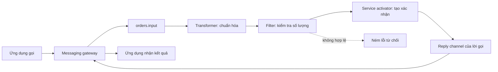
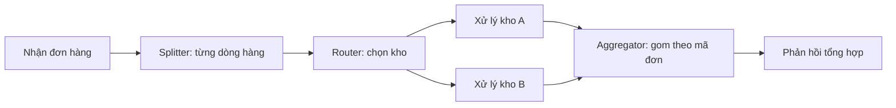

# Message flow từ đầu vào đến đầu ra

## 1. Mục tiêu và bối cảnh

Trong chương **Nền tảng Spring Integration** của module **SPRING_INTEGRATION_CORE**, bài này trình bày cách một thông điệp đi từ nơi tiếp nhận dữ liệu, qua các bước xử lý, đến nơi nhận kết quả. Đây là nền tảng để thiết kế luồng bằng `Message`, `MessageChannel`, endpoint, gateway và Java DSL, rồi mở rộng sang transformer, router, filter, aggregator, xử lý lỗi và kiểm thử.

Sau bài học, bạn có thể:

- Vẽ đường đi của một thông điệp và chỉ ra trách nhiệm của từng thành phần.
- Phân biệt đầu vào, channel, bước xử lý và đầu ra của một flow.
- Xây dựng một flow request–reply bằng Java DSL.
- Giải thích vì sao thêm hàng đợi làm thay đổi thời điểm thực thi, nhận kết quả và quan sát lỗi.
- Xác định vị trí cần đặt kiểm tra dữ liệu, theo dõi và kiểm thử.

Ví dụ xuyên suốt là tiếp nhận đơn hàng: ứng dụng gửi yêu cầu, luồng chuẩn hóa mã đơn, kiểm tra số lượng, tạo xác nhận và trả kết quả. Ví dụ tập trung vào đường đi của thông điệp, chưa triển khai lưu cơ sở dữ liệu hay gọi dịch vụ ngoài.

## 2. Flow là một đồ thị xử lý thông điệp

Một **message flow** mô tả cách các thành phần phối hợp thông qua thông điệp. Flow đơn giản có dạng đường thẳng; flow thực tế có thể rẽ nhánh, chia nhỏ, gom nhóm hoặc kết thúc ở nhiều đích khác nhau.



Sơ đồ thể hiện đường đi logic. Nó chưa cho biết có bao nhiêu thread, dữ liệu có được lưu bền hay không, hoặc bước nào nằm trong transaction. Muốn trả lời các câu hỏi đó, phải xem loại channel, poller, executor, cấu hình transaction và cách endpoint thực thi.

Trong Java DSL, nhiều channel nối các bước được tạo ngầm. Vì vậy, số lời gọi `.channel(...)` trong mã nguồn không nhất thiết bằng số kết nối trong flow.

### 2.1. Các vai trò trên đường đi

| Thành phần | Vai trò | Ví dụ trong luồng đơn hàng |
|---|---|---|
| Nguồn phát sinh dữ liệu | Nơi dữ liệu xuất hiện trước khi vào hệ thống thông điệp | Một lời gọi Java, HTTP request hoặc bản ghi được đọc theo lịch |
| Inbound adapter hoặc gateway | Đưa dữ liệu qua ranh giới của flow | Gateway chuyển lời gọi `submit(...)` thành thông điệp |
| `Message` | Mang payload và headers giữa các bước | Payload là yêu cầu đặt hàng |
| `MessageChannel` | Kết nối bên gửi với bên nhận, quyết định một phần cách phân phối | `orders.input` là `DirectChannel` |
| Endpoint | Kết nối hành vi xử lý với hạ tầng thông điệp | Transformer, filter, service activator |
| Đầu ra | Nơi kết quả của một nhánh được gửi đến | Reply channel, queue kết quả hoặc hệ thống ngoài |

Channel không tự thực hiện quy tắc nghiệp vụ. Transformer không tự trở thành một nguồn dữ liệu. Gateway không thay thế các bước xử lý phía sau nó. Việc tách vai trò giúp bạn xác định đúng vị trí khi sửa lỗi hoặc thay đổi luồng.

## 3. Dữ liệu được truyền dưới dạng Message

Một `Message<T>` có hai phần chính:

```text
Message<T>
├── payload: dữ liệu cần xử lý
└── headers: thông tin điều phối và ngữ cảnh
```

Ví dụ khởi tạo một thông điệp từ Java:

```java
import org.springframework.messaging.Message;
import org.springframework.messaging.support.MessageBuilder;

Message<String> message = MessageBuilder
        .withPayload("  ORD-1001  ")
        .setHeader("source", "web")
        .setHeader("traceId", "trace-1001")
        .build();
```

Payload ở đây là chuỗi mã đơn hàng. Header `source` và `traceId` bổ sung ngữ cảnh, không cần trộn vào chuỗi đó.

Các header thường gặp trên đường đi:

| Header | Ý nghĩa |
|---|---|
| `id` | Định danh của một message; không nên dùng thay mã giao dịch nghiệp vụ xuyên suốt flow |
| `timestamp` | Thời điểm message được tạo, khi việc tạo timestamp được bật |
| `replyChannel` | Gợi ý nơi gửi phản hồi khi không có đích đầu ra tường minh phù hợp |
| `errorChannel` | Đích xử lý lỗi trong các cơ chế có hỗ trợ định tuyến lỗi bằng header |
| `correlationId` | Liên kết những message thuộc cùng một nhóm xử lý khi flow sử dụng cơ chế tương quan |
| Header nghiệp vụ tự đặt | Ví dụ `orderId`, `tenantId`, `traceId` để theo dõi ngữ cảnh |

### 3.1. Không nên hiểu flow là một đối tượng Message bị sửa liên tục

`Message` cung cấp một phong bì không có API setter thông thường. Transformer có thể trả payload mới; hạ tầng tạo message đầu ra và thường truyền tiếp những header phù hợp. Không được suy ra rằng `id` và `timestamp` luôn giữ nguyên qua mọi bước.

Payload cũng không tự trở nên bất biến chỉ vì nằm trong `Message`. Nếu payload là một `List` khả biến, nhiều nhánh cùng tham chiếu nó vẫn có thể ảnh hưởng lẫn nhau. Với fan-out hoặc xử lý bất đồng bộ, nên ưu tiên payload bất biến hoặc sao chép rõ ràng khi cần.

Để lần theo một đơn hàng xuyên suốt, sử dụng mã nghiệp vụ hoặc header theo dõi do ứng dụng quản lý; đừng phụ thuộc duy nhất vào `MessageHeaders.ID`.

## 4. Channel quyết định cách thông điệp đi tiếp

Hai flow có cùng các bước nghiệp vụ nhưng khác loại channel có thể có hành vi thực thi rất khác nhau.

| Channel | Cách chuyển thông điệp cơ bản | Điều cần hiểu |
|---|---|---|
| `DirectChannel` | Gửi trực tiếp đến một subscriber được chọn, trên thread gửi trong cấu hình thông thường | Bước sau hoàn thành hoặc phát sinh lỗi ngay trên đường gọi hiện tại |
| `QueueChannel` | Giữ message trong hàng đợi để consumer lấy ra | Cần thao tác `receive` hoặc consumer có poller; gửi thành công chưa có nghĩa nghiệp vụ đã hoàn tất |
| `ExecutorChannel` | Dùng executor để điều phối xử lý đến một subscriber | Thường tạo ranh giới thực thi bất đồng bộ; hành vi cụ thể còn phụ thuộc executor và chính sách từ chối |
| `PublishSubscribeChannel` | Phân phối đến các subscriber | Dùng khi mỗi nhánh đều cần nhận message; có thể cấu hình executor |

`DirectChannel` có nhiều subscriber không đồng nghĩa mọi subscriber đều nhận mỗi message. Muốn phát đến nhiều nhánh, phải chọn cơ chế publish–subscribe hoặc thiết kế định tuyến phù hợp.

### 4.1. Ba thời điểm không nên đánh đồng

1. **Gửi vào channel thành công**: channel chấp nhận việc gửi theo hợp đồng của nó.
2. **Endpoint xử lý xong**: một bước đã hoàn tất công việc của bước đó.
3. **Nghiệp vụ hoàn tất**: toàn bộ chuỗi cần thiết đã thành công theo định nghĩa của ứng dụng.

Với một chuỗi đồng bộ dùng `DirectChannel`, các thời điểm có thể nằm trong cùng một lời gọi. Với queue hoặc executor, chúng thường tách rời. Giá trị `true` từ `send(...)` không phải bằng chứng chung rằng đơn hàng đã được ghi nhận hoàn tất ở mọi hệ thống đích.

## 5. Ví dụ hoàn chỉnh: gateway → chuẩn hóa → kiểm tra → xác nhận

Ví dụ dưới đây dùng ứng dụng Spring đã có hạ tầng Spring Integration, chẳng hạn ứng dụng Spring Boot với dependency `spring-boot-starter-integration`. Các `record` yêu cầu Java 17 trở lên trong ví dụ này. Phiên bản Spring cụ thể cần theo cấu hình dependency của dự án.

Tạo các tệp Java riêng trong package `example.integration`. Mã chủ ý chỉ mô phỏng xử lý trong bộ nhớ; đầu vào minh họa có `orderId` khác `null`.

### 5.1. Các kiểu dữ liệu

```java
// SubmitOrder.java
package example.integration;

public record SubmitOrder(String orderId, int quantity) {
}
```

```java
// Order.java
package example.integration;

public record Order(String orderId, int quantity) {
}
```

```java
// OrderReceipt.java
package example.integration;

public record OrderReceipt(String orderId, String status) {
}
```

`SubmitOrder` thể hiện dữ liệu tiếp nhận. `Order` là dữ liệu đã đi qua bước chuẩn hóa. `OrderReceipt` là kết quả của flow. Tách các kiểu làm rõ hợp đồng đầu vào và đầu ra của từng giai đoạn.

### 5.2. Gateway làm cửa vào cho mã ứng dụng

```java
// OrderGateway.java
package example.integration;

import org.springframework.integration.annotation.MessagingGateway;

@MessagingGateway(
        defaultRequestChannel = "orders.input",
        defaultReplyTimeout = "3000"
)
public interface OrderGateway {
    OrderReceipt submit(SubmitOrder request);
}
```

Spring tạo proxy cho interface gateway. Khi ứng dụng gọi `submit(...)`, proxy tạo request message, gửi vào `orders.input` và thực hiện cơ chế chờ phản hồi để trả `OrderReceipt`.

`defaultReplyTimeout` liên quan đến việc chờ reply; nó không phải deadline có khả năng cưỡng chế dừng toàn bộ công việc phía sau. Đặc biệt, một handler chạy đồng bộ trên thread gọi có thể giữ lời gọi lâu hơn giá trị này.

### 5.3. Khai báo channel và flow bằng Java DSL

```java
// OrderFlowConfiguration.java
package example.integration;

import org.springframework.context.annotation.Bean;
import org.springframework.context.annotation.Configuration;
import org.springframework.integration.channel.DirectChannel;
import org.springframework.integration.config.EnableIntegration;
import org.springframework.integration.config.IntegrationComponentScan;
import org.springframework.integration.dsl.IntegrationFlow;
import org.springframework.messaging.MessageChannel;

@Configuration
@EnableIntegration
@IntegrationComponentScan(basePackageClasses = OrderGateway.class)
public class OrderFlowConfiguration {

    @Bean(name = "orders.input")
    public MessageChannel ordersInput() {
        return new DirectChannel();
    }

    @Bean
    public IntegrationFlow orderFlow() {
        return IntegrationFlow.from("orders.input")
                .transform(SubmitOrder.class, request ->
                        new Order(
                                request.orderId().trim(),
                                request.quantity()
                        ))
                .filter(Order.class,
                        order -> order.quantity() > 0,
                        endpoint -> endpoint.throwExceptionOnRejection(true))
                .handle(Order.class, (order, headers) ->
                        new OrderReceipt(order.orderId(), "ACCEPTED"))
                .get();
    }
}
```

Ứng dụng phải nạp `OrderFlowConfiguration`, chẳng hạn qua component scan của ứng dụng Spring Boot nằm ở package cha hoặc qua `@Import`. `@IntegrationComponentScan` tìm interface được đánh dấu `@MessagingGateway`; component scan thông thường không thay thế vai trò này cho interface gateway.

Các đoạn DSL mang ý nghĩa sau:

| Đoạn mã | Tác dụng |
|---|---|
| `from("orders.input")` | Kết nối đầu flow với channel có tên tương ứng |
| `transform(...)` | Chuyển payload từ `SubmitOrder` thành `Order` |
| `filter(...)` | Cho message đi tiếp nếu số lượng lớn hơn 0 |
| `throwExceptionOnRejection(true)` | Biến việc không đạt điều kiện thành lỗi tường minh |
| `handle(...)` | Gọi hàm nghiệp vụ và dùng giá trị trả về làm payload phản hồi |
| `get()` | Hoàn tất việc xây dựng đối tượng cấu hình `IntegrationFlow` |

Việc gọi `.get()` không kích hoạt một đơn hàng. Flow được đăng ký trong Spring; message chỉ bắt đầu đi qua khi có dữ liệu gửi vào channel.

### 5.4. Gọi từ một Spring bean khác

```java
package example.integration;

import org.springframework.stereotype.Service;

@Service
public class CheckoutService {
    private final OrderGateway orderGateway;

    public CheckoutService(OrderGateway orderGateway) {
        this.orderGateway = orderGateway;
    }

    public OrderReceipt checkout() {
        return orderGateway.submit(new SubmitOrder("  ORD-1001  ", 2));
    }
}
```

Kết quả dự kiến:

```text
OrderReceipt[orderId=ORD-1001, status=ACCEPTED]
```

Không gọi `new OrderGateway(...)`: gateway là interface có proxy do Spring quản lý. Cũng không gọi trực tiếp phương thức `orderFlow()` để gửi dữ liệu; phương thức đó tạo cấu hình, không phải API xử lý nghiệp vụ.

## 6. Theo dấu một lần gọi từ đầu đến cuối

Xét lời gọi:

```java
orderGateway.submit(new SubmitOrder("  ORD-1001  ", 2));
```

### Bước 1 — Gateway tạo message đầu vào

Payload là `SubmitOrder`. Hạ tầng gateway thiết lập cơ chế nhận reply cho lời gọi. Mã gọi không phải tự tạo message hay tự quản lý channel phản hồi tạm thời trong ví dụ này.

### Bước 2 — `orders.input` chuyển message đến endpoint đầu

`orders.input` là `DirectChannel`. Trong chuỗi minh họa không có queue hay executor chen giữa, các bước tiếp tục thực thi trên thread gọi.

Nếu channel chưa có subscriber hoạt động, gửi message không có nghĩa là nó sẽ tự nằm chờ đến khi flow sẵn sàng. `DirectChannel` không phải hàng đợi lưu đệm.

### Bước 3 — Transformer tạo payload đã chuẩn hóa

```text
Trước: SubmitOrder("  ORD-1001  ", 2)
Sau:   Order("ORD-1001", 2)
```

Bước sau nhận `Order`, vì thế điều kiện filter và handler đều khai báo kiểu `Order`. Khai báo sai kiểu giữa các bước có thể dẫn đến lỗi chuyển đổi hoặc lỗi xử lý khi chạy.

### Bước 4 — Filter quyết định có cho đi tiếp

Với số lượng `2`, message được chuyển tiếp. Với số lượng `0`, cấu hình `throwExceptionOnRejection(true)` làm phát sinh lỗi từ chối; handler tạo xác nhận không được thực thi.

Đây là lựa chọn của ví dụ. Một hệ thống khác có thể chuyển yêu cầu không hợp lệ sang nhánh tạo phản hồi từ chối hoặc một channel kiểm tra thủ công.

### Bước 5 — Handler tạo phản hồi

Handler trả `OrderReceipt`. Trong một chuỗi request–reply, giá trị trả về của endpoint có khả năng tạo reply được dùng để tạo message tiếp theo.

Nếu một handler kết thúc chuỗi trả `null`, thường không có reply được tạo từ bước đó. Gateway có thể phải chờ đến timeout nếu không có nhánh nào khác gửi phản hồi. Khi muốn bắt buộc handler phải tạo reply, cần cấu hình yêu cầu phản hồi ở endpoint thích hợp.

### Bước 6 — Kết quả quay về người gọi

Ví dụ không khai báo output channel tường minh ở handler cuối. Hạ tầng sử dụng đường phản hồi của request để đưa `OrderReceipt` về gateway, rồi gateway trả payload cho `CheckoutService`.

Có thể tóm tắt sự biến đổi payload như sau:

```text
SubmitOrder
    → Order
    → Order được filter chấp nhận
    → OrderReceipt
```

Flow không bắt buộc payload giữ cùng kiểu từ đầu đến cuối. Điều quan trọng là hợp đồng ở mỗi kết nối khớp nhau.

## 7. Đầu ra tường minh và reply channel

Một endpoint có thể gửi kết quả đến output channel được cấu hình, hoặc sử dụng cơ chế reply của request khi phù hợp.

Ví dụ thay phần cuối của flow bằng:

```java
.handle(Order.class, (order, headers) ->
        new OrderReceipt(order.orderId(), "ACCEPTED"))
.channel("orders.receipts")
.get();
```

Kết quả lúc này được chuyển đến `orders.receipts`. Nếu đó là một `QueueChannel` và không có consumer đưa phản hồi trở lại đường reply, gateway không tự biết rằng phải lấy kết quả từ queue này.

Do đó, trước khi thêm một output channel, cần xác định:

- Caller có đang chờ phản hồi của cùng request không?
- Kết quả dành cho caller hay dành cho một tiến trình khác?
- Thành phần nào tiêu thụ output và thành phần nào chịu trách nhiệm trả reply?

Một luồng một chiều có thể kết thúc bằng outbound adapter gửi ra hệ thống ngoài và không tạo reply. Một luồng request–reply cần một đường phản hồi hoàn chỉnh. Tên “đầu ra” chỉ mô tả vị trí logic; không đảm bảo kết quả đã được trả về người gọi.

### 7.1. Adapter và gateway ở ranh giới flow

**Channel adapter** kết nối việc nhận hoặc gửi theo một chiều tại ranh giới tích hợp. **Messaging gateway** cung cấp tương tác request–reply khi hợp đồng sử dụng cần phản hồi, đồng thời cũng có thể khai báo phương thức một chiều.

Ví dụ:

- Inbound adapter đọc tệp rồi phát message vào flow: không có lời gọi Java đang chờ một giá trị trả về cho từng tệp.
- Gateway `OrderGateway.submit(...)`: caller mong nhận `OrderReceipt`.
- Outbound adapter ghi kết quả ra tệp: thao tác gửi ra ngoài không tự tạo một reply nghiệp vụ cho caller ban đầu.

Đừng chọn gateway chỉ vì flow có một bước cuối; hãy chọn theo hợp đồng giao tiếp ở ranh giới.

## 8. Khi thêm QueueChannel: xử lý được tách theo thời gian

Ví dụ độc lập dưới đây nhận chuỗi vào queue, poll định kỳ để viết hoa rồi đưa kết quả vào queue đầu ra. Cấu hình giả định đã bật Spring Integration như phần trước.

```java
package example.integration;

import java.util.Locale;

import org.springframework.context.annotation.Bean;
import org.springframework.context.annotation.Configuration;
import org.springframework.integration.channel.QueueChannel;
import org.springframework.integration.dsl.IntegrationFlow;
import org.springframework.integration.dsl.Pollers;
import org.springframework.messaging.PollableChannel;

@Configuration
public class QueuedJobConfiguration {

    @Bean(name = "jobs.queue")
    public PollableChannel jobsQueue() {
        return new QueueChannel(100);
    }

    @Bean(name = "jobs.results")
    public PollableChannel jobsResults() {
        return new QueueChannel(100);
    }

    @Bean
    public IntegrationFlow queuedJobFlow() {
        return IntegrationFlow.from("jobs.queue")
                .handle(String.class,
                        (payload, headers) -> payload.toUpperCase(Locale.ROOT),
                        endpoint -> endpoint.poller(
                                Pollers.fixedDelay(200)
                                        .maxMessagesPerPoll(10)))
                .channel("jobs.results")
                .get();
    }
}
```

`jobs.queue` là `PollableChannel`. Poller gắn ở endpoint tiêu thụ queue, giúp nó chủ động lấy message. `fixedDelay(200)` đặt độ trễ giữa các lượt chạy; `maxMessagesPerPoll(10)` giới hạn số message xử lý trong một lượt poll. Những giá trị này không bảo đảm một thông lượng cố định vì thời gian xử lý còn phụ thuộc handler và tài nguyên hệ thống.

Ví dụ gửi và nhận trong một đoạn mã đã được inject đúng hai channel theo tên:

```java
import org.springframework.messaging.Message;
import org.springframework.messaging.PollableChannel;
import org.springframework.messaging.support.MessageBuilder;

// jobsQueue và jobsResults lần lượt là bean jobs.queue và jobs.results.
boolean accepted = jobsQueue.send(
        MessageBuilder.withPayload("spring integration").build(),
        1_000);

if (!accepted) {
    throw new IllegalStateException("Không gửi được vào jobs.queue");
}

Message<?> result = jobsResults.receive(3_000);
if (result == null) {
    throw new IllegalStateException("Chưa nhận được kết quả trong thời gian chờ");
}

System.out.println(result.getPayload()); // SPRING INTEGRATION
```

Đoạn gửi/nhận chỉ minh họa một message trong môi trường thực hành. Khi nhiều request chạy đồng thời, consumer không nên lấy một kết quả bất kỳ từ queue dùng chung rồi coi đó là kết quả của request hiện tại. Cần thiết kế tương quan request–reply hoặc cơ chế theo dõi kết quả theo mã công việc.

### 8.1. Các hệ quả của ranh giới hàng đợi

- Thread gửi có thể kết thúc trước khi handler xử lý xong.
- Nếu không có poller hoặc consumer gọi `receive`, message không tự đi tiếp.
- Queue có dung lượng giới hạn có thể đầy; cần chọn timeout và chính sách khi gửi không thành công.
- `QueueChannel` trong ví dụ giữ dữ liệu trong bộ nhớ. Nó không tự tạo cam kết tồn tại sau khi tiến trình dừng.
- Transaction và ngữ cảnh thread ở phía gửi không mặc nhiên bao trùm xử lý sau queue.
- Lỗi ở handler phía sau queue không tự được ném trở lại lời gọi `send(...)` đã kết thúc.

Việc thêm queue cần xuất phát từ nhu cầu như làm phẳng tải hoặc tách tốc độ tiếp nhận và xử lý. Nó đồng thời tạo thêm trách nhiệm quản lý backlog, lỗi và khả năng phục hồi.

## 9. Flow thực tế có thể rẽ nhánh, chia và gom

Ngoài đường thẳng của ví dụ, các mẫu tích hợp thường làm thay đổi cấu trúc flow:

| Thành phần | Thay đổi đường đi như thế nào? | Câu hỏi cần trả lời |
|---|---|---|
| Transformer | Tạo dạng dữ liệu mới để bước sau sử dụng | Đầu ra có đúng kiểu và đủ ngữ cảnh không? |
| Filter | Giữ lại hoặc loại message theo điều kiện | Message bị loại sẽ đi đâu; caller có nhận được kết quả không? |
| Router | Chọn đích dựa trên payload hoặc headers | Mỗi trường hợp được chuyển đến channel nào; có đích mặc định không? |
| Splitter | Tạo nhiều message từ một đầu vào | Mỗi phần được định danh và liên kết với đầu vào thế nào? |
| Aggregator | Gom những message có tương quan thành kết quả | Khi nào nhóm đủ điều kiện hoàn tất; nhóm thiếu dữ liệu xử lý ra sao? |
| Service activator | Gọi hành vi nghiệp vụ | Có tác dụng phụ không; có tạo reply không? |

Ví dụ đơn hàng nhiều dòng có thể được mở rộng thành:



Ở cấu trúc này, việc một nhánh đã xong không đồng nghĩa toàn bộ đơn hàng hoàn tất. Aggregator cần quy tắc tương quan, điều kiện release và xử lý nhóm không đủ thành phần. Chỉ đưa tất cả message vào một channel không tự biến chúng thành một kết quả tổng hợp.

Chi tiết cấu hình từng mẫu cần học riêng; khi đọc sơ đồ, trước hết hãy xác định một message được biến đổi, nhân thành nhiều message hay hợp nhất với các message khác ở đâu.

## 10. Lỗi cũng có đường đi cần được thiết kế

### 10.1. Lỗi trong chuỗi đồng bộ

Trong flow đơn hàng dùng `DirectChannel`, lỗi chuẩn hóa hoặc lỗi từ chối tại filter có thể quay về thread gọi gateway dưới dạng ngoại lệ của hạ tầng messaging, có thể kèm nguyên nhân gốc.

Ứng dụng cần phân biệt lỗi dữ liệu nghiệp vụ và lỗi kỹ thuật để chuyển thành phản hồi phù hợp tại ranh giới của mình. Không nên giả định mọi ngoại lệ đều có cùng kiểu hoặc cùng ý nghĩa.

Không có quy tắc chung rằng “cứ có bean `errorChannel` thì mọi lỗi của mọi endpoint tự đi vào đó”. Cách truyền lỗi phụ thuộc loại endpoint, cách thực thi và cấu hình xử lý lỗi của gateway hoặc consumer.

### 10.2. Lỗi sau ranh giới bất đồng bộ

Với poller hoặc executor, lỗi xảy ra khi bên gửi có thể đã kết thúc. Cần có đường xử lý lỗi phù hợp, chẳng hạn error flow nhận `ErrorMessage`, ghi lại nguyên nhân và quyết định retry, chuyển sang nơi lưu lỗi hoặc đánh dấu công việc thất bại.

Một error flow hữu ích cần giữ đủ dữ kiện:

- Mã nghiệp vụ hoặc mã theo dõi của công việc.
- Bước xử lý đã lỗi và nguyên nhân gốc.
- Payload lỗi hoặc tham chiếu có thể truy hồi dữ liệu cần xử lý lại.
- Trạng thái những tác dụng phụ đã xảy ra trước lỗi.

Error channel là đích của thông điệp lỗi trong cơ chế được cấu hình; nó không phải một hành động rollback tự động cho tất cả hệ thống bên ngoài.

### 10.3. Filter loại message không nhất thiết là lỗi kỹ thuật

Một filter có thể loại message mà không ném lỗi nếu không bật chế độ ném lỗi khi từ chối. Trong request–reply, nếu nhánh loại không tạo phản hồi, caller có thể chờ hết timeout.

Ba lựa chọn thiết kế thường dùng:

| Lựa chọn | Khi phù hợp | Hệ quả với caller |
|---|---|---|
| Ném lỗi khi bị từ chối | Vi phạm hợp đồng đầu vào cần được báo ngay | Caller nhận lỗi trên đường đồng bộ thích hợp |
| Chuyển đến discard channel | Cần ghi nhận hoặc xử lý riêng message bị loại | Phải thiết kế thêm nếu caller cần phản hồi từ nhánh này |
| Trả kết quả từ chối qua một nhánh rõ ràng | Từ chối là kết quả nghiệp vụ bình thường | Caller nhận một kiểu kết quả thể hiện trạng thái từ chối |

Không retry vô hạn dữ liệu vốn không hợp lệ. Với thao tác có tác dụng phụ, retry còn đòi hỏi thiết kế chống xử lý trùng, vì gửi lại message có thể lặp lại một công việc đã thực hiện một phần.

## 11. Kiểm thử theo hợp đồng đầu vào và đầu ra

Khi kiểm thử flow, mục tiêu là xác nhận hành vi quan sát được qua các ranh giới của nó.

Với flow gateway ở phần 5, các kịch bản chính là:

| Đầu vào hoặc tình huống | Kết quả cần xác nhận |
|---|---|
| `SubmitOrder("  ORD-1001  ", 2)` | Nhận `OrderReceipt` với mã đã bỏ khoảng trắng và trạng thái `ACCEPTED` |
| Số lượng bằng 0 hoặc âm | Bị từ chối; không tạo xác nhận thành công |
| Payload sai kiểu được gửi trực tiếp vào channel | Lỗi được quan sát qua cơ chế xử lý tương ứng |
| Handler cuối không tạo reply | Hành vi chờ và timeout khớp hợp đồng đã chọn |
| Chèn thêm bước bất đồng bộ | Bài kiểm tra chờ có giới hạn và xác nhận đúng kết quả tương quan |

Có thể kiểm tra gateway bằng Spring Test và JUnit trong một application context nạp flow:

```java
package example.integration;

import org.junit.jupiter.api.Test;
import org.springframework.beans.factory.annotation.Autowired;
import org.springframework.test.context.junit.jupiter.SpringJUnitConfig;

import static org.junit.jupiter.api.Assertions.assertEquals;

@SpringJUnitConfig(OrderFlowConfiguration.class)
class OrderFlowTest {

    @Autowired
    OrderGateway gateway;

    @Test
    void returnsReceiptWithNormalizedOrderId() {
        OrderReceipt receipt = gateway.submit(
                new SubmitOrder("  ORD-1001  ", 2));

        assertEquals("ORD-1001", receipt.orderId());
        assertEquals("ACCEPTED", receipt.status());
    }
}
```

Đoạn kiểm thử này cần các dependency kiểm thử tương ứng của dự án, ví dụ `spring-boot-starter-test` khi dùng Spring Boot. Nó xác nhận đường đi công khai từ gateway đến phản hồi; không phụ thuộc tên của những channel được DSL tạo ngầm.

Với queue, dùng thao tác nhận hoặc cơ chế chờ có timeout. Tránh chỉ gọi `Thread.sleep(...)` rồi mặc định flow đã xong; cách đó khiến kiểm thử chậm hoặc thiếu ổn định. Khi kiểm tra nhánh từ chối, nên xác nhận cả lỗi/đầu ra từ chối và việc nhánh thành công không thực hiện tác dụng phụ.

## 12. Các nhầm lẫn thường gặp

| Nhầm lẫn | Cách hiểu đúng |
|---|---|
| Mỗi lời gọi DSL tạo một thread mới | Loại channel và cơ chế thực thi quyết định ranh giới thread |
| `send(...)` trả `true` nghĩa là nghiệp vụ đã xong | Cần xem channel và consumer; một queue chỉ có thể mới tiếp nhận message |
| `DirectChannel` giữ message đến khi có consumer | Nó không phải queue lưu đệm |
| Có `QueueChannel` là đủ để tự động xử lý | Cần consumer gọi nhận hoặc endpoint có poller |
| `handle(...)` luôn kết thúc flow | Handler tạo reply có thể tiếp tục chuyển kết quả đến bước sau |
| Cứ đặt output channel là gateway sẽ nhận kết quả | Cần đường phản hồi thực sự quay về lời gọi đang chờ |
| Filter loại message thì caller luôn nhận thông báo | Nhánh loại phải có hành vi báo lỗi hoặc trả kết quả theo thiết kế |
| Cùng một flow nghĩa là cùng một transaction | Ranh giới thread và resource quyết định phạm vi transaction |
| Tất cả lỗi đều tự đến `errorChannel` | Đường lỗi phụ thuộc cơ chế thực thi và cấu hình endpoint/gateway |
| Queue trong bộ nhớ bảo đảm không mất dữ liệu khi dừng ứng dụng | Cần thiết kế lưu bền và phục hồi phù hợp nếu có yêu cầu đó |

## 13. Thực hành tự kiểm tra

### Bài 1 — Vẽ đường đi của payload

Dùng flow ở phần 5 và ghi kiểu payload trước/sau mỗi bước. Với đầu vào có số lượng `0`, chỉ ra bước nào là bước cuối cùng được thực thi và vì sao không xuất hiện `OrderReceipt` thành công.

### Bài 2 — Thêm ngữ cảnh theo dõi

Thiết kế cách gắn `traceId` vào message tại đầu flow. Xác định vị trí đọc header này khi ghi log. Dùng cùng mã nghiệp vụ để đối chiếu đầu vào và đầu ra thay vì giả định message ID không thay đổi.

### Bài 3 — Thay đổi hợp đồng đầu ra

Giả sử nghiệp vụ chỉ tiếp nhận yêu cầu rồi xử lý nền. Vẽ lại flow với queue và một nơi lưu trạng thái công việc. Phân biệt “đã tiếp nhận” và “đã xử lý”; nêu cách caller tra kết quả bằng mã công việc.

### Bài 4 — Thiết kế đường từ chối

Thay yêu cầu ném lỗi của filter bằng yêu cầu trả một kết quả nghiệp vụ từ chối. Xác định các nhánh, kiểu kết quả chung và đường reply để caller luôn nhận được một kết quả phù hợp cho mỗi request trong hợp đồng của bài tập.

## 14. Điểm cần ghi nhớ

Một message flow hoàn chỉnh phải trả lời được: dữ liệu vào từ đâu, payload và headers mang gì, channel chuyển message thế nào, endpoint biến đổi hoặc điều phối ra sao, kết quả đi đến đâu và lỗi được quan sát ở đâu.

Với luồng đồng bộ đơn giản, gateway và `DirectChannel` giúp nối lời gọi Java với chuỗi xử lý và phản hồi. Khi xuất hiện queue, executor, nhánh song song hoặc aggregator, cần bổ sung cách xác định hoàn tất, tương quan kết quả và xử lý lỗi. Sơ đồ đường đi của message là điểm bắt đầu; cấu hình channel và endpoint mới quyết định hành vi thực thi cụ thể.