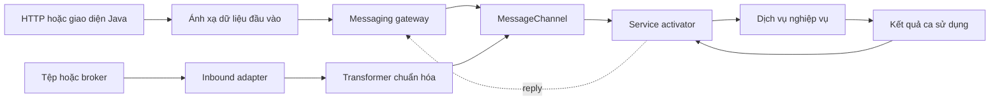

# Tách kết nối khỏi xử lý nghiệp vụ

## 1. Mục tiêu và phạm vi

Trong chương **Nền tảng Spring Integration** của module `SPRING_INTEGRATION_CORE`, bài học này giải thích cách đặt ranh giới giữa mã giao tiếp với bên ngoài và mã thực thi quy tắc nghiệp vụ. Mục tiêu là thiết kế một luồng mà HTTP, tệp hoặc broker có thể thay đổi mà không buộc phần tính toán nghiệp vụ phải thay đổi theo.

Sau bài học, bạn có thể:

- Phân biệt trách nhiệm của adapter, messaging gateway, channel và service activator.
- Thiết kế hợp đồng dữ liệu để nghiệp vụ không phải hiểu HTTP request, bản tin broker hay vị trí tệp.
- Dùng Java DSL nối một gateway với một dịch vụ Java thông thường.
- Giải thích vì sao tách phụ thuộc không đồng nghĩa với xử lý bất đồng bộ hoặc triển khai thành nhiều dịch vụ.
- Kiểm thử quy tắc nghiệp vụ riêng và kiểm thử đường nối thông điệp riêng.

Các ví dụ tập trung vào tiếp nhận đơn hàng. Transformer, router, filter và aggregator được đặt vào đúng vị trí trong kiến trúc; kỹ thuật cấu hình chi tiết của từng mẫu không phải trọng tâm bài này.

## 2. Vấn đề: một phương thức đang gánh quá nhiều trách nhiệm

Giả sử hệ thống nhận đơn qua HTTP. Một thiết kế ban đầu có thể gom mọi việc vào một phương thức:

```java
// Minh họa cách trộn trách nhiệm; không phải mã ứng dụng hoàn chỉnh.
public void receive(HttpServletRequest request) {
    String customerId = request.getParameter("customerId");
    int quantity = Integer.parseInt(request.getParameter("quantity"));
    String correlationId = request.getHeader("X-Correlation-Id");

    // Tự kiểm tra quyền truy cập, tính tiền, lưu dữ liệu,
    // gửi yêu cầu đến đối tác rồi quyết định HTTP response.
}
```

Vấn đề không nằm ở việc có HTTP controller. Vấn đề là các quyết định nghiệp vụ bị buộc vào cấu trúc HTTP và vòng đời kết nối. Khi bổ sung nhận đơn từ CSV, nhóm phát triển dễ sao chép logic hoặc tạo một HTTP request giả để tái sử dụng phương thức trên.

Hậu quả xuất hiện ở nhiều phía:

| Thay đổi | Ảnh hưởng khi các trách nhiệm bị trộn |
|---|---|
| Đối tác đổi tên trường JSON | Phương thức tính tiền phải sửa cùng mã đọc request |
| Thêm nhận đơn từ broker | Consumer phải sao chép logic đang nằm trong controller |
| Kiểm tra số lượng không hợp lệ | Bài kiểm thử cần dựng servlet dù không kiểm tra HTTP |
| Dịch vụ đối tác chậm | Thời gian xử lý nghiệp vụ bị gắn với timeout kết nối |
| Thay chính sách retry | Quy tắc đặt hàng có thể bị gọi lặp mà không được thiết kế cho điều đó |

Một thay đổi hữu ích là chuyển từ câu hỏi “phương thức nào gọi phương thức nào?” sang “thành phần này tiếp nhận hợp đồng gì và chịu trách nhiệm về điều gì?”. Spring Integration cung cấp các thành phần messaging để biểu diễn những ranh giới ấy.

## 3. Tách kết nối nghĩa là tách những gì?

### 3.1. Tách công nghệ giao tiếp

Mã nghiệp vụ nên nhận dữ liệu có ý nghĩa với ca sử dụng, chẳng hạn `OrderCommand`, thay vì `HttpServletRequest`, `jakarta.jms.Message` hoặc đối tượng mô tả một tệp vừa tải về.

Phần giao tiếp chịu trách nhiệm về giao thức, xác thực ở biên, cách đọc dữ liệu và cách biểu diễn phản hồi cho bên gọi. Phần nghiệp vụ chịu trách nhiệm về điều kiện hợp lệ của đơn hàng và kết quả xử lý.

Ví dụ, lỗi JSON không đọc được thuộc biên tiếp nhận. Số lượng bằng không vi phạm quy tắc đặt hàng ngay cả khi JSON hoàn toàn hợp lệ. Hai lỗi này cần được phân biệt vì chúng có nguyên nhân và cách phản hồi khác nhau.

### 3.2. Tách hiểu biết về thành phần nhận

Thành phần gửi thông điệp có thể biết channel `orderRequests` mà không biết lớp nào xử lý nó. Cấu hình tích hợp quyết định channel được nối với service activator nào.

Sự tách biệt này vẫn cần một hợp đồng chung: kiểu payload, ý nghĩa dữ liệu và cách biểu diễn kết quả. Channel giúp giảm phụ thuộc vào nơi nhận cụ thể; nó không xóa nhu cầu thống nhất hợp đồng.

### 3.3. Tách thời điểm thực thi khi cần

Một thiết kế có thể tách công nghệ giao tiếp nhưng vẫn chạy đồng bộ trong cùng luồng thực thi. Chỉ khi có yêu cầu về đệm tải, xử lý nền hoặc giới hạn mức song song, ta mới cân nhắc thêm ranh giới thực thi.

Phân biệt ba quyết định:

| Quyết định | Câu hỏi cần trả lời |
|---|---|
| Ranh giới trách nhiệm | Ai hiểu giao thức, ai áp dụng quy tắc nghiệp vụ? |
| Ranh giới thực thi | Caller có thực hiện trực tiếp công việc phía sau không? |
| Ranh giới triển khai | Các thành phần chạy trong cùng JVM hay ở các tiến trình khác nhau? |

Ba quyết định có liên quan nhưng không thay thế nhau. Một ứng dụng Spring duy nhất vẫn có thể tách trách nhiệm tốt. Ngược lại, hai microservice vẫn có thể phụ thuộc chặt nếu mỗi lần đổi dữ liệu đều buộc cả hai cùng triển khai.

## 4. Phân công vai trò trong Spring Integration



Đây là sơ đồ trách nhiệm, không ngụ ý mọi nguồn vào đều phải đi qua cùng một gateway hoặc có cùng cách phản hồi. Nhánh HTTP có thể chờ kết quả; nhánh nhận tệp có thể ghi nhận kết quả ở một kênh khác.

### 4.1. Message: dữ liệu và ngữ cảnh truyền nhận

Một `Message<T>` gồm payload và headers. Trong thiết kế này:

- Payload là hợp đồng dữ liệu cần xử lý, ví dụ `OrderCommand`.
- Headers chứa ngữ cảnh phục vụ truyền nhận và vận hành, ví dụ mã theo dõi hoặc nguồn tiếp nhận.

Dữ liệu bắt buộc để quyết định nghiệp vụ nên được thể hiện rõ trong hợp đồng. Chẳng hạn, nếu giá áp dụng phụ thuộc thị trường, trường `market` phải đi vào dữ liệu nghiệp vụ một cách tường minh; không nên để service tự tìm một header tùy ý để quyết định giá.

### 4.2. MessageChannel: điểm nối giữa các thành phần

Channel là đích mà producer gửi thông điệp đến và consumer nhận thông điệp từ đó. Kiểu channel còn ảnh hưởng cách thực thi. `DirectChannel` chuyển thông điệp trực tiếp trong luồng của sender; `QueueChannel` đệm thông điệp để consumer nhận sau. Chọn channel vì yêu cầu vận hành cụ thể. [Tài liệu về các loại channel](https://docs.spring.io/spring-integration/reference/channel/implementations.html).

Tên channel nên thể hiện mục đích, chẳng hạn `orderRequests` hoặc `orderResults`. Tên như `httpToMethodXChannel` làm lộ cấu trúc kết nối hiện tại và gây khó hiểu khi bổ sung một nguồn vào khác.

### 4.3. Endpoint: nơi thông điệp kích hoạt hành vi

Endpoint gắn việc nhận thông điệp với một hành vi: biến đổi, định tuyến, lọc, tổng hợp hoặc gọi dịch vụ. Với service activator, Java DSL có thể gọi một phương thức trên bean và dùng giá trị trả về làm kết quả tiếp theo. Nếu không cấu hình output channel, cơ chế trả lời có thể sử dụng `replyChannel` của request. [Tài liệu service activator](https://docs.spring.io/spring-integration/reference/service-activator.html).

Nhờ đó, lớp nghiệp vụ có thể giữ chữ ký phương thức bình thường:

```java
OrderResult place(OrderCommand command)
```

Nó không cần tự lấy payload, tìm channel trả lời hay tạo `Message` kết quả.

### 4.4. Messaging gateway: giao diện Java tại biên messaging

Messaging gateway cho phép phía gọi sử dụng một interface Java thay vì trực tiếp xây dựng và gửi `Message`. Spring Integration tạo proxy thực hiện phần chuyển đổi giữa lời gọi phương thức và tương tác thông điệp. [Tài liệu messaging gateway](https://docs.spring.io/spring-integration/reference/gateway.html).

Cần phân biệt:

| Thành phần | Vai trò trong bài |
|---|---|
| Messaging gateway | Cửa vào từ mã Java đến một luồng thông điệp |
| Inbound adapter | Đưa dữ liệu từ nguồn ngoài vào luồng theo cơ chế nhận của nguồn đó |
| Outbound adapter | Thực hiện tương tác một chiều với đích ngoài |
| Outbound gateway | Tương tác với hệ thống ngoài theo mô hình yêu cầu và phản hồi |

Một interface có `@MessagingGateway` không tự mở cổng HTTP hay tạo consumer cho broker. Nếu cần nhận HTTP, vẫn phải có controller hoặc endpoint HTTP phù hợp. Nếu cần đọc broker, vẫn phải có thành phần tích hợp với broker đó.

## 5. Ví dụ xuyên suốt: đặt hàng qua một hợp đồng chung

### 5.1. Giả định chạy ví dụ

Ví dụ dùng Java record và Java DSL với lớp `IntegrationFlow`. Dự án cần có Spring Integration Core; nếu dùng Spring Boot, có thể khai báo starter sau trong dự án đã được quản lý phiên bản bởi Spring Boot:

```xml
<dependency>
    <groupId>org.springframework.boot</groupId>
    <artifactId>spring-boot-starter-integration</artifactId>
</dependency>
```

Không tự gán một phiên bản Spring Integration khác với bộ dependency mà dự án đang quản lý. Chọn JDK theo yêu cầu của phiên bản Spring Boot/Spring Integration được sử dụng; cú pháp record riêng lẻ không xác định toàn bộ yêu cầu JDK của framework.

Các khối Java dưới đây thuộc package `demo.orders`. Khi đưa vào dự án, mỗi kiểu `public` nằm trong một tệp cùng tên. Bài học chỉ trình bày mã minh họa, không tạo sẵn các tệp Java hay cấu hình build cho bạn.

### 5.2. Hợp đồng nghiệp vụ

```java
package demo.orders;

import java.math.BigDecimal;

public record OrderCommand(
        String orderId,
        String customerId,
        int quantity,
        BigDecimal unitPrice) {
}
```

```java
package demo.orders;

import java.math.BigDecimal;

public record OrderResult(
        String orderId,
        BigDecimal totalAmount,
        String status) {
}
```

Ví dụ giả định `unitPrice` đã được một thành phần đáng tin cậy xác định trước khi gửi command. Trong hệ thống thật, không nên dùng giá do client tùy ý truyền lên làm giá bán chính thức; có thể thay bằng mã sản phẩm rồi tra giá thông qua một cổng nghiệp vụ.

`orderId` là định danh đơn theo ca sử dụng. Nó không nên được thay bằng ID kỹ thuật được sinh mới ở mỗi lần truyền thông điệp, vì cùng một đơn có thể được gửi lại nhiều lần.

### 5.3. Dịch vụ chỉ biết quy tắc đặt hàng

```java
package demo.orders;

import java.math.BigDecimal;
import java.util.Objects;

public final class OrderService {

    public OrderResult place(OrderCommand command) {
        Objects.requireNonNull(command, "command must not be null");
        requireText(command.orderId(), "orderId");
        requireText(command.customerId(), "customerId");

        if (command.quantity() <= 0) {
            throw new IllegalArgumentException("quantity must be positive");
        }
        if (command.unitPrice() == null
                || command.unitPrice().signum() < 0) {
            throw new IllegalArgumentException("unitPrice must not be negative");
        }

        BigDecimal total = command.unitPrice()
                .multiply(BigDecimal.valueOf(command.quantity()));

        return new OrderResult(command.orderId(), total, "VALIDATED");
    }

    private static void requireText(String value, String field) {
        if (value == null || value.isBlank()) {
            throw new IllegalArgumentException(field + " must not be blank");
        }
    }
}
```

Lớp này không import Spring Integration, không biết channel, không đọc header HTTP và không quyết định HTTP status. Với cùng một command, quy tắc được áp dụng giống nhau dù nguồn là REST, tệp hoặc bản tin.

Kết quả `VALIDATED` chỉ có nghĩa đơn đã qua các kiểm tra trong ví dụ. Mã chưa lưu cơ sở dữ liệu, giữ hàng, thanh toán hay bảo đảm chống trùng. Không nên dùng tên `PAID` hoặc `COMPLETED` nếu các hành vi tương ứng chưa xảy ra.

### 5.4. Gateway che phần tạo và nhận thông điệp

```java
package demo.orders;

import org.springframework.integration.annotation.MessagingGateway;

@MessagingGateway(
        defaultRequestChannel = "orderRequests",
        defaultRequestTimeout = "1000",
        defaultReplyTimeout = "3000")
public interface OrderGateway {

    OrderResult submit(OrderCommand command);
}
```

Phía gọi nhận một `OrderGateway` qua dependency injection rồi gọi `submit(command)`. Interface vẫn thể hiện ý định đặt hàng, trong khi annotation chỉ ra ranh giới tích hợp.

Có hai mức tách phụ thuộc cần nhìn rõ: caller không phải dùng `MessageChannel`, nhưng interface trên vẫn có annotation của Spring Integration. Nếu muốn hợp đồng ứng dụng hoàn toàn không phụ thuộc framework, có thể định nghĩa một interface cổng riêng không annotation, rồi viết một adapter triển khai interface đó và ủy quyền cho gateway.

### 5.5. Java DSL nối channel với service activator

```java
package demo.orders;

import org.springframework.context.annotation.Bean;
import org.springframework.context.annotation.Configuration;
import org.springframework.integration.annotation.IntegrationComponentScan;
import org.springframework.integration.channel.DirectChannel;
import org.springframework.integration.config.EnableIntegration;
import org.springframework.integration.dsl.IntegrationFlow;
import org.springframework.messaging.MessageChannel;

@Configuration
@EnableIntegration
@IntegrationComponentScan(basePackageClasses = OrderGateway.class)
public class OrderIntegrationConfig {

    @Bean
    public MessageChannel orderRequests() {
        return new DirectChannel();
    }

    @Bean
    public OrderService orderService() {
        return new OrderService();
    }

    @Bean
    public IntegrationFlow orderFlow(OrderService orderService) {
        return IntegrationFlow.from("orderRequests")
                .handle(orderService, "place")
                .get();
    }
}
```

Cấu hình đăng ký service thành bean và dùng service activator để gọi phương thức `place`. Trong Java DSL, `.handle(...)` biểu diễn bước gọi xử lý; các bước trong flow được nối bằng channel theo cấu hình DSL. [Tài liệu Java DSL về channel](https://docs.spring.io/spring-integration/reference/dsl/java-channels.html).

Đường đi trong cấu hình này là:

1. Caller gọi `OrderGateway.submit(command)`.
2. Proxy gateway đưa command vào thông điệp và thiết lập ngữ cảnh trả lời.
3. Thông điệp đi đến `orderRequests`.
4. Service activator gọi `OrderService.place(...)` với payload phù hợp.
5. `OrderResult` quay về gateway qua cơ chế trả lời của luồng.
6. Caller nhận kết quả từ lời gọi Java.

Không cần cấu hình thêm một channel kết quả chỉ để minh họa request/reply đơn giản này. Tuy nhiên, nếu bổ sung bước tạo mới `Message`, cần giữ đúng ngữ cảnh trả lời thay vì vô tình làm mất các header mà luồng đang cần.

### 5.6. Phía HTTP còn chịu trách nhiệm gì?

Một controller vẫn cần đọc HTTP body, áp dụng xác thực/phân quyền ở biên và ánh xạ dữ liệu đầu vào thành `OrderCommand`. Sau đó nó gọi gateway. Khi nhận kết quả, controller chuyển kết quả sang response phù hợp.

Không cần tạo một controller thật chỉ để hiểu nguyên tắc. Ranh giới mong muốn có thể viết ngắn gọn như sau:

```text
HTTP body
  -> DTO của API
  -> kiểm tra cấu trúc + ánh xạ + lấy giá đáng tin cậy
  -> OrderCommand
  -> OrderGateway.submit(...)
  -> OrderResult
  -> DTO phản hồi + HTTP status
```

Nghiệp vụ vẫn kiểm tra các bất biến quan trọng, vì controller không phải lối vào duy nhất. Kiểm tra cấu trúc tại HTTP giúp phản hồi sớm; kiểm tra nghiệp vụ tại service giữ quy tắc đúng với mọi nguồn vào.

## 6. Bổ sung nguồn vào mà không sửa thuật toán nghiệp vụ

Giả sử sau đó đối tác gửi tệp CSV có các cột `partner_order_no`, `buyer_code`, `qty` và `product_code`. Không nên cho `OrderService` nhận cả dòng CSV và tự phân biệt xem nó đến từ đâu.

Thiết kế phù hợp hơn:

```text
Nhánh HTTP:
DTO API -> ánh xạ + lấy giá -> OrderCommand -> orderRequests

Nhánh tệp:
inbound adapter -> đọc dòng -> ánh xạ mã sản phẩm + lấy giá
                -> OrderCommand -> orderRequests
```

Điểm dùng chung là hợp đồng `OrderCommand` và hành vi nghiệp vụ. Mã đọc CSV, xử lý encoding, quyết định tệp nào đã đọc và báo lỗi dòng nào vẫn thuộc nhánh tích hợp tệp.

Hợp đồng dùng chung không bắt buộc hai nhánh cùng xử lý kết quả. Một lời gọi HTTP có thể chờ `OrderResult`; quá trình nhập tệp có thể gửi kết quả sang channel lưu báo cáo. Nếu gửi trực tiếp vào `orderRequests`, nhánh tệp phải cung cấp nơi nhận kết quả hoặc có cấu hình output thích hợp. Tái sử dụng channel của flow request/reply mà bỏ qua đường trả lời có thể gây lỗi khi service trả về giá trị.

Đừng tái sử dụng bằng mọi giá. Nếu “đặt hàng tức thời” và “nhập đơn lịch sử” có quy tắc khác nhau, nên tạo command và ca sử dụng riêng. Một kiểu dữ liệu chung chỉ hữu ích khi ý nghĩa nghiệp vụ cũng chung.

## 7. Đặt transformer, router, filter và aggregator ở đâu?

Các mẫu tích hợp giúp diễn đạt luồng, nhưng không nên biến mọi quy tắc nghiệp vụ thành một biểu thức cấu hình dài.

| Thành phần | Công việc phù hợp tại biên tích hợp | Điều cần cân nhắc |
|---|---|---|
| Transformer | Đổi định dạng đối tác thành command của hệ thống | Tách việc đổi cấu trúc khỏi chính sách giá hoặc quyết định phê duyệt |
| Router | Chọn nhánh theo loại thông điệp hoặc đích xử lý | Quy tắc nghiệp vụ phức tạp có thể cần một policy/service được kiểm thử riêng |
| Filter | Loại dữ liệu ngoài phạm vi tiếp nhận theo hợp đồng rõ ràng | Với caller chờ phản hồi, phải quyết định cách báo từ chối thay vì để mất reply |
| Aggregator | Ghép các phần dữ liệu liên quan trước khi gọi ca sử dụng | Cần xác định khóa nhóm, điều kiện đủ và cách xử lý nhóm thiếu dữ liệu |
| Service activator | Gọi dịch vụ thực thi ca sử dụng | Tránh để service tự điều khiển channel hoặc ack của broker |

Ví dụ, “CSV có đủ các cột bắt buộc” thuộc chuyển đổi đầu vào. “Khách hàng không được vượt hạn mức công nợ” thuộc nghiệp vụ. “Các dòng cùng mã đơn phải được tập hợp đủ trước khi xác nhận đơn” cần cả cấu hình tổng hợp và quy tắc xác định một đơn đầy đủ; phần quy tắc nên có tên, hợp đồng và kiểm thử rõ ràng.

Một dấu hiệu cần tách thêm là lambda trong DSL vừa đọc header nguồn, vừa gọi repository, vừa tính chiết khấu, vừa chọn HTTP status. Khi đó flow đang trở thành nơi chứa tất cả trách nhiệm thay vì biểu diễn cách nối các trách nhiệm.

## 8. Tách phụ thuộc và bất đồng bộ là hai việc khác nhau

### 8.1. Cấu hình hiện tại vẫn đồng bộ

Trong ví dụ, `DirectChannel` giữ việc gọi service trên luồng của sender. Vì vậy, `submit(...)` hoàn thành sau khi công việc đồng bộ phía sau hoàn thành hoặc phát sinh lỗi. Đây vẫn là thiết kế đã tách kết nối: service không biết HTTP và caller không cần tự gửi message.

Nếu `place(...)` gọi một hệ thống ngoài và mất 20 giây, thêm gateway và `DirectChannel` không làm thời gian đó biến mất. Cần đo và thiết kế timeout của chính lời gọi ra ngoài.

### 8.2. Khi thêm hàng đợi

Có thể cân nhắc `QueueChannel` khi cần đệm đầu vào và để consumer xử lý sau. Khi đó cần một consumer có poller, quy định sức chứa và xử lý quá tải. Queue nội bộ mặc định không phải nơi lưu bền vững qua lần khởi động lại. [Tài liệu QueueChannel và lưu trữ thông điệp](https://docs.spring.io/spring-integration/reference/channel/implementations.html).

Điều quan trọng hơn tên lớp là hợp đồng với bên gọi:

- Nếu gateway vẫn trả `OrderResult`, caller vẫn đang chờ kết quả nghiệp vụ dù consumer chạy ở luồng khác.
- Nếu API chỉ xác nhận đã tiếp nhận, cần một hợp đồng tiếp nhận và cách truy vấn hoặc nhận thông báo kết quả về sau.
- Nếu API hứa dữ liệu đã được lưu bền vững, chỉ đẩy vào hàng đợi trong bộ nhớ chưa đủ để thực hiện lời hứa đó.

Không thể chỉ thay `new DirectChannel()` bằng `new QueueChannel()` rồi giả định mọi hành vi giữ nguyên. Cấu hình nhận, lỗi, thời gian chờ và ranh giới transaction đều cần được xem lại.

### 8.3. Timeout không tự hủy công việc

Trong gateway mẫu, request timeout liên quan khả năng gửi vào channel hỗ trợ chờ, còn reply timeout liên quan thời gian chờ reply. Chúng không phải một bộ đếm có thể ngắt mọi thao tác phía sau.

Đặc biệt, một handler chạy đồng bộ qua `DirectChannel` không bị tự ngắt khi giá trị reply timeout trôi qua. Với xử lý ở luồng khác, caller hết thời gian chờ cũng không có nghĩa công việc đã dừng hoặc chưa gây tác động. [Tài liệu hành vi chờ của gateway](https://docs.spring.io/spring-integration/reference/gateway.html).

Vì vậy, nếu caller gửi lại sau timeout, hệ thống cần phân biệt “chưa nhận”, “đang xử lý” và “đã hoàn thành”. Đây là một lý do dùng định danh nghiệp vụ ổn định và thiết kế chống trùng cho thao tác có tác động.

## 9. Xử lý lỗi tại đúng ranh giới

### 9.1. Lỗi thuộc hợp đồng nào?

Có thể phân loại lỗi của ví dụ như sau:

| Tình huống | Nơi phát hiện phù hợp | Hướng xử lý |
|---|---|---|
| Body không đọc được | Biên HTTP | Phản hồi lỗi định dạng của API |
| Dòng CSV thiếu cột | Nhánh nhập tệp | Ghi nhận dòng lỗi theo quy trình nhập |
| Số lượng không dương | Dịch vụ nghiệp vụ | Trả thông tin từ chối theo hợp đồng ca sử dụng |
| Đích ngoài không phản hồi | Adapter/gateway gọi ra ngoài | Áp dụng timeout, retry có điều kiện và báo trạng thái rõ ràng |
| Không gửi được vào luồng | Ranh giới messaging | Báo lỗi tiếp nhận hoặc kích hoạt cơ chế khôi phục đã thiết kế |

Ví dụ dùng `IllegalArgumentException` để giữ mã ngắn. Khi xây dựng ứng dụng thật, có thể dùng exception có mã nghiệp vụ hoặc kiểu kết quả biểu diễn trạng thái từ chối. Nếu dùng exception xuyên qua gateway, cần tính đến exception có thể được bọc trong exception messaging; không nên mặc định controller sẽ luôn nhận trực tiếp đúng lớp exception gốc.

### 9.2. Lỗi đồng bộ và lỗi ở tác vụ nền

Ở luồng đồng bộ, exception có thể truyền ngược về caller. Với tác vụ bất đồng bộ do hạ tầng Spring Integration quản lý, lỗi thường cần đi qua `ErrorMessage` và đường xử lý lỗi được cấu hình. Việc có bean tên `errorChannel` không khiến mọi exception đồng bộ tự chuyển đến đó; cũng không khiến lỗi từ một executor tùy ý ngoài hạ tầng được tự động thu thập. [Tài liệu xử lý lỗi](https://docs.spring.io/spring-integration/reference/error-handling.html).

Đặt một câu hỏi cụ thể cho từng nhánh: “Nếu xử lý thất bại ở đây thì ai biết, biết bằng cách nào và có thể làm gì tiếp?”. Câu trả lời có thể là HTTP caller, bản ghi trạng thái nhập tệp hoặc một luồng phục hồi dành cho bản tin broker.

### 9.3. Retry phải đi cùng ý nghĩa nghiệp vụ

Không retry lỗi số lượng bằng không với cùng dữ liệu, vì chờ thêm không làm đơn trở nên hợp lệ. Retry có thể phù hợp với lỗi kết nối tạm thời, nhưng phải giới hạn số lần và xét xem thao tác trước có thể đã thành công hay chưa.

Nếu thao tác vừa ghi đơn xong nhưng bị mất phản hồi, retry toàn bộ có thể tạo tác động lần hai. Một phương án chống trùng cần dùng định danh như `orderId` và trạng thái được lưu phù hợp. Lớp `OrderService` trong bài chỉ tính toán nên chưa triển khai cơ chế này.

## 10. Transaction và tính nhất quán

Tách kết nối giúp tổ chức mã; nó không tự tạo một transaction xuyên qua mọi thành phần.

Trong một luồng đồng bộ cùng thread, các lời gọi có thể tham gia transaction đang tồn tại nếu transaction manager và tài nguyên được cấu hình phù hợp. Ví dụ hiện tại chưa khai báo transaction và chưa truy cập dữ liệu nên không có bảo đảm transaction nào được bổ sung ngầm.

Khi đưa công việc qua hàng đợi để xử lý ở thread khác, không nên giả định transaction gắn với thread của caller đi theo thông điệp. Nếu cần vừa cập nhật dữ liệu vừa công bố một sự kiện, phải thiết kế cách bảo đảm tính nhất quán, chẳng hạn lưu thay đổi và bản ghi outbox trong cùng transaction cục bộ rồi gửi sau.

Đối với broker, “đã ack bản tin”, “đã commit cơ sở dữ liệu” và “đã gửi reply” là các mốc khác nhau. Trách nhiệm điều phối các mốc này nằm ở lớp ứng dụng/tích hợp và cấu hình tài nguyên, không nên bị giấu trong phương thức tính tiền.

## 11. Kiểm thử cách tách trách nhiệm

### 11.1. Kiểm thử nghiệp vụ không cần Spring

Hai trường hợp hữu ích là tính đúng tổng tiền và từ chối số lượng không hợp lệ:

```java
package demo.orders;

import java.math.BigDecimal;
import org.junit.jupiter.api.Test;

import static org.junit.jupiter.api.Assertions.assertEquals;
import static org.junit.jupiter.api.Assertions.assertThrows;

class OrderServiceTest {

    private final OrderService service = new OrderService();

    @Test
    void calculatesTotalForValidOrder() {
        OrderResult result = service.place(new OrderCommand(
                "ORD-101", "CUS-01", 3, new BigDecimal("125000")));

        assertEquals("ORD-101", result.orderId());
        assertEquals(0, new BigDecimal("375000")
                .compareTo(result.totalAmount()));
        assertEquals("VALIDATED", result.status());
    }

    @Test
    void rejectsNonPositiveQuantity() {
        assertThrows(IllegalArgumentException.class, () -> service.place(
                new OrderCommand(
                        "ORD-102", "CUS-01", 0,
                        new BigDecimal("125000"))));
    }
}
```

Không có servlet, broker hoặc application context trong bài kiểm thử này. Đây là một lợi ích có thể quan sát được của việc tách nghiệp vụ khỏi kết nối.

### 11.2. Kiểm thử hợp đồng qua gateway

Bài kiểm thử tích hợp xác nhận việc quét gateway, đăng ký channel, gọi service và trả kết quả được nối đúng. Nó cần Spring Test và JUnit Jupiter; với Spring Boot thường dùng dependency test do Boot quản lý.

```java
package demo.orders;

import java.math.BigDecimal;
import org.junit.jupiter.api.Test;
import org.springframework.beans.factory.annotation.Autowired;
import org.springframework.test.context.junit.jupiter.SpringJUnitConfig;

import static org.junit.jupiter.api.Assertions.assertEquals;
import static org.junit.jupiter.api.Assertions.assertNotNull;

@SpringJUnitConfig(OrderIntegrationConfig.class)
class OrderFlowTest {

    @Autowired
    private OrderGateway gateway;

    @Test
    void returnsBusinessResultThroughGateway() {
        OrderResult result = gateway.submit(new OrderCommand(
                "ORD-201", "CUS-02", 2, new BigDecimal("80000")));

        assertNotNull(result);
        assertEquals("ORD-201", result.orderId());
        assertEquals(0, new BigDecimal("160000")
                .compareTo(result.totalAmount()));
        assertEquals("VALIDATED", result.status());
    }
}
```

Kiểm thử này bổ sung bằng chứng về cấu hình luồng, không thay thế kiểm thử nghiệp vụ. Khi thêm HTTP hoặc tệp, cần kiểm thử ánh xạ đầu vào của từng nhánh. Không cần gọi HTTP trong mọi trường hợp chỉ để kiểm tra một phép tính tổng tiền.

### 11.3. Kiểm thử khả năng thay đổi nguồn

Một phép kiểm tra kiến trúc thực tế là lấy hai dữ liệu ngoài có cùng ý nghĩa, chẳng hạn một DTO HTTP và một dòng CSV, rồi xác nhận chúng được ánh xạ thành cùng nội dung `OrderCommand`.

Sau đó xác nhận mỗi nhánh có đường xử lý kết quả và lỗi phù hợp với nguồn của nó. Hai nguồn dùng chung nghiệp vụ không có nghĩa chúng dùng chung mọi cơ chế phản hồi hoặc xác nhận tiếp nhận.

Các đoạn kiểm thử trên là hướng dẫn để đưa vào dự án; bài học không khẳng định đã biên dịch hoặc chạy chúng trong môi trường hiện tại.

## 12. Những sai lầm thường gặp

| Sai lầm | Vì sao gây vấn đề | Cách điều chỉnh |
|---|---|---|
| Truyền HTTP request vào service | Quy tắc nghiệp vụ phụ thuộc servlet và cấu trúc request | Ánh xạ sang command tại biên |
| Dùng một `Map<String, Object>` cho mọi bước | Hợp đồng khó thấy, dễ sai tên trường hoặc kiểu dữ liệu | Định nghĩa kiểu payload theo ca sử dụng |
| Cho service tự gửi message ra channel kế tiếp | Service phải hiểu topology của flow | Trả kết quả và để cấu hình luồng nối bước tiếp |
| Gắn quy tắc giá vào header kỹ thuật | Kết quả phụ thuộc ngữ cảnh ngầm | Đưa dữ kiện có ý nghĩa nghiệp vụ vào hợp đồng rõ ràng |
| Thêm queue để “tách kiến trúc” | Tăng nhu cầu xử lý trạng thái, lỗi và vận hành khi chưa cần | Tách trách nhiệm trước, chọn mô hình thực thi theo yêu cầu |
| Cho rằng `void` nghĩa là chạy nền | Kiểu trả về không quyết định thread thực thi | Xem channel và cấu hình consumer |
| Cho rằng timeout nghĩa là thất bại chắc chắn | Công việc có thể vẫn chạy hoặc đã gây tác động | Theo dõi trạng thái và chống trùng theo định danh nghiệp vụ |
| Gửi reply từ service nhưng không có đích nhận | Flow mất đường trả lời hoặc phát sinh lỗi định tuyến kết quả | Thiết kế output/reply cho từng nguồn vào |
| Lọc mất request mà caller đang chờ | Caller không nhận được quyết định từ chối rõ ràng | Trả lỗi hoặc kết quả từ chối theo hợp đồng |
| Xem queue bộ nhớ như broker bền vững | Có thể mất dữ liệu khi tiến trình dừng | Chọn lưu trữ và giao thức phù hợp với cam kết tiếp nhận |

## 13. Bài tập thực hành

### Bài 1: thêm một đầu vào CSV

Thiết kế một hàm ánh xạ dòng dữ liệu đối tác thành `OrderCommand`. Xác định trường nào lấy trực tiếp từ dòng dữ liệu và trường nào cần tra cứu từ nguồn tin cậy. Không sửa phép tính tổng tiền trong `OrderService`.

Kết quả cần thể hiện được hai trường hợp: một dòng hợp lệ đi vào ca sử dụng và một dòng sai định dạng bị ghi nhận tại nhánh nhập. Nêu rõ nơi nhận `OrderResult` của nhánh này.

### Bài 2: thay đổi yêu cầu tiếp nhận

Giả sử phía gọi muốn nhận mã theo dõi ngay và lấy kết quả sau. Vẽ lại luồng với các mốc tiếp nhận, lưu bền vững và hoàn thành. Chọn rõ API xác nhận mốc nào, không chỉ đổi chữ ký gateway thành `void`.

Giải thích thêm điều gì xảy ra khi tiến trình dừng ngay sau lúc đã trả phản hồi tiếp nhận. Nếu thiết kế chưa đáp ứng được cam kết, điều chỉnh nơi lưu dữ liệu hoặc nội dung cam kết.

### Bài 3: xử lý gửi lặp

Một client timeout và gửi lại cùng `orderId`. Liệt kê các trạng thái mà lần gửi đầu có thể đang ở. Đề xuất quy tắc trả kết quả cho lần gửi lại và vị trí lưu dấu vết xử lý.

Phân biệt thao tác tính toán thuần với thao tác gây tác động như ghi đơn hoặc trừ tồn kho. Xác định thao tác nào cần cơ chế chống trùng và vì sao.

## 14. Các điểm cần nhớ

Tách kết nối khỏi nghiệp vụ bắt đầu từ hợp đồng dữ liệu và ranh giới trách nhiệm. Adapter hiểu nguồn/đích, gateway cung cấp cửa vào messaging cho mã Java, channel nối các thành phần và service activator gọi dịch vụ nghiệp vụ.

Một flow dùng `DirectChannel` vẫn có thể tách trách nhiệm tốt. Khi thêm bất đồng bộ, cần thiết kế thêm việc tiếp nhận, phản hồi, lỗi, timeout và transaction. Mức độ tách biệt nên được đánh giá bằng khả năng thay nguồn vào, kiểm thử quy tắc riêng và diễn đạt rõ cam kết xử lý.