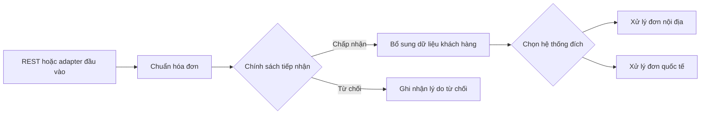

# Khi dùng Spring Integration thay cho gọi trực tiếp

## 1. Bài toán lựa chọn trong một ứng dụng Spring

Gọi một phương thức Java là cách tự nhiên để một thành phần sử dụng chức năng của thành phần khác. Với nhiều nghiệp vụ, một application service gọi repository, một số dịch vụ miền rồi trả kết quả là thiết kế rõ ràng và đủ tốt.

Spring Integration hữu ích khi vấn đề chính chuyển từ **gọi một chức năng** sang **tổ chức cách dữ liệu đi qua nhiều bước xử lý hoặc nhiều hệ thống**. Module `SPRING_INTEGRATION_CORE` tập trung vào việc biểu diễn những luồng đó bằng `Message`, `MessageChannel`, endpoint, gateway và Java DSL, cùng các mẫu transformer, router, filter, aggregator, xử lý lỗi và kiểm thử.

Câu hỏi cần trả lời không phải “có bao nhiêu service thì phải dùng Spring Integration?”, mà là:

> Quy tắc luân chuyển thông điệp có đủ quan trọng, phức tạp và thường xuyên thay đổi để trở thành một phần kiến trúc được mô hình hóa riêng hay chưa?

Sau bài học, bạn có thể:

- Nhận ra trường hợp nên giữ lời gọi trực tiếp.
- Nhận ra luồng phù hợp với các mẫu tích hợp doanh nghiệp.
- So sánh cùng một nghiệp vụ khi viết bằng lời gọi phương thức và bằng Java DSL.
- Phân biệt sự tách rời về cấu trúc với bất đồng bộ, độ bền và ranh giới giao dịch.
- Chọn cách áp dụng từng phần và xác định cách kiểm thử phù hợp.

## 2. Gọi trực tiếp đem lại điều gì?

### 2.1. Ví dụ một use case đơn giản

Giả sử ứng dụng nhận yêu cầu đặt hàng. Các kiểu dữ liệu và lớp dưới đây minh họa cấu trúc; phần định nghĩa repository và service được lược bỏ:

```java
@Service
public class PlaceOrderService {

    private final OrderValidator validator;
    private final OrderRepository repository;
    private final PriceService priceService;

    public PlaceOrderService(
            OrderValidator validator,
            OrderRepository repository,
            PriceService priceService) {
        this.validator = validator;
        this.repository = repository;
        this.priceService = priceService;
    }

    @Transactional
    public OrderResult place(OrderCommand command) {
        validator.validate(command);
        Money total = priceService.calculate(command);
        Order order = repository.save(Order.create(command, total));
        return new OrderResult(order.getId(), total);
    }
}
```

Nếu các bước này chủ yếu làm việc trong cùng ứng dụng và cùng nguồn dữ liệu, thứ tự ổn định, cần trả kết quả ngay, cách viết trên có nhiều lợi thế:

- Luồng điều khiển nằm trong một phương thức, dễ đọc theo thứ tự.
- Compiler kiểm tra kiểu của các đối số và kết quả.
- Lỗi được truyền qua lời gọi và stack trace quen thuộc.
- Dễ kiểm thử nghiệp vụ bằng các đối tượng hoặc dependency giả.
- Không phải quản lý thêm tên channel, endpoint, poller hoặc quy tắc truyền header.

`@Transactional` chỉ có tác dụng khi lời gọi đi qua cơ chế giao dịch thích hợp của Spring và transaction manager quản lý được tài nguyên liên quan. Annotation này không tự biến lời gọi HTTP, gửi email hay mọi thao tác bên ngoài thành một giao dịch có thể rollback.

### 2.2. Khi lời gọi trực tiếp vẫn đủ

Một phương thức gọi ba hoặc năm thành phần không tự động là vấn đề thiết kế. Hãy giữ cách gọi trực tiếp nếu:

- Quan hệ giữa bên gọi và bên được gọi ổn định.
- Các bước phần lớn là tính toán, kiểm tra bất biến miền hoặc truy cập dữ liệu cục bộ.
- Không cần hàng đợi, tiêu thụ độc lập, định tuyến động hoặc ghép các phản hồi.
- Thất bại có thể xử lý trong một phạm vi gọi rõ ràng.
- Nhóm phát triển dễ mô tả và vận hành luồng hiện tại.

Có thể tách phương thức dài, tạo strategy hoặc tách application service trước khi đưa một framework tích hợp vào. Spring Integration không phải điều kiện bắt buộc để có mã nguồn được chia nhỏ tốt.

## 3. Dấu hiệu luồng đã trở thành một bài toán tích hợp

Xét một hệ thống tiếp nhận đơn từ REST, tệp của đối tác và hàng đợi thông điệp. Mỗi nguồn dùng định dạng khác nhau. Đơn được chuẩn hóa, lọc theo chính sách tiếp nhận, bổ sung dữ liệu khách hàng rồi chuyển đến hệ thống xử lý phù hợp. Một số đối tác chậm hoặc tạm mất kết nối.

Nếu viết toàn bộ trong application service, phương thức có thể tích lũy:

- Nhánh điều kiện theo nguồn, khách hàng và khu vực.
- Mã chuyển đổi giữa nhiều định dạng dữ liệu.
- Logic retry, timeout và phân loại lỗi.
- Cơ chế chạy nền, xếp hàng và giới hạn số tác vụ đồng thời.
- Trạng thái chờ nhiều phản hồi trước khi trả kết quả tổng hợp.
- Mã tích hợp thư viện của từng giao thức.

Các phần này mô tả **đường đi và chính sách xử lý dữ liệu**, không chỉ mô tả nghiệp vụ của một đối tượng miền. Đó là dấu hiệu nên cân nhắc Spring Integration.

### 3.1. Ánh xạ nhu cầu sang thành phần cốt lõi

| Nhu cầu | Thành phần hoặc mẫu phù hợp | Giá trị khi mô hình hóa riêng |
| --- | --- | --- |
| Mang dữ liệu kèm metadata xử lý | `Message<T>` | Tách payload khỏi header như correlation ID hoặc thông tin định tuyến |
| Nối các bước của luồng | `MessageChannel` | Bên gửi biết điểm gửi; cách kết nối do cấu hình quyết định |
| Chuẩn hóa định dạng | Transformer | Làm rõ nơi dữ liệu thay đổi hình dạng |
| Giữ hoặc loại thông điệp theo điều kiện | Filter | Tập trung chính sách chấp nhận và đường đi của bản tin bị loại |
| Chọn nhánh xử lý | Router | Tách quy tắc chọn đích khỏi xử lý của từng đích |
| Gọi chức năng nghiệp vụ | Service activator | Cho luồng sử dụng service Java hiện có |
| Chia một đầu vào thành nhiều phần | Splitter | Biểu diễn xử lý theo từng phần tử |
| Gom nhiều thông điệp liên quan | Aggregator | Khai báo tương quan, điều kiện đủ dữ liệu và timeout của nhóm |
| Cho mã Java gọi vào luồng | Messaging gateway | Tạo biên giao tiếp bằng interface nghiệp vụ |
| Kết nối một giao thức hoặc hệ thống ngoài | Channel adapter hoặc outbound gateway phù hợp | Đặt logic giao tiếp ngoài ở biên luồng |

Không phải mọi bài toán đều cần mọi thành phần. Một flow nhỏ chỉ gồm transformer và service activator có thể đã đủ.

### 3.2. Ví dụ luồng tiếp nhận đơn



Sơ đồ cho thấy các quyết định luân chuyển dữ liệu. Nó chưa xác định bước nào chạy bất đồng bộ, nơi nào lưu thông điệp bền vững hay thao tác nào cùng một giao dịch. Những thuộc tính đó phải được thiết kế riêng.

## 4. So sánh cùng một nghiệp vụ bằng hai cách

Ví dụ này chỉ dùng xử lý trong bộ nhớ để làm rõ sự khác nhau về cấu trúc. Nó không nhằm chứng minh Spring Integration luôn tốt hơn một phương thức Java.

Nghiệp vụ gồm ba bước: chuẩn hóa mã khách hàng, kiểm tra điều kiện dữ liệu và tiếp nhận đơn.

### 4.1. Kiểu dữ liệu và xử lý nghiệp vụ dùng chung

Các kiểu `public` dưới đây cần nằm trong các tệp Java tương ứng nếu đưa vào dự án thực tế. `record` yêu cầu phiên bản Java có hỗ trợ, chẳng hạn Java 17 trở lên. Chọn phiên bản thư viện tương thích với ứng dụng; ví dụ không ấn định một phiên bản Spring cụ thể.

```java
import java.math.BigDecimal;

public record OrderRequest(String customerCode, BigDecimal amount) {
}
```

```java
import java.math.BigDecimal;

public record NormalizedOrder(String customerCode, BigDecimal amount) {
}
```

```java
public record OrderReceipt(String customerCode, String status) {
}
```

```java
import java.util.Locale;
import java.util.Objects;
import org.springframework.stereotype.Service;

@Service
public class OrderOperations {

    public NormalizedOrder normalize(OrderRequest request) {
        Objects.requireNonNull(request, "request is required");
        Objects.requireNonNull(
                request.customerCode(), "customerCode is required");
        Objects.requireNonNull(request.amount(), "amount is required");

        return new NormalizedOrder(
                request.customerCode().trim().toUpperCase(Locale.ROOT),
                request.amount());
    }

    public NormalizedOrder validate(NormalizedOrder order) {
        if (order.customerCode().isBlank()) {
            throw new IllegalArgumentException("customerCode must not be blank");
        }
        if (order.amount().signum() <= 0) {
            throw new IllegalArgumentException("amount must be positive");
        }
        return order;
    }

    public OrderReceipt accept(NormalizedOrder order) {
        return new OrderReceipt(order.customerCode(), "ACCEPTED");
    }
}
```

`accept` chỉ tạo phản hồi minh họa, chưa ghi dữ liệu, trừ tiền hoặc gọi đối tác. Logic miền được giữ trong service để hai cách điều phối đều sử dụng được.

### 4.2. Cách A: điều phối bằng lời gọi phương thức

```java
import org.springframework.stereotype.Service;

@Service
public class DirectOrderService {

    private final OrderOperations operations;

    public DirectOrderService(OrderOperations operations) {
        this.operations = operations;
    }

    public OrderReceipt submit(OrderRequest request) {
        NormalizedOrder normalized = operations.normalize(request);
        NormalizedOrder validated = operations.validate(normalized);
        return operations.accept(validated);
    }
}
```

Với đúng yêu cầu hiện tại, đây là lựa chọn hợp lý. Người đọc nhìn thấy ngay đầu vào, thứ tự xử lý và kết quả. Không có nhu cầu tích hợp rõ ràng để bắt buộc chuyển sang messaging.

### 4.3. Cách B: điều phối bằng Spring Integration Java DSL

Để sử dụng trong ứng dụng Spring Boot, thêm module hỗ trợ Spring Integration bằng cơ chế quản lý dependency của dự án, thông thường là starter Integration của Spring Boot. Đặt các lớp trong phạm vi component scan của ứng dụng. Interface gateway dưới đây cần được phát hiện bởi `@IntegrationComponentScan`.

```java
import org.springframework.integration.annotation.MessagingGateway;

@MessagingGateway(defaultRequestChannel = "orders.input")
public interface OrderGateway {

    OrderReceipt submit(OrderRequest request);
}
```

```java
import org.springframework.context.annotation.Bean;
import org.springframework.context.annotation.Configuration;
import org.springframework.integration.annotation.IntegrationComponentScan;
import org.springframework.integration.channel.DirectChannel;
import org.springframework.integration.config.EnableIntegration;
import org.springframework.integration.dsl.IntegrationFlow;
import org.springframework.messaging.MessageChannel;

@Configuration
@EnableIntegration
@IntegrationComponentScan(basePackageClasses = OrderGateway.class)
public class OrderIntegrationConfiguration {

    @Bean(name = "orders.input")
    public MessageChannel ordersInput() {
        return new DirectChannel();
    }

    @Bean
    public IntegrationFlow orderFlow(OrderOperations operations) {
        return IntegrationFlow.from("orders.input")
                .transform(OrderRequest.class, operations::normalize)
                .handle(operations, "validate")
                .handle(operations, "accept")
                .get();
    }
}
```

Ở đây:

1. `OrderGateway` cung cấp phương thức Java cho bên gọi.
2. Gateway tạo thông điệp với payload là `OrderRequest` và gửi đến `orders.input`.
3. `DirectChannel` chuyển thông điệp tới endpoint tiếp theo trên luồng gọi hiện tại.
4. Transformer tạo payload `NormalizedOrder`.
5. Hai service activator gọi `validate` và `accept`.
6. Kết quả cuối được trả qua cơ chế request–reply của gateway.

Bên gọi chỉ cần inject `OrderGateway` và gọi `submit`. Nó không phải tự tạo `Message` hoặc biết tên channel. Đây là một lợi ích về biên giao tiếp, nhưng một interface service thông thường cũng có thể che giấu triển khai. Lợi ích riêng của Spring Integration nằm ở cách mô hình hóa và kết nối những bước bên trong luồng.

Trong ví dụ này, Java DSL dài hơn lời gọi trực tiếp và chưa tạo ra lợi ích nghiệp vụ đáng kể. Giá trị xuất hiện khi chính sách định tuyến, chuyển đổi, kết nối adapter hoặc điều khiển tiêu thụ phát triển thêm.

### 4.4. Khi cần mở rộng luồng

Giả sử sau này đơn phải đi đến một trong hai hệ thống xử lý. Một đoạn router minh họa trong flow có thể là:

```java
.route(NormalizedOrder.class,
        order -> order.amount().compareTo(new BigDecimal("10000000")) >= 0,
        mapping -> mapping
                .channelMapping(true, "orders.manualReview")
                .channelMapping(false, "orders.standard"))
```

Đây là đoạn thay thế vị trí điều phối trong một flow mở rộng, không phải cấu hình hoàn chỉnh để ghép nguyên xi vào ví dụ trước. Cần khai báo và đăng ký consumer cho hai channel đích, đồng thời xác định kiểu phản hồi thống nhất nếu gateway vẫn trả `OrderReceipt`.

Nếu một nhánh kết thúc mà không trả lời, lời gọi request–reply có thể chờ đến timeout hoặc không nhận được phản hồi như mong muốn, tùy cấu hình. Việc vẽ thêm nhánh không tự hoàn tất hợp đồng phản hồi.

Ngưỡng tiền trong ví dụ chỉ minh họa định tuyến. Với quy tắc phức tạp, nên để policy service tính quyết định rồi để router chọn đích theo kết quả, tránh đưa toàn bộ nghiệp vụ vào lambda DSL.

## 5. Những bảo đảm Spring Integration không tự cung cấp

### 5.1. Có channel không có nghĩa là bất đồng bộ

`DirectChannel` thường thực hiện lời gọi tới handler trên thread của bên gửi. Vì vậy, thay một lời gọi service bằng gateway và `DirectChannel` không tự làm hệ thống xử lý nền hoặc phản hồi nhanh hơn.

| Cách kết nối | Mô hình thực thi cơ bản | Điều cần thiết kế thêm |
| --- | --- | --- |
| Gọi trực tiếp | Cùng thread, trừ khi mã được gọi tự chuyển thread | Timeout của I/O, giao dịch và lỗi |
| `DirectChannel` | Handler chạy trên thread bên gửi | Thời gian xử lý và lỗi ảnh hưởng bên gọi |
| `ExecutorChannel` | Thường giao việc qua executor; hành vi cuối phụ thuộc executor | Kích thước pool, queue của executor, chính sách từ chối, ngữ cảnh thread |
| `QueueChannel` | Giữ message để consumer nhận sau; polling endpoint thường cần poller | Capacity, lịch poll, số consumer, lưu trữ và xử lý backlog |
| Adapter kết nối broker | Phụ thuộc giao thức, client và cấu hình | Ack, retry, redelivery, persistence và giới hạn tải |

Một executor có chính sách chạy tác vụ trên thread bên gửi khi quá tải có thể làm khác đi giả định “đã chuyển sang thread khác”. Cần hiểu cấu hình thực tế thay vì chỉ dựa vào tên loại channel.

### 5.2. Queue trong bộ nhớ không phải hàng đợi bền vững

Một `QueueChannel` mặc định dùng bộ nhớ không đảm bảo phục hồi thông điệp sau khi tiến trình dừng. Nếu cần chịu được restart, phải thiết kế nơi lưu message phù hợp hoặc dùng hạ tầng nhắn tin có độ bền được cấu hình đúng.

Dung lượng queue cũng cần có giới hạn phù hợp. Đẩy công việc sang queue không xóa chi phí xử lý; nó chuyển chi phí thành thời gian chờ và tài nguyên lưu trữ. Khi tốc độ vào vượt tốc độ xử lý trong thời gian dài, phải có chính sách điều tiết, từ chối hoặc mở rộng năng lực.

### 5.3. Đổi thread có thể đổi ranh giới giao dịch

Với xử lý đồng bộ qua `DirectChannel`, các thao tác tiếp theo có thể tham gia giao dịch đang hoạt động trên thread nếu cấu hình và tài nguyên cho phép. Chỉ dùng `DirectChannel` không tự bắt đầu giao dịch.

Khi chuyển sang executor hoặc queue, không được mặc định rằng giao dịch gắn với thread của bên gọi tiếp tục bao trùm consumer. Consumer thường cần ranh giới giao dịch riêng. Cần xác định rõ:

- Thao tác nào được commit trước khi message được gửi hoặc tiêu thụ.
- Nếu ghi database thành công nhưng gửi ra ngoài thất bại, hệ thống phục hồi thế nào.
- Nếu bên ngoài đã nhận mà xử lý cục bộ rollback, lần gửi lại có gây tác dụng phụ trùng lặp không.

Với yêu cầu nhất quán giữa cập nhật database và phát sự kiện, có thể cần mẫu outbox cùng cơ chế chuyển tiếp và chống xử lý trùng. Spring Integration có thể tham gia triển khai luồng này, nhưng chỉ thêm một channel không giải quyết bài toán nhất quán đó.

### 5.4. Retry không đồng nghĩa với xử lý thành công đúng một lần

Retry phù hợp cho lỗi có khả năng tạm thời, chẳng hạn kết nối bị gián đoạn. Retry một thanh toán sau timeout có thể tạo thanh toán trùng nếu đối tác đã xử lý nhưng phản hồi bị mất.

Phải xác định đơn vị retry: một lời gọi outbound, một handler hay toàn bộ quá trình tiêu thụ. Nếu retry bao trùm bước đã gây tác dụng phụ, bước đó có thể được thực hiện lại. Với các thao tác nhạy cảm, cần khóa idempotency hoặc mã nghiệp vụ ổn định, lưu kết quả xử lý và cơ chế đối soát.

### 5.5. Tách rời không có nghĩa là không còn phụ thuộc

Channel giúp giảm phụ thuộc trực tiếp vào đối tượng nhận, nhưng các thành phần vẫn phải thống nhất về:

- Kiểu và ý nghĩa payload.
- Header bắt buộc, correlation ID và cách truyền chúng.
- Hợp đồng request–reply hoặc một chiều.
- Thời gian chờ, cách báo lỗi và khả năng nhận bản tin trùng.
- Thứ tự xử lý, khả năng chạy song song và tính tương thích của schema.

Nếu payload là `Object`, header đặt tùy ý và tên channel rải khắp hệ thống, sự phụ thuộc có thể trở nên khó nhìn thấy hơn. Dùng DTO có kiểu rõ ràng, gateway có hợp đồng cụ thể và tên channel nhất quán để giữ kiến trúc dễ hiểu.

## 6. Xử lý lỗi phải đi cùng lựa chọn kiến trúc

### 6.1. Lỗi đồng bộ và lỗi bất đồng bộ

Với lời gọi trực tiếp, exception thường đi ngược stack về bên gọi. Trong flow đồng bộ dùng `DirectChannel`, lỗi xử lý cũng có thể truyền về bên gọi; Spring messaging có thể bọc lỗi bằng exception mang ngữ cảnh thông điệp. Không nên giả định bên gọi luôn bắt được đúng lớp exception nghiệp vụ ban đầu.

Với tác vụ chạy trên thread khác hoặc được poll sau đó, stack gọi ban đầu không còn là nơi nhận lỗi tự nhiên. Cần cấu hình cơ chế báo lỗi phù hợp với executor, poller và endpoint. Spring Integration hỗ trợ biểu diễn lỗi bằng `ErrorMessage` và luồng lỗi qua error channel.

Không được mặc định rằng mọi exception ở mọi flow đều tự được gửi đến `errorChannel`. Cần xem lỗi phát sinh ở đâu, thành phần nào bắt nó và cơ chế xuất bản lỗi nào đang được cấu hình. `ErrorMessage` cũng không tự đồng nghĩa với phản hồi nghiệp vụ thành công hoặc thất bại cho gateway ban đầu.

### 6.2. Phân loại lỗi để quyết định hành vi

| Tình huống | Hành vi thường phù hợp | Điều tránh làm máy móc |
| --- | --- | --- |
| Dữ liệu không hợp lệ | Trả lỗi xác định hoặc chuyển tới nhánh từ chối | Retry vô hạn cùng một dữ liệu |
| Mất kết nối tạm thời | Retry có giới hạn và khoảng chờ | Retry dồn dập làm tăng tải đối tác |
| Không biết thao tác bên ngoài đã thành công chưa | Kiểm tra trạng thái theo mã nghiệp vụ, đối soát | Gửi lại tác dụng phụ không có idempotency |
| Không thể xử lý sau số lần thử cho phép | Lưu thông tin để điều tra và xử lý lại có kiểm soát | Chỉ ghi log rồi mất dấu bản tin |
| Thiếu một phần dữ liệu khi aggregate | Áp dụng timeout và chính sách cho kết quả thiếu | Giữ nhóm thông điệp vô thời hạn |

Filter đặc biệt cần được cân nhắc trong luồng request–reply. Nếu filter loại bản tin mà không tạo phản hồi hay phát lỗi theo hợp đồng đã chọn, gateway có thể không nhận được câu trả lời mong muốn. “Không xử lý tiếp” và “trả về quyết định từ chối” là hai hành vi khác nhau.

## 7. Bảng quyết định thực tế

| Đặc điểm bài toán | Ưu tiên ban đầu | Lý do |
| --- | --- | --- |
| CRUD và vài bước nghiệp vụ cục bộ | Lời gọi trực tiếp | Luồng ngắn, hợp đồng rõ, ít cấu hình vận hành |
| Tính toán miền phức tạp nhưng không có luồng tích hợp đáng kể | Service hoặc domain model | Độ phức tạp nằm trong nghiệp vụ, không nằm ở luân chuyển message |
| Nhiều nguồn đầu vào cần chung bước chuẩn hóa | Cân nhắc Spring Integration | Adapter và transformer tạo biên tiếp nhận thống nhất |
| Định tuyến thay đổi độc lập với logic từng đích | Cân nhắc Spring Integration | Router thể hiện quy tắc chọn đích riêng |
| Chia dữ liệu rồi gom kết quả theo mã tương quan | Cân nhắc splitter và aggregator | Có mô hình rõ cho phân tách, tương quan và điều kiện hoàn tất |
| Cần xử lý nền rất đơn giản | Đánh giá executor hoặc cơ chế sẵn có trước | Không phải mọi tác vụ nền đều cần một hệ thống flow |
| Tiêu thụ từ broker rồi chuyển đổi và gọi nhiều hệ thống | Cân nhắc Spring Integration | Ghép các mẫu tích hợp và chính sách lỗi tại biên |
| Quy trình kéo dài nhiều ngày, cần tác vụ người dùng và lịch sử trạng thái nghiệp vụ | Đánh giá công cụ workflow chuyên dụng | Những yêu cầu này vượt quá việc chỉ nối endpoint |

Bảng là điểm khởi đầu. Quyết định cuối còn phụ thuộc năng lực vận hành của nhóm, thư viện đã có và yêu cầu phục hồi dữ liệu. Có nhiều hệ thống ngoài là một tín hiệu, không phải một quy tắc bắt buộc.

### 7.1. Năm câu hỏi trước khi đưa vào dự án

1. **Độ phức tạp nằm ở đâu?** Nếu nằm trong công thức tính giá, hãy làm rõ domain service. Nếu nằm ở định tuyến và chuyển đổi giữa các hệ thống, flow có thể giúp ích.
2. **Hợp đồng với bên gọi là gì?** Cần kết quả xử lý ngay, hay chỉ cần xác nhận đã tiếp nhận? Với tiếp nhận bất đồng bộ, trả mã theo dõi và có nơi tra trạng thái khi cần.
3. **Nếu tiến trình dừng thì sao?** Xác định dữ liệu nào có thể mất, dữ liệu nào phải khôi phục và bằng chứng đã tiếp nhận nằm ở đâu.
4. **Nếu cùng một bản tin đến hai lần thì sao?** Định nghĩa idempotency theo nghiệp vụ và cách nhận biết thao tác đã thực hiện.
5. **Ai vận hành luồng?** Nhóm cần quan sát được đầu vào, backlog, thất bại, timeout và cách xử lý lại an toàn.

Không nên biến các câu hỏi này thành một điểm số cơ học. Một yêu cầu bắt buộc về độ bền có thể quan trọng hơn nhiều lợi ích nhỏ về độ gọn của code.

## 8. Áp dụng từng phần trong hệ thống hiện có

Một cách chuyển đổi có kiểm soát là chọn một luồng có ranh giới rõ, chẳng hạn tiếp nhận dữ liệu đối tác:

1. **Ghi lại hành vi hiện tại.** Xác định đầu vào, đầu ra, lỗi, tác dụng phụ và yêu cầu thứ tự.
2. **Giữ logic nghiệp vụ trong service có kiểu rõ.** Tránh viết lại quy tắc miền chỉ để chuyển sang DSL.
3. **Đặt một gateway tại biên.** Cho bên gọi một hợp đồng ổn định, dễ thay thế trong kiểm thử.
4. **Bắt đầu với luồng đồng bộ nếu phù hợp.** Dùng `DirectChannel` để kiểm tra cấu trúc luồng trước khi bổ sung thay đổi về thời gian xử lý.
5. **Tách chính sách tích hợp.** Đưa chuẩn hóa vào transformer, chọn nhánh vào router và giao tiếp ngoài vào endpoint phù hợp.
6. **Thêm queue hoặc executor khi có lý do cụ thể.** Đồng thời quyết định capacity, timeout, giao dịch, lỗi và độ bền.
7. **Đánh giá bằng hành vi và khả năng vận hành.** So sánh độ rõ của luồng, mức thay đổi khi thêm nguồn hoặc đích, chi phí theo dõi và phục hồi.

Không cần chuyển toàn bộ repository, domain service hoặc mọi lời gọi nội bộ thành channel. Một thiết kế thường phù hợp là điều phối tích hợp ở bên ngoài, gọi service nghiệp vụ thông thường ở bên trong.

Cũng cần chú ý các yêu cầu thứ tự. Khi tăng số consumer hoặc xử lý song song, thời điểm hoàn tất có thể khác thứ tự tiếp nhận. Nếu mọi sự kiện của cùng một đơn phải xử lý lần lượt, cần chính sách phân vùng hoặc tuần tự hóa thích hợp; aggregator không tự giải quyết mọi yêu cầu thứ tự.

## 9. Kiểm thử để bảo vệ quyết định thiết kế

Chuyển từ lời gọi trực tiếp sang flow nên giữ nguyên hành vi nghiệp vụ đã cam kết. Cần kiểm thử cả logic từng bước và cách nối các bước.

### 9.1. Kiểm thử logic nghiệp vụ không cần Spring context

Ví dụ JUnit dưới đây kiểm tra bước chuẩn hóa được dùng trong cả hai cách điều phối:

```java
import static org.junit.jupiter.api.Assertions.assertEquals;

import java.math.BigDecimal;
import org.junit.jupiter.api.Test;

class OrderOperationsTest {

    @Test
    void normalizesCustomerCode() {
        OrderOperations operations = new OrderOperations();
        NormalizedOrder result = operations.normalize(
                new OrderRequest("  vn-001  ", new BigDecimal("150000")));

        assertEquals("VN-001", result.customerCode());
        assertEquals(new BigDecimal("150000"), result.amount());
    }
}
```

Bài kiểm thử này không xác minh flow, gateway hoặc channel. Nó bảo vệ quy tắc biến đổi dữ liệu độc lập với công nghệ điều phối.

### 9.2. Kiểm thử hợp đồng gateway và kết nối flow

Nếu dự án dùng Spring Boot Test, có thể khởi tạo context tối thiểu với cấu hình và service đã minh họa:

```java
import static org.junit.jupiter.api.Assertions.assertEquals;

import java.math.BigDecimal;
import org.junit.jupiter.api.Test;
import org.springframework.beans.factory.annotation.Autowired;
import org.springframework.boot.test.context.SpringBootTest;

@SpringBootTest(classes = {
        OrderIntegrationConfiguration.class,
        OrderOperations.class
})
class OrderFlowTest {

    @Autowired
    private OrderGateway gateway;

    @Test
    void returnsReceiptAfterNormalizationAndValidation() {
        OrderReceipt receipt = gateway.submit(
                new OrderRequest("  vn-001  ", new BigDecimal("150000")));

        assertEquals("VN-001", receipt.customerCode());
        assertEquals("ACCEPTED", receipt.status());
    }
}
```

Các ví dụ kiểm thử là hướng dẫn áp dụng trong dự án Java có dependency tương ứng; chúng không phải bằng chứng rằng mã đã được chạy trong môi trường của bài học.

Khi luồng có nhiều nhánh hoặc giao tiếp ngoài, cần bổ sung các kịch bản có ý nghĩa:

- Router chuyển từng loại đơn đến đúng đích và có hành vi rõ với trường hợp không ánh xạ.
- Bản tin bị loại có kết quả hoặc lỗi đúng hợp đồng, không làm gateway chờ ngoài dự kiến.
- Lỗi outbound tạm thời được thử lại đúng phạm vi, còn lỗi dữ liệu kết thúc xác định.
- Bản tin trùng không tạo thêm tác dụng phụ khi nghiệp vụ yêu cầu idempotency.
- Timeout của việc gom kết quả tạo hành vi đã định nghĩa và không giữ trạng thái vô hạn.
- Khi vượt capacity, hệ thống phản ứng theo chính sách tải đã chọn.

Với xử lý bất đồng bộ, kiểm thử nên chờ có giới hạn theo điều kiện hoặc dùng công cụ hỗ trợ chờ thích hợp, tránh dựa vào một thời gian ngủ cố định. Với adapter ngoài hoặc broker, kiểm thử tích hợp phải kiểm tra thêm hành vi thực tế của giao thức, ack và phục hồi; kiểm thử trong bộ nhớ không đủ để kết luận về những bảo đảm đó.

## 10. Bài tập ra quyết định

### Tình huống A: tính tổng giỏ hàng

Một API nhận các dòng hàng, tính giảm giá từ quy tắc cục bộ rồi trả tổng tiền. Không có nguồn nhập khác, không cần xử lý nền hoặc định tuyến.

**Lựa chọn đề xuất:** giữ application service và lời gọi trực tiếp. Nếu quy tắc giảm giá tăng, cân nhắc policy hoặc strategy. Spring Integration chưa giải quyết một nhu cầu luân chuyển dữ liệu đủ rõ trong tình huống này.

### Tình huống B: đồng bộ danh mục từ nhiều đối tác

Ba đối tác gửi dữ liệu qua tệp và HTTP. Dữ liệu cần chuẩn hóa, kiểm tra, chia lô và chuyển sang hai hệ thống đích. Khi một hệ thống đích tạm lỗi, cần giữ bằng chứng để thử lại có kiểm soát.

**Lựa chọn đề xuất:** cân nhắc Spring Integration cho phần tiếp nhận và điều phối. Mô tả adapter đầu vào, transformer chuẩn hóa, router chọn đích, cơ chế gửi và đường lỗi. Quyết định riêng nơi lưu dữ liệu bền vững, khóa idempotency và giới hạn retry. Không kết luận rằng chỉ dựng DSL là đã đáp ứng yêu cầu phục hồi.

### Tình huống C: tổng hợp báo giá

Ứng dụng gọi ba nhà vận chuyển rồi tổng hợp báo giá theo mã yêu cầu, chấp nhận kết quả thiếu sau một thời hạn.

**Lựa chọn đề xuất:** nếu hệ thống đã có nhiều flow tích hợp, phân nhánh và aggregator có thể biểu diễn rõ tương quan và điều kiện hoàn tất. Nếu đây chỉ là một thao tác nhỏ trong một ứng dụng, xử lý đồng thời bằng các công cụ Java và timeout rõ ràng cũng có thể đủ. Cần cân nhắc chi phí giữ trạng thái, xử lý phản hồi đến muộn và quan sát lỗi thay vì chọn framework chỉ vì có ba lời gọi.

### Câu hỏi tự kiểm tra

1. Vì sao gateway kết hợp `DirectChannel` chưa làm một phương thức trở thành bất đồng bộ?
2. Tách bên gửi khỏi tên service cụ thể còn để lại những phụ thuộc nào?
3. Nếu filter loại yêu cầu trong một flow request–reply, cần quyết định thêm điều gì?
4. Vì sao retry một lời gọi thanh toán sau timeout có thể gây tác dụng phụ trùng?
5. Trong hệ thống hiện tại của bạn, độ phức tạp nằm ở quy tắc miền hay ở đường đi của dữ liệu?

Chọn Spring Integration khi việc mô hình hóa đường đi của thông điệp giúp hệ thống dễ thay đổi, kiểm thử và vận hành hơn. Giữ lời gọi trực tiếp khi nó vẫn thể hiện use case rõ ràng. Hai cách có thể cùng tồn tại: flow xử lý tích hợp, còn service Java giữ các quy tắc nghiệp vụ.