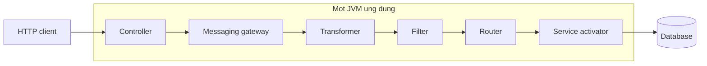

# Giới hạn của in-process message flow

Trong chương **Nền tảng Spring Integration** của module **SPRING_INTEGRATION_CORE**, bài này xác định những bảo đảm mà một luồng thông điệp chạy trong ứng dụng có thể cung cấp. Hiểu giới hạn đó giúp lựa chọn Message, MessageChannel, endpoint, gateway và Java DSL phù hợp, đồng thời tránh gán cho transformer, router, filter hoặc aggregator những đặc tính mà chúng không tự có.

Một flow tách các bước xử lý bằng message và channel có thể làm mã nguồn dễ thay đổi. Tuy nhiên, việc tách thành nhiều endpoint không tự tạo ra lưu trữ bền vững, khả năng phục hồi sau khi JVM dừng, hoặc khả năng triển khai từng bước độc lập.

## 1. Mục tiêu học tập

Sau bài này, bạn có thể:

- Phân biệt ranh giới thành phần, ranh giới thread và ranh giới tiến trình.
- Giải thích vì sao xử lý bất đồng bộ chưa đủ để bảo đảm không mất thông điệp.
- Xác định tác động của channel tới lỗi, thời gian chờ và giao dịch.
- Phân tích áp lực lên bộ nhớ, thứ tự xử lý và trạng thái aggregator khi tăng tải hoặc tăng số instance.
- Chọn giữa flow nội bộ, persistent message store và hạ tầng messaging bên ngoài dựa trên yêu cầu nghiệp vụ.

## 2. In-process flow là gì?

Một **in-process message flow** có các thành phần trao đổi thông điệp trong cùng tiến trình ứng dụng, thường là cùng JVM và Spring ApplicationContext. Ví dụ, ứng dụng nhận yêu cầu đặt hàng, chuẩn hóa dữ liệu, lọc yêu cầu không hợp lệ, định tuyến rồi gọi dịch vụ nghiệp vụ.



Database trong sơ đồ là tài nguyên bên ngoài. Việc một endpoint ghi database không làm các message đang nằm trong RAM của những bước trước đó trở thành dữ liệu bền vững.

Cần phân biệt ba ranh giới:

| Ranh giới | Ví dụ | Điều thực sự thay đổi |
| --- | --- | --- |
| Thành phần | Transformer chuyển message cho router | Tổ chức và trách nhiệm của mã nguồn |
| Thread | Producer giao công việc cho executor | Lịch chạy, cách chờ và cách truyền ngữ cảnh |
| Tiến trình | Ứng dụng A gửi dữ liệu cho ứng dụng B qua transport | Miền lỗi, hợp đồng dữ liệu và cơ chế truyền nhận |

Chuyển sang thread khác vẫn giữ công việc trong cùng JVM. Muốn một tiến trình khác nhận được thông điệp cần transport hoặc cơ chế lưu trữ, phối hợp dùng chung được thiết kế cho mục đích đó.

## 3. MessageChannel không tự trở thành broker

`DirectChannel`, `ExecutorChannel` và `QueueChannel` giải quyết những vấn đề khác nhau. Không thể suy ra bảo đảm của flow chỉ từ việc nó sử dụng interface `MessageChannel`.

| Loại channel trong cấu hình thông thường | Cách chuyển công việc | Điều cần lưu ý |
| --- | --- | --- |
| `DirectChannel` | Gọi handler trên thread gửi | Handler chậm giữ thread gọi; không có hàng đợi bền vững |
| `ExecutorChannel` với executor bất đồng bộ | Giao việc cho executor | Có thêm giới hạn pool và hàng đợi task; vẫn chung tiến trình |
| `QueueChannel` mặc định | Giữ message trong RAM để bên nhận lấy ra | Message còn chờ có thể mất khi JVM dừng |
| `PublishSubscribeChannel` không cấu hình executor | Gọi các subscriber theo cơ chế đồng bộ | Broadcast nội bộ không tương đương topic bền vững giữa nhiều ứng dụng |

`DirectChannel` cho phép handler chạy trước khi lời gọi `send()` kết thúc. Với `ExecutorChannel`, hành vi thực tế còn phụ thuộc executor và rejection policy; không nên giả định mọi lời gọi luôn chạy trên thread khác. Xem [các implementation của message channel](https://docs.spring.io/spring-integration/reference/channel/implementations.html).

Một tên channel như `orders` là tên thành phần trong ứng dụng. Hai instance cùng khai báo `orders` không vì thế mà cùng sử dụng một hàng đợi. Mỗi instance có thể đang giữ một đối tượng channel và tập message riêng.

### Ví dụ Java DSL: nhiều endpoint vẫn có thể cùng một call stack

Đoạn cấu hình sau đặt trong ứng dụng Spring đã bật Spring Integration. Bean `orderPrinter` minh họa một flow một chiều, chỉ ghi kết quả ra console.

```java
import java.util.Locale;

import org.springframework.context.annotation.Bean;
import org.springframework.context.annotation.Configuration;
import org.springframework.integration.config.EnableIntegration;
import org.springframework.integration.dsl.IntegrationFlow;

@Configuration
@EnableIntegration
public class LocalFlowConfiguration {

    @Bean
    public IntegrationFlow orderPrinter() {
        return IntegrationFlow.from("ordersInput")
                .transform(String.class,
                        value -> value.trim().toUpperCase(Locale.ROOT))
                .handle(String.class, (payload, headers) -> {
                    System.out.println(payload);
                    return null;
                })
                .get();
    }
}
```

Ở đây không khai báo queue, executor hoặc bước bất đồng bộ. Java DSL mặc định nối các endpoint bằng `DirectChannel`; xem [Message Channels trong Java DSL](https://docs.spring.io/spring-integration/reference/dsl/java-channels.html). Vì vậy, một caller gửi trực tiếp vào `ordersInput` sẽ thực hiện cả transformer và handler trên thread gọi.

Nếu handler được thay bằng một thao tác I/O mất hai giây, việc viết flow theo DSL không làm hai giây đó biến mất khỏi thời gian chờ của caller.

## 4. Giới hạn về độ bền và khả năng phục hồi

### 4.1. Nhận vào queue khác với hoàn thành nghiệp vụ

Xét một đơn hàng đi qua các thời điểm:

```text
T0: ứng dụng nhận yêu cầu
T1: message được đưa vào QueueChannel trong RAM
T2: worker lấy message ra
T3: nghiệp vụ ghi dữ liệu thành công
T4: kết quả được trả cho bên gọi
```

Nếu chỉ dựa vào queue trong RAM:

- JVM dừng giữa T1 và T2: message chưa xử lý có thể biến mất.
- Worker lỗi sau T2: không có bảo đảm tự trả message vào queue nếu chưa thiết kế cơ chế tương ứng.
- JVM dừng sau T3 nhưng trước T4: bên gọi có thể chưa biết thao tác đã thành công và gửi lại yêu cầu.

Đây là phân tích các cửa sổ lỗi của ví dụ, không phải khẳng định mọi channel có cùng cơ chế giao nhận.

Với API trả về trạng thái “đã tiếp nhận”, hệ thống phải định nghĩa rõ tiếp nhận nghĩa là gì. Nếu cam kết sẽ xử lý kể cả sau khi ứng dụng khởi động lại, thời điểm trả thành công cần gắn với một cơ chế ghi nhận bền vững thích hợp.

### 4.2. Có thể bổ sung persistence nhưng phải hiểu phạm vi

Spring Integration hỗ trợ persistent store cho các thành phần có giữ message. `QueueChannel` có thể được cấu hình với store như `JdbcChannelMessageStore`; channel mặc định không tự dùng database. Xem [cấu hình persistent QueueChannel](https://docs.spring.io/spring-integration/reference/channel/configuration.html).

Persistence xử lý một phần bài toán. Cần tiếp tục xác định:

1. Ghi message vào store thành công tại thời điểm nào?
2. Khi lấy message ra, việc xóa khỏi store có cùng transaction với xử lý nghiệp vụ không?
3. Nếu nghiệp vụ đã tạo tác động nhưng bước xác nhận thất bại, message có được thực hiện lại không?
4. Payload và header nào có thể được lưu, khôi phục và sử dụng hợp lệ sau restart?

Không nên lưu tùy tiện các tham chiếu bean, tài nguyên đang mở hoặc đối tượng chỉ có ý nghĩa trong tiến trình hiện tại. Tài liệu [Message Store](https://docs.spring.io/spring-integration/reference/message-store.html) nêu riêng vấn đề khôi phục những header chứa đối tượng như reply channel hoặc error channel.

Một store bền vững cũng không tự biến flow thành hệ thống có replay lịch sử, quản trị backlog và điều phối consumer tương đương mọi loại broker.

## 5. Giới hạn về tải: buffer chỉ mua thêm thời gian

Giả sử trong một đợt tải:

- Producer gửi trung bình 500 message/giây.
- Consumer xử lý được 300 message/giây.
- Queue hiện rỗng và có sức chứa 2.000 message.

Backlog tăng xấp xỉ:

```text
500 - 300 = 200 message/giây
Thời gian tới khi đầy ≈ 2.000 / 200 = 10 giây
```

Đây là ước lượng với tốc độ ổn định, chưa tính dao động và thời gian xử lý từng message. Tăng queue chỉ kéo dài thời gian trước khi chạm giới hạn; không sửa được chênh lệch thông lượng lâu dài.

Với bộ đệm trong RAM, bộ nhớ còn bao gồm payload, header, các đối tượng liên quan và chi phí quản lý queue. Giả sử mỗi message giữ khoảng 20 KiB dữ liệu, 10.000 message đã tương ứng khoảng 195 MiB chỉ tính phần dữ liệu giả định; heap thực tế có thể cao hơn.

### Ví dụ: queue có giới hạn và thời gian chờ gửi

Đây là chương trình Java độc lập, cần các dependency Spring Integration Core và Spring Messaging trên classpath. Nó cố ý không tạo consumer để quan sát việc queue từ chối tiếp nhận khi đầy.

```java
import org.springframework.integration.channel.QueueChannel;
import org.springframework.messaging.support.MessageBuilder;

public class LocalQueueProbe {

    public static void main(String[] args) {
        QueueChannel queue = new QueueChannel(1);

        boolean first = queue.send(
                MessageBuilder.withPayload("order-001").build(), 0);

        boolean second = queue.send(
                MessageBuilder.withPayload("order-002").build(), 100);

        System.out.println("first=" + first);
        System.out.println("second=" + second);
        System.out.println("queued=" + queue.getQueueSize());
    }
}
```

Kết quả mong đợi:

```text
first=true
second=false
queued=1
```

`100` là thời gian chờ gửi tính bằng mili giây. Lần gửi thứ hai chờ có chỗ trống rồi trả về `false` khi hết thời gian; chưa có message nào được xử lý nghiệp vụ. Cấu hình queue hữu hạn được trình bày trong [QueueChannel Configuration](https://docs.spring.io/spring-integration/reference/channel/configuration.html).

Đoạn này gọi trực tiếp `QueueChannel.send()`. Khi đi qua gateway hoặc API khác, kết quả không tiếp nhận có thể được biểu diễn thành exception theo API và cấu hình sử dụng.

Ứng dụng cần quyết định phản ứng khi quá tải: từ chối có kiểm soát, chờ hữu hạn, giảm tốc nguồn gửi hoặc ghi vào nơi lưu bền vững. Tránh retry tức thì vô hạn vì nó làm tăng thêm lưu lượng đúng lúc hệ thống đang thiếu năng lực.

## 6. Giới hạn giao dịch khi đổi thread hoặc đổi tài nguyên

Với transaction thông thường gắn với thread, một chuỗi xử lý đồng bộ có thể tham gia transaction đang tồn tại nếu transaction manager, propagation và các tài nguyên được cấu hình phù hợp.

```text
Thread nhận yêu cầu, transaction T1:
  ghi đơn hàng
  -> DirectChannel
  -> cập nhật tồn kho trong cùng database
  -> commit T1
```

Đổi thành một bước bất đồng bộ sẽ thay đổi ranh giới:

```text
Thread A, transaction T1:
  ghi đơn hàng -> giao việc cho executor -> commit T1

Thread B:
  nhận công việc -> xử lý tồn kho trong ngữ cảnh riêng
```

Nếu thread B lỗi sau khi T1 đã commit, không thể tự động quay lại rollback T1. `DirectChannel` cũng không tự tạo transaction; nó chỉ giữ điều kiện thực thi đồng bộ để transaction đã cấu hình có thể bao phủ các bước thích hợp. Xem [Transaction Support](https://docs.spring.io/spring-integration/reference/transactions.html).

Ngay cả cùng một thread, gửi email hoặc gọi API thanh toán không mặc nhiên được rollback cùng giao dịch database. Vì vậy, cần phân tích theo cả **ranh giới thread** lẫn **khả năng tham gia transaction của tài nguyên**.

Ví dụ, yêu cầu “lưu đơn hàng và chắc chắn sẽ phát sự kiện” có thể dẫn tới thiết kế transactional outbox:

1. Lưu đơn hàng và bản ghi outbox trong cùng transaction database.
2. Một tiến trình phát sự kiện đọc các bản ghi outbox chưa xử lý.
3. Phát sự kiện ra transport rồi cập nhật trạng thái theo cơ chế đã chọn.
4. Consumer xử lý idempotent để chịu được tình huống phát lại.

Đây là phương án thiết kế cho ví dụ, không phải tính năng được tự kích hoạt khi khai báo một integration flow. Các cửa sổ lỗi giữa phát sự kiện và cập nhật outbox vẫn cần được xử lý.

## 7. Giới hạn của xử lý lỗi và gateway timeout

### 7.1. Exception đi theo mô hình thực thi

Trong flow đồng bộ, exception có thể truyền ngược theo call stack tới caller. Khi công việc đã chạy bất đồng bộ, không thể dùng một khối `try/catch` quanh lần gửi đã kết thúc để bắt lỗi xảy ra sau đó trên worker.

Với các tác vụ do Spring Integration quản lý, lỗi bất đồng bộ có thể được đóng gói thành `ErrorMessage`, định tuyến theo header `errorChannel` hoặc channel lỗi toàn cục. Executor, scheduler tùy chỉnh và gateway cần được cấu hình phù hợp; không phải mọi exception trong ứng dụng đều tự đi vào đó. Xem [Error Handling](https://docs.spring.io/spring-integration/reference/error-handling.html).

Đưa lỗi vào một channel mới chỉ tạo đường xử lý lỗi. Thiết kế còn cần quyết định lỗi nào được retry, lỗi nào cần ghi bền vững, ai theo dõi và cách khôi phục công việc thất bại. Nếu error channel chỉ giữ trong RAM, nó vẫn chịu rủi ro mất dữ liệu khi tiến trình dừng.

### 7.2. Gateway là cửa vào, không phải cam kết hoàn thành

Messaging gateway che API messaging sau một interface nghiệp vụ. Hợp đồng trả về của interface phải phù hợp với flow: một luồng một chiều không tự có câu trả lời nghiệp vụ chỉ vì được gọi qua gateway. Xem [Messaging Gateways](https://docs.spring.io/spring-integration/reference/gateway.html).

Cần phân biệt:

| Khái niệm | Câu hỏi cần trả lời |
| --- | --- |
| Thời gian chờ gửi | Đợi channel tiếp nhận tối đa bao lâu, nếu channel hỗ trợ chờ? |
| Thời gian chờ reply | Đợi kết quả phản hồi tối đa bao lâu? |
| Deadline nghiệp vụ | Sau thời điểm nào thì công việc không còn nên được thực hiện? |
| Timeout I/O | Một lần gọi hệ thống bên ngoài có thể kéo dài bao lâu? |

Reply timeout không phải cơ chế hủy và rollback toàn bộ công việc. Trong flow đồng bộ, handler có thể giữ thread gọi trong chính lời gọi gửi; không thể coi reply timeout là giới hạn cứng cho thời gian chạy handler. Trong flow bất đồng bộ, worker có thể tiếp tục sau khi caller đã ngừng chờ.

Ví dụ, caller chờ ba giây rồi gửi lại cùng yêu cầu, trong khi lần xử lý đầu hoàn thành ở giây thứ năm. Nếu thiếu khóa nghiệp vụ ổn định và cơ chế chống xử lý trùng, cả hai lần có thể tạo tác động.

## 8. Giới hạn về thứ tự và trạng thái khi mở rộng

### 8.1. FIFO không đồng nghĩa hoàn thành theo thứ tự

Giả sử message A được lấy ra trước B nhưng hai worker xử lý song song. A mất hai giây, B mất 100 mili giây: B có thể hoàn thành trước A.

Nếu yêu cầu là “các sự kiện của cùng một đơn hàng phải được áp dụng đúng thứ tự”, cần xác định khóa phân nhóm, chiến lược phân phối, số worker và kiểm tra phiên bản nghiệp vụ. Không cần ép tất cả đơn hàng vào một đường xử lý tuần tự nếu chỉ cần thứ tự trong từng đơn hàng.

### 8.2. Aggregator phụ thuộc nơi lưu nhóm message

Aggregator giữ trạng thái nhóm theo correlation key và release strategy. Với trạng thái chỉ nằm trong RAM, restart có thể làm mất các phần đã nhận. Khi chạy nhiều instance với store riêng, các phần của cùng nhóm còn có thể bị phân tán sang những instance khác nhau.

Dùng shared persistent store có thể giúp chia sẻ trạng thái, nhưng thiết kế phải xem xét khóa phối hợp giữa instance, correlation key, thời hạn nhóm và dọn dữ liệu. Store chung không tự giải quyết mọi xung đột. Xem [quản lý trạng thái của Aggregator](https://docs.spring.io/spring-integration/reference/aggregator.html).

Ví dụ, nhóm kết quả kiểm tra đơn hàng cần ba phần: thanh toán, kho và vận chuyển. Khi chỉ có hai phần đến, phải định nghĩa chờ bao lâu, có phát kết quả một phần không, và xử lý thế nào nếu phần cuối tới muộn. “Chờ đủ rồi mới trả” mà không có giới hạn có thể giữ trạng thái vô thời hạn.

### 8.3. Thêm instance không chia sẻ heap

Nhân đôi số instance có thể tăng năng lực nhận yêu cầu, nhưng mỗi instance vẫn có queue, pool và bộ nhớ riêng. Một instance có backlog lớn không tự chuyển message trong RAM sang instance rảnh hơn.

Muốn triển khai handler độc lập, nhận việc từ cùng một nguồn bền vững hoặc phục hồi công việc của instance đã dừng, cần bổ sung transport hay cơ chế phối hợp phù hợp.

## 9. Giới hạn của dữ liệu và ngữ cảnh trong JVM

Message có cấu trúc payload và headers, nhưng việc bao một đối tượng Java vào message không tự sao chép sâu hoặc biến đối tượng đó thành immutable. Nếu hai nhánh cùng giữ một đối tượng mutable, thay đổi từ một nhánh có thể ảnh hưởng nhánh khác.

Để giảm phụ thuộc ngầm, nên dùng payload có hợp đồng rõ ràng và hạn chế sửa trực tiếp đối tượng đã gửi. Khi cần truyền sang tiến trình khác, phải thiết kế thêm serialization, phiên bản schema và quy tắc tương thích.

Tương tự, dữ liệu trong `ThreadLocal`, MDC hoặc ngữ cảnh bảo mật không tự được bảo toàn chỉ nhờ message chuyển qua executor. Cần chọn cơ chế truyền ngữ cảnh phù hợp và chỉ đưa các trường dữ liệu cần thiết vào header. Một correlation ID ổn định giúp liên kết log giữa các bước, nhưng nó không thay thế cơ chế cấp quyền hoặc chống xử lý trùng.

## 10. Đừng suy ra exactly-once từ một flow nội bộ

Một yêu cầu có thể được gửi lại do timeout, retry, khởi động lại hoặc người vận hành chạy bù. Điều quan trọng là **tác động nghiệp vụ** khi cùng công việc xuất hiện nhiều lần.

Ví dụ, khóa `paymentRequestId` được bên gửi giữ nguyên qua các lần thử có ý nghĩa hơn việc tạo một message ID mới cho mỗi lần gửi. Phía nhận có thể dùng ràng buộc duy nhất trong database hoặc API có hỗ trợ idempotency để tránh tạo thêm giao dịch thanh toán cho cùng yêu cầu.

Spring Integration cung cấp `IdempotentReceiverInterceptor` để hỗ trợ nhận biết hoặc xử lý message trùng, nhưng logic idempotency đầy đủ vẫn thuộc ứng dụng. Nếu dùng metadata store chỉ trong RAM, trạng thái nhận biết trùng không tồn tại qua restart. Xem [Idempotent Receiver](https://docs.spring.io/spring-integration/reference/handler-advice/idempotent-receiver.html).

Thiết kế cần làm rõ việc ghi nhận khóa chống trùng có gắn an toàn với tác động nghiệp vụ hay không. Ghi khóa quá sớm rồi crash trước xử lý có thể làm lần thử lại bị loại nhầm; ghi quá muộn có thể để hai tác động cùng xảy ra. Một interceptor riêng lẻ không tự biến nhiều tài nguyên độc lập thành một transaction.

## 11. Chọn mức hạ tầng theo yêu cầu

Bảng dưới là gợi ý phân tích kiến trúc; quyết định cuối cùng phụ thuộc loại dữ liệu và cam kết vận hành.

| Nhu cầu | Hướng thiết kế để cân nhắc |
| --- | --- |
| Chuẩn hóa, lọc và định tuyến dữ liệu trong một request ngắn | Flow đồng bộ trong JVM, giới hạn rõ thời gian I/O |
| Tác vụ nền có thể tái tạo, chấp nhận mất phần đang chờ khi crash | Queue hoặc executor nội bộ có giới hạn và cơ chế tái tạo |
| Message còn chờ phải tồn tại sau restart | Persistent store hoặc transport bền vững; xác định ranh giới commit |
| Producer và consumer triển khai, mở rộng độc lập | Messaging bên ngoài hoặc cơ chế giao tiếp giữa tiến trình thích hợp |
| Có nhu cầu lưu và đọc lại lịch sử sự kiện | Hệ thống lưu sự kiện đáp ứng chính sách retention và replay |
| Vừa ghi database vừa phát sự kiện tin cậy | Phân tích outbox hoặc phối hợp giao dịch phù hợp |
| Phản hồi có thể đến sau khi caller đã ngừng chờ | Job ID, trạng thái bền vững, API tra cứu hoặc callback |

Dùng broker vẫn cần cấu hình durability, acknowledgement, retry và giới hạn tải đúng cách. Một lỗi mạng hoặc tác động bên ngoài không biến mất chỉ vì message đã đi qua transport khác.

Spring Integration có thể tiếp tục thực hiện transformer, router, filter, aggregator và các endpoint ở hai phía của transport. Việc bổ sung hạ tầng truyền nhận không bắt buộc loại bỏ mô hình flow đã xây dựng.

## 12. Bài thực hành phân tích giới hạn

Các tình huống sau dùng để luyện suy luận và thiết kế kiểm thử trong ứng dụng thực tế.

### Tình huống A: đã gửi nhưng chưa xử lý

Chạy ví dụ `LocalQueueProbe` và giải thích vì sao `first=true` dù không có consumer. Sau đó thêm consumer có kiểm soát và ghi nhận riêng ba thời điểm: gửi, bắt đầu xử lý, hoàn thành.

**Điểm cần rút ra:** kết quả gửi thành công phản ánh hợp đồng tiếp nhận của channel tại ranh giới đó; không đại diện cho mọi tác động ở phía sau.

### Tình huống B: crash trước khi worker xử lý

Cho consumer dừng chờ bằng một cơ chế đồng bộ có kiểm soát, gửi một message vào queue RAM rồi kết thúc tiến trình trong môi trường thử nghiệm. Khởi động lại và kiểm tra có dữ liệu nào để khôi phục công việc không.

**Điểm cần rút ra:** graceful shutdown và crash là hai trường hợp khác nhau. Chờ xử lý hết công việc khi tắt bình thường không chứng minh khả năng phục hồi khi tiến trình dừng đột ngột.

### Tình huống C: timeout rồi gửi lại

Giả lập worker xử lý lâu hơn thời gian chờ của caller. Gửi lại cùng khóa nghiệp vụ sau timeout và đếm số tác động được ghi nhận trong database thử nghiệm.

**Điểm cần rút ra:** phải quan sát kết quả cuối cùng, không chỉ exception phía caller. Dùng khóa ổn định, ràng buộc dữ liệu và transaction thích hợp để bảo vệ tác động.

### Tình huống D: aggregator chạy hai instance

Gửi các phần của cùng một correlation key tới hai instance có store riêng, sau đó phân tích vì sao không instance nào đủ dữ liệu để release nhóm.

**Điểm cần rút ra:** cần chiến lược đưa các phần về cùng nơi xử lý hoặc cấu hình chia sẻ trạng thái và phối hợp phù hợp.

Khi thiết kế kiểm thử concurrency, ưu tiên latch, barrier hoặc công cụ chờ có giới hạn thay cho phỏng đoán bằng những khoảng ngủ cố định.

## 13. Những câu hỏi cần trả lời trước khi đưa flow vào vận hành

1. Thành công được xác nhận ở bước tiếp nhận, commit hay hoàn thành nghiệp vụ?
2. Message đang chờ và message đang xử lý sẽ ra sao nếu JVM dừng ngay lúc này?
3. Thread nào thực thi từng đoạn, và transaction nào thực sự bao phủ nó?
4. Khi queue đầy hoặc executor từ chối task, bên gửi nhận được kết quả gì?
5. Khi caller timeout, công việc có tiếp tục và có thể bị gửi lại không?
6. Thứ tự cần được bảo đảm theo toàn hệ thống hay theo khóa nghiệp vụ?
7. Aggregator, trạng thái chống trùng và tiến độ công việc được lưu ở đâu?
8. Có đo được backlog, tuổi message, thời gian xử lý, tỷ lệ lỗi và số lần retry không?

Giới hạn của in-process flow nằm ở phạm vi bảo đảm đã cấu hình: nó tổ chức xử lý thông điệp trong ứng dụng rất hiệu quả, còn độ bền, phục hồi, phối hợp giữa instance và tính an toàn của tác động nghiệp vụ cần được thiết kế rõ tại từng ranh giới.