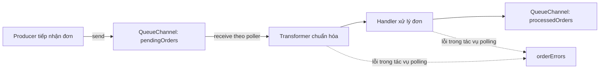

# QueueChannel và internal queue

## 1. Bài toán: tiếp nhận nhanh, xử lý theo nhịp riêng

Một ứng dụng tiếp nhận yêu cầu đồng bộ đơn hàng. Bình thường, số yêu cầu đến khá đều; khi một đối tác gửi dữ liệu theo lô, lượng yêu cầu tăng đột ngột. Nếu mỗi lần tiếp nhận đều phải chờ toàn bộ bước chuẩn hóa và gọi dịch vụ phía sau hoàn tất, thời gian phản hồi sẽ phụ thuộc trực tiếp vào tốc độ xử lý đó.

Trong module **SPRING_INTEGRATION_CORE**, chương **Queue và pollable channel**, `QueueChannel` là công cụ để đặt một bộ đệm thông điệp giữa hai công đoạn. Bài này đi từ `Message` và `MessageChannel` đến endpoint polling, cấu hình Java DSL và các giới hạn cần hiểu trước khi sử dụng bộ đệm.

Sau bài học, bạn có thể:

- Phân biệt hợp đồng `PollableChannel` với lớp triển khai `QueueChannel`.
- Giải thích message nằm ở đâu sau `send()` và khi nào nó rời queue.
- Chọn capacity, thời gian chờ gửi và cấu hình poller cho một luồng cụ thể.
- Nhận diện ranh giới thread, thứ tự xử lý và hành vi khi downstream gặp lỗi.
- Viết kiểm thử có thời hạn cho việc tiếp nhận, lấy message và xử lý qua flow.

Luồng xuyên suốt bài học:



Queue tạo chỗ chờ cho công việc. Khả năng xử lý cuối cùng vẫn do endpoint, tài nguyên hệ thống và dịch vụ đích quyết định.

## 2. PollableChannel là hợp đồng, QueueChannel là một cách triển khai

`MessageChannel` cung cấp thao tác gửi. `PollableChannel` kế thừa hợp đồng đó và bổ sung thao tác chủ động nhận message:

```java
// Rút gọn để minh họa hợp đồng, không thay thế interface của thư viện.
public interface PollableChannel extends MessageChannel {
    Message<?> receive();
    Message<?> receive(long timeout);
}
```

Consumer gọi `receive()` để lấy dữ liệu. Lời gọi có timeout có thể trả về `null` khi hết thời gian chờ; việc nhận bị interrupt cũng có thể dẫn đến `null`. Đơn vị timeout là mili giây. Xem [hợp đồng PollableChannel](https://docs.spring.io/spring-framework/docs/current/javadoc-api/org/springframework/messaging/PollableChannel.html).

`QueueChannel` thuộc package `org.springframework.integration.channel`; `Message`, `MessageChannel` và `PollableChannel` thuộc `org.springframework.messaging`.

| Thành phần | Vai trò trong ví dụ đơn hàng |
| --- | --- |
| `Message<?>` | Mang payload đơn hàng và headers như mã yêu cầu |
| `QueueChannel` | Tiếp nhận và giữ các message đang chờ |
| `PollableChannel` | Kiểu hợp đồng để consumer lấy message |
| Polling endpoint | Lập lịch lấy message và gọi handler |
| Transformer | Chuẩn hóa nội dung đơn hàng |
| Handler | Thực hiện công việc nghiệp vụ |

Việc khai báo một bean `QueueChannel` chưa tạo ra consumer. Nếu producer liên tục gửi nhưng không có ai gọi `receive()` hoặc không có polling endpoint, message sẽ tích lại.

## 3. Internal queue giữ gì và hoạt động ra sao?

### 3.1. Cấu trúc mặc định

Với constructor nhận capacity, triển khai hiện hành tạo một `LinkedBlockingQueue<Message<?>>`. Constructor không tham số dùng `LinkedBlockingQueue` với giới hạn mặc định `Integer.MAX_VALUE`. Đây là chi tiết triển khai của các constructor thông thường, không phải cam kết rằng mọi queue được truyền vào đều có cùng hành vi. Tham khảo [mã nguồn QueueChannel](https://raw.githubusercontent.com/spring-projects/spring-integration/main/spring-integration-core/src/main/java/org/springframework/integration/channel/QueueChannel.java).

```java
QueueChannel bounded = new QueueChannel(100);
QueueChannel practicallyUnbounded = new QueueChannel();
```

Capacity tính theo **số message**, không phải số byte. Một trăm message chứa mã đơn hàng ngắn và một trăm message chứa dữ liệu lớn có thể tạo áp lực bộ nhớ rất khác nhau.

Queue mặc định nằm trong bộ nhớ của JVM. Với một message đang nằm trong queue, ứng dụng vẫn giữ các tham chiếu cần thiết tới payload và headers. Không nên suy từ việc `Message` có cấu trúc bất biến rằng mọi đối tượng payload bên trong đều bất biến sâu: nếu producer tiếp tục sửa một đối tượng mutable đã gửi, consumer có thể thấy trạng thái ngoài dự kiến. Trong ví dụ, payload là `String` để tránh vấn đề chia sẻ trạng thái này.

### 3.2. Vòng đời của một message

Giả sử queue có capacity bằng 2:

```text
Ban đầu                 []
send(A, 0) -> true      [A]
send(B, 0) -> true      [A, B]
send(C, 0) -> false     [A, B]
receive(0) -> A         [B]
send(C, 0) -> true      [B, C]
```

Ở bước nhận `A`, message đã rời queue trước khi nghiệp vụ xử lý `A` hoàn tất. Vì vậy, có thể có 2 message chờ và thêm message đang được xử lý. Capacity của queue không giới hạn tổng số công việc đang tồn tại trong toàn bộ ứng dụng.

Nếu có nhiều receiver cùng lấy từ một `QueueChannel`, các receiver cạnh tranh để nhận message. Một message được lấy bởi một receiver; channel không tự sao chép message tới mọi consumer. Queue thông thường lấy theo FIFO. Xem [ngữ nghĩa QueueChannel](https://docs.spring.io/spring-integration/reference/channel/implementations.html#channel-implementations-queuechannel).

### 3.3. Tùy biến queue nội bộ

API cũng có constructor nhận `Queue<Message<?>>`. Chẳng hạn, khi muốn dùng một `BlockingQueue` khác với capacity cụ thể:

```java
import java.util.concurrent.ArrayBlockingQueue;

import org.springframework.integration.channel.QueueChannel;
import org.springframework.messaging.Message;

QueueChannel channel = new QueueChannel(
        new ArrayBlockingQueue<Message<?>>(100));
```

Khi đưa queue tùy biến vào, cần kiểm tra lại tính an toàn đồng thời, thứ tự phần tử và hỗ trợ chờ có timeout. Không suy rộng hành vi của `BlockingQueue` sang mọi implementation chỉ triển khai `Queue`. Không thao tác trực tiếp lên queue bên dưới sau khi trao nó cho channel; hãy để việc gửi và nhận đi qua API channel.

Với yêu cầu phổ biến là FIFO trong bộ nhớ và capacity hữu hạn, `new QueueChannel(capacity)` thường đã đủ. Capacity phải lớn hơn 0; nếu cần chuyển giao trực tiếp không có bộ đệm, có thể khảo sát `RendezvousChannel`. Các constructor và phương thức quản lý được mô tả trong [QueueChannel API](https://docs.spring.io/spring-integration/docs/current/api/org/springframework/integration/channel/QueueChannel.html).

## 4. send, receive và thời gian chờ

Với `QueueChannel` sử dụng `BlockingQueue` thông thường, hai trạng thái gây chờ là **gửi vào queue đầy** và **nhận từ queue rỗng**.

| Lời gọi | Khi có thể thực hiện ngay | Khi queue đầy hoặc rỗng tương ứng |
| --- | --- | --- |
| `send(message, 0)` | Đưa vào queue, trả `true` | Trả `false` ngay khi queue đầy |
| `send(message, 200)` | Đưa vào queue, trả `true` | Chờ tối đa 200 ms để có chỗ; hết hạn trả `false` |
| `send(message)` | Đưa vào queue, trả `true` | Chờ không đặt hạn khi queue đầy |
| `receive(0)` | Lấy và loại message khỏi queue | Trả `null` ngay khi queue rỗng |
| `receive(200)` | Lấy và loại message khỏi queue | Chờ tối đa 200 ms; hết hạn trả `null` |
| `receive()` | Lấy và loại message khỏi queue | Chờ không đặt hạn khi queue rỗng |

Giá trị timeout âm biểu thị chờ không đặt hạn. Bảng mô tả việc chờ vì trạng thái queue; scheduling, interceptors và xử lý lỗi vẫn có thể ảnh hưởng lời gọi thực tế. Tài liệu [Message Channel Implementations](https://docs.spring.io/spring-integration/reference/channel/implementations.html) giải thích các biến thể chờ này.

Các phân biệt cần giữ rõ:

- **Send timeout** giới hạn chờ có chỗ trong queue, không giới hạn thời gian handler xử lý.
- **Receive timeout** giới hạn chờ có message, không phải tuổi thọ message.
- **Message TTL** không tự xuất hiện chỉ vì bạn đặt timeout cho `send()` hoặc `receive()`.
- `true` từ `send()` là kết quả tiếp nhận vào channel trong trường hợp này, chưa chứng minh đơn hàng đã được xử lý.

Không dùng `getRemainingCapacity()` làm điều kiện bảo đảm gửi thành công:

```java
// Kết quả quan sát có thể thay đổi trước lần send tiếp theo.
if (channel.getRemainingCapacity() > 0) {
    channel.send(message, 0);
}
```

Producer khác có thể chiếm chỗ vừa quan sát. Hãy dựa vào kết quả của chính thao tác gửi:

```java
boolean accepted = channel.send(message, 200);
if (!accepted) {
    // Quyết định ở biên tiếp nhận: báo bận, lưu để gửi lại,
    // hoặc từ chối theo hợp đồng nghiệp vụ.
    throw new IllegalStateException("Không thể tiếp nhận thêm đơn hàng");
}
```

Đây là ví dụ xử lý kết quả `false`. Các lỗi khác, chẳng hạn interceptor ném exception, vẫn cần được xử lý phù hợp ở lớp gọi.

## 5. Ví dụ tối thiểu: quan sát FIFO và giới hạn dung lượng

Ví dụ sau chỉ cần Spring Integration Core trên classpath, không cần khởi động Spring context:

```java
import org.springframework.integration.channel.QueueChannel;
import org.springframework.messaging.Message;
import org.springframework.messaging.support.MessageBuilder;

public class QueueChannelDemo {

    public static void main(String[] args) {
        QueueChannel pendingOrders = new QueueChannel(2);

        Message<String> first = order("ORDER-001");
        Message<String> second = order("ORDER-002");
        Message<String> third = order("ORDER-003");

        System.out.println(pendingOrders.send(first, 0));  // true
        System.out.println(pendingOrders.send(second, 0)); // true
        System.out.println(pendingOrders.send(third, 0));  // false

        printPayload(pendingOrders.receive(0)); // ORDER-001
        System.out.println(pendingOrders.send(third, 0)); // true
        printPayload(pendingOrders.receive(0)); // ORDER-002
        printPayload(pendingOrders.receive(0)); // ORDER-003
        printPayload(pendingOrders.receive(0)); // EMPTY
    }

    private static Message<String> order(String orderId) {
        return MessageBuilder.withPayload(orderId)
                .setHeader("requestId", "req-" + orderId)
                .build();
    }

    private static void printPayload(Message<?> message) {
        System.out.println(message == null ? "EMPTY" : message.getPayload());
    }
}
```

Điểm cần quan sát là lần gửi thứ ba thất bại không làm `ORDER-003` tự nằm chờ ở đâu đó trong framework. Producer vẫn chịu trách nhiệm đối với message chưa được tiếp nhận. Sau khi lấy `ORDER-001`, lần gửi lại `ORDER-003` mới thành công.

## 6. Ghép QueueChannel với endpoint bằng Java DSL

### 6.1. Poller nằm ở endpoint tiêu thụ

Một `QueueChannel` không tự tạo worker thread. Khi handler kết nối tới một `PollableChannel`, Spring Integration dùng `PollingConsumer` để lấy message và gọi handler. Với `SubscribableChannel`, framework dùng mô hình endpoint nhận sự kiện. Xem [Polling Consumer](https://docs.spring.io/spring-integration/reference/polling-consumer.html).

Trong Java DSL, cấu hình poller gắn với **endpoint trực tiếp đọc từ queue**. Nếu transformer là bước đầu tiên sau `pendingOrders`, poller phải gắn vào transformer. Các bước downstream nối đồng bộ sau đó chạy trong cùng tác vụ polling cho đến khi gặp một ranh giới thực thi khác.

### 6.2. Cấu hình đầy đủ

Ví dụ sử dụng `IntegrationFlow.from(...)` và `Duration`, phù hợp với API Java DSL ở các dòng Spring Integration hiện đại. Dự án cần `spring-integration-core`; nếu dùng Spring Boot, có thể dùng starter Integration và để BOM của Boot quản lý phiên bản tương thích. Ví dụ này không yêu cầu broker hay database.

```java
import java.time.Duration;
import java.util.Locale;
import java.util.logging.Level;
import java.util.logging.Logger;

import org.springframework.context.annotation.Bean;
import org.springframework.context.annotation.Configuration;
import org.springframework.integration.channel.QueueChannel;
import org.springframework.integration.config.EnableIntegration;
import org.springframework.integration.dsl.IntegrationFlow;
import org.springframework.integration.dsl.Pollers;

@Configuration
@EnableIntegration
public class OrderQueueConfiguration {

    private static final Logger LOG =
            Logger.getLogger(OrderQueueConfiguration.class.getName());

    @Bean
    public QueueChannel pendingOrders() {
        return new QueueChannel(100);
    }

    @Bean
    public QueueChannel processedOrders() {
        return new QueueChannel(100);
    }

    @Bean
    public QueueChannel orderErrors() {
        return new QueueChannel(20);
    }

    @Bean
    public IntegrationFlow orderFlow() {
        return IntegrationFlow.from("pendingOrders")
                .transform(String.class,
                        value -> value.trim().toUpperCase(Locale.ROOT),
                        endpoint -> endpoint.poller(
                                Pollers.fixedDelay(Duration.ofMillis(100))
                                        .receiveTimeout(0)
                                        .maxMessagesPerPoll(10)
                                        .errorChannel("orderErrors")))
                .<String, String>handle((orderId, headers) -> {
                    if (orderId.startsWith("FAIL-")) {
                        throw new IllegalArgumentException(
                                "Đơn hàng không hợp lệ: " + orderId);
                    }
                    return "PROCESSED:" + orderId;
                })
                .channel("processedOrders")
                .get();
    }

    @Bean
    public IntegrationFlow orderErrorFlow() {
        return IntegrationFlow.from("orderErrors")
                .handle(message -> LOG.log(
                                Level.SEVERE,
                                "Xử lý đơn hàng thất bại",
                                (Throwable) message.getPayload()),
                        endpoint -> endpoint.poller(
                                Pollers.fixedDelay(Duration.ofMillis(100))
                                        .receiveTimeout(0)
                                        .maxMessagesPerPoll(10)))
                .get();
    }
}
```

Trong ví dụ, `orderErrors` được dành riêng để nhận `ErrorMessage`, có payload là lỗi. Không gửi payload nghiệp vụ tùy ý vào channel này vì handler minh họa ép kiểu payload sang `Throwable`.

Ba tham số polling có ý nghĩa riêng:

| Cấu hình | Ý nghĩa trong flow này |
| --- | --- |
| `fixedDelay(100 ms)` | Chờ 100 ms sau khi tác vụ polling hoàn tất trước lượt kế tiếp |
| `receiveTimeout(0)` | Khi queue rỗng, lần nhận kết thúc ngay |
| `maxMessagesPerPoll(10)` | Trong một lượt, lấy tối đa 10 message; dừng sớm nếu nhận `null` |

`maxMessagesPerPoll(10)` không tạo ra 10 worker. Trong cấu hình không có executor riêng này, các message của lượt được xử lý tuần tự. API [Pollers](https://docs.spring.io/spring-integration/docs/current/api/org/springframework/integration/dsl/Pollers.html) mô tả lịch fixed delay; [Message Endpoints](https://docs.spring.io/spring-integration/reference/endpoint.html) mô tả giới hạn mỗi lượt và timeout nhận. Các lựa chọn DSL như `errorChannel(...)` và `receiveTimeout(...)` có trong [PollerSpec](https://docs.spring.io/spring-integration/docs/current/api/org/springframework/integration/dsl/PollerSpec.html).

### 6.3. Gửi vào flow và nhận kết quả

Trong một ứng dụng đã nạp `OrderQueueConfiguration`, có thể dùng channel trực tiếp như sau. Biến `context` đại diện cho `ApplicationContext` đang chạy:

```java
QueueChannel input = context.getBean("pendingOrders", QueueChannel.class);
QueueChannel output = context.getBean("processedOrders", QueueChannel.class);

Message<String> request = MessageBuilder.withPayload(" order-001 ")
        .setHeader("requestId", "req-001")
        .build();

if (!input.send(request, 200)) {
    throw new IllegalStateException("Hàng đợi tiếp nhận đang đầy");
}

Message<?> result = output.receive(2_000);
if (result == null) {
    throw new IllegalStateException("Chưa nhận được kết quả trong 2 giây");
}

System.out.println(result.getPayload()); // PROCESSED:ORDER-001
```

Ở ứng dụng thật có nhiều request đồng thời, không dùng việc lấy phần tử kế tiếp từ một output queue chung như cơ chế ghép request với response. Cần correlation hoặc thiết kế request-reply thích hợp. Đoạn mã chỉ minh họa một request độc lập.

`processedOrders` cũng có capacity hữu hạn và cần consumer. Nếu ứng dụng chỉ gửi mà không lấy kết quả, output queue có thể đầy và chặn flow phía trước. Thiết kế bộ đệm phải xem toàn bộ đường đi, gồm cả các channel kết quả và lỗi.

## 7. Ranh giới thread, gateway và thứ tự

### 7.1. Có queue không đồng nghĩa tự có thread mới

Trong ví dụ tối thiểu, `send()` và `receive()` đều được gọi từ `main`; không có bất đồng bộ tự động. Trong ví dụ Spring DSL, tác vụ poller chủ động lấy message nên công việc được tách khỏi lời gọi producer theo mô hình lập lịch đã cấu hình.

```text
Thread tiếp nhận:   tạo Message -> send -> tiếp tục công việc khác
Tác vụ poller:                    receive -> transform -> handle
```

Nếu producer đã gửi thành công rồi mới có lỗi ở handler trong tác vụ poller, exception đó không tự quay ngược về call stack đã kết thúc của producer. Đây là lý do luồng cần một đường xử lý lỗi riêng.

Gateway cung cấp giao diện Java cho việc tương tác messaging, nhưng hợp đồng gateway phải phản ánh đúng nhu cầu: tiếp nhận một chiều khác với chờ kết quả nghiệp vụ. Với gateway request-reply, cần đường trả lời và reply timeout; timeout của gateway không tự hủy message còn đang chờ hoặc đang xử lý. Việc trả lời “đã tiếp nhận” cho khách hàng cũng cần tách với trạng thái “đã xử lý đơn thành công”.

### 7.2. FIFO của queue không bảo đảm thứ tự hoàn tất

Giả sử hai worker lấy `ORDER-001` rồi `ORDER-002`. Nếu đơn thứ nhất cần 500 ms, còn đơn thứ hai cần 20 ms, đơn thứ hai có thể hoàn tất trước.

Nếu nghiệp vụ yêu cầu xử lý đúng thứ tự theo từng khách hàng, cần thiết kế thêm việc phân vùng theo khóa và tuần tự hóa trong từng nhóm. Tăng concurrency mà không xét yêu cầu thứ tự có thể làm hỏng quy tắc cập nhật trạng thái, dù queue vẫn lấy message theo thứ tự đã lưu.

## 8. Khi downstream thất bại

Xét thông điệp `FAIL-002` trong flow:

1. Producer gửi thành công vào `pendingOrders`.
2. Poller lấy message ra khỏi queue.
3. Transformer chuẩn hóa payload.
4. Handler ném `IllegalArgumentException`.
5. Cơ chế xử lý lỗi của poller gửi một `ErrorMessage` tới `orderErrors`.
6. `orderErrorFlow` lấy lỗi để ghi log.

Spring Integration hỗ trợ chuyển lỗi từ tác vụ polling thành error message. Việc định tuyến lỗi còn chịu ảnh hưởng của cấu hình error handler và header `errorChannel` trên request. Ví dụ dùng channel lỗi riêng ở poller và không đặt header ghi đè. Xem [Error Handling](https://docs.spring.io/spring-integration/reference/error-handling.html).

Điểm cốt lõi: **message đã lấy khỏi queue trong bộ nhớ không tự quay lại chỉ vì handler ném exception**. Ghi log lỗi cũng không đồng nghĩa đã retry hay khôi phục công việc.

Chính sách phục hồi cần trả lời các câu hỏi nghiệp vụ cụ thể:

- Lỗi dữ liệu có nên bị từ chối ngay thay vì thử lại?
- Lỗi tạm thời khi gọi dịch vụ có được retry với số lần và khoảng chờ hữu hạn?
- Sau khi hết retry, công việc được lưu ở đâu để điều tra hoặc xử lý lại?
- Nếu không rõ lần gọi trước đã thành công hay chưa, thao tác có idempotent theo mã đơn hàng không?

Không dùng vòng lặp gửi lại vô hạn vào chính queue đầy: điều đó có thể giữ thread, tăng tải và ngăn hệ thống phục hồi. Nếu dùng channel lỗi có bộ đệm, cần bảo đảm đường tiêu thụ lỗi cũng hoạt động; bản thân nó vẫn có thể trở thành điểm nghẽn.

### Độ bền và transaction

`QueueChannel` mặc định chỉ giữ dữ liệu trong bộ nhớ; sự cố tiến trình có thể làm mất backlog. Gắn transaction cho thao tác ghi database phía sau không tự biến internal queue thành tài nguyên có rollback.

Khi cần lưu bền, Spring Integration hỗ trợ cấu hình channel với message store, chẳng hạn `JdbcChannelMessageStore`. Với store có transaction và poller tham gia transaction tương ứng, việc lấy message có thể gắn với kết quả commit hoặc rollback. Cần thiết kế cả phạm vi transaction và side effect bên ngoài; persistent queue riêng lẻ chưa tạo ra bảo đảm exactly-once cho nghiệp vụ. Xem [Persistent QueueChannel Configuration](https://docs.spring.io/spring-integration/reference/channel/configuration.html).

Nếu cần các tiến trình ứng dụng chia sẻ cùng một hàng đợi, cũng phải thiết kế hạ tầng chia sẻ phù hợp. Hai instance ứng dụng, mỗi instance tạo `new QueueChannel(100)`, có hai queue riêng biệt.

## 9. Chọn capacity và nhịp tiêu thụ bằng một tình huống cụ thể

Giả sử hệ thống nhận 300 đơn/giây trong một đợt cao điểm kéo dài 5 giây; năng lực xử lý đo được là 200 đơn/giây. Nếu bắt đầu không có backlog và tốc độ ổn định trong đợt đó:

```text
Tốc độ tăng backlog = 300 - 200 = 100 message/giây
Backlog tăng sau 5 giây = 100 × 5 = 500 message
```

Đây là mô hình ước lượng, chưa tính dao động, lần retry hoặc lúc dịch vụ đích dừng hẳn. Capacity bằng 500 sẽ gần như không có khoảng dự phòng trong giả định này. Nếu producer vẫn gửi 300 đơn/giây vô thời hạn trong khi consumer chỉ xử lý 200 đơn/giây, mọi queue hữu hạn cuối cùng đều đầy.

Giả sử sau cao điểm, lượng đến giảm còn 100 đơn/giây, thì phần năng lực dành để giảm backlog là:

```text
200 - 100 = 100 message/giây
Thời gian giảm backlog 500 message ≈ 500 / 100 = 5 giây
```

Khi chọn capacity, hãy cân nhắc đồng thời:

| Yếu tố | Câu hỏi cần giải quyết |
| --- | --- |
| Bộ nhớ | Một message giữ lại bao nhiêu dữ liệu và tham chiếu? |
| Độ trễ | Công việc được phép chờ bao lâu trước khi bắt đầu xử lý? |
| Đợt tăng tải | Chênh lệch tốc độ vào/ra kéo dài bao lâu? |
| Khi đầy | Producer chờ, từ chối hay chuyển sang nơi lưu khác? |
| Phục hồi | Sau cao điểm, còn bao nhiêu năng lực để giảm backlog? |
| Sự cố | Công việc đang chờ có được phép mất khi ứng dụng dừng bất thường? |

Không chỉ tính throughput bằng `maxMessagesPerPoll / fixedDelay`. Với flow tuần tự, nếu mỗi handler mất 50 ms, một lượt 10 message có thể cần khoảng 500 ms xử lý rồi thêm 100 ms nghỉ. Khi backlog luôn đủ, mô hình đơn giản cho khoảng `10 / 0,6 ≈ 16,7 message/giây`, chưa tính các chi phí khác. Giảm delay không giải quyết được một handler vốn quá chậm.

Capacity hữu hạn tạo một cơ chế phản hồi quá tải thông qua chờ gửi hoặc từ chối. Cơ chế này cần kết hợp với timeout và cách phản hồi phù hợp ở biên tiếp nhận; nó không tự cung cấp giao thức điều tiết nhu cầu như Reactive Streams.

## 10. Kiểm thử các hành vi quan trọng

Các đoạn dưới là ví dụ kiểm thử JUnit Jupiter để đưa vào dự án đã cấu hình dependency thích hợp. Chúng tập trung vào hành vi quan sát được và dùng thời gian chờ hữu hạn, tránh phụ thuộc vào `Thread.sleep()`.

### 10.1. Queue đầy, nhận theo FIFO và có chỗ sau khi lấy

```java
import org.junit.jupiter.api.Test;
import org.springframework.integration.channel.QueueChannel;
import org.springframework.messaging.Message;
import org.springframework.messaging.support.GenericMessage;

import static org.junit.jupiter.api.Assertions.*;

class QueueChannelContractTest {

    @Test
    void rejectsWhenFullAndAcceptsAfterReceive() {
        QueueChannel queue = new QueueChannel(2);
        Message<String> first = new GenericMessage<>("ORDER-001");
        Message<String> second = new GenericMessage<>("ORDER-002");
        Message<String> third = new GenericMessage<>("ORDER-003");

        assertTrue(queue.send(first, 0));
        assertTrue(queue.send(second, 0));
        assertFalse(queue.send(third, 0));

        assertSame(first, queue.receive(0));
        assertTrue(queue.send(third, 0));
        assertSame(second, queue.receive(0));
        assertSame(third, queue.receive(0));
        assertNull(queue.receive(0));
    }
}
```

Ở đây không có consumer chạy nền hoặc interceptor thay message, nên kiểm tra tham chiếu và thứ tự là xác định. Không suy rộng kết quả đo queue size trong ví dụ đơn luồng sang một hệ thống đang có nhiều producer/consumer.

### 10.2. Flow thực sự lấy message và tạo kết quả

Đặt test sau cùng package với `OrderQueueConfiguration` ở trên:

```java
import org.junit.jupiter.api.Test;
import org.springframework.context.annotation.AnnotationConfigApplicationContext;
import org.springframework.integration.channel.QueueChannel;
import org.springframework.messaging.Message;
import org.springframework.messaging.support.MessageBuilder;

import static org.junit.jupiter.api.Assertions.*;

class OrderQueueFlowTest {

    @Test
    void pollsNormalizesAndProcessesOrder() {
        try (var context = new AnnotationConfigApplicationContext(
                OrderQueueConfiguration.class)) {

            QueueChannel input = context.getBean(
                    "pendingOrders", QueueChannel.class);
            QueueChannel output = context.getBean(
                    "processedOrders", QueueChannel.class);

            assertTrue(input.send(
                    MessageBuilder.withPayload(" order-001 ")
                            .setHeader("requestId", "req-001")
                            .build(),
                    200));

            Message<?> result = output.receive(2_000);
            assertNotNull(result, "Flow chưa tạo kết quả trong thời hạn");
            assertEquals("PROCESSED:ORDER-001", result.getPayload());
            assertEquals("req-001", result.getHeaders().get("requestId"));
        }
    }
}
```

Test thứ hai kiểm tra cả wiring, poller và xử lý downstream. Nếu chỉ kiểm tra `send()` trả `true`, một flow thiếu consumer vẫn có thể vượt qua kiểm tra dù không xử lý đơn nào.

Với nhánh lỗi, có thể tạo cấu hình test để bắt `ErrorMessage` tại channel lỗi rồi xác minh failed message và nguyên nhân. Không vừa để `orderErrorFlow` ghi log tiêu thụ vừa gọi `receive()` từ test để chờ cùng một error message: hai consumer sẽ cạnh tranh và làm test không ổn định.

## 11. Quan sát và xử lý các dấu hiệu bất thường

| Dấu hiệu | Hướng kiểm tra đầu tiên |
| --- | --- |
| `send()` chờ lâu | Queue đầy, consumer dừng hoặc downstream đang bị chặn |
| Queue tăng liên tục | Tốc độ tiếp nhận vượt năng lực tiêu thụ trong thời gian dài |
| Có message nhưng không được xử lý | Endpoint chưa chạy, thiếu poller hoặc cấu hình sai channel đầu vào |
| Queue gần rỗng nhưng khách hàng vẫn đợi lâu | Message đang xử lý, output queue bị nghẽn hoặc thiếu đường trả lời |
| `send()` thành công nhưng không có kết quả | Kiểm tra nhánh lỗi, filter/router downstream và correlation |
| Tăng worker làm kết quả đảo thứ tự | Thứ tự hoàn tất thay đổi khi xử lý đồng thời |
| Khởi động lại mất công việc chờ | Queue trong bộ nhớ không đáp ứng yêu cầu lưu bền |

`getQueueSize()` và `getRemainingCapacity()` hữu ích để quan sát tại một thời điểm; chúng không phải khóa đồng bộ giữa producer và consumer. Ngoài độ dài queue, nên theo dõi thời gian chờ gửi, số lần bị từ chối, độ trễ từ tiếp nhận đến hoàn tất và số lỗi xử lý. Tên và cách xuất metric cần theo cấu hình quan sát của dự án.

Ví dụ, queue ngắn chưa chắc có nghĩa hệ thống khỏe: một worker có thể đang treo trên dịch vụ đích trong khi không còn nhiều phần tử chờ. Ngược lại, một queue có backlog ngắn hạn rồi giảm đều có thể đang thực hiện đúng vai trò hấp thụ đợt tăng tải.

## 12. Vận dụng trong thiết kế luồng thông điệp

Với luồng đơn hàng đã xây dựng, mỗi quyết định cần được diễn đạt bằng một hợp đồng rõ ràng: producer chờ tối đa bao lâu để được tiếp nhận, internal queue giữ tối đa bao nhiêu message, endpoint nào chịu trách nhiệm polling, kết quả nghiệp vụ đi đâu và lỗi được phục hồi như thế nào.

Transformer, router, filter hay aggregator downstream đều có thể tham gia luồng, nhưng mỗi bước cần giữ rõ ý nghĩa thành công. Message bị filter loại hoặc được router chuyển sang nhánh khác sẽ không nhất thiết xuất hiện ở output mà producer ban đầu đang quan sát. Aggregator còn có trạng thái nhóm riêng; capacity của `QueueChannel` đầu vào không giới hạn toàn bộ trạng thái đó.

`QueueChannel` phù hợp khi cần một bộ đệm có giới hạn rõ giữa các công đoạn trong ứng dụng và chấp nhận được đặc tính lưu trữ đã chọn. Khi yêu cầu bao gồm khôi phục sau sự cố, chia sẻ giữa nhiều tiến trình hoặc bảo đảm nghiệp vụ sau retry, thiết kế cần bổ sung message store, broker, transaction và idempotency theo đúng phạm vi yêu cầu.
