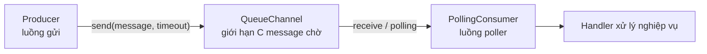

# Queue capacity

Trong chương **Queue và pollable channel** của module **SPRING_INTEGRATION_CORE**, bài học này giải thích cách giới hạn số message đang chờ trong một `QueueChannel`. Quyết định này ảnh hưởng trực tiếp đến bộ nhớ, thời gian chờ của producer và khả năng ứng phó khi downstream xử lý chậm.

Một hệ thống nhận đơn hàng có thể nhận 500 message/giây trong đợt cao điểm, trong khi dịch vụ xử lý chỉ hoàn thành 300 message/giây. Queue giúp hấp thụ chênh lệch trong một khoảng thời gian; nếu tình trạng kéo dài, hệ thống vẫn cần giảm lượng tiếp nhận hoặc tăng năng lực xử lý.

## 1. Mục tiêu và kiến thức nền

Sau bài học, bạn có thể:

- Phân biệt capacity, số message đang chờ và số message đang được xử lý.
- Dự đoán hành vi gửi message khi queue đầy và nhận message khi queue rỗng.
- Cấu hình bounded `QueueChannel` cùng polling endpoint bằng Java DSL.
- Ước lượng capacity theo tải đột biến, bộ nhớ và thời gian chờ cho phép.
- Chọn chính sách xử lý khi không thể đưa thêm message vào queue.

Bạn cần biết `Message<T>` mang payload và headers, `MessageChannel` cung cấp thao tác gửi, còn `PollableChannel` bổ sung thao tác `receive()` để consumer chủ động lấy message. Các ví dụ sử dụng API của `spring-integration-core` và Spring Context; dự án Spring Boot có thể dùng starter Integration để cung cấp các dependency tương ứng. Không cần message broker cho những ví dụ queue trong bộ nhớ dưới đây. Hợp đồng nhận chủ động được mô tả trong [API PollableChannel](https://docs.spring.io/spring-framework/docs/current/javadoc-api/org/springframework/messaging/PollableChannel.html).

## 2. Capacity giới hạn điều gì?

**Queue capacity** là số message tối đa có thể nằm chờ trong queue. Với cách khởi tạo thông thường:

```java
QueueChannel orderQueue = new QueueChannel(200);
```

Giá trị `200` có đơn vị là **message**, không phải byte, mili giây hay số worker. Constructor nhận capacity yêu cầu số nguyên dương. Nếu cần cơ chế trao tay không có vùng đệm, dùng `RendezvousChannel` thay vì truyền `0` cho constructor này. Constructor `new QueueChannel()` dùng giới hạn `Integer.MAX_VALUE`, thường được xem là queue gần như không giới hạn trong thực tế. Các quy tắc constructor này được nêu trong [API QueueChannel](https://docs.spring.io/spring-integration/api/org/springframework/integration/channel/QueueChannel.html).

Với capacity `C = 200`:

- Queue đang chứa 150 message: còn 50 vị trí cho message mới.
- Queue đang chứa 200 message: producer phải áp dụng chính sách chờ hoặc không gửi được.
- Consumer lấy một message ra: vị trí đó được giải phóng, dù handler còn đang xử lý message vừa lấy.

Vì vậy, queue có capacity 200 vẫn có thể đi kèm nhiều message đang xử lý bên ngoài queue. Khi tính tài nguyên của toàn luồng, cần cộng cả message đang chờ, message đang xử lý và các vùng đệm ở những endpoint tiếp theo.



`QueueChannel` thông thường có ngữ nghĩa point-to-point: nhiều consumer có thể cạnh tranh lấy message, mỗi lần lấy giao message cho một consumer. Queue mặc định lấy theo FIFO, nhưng nhiều consumer có thể hoàn thành công việc khác thứ tự lấy ra. Xem phần [Message Channel Implementations](https://docs.spring.io/spring-integration/reference/channel/implementations.html#channel-implementations-queuechannel).

### Capacity không phải ngân sách bộ nhớ tuyệt đối

Hai queue cùng capacity 200 có thể giữ lượng dữ liệu rất khác nhau. Queue chứa mã đơn hàng ngắn sẽ khác queue chứa `byte[]` của ảnh hoặc cây đối tượng lớn.

Ước lượng ban đầu cho queue trong bộ nhớ:

```text
Bộ nhớ giữ bởi queue ≈ số message đang chờ × bộ nhớ giữ thêm trên mỗi message
```

Giá trị trên mỗi message cần tính payload, headers, đối tượng bao và overhead của cấu trúc queue. Không thể chỉ lấy kích thước JSON rồi coi đó là chi phí heap chính xác. Tham chiếu dùng chung giữa message cũng có thể khiến phép nhân đơn giản sai lệch.

Nếu giả định mỗi message giữ thêm trung bình 8 KiB, 2.000 message tương ứng khoảng 15,6 MiB. Đây là dữ liệu giả định để tính toán; cần đo với payload thực tế và chừa tài nguyên cho phần còn lại của ứng dụng.

## 3. Gửi message khi queue đầy

Với queue thông thường, không có interceptor tùy biến, lời gọi trực tiếp `send` trả về `boolean` cho biết việc gửi có được chấp nhận hay không. Tham số timeout có đơn vị mili giây. Hợp đồng timeout của thao tác gửi được mô tả trong [API MessageChannel](https://docs.spring.io/spring-framework/docs/current/javadoc-api/org/springframework/messaging/MessageChannel.html).

| Lời gọi trên QueueChannel | Khi còn chỗ | Khi queue đầy |
| --- | --- | --- |
| `send(message)` | Đưa message vào queue, trả `true` | Chờ đến khi có chỗ; không đặt giới hạn thời gian chờ |
| `send(message, 0)` | Đưa message vào queue, trả `true` | Không chờ có chỗ, trả `false` |
| `send(message, 200)` | Đưa message vào queue, trả `true` | Chờ có chỗ trong giới hạn 200 ms; hết thời gian mà chưa gửi được thì trả `false` |
| `send(message, -1)` | Đưa message vào queue, trả `true` | Chờ không giới hạn như lời gọi không truyền timeout |

Thời gian quan sát thực tế còn chịu tác động của lập lịch luồng và hoạt động khác của JVM. Timeout gửi không phải thời hạn hoàn thành nghiệp vụ.

Ví dụ này bỏ qua kết quả quan trọng:

```java
orderQueue.send(message, 0);
```

Nếu queue đầy, hệ thống gọi tiếp tục chạy nhưng message chưa được tiếp nhận. Cần xử lý kết quả rõ ràng:

```java
boolean accepted = orderQueue.send(message, 200);

if (!accepted) {
    throw new IllegalStateException(
            "Không thể tiếp nhận thêm đơn hàng trong thời gian cho phép");
}
```

`IllegalStateException` ở đây là lựa chọn minh họa của ứng dụng. Ở biên tiếp nhận thực tế, có thể dùng kết quả nghiệp vụ hoặc loại exception riêng để bên gọi biết yêu cầu chưa được nhận.

### Ba cách hiểu cần tách biệt

**Được đưa vào queue:** `send()` trả `true`.

**Đã xử lý xong:** handler đã hoàn thành tác vụ nghiệp vụ; điều này xảy ra sau thao tác lấy message.

**Được lưu bền vững:** dữ liệu có thể phục hồi sau sự cố; queue mặc định trong bộ nhớ không cung cấp cam kết này.

Nếu tầng ứng dụng gửi qua `MessagingTemplate` hoặc gateway, hãy xem hợp đồng của tầng đó. Timeout và lỗi gửi có thể được biểu diễn bằng exception thay vì trả nguyên giá trị `boolean` của channel. Không suy ra hành vi gateway từ một phép gọi trực tiếp `QueueChannel.send()`. Các thiết lập timeout của template được trình bày trong [API GenericMessagingTemplate](https://docs.spring.io/spring-framework/docs/current/javadoc-api/org/springframework/messaging/core/GenericMessagingTemplate.html).

## 4. Quan sát capacity bằng ví dụ Java độc lập

Đoạn mã sau không cần khởi động Spring context. Nó tạo queue có hai vị trí và thao tác tuần tự để kết quả dễ quan sát. Các timeout đều bằng `0` nên chương trình không phải chờ có message hoặc chờ queue trống chỗ.

```java
import org.springframework.integration.channel.QueueChannel;
import org.springframework.messaging.Message;
import org.springframework.messaging.support.GenericMessage;

public class QueueCapacityDemo {

    public static void main(String[] args) {
        QueueChannel queue = new QueueChannel(2);

        Message<String> first = new GenericMessage<>("ORDER-001");
        Message<String> second = new GenericMessage<>("ORDER-002");
        Message<String> third = new GenericMessage<>("ORDER-003");

        System.out.println(queue.send(first, 0));   // true
        System.out.println(queue.send(second, 0));  // true

        System.out.println(queue.getQueueSize());          // 2
        System.out.println(queue.getRemainingCapacity());  // 0

        System.out.println(queue.send(third, 0));   // false

        Message<?> received = queue.receive(0);
        if (received == null) {
            throw new IllegalStateException("Ví dụ phải nhận được ORDER-001");
        }
        System.out.println(received.getPayload()); // ORDER-001

        System.out.println(queue.send(third, 0));   // true

        Message<?> next;
        while ((next = queue.receive(0)) != null) {
            System.out.println(next.getPayload());
        }

        System.out.println(queue.getQueueSize());  // 0
        System.out.println(queue.receive(0));       // null
    }
}
```

Chuỗi trạng thái của queue:

| Thao tác | Kết quả | Nội dung queue sau thao tác |
| --- | --- | --- |
| Gửi `ORDER-001` | `true` | `[ORDER-001]` |
| Gửi `ORDER-002` | `true` | `[ORDER-001, ORDER-002]` |
| Gửi `ORDER-003` khi đầy | `false` | `[ORDER-001, ORDER-002]` |
| Nhận một message | `ORDER-001` | `[ORDER-002]` |
| Gửi lại `ORDER-003` | `true` | `[ORDER-002, ORDER-003]` |

Lần gửi không thành công không tự xóa message cũ và không tự lưu message mới vào một queue khác. Ứng dụng vẫn giữ đối tượng `third` và chủ động gửi lại sau khi có chỗ.

Về phía nhận, `receive(0)` trả `null` nếu queue rỗng; `receive(timeout)` có thể chờ message, còn `receive()` không đặt giới hạn thời gian chờ. Không dùng lời gọi nhận vô hạn ở cuối một ví dụ không có producer đang hoạt động. Xem [hợp đồng nhận của PollableChannel](https://docs.spring.io/spring-framework/docs/current/javadoc-api/org/springframework/messaging/PollableChannel.html).

## 5. Cấu hình queue và endpoint bằng Java DSL

Một queue lưu message nhưng không tự tạo worker để xử lý. Trong Spring Integration, endpoint lấy dữ liệu từ `PollableChannel` cần cấu hình poller, trực tiếp trên endpoint hoặc qua poller mặc định của context. Ví dụ dưới đây gắn poller trực tiếp để dễ xác định hành vi. Quan hệ giữa loại channel và loại endpoint được giải thích trong [Message Endpoints](https://docs.spring.io/spring-integration/reference/endpoint.html).

```java
import java.time.Duration;

import org.springframework.beans.factory.annotation.Qualifier;
import org.springframework.context.annotation.Bean;
import org.springframework.context.annotation.Configuration;
import org.springframework.integration.channel.QueueChannel;
import org.springframework.integration.config.EnableIntegration;
import org.springframework.integration.dsl.IntegrationFlow;
import org.springframework.integration.dsl.Pollers;
import org.springframework.messaging.support.GenericMessage;

@Configuration
@EnableIntegration
public class QueueCapacityConfig {

    @Bean
    public QueueChannel orderQueue() {
        return new QueueChannel(200);
    }

    @Bean
    public IntegrationFlow orderProcessingFlow(
            @Qualifier("orderQueue") QueueChannel orderQueue) {

        return IntegrationFlow.from(orderQueue)
                .handle(String.class, (orderId, headers) -> {
                    // Thay bằng thao tác nghiệp vụ thực tế.
                    System.out.println("Đang xử lý đơn: " + orderId);
                    return null;
                }, endpoint -> endpoint.poller(
                        Pollers.fixedDelay(Duration.ofMillis(100))
                                .maxMessagesPerPoll(10)
                                .receiveTimeout(0)))
                .get();
    }

    @Bean
    public OrderIngress orderIngress(
            @Qualifier("orderQueue") QueueChannel orderQueue) {

        return new OrderIngress(orderQueue);
    }

    public static class OrderIngress {

        private final QueueChannel orderQueue;

        public OrderIngress(QueueChannel orderQueue) {
            this.orderQueue = orderQueue;
        }

        public boolean tryAccept(String orderId) {
            return this.orderQueue.send(
                    new GenericMessage<>(orderId), 200);
        }
    }
}
```

Spring phải nạp cấu hình này vào application context thì poller mới được quản lý và chạy. Chỉ dùng `new QueueChannel(200)` trong mã Java không khởi động endpoint của ví dụ.

Ứng dụng lấy bean `OrderIngress` và gọi `tryAccept(orderId)`. Nếu kết quả là `false`, tầng gọi cần phản hồi chưa tiếp nhận được yêu cầu hoặc áp dụng chính sách retry đã thiết kế. Bean này trả về kết quả chấp nhận, chưa trả kết quả xử lý đơn.

Handler trả `null` vì đây là điểm kết thúc xử lý trong ví dụ. Việc in ra console chỉ giúp quan sát; trong ứng dụng thật, thay bằng lời gọi service và xử lý lỗi tương ứng.

Ba tham số poller có vai trò khác nhau:

| Thiết lập | Vai trò trong ví dụ |
| --- | --- |
| `fixedDelay(100 ms)` | Đặt khoảng nghỉ giữa lúc một đợt polling hoàn thành và đợt tiếp theo được lên lịch, với cách thực thi trực tiếp đang dùng |
| `maxMessagesPerPoll(10)` | Cho phép xử lý tối đa 10 message trong một đợt polling |
| `receiveTimeout(0)` | Mỗi lần nhận không chờ nếu queue đang rỗng |

`maxMessagesPerPoll(10)` không có nghĩa là tạo 10 worker. Trong cấu hình này, các message của một đợt polling được xử lý tuần tự. API cấu hình được mô tả trong [PollerSpec](https://docs.spring.io/spring-integration/api/org/springframework/integration/dsl/PollerSpec.html); ý nghĩa fixed delay nằm trong [Pollers](https://docs.spring.io/spring-integration/api/org/springframework/integration/dsl/Pollers.html).

## 6. Capacity và tốc độ tiêu thụ phải được thiết kế cùng nhau

Tăng capacity cho phép giữ nhiều công việc hơn, nhưng không khiến một lời gọi HTTP, truy vấn cơ sở dữ liệu hoặc handler chạy nhanh hơn.

Với ví dụ Java DSL, giả sử:

- Mỗi message cần 20 ms để xử lý.
- Một đợt polling nhận đủ 10 message.
- Sau đợt đó có khoảng nghỉ 100 ms.
- Không có executor bổ sung và bỏ qua overhead khác.

Ước lượng:

```text
Thời gian xử lý một đợt = 10 × 20 ms = 200 ms
Chu kỳ có cả khoảng nghỉ ≈ 200 ms + 100 ms = 300 ms
Tốc độ tiêu thụ ≈ 10 / 0,3 = 33,3 message/giây
```

Vì thế, không thể tính tốc độ là `10 message / 100 ms = 100 message/giây` mà bỏ qua thời gian xử lý.

Phép tính trên là mô hình đơn giản cho cấu hình đã nêu. Nếu bổ sung executor, nhiều consumer hoặc thao tác bất đồng bộ ở downstream, cần đo lại toàn luồng.

Muốn cải thiện tốc độ xử lý, hãy xác định chỗ chậm trước: thời gian handler, connection pool, dịch vụ từ xa hay lịch polling. Tăng số consumer chỉ có ích khi downstream đủ khả năng phục vụ thêm yêu cầu; nếu tài nguyên đích đã bão hòa, nhiều worker hơn còn có thể tăng tranh chấp và timeout.

## 7. Chọn capacity từ ba ràng buộc

Không có một con số capacity phù hợp cho mọi hệ thống. Có thể bắt đầu từ mô hình tải đơn giản, sau đó đo và điều chỉnh với dữ liệu thực tế.

### 7.1. Khả năng hấp thụ tải đột biến

Ký hiệu:

| Ký hiệu | Ý nghĩa |
| --- | --- |
| `C` | Capacity, đơn vị message |
| `q0` | Số message đang chờ khi đợt tải bắt đầu |
| `λ` | Tốc độ message được đưa tới queue, message/giây |
| `μ` | Tốc độ consumer lấy và xử lý có thể duy trì, message/giây |
| `T` | Thời gian tải đột biến, giây |

Giả sử tải và tốc độ xử lý gần như ổn định trong khoảng xét, chưa có message bị từ chối:

```text
Nếu λ > μ:
    backlog cuối đợt ≈ q0 + (λ - μ) × T
    thời gian tới lúc đầy ≈ (C - q0) / (λ - μ)
```

Ví dụ minh họa riêng cho bài toán sizing:

```text
q0 = 200 message
λ  = 500 message/giây
μ  = 300 message/giây
T  = 8 giây

Backlog tăng thêm = (500 - 300) × 8 = 1.600 message
Backlog cuối đợt ≈ 200 + 1.600 = 1.800 message
```

Capacity 2.000 có thể hấp thụ đợt tải này theo mô hình, với khoảng dự phòng 200 message. Nếu tốc độ cao tiếp tục:

```text
Thời gian tới lúc đầy ≈ (2.000 - 200) / 200 = 9 giây
```

Đây là ước lượng theo dòng tải liên tục. Lịch polling, các message đến cùng lúc và thời gian xử lý biến động có thể làm queue đầy sớm hơn.

### 7.2. Thời gian chờ cho phép

Khi đang có `q` message phía trước, một ước lượng thô cho thời gian đợi là:

```text
Thời gian chờ trong queue ≈ q / μ
```

Với `q = 1.800` và `μ = 300`, thời gian chờ khoảng 6 giây, chưa cộng thời gian xử lý message đó và các bước tiếp theo.

Nếu nghiệp vụ chỉ chấp nhận khoảng 2 giây chờ trong queue:

```text
Số message chờ tương ứng ≈ 300 × 2 = 600
```

Như vậy, nhu cầu chứa 1.800 message trong đợt tải mâu thuẫn với mục tiêu chỉ chờ khoảng 2 giây. Chọn capacity 2.000 giải quyết việc giữ backlog trong mô hình, nhưng không đáp ứng mục tiêu độ trễ này.

Cần thay đổi ít nhất một yếu tố: tăng tốc độ xử lý, giảm lượng tiếp nhận, chia nhỏ tải đột biến hoặc điều chỉnh thời hạn nghiệp vụ. Công thức thời gian chờ chỉ là xấp xỉ, không bảo đảm độ trễ tối đa cho từng message.

### 7.3. Ngân sách bộ nhớ

Giả sử dành tối đa 32 MiB cho phần dữ liệu đang chờ và đo được chi phí trung bình khoảng 8 KiB/message:

```text
Giới hạn theo bộ nhớ ≈ 32 MiB / 8 KiB = 4.096 message
```

Trong ví dụ này:

| Ràng buộc | Ước lượng |
| --- | --- |
| Chứa hết backlog cuối đợt tải | Cần ít nhất khoảng 1.800 vị trí |
| Ngân sách bộ nhớ | Cho phép khoảng 4.096 vị trí theo chi phí trung bình giả định |
| Mục tiêu chờ khoảng 2 giây | Chỉ tương ứng khoảng 600 message chờ |

Hai yêu cầu đầu có thể cùng thỏa mãn, nhưng yêu cầu độ trễ đang xung đột với tải. Không nên chọn capacity chỉ vì heap còn đủ.

### 7.4. Khả năng giải phóng backlog

Sau đợt cao điểm, giả sử lượng gửi giảm còn 120 message/giây và consumer vẫn xử lý 300 message/giây:

```text
Tốc độ giảm backlog = 300 - 120 = 180 message/giây
Thời gian xử lý hết backlog ≈ 1.800 / 180 = 10 giây
```

Nếu đợt tải tiếp theo đến trước lúc backlog được giải phóng, queue bắt đầu đợt mới với nhiều message còn tồn. Một lần thử tải ngắn có thể che khuất tình trạng tích lũy qua nhiều chu kỳ.

Khi tốc độ gửi trung bình liên tục cao hơn tốc độ xử lý, mọi queue hữu hạn cuối cùng đều đầy. Capacity khi đó quyết định khoảng thời gian hệ thống có trước khi phải giảm lượng tiếp nhận hoặc báo không nhận thêm.

## 8. Chính sách khi queue đầy

Bounded queue tạo giới hạn rõ ràng cho lượng công việc chờ. Để giới hạn đó có tác dụng, producer phải thực hiện hành động cụ thể khi gửi không thành công.

| Chính sách | Trường hợp sử dụng | Điểm cần thiết kế |
| --- | --- | --- |
| Không chờ, dùng `send(message, 0)` | Bên gọi cần phản hồi nhanh | Trả kết quả chưa tiếp nhận; không bỏ qua `false` |
| Chờ có giới hạn | Chấp nhận trì hoãn ngắn để hấp thụ dao động | Timeout phải phù hợp với thời hạn của bên gọi |
| Retry có giới hạn và khoảng nghỉ | Quá tải có thể tự phục hồi | Giới hạn số lần, tổng thời gian và tốc độ retry |
| Giảm tốc độ đọc từ nguồn | Nguồn cho phép điều tiết | Theo dõi khả năng tồn đọng ở chính nguồn đó |
| Chuyển sang nơi lưu bền vững | Công việc cần được giữ qua sự cố | Thiết kế xác nhận tiếp nhận, phục hồi và chống xử lý trùng |
| Loại bỏ có chủ đích | Nghiệp vụ cho phép mất một số sự kiện | Quy định rõ loại nào được bỏ và có số liệu theo dõi |

Không dùng vòng lặp retry liên tục không có khoảng nghỉ. Nó có thể chiếm CPU và tăng áp lực đúng lúc hệ thống đang chậm.

`QueueChannel` thông thường không tự chuyển sang chính sách “bỏ message cũ nhất”. Nếu muốn loại bỏ hay chuyển message sang nhánh khác, ứng dụng phải thiết kế hành vi đó và hiểu rõ hậu quả nghiệp vụ.

Có thể xem chờ khi gửi là cách truyền áp lực ngược về producer ở mức luồng thực thi. Tuy nhiên, bounded queue không tự biến cả luồng thành cơ chế backpressure kiểu Reactive Streams. Khi producer tiếp tục tăng số luồng để vượt qua thời gian chờ, áp lực có thể chuyển sang thread pool và request đang treo.

## 9. Tránh để capacity gây kẹt luồng

Một tình huống nguy hiểm:

1. Một tác vụ đang chạy trên executor chỉ có một luồng.
2. Tác vụ gửi vào queue đã đầy bằng `send(message)`.
3. Consumer cũng cần chính executor đó để lấy message.
4. Luồng duy nhất đang chờ có chỗ, nên consumer không được chạy để giải phóng chỗ.

Queue hữu hạn vẫn hoạt động đúng hợp đồng, nhưng cách dùng chung tài nguyên khiến toàn luồng không tiến triển.

Tình huống tương tự xảy ra khi producer giữ tài nguyên mà consumer cần, chẳng hạn producer giữ khóa trong lúc chờ gửi, còn consumer cần lấy khóa đó mới xử lý tiếp được.

Khi thiết kế luồng:

- Tránh chờ gửi vô hạn trong request cần đáp ứng theo thời hạn.
- Không giữ khóa hoặc tài nguyên khan hiếm qua một thao tác gửi có thể chờ lâu.
- Kiểm tra quan hệ giữa executor của producer, poller và handler.
- Đặt giới hạn tổng số request đang xử lý ở biên tiếp nhận.

Timeout giúp phát hiện và thoát khỏi một lần chờ; nó không tự sửa sơ đồ phụ thuộc tài nguyên gây kẹt.

## 10. Queue đầy, lỗi handler và lưu bền vững

Ba tình huống sau cần cách xử lý riêng.

### 10.1. Queue không nhận được message mới

Với lời gọi trực tiếp trong các ví dụ, `send(message, timeout)` trả `false` nếu không đưa được message vào queue trong thời gian chờ. Đây là quyết định tiếp nhận ở producer.

Không mặc định rằng giá trị `false` tự sinh một `ErrorMessage` gửi tới `errorChannel`. Producer phải kiểm tra kết quả và quyết định phản hồi.

### 10.2. Queue đã nhận, nhưng handler thất bại

Khi handler do poller gọi ở luồng khác ném exception, exception đó không thể tự quay ngược vào lời gọi `send()` đã kết thúc trước đó. Spring Integration có cơ chế chuyển lỗi bất đồng bộ thành `ErrorMessage` qua kênh lỗi; ứng dụng cần cấu hình nhánh xử lý lỗi phù hợp. Xem [Error Handling](https://docs.spring.io/spring-integration/reference/error-handling.html).

Queue thông thường trong bộ nhớ cũng không tự đưa message đã lấy ra trở lại queue chỉ vì handler thất bại. Nếu cần retry hoặc phục hồi, phải thiết kế rõ phạm vi retry và điều kiện xử lý trùng.

### 10.3. Tiến trình dừng khi còn message chờ

Queue mặc định giữ message trong bộ nhớ của tiến trình. Capacity hữu hạn giúp kiểm soát lượng tồn, nhưng không bảo đảm phục hồi sau crash.

Spring Integration hỗ trợ queue dựa trên message store, trong đó việc lưu trữ và transaction có quy tắc riêng. Không sao chép nguyên giả định capacity của queue trong bộ nhớ sang cấu hình persistent store; chẳng hạn thuộc tính XML `capacity` không được dùng cùng `message-store` trên `<queue>`. Xem [Persistent QueueChannel Configuration](https://docs.spring.io/spring-integration/reference/channel/configuration.html#channel-configuration-queuechannel).

Nếu chạy ba instance, mỗi instance có một `new QueueChannel(200)` riêng, chúng có ba vùng đệm trong ba tiến trình. Đó không phải một queue dùng chung có khả năng tự chuyển message từ instance đang đầy sang instance còn trống.

## 11. Theo dõi capacity trong vận hành

Độ dài queue chỉ phản ánh một phần tình trạng xử lý. Nên quan sát đồng thời:

| Chỉ số | Dùng để nhận biết |
| --- | --- |
| Số message đang chờ | Backlog hiện tại |
| Tỷ lệ lấp đầy | Khoảng cách tới giới hạn tiếp nhận |
| Tốc độ vào và tốc độ ra | Queue đang tích lũy hay đang giảm tồn |
| Số lần gửi không thành công | Số yêu cầu chưa được tiếp nhận |
| Thời gian chờ khi gửi | Mức trì hoãn producer đang chịu |
| Thời gian message nằm trong queue | Độ trễ trước xử lý |
| Thời gian xử lý và lỗi handler | Năng lực thực tế của downstream |
| Heap, GC và số luồng hoạt động | Chi phí tài nguyên của toàn ứng dụng |

Với queue có capacity cấu hình trước:

```text
Tỷ lệ lấp đầy = số message đang chờ / capacity đã cấu hình
```

`getQueueSize()` và `getRemainingCapacity()` hỗ trợ quan sát queue. Tuy nhiên, trong môi trường nhiều luồng, dữ liệu quan sát có thể thay đổi ngay trước lần gửi tiếp theo. Không thực hiện kiểu “kiểm tra còn chỗ rồi coi lần gửi chắc chắn thành công”. Lời gọi `send()` mới quyết định message có được tiếp nhận tại thời điểm thao tác hay không. Vấn đề kiểm tra trước trong môi trường cạnh tranh cũng được nêu trong [API BlockingQueue.remainingCapacity](https://docs.oracle.com/en/java/javase/21/docs/api/java.base/java/util/concurrent/BlockingQueue.html#remainingCapacity()).

Một queue có ít message nhưng handler thường xuyên mắc kẹt ở dịch vụ từ xa vẫn có thể vi phạm thời hạn nghiệp vụ. Ngược lại, queue tăng nhanh rồi giảm hết sau mỗi đợt tải có thể đang thực hiện đúng mục đích hấp thụ đột biến.

Có thể đặt cảnh báo khi tỷ lệ lấp đầy vượt một ngưỡng trong một khoảng thời gian, nhưng ngưỡng phải dựa trên tốc độ tăng backlog và thời hạn cho phép. Một mẫu số liệu riêng lẻ chưa đủ kết luận cần tăng capacity.

## 12. Những nhầm lẫn thường gặp

| Nhầm lẫn | Cách hiểu và xử lý đúng |
| --- | --- |
| Capacity càng lớn thì throughput càng cao | Đo năng lực xử lý của consumer; queue lớn chủ yếu tăng lượng công việc có thể chờ |
| `new QueueChannel()` sẽ tự bảo vệ heap | Đặt giới hạn rõ ràng và đo bộ nhớ của payload thực tế |
| Capacity 0 là một queue không lưu message hợp lệ | Constructor nhận capacity yêu cầu số dương; tìm hiểu `RendezvousChannel` khi cần trao tay |
| Queue đầy thì message cũ tự bị loại | Chọn chính sách quá tải ở producer hoặc thành phần có hành vi loại bỏ được thiết kế rõ |
| `maxMessagesPerPoll` là số worker | Đây là giới hạn số message trong một đợt polling |
| `send()` thành công nghĩa là nghiệp vụ hoàn tất | Thiết kế kết quả xử lý, phản hồi hoặc sự kiện hoàn thành riêng |
| Queue đủ nhỏ thì không cần timeout gửi | Đặt timeout dựa trên thời hạn và tài nguyên của bên gọi |
| Queue FIFO bảo đảm mọi tác vụ hoàn tất theo thứ tự | Xem xét số consumer và thời gian thực thi của từng tác vụ |

## 13. Thực hành thiết kế giới hạn tiếp nhận

Thực hành trong một dự án thử nghiệm; không cần broker cho các bước dùng queue trong bộ nhớ.

### Bước 1: Quan sát queue đầy khi không có consumer

Dùng ví dụ `QueueCapacityDemo` với capacity 2.

Kết quả mong đợi: hai message đầu được nhận; message thứ ba trả `false`; sau khi lấy một message, gửi lại message thứ ba thành công. Hai message đã có không bị loại để nhường chỗ.

### Bước 2: Quan sát timeout hữu hạn

Tạo một `QueueChannel(1)`, gửi đầy queue rồi gửi message tiếp theo với timeout 100 ms, không chạy consumer.

Kết quả mong đợi: lần gửi sau không được nhận và trả `false` sau khoảng chờ tương ứng. Không khẳng định thời gian đo luôn đúng chính xác 100 ms; message đầu vẫn ở trong queue.

### Bước 3: Quan sát queue và poller cùng hoạt động

Nạp `QueueCapacityConfig` vào Spring context, dùng capacity nhỏ hơn, chẳng hạn 5, và thay handler bằng thao tác có độ trễ kiểm soát được trong môi trường thử nghiệm. Gửi nhiều message hơn khả năng xử lý tức thời.

Ghi lại số lần `tryAccept()` trả `true`, số lần trả `false`, thời gian gửi và độ dài queue. Không gán trước số lần từ chối cố định vì poller có thể lấy message xen kẽ với producer.

### Bước 4: Chứng minh tăng capacity không sửa được thiếu năng lực xử lý

Giữ nguyên handler và poller, lần lượt thử capacity nhỏ rồi lớn hơn với cùng một chuỗi tải đủ dài.

Quan sát thời gian bắt đầu có lần gửi không thành công, mức backlog và độ trễ trước xử lý. Capacity lớn thường trì hoãn thời điểm đầy và cho phép nhiều công việc chờ hơn; nếu nguồn liên tục nhanh hơn consumer, vẫn sẽ xuất hiện giới hạn tiếp nhận.

### Bước 5: Ghi quyết định cho một luồng thực tế

Với một luồng nhận đơn hàng hoặc đồng bộ dữ liệu, ghi rõ:

- Tốc độ gửi bình thường, tốc độ cao điểm và độ dài đợt tải.
- Tốc độ xử lý đo được với cấu hình poller hiện tại.
- Chi phí bộ nhớ trên message và thời gian chờ chấp nhận được.
- Capacity đã chọn cùng các giả định dùng để tính.
- Hành động khi gửi không thành công và bên chịu trách nhiệm retry.
- Nhu cầu phục hồi sau crash và hành vi khi handler thất bại.

Một quyết định hoàn chỉnh cần giải thích cả giới hạn tiếp nhận lẫn cách công việc được xử lý sau khi đã vào queue.
