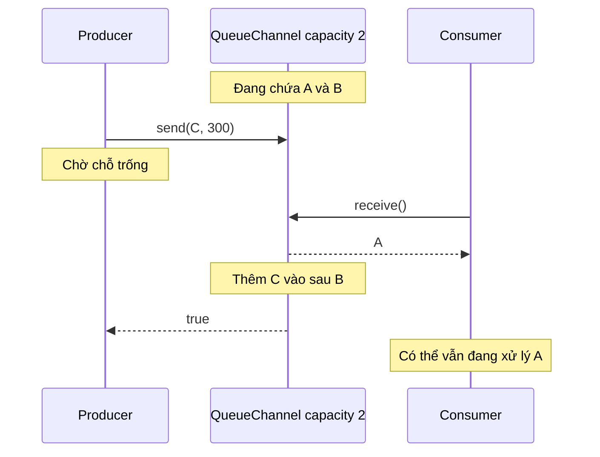

# Send timeout trong QueueChannel

Trong chương **Queue và pollable channel** của module `SPRING_INTEGRATION_CORE`, bài này giải thích cách giới hạn thời gian producer chờ đưa một `Message` vào queue. Đây là một phần của việc thiết kế luồng thông điệp bằng channel, endpoint, gateway và Java DSL: một queue giúp tách tốc độ gửi khỏi tốc độ xử lý, nhưng producer vẫn cần quyết định phải làm gì khi queue không còn chỗ.

Sau bài học, bạn có thể chọn giá trị timeout, xử lý kết quả gửi và cấu hình giới hạn chờ tại đúng thành phần. Các ví dụ dùng `QueueChannel` trong bộ nhớ với capacity hữu hạn; không suy rộng mọi đặc điểm của nó sang channel dùng queue tùy biến hoặc kho lưu trữ bền vững.

## 1. Send timeout giới hạn giai đoạn nào?

Xét luồng tiếp nhận yêu cầu xuất báo cáo:

```text
Producer --send(message, timeout)--> QueueChannel --> Polling consumer
                                                        |
                                                        v
                                                Tạo báo cáo
```

Có ba thời điểm khác nhau:

1. Producer bắt đầu gọi `send`.
2. Channel nhận message vào queue.
3. Consumer lấy message ra và thực hiện nghiệp vụ.

**Send timeout giới hạn việc chờ gửi tại channel.** Với queue hữu hạn đang đầy, đó là thời gian chờ có chỗ để thêm message. Một lần `send` thành công xác nhận việc đưa message vào queue; nó không xác nhận báo cáo đã được tạo. [Tham khảo hành vi QueueChannel](https://docs.spring.io/spring-integration/reference/channel/implementations.html).

Ví dụ do bài học đặt ra: queue có capacity 2, đang chứa `A` và `B`; producer muốn gửi `C` với timeout 300 ms.



Nếu trong khoảng chờ không có consumer lấy message ra, lần gửi `C` có thể hết hạn và trả về `false`. Message `C` chưa được lần gửi đó thêm vào queue. Việc tăng timeout chỉ cho producer cơ hội chờ lâu hơn; nó không làm consumer xử lý nhanh hơn.

## 2. API và ý nghĩa từng giá trị

`MessageChannel` cung cấp hai cách gửi:

```java
boolean send(Message<?> message);
boolean send(Message<?> message, long timeout);
```

Tham số `timeout` có đơn vị **mili giây**. Với `QueueChannel` được tạo bằng `new QueueChannel(capacity)`, hãy dùng các quy ước sau:

| Cách gọi | Khi queue đang đầy | Mục đích thường gặp |
| --- | --- | --- |
| `send(message, 0)` | Thử gửi ngay, không chờ chỗ trống | Từ chối sớm khi quá tải |
| `send(message, 200)` | Chờ có chỗ tối đa theo ngân sách 200 ms | Hấp thụ một đợt nghẽn ngắn |
| `send(message, MessageChannel.INDEFINITE_TIMEOUT)` | Chờ không có thời hạn định trước | Chỉ dùng khi chấp nhận giữ luồng gửi |
| `send(message)` | Có thể chờ vô hạn | Cần cân nhắc nếu queue hữu hạn |

`MessageChannel.INDEFINITE_TIMEOUT` có giá trị `-1`. Khi queue còn chỗ, không cần chờ hết timeout mới gửi: timeout là giới hạn chờ, không phải thời gian trì hoãn bắt buộc. [Hợp đồng MessageChannel](https://docs.spring.io/spring-framework/docs/current/javadoc-api/org/springframework/messaging/MessageChannel.html).

Đừng dùng `0` với ý nghĩa “chờ mãi”. Sai khác này có thể làm ứng dụng từ chối hàng loạt message ngay khi xảy ra một đợt tăng tải.

Ở mức triển khai queue có hỗ trợ blocking, các nhánh xử lý tương ứng với thử thêm ngay, thêm có thời hạn và thêm với khả năng chờ vô hạn. Nếu thread bị interrupt trong lúc chờ, `QueueChannel` trả về `false` và khôi phục cờ interrupt. Vì vậy, `false` không tự nó chứng minh rằng đã dùng hết toàn bộ timeout. [Mã nguồn QueueChannel](https://raw.githubusercontent.com/spring-projects/spring-integration/main/spring-integration-core/src/main/java/org/springframework/integration/channel/QueueChannel.java).

## 3. Ví dụ tối thiểu: queue đầy và thử gửi lại

Ví dụ dưới đây chỉ cần thư viện `spring-integration-core` và các phụ thuộc Spring tương ứng. Nó dùng channel trực tiếp, không khởi tạo application context hay poller.

```java
import org.springframework.integration.channel.QueueChannel;
import org.springframework.messaging.Message;
import org.springframework.messaging.support.MessageBuilder;

public class SendTimeoutDemo {

    public static void main(String[] args) {
        QueueChannel channel = new QueueChannel(1);

        Message<String> first = MessageBuilder
                .withPayload("report-001")
                .build();
        Message<String> second = MessageBuilder
                .withPayload("report-002")
                .build();

        boolean firstAccepted = channel.send(first, 0);
        boolean secondAccepted = channel.send(second, 100);

        System.out.println(firstAccepted);  // true
        System.out.println(secondAccepted); // false: chưa có ai lấy first ra

        Message<?> received = channel.receive(0);
        System.out.println(received.getPayload()); // report-001

        boolean acceptedAfterReceive = channel.send(second, 0);
        System.out.println(acceptedAfterReceive); // true
    }
}
```

Trong tình huống này, lần gửi thứ hai không tự thay thế message đầu tiên. Sau khi `receive(0)` lấy message đầu ra, producer mới có thể đưa message thứ hai vào.

Ví dụ cũng cho thấy queue tự chứa message mà chưa cần consumer đang hoạt động. Nếu chạy lại với `new QueueChannel(2)`, cả hai lần gửi đầu đều thành công; khi đó kết quả dự kiến phải thay đổi theo capacity.

## 4. Xử lý kết quả ở phía producer

Với lời gọi trực tiếp, không được bỏ qua giá trị `boolean`:

```java
// Dễ mất dấu yêu cầu bị từ chối nếu không kiểm tra kết quả.
reportRequests.send(message, 200);
```

Một cách biểu diễn rõ hơn là đưa kết quả tiếp nhận vào hợp đồng ứng dụng:

```java
import org.springframework.messaging.MessageChannel;
import org.springframework.messaging.support.MessageBuilder;

public final class ReportSubmissionService {

    public enum SubmissionResult {
        ACCEPTED,
        NOT_ACCEPTED,
        INTERRUPTED
    }

    private final MessageChannel requests;

    public ReportSubmissionService(MessageChannel requests) {
        this.requests = requests;
    }

    public SubmissionResult submit(String requestId) {
        var message = MessageBuilder.withPayload(requestId)
                .setHeader("requestId", requestId)
                .build();

        boolean accepted = this.requests.send(message, 200);

        if (accepted) {
            return SubmissionResult.ACCEPTED;
        }
        if (Thread.currentThread().isInterrupted()) {
            return SubmissionResult.INTERRUPTED;
        }
        return SubmissionResult.NOT_ACCEPTED;
    }
}
```

Trong ví dụ này, `ACCEPTED` chỉ có nghĩa hệ thống đã nhận vào channel. `NOT_ACCEPTED` cho phép tầng gọi quyết định phản hồi quá tải, ghi nhận để xử lý lại, hoặc áp dụng chính sách khác. Nhánh `INTERRUPTED` bảo toàn tín hiệu dừng; không gọi `Thread.interrupted()` chỉ để kiểm tra, vì phương thức đó xóa cờ interrupt.

Các lỗi runtime vẫn có thể được ném ra, chẳng hạn từ validation hoặc interceptor. Không gom mọi exception thành “queue đầy”: cách xử lý lỗi cấu hình khác với cách xử lý quá tải. [API gửi message](https://docs.spring.io/spring-framework/docs/current/javadoc-api/org/springframework/messaging/MessageChannel.html), [hạ tầng interceptor của channel](https://docs.spring.io/spring-integration/api/org/springframework/integration/channel/AbstractMessageChannel.html).

## 5. Cấu hình QueueChannel và consumer bằng Java DSL

Capacity được cấu hình trên channel; timeout gửi được chọn tại nơi thực hiện thao tác gửi. Hai quyết định này có quan hệ với nhau nhưng không phải cùng một thuộc tính.

```java
import java.time.Duration;

import org.springframework.context.annotation.Bean;
import org.springframework.context.annotation.Configuration;
import org.springframework.integration.channel.QueueChannel;
import org.springframework.integration.config.EnableIntegration;
import org.springframework.integration.dsl.IntegrationFlow;
import org.springframework.integration.dsl.Pollers;

@Configuration
@EnableIntegration
public class ReportFlowConfiguration {

    @Bean
    public QueueChannel reportRequests() {
        return new QueueChannel(20);
    }

    @Bean
    public IntegrationFlow reportFlow(QueueChannel reportRequests) {
        return IntegrationFlow.from(reportRequests)
                .handle(String.class, (requestId, headers) -> {
                    // Thay bằng lời gọi dịch vụ tạo báo cáo trong ứng dụng.
                    System.out.println("Processing " + requestId);
                    return null; // Kết thúc luồng một chiều.
                }, endpoint -> endpoint.poller(
                        Pollers.fixedDelay(Duration.ofMillis(50))
                                .receiveTimeout(0)
                                .maxMessagesPerPoll(5)))
                .get();
    }
}
```

Đây là một cấu hình độc lập để import vào Spring context; ứng dụng cần cung cấp `spring-integration-core`. Consumer là endpoint polling vì đầu vào là một `PollableChannel`. Java DSL cung cấp `Pollers` để cấu hình lịch và các thuộc tính polling. [Cấu hình channel](https://docs.spring.io/spring-integration/reference/channel/configuration.html), [Pollers trong Java DSL](https://docs.spring.io/spring-integration/reference/dsl/java-pollers.html).

Trong cấu hình minh họa:

- Capacity 20 giới hạn số message đang nằm trong queue.
- `fixedDelay(50 ms)` điều khiển khoảng nghỉ giữa các lượt polling.
- `receiveTimeout(0)` khiến thao tác nhận không chờ khi queue rỗng.
- `maxMessagesPerPoll(5)` giới hạn số message của một lượt poll; nó không tạo năm consumer song song.

Producer vẫn phải gọi `reportRequests.send(message, 200)` hoặc dùng một thành phần gửi đã cấu hình timeout. Đặt `receiveTimeout(0)` cho poller không làm producer tự động chuyển sang gửi không chờ.

Queue giảm số phần tử ngay khi consumer lấy message ra. Vì vậy, capacity 20 không đồng nghĩa toàn hệ thống chỉ có tối đa 20 công việc chưa hoàn tất: còn có công việc đang được consumer xử lý.

## 6. Dùng MessagingTemplate: thất bại gửi trở thành exception

Khi gửi qua `MessagingTemplate`, hợp đồng của lời gọi khác với gọi trực tiếp `MessageChannel.send`:

```java
import org.springframework.integration.channel.QueueChannel;
import org.springframework.integration.core.MessagingTemplate;
import org.springframework.messaging.MessageDeliveryException;
import org.springframework.messaging.support.MessageBuilder;

QueueChannel channel = new QueueChannel(1);
channel.send(MessageBuilder.withPayload("existing-report").build(), 0);

MessagingTemplate template = new MessagingTemplate();
template.setSendTimeout(150);

try {
    template.send(channel,
            MessageBuilder.withPayload("new-report").build());
} catch (MessageDeliveryException ex) {
    // Ví dụ không có consumer: queue vẫn đầy sau khoảng chờ gửi.
    System.out.println("Yêu cầu chưa được channel tiếp nhận");
}
```

Đoạn trên là phần thân minh họa để đặt trong một phương thức. `template.send(...)` trả về `void`; khi thao tác gửi vào channel trả về `false`, template ném `MessageDeliveryException`. Tại nơi dùng template, hãy xử lý exception theo chính sách ứng dụng thay vì chờ một kết quả `boolean`. [MessagingTemplate API](https://docs.spring.io/spring-integration/api/org/springframework/integration/core/MessagingTemplate.html), [triển khai GenericMessagingTemplate](https://raw.githubusercontent.com/spring-projects/spring-framework/main/spring-messaging/src/main/java/org/springframework/messaging/core/GenericMessagingTemplate.java).

Một message có header `sendTimeout` không có nghĩa mọi channel tự đọc header đó. Với template, header timeout có thể ghi đè giá trị mặc định theo cơ chế của template; còn lời gọi trực tiếp `channel.send(message, 150)` sử dụng tham số timeout được truyền vào. Đặt timeout ở nơi gửi giúp tránh nhầm lẫn về thành phần thực sự áp dụng nó. [Cơ chế timeout của template](https://raw.githubusercontent.com/spring-projects/spring-framework/main/spring-messaging/src/main/java/org/springframework/messaging/core/GenericMessagingTemplate.java).

## 7. Gateway: phân biệt request timeout và reply timeout

Gateway có thể che API message khỏi mã nghiệp vụ, nhưng vẫn cần giới hạn chờ gửi vào request channel:

```java
import org.springframework.integration.annotation.MessagingGateway;

@MessagingGateway(
        defaultRequestChannel = "reportRequests",
        defaultRequestTimeout = "200")
public interface ReportGateway {
    void submit(String requestId);
}
```

Ứng dụng cần đăng ký gateway, ví dụ bằng `@IntegrationComponentScan` trên lớp cấu hình trong package phù hợp. `defaultRequestTimeout` áp dụng cho bước gửi request có khả năng block, như khi request channel là queue đầy. Phương thức `void` thể hiện luồng một chiều; việc trả về bình thường không xác nhận báo cáo đã hoàn thành. [MessagingGateway API](https://docs.spring.io/spring-integration/api/org/springframework/integration/annotation/MessagingGateway.html).

Với gateway có trả kết quả nghiệp vụ, cần thêm consumer tạo reply và giữ thông tin trả lời. Khi đó:

| Giới hạn | Điều đang được chờ |
| --- | --- |
| Request/send timeout | Gửi được request vào channel |
| Reply timeout | Nhận được message phản hồi |
| Timeout gọi HTTP/DB ở consumer | Hoàn tất thao tác của thư viện tương ứng |

`defaultReplyTimeout` cấu hình thời gian đợi phản hồi của gateway. Nó không tự biến request timeout thành giới hạn cho mọi bước của luồng. [Thuộc tính timeout của gateway](https://docs.spring.io/spring-integration/api/org/springframework/integration/annotation/MessagingGateway.html).

Ví dụ do bài học đặt ra: gửi vào queue mất 120 ms rồi consumer mất 2 giây tạo báo cáo. Send timeout 200 ms vẫn có thể đạt yêu cầu ở bước gửi. Nếu nghiệp vụ cần hoàn tất trong 1 giây, thiết kế phải có ngân sách xử lý và phản hồi riêng.

## 8. Backpressure và lựa chọn ngân sách chờ

Queue hữu hạn cùng send timeout tạo ra một điểm thể hiện quá tải: producer phải chờ hoặc nhận kết quả không được tiếp nhận. Từ đó ứng dụng có thể điều tiết tốc độ gửi. Tuy nhiên, timeout không tự giảm lượng request bên ngoài; cần chính sách tại tầng gọi.

Một tình huống thiết kế giả định:

- Producer tạo 100 yêu cầu mỗi giây.
- Consumer chỉ xử lý trung bình 60 yêu cầu mỗi giây.
- Queue có capacity 200 và ban đầu rỗng.

Nếu tốc độ giữ ổn định, chưa có từ chối và bỏ qua dao động, backlog tăng khoảng 40 message mỗi giây; queue đạt giới hạn sau khoảng `200 / 40 = 5` giây. Đây là ước lượng để suy luận thiết kế, không phải cam kết hiệu năng của Spring Integration.

Tăng send timeout từ 200 ms lên 5 giây không xử lý được chênh lệch tốc độ kéo dài. Nó có thể làm nhiều thread producer bị giữ lâu hơn. Tăng capacity chỉ kéo dài thời gian trước khi queue đầy và có thể tăng độ trễ chờ trong queue.

Hãy chọn ngân sách chờ từ yêu cầu của nơi gọi. Ví dụ giả định tổng thời gian phản hồi mong muốn là 500 ms, tầng vào dự trù 100 ms cho xác thực và tạo message, 50 ms cho tạo phản hồi. Nếu chọn send timeout 200 ms, còn một khoảng dự phòng cho dao động. Các con số này cần đo và điều chỉnh trong ứng dụng cụ thể.

Timeout gửi cũng không phải đồng hồ cưỡng chế cho toàn bộ phương thức. Thời gian quan sát được còn chịu ảnh hưởng của lập lịch thread và công việc như interceptor trước hoặc sau thao tác queue. Không dùng nó để kết luận rằng mọi lời gọi sẽ kết thúc đúng tại mốc thời gian đã đặt. [Channel có hỗ trợ interceptor](https://docs.spring.io/spring-integration/api/org/springframework/integration/channel/AbstractMessageChannel.html).

## 9. Retry, lỗi và độ tin cậy

Khi một lần gửi trực tiếp vào queue chuẩn trả về `false` vì hết thời gian chờ chỗ trống, message đó chưa được thêm bởi lần gửi ấy. Ứng dụng cần giữ đủ thông tin để từ chối rõ ràng hoặc thử lại. Một vòng lặp gọi `send(message, 0)` liên tục có thể tiêu tốn CPU và gây áp lực thêm trong lúc consumer đã quá tải.

Nếu dùng retry, cần đồng thời giới hạn số lần, tổng thời gian và khoảng nghỉ; dùng jitter khi nhiều producer có thể thử lại cùng lúc. Với nghiệp vụ quan trọng, một lựa chọn kiến trúc là ghi nhận yêu cầu bền vững rồi xử lý lại có kiểm soát. Đây là các chính sách ứng dụng, không phải hành vi tự có của `send`.

Lỗi gửi và lỗi consumer thuộc hai giai đoạn khác nhau:

```text
send trả false --> Producer xử lý việc chưa tiếp nhận

send trả true  --> Message đã vào queue
                         |
                         v
                  Consumer lấy ra
                         |
                         v
                  Nghiệp vụ có thể lỗi
```

Đừng giả định `send` trả về `false` thì Spring tự chuyển message sang `errorChannel`. Cũng đừng coi một lần enqueue thành công là bảo đảm xử lý đúng một lần. Nếu producer nhận timeout ở một tầng bên ngoài trong khi việc tiếp nhận bên trong đã xảy ra, thử lại toàn bộ request có thể tạo trùng; nên có khóa nghiệp vụ và cơ chế idempotency phù hợp.

`QueueChannel` mặc định lưu trong bộ nhớ. Muốn tồn tại qua sự cố tiến trình cần thiết kế lưu trữ riêng; việc cấu hình timeout không cung cấp persistence hay tự đưa message đã lấy ra trở lại queue. [QueueChannel và lưu trữ bền vững](https://docs.spring.io/spring-integration/reference/channel/configuration.html).

## 10. Kiểm thử hành vi gửi

Các ví dụ JUnit 5 sau là mã thực hành cho người học. Chúng kiểm tra kết quả và nội dung queue, không khẳng định đồng hồ phải khớp từng mili giây.

```java
import org.junit.jupiter.api.Test;
import org.springframework.integration.channel.QueueChannel;
import org.springframework.messaging.Message;
import org.springframework.messaging.support.MessageBuilder;

import static org.junit.jupiter.api.Assertions.*;

class QueueSendTimeoutTest {

    private Message<String> message(String payload) {
        return MessageBuilder.withPayload(payload).build();
    }

    @Test
    void rejectsImmediatelyWhenQueueIsFull() {
        QueueChannel channel = new QueueChannel(1);
        Message<String> first = message("A");
        Message<String> second = message("B");

        assertTrue(channel.send(first, 0));
        assertFalse(channel.send(second, 0));

        assertSame(first, channel.receive(0));
        assertNull(channel.receive(0));
    }

    @Test
    void rejectsAfterBoundedWaitWhenNobodyReceives() {
        QueueChannel channel = new QueueChannel(1);
        Message<String> first = message("A");

        assertTrue(channel.send(first, 0));
        assertFalse(channel.send(message("B"), 40));

        assertSame(first, channel.receive(0));
        assertNull(channel.receive(0));
    }

    @Test
    void acceptsAnotherMessageAfterSpaceIsReleased() {
        QueueChannel channel = new QueueChannel(1);
        Message<String> first = message("A");
        Message<String> second = message("B");

        assertTrue(channel.send(first, 0));
        assertSame(first, channel.receive(0));

        assertTrue(channel.send(second, 100));
        assertSame(second, channel.receive(0));
    }
}
```

Test thứ hai không có consumer nên queue không thể tự có chỗ trống. Test thứ ba kiểm tra gửi sau khi giải phóng chỗ, không kiểm tra việc đánh thức một producer đang bị block. Khi bổ sung bài thực hành đa luồng cho tình huống đó, hãy dùng đồng bộ hóa và deadline của bộ kiểm thử, tránh dựa duy nhất vào `Thread.sleep` để đoán thread đã đến bước nào.

Các trường hợp nên quan sát thêm trong ứng dụng là template ném exception khi gửi thất bại và việc hủy tác vụ khi producer đang chờ. Không dùng một test cố ý gọi `send(message)` vào queue đầy trên thread kiểm thử chính mà không có cơ chế giải phóng hoặc hủy: test có thể treo vô hạn.

## 11. Những nhầm lẫn cần tránh

| Nhận định | Cách hiểu đúng trong bài này |
| --- | --- |
| Timeout 0 nghĩa là chờ mãi | Timeout 0 thử gửi ngay |
| `send` thành công nghĩa là xong nghiệp vụ | Với QueueChannel, message đã được đưa vào queue |
| Có header `sendTimeout` thì channel luôn áp dụng | Phải xác định thành phần đọc header; template có cơ chế riêng |
| Poller có receive timeout thì producer cũng có send timeout | Hai bên cấu hình hai thao tác riêng |
| Queue là bất đồng bộ nên producer không thể block | Producer vẫn có thể chờ khi queue đầy |
| Queue còn chỗ thì phải đợi đủ timeout | Message có thể được thêm ngay |
| Tăng timeout giải quyết thiếu năng lực xử lý | Cần điều chỉnh tải vào, consumer hoặc chính sách quá tải |
| Đổi sang DirectChannel vẫn chặn handler ở mốc send timeout | Không dùng tham số đó như cơ chế hủy handler đồng bộ |

Điểm cuối đặc biệt quan trọng khi thay đổi kiến trúc: `DirectChannel` gọi handler trên thread gửi, khác với bước enqueue của `QueueChannel`. Tham số timeout gửi không phải cơ chế cưỡng chế dừng handler đang chạy. [DirectChannel](https://docs.spring.io/spring-integration/reference/channel/implementations.html).

## 12. Thực hành tự kiểm tra

1. Chạy ví dụ capacity 1, giải thích vì sao lần gửi thứ hai thất bại.
2. Đổi capacity thành 2 và dự đoán kết quả trước khi chạy.
3. Thay timeout dương bằng 0, quan sát cùng kết quả từ chối khi queue đầy nhưng khác chính sách chờ.
4. Đưa thao tác gửi qua `MessagingTemplate`, xử lý `MessageDeliveryException` thay cho giá trị `boolean`.
5. Tích hợp consumer bằng Java DSL và theo dõi số lần gửi không được tiếp nhận khi tăng tải.
6. Nêu riêng ba ngân sách: chờ đưa vào queue, chờ phản hồi và gọi dịch vụ ngoài.

Với một luồng thực tế, hãy ghi nhận thời gian gửi, số lần không tiếp nhận, độ sâu queue và thời gian xử lý consumer. Đọc các chỉ số cùng nhau để quyết định thay đổi timeout, capacity hay năng lực xử lý; một con số timeout riêng lẻ không giải thích đầy đủ tình trạng nghẽn.
