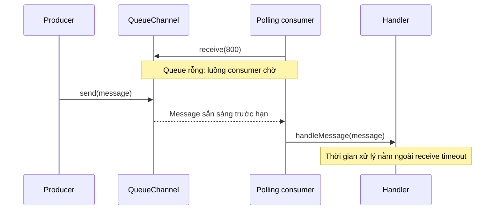

# Receive timeout trong Queue và pollable channel

Trong Spring Integration Core, `receive timeout` là khoảng thời gian bên nhận chấp nhận chờ để lấy một `Message` từ `PollableChannel` khi chưa có thông điệp sẵn sàng. Hiểu đúng tham số này giúp thiết kế luồng thông điệp có độ trễ phù hợp, sử dụng luồng thực thi hợp lý và tránh nhầm việc chờ dữ liệu với việc xử lý dữ liệu.

Bài học thuộc chương **Queue và pollable channel**, tập trung vào `QueueChannel` dùng hàng đợi trong bộ nhớ và polling endpoint tiêu thụ từ kênh này. Các ví dụ dùng API Spring Integration và Java DSL; dự án cần có thư viện `spring-integration-core` với phiên bản được quản lý nhất quán, chẳng hạn qua dependency management của Spring Boot.

## 1. Vị trí của receive timeout trong luồng thông điệp

Một producer tạo thông điệp rồi gửi vào `QueueChannel`. Consumer lấy thông điệp ra trước khi chuyển nó đến transformer, router, filter, service activator hoặc thành phần xử lý khác.



Với `QueueChannel`, một thông điệp được lấy bởi một consumer, kể cả khi nhiều consumer cùng đọc kênh. Nếu queue đã có dữ liệu, thao tác nhận có thể trả về ngay; tham số timeout chỉ có ý nghĩa chờ khi chưa lấy được dữ liệu. Đây là hành vi hàng đợi được mô tả trong [tài liệu Message Channel Implementations](https://docs.spring.io/spring-integration/reference/channel/implementations.html).

Ví dụ tự xây dựng: luồng xử lý đơn hàng gọi `receive(800)`, rồi đơn hàng xuất hiện sau khoảng 120 ms. Consumer có thể nhận đơn hàng lúc đó; nó không phải chờ cho đủ 800 ms. Nếu xử lý đơn hàng tiếp tục mất 2 giây, giá trị 800 ms cũng không ngắt handler.

## 2. Ý nghĩa của các cách gọi receive

`PollableChannel` nằm trong package `org.springframework.messaging`. Hai cách gọi cần phân biệt là:

```java
Message<?> receive();
Message<?> receive(long timeout);
```

Với `QueueChannel` thông thường:

| Cách gọi | Nếu queue rỗng | Nếu nhận được thông điệp |
| --- | --- | --- |
| `receive(0)` | Trả về `null` ngay, không chờ dữ liệu | Trả về thông điệp |
| `receive(300)` | Chờ tối đa khoảng 300 ms cho dữ liệu | Trả về ngay khi lấy được thông điệp |
| `receive(-1)` | Chờ không giới hạn cho đến khi có dữ liệu hoặc bị interrupt | Trả về khi lấy được thông điệp |
| `receive()` | Chờ không giới hạn tương tự giá trị âm | Trả về khi lấy được thông điệp |

Đơn vị của tham số `long timeout` là **millisecond**. Giá trị âm biểu thị chờ không giới hạn; không riêng `-1`. `AbstractPollableChannel` cho phép kết quả `null` khi hết thời gian hoặc luồng nhận bị interrupt. Xem [Javadoc AbstractPollableChannel](https://docs.spring.io/spring-integration/api/org/springframework/integration/channel/AbstractPollableChannel.html).

“Không chờ” ở `receive(0)` nghĩa là không đợi thông điệp xuất hiện. Lời gọi vẫn có chi phí thực thi, khóa nội bộ và interceptor; không nên hiểu nó là thao tác có thời lượng tuyệt đối bằng không. Tương tự, timeout hữu hạn không phải cam kết thời gian thực cứng cho toàn bộ lời gọi trong mọi điều kiện hệ thống.

### 2.1. Nhận trực tiếp và xử lý trường hợp không có dữ liệu

```java
import org.springframework.integration.channel.QueueChannel;
import org.springframework.messaging.Message;
import org.springframework.messaging.support.MessageBuilder;

public class ReceiveTimeoutDemo {

    public static void main(String[] args) {
        QueueChannel orders = new QueueChannel(10);

        Message<?> absent = orders.receive(0);
        System.out.println(absent == null); // true: queue đang rỗng

        boolean accepted = orders.send(
                MessageBuilder.withPayload("order-101").build(), 0);
        if (!accepted) {
            throw new IllegalStateException("Không đưa được đơn vào queue");
        }

        Message<?> received = orders.receive(500);
        if (received != null) {
            System.out.println(received.getPayload()); // order-101
        }

        Message<?> noNextOrder = orders.receive(100);
        if (noNextOrder == null) {
            System.out.println("Chưa nhận được đơn tiếp theo");
        }
    }
}
```

Ví dụ gửi thông điệp trước khi nhận nên lần `receive(500)` không cần đợi đủ 500 ms. Lần cuối dùng khoảng chờ hữu hạn để chương trình có thể tiếp tục nếu không có đơn mới.

Không gọi `getPayload()` trước khi kiểm tra kết quả nhận. `null` biểu thị không nhận được thông điệp; nó không phải một `Message` có payload rỗng.

## 3. Phân biệt các loại timeout dễ nhầm

| Cấu hình | Câu hỏi mà nó trả lời | Điều không thể suy ra |
| --- | --- | --- |
| `queue.receive(timeout)` | Consumer đợi bao lâu để lấy được một thông điệp? | Handler sẽ hoàn tất trong khoảng đó |
| `queue.send(message, timeout)` | Producer đợi bao lâu để có thể đưa thông điệp vào queue khi queue đầy? | Consumer đã xử lý thành công |
| `receiveTimeout` của poller | Mỗi lần polling consumer gọi nhận sẽ dùng khoảng chờ nào? | Toàn bộ một lượt poll chỉ kéo dài bấy nhiêu |
| Khoảng chờ phản hồi của gateway | Caller đợi phản hồi của luồng request/reply bao lâu? | Công việc phía sau đã bị hủy khi caller hết chờ |
| Timeout HTTP/JDBC hoặc thư viện nghiệp vụ | Một thao tác I/O cụ thể được chờ theo cơ chế nào? | Queue tự áp dụng cùng giới hạn |

Bảng này là cách phân tích thiết kế: mỗi khoảng chờ thuộc một ranh giới khác nhau. Muốn giới hạn thời gian từ lúc nhận yêu cầu đến lúc trả kết quả, cần thiết kế ngân sách thời gian cho cả chuỗi.

Ví dụ một gateway chờ phản hồi 1 giây, trong khi handler gọi dịch vụ ngoài tới 3 giây. Đổi receive timeout của queue từ 500 ms xuống 50 ms chỉ thay đổi giai đoạn đợi lấy thông điệp. Việc hủy hay tiếp tục lời gọi dịch vụ phải được quyết định riêng bằng cơ chế của handler và thư viện I/O.

## 4. Receive timeout của polling endpoint

Khi một endpoint đọc từ `PollableChannel`, Spring Integration dùng `PollingConsumer` để nối kênh với `MessageHandler`. Consumer này có mặc định receive timeout là **1.000 ms**, theo [Javadoc PollingConsumer](https://docs.spring.io/spring-integration/api/org/springframework/integration/endpoint/PollingConsumer.html).

Cần phân biệt hai mặc định:

- Tự gọi `queue.receive()` không truyền tham số: có thể chờ không giới hạn khi queue rỗng.
- Để polling endpoint sử dụng receive timeout mặc định: consumer dùng khoảng chờ hữu hạn của nó.

Không dùng hành vi của lời gọi không tham số để suy ra cách cấu hình mặc định của endpoint.

Ba tham số thường phải cân nhắc cùng nhau là:

| Tham số | Vai trò |
| --- | --- |
| Trigger, chẳng hạn `fixedDelay` | Xác định lịch bắt đầu các lượt poll |
| `receiveTimeout` | Khoảng chờ dữ liệu của từng lần nhận |
| `maxMessagesPerPoll` | Giới hạn số thông điệp được nhận trong một lượt |

Theo [tài liệu Message Endpoints](https://docs.spring.io/spring-integration/reference/endpoint.html), lượt poll có thể nhận nhiều thông điệp và kết thúc khi không nhận được dữ liệu hoặc đạt giới hạn. Vì vậy, không nên coi một lượt poll luôn tương ứng một lần `receive()`.

### 4.1. Ví dụ Java DSL đầy đủ

Ví dụ sau khai báo hàng đợi đơn hàng, transformer chuẩn hóa mã đơn và kênh chứa kết quả. Poller được gắn tại transformer vì đây là endpoint đầu tiên đọc từ queue.

```java
import java.time.Duration;
import java.util.Locale;

import org.springframework.context.annotation.Bean;
import org.springframework.context.annotation.Configuration;
import org.springframework.integration.channel.QueueChannel;
import org.springframework.integration.config.EnableIntegration;
import org.springframework.integration.dsl.IntegrationFlow;
import org.springframework.integration.dsl.Pollers;

@Configuration
@EnableIntegration
public class OrderFlowConfiguration {

    @Bean
    public QueueChannel orderInput() {
        return new QueueChannel(100);
    }

    @Bean
    public QueueChannel normalizedOrders() {
        return new QueueChannel(100);
    }

    @Bean
    public IntegrationFlow normalizeOrdersFlow() {
        return IntegrationFlow.from(orderInput())
                .<String, String>transform(
                        value -> value.trim().toUpperCase(Locale.ROOT),
                        endpoint -> endpoint.poller(
                                Pollers.fixedDelay(Duration.ofMillis(200))
                                        .receiveTimeout(800)
                                        .maxMessagesPerPoll(1)))
                .channel(normalizedOrders())
                .get();
    }
}
```

Trong một Spring application context đã nạp cấu hình này, producer gửi payload chuỗi vào bean `orderInput`; bên đọc lấy kết quả từ `normalizedOrders`. Java DSL có phương thức `receiveTimeout(long)` nhận giá trị millisecond, được công bố trong [Javadoc PollerSpec](https://docs.spring.io/spring-integration/api/org/springframework/integration/dsl/PollerSpec.html).

Các con số 200 ms, 800 ms và capacity 100 là lựa chọn minh họa. Hãy đọc ví dụ theo từng bước:

1. Một lượt poll bắt đầu và thử lấy một thông điệp từ `orderInput`.
2. Nếu queue rỗng, luồng thực hiện poll có thể chờ tới khoảng 800 ms.
3. Nếu thông điệp xuất hiện trong lúc chờ, transformer xử lý nó ngay khi nhận được.
4. Do giới hạn một thông điệp mỗi lượt, consumer không tiếp tục lấy đơn thứ hai trong cùng lượt đó.
5. Với lịch fixed delay và thực thi đồng bộ như ví dụ, lượt kế tiếp được lên lịch sau khi lượt hiện tại hoàn tất rồi qua khoảng delay.

Kênh đầu ra cũng là queue hữu hạn. Nếu không có bên đọc và nó đầy, bước gửi kết quả có thể chờ, làm kéo dài lượt poll. Receive timeout ở đầu vào không giới hạn bước gửi ra này. Khi triển khai thực tế, cần có consumer đầu ra và chính sách gửi phù hợp với năng lực xử lý.

## 5. Timeline để hiểu độ trễ

Các timeline sau là mô hình tính toán của ví dụ, bỏ qua thời gian lập lịch, interceptor, xử lý và gửi đầu ra; giả sử chỉ có một poller, không có executor bất đồng bộ và `maxMessagesPerPoll = 1`.

### 5.1. Queue luôn rỗng

Với `receiveTimeout = 800 ms` và `fixedDelay = 200 ms`:

```text
0 ms        800 ms       1000 ms       1800 ms
|-- chờ nhận --|-- nghỉ --|-- chờ nhận --|
```

Một lượt trống chiếm khoảng 800 ms chờ dữ liệu. Sau đó mới đến 200 ms delay. Trong mô hình này, hai lần bắt đầu poll liên tiếp cách nhau khoảng 1.000 ms.

Nếu đơn đến tại mốc 350 ms, consumer đang chờ nên có thể lấy được ngay quanh thời điểm đó. Nếu đơn đến tại mốc 850 ms, consumer đang ở khoảng delay nên phải đợi lượt bắt đầu quanh mốc 1.000 ms.

### 5.2. Receive timeout bằng 0

Với `receiveTimeout = 0` và `fixedDelay = 200 ms`, lần nhận từ queue rỗng kết thúc nhanh, rồi poller nghỉ theo lịch. Một đơn đến ngay sau lần kiểm tra có thể phải đợi gần một khoảng delay mới được nhìn thấy, trong mô hình đơn giản này.

Giá trị 0 không biến queue thành kênh đẩy sự kiện. Nó chỉ bỏ giai đoạn chờ của lần nhận hiện tại.

### 5.3. Queue có backlog

Nếu đầu mỗi lượt luôn có đơn sẵn, thời gian chờ nhận gần như không phải nút thắt. Với giới hạn một đơn/lượt và delay 200 ms, tốc độ trong mô hình sẽ bị chi phối bởi số lượt poll cùng thời gian xử lý. Tăng receive timeout từ 800 lên 5.000 ms không tự giúp lấy nhiều đơn hơn mỗi lượt.

Để cải thiện backlog, hãy xem thời gian handler, `maxMessagesPerPoll`, lịch poll, số consumer và năng lực hệ thống đích. Các thay đổi này cần giữ đúng yêu cầu thứ tự và giới hạn tải của nghiệp vụ.

## 6. Phối hợp với maxMessagesPerPoll

Giả sử cấu hình của chính ví dụ được đổi thành:

```java
Pollers.fixedDelay(Duration.ofMillis(200))
        .receiveTimeout(800)
        .maxMessagesPerPoll(10);
```

Tưởng tượng queue có ba đơn ở đầu lượt và không có đơn mới:

```text
receive lần 1 -> đơn A -> xử lý
receive lần 2 -> đơn B -> xử lý
receive lần 3 -> đơn C -> xử lý
receive lần 4 -> chờ dữ liệu -> hết khoảng chờ -> null -> kết thúc lượt
```

Lượt này có thể chứa ba lần xử lý và thêm một lần chờ rỗng. Vì vậy, không thể lấy 800 ms làm giới hạn tổng thời lượng của lượt.

Nếu đơn mới tiếp tục đến trước khi mỗi lần chờ kết thúc, nhiều lần nhận trong cùng lượt có thể cùng tiêu tốn một phần khoảng chờ. Cần đo thời lượng cả lượt khi đánh giá tài nguyên, thay vì chỉ đo thời gian một lần receive.

Trường hợp `maxMessagesPerPoll` âm cần thận trọng: giới hạn số lượng không giúp kết thúc lượt; với nguồn liên tục có dữ liệu, lượt có thể kéo dài. Hãy đặt giới hạn dương rõ ràng cho ví dụ học tập để dễ quan sát hành vi.

## 7. Long polling và tài nguyên thực thi

Khoảng chờ nhận dài tạo điều kiện cho thông điệp đến trong lúc consumer đang chờ được nhận sớm. Đổi lại, tác vụ poll giữ một luồng trong giai đoạn chờ. Tài liệu Spring Integration gọi cách phối hợp này là [long polling](https://docs.spring.io/spring-integration/reference/endpoint.html).

Một luồng bị block khi chờ queue không đồng nghĩa nó đang liên tục chạy vòng lặp và tiêu thụ CPU. Tuy nhiên, nó vẫn là tài nguyên thực thi đang bận với nhiệm vụ đó. Nếu nhiều endpoint cùng chờ trên scheduler ít luồng, các endpoint khác có thể phải đợi tới lượt.

Các lựa chọn dưới đây là định hướng thiết kế, cần đo trên tải của ứng dụng:

| Tình huống | Hướng thử nghiệm | Chỉ số cần xem |
| --- | --- | --- |
| Dữ liệu đến thưa, muốn nhận sớm | Tăng khoảng chờ nhận hữu hạn, giảm khoảng nghỉ nếu cần | Độ trễ lúc nhàn rỗi, số luồng đang chờ |
| Nhiều poller dùng chung scheduler | Giảm thời gian giữ luồng hoặc phân bổ tài nguyên riêng | Độ trễ lập lịch của các endpoint |
| Queue thường xuyên có backlog | Điều chỉnh giới hạn mỗi lượt và năng lực xử lý | Queue depth, throughput, tuổi thông điệp |
| Cần shutdown dễ dự đoán | Tránh chờ vô hạn nếu không có chiến lược interrupt rõ ràng | Thời gian dừng với queue rỗng |

Nếu bổ sung `taskExecutor`, tác vụ polling chuyển sang executor được chỉ định. Khi đó phải đánh giá cả số luồng, hàng đợi tác vụ và khả năng nhiều lượt poll đang tồn tại đồng thời; không áp dụng nguyên xi timeline đồng bộ ở trên. Cơ chế thực thi này được mô tả trong [tài liệu polling consumer](https://docs.spring.io/spring-integration/reference/endpoint.html).

## 8. Timeout, lỗi và vòng đời thông điệp

### 8.1. Hết thời gian chờ nhận không phải lỗi xử lý

Nếu queue rỗng và `receive(300)` trả về `null`, ứng dụng đơn giản là chưa lấy được thông điệp trong lần gọi đó. Không có cơ sở để phát sinh lỗi nghiệp vụ cho một đơn hàng cụ thể, vì consumer chưa nhận đơn nào.

Trong thiết kế giám sát, có thể ghi nhận số lượt poll trống. Chỉ nâng thành cảnh báo khi phù hợp với kỳ vọng dữ liệu, chẳng hạn nguồn đáng lẽ có bản tin theo chu kỳ nhưng im lặng lâu hơn ngưỡng vận hành đã thống nhất.

### 8.2. Không dùng null làm bằng chứng duy nhất về timeout

Kết quả nhận còn có thể là `null` khi luồng bị interrupt theo hợp đồng của `AbstractPollableChannel`. Nếu ứng dụng tự chạy một vòng lặp nhận, cần tôn trọng trạng thái interrupt và kế hoạch dừng. Không bắt mọi tình huống không có dữ liệu rồi lặp vô hạn bất chấp yêu cầu kết thúc.

Trong luồng do Spring quản lý, hãy ưu tiên lifecycle của endpoint thay vì tự tạo thêm vòng lặp consumer cạnh tranh với endpoint mà không có chủ đích.

### 8.3. Không tự động retry hay khôi phục thông điệp

Receive timeout không cấu hình retry, không tạo dead-letter queue và không cấp đặc tính xử lý đúng một lần. Sau khi lấy thông điệp khỏi `QueueChannel` trong bộ nhớ, lỗi handler không có nghĩa hàng đợi tự đặt lại thông điệp.

Ví dụ đơn hàng đã được lấy khỏi queue rồi transformer ném exception. Cần thiết kế đường xử lý lỗi và chính sách phục hồi ở endpoint/handler, hoặc chọn giải pháp lưu trữ và giao nhận phù hợp. Thay receive timeout không giải quyết việc khôi phục này.

Receive timeout cũng không phải TTL của thông điệp. Một đơn đang nằm trong queue không bị xóa chỉ vì một lần receive ở thời điểm khác đã hết hạn chờ.

## 9. Minh họa kiểm thử các nhánh nhận

Đoạn kiểm thử JUnit 5 dưới đây có thể đặt trong một dự án đã có Spring Integration Core và JUnit Jupiter. Nó minh họa ba kết quả quan trọng mà không dựng toàn bộ application context.

```java
import java.util.concurrent.ExecutorService;
import java.util.concurrent.Executors;
import java.util.concurrent.Future;
import java.util.concurrent.TimeUnit;

import org.junit.jupiter.api.Test;
import org.springframework.integration.channel.QueueChannel;
import org.springframework.messaging.Message;
import org.springframework.messaging.support.MessageBuilder;

import static org.junit.jupiter.api.Assertions.*;

class QueueReceiveTimeoutTest {

    @Test
    void emptyQueueReturnsNullWithoutWaitingForData() {
        QueueChannel channel = new QueueChannel(1);
        assertNull(channel.receive(0));
    }

    @Test
    void emptyQueueEventuallyReturnsNullWithFiniteTimeout() {
        QueueChannel channel = new QueueChannel(1);
        assertNull(channel.receive(50));
    }

    @Test
    void consumerCanReceiveMessageSentFromAnotherThread() throws Exception {
        QueueChannel channel = new QueueChannel(1);
        ExecutorService executor = Executors.newSingleThreadExecutor();
        Future<Message<?>> result = null;
        try {
            result = executor.submit(() -> channel.receive(5_000));

            assertTrue(channel.send(
                    MessageBuilder.withPayload("order-102").build(), 0));

            Message<?> received = result.get(6, TimeUnit.SECONDS);
            assertNotNull(received);
            assertEquals("order-102", received.getPayload());
            assertNull(channel.receive(0));
        }
        finally {
            if (result != null) {
                result.cancel(true);
            }
            executor.shutdownNow();
        }
    }
}
```

Bài kiểm thử thứ ba kiểm tra việc trao đổi giữa hai luồng và kết quả nhận, không chứng minh luồng consumer chắc chắn đã block trước khi producer gửi. Trình tự lên lịch có thể khiến thông điệp được gửi trước khi consumer bắt đầu nhận.

Muốn chứng minh riêng nhánh “thông điệp đến khi consumer đang chờ”, cần thêm cơ chế đồng bộ hoặc quan sát điểm chờ thích hợp. Không xem một lệnh `sleep` tùy ý là bằng chứng chắc chắn.

Các bài kiểm thử thời gian nên có biên độ cho môi trường chạy. Không đặt điều kiện thời gian thực thi phải bằng đúng 50 ms; mục tiêu là xác minh kết quả và khả năng kết thúc theo giới hạn phù hợp. `Future.get` ở ví dụ là giới hạn chờ của luồng kiểm thử, tách biệt với receive timeout trong consumer.

## 10. Bài thực hành: chọn timeout cho luồng đơn hàng

Dùng cấu hình Java DSL ở trên làm điểm xuất phát và quan sát ba kịch bản:

1. **Đơn đến sau một khoảng nhàn rỗi:** gửi một đơn khi poller đang đợi và so sánh độ trễ với cấu hình `receiveTimeout(0)`.
2. **Một đợt nhiều đơn:** gửi 20 đơn, quan sát khác biệt giữa `maxMessagesPerPoll(1)` và `maxMessagesPerPoll(10)`. Luôn đọc kênh kết quả để tránh queue đầu ra đầy làm sai lệch quan sát.
3. **Handler xử lý chậm:** thêm độ trễ có kiểm soát ở handler trong môi trường học tập, rồi xác nhận receive timeout nhỏ không tự ngắt handler đó.

Đo từ lúc producer gửi thành công đến lúc consumer bắt đầu xử lý, đồng thời đo riêng thời gian handler. Cách đo tách hai giai đoạn giúp xác định độ trễ đến từ lịch nhận hay từ xử lý nghiệp vụ.

Khi giải thích kết quả, cần trả lời được:

- Vì sao `receive(5_000)` có thể trả về sau vài millisecond?
- Vì sao `receiveTimeout(0)` vẫn cần poller để tiếp tục kiểm tra queue?
- Vì sao tăng receive timeout không giải quyết backlog khi queue luôn có dữ liệu?
- Vì sao một lượt poll có thể dài hơn receive timeout?
- Vì sao cần xử lý `null` và phân biệt nó với exception từ handler?

Những câu hỏi này là cơ sở để chọn timeout theo độ trễ mong muốn, tài nguyên thực thi và hành vi khi không có dữ liệu, thay vì dùng một giá trị cố định cho mọi luồng.