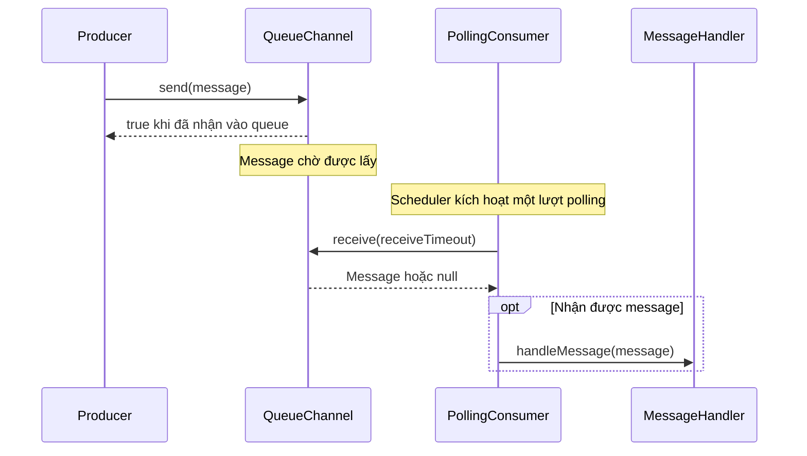
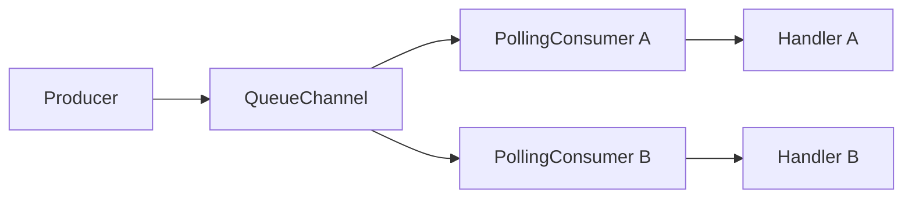

# PollingConsumer đọc QueueChannel

## Mục tiêu bài học

Trong module `SPRING_INTEGRATION_CORE`, hiểu cách endpoint lấy message từ channel giúp bạn thiết kế luồng thông điệp có nhịp xử lý rõ ràng. Bài này thuộc chương **Queue và pollable channel**, tập trung vào cách `PollingConsumer` đọc `QueueChannel` và chuyển message cho một `MessageHandler`.

Sau bài học, bạn có thể:

- Phân biệt nơi lưu message, cơ chế lấy message và nghiệp vụ xử lý message.
- Cấu hình consumer bằng Java DSL hoặc annotation.
- Giải thích tác động của chu kỳ polling, `receiveTimeout` và `maxMessagesPerPoll`.
- Nhận diện nghẽn hàng đợi, cạnh tranh giữa consumer và khả năng mất message khi xử lý lỗi.
- Thiết kế phép kiểm thử có giới hạn thời gian cho luồng polling.

## 1. Vì sao QueueChannel cần một consumer chủ động lấy message?

`QueueChannel` là một hiện thực của `PollableChannel`. Producer gửi một `Message<?>` vào hàng đợi qua `send(...)`; bên nhận lấy message qua `receive(...)`.

Khác với `DirectChannel`, thao tác gửi vào `QueueChannel` không tự gọi handler nghiệp vụ. Một lần gửi thành công chỉ cho biết channel đã chấp nhận message. Handler có thể chưa chạy hoặc sau đó xử lý thất bại.



Trong cấu hình polling đồng bộ thông thường, handler chạy trên thread thực hiện lượt poll. Producer và handler vì thế được tách bằng queue, nhưng `QueueChannel` không tự tạo một thread xử lý nền. Scheduler và endpoint mới cung cấp cơ chế thực thi đó.

### Ba vai trò cần tách biệt

| Thành phần | Trách nhiệm | Không tự bảo đảm |
| --- | --- | --- |
| `QueueChannel` | Giữ message đang chờ và cung cấp `send`/`receive` | Gọi nghiệp vụ, retry hay lưu bền qua lần khởi động lại |
| `PollingConsumer` | Theo lịch, nhận message từ một `PollableChannel` rồi gọi handler | Xử lý nghiệp vụ thay handler hay tự đưa mọi message lỗi trở lại queue |
| `MessageHandler` | Thực hiện transformer, service activator, filter hoặc bước xử lý tương ứng | Tự lên lịch đọc queue |

Ví dụ thực tế: API tiếp nhận yêu cầu tạo báo cáo và đặt yêu cầu vào queue. Endpoint nền lấy từng yêu cầu để tạo báo cáo. Phản hồi “đã tiếp nhận” và trạng thái “báo cáo hoàn tất” là hai sự kiện khác nhau.

## 2. PollingConsumer nằm ở đâu trong endpoint?

Khi một service activator nhận đầu vào là `QueueChannel`, Spring Integration cần một polling endpoint để nối channel với handler. `PollingConsumer` là endpoint dành cho tình huống lấy message từ một `PollableChannel` rồi giao cho `MessageHandler`.

Không phải mọi thành phần có poller đều là `PollingConsumer`:

- **Polling consumer:** đọc message đã có trong một channel, chẳng hạn `QueueChannel`.
- **Source polling channel adapter:** gọi một `MessageSource` để lấy dữ liệu từ nguồn, chẳng hạn nguồn file hoặc nguồn do ứng dụng tự viết, rồi gửi message vào luồng.

Điểm phân biệt là **đối tượng được poll**. Bài này nói về channel đã chứa message.

Với Java DSL, bạn thường khai báo channel, handler và poller; framework tạo endpoint phù hợp. Không cần tự tạo vòng lặp `while (true)` để gọi `receive()`.

## 3. Một lượt polling diễn ra như thế nào?

Mô hình dưới đây mô tả cấu hình cơ bản, không gắn transaction, advice hay task executor riêng:

```text
Scheduler kích hoạt lượt polling
    |
    +-- receive(receiveTimeout)
    |      |
    |      +-- Không có message: kết thúc lượt polling
    |      |
    |      +-- Có message: gọi handler
    |                         |
    |                         +-- Thành công: xét đọc message tiếp theo
    |                         +-- Ném lỗi: chuyển sang cơ chế xử lý lỗi
    |
    +-- Dừng khi đạt maxMessagesPerPoll hoặc khi không nhận được message
```

Đây là mô hình giải thích, không phải mã nguồn của framework. Khi bật transaction, retry, advice hoặc executor riêng, cần xem thêm phạm vi thực thi của từng cơ chế.

### 3.1. Trigger quyết định lúc bắt đầu một lượt

Hai lựa chọn phổ biến:

- `fixedDelay`: đợi một khoảng sau khi tác vụ theo lịch kết thúc rồi mới kích hoạt lượt kế tiếp.
- `fixedRate`: nhắm tới một nhịp kích hoạt định kỳ dựa trên thời gian.

`fixedRate` không tự bảo đảm có nhiều handler chạy song song và không bảo đảm mỗi message được xử lý đúng một lần mỗi khoảng thời gian. Khả năng chạy đồng thời còn phụ thuộc scheduler, executor và cấu hình endpoint.

### 3.2. receiveTimeout quyết định thời gian chờ nhận

Với `QueueChannel`, timeout khi receive được hiểu như sau:

| Giá trị | Hành vi nhận message |
| --- | --- |
| `0` | Kiểm tra ngay; trả về `null` nếu queue đang rỗng |
| Số dương | Chờ tối đa số mili giây đó nếu chưa có message |
| Số âm | Có thể chờ không giới hạn cho tới khi có message hoặc bị ngắt |

Trong poller chạy trên tài nguyên scheduler dùng chung, timeout hữu hạn thường dễ quản lý hơn. Một lần `receive` chờ lâu có thể giữ thread mà endpoint khác cũng cần.

Timeout không phải thời gian nghỉ giữa hai message. Nếu queue luôn có dữ liệu, consumer có thể lấy message tiếp theo ngay sau khi xử lý xong message trước.

### 3.3. maxMessagesPerPoll giới hạn số message trong một lượt

Với cấu hình:

```java
Pollers.fixedDelay(500)
    .receiveTimeout(0)
    .maxMessagesPerPoll(5)
```

một lượt polling xử lý **tối đa 5 message**. Nếu chỉ có 2 message rồi queue rỗng, lượt đó có thể kết thúc sau 2 message. Đây không phải yêu cầu chờ đủ một nhóm 5 phần tử.

Giới hạn này cũng không biến payload thành danh sách. Handler vẫn được gọi theo từng message. Muốn ghép nhiều message thành một kết quả cần một mẫu khác, chẳng hạn aggregator.

Nên đặt một giá trị dương rõ ràng khi học và khi cần giới hạn lượng công việc mỗi lượt. Không nên coi giá trị `0` là cách bật chế độ không giới hạn; với polling endpoint, nó có thể làm các lượt poll không thực hiện việc nhận message. Giá trị âm dùng cho chế độ không giới hạn số message mỗi lượt; nếu queue liên tục có dữ liệu, một lượt có thể kéo dài và chiếm tài nguyên thực thi.

## 4. Ví dụ đầy đủ bằng Java DSL

Giả sử ứng dụng đã có các dependency Spring Integration Core và Spring Context tương thích. Ví dụ dưới dùng API của dòng Spring Integration 6.x và Java 17 trở lên. Các số thời gian trong `fixedDelay(...)` và `receiveTimeout(...)` là mili giây.

```java
import org.springframework.context.annotation.Bean;
import org.springframework.context.annotation.Configuration;
import org.springframework.integration.channel.QueueChannel;
import org.springframework.integration.config.EnableIntegration;
import org.springframework.integration.dsl.IntegrationFlow;
import org.springframework.integration.dsl.Pollers;

@Configuration
@EnableIntegration
public class OrderFlowConfig {

    public record OrderRequest(String orderId, int quantity) {}

    @Bean
    public QueueChannel ordersQueue() {
        return new QueueChannel(100);
    }

    @Bean
    public IntegrationFlow processOrders(QueueChannel ordersQueue) {
        return IntegrationFlow.from(ordersQueue)
            .handle(OrderRequest.class, (order, headers) -> {
                if (order.quantity() <= 0) {
                    throw new IllegalArgumentException(
                        "quantity phải lớn hơn 0: " + order.orderId());
                }

                System.out.println("Đang xử lý đơn " + order.orderId());
                return null;
            }, endpoint -> endpoint.poller(
                Pollers.fixedDelay(500)
                    .receiveTimeout(0)
                    .maxMessagesPerPoll(5)))
            .get();
    }
}
```

Các điểm cần đọc đúng trong cấu hình:

1. `ordersQueue` giữ tối đa 100 message đang chờ trong cấu hình ví dụ.
2. `IntegrationFlow.from(ordersQueue)` xác định đầu vào là channel có thể poll.
3. `.handle(...)` tạo handler xử lý từng payload `OrderRequest`.
4. `.poller(...)` gắn lịch nhận message vào endpoint tiêu thụ queue.
5. `return null` cho biết handler kết thúc bước xử lý mà không phát reply message.

Poller thuộc endpoint đọc queue. Không có thao tác “gắn lịch vào queue” làm mọi consumer của queue tự dùng chung lịch đó.

### Gửi message từ producer

Producer có thể dùng bean `ordersQueue` đã được inject:

```java
import org.springframework.integration.channel.QueueChannel;
import org.springframework.messaging.support.MessageBuilder;

public class OrderProducer {

    private final QueueChannel ordersQueue;

    public OrderProducer(QueueChannel ordersQueue) {
        this.ordersQueue = ordersQueue;
    }

    public void submit(String orderId, int quantity) {
        var message = MessageBuilder
            .withPayload(new OrderFlowConfig.OrderRequest(orderId, quantity))
            .setHeader("requestOrigin", "web")
            .build();

        boolean accepted = ordersQueue.send(message, 200);
        if (!accepted) {
            throw new IllegalStateException(
                "Queue đang đầy, chưa tiếp nhận đơn " + orderId);
        }
    }
}
```

`send(message, 200)` chờ tối đa 200 ms để enqueue khi cần. Nó không đợi nghiệp vụ xử lý đơn hoàn tất. Cần đăng ký `OrderProducer` làm bean hoặc khởi tạo với channel được lấy từ application context khi dùng lớp này.

Capacity 100 giới hạn số message đang nằm trong queue, không giới hạn tổng số message đã được nhận ra và đang xử lý ở những thread khác.

## 5. Cấu hình tương đương bằng annotation

Nếu dùng annotation, có thể đặt `@Poller` trong `@ServiceActivator`. Đoạn dưới là **phương án thay thế** cho bean `processOrders` ở phần DSL. Giữ bean `ordersQueue` và cấu hình `@EnableIntegration`, đồng thời để component scan phát hiện service này.

```java
import org.springframework.integration.annotation.Poller;
import org.springframework.integration.annotation.ServiceActivator;
import org.springframework.stereotype.Component;

@Component
public class OrderHandler {

    @ServiceActivator(
        inputChannel = "ordersQueue",
        poller = @Poller(
            fixedDelay = "500",
            receiveTimeout = "0",
            maxMessagesPerPoll = "5"))
    public void process(OrderFlowConfig.OrderRequest order) {
        if (order.quantity() <= 0) {
            throw new IllegalArgumentException(
                "quantity phải lớn hơn 0: " + order.orderId());
        }
        System.out.println("Đang xử lý đơn " + order.orderId());
    }
}
```

Không giữ cả hai endpoint chỉ để “cấu hình cùng một handler hai cách”. Nếu cả hai cùng hoạt động, chúng trở thành hai consumer cạnh tranh đọc `ordersQueue`.

Khi một pollable input channel không có poller cục bộ, endpoint có thể sử dụng default poller được khai báo trong ứng dụng. Nếu không có cấu hình poller phù hợp, ứng dụng có thể không khởi tạo được endpoint. Khai báo poller ngay tại endpoint giúp ví dụ tự chứa và dễ đọc.

## 6. Đọc nhịp xử lý và khả năng chịu tải

Giả sử:

- `fixedDelay = 500 ms`.
- `maxMessagesPerPoll = 5`.
- `receiveTimeout = 0`.
- Một consumer xử lý đồng bộ, mỗi message mất khoảng 100 ms.
- Queue luôn có đủ message và không có lỗi.

Một lượt cần khoảng `5 × 100 = 500 ms` để xử lý, sau đó nghỉ khoảng 500 ms. Thông lượng ước lượng là:

```text
thông lượng ≈ số message mỗi lượt / (thời gian xử lý lượt + fixedDelay)
            ≈ 5 / (0,5 + 0,5)
            ≈ 5 message/giây
```

Đây là ước lượng trong điều kiện đã nêu, chưa tính chi phí scheduler, receive và các bước phụ trợ. Không thể kết luận “5 message mỗi 500 ms nghĩa là luôn đạt 10 message/giây”, vì xử lý cũng mất thời gian.

Nếu producer liên tục gửi 8 message/giây trong khi consumer chỉ xử lý khoảng 5 message/giây, backlog có xu hướng tăng khoảng 3 message/giây cho tới khi queue đầy hoặc tải thay đổi.

### Khi queue đang rỗng

Với `receiveTimeout = 0`, consumer kiểm tra và kết thúc lượt rất nhanh. Message đến ngay sau lần kiểm tra có thể phải chờ tới lượt tiếp theo.

Với `receiveTimeout = 200`, consumer có thể nhận một message xuất hiện trong khoảng chờ đó. Đổi lại, nó có thể giữ thread chờ tối đa 200 ms mỗi lần nhận không có dữ liệu. Ngay cả sau khi đã xử lý một số message, lần receive tiếp theo trong cùng lượt vẫn có thể phải chờ nếu queue vừa cạn.

### Chọn tham số theo mục tiêu

| Mục tiêu | Điều chỉnh có thể cân nhắc | Điều cần theo dõi |
| --- | --- | --- |
| Giảm độ trễ lúc tải thấp | Giảm khoảng polling hoặc dùng receive chờ hữu hạn | Số lần poll rỗng và mức sử dụng thread |
| Xử lý backlog nhanh hơn | Tăng số message mỗi lượt, tối ưu handler | Thời gian một lượt, tải database và dịch vụ đích |
| Tránh giữ tài nguyên quá lâu | Giới hạn số message mỗi lượt và timeout | Độ dài queue, tuổi message chờ lâu nhất |
| Hạn chế lượng message chờ trong bộ nhớ | Đặt capacity hữu hạn và send timeout rõ ràng | Tỷ lệ enqueue thất bại, tốc độ producer |

Không có một bộ tham số tối ưu cho mọi hệ thống. Cần đo cùng tốc độ producer, thời gian handler và giới hạn tài nguyên phía sau.

## 7. Nhiều consumer, thứ tự và thread

Một `QueueChannel` thông thường chuyển mỗi message được nhận thành công cho một bên nhận. Hai consumer đọc cùng queue là **competing consumers**: chúng chia nhau công việc, không phải mỗi consumer đều nhận một bản sao.



Trong cấu hình FIFO thông thường, thứ tự lấy message khỏi queue không đồng nghĩa với thứ tự hoàn tất khi có nhiều consumer. Ví dụ A lấy đơn 1 và mất 2 giây, B lấy đơn 2 và mất 100 ms: đơn 2 có thể hoàn tất trước đơn 1.

Muốn giữ thứ tự xử lý cần xem xét toàn bộ luồng: số consumer, executor, các channel kế tiếp và cách phân nhóm nghiệp vụ. Tăng số thread cũng không tự tăng thông lượng nếu mọi handler cùng chờ một tài nguyên đang nghẽn.

Nếu cấu hình task executor riêng cho poller, cần đánh giá thêm lượng tác vụ đang đợi trong executor. Queue đầu vào giảm chưa chắc nghĩa là nghiệp vụ đã hoàn thành; công việc có thể đang chờ ở một hàng đợi khác.

## 8. Lỗi sau khi receive: message có trở lại queue không?

Với `new QueueChannel(100)` như ví dụ, message được lấy khỏi hàng đợi khi `receive` thành công. Nếu handler ném lỗi sau đó, channel không mặc nhiên đưa message trở lại.

```text
enqueue thành công
    → receive thành công, message rời queue
    → handler gọi dịch vụ ngoài
    → dịch vụ ngoài lỗi
    → cần cơ chế xử lý lỗi hoặc phục hồi được cấu hình rõ ràng
```

Trong polling do scheduler quản lý, lỗi không quay ngược về lời gọi `send()` vốn đã kết thúc từ trước. Cơ chế xử lý lỗi mặc định của hạ tầng Spring Integration có thể phát `ErrorMessage` tới error channel phù hợp; hành vi cụ thể còn phụ thuộc cấu hình error handler, header và luồng lỗi.

### Các lớp bảo vệ giải quyết những vấn đề khác nhau

| Cơ chế | Công dụng | Giới hạn cần nhớ |
| --- | --- | --- |
| Error flow | Quan sát lỗi, cảnh báo, ghi thông tin xử lý thất bại | Chỉ ghi log không phục hồi công việc đã thất bại |
| Retry quanh handler | Thử lại một thao tác có thể lỗi tạm thời | Hết số lần retry vẫn cần recovery; thao tác có thể lặp tác dụng phụ |
| Recovery hoặc kênh lỗi nghiệp vụ | Lưu công việc thất bại để xử lý sau | Cần chính sách lưu trữ, thử lại và chống lặp |
| Message store bền vững có hỗ trợ transaction phù hợp | Giữ message và hỗ trợ phục hồi theo khả năng store | Phải kiểm tra phạm vi transaction thực tế và tài nguyên tham gia |
| Idempotency theo khóa nghiệp vụ | Giảm tác dụng phụ do xử lý lặp | Không tự cung cấp khả năng lưu bền hay giao nhận |

`QueueChannel` mặc định giữ dữ liệu trong bộ nhớ; tiến trình dừng có thể làm mất các message chưa xử lý. Gắn một transaction manager vào poller cũng không tự biến queue trong bộ nhớ thành hàng đợi bền vững có rollback nhận message.

Với yêu cầu tin cậy cao, hãy thiết kế cùng message store hoặc broker, transaction phù hợp, retry và idempotency. Không suy ra bảo đảm “exactly once” chỉ từ việc có queue và poller.

## 9. Kiểm thử hành vi polling

Nên tách hai câu hỏi:

1. Handler có xử lý đúng payload và quy tắc nghiệp vụ không?
2. Endpoint có thực sự lấy message từ queue theo cấu hình và chuyển tới handler không?

Kiểm thử handler có thể gọi trực tiếp phương thức nghiệp vụ. Kiểm thử endpoint nên khởi động Spring context và chờ một tín hiệu hoàn tất có timeout.

Ví dụ JUnit 5 sau dùng `CountDownLatch` làm tín hiệu. Nó cần thư viện JUnit Jupiter trên test classpath, bên cạnh các dependency của ví dụ trước.

```java
import java.util.concurrent.CountDownLatch;
import java.util.concurrent.TimeUnit;

import org.junit.jupiter.api.Test;
import org.springframework.context.annotation.AnnotationConfigApplicationContext;
import org.springframework.context.annotation.Bean;
import org.springframework.context.annotation.Configuration;
import org.springframework.integration.channel.QueueChannel;
import org.springframework.integration.config.EnableIntegration;
import org.springframework.integration.dsl.IntegrationFlow;
import org.springframework.integration.dsl.Pollers;
import org.springframework.messaging.support.MessageBuilder;

import static org.junit.jupiter.api.Assertions.assertTrue;

class QueuePollingTest {

    @Test
    void consumesMessageFromQueue() throws InterruptedException {
        try (var context = new AnnotationConfigApplicationContext(TestConfig.class)) {
            var queue = context.getBean("testQueue", QueueChannel.class);
            var handled = context.getBean(CountDownLatch.class);

            assertTrue(queue.send(MessageBuilder.withPayload("order-42").build(), 0));
            assertTrue(handled.await(2, TimeUnit.SECONDS),
                "Consumer chưa xử lý message trong thời gian cho phép");
        }
    }

    @Configuration
    @EnableIntegration
    static class TestConfig {

        @Bean
        QueueChannel testQueue() {
            return new QueueChannel(10);
        }

        @Bean
        CountDownLatch handled() {
            return new CountDownLatch(1);
        }

        @Bean
        IntegrationFlow testFlow(QueueChannel testQueue, CountDownLatch handled) {
            return IntegrationFlow.from(testQueue)
                .handle(String.class, (payload, headers) -> {
                    if ("order-42".equals(payload)) {
                        handled.countDown();
                    }
                    return null;
                }, endpoint -> endpoint.poller(
                    Pollers.fixedDelay(20)
                        .receiveTimeout(0)
                        .maxMessagesPerPoll(1)))
                .get();
        }
    }
}
```

Phép thử xác nhận một message đúng payload đi qua endpoint tới handler. Nó không chứng minh thông lượng, retry, transaction hay độ bền dữ liệu.

Tránh kiểm tra bất đồng bộ bằng `Thread.sleep(500)` rồi khẳng định handler đã chạy. Tốc độ máy và scheduler có thể thay đổi; tín hiệu hoàn tất với timeout giúp phép thử đợi đúng sự kiện cần quan sát. Cũng không nên tự gọi `queue.receive()` trong test để “xem message” trong khi endpoint đang chạy: test sẽ trở thành một bên nhận cạnh tranh và có thể lấy mất message của handler.

### Những tình huống nên kiểm tra thêm khi ứng dụng cần

- Queue đầy: producer nhận kết quả thất bại đúng theo send timeout.
- Handler lỗi: error flow nhận lỗi và recovery thực hiện đúng chính sách.
- Nhiều consumer: mỗi mã yêu cầu được xử lý theo quy tắc nghiệp vụ, không giả định thứ tự hoàn tất.
- Dừng context: tác vụ polling được dừng và tài nguyên được giải phóng.
- Tải liên tục: backlog, thời gian chờ và tài nguyên phía sau nằm trong giới hạn chấp nhận được.

## 10. Lỗi thường gặp và cách chẩn đoán

| Hiện tượng | Nguyên nhân cần kiểm tra | Hướng xử lý |
| --- | --- | --- |
| `send()` thành công nhưng handler không chạy | Endpoint chưa start, thiếu poller hoặc dùng sai channel bean | Kiểm tra lifecycle endpoint, cấu hình input channel và poller |
| Message đợi lâu khi hệ thống ít tải | Khoảng polling dài hoặc scheduler bận | Đo thời gian enqueue đến lúc bắt đầu xử lý; xem trigger và thread |
| Queue tăng liên tục | Tốc độ vào lớn hơn tốc độ xử lý | Đo thời gian handler, tài nguyên đích và thông lượng thực tế |
| Producer bị chặn khi queue đầy | Capacity hữu hạn và send timeout dài hoặc không giới hạn | Đặt chính sách tiếp nhận và timeout có chủ đích |
| Chỉ một số consumer thấy mỗi message | Nhiều consumer cạnh tranh trên cùng queue | Xác định lại nhu cầu chia việc hay phát bản sao tới nhiều nhánh |
| Message biến mất sau lỗi | Message đã bị receive, chưa có recovery phù hợp | Thiết kế error flow, retry và cơ chế lưu phục hồi |
| `maxMessagesPerPoll = 5` nhưng chỉ xử lý 2 message | Queue cạn giữa lượt hoặc có lỗi làm dừng lượt | Nhớ đây là giới hạn tối đa; kiểm tra queue và error flow |
| Queue giảm nhưng độ trễ vẫn tăng | Công việc đang đợi ở executor hoặc bước phía sau | Quan sát toàn bộ luồng, không chỉ độ dài queue đầu vào |

## 11. Bài tập thực hành

1. Dùng ví dụ DSL với queue capacity 10, `fixedDelay = 500`, `maxMessagesPerPoll = 2`, `receiveTimeout = 0`. Gửi 6 message và ghi thời điểm bắt đầu xử lý từng message.
2. Thêm độ trễ mô phỏng 200 ms trong handler. Quan sát một lượt xử lý hai message rồi khoảng nghỉ của `fixedDelay`. Chỉ dùng độ trễ mô phỏng trong bài thực hành, không đưa vào nghiệp vụ thật.
3. Đổi `maxMessagesPerPoll` thành 1 rồi thành 5. So sánh thời gian xử lý hết backlog và thời lượng mỗi lượt.
4. Cố ý ném lỗi ở một mã đơn. Quan sát đường đi của lỗi và kiểm chứng rằng queue trong bộ nhớ không tự đưa đơn đó trở lại.
5. Tạo hai consumer đọc cùng queue. Ghi mã đơn và tên thread để nhận diện việc chia công việc và khác biệt giữa thứ tự nhận với thứ tự hoàn tất.

Kết quả cần giải thích được bằng bốn yếu tố: **message đang chờ ở đâu, ai thực hiện receive, lúc nào receive diễn ra và điều gì xảy ra sau khi handler thành công hoặc thất bại**. Đó là nền tảng để mở rộng sang transformer, router, filter, aggregator và gateway trên những luồng có đầu vào dạng pollable.
