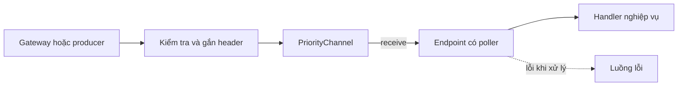

# PriorityChannel và Comparator

## 1. Mục tiêu và tình huống sử dụng

Trong module **SPRING_INTEGRATION_CORE**, chương **Queue và pollable channel**, bài này trình bày cách điều khiển thứ tự lấy thông điệp bằng `PriorityChannel` và `Comparator<Message<?>>`. Sau bài học, bạn có thể xây dựng luồng tiếp nhận công việc, gắn mức ưu tiên, đưa vào channel và để endpoint có poller lấy ra xử lý; đồng thời biết cách kiểm chứng thứ tự và xử lý tình huống quá tải.

Giả sử hệ thống xử lý yêu cầu hỗ trợ có ba loại công việc:

| Công việc | Mức ưu tiên do ứng dụng quy định | Mong muốn |
| --- | ---: | --- |
| Xuất báo cáo định kỳ | 1 | Có thể chờ |
| Xử lý yêu cầu khách hàng | 5 | Xử lý trước báo cáo đang chờ |
| Khắc phục sự cố nghiêm trọng | 9 | Xử lý trước hai loại còn lại đang chờ |

Một hàng đợi FIFO có thể khiến yêu cầu sự cố đứng sau nhiều báo cáo. `PriorityChannel` cung cấp điểm điều phối để lựa chọn công việc đang chờ theo mức ưu tiên. Nó phù hợp khi thứ tự phục vụ quan trọng hơn thứ tự tiếp nhận tuyệt đối.

Ví dụ trong bài dùng Java 17 và API Spring Integration 6.x; phần chi tiết về giá trị ưu tiên mặc định và thứ tự khi hòa điểm được đối chiếu với mã nguồn **6.4.2**. Dependency cần thiết là `org.springframework.integration:spring-integration-core`; trong ứng dụng Spring Boot, nên để BOM của dự án quản lý phiên bản tương thích. Ví dụ kiểm thử sử dụng JUnit Jupiter và là mã hướng dẫn để người học chạy trong dự án của mình.

## 2. PriorityChannel nằm ở đâu trong luồng thông điệp?

`PriorityChannel` kế thừa `QueueChannel` và là một `PollableChannel`: producer gọi `send`, consumer gọi `receive`, hoặc một polling endpoint thực hiện việc nhận thay cho ứng dụng. Mặc định channel dùng header `priority`; bạn có thể truyền comparator để áp dụng quy tắc khác. Xem [Message Channel Implementations](https://docs.spring.io/spring-integration/reference/channel/implementations.html).



Trong sơ đồ, mỗi thành phần có một trách nhiệm riêng:

- `Message` mang payload công việc và header dùng để lựa chọn thứ tự.
- Channel giữ những thông điệp chưa được lấy ra.
- Poller quyết định thời điểm endpoint thử nhận thông điệp.
- Handler thực hiện nghiệp vụ sau khi thông điệp được nhận.

Cần phân biệt **thứ tự lấy ra**, **thứ tự bắt đầu chạy** và **thứ tự hoàn tất**. Việc ưu tiên tại channel trực tiếp tác động tới lần `receive` tiếp theo. Nếu sau đó thông điệp đi qua executor hoặc nhiều handler chạy song song, thời điểm hoàn tất còn phụ thuộc thời gian chạy từng công việc.

### Ví dụ về phạm vi ưu tiên

Nếu A, B, C đã được gửi lần lượt với priority 1, 9, 5 và consumer chưa chạy, thứ tự nhận mong đợi là B, C, A.

Nếu consumer đã lấy A và đang xử lý, sau đó B mới đến, channel không thu hồi A từ handler. B chỉ được xét trong các lần nhận tiếp theo. Vì vậy, kết quả log từ một hệ thống đang chạy không nhất thiết là một dãy priority giảm dần trên toàn bộ lịch sử.

Đây là hệ quả của việc chỉ sắp xếp tập thông điệp **đang chờ**, cần đưa vào cách diễn giải kết quả kiểm thử và yêu cầu SLA.

## 3. Quy tắc mặc định của header priority

Với `PriorityChannel` dùng hàng đợi trong bộ nhớ ở Spring Integration 6.4.2:

- Giá trị `Integer` lớn hơn được lấy trước.
- Header `priority` bị thiếu được tính như `0`.
- Khi hai thông điệp hòa điểm, channel dùng số thứ tự nội bộ làm tiêu chí phụ. Với producer gửi tuần tự, điều này giữ thứ tự gửi trong nhóm cùng ưu tiên, kể cả khi comparator tùy chỉnh trả về `0`.

Các quy tắc trên được thể hiện trong `SequenceFallbackComparator` của [mã nguồn PriorityChannel 6.4.2](https://github.com/spring-projects/spring-integration/blob/v6.4.2/spring-integration-core/src/main/java/org/springframework/integration/channel/PriorityChannel.java). Khi nhiều producer gửi đồng thời, số thứ tự nội bộ không phải một cam kết về thứ tự thời gian nghiệp vụ giữa các máy hoặc giữa các request.

Mức 1, 5, 9 chỉ là quy ước của ví dụ. Ứng dụng cần xác định ý nghĩa từng mức và giới hạn dữ liệu đầu vào. Chuỗi `"9"` không thay thế an toàn cho số nguyên `9` trong header chuẩn này.

### Ví dụ gửi và nhận trực tiếp

```java
import org.springframework.integration.IntegrationMessageHeaderAccessor;
import org.springframework.integration.channel.PriorityChannel;
import org.springframework.messaging.Message;
import org.springframework.messaging.support.MessageBuilder;

public class PriorityChannelDemo {

    public static void main(String[] args) {
        PriorityChannel channel = new PriorityChannel(10);

        send(channel, job("REPORT", 1));
        send(channel, job("INCIDENT", 9));
        send(channel, job("CUSTOMER", 5));

        for (int i = 0; i < 3; i++) {
            Message<?> message = channel.receive(0);
            if (message == null) {
                throw new IllegalStateException("Thiếu công việc trong ví dụ");
            }
            System.out.println(message.getPayload());
        }
    }

    private static Message<String> job(String id, int priority) {
        return MessageBuilder.withPayload(id)
                .setHeader(IntegrationMessageHeaderAccessor.PRIORITY, priority)
                .build();
    }

    private static void send(PriorityChannel channel, Message<?> message) {
        if (!channel.send(message, 0)) {
            throw new IllegalStateException("Hàng đợi đã đầy");
        }
    }
}
```

Kết quả mong đợi:

```text
INCIDENT
CUSTOMER
REPORT
```

Ví dụ chủ động gửi đủ ba message trước khi nhận, giúp quan sát rõ quy tắc lựa chọn mà không có cuộc đua với poller. `send` thành công nghĩa là channel đã nhận message; ứng dụng vẫn cần cơ chế riêng để biết công việc đã hoàn tất.

## 4. Capacity và timeout: ưu tiên không giải quyết hàng đợi đầy

Các constructor thường dùng gồm:

```java
new PriorityChannel();                 // Không đặt giới hạn hữu hạn
new PriorityChannel(100);              // Tối đa 100 message đang chờ
new PriorityChannel(comparator);       // Comparator tùy chỉnh
new PriorityChannel(100, comparator);  // Giới hạn và comparator tùy chỉnh
```

Constructor không có capacity tạo hàng đợi không giới hạn cấu hình; capacity không dương cũng mang ý nghĩa không giới hạn. Vì vậy, `new PriorityChannel(0)` không tạo channel chuyển giao trực tiếp. Xem [PriorityChannel API](https://docs.spring.io/spring-integration/docs/6.4.2/api/org/springframework/integration/channel/PriorityChannel.html).

Với các lệnh gửi/nhận trực tiếp trong bài:

| Lệnh | Hành vi khi chưa có điều kiện hoàn tất |
| --- | --- |
| `send(message, 0)` | Không chờ chỗ trống; trả `false` nếu đầy |
| `send(message, 200)` | Chờ tối đa 200 ms để có chỗ trống |
| `receive(0)` | Không chờ message; trả `null` nếu rỗng |
| `receive(200)` | Chờ tối đa 200 ms để có message |
| `send(message)` hoặc `receive()` | Có thể chờ vô hạn nếu điều kiện không được đáp ứng |

Đây là hành vi hàng đợi được mô tả trong [tài liệu QueueChannel](https://docs.spring.io/spring-integration/reference/channel/implementations.html). Khi lời gọi bị lỗi hoặc bị ngắt, có thể phát sinh ngoại lệ; bảng trên mô tả tình huống chờ bình thường.

Nếu capacity là 2 và hai message priority 1 đã chiếm hết chỗ, một message priority 9 gửi với timeout 0 vẫn bị từ chối. Channel không tự loại công việc ít ưu tiên để nhường chỗ.

Thiết kế tiếp nhận vì thế cần câu trả lời cụ thể: khi đầy, request bị từ chối để caller thử lại, chuyển sang cơ chế lưu bền, hay đưa vào luồng xử lý quá tải? Cần kiểm tra kết quả `send`; không để công việc biến mất vì bỏ qua giá trị `false`.

Capacity cũng chỉ giới hạn số message đang chờ tại channel. Nếu consumer lấy nhanh rồi dồn công việc vào một executor có hàng đợi lớn, backlog đã chuyển sang nơi khác và vẫn tiêu tốn tài nguyên.

## 5. Comparator: diễn đạt đúng thứ tự nghiệp vụ

Kiểu comparator mà channel nhận là:

```java
Comparator<Message<?>>
```

Comparator so sánh **message**, nên có thể đọc payload hoặc header. Không ép đối tượng nhận được thành `GenericMessage` hay lớp message tùy chỉnh; hãy dùng giao diện `Message`, vì channel có thể bọc message bên trong khi quản lý thứ tự.

Quy ước dấu:

| Kết quả `compare(a, b)` | Ý nghĩa thứ tự |
| --- | --- |
| Âm | A đứng trước B |
| 0 | Hai message bằng nhau theo tiêu chí bạn cung cấp |
| Dương | A đứng sau B |

Comparator cần đối xứng về dấu và có tính bắc cầu. Java cung cấp `comparingInt`, `comparingLong`, `thenComparing` và `reversed` để kết hợp tiêu chí, theo [Java Comparator API](https://docs.oracle.com/en/java/javase/17/docs/api/java.base/java/util/Comparator.html).

### 5.1. Trường hợp số nhỏ hơn lại quan trọng hơn

Nhiều hệ thống quy định P1 là sự cố khẩn cấp nhất, P2 thấp hơn, P3 thấp hơn nữa. Nếu ghi trực tiếp 1, 2, 3 vào header `priority` rồi dùng mặc định, P3 sẽ được lấy trước P1.

Có hai cách triển khai hợp lý:

1. Ánh xạ mức nghiệp vụ sang điểm ưu tiên: P1 → 9, P2 → 5, P3 → 1, rồi dùng mặc định.
2. Giữ mức nghiệp vụ trong header riêng như `slaRank`, dùng comparator tăng dần.

Cách thứ hai giúp tách ý nghĩa “hạng SLA” khỏi ý nghĩa của header chuẩn `priority`. Không nên dùng cùng một tên header nhưng thay đổi cách hiểu giữa các producer.

### 5.2. Ví dụ comparator theo SLA rồi deadline

Quy tắc của ví dụ tiếp theo:

- `slaRank` nhỏ hơn được chọn trước.
- Cùng hạng SLA thì `deadlineEpochMs` nhỏ hơn được chọn trước.
- Thiếu hạng hoặc deadline thì xếp sau các giá trị được khai báo.
- Sai kiểu dữ liệu là lỗi hợp đồng đầu vào.

```java
import java.util.Comparator;

import org.springframework.messaging.Message;

public final class WorkOrderComparator implements Comparator<Message<?>> {

    public static final String SLA_RANK = "slaRank";
    public static final String DEADLINE = "deadlineEpochMs";

    private static final Comparator<Message<?>> ORDER =
            Comparator.<Message<?>>comparingInt(WorkOrderComparator::slaRank)
                    .thenComparingLong(WorkOrderComparator::deadline);

    @Override
    public int compare(Message<?> left, Message<?> right) {
        return ORDER.compare(left, right);
    }

    public static void validate(Message<?> message) {
        slaRank(message);
        deadline(message);
    }

    private static int slaRank(Message<?> message) {
        Object value = message.getHeaders().get(SLA_RANK);
        if (value == null) {
            return Integer.MAX_VALUE;
        }
        if (value instanceof Integer rank && rank >= 1 && rank <= 3) {
            return rank;
        }
        throw new IllegalArgumentException("slaRank phải là Integer từ 1 đến 3");
    }

    private static long deadline(Message<?> message) {
        Object value = message.getHeaders().get(DEADLINE);
        if (value == null) {
            return Long.MAX_VALUE;
        }
        if (value instanceof Long epochMs && epochMs >= 0) {
            return epochMs;
        }
        throw new IllegalArgumentException("deadlineEpochMs phải là Long không âm");
    }
}
```

Khởi tạo và gửi:

```java
PriorityChannel queue = new PriorityChannel(100, new WorkOrderComparator());

Message<String> message = MessageBuilder.withPayload("INCIDENT-42")
        .setHeader(WorkOrderComparator.SLA_RANK, 1)
        .setHeader(WorkOrderComparator.DEADLINE, 1_900_000_000_000L)
        .build();

WorkOrderComparator.validate(message);
boolean accepted = queue.send(message, 0);
if (!accepted) {
    throw new IllegalStateException("Không còn chỗ tiếp nhận công việc");
}
```

Đoạn này sử dụng các import `PriorityChannel`, `Message`, `MessageBuilder` như ví dụ trước, cùng lớp `WorkOrderComparator` vừa định nghĩa.

Cần gọi `validate` ở ranh giới tiếp nhận: khi queue còn rỗng, việc chèn message đầu tiên có thể chưa cần so sánh. Vì vậy, không dùng comparator như cơ chế duy nhất để phát hiện dữ liệu sai. Trong luồng thực tế, có thể thực hiện kiểm tra này trong service nhận đầu vào hoặc endpoint đứng trước channel.

Với chính sách đã chọn, thứ tự mong đợi là:

| Thứ tự gửi | Payload | slaRank | deadlineEpochMs |
| ---: | --- | ---: | ---: |
| 1 | REPORT | 3 | 1000 |
| 2 | INCIDENT-LATER | 1 | 3000 |
| 3 | INCIDENT-EARLIER | 1 | 2000 |

```text
INCIDENT-EARLIER → INCIDENT-LATER → REPORT
```

Deadline của REPORT sớm nhất nhưng REPORT vẫn đứng sau vì SLA là tiêu chí chính. Đây là lựa chọn nghiệp vụ của ví dụ. Nếu yêu cầu thực sự là “deadline gần nhất trước”, hãy đặt deadline làm tiêu chí chính và kiểm chứng lại bằng các trường hợp hòa điểm.

Khi cung cấp comparator, các tiêu chí chính do comparator quyết định; header `priority` không được tự động ghép thêm vào chính sách trên. Nếu muốn sử dụng cả hai, cần viết rõ thứ tự so sánh.

### 5.3. Những cách viết dễ gây lỗi

Không dùng phép trừ để so sánh số:

```java
// Dễ tràn số với miền giá trị rộng.
return rightPriority - leftPriority;

// Thể hiện rõ: điểm lớn hơn đứng trước.
return Integer.compare(rightPriority, leftPriority);
```

Không gọi HTTP, truy vấn database, cập nhật trạng thái, hay đọc đồng hồ liên tục để xác định kết quả trong comparator. Đây là hàm được gọi trong quá trình quản lý hàng đợi; nên chỉ đọc dữ liệu ổn định đã có trên message.

Nếu cần “càng chờ lâu càng tăng ưu tiên”, một comparator phụ thuộc thời gian có thể thay đổi quan hệ giữa các phần tử đã nằm trong heap mà không kích hoạt việc tổ chức lại toàn bộ heap. Hãy thiết kế cơ chế lập lịch hoặc đưa message ra để tính lại và xếp lại có kiểm soát. Một deadline cố định được gắn trước khi gửi dễ lý giải hơn việc sửa điểm từ bên ngoài.

Tránh lấy khóa sắp xếp từ payload mutable rồi đổi payload đó sau khi enqueue. Giữ các khóa ưu tiên bất biến trong suốt thời gian message chờ xử lý.

## 6. Ghép PriorityChannel với endpoint bằng Java DSL

Cấu hình dưới đây sử dụng chính sách mặc định theo header `priority`. Nó minh họa một handler một chiều và một luồng nhận lỗi riêng.

```java
import java.time.Duration;

import org.springframework.context.annotation.Bean;
import org.springframework.context.annotation.Configuration;
import org.springframework.integration.channel.DirectChannel;
import org.springframework.integration.channel.PriorityChannel;
import org.springframework.integration.config.EnableIntegration;
import org.springframework.integration.dsl.IntegrationFlow;
import org.springframework.integration.dsl.Pollers;
import org.springframework.messaging.MessageHandler;

@Configuration
@EnableIntegration
public class PriorityWorkConfiguration {

    @Bean
    public PriorityChannel workQueue() {
        return new PriorityChannel(100);
    }

    @Bean
    public DirectChannel workErrors() {
        return new DirectChannel();
    }

    @Bean
    public IntegrationFlow workFlow(PriorityChannel workQueue) {
        return IntegrationFlow.from(workQueue)
                .handle((MessageHandler) message -> {
                    System.out.println("Đang xử lý: " + message.getPayload());
                    // Gọi service nghiệp vụ tại đây.
                }, endpoint -> endpoint.poller(
                        Pollers.fixedDelay(Duration.ofMillis(100))
                                .receiveTimeout(0)
                                .maxMessagesPerPoll(5)
                                .errorChannel("workErrors")))
                .get();
    }

    @Bean
    public IntegrationFlow workErrorFlow() {
        return IntegrationFlow.from("workErrors")
                .handle((MessageHandler) message -> {
                    System.err.println("Lỗi công việc: " + message.getPayload());
                    // Thực tế: lưu lỗi, cảnh báo, hoặc điều phối phục hồi.
                })
                .get();
    }
}
```

Java DSL cho phép cấu hình poller bằng `Pollers`; xem [Pollers trong Java DSL](https://docs.spring.io/spring-integration/reference/dsl/java-pollers.html).

Cách đọc cấu hình:

- Endpoint đầu tiên đứng sau `workQueue` nhận từ một pollable channel, nên được gắn poller.
- `fixedDelay(100 ms)` tạo khoảng nghỉ sau khi tác vụ poll trước hoàn tất, không bảo đảm có đúng một message được xử lý mỗi 100 ms.
- `receiveTimeout(0)` giúp lần nhận không chờ khi queue rỗng.
- `maxMessagesPerPoll(5)` giới hạn số message được xử lý trong một lượt poll; nó không tạo năm worker song song.

Ý nghĩa fixed delay được mô tả trong [Pollers API](https://docs.spring.io/spring-integration/api/org/springframework/integration/dsl/Pollers.html). Không cấu hình executor riêng trong ví dụ này, nên handler chạy trong tác vụ poll; thời gian nghiệp vụ góp vào thời gian của lượt poll đó.

Muốn dùng `WorkOrderComparator`, thay phần khởi tạo bean bằng:

```java
return new PriorityChannel(100, new WorkOrderComparator());
```

Đồng thời phải kiểm tra `slaRank` và `deadlineEpochMs` trước khi gửi vào `workQueue`. Không giữ producer chỉ gắn header `priority` rồi kỳ vọng comparator mới hiểu mức SLA.

### Lưu ý khi dùng gateway

Gateway một chiều có thể đưa request vào channel để xử lý sau. Gateway request-reply còn cần đường trả lời và timeout phù hợp. Thời gian chờ của caller có thể gồm cả thời gian message nằm trong queue; được nhận vào queue không đồng nghĩa đã nhận được kết quả nghiệp vụ.

Không để caller gọi đồng bộ rồi chờ vô hạn chỉ vì công việc có priority cao. Priority không bảo đảm thời hạn hoàn tất.

## 7. Xử lý lỗi ở ranh giới bất đồng bộ

Cần phân biệt ba thời điểm lỗi trong ví dụ:

| Thời điểm | Ví dụ | Nơi cần xử lý |
| --- | --- | --- |
| Trước enqueue | `slaRank` là chuỗi hoặc ngoài miền quy định | Ranh giới tiếp nhận, trả lỗi dữ liệu |
| Khi enqueue | Hết capacity, `send` trả `false` | Producer hoặc cơ chế điều tiết tải |
| Sau dequeue | Handler gọi hệ thống đích thất bại | Luồng lỗi và chính sách phục hồi |

Ở cấu hình trên, lỗi của tác vụ poll được chuyển tới `workErrors` dưới dạng `ErrorMessage`. Producer có thể đã hoàn tất lời gọi gửi, nên không thể trông chờ ngoại lệ nghiệp vụ xuất hiện trong `try/catch` bao quanh lần `send` trước đó. Xem [Spring Integration Error Handling](https://docs.spring.io/spring-integration/reference/error-handling.html).

`errorChannel` chỉ cung cấp đường nhận lỗi; nó không tự thiết lập retry, giao dịch, hoặc đưa message vào lại queue. Với channel trong bộ nhớ và ví dụ không có giao dịch này, message đã được lấy ra không tự xuất hiện trở lại khi handler thất bại.

Nếu thiết kế retry, cần giới hạn số lần, có khoảng nghỉ và có nơi giữ các lỗi cuối cùng. Một công việc lỗi nhưng luôn được gửi lại với ưu tiên cao có thể chiếm hết cơ hội xử lý công việc khác. Với thao tác có tác dụng phụ, dùng khóa nghiệp vụ để tránh thực hiện trùng khi phục hồi.

## 8. Kiểm chứng hành vi bằng JUnit

Để kiểm tra thứ tự, trước hết dùng channel độc lập: gửi hết tập dữ liệu rồi gọi `receive(0)`. Khi kiểm thử cả ứng dụng có poller, cần dừng endpoint hoặc kiểm soát thời điểm bắt đầu; nếu consumer nhận ngay sau lần gửi đầu tiên thì kỳ vọng sắp xếp toàn bộ tập dữ liệu không còn phù hợp.

Các kiểm thử sau không cần Spring application context:

```java
import org.junit.jupiter.api.Test;
import org.springframework.integration.IntegrationMessageHeaderAccessor;
import org.springframework.integration.channel.PriorityChannel;
import org.springframework.messaging.Message;
import org.springframework.messaging.support.MessageBuilder;

import static org.junit.jupiter.api.Assertions.*;

class PriorityChannelTest {

    @Test
    void higherPriorityIsReceivedFirstAndTiesKeepSequentialSendOrder() {
        PriorityChannel queue = new PriorityChannel(10);

        assertTrue(queue.send(job("LOW", 1), 0));
        assertTrue(queue.send(job("HIGH-A", 9), 0));
        assertTrue(queue.send(job("HIGH-B", 9), 0));

        assertEquals("HIGH-A", nextPayload(queue));
        assertEquals("HIGH-B", nextPayload(queue));
        assertEquals("LOW", nextPayload(queue));
        assertNull(queue.receive(0));
    }

    @Test
    void missingPriorityActsAsZero() {
        PriorityChannel queue = new PriorityChannel(10);

        assertTrue(queue.send(job("NEGATIVE", -1), 0));
        assertTrue(queue.send(MessageBuilder.withPayload("MISSING").build(), 0));
        assertTrue(queue.send(job("POSITIVE", 1), 0));

        assertEquals("POSITIVE", nextPayload(queue));
        assertEquals("MISSING", nextPayload(queue));
        assertEquals("NEGATIVE", nextPayload(queue));
    }

    @Test
    void urgentMessageDoesNotEvictExistingMessageWhenFull() {
        PriorityChannel queue = new PriorityChannel(1);

        assertTrue(queue.send(job("LOW", 1), 0));
        assertFalse(queue.send(job("URGENT", 9), 0));
        assertEquals("LOW", nextPayload(queue));
        assertNull(queue.receive(0));
    }

    private static Message<String> job(String id, int priority) {
        return MessageBuilder.withPayload(id)
                .setHeader(IntegrationMessageHeaderAccessor.PRIORITY, priority)
                .build();
    }

    private static Object nextPayload(PriorityChannel queue) {
        Message<?> message = queue.receive(0);
        assertNotNull(message);
        return message.getPayload();
    }
}
```

Đối với comparator SLA, bổ sung các trường hợp mang ý nghĩa hợp đồng:

| Dữ liệu | Kết quả cần chứng minh |
| --- | --- |
| P3 deadline 1000, P1 deadline 3000 | P1 được chọn trước |
| Hai P1 deadline 3000 và 2000 | Deadline 2000 được chọn trước |
| Cùng SLA và deadline, gửi tuần tự A rồi B | A rồi B trên channel trong bộ nhớ đã đối chiếu |
| Thiếu SLA, so với P3 hợp lệ | Message có SLA hợp lệ được chọn trước |
| `slaRank = "1"` | `validate` từ chối trước enqueue |
| Lấy LOW ra trước, sau đó mới gửi HIGH | LOW vẫn là công việc đã được nhận |

Không dùng `Thread.sleep` để đoán lúc poller đã chạy xong. Khi cần kiểm thử endpoint bất đồng bộ, chờ một tín hiệu hoàn tất có timeout, chẳng hạn message trên một output channel hoặc latch do handler báo; tách kiểm tra thứ tự dequeue khỏi kiểm tra thời gian hoàn thành nghiệp vụ.

## 9. Những giới hạn cần đưa vào thiết kế

### 9.1. Starvation: công việc thấp có thể chờ rất lâu

Nếu lưu lượng priority 9 liên tục chiếm hết năng lực xử lý, message priority 1 có thể không được chọn trong thời gian dài. Đó là hệ quả của chính sách ưu tiên nghiêm ngặt.

Ví dụ phương án thiết kế: tách các mức vào nhiều queue và lập lịch theo quota, hoặc bảo đảm một phần năng lực cho công việc thường. Đây là các cơ chế cần triển khai thêm; thay comparator không tự tạo ra công bằng.

Nên theo dõi cả tuổi của message cũ nhất theo từng mức ưu tiên. Queue ngắn vẫn có thể chứa một công việc ít ưu tiên đã chờ quá lâu.

### 9.2. Ưu tiên cục bộ và luồng phân tán

Hai instance ứng dụng với hai `PriorityChannel` trong bộ nhớ có hai tập công việc chờ độc lập. Một instance có thể xử lý priority 1 trong khi instance khác còn priority 9. Nếu cần một trật tự phục vụ chung, phải thiết kế nơi điều phối chung và xem xét mức độ song song mong muốn.

Cũng cần kiểm tra các buffer tiếp theo trong luồng. Một executor FIFO ở phía sau có thể đã giữ nhiều công việc thấp; công việc cao vừa rời `PriorityChannel` vẫn phải chờ tại đó.

### 9.3. Độ bền và message store

Channel trong bộ nhớ không giữ lại backlog qua lần tiến trình dừng. Khi cần persistence, có thể dùng message store hỗ trợ ưu tiên hoặc một broker phù hợp. Cấu hình dùng store có quy tắc riêng; không mặc định rằng comparator Java hiện tại được thực thi trong database. Tài liệu cấu hình yêu cầu store có khả năng ưu tiên và nêu các ràng buộc với comparator/capacity trong cấu hình XML: [PriorityChannel Configuration](https://docs.spring.io/spring-integration/reference/channel/configuration.html).

Trước khi chuyển sang store, hãy xác định cách biểu diễn priority, thứ tự hòa điểm, khả năng giao dịch và hành vi khi nhiều instance cùng lấy message. Persistence và việc tránh xử lý trùng là hai yêu cầu cần được thiết kế riêng.

## 10. Checklist áp dụng cho một luồng thực tế

1. Thống nhất ý nghĩa mức ưu tiên và ai được quyền gán mức khẩn cấp.
2. Chọn header chuẩn `priority` hoặc bộ khóa tùy chỉnh với kiểu dữ liệu rõ ràng.
3. Kiểm tra và chuẩn hóa khóa trước khi enqueue, giữ chúng ổn định khi chờ.
4. Đặt capacity hữu hạn phù hợp và xử lý kết quả `send` khi hết chỗ.
5. Gắn poller cho endpoint nhận từ channel; điều chỉnh lượt poll theo thời gian xử lý thực tế.
6. Đặt đường xử lý lỗi, chính sách retry và cơ chế chống tác dụng phụ trùng nếu cần.
7. Kiểm chứng thứ tự với dữ liệu đã enqueue đầy đủ, sau đó kiểm thử riêng tính đồng thời của cả flow.
8. Theo dõi thời gian chờ theo từng mức để nhận biết quá tải hoặc starvation.

`PriorityChannel` hữu ích khi cần chọn công việc tiếp theo theo chính sách rõ ràng. Một thiết kế hoàn chỉnh còn phải trả lời được khi nào công việc được nhận, chờ ở đâu, lỗi đi đâu và điều gì xác nhận công việc đã hoàn tất.