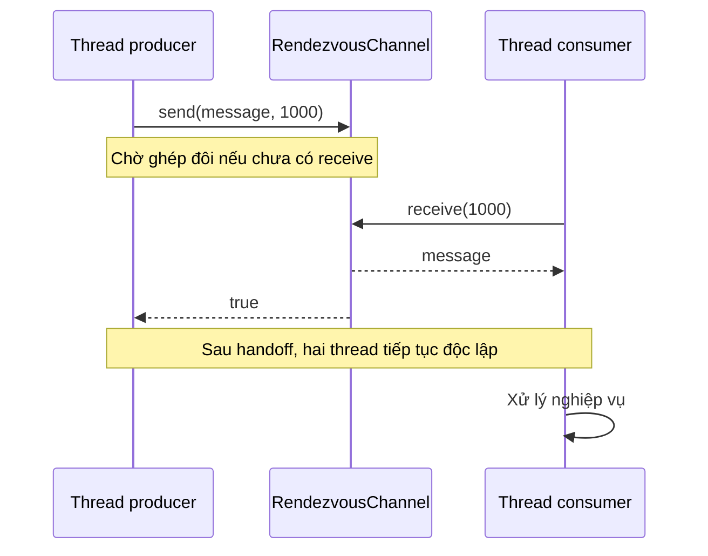

# RendezvousChannel handoff

## Mục tiêu bài học

Trong chương **Queue và pollable channel** của **SPRING_INTEGRATION_CORE**, `RendezvousChannel` giúp mô tả một tình huống đặc biệt: producer chỉ bàn giao được một `Message` khi có consumer nhận nó. Đây là điểm phối hợp giữa hai luồng thực thi, không phải nơi tích trữ công việc chờ xử lý.

Sau bài học, bạn có thể:

- Giải thích cơ chế handoff không có bộ đệm của `RendezvousChannel`.
- Phân biệt việc nhận message với hoàn tất xử lý nghiệp vụ.
- Dùng `send(message, timeout)` và `receive(timeout)` để giới hạn thời gian chờ.
- Kết nối channel với polling endpoint bằng Java DSL.
- Nhận biết backpressure, nguy cơ deadlock và giới hạn của cơ chế bàn giao trong bộ nhớ.

## 1. Vì sao cần một channel để bàn giao trực tiếp?

Giả sử ứng dụng nhận yêu cầu tạo báo cáo. Một luồng tiếp nhận yêu cầu, một luồng khác lấy yêu cầu để xử lý. Bạn muốn bên gửi chỉ tiếp tục khi có bên nhận thực sự lấy message, thay vì đưa yêu cầu vào một hàng đợi rồi để chúng tích lại.

`RendezvousChannel` hỗ trợ điểm hẹn đó. Bên gửi và bên nhận phải gặp nhau tại thao tác chuyển giao:

- Bên gửi đến trước: chờ một bên nhận, trong giới hạn timeout nếu có.
- Bên nhận đến trước: chờ một bên gửi, trong giới hạn timeout nếu có.
- Hai thao tác ghép đôi thành công: message được chuyển từ bên gửi sang bên nhận.

Channel sử dụng cơ chế `SynchronousQueue` của Java. Cấu trúc này không có dung lượng lưu phần tử chờ được lấy. Tên có chữ “queue” không có nghĩa message sẽ nằm lại trong một bộ đệm như ở `QueueChannel` thông thường.

> Không có bộ đệm không có nghĩa không tốn tài nguyên: producer đang chờ vẫn giữ thread, stack và các đối tượng liên quan đến message.

## 2. Vị trí trong mô hình Spring Integration

Luồng thông điệp của Spring Integration bao gồm `Message`, `MessageChannel` và các endpoint thực hiện công việc. Một channel điều phối cách message di chuyển; transformer, filter, router hoặc service activator mới đảm nhiệm hành vi xử lý tương ứng.

`RendezvousChannel` là một `PollableChannel`. Consumer nhận message bằng `receive(...)`; channel không tự gọi subscriber theo mô hình của `DirectChannel`.

| Thành phần | Vai trò trong ví dụ bàn giao |
|---|---|
| `Message<T>` | Chứa payload yêu cầu và các header |
| Producer | Gọi `send(...)` để đề nghị bàn giao message |
| `RendezvousChannel` | Ghép một lần gửi với một lần nhận, không tích trữ message |
| Consumer hoặc polling endpoint | Gọi `receive(...)` để lấy message |
| Handler | Xử lý message đã được lấy ra khỏi channel |
| Gateway, nếu sử dụng | Cung cấp giao diện gọi vào flow và có thể chờ reply theo cấu hình riêng |

Với mỗi message được bàn giao thành công, chỉ một consumer nhận message đó. Đây không phải channel phát cùng một message tới tất cả consumer.

## 3. Trình tự bàn giao giữa hai thread



Sơ đồ biểu diễn quan hệ bàn giao; thứ tự chính xác giữa thời điểm `send` trả về và consumer bắt đầu thực thi handler phụ thuộc vào lập lịch thread. Không có cam kết rằng producer sẽ tiếp tục trước hoặc sau câu lệnh đầu tiên của handler.

### Điều mà `send(...) == true` xác nhận

Một message đã được consumer lấy qua thao tác nhận. Điều này không xác nhận rằng:

- Handler đã xử lý xong payload.
- Giao dịch cơ sở dữ liệu của consumer đã commit.
- Reply đã được tạo hoặc gửi lại.
- Dữ liệu đã được lưu bền vững.

Ví dụ, consumer có thể lấy yêu cầu báo cáo, sau đó gặp lỗi truy vấn dữ liệu. Producer vẫn có thể đã nhận `true` từ `send` trước khi lỗi xảy ra.

Nếu cần biết kết quả nghiệp vụ, hãy bổ sung reply hoặc sự kiện xác nhận theo hợp đồng của hệ thống. Không dùng kết quả boolean của `send` để thay thế kết quả nghiệp vụ.

## 4. Timeout của send và receive

Hai phía có thời gian chờ độc lập:

| Lời gọi | Ý nghĩa | Kết quả bình thường |
|---|---|---|
| `send(message, 500)` | Chờ tối đa khoảng 500 ms để bàn giao | `true` nếu bàn giao, `false` nếu hết thời gian chờ |
| `receive(500)` | Chờ tối đa khoảng 500 ms để nhận | `Message<?>` nếu nhận được, `null` nếu hết thời gian chờ |
| `send(message, 0)` | Thử bàn giao ngay, không chờ bên nhận xuất hiện | `true` hoặc `false` |
| `receive(0)` | Thử nhận ngay, không chờ bên gửi xuất hiện | Message hoặc `null` |
| `send(message)` | Chờ bàn giao không có hạn chờ hữu hạn do lời gọi này đặt ra | Có thể chờ vô hạn nếu không có consumer |
| `receive()` | Chờ nhận không có hạn chờ hữu hạn do lời gọi này đặt ra | Có thể chờ vô hạn nếu không có producer |

Các giá trị timeout ở ví dụ tính bằng mili giây. Thời gian quan sát thực tế còn chịu ảnh hưởng của lập lịch thread; timeout không phải cam kết thời gian thực cứng.

Trong ví dụ dùng timeout `0`, thành công phụ thuộc việc có thao tác đối ứng có thể ghép đôi ngay lúc đó. Chỉ mới tạo thread consumer chưa bảo đảm consumer đã vào `receive`.

Các kết quả trong bảng mô tả tình huống thông thường không có lỗi. Lỗi từ interceptor hoặc việc thread bị ngắt có thể dẫn đến exception. Đừng viết logic giả định mọi lần gửi không thành công đều chỉ trả `false`.

### Timeout không hủy công việc đã được nhận

Nếu `send(message, 500)` trả `false` do hết hạn trước khi ghép đôi, message đó chưa được bàn giao qua lần gửi này và không còn nằm trong bộ đệm để consumer lấy sau.

Ngược lại, sau khi `send` đã trả `true`, timeout của lời gọi gửi không quản lý vòng đời xử lý tiếp theo. Muốn hủy một tác vụ đã được nhận cần thiết kế cơ chế hủy riêng.

## 5. Ví dụ Java: hai thread gặp nhau tại channel

Ví dụ sau giả định dự án đã có Spring Integration Core và các dependency Spring tương ứng. Đoạn mã dùng JDK 17 trở lên, với `ExecutorService` để tạo một consumer độc lập.

```java
import java.util.concurrent.ExecutorService;
import java.util.concurrent.Executors;
import java.util.concurrent.Future;
import java.util.concurrent.TimeUnit;

import org.springframework.integration.channel.RendezvousChannel;
import org.springframework.messaging.Message;
import org.springframework.messaging.support.MessageBuilder;

public class RendezvousDemo {

    public static void main(String[] args) throws Exception {
        RendezvousChannel channel = new RendezvousChannel();
        ExecutorService executor = Executors.newSingleThreadExecutor();

        try {
            Future<String> handled = executor.submit(() -> {
                Message<?> received = channel.receive(2_000);
                if (received == null) {
                    throw new IllegalStateException("Không nhận được message");
                }

                String reportId = (String) received.getPayload();
                // Đại diện cho bước xử lý sau khi đã nhận message.
                return "Đã xử lý: " + reportId;
            });

            Message<String> request = MessageBuilder
                    .withPayload("report-42")
                    .setHeader("requestType", "CREATE_REPORT")
                    .build();

            boolean handedOff = channel.send(request, 1_000);
            if (!handedOff) {
                throw new IllegalStateException("Hết thời gian chờ bàn giao");
            }

            System.out.println("Consumer đã nhận message");
            System.out.println(handled.get(3, TimeUnit.SECONDS));
        } finally {
            executor.shutdownNow();
        }
    }
}
```

Có hai mốc khác nhau trong đoạn mã:

1. `send` trả `true`: channel đã bàn giao message cho lần `receive` đối ứng.
2. `handled.get(...)` trả kết quả: tác vụ consumer đã thực thi xong và trả về chuỗi kết quả.

`Future` ở đây chỉ giúp minh họa sự khác biệt giữa hai mốc; đó không phải một cơ chế request-reply tự động của Spring Integration.

Consumer và producer không cần bắt đầu chính xác cùng lúc. Timeout cho phép phía đến trước đợi phía còn lại. Nếu thread consumer bị trì hoãn quá lâu, ví dụ có thể thất bại theo đúng giới hạn chờ đã đặt.

## 6. Ví dụ Java DSL với polling endpoint

Trong một flow thực tế, polling endpoint có thể thực hiện `receive` thay cho mã consumer thủ công.

```java
import org.springframework.context.annotation.Bean;
import org.springframework.context.annotation.Configuration;
import org.springframework.integration.channel.RendezvousChannel;
import org.springframework.integration.config.EnableIntegration;
import org.springframework.integration.dsl.IntegrationFlow;
import org.springframework.integration.dsl.Pollers;

@Configuration
@EnableIntegration
public class ReportHandoffConfiguration {

    @Bean
    public RendezvousChannel reportHandoffChannel() {
        return new RendezvousChannel();
    }

    @Bean
    public IntegrationFlow reportHandoffFlow() {
        return IntegrationFlow.from("reportHandoffChannel")
                .handle(String.class, (reportId, headers) -> {
                    System.out.println("Bắt đầu tạo báo cáo: " + reportId);
                    // Gọi dịch vụ nghiệp vụ tại đây.
                    return null;
                }, endpoint -> endpoint.poller(
                        Pollers.fixedDelay(100)
                                .receiveTimeout(50)
                                .maxMessagesPerPoll(1)))
                .get();
    }
}
```

Đây là flow một chiều: handler trả `null`, không tạo reply. Context cần được khởi tạo và endpoint cần đang chạy để poller thực hiện việc nhận.

Producer lấy bean channel rồi gửi message với hạn chờ hữu hạn:

```java
import org.springframework.integration.channel.RendezvousChannel;
import org.springframework.messaging.support.MessageBuilder;

public class ReportSubmissionService {

    private final RendezvousChannel handoffChannel;

    public ReportSubmissionService(RendezvousChannel handoffChannel) {
        this.handoffChannel = handoffChannel;
    }

    public boolean submit(String reportId) {
        return handoffChannel.send(
                MessageBuilder.withPayload(reportId).build(),
                1_000);
    }
}
```

Ví dụ này minh họa một consumer được kích hoạt theo lịch. Với cấu hình xử lý tuần tự và không thêm executor cho handler:

- Poller vào `receive`, chờ tối đa 50 ms nếu chưa có message.
- Khi ghép đôi với producer, poller nhận message và gọi handler.
- Trong lúc handler đang chạy, chính tác vụ poll đó chưa quay lại nhận message tiếp theo.
- `maxMessagesPerPoll(1)` giới hạn một message trong mỗi lần poll; nó không tạo một worker pool và không giới hạn tổng số producer đang chờ gửi.
- `fixedDelay(100)` đặt khoảng trễ giữa các lượt poll, sau khi lượt trước hoàn tất trong cấu hình này.

Producer phải chọn timeout phù hợp với độ trễ polling, thời gian handler và tải hệ thống. Các giá trị 50, 100 và 1.000 ms là ví dụ để hiểu cơ chế, không phải cấu hình tối ưu cho mọi ứng dụng.

### Khi ghép thêm transformer, filter hoặc router

Có thể thêm các endpoint sau điểm nhận để biến đổi, lọc hoặc định tuyến message. Tuy nhiên, việc bàn giao vào `RendezvousChannel` thành công vẫn chỉ chứng minh consumer đã nhận message.

Ví dụ, nếu filter ở phía sau loại bỏ message theo điều kiện nghiệp vụ, producer không tự động nhận `false` từ lần `send` đã bàn giao trước đó. Nếu cần phản hồi “được chấp nhận” hay “bị từ chối”, hãy thiết kế reply tường minh.

Tương tự, channel này không tự thực hiện correlation, gom nhóm hay release message như aggregator. Không dùng số lần handoff thành công để suy ra một nhóm message đã được xử lý đầy đủ.

## 7. Phân biệt với QueueChannel và DirectChannel

| Tiêu chí | `QueueChannel` có bộ đệm | `RendezvousChannel` | `DirectChannel` |
|---|---|---|---|
| Mô hình nhận | Consumer poll | Consumer poll | Channel gọi subscriber |
| Tích trữ message đang chờ | Có, tùy capacity và message store | Không | Không có hàng đợi nội bộ |
| Khi gửi mà chưa có lần nhận | Có thể đưa vào queue nếu còn chỗ | Chờ bàn giao hoặc hết timeout | Gửi tới handler đã đăng ký; thường lỗi nếu không có subscriber |
| Thread chạy handler | Thread consumer/poller | Thread consumer/poller | Thường là thread gọi gửi |
| Mốc gửi thành công thông thường | Message được nhận vào queue | Message được một consumer lấy | Lời gọi dispatch tới handler đã hoàn tất theo hợp đồng channel/handler |
| Cách hấp thụ đợt tải ngắn | Dùng sức chứa của queue | Producer phải chờ hoặc thất bại | Thời gian gọi handler tác động trực tiếp lên producer |

Bảng mô tả cấu hình thông thường. Interceptor, executor, transaction và cách handler tự phát sinh công việc bất đồng bộ có thể làm thay đổi hành vi quan sát của cả flow.

Điểm dễ nhầm là từ “đồng bộ”. `RendezvousChannel` đồng bộ hóa **thời điểm chuyển giao** giữa bên gửi và bên nhận; nó không tự buộc producer chờ toàn bộ nghiệp vụ như một lời gọi handler trực tiếp trên cùng thread.

## 8. Backpressure và giới hạn thực tế

Không có bộ đệm tạo ra sức ép ngược: khi consumer chưa nhận được, producer phải chờ hoặc chấp nhận kết quả hết hạn. Điều này hữu ích khi ứng dụng cần biết có bên nhận tại điểm bàn giao.

Tuy vậy, cơ chế này không tự giới hạn tổng tài nguyên của hệ thống. Nếu 10.000 producer cùng gọi `send` và chờ, bạn vẫn có thể có 10.000 tác vụ đang giữ tham chiếu tới message hoặc chờ được chạy.

Khi thiết kế, hãy xác định:

- Có bao nhiêu producer có thể gửi đồng thời?
- Producer có thể giữ thread chờ tối đa bao lâu?
- Sau timeout, hệ thống từ chối yêu cầu, trả kết quả bận hay thử lại?
- Consumer xử lý tuần tự hay có các lần nhận chạy đồng thời?
- Scheduler hoặc executor có đủ khả năng chạy consumer khi producer đang bị chặn?

`RendezvousChannel` không có thread pool riêng và không tự chạy consumer. Các tài nguyên này thuộc về ứng dụng, poller hoặc endpoint.

## 9. Các tình huống treo và deadlock

### 9.1. Gửi rồi nhận trên cùng thread

```java
RendezvousChannel channel = new RendezvousChannel();

channel.send(message);  // Chờ bên nhận.
channel.receive();      // Không tới được đây nếu không có thread khác nhận.
```

Không có consumer độc lập, thao tác đầu tiên có thể chờ vô hạn. Thêm timeout hữu hạn sẽ giúp thoát chờ, nhưng không làm đoạn mã trên trở thành mô hình bàn giao đúng: phía gửi hết hạn trước khi chính thread đó đến bước nhận.

### 9.2. Producer và consumer dùng chung executor chỉ có một thread

Giả sử tác vụ producer chạy trước trên executor một thread và gọi `send` không có hạn chờ. Tác vụ consumer đã được submit nhưng còn nằm trong hàng đợi executor. Producer chờ consumer, còn consumer chờ thread đang bị producer giữ.

Cần thiết kế tài nguyên để bên nhận có thể chạy độc lập. Timeout giúp giới hạn hậu quả của cấu hình sai; nó không thay thế thiết kế thread phù hợp.

### 9.3. Producer giữ khóa mà consumer cần trước khi nhận

Nếu producer giữ một khóa rồi gửi, còn consumer phải lấy chính khóa đó trước khi gọi `receive`, cả hai phía có thể chờ nhau. Tránh giữ khóa hoặc tài nguyên độc quyền trong khi thực hiện handoff có thể block.

Nếu consumer nhận trước rồi mới cần khóa, producer có thể đã thoát `send`; tình huống này có quan hệ chờ khác. Cần phân tích chính xác vị trí nhận message, thay vì kết luận mọi khóa quanh handler đều tạo cùng một deadlock.

## 10. Lỗi, retry và độ bền

### Hết hạn trước khi bàn giao

Một lần `send` trả `false` do timeout nghĩa là consumer chưa nhận message qua lần gọi đó. Producer có thể xử lý tình trạng bận hoặc áp dụng retry có giới hạn.

Không thử lại liên tục trong vòng lặp không có khoảng nghỉ: cách đó gây tranh chấp CPU và có thể làm hệ thống quá tải hơn. Retry cần giới hạn số lần, thời gian chờ và tổng thời gian cho phép.

### Lỗi sau khi consumer nhận

Handler phía consumer có thể ném exception sau handoff. Exception phát sinh trên thread consumer không tự truyền ngược vào lần `send` đã hoàn tất trên producer.

Với polling endpoint, cơ chế xử lý lỗi phụ thuộc cấu hình poller và error handler; error flow có thể dùng `errorChannel` để thu nhận lỗi. Cần kiểm tra cấu hình endpoint thay vì giả định producer sẽ nhận được exception từ handler.

Nếu gửi `ErrorMessage` vào một `RendezvousChannel`, chính error channel đó cũng cần bên nhận. Chọn error flow sao cho việc báo lỗi không tạo thêm một điểm chờ vô hạn.

### Không có lưu trữ bền vững hoặc xác nhận giao dịch tự động

`RendezvousChannel` là cơ chế bàn giao trong bộ nhớ của ứng dụng. Nó không tự cung cấp:

- Lưu message để khôi phục sau khi tiến trình dừng.
- Redelivery khi handler lỗi sau khi đã nhận.
- Xử lý đúng một lần.
- Xác nhận rằng giao dịch nghiệp vụ của consumer đã commit.

Nếu yêu cầu là không mất công việc qua lần khởi động lại, cần đánh giá message store hoặc broker bền vững cùng giao thức xác nhận phù hợp. Không thể đạt yêu cầu đó chỉ bằng việc tăng timeout handoff.

Khi retry toàn bộ yêu cầu vì thiếu kết quả nghiệp vụ, vẫn phải tính đến khả năng lần xử lý trước đã thành công nhưng reply chưa tới. Một khóa nghiệp vụ và xử lý idempotent có thể cần thiết để hạn chế tác dụng phụ lặp lại.

## 11. Quan hệ với gateway và request-reply

Request-reply thường có hai chặng:

1. Gửi request tới phía xử lý.
2. Chờ reply từ phía xử lý quay lại.

Timeout gửi request và timeout chờ reply phục vụ hai mục đích khác nhau. `RendezvousChannel` chỉ điều phối những lần send/receive đi qua chính channel đó.

Ví dụ về mặt ý tưởng:

```text
Producer --request--> RendezvousChannel --receive--> Consumer
Producer <--reply qua đường riêng------------------ Consumer
```

Nếu gateway trả về lỗi hết thời gian chờ reply, không thể chỉ từ đó kết luận request chưa được nhận. Request có thể đã được bàn giao và đang xử lý.

Cũng không nên tự giả định mọi gateway đều dùng `RendezvousChannel` làm reply channel nội bộ. Reply channel và cơ chế chờ phụ thuộc cấu hình, kiểu gọi và triển khai gateway. Khi cần điều khiển chúng, hãy cấu hình và kiểm tra hợp đồng request-reply riêng.

## 12. Cách kiểm chứng hành vi

Các kịch bản sau dùng để xây dựng kiểm thử cho bài thực hành. Chúng chưa phải kết quả đã chạy trong một dự án cụ thể.

| Kịch bản | Chuẩn bị | Điều cần xác nhận |
|---|---|---|
| Gửi không có consumer | Không khởi chạy receiver | `send(message, 50)` trả `false` |
| Nhận không có producer | Không có sender | `receive(50)` trả `null` |
| Bàn giao thành công | Chạy send và receive trên các thread độc lập, có hạn chờ đủ rộng | Send trả `true`, receiver nhận đúng message |
| Không lưu message sau timeout | Để send hết hạn, sau đó mới gọi receive | Receive hết hạn và trả `null` |
| Handoff khác hoàn tất nghiệp vụ | Chặn handler sau khi đã nhận bằng latch riêng | Send có thể hoàn tất khi handler vẫn chưa xong |
| Lỗi sau bàn giao | Consumer nhận rồi phát sinh exception | Quan sát lỗi tại consumer/error flow; không mong send đã trả về bị đổi kết quả |
| Nhiều consumer | Cho nhiều receiver cùng chờ, chỉ gửi một message | Chỉ một receiver nhận được message đó |

Ví dụ tối thiểu bằng JUnit 5 cho trường hợp không có consumer:

```java
import static org.junit.jupiter.api.Assertions.assertFalse;
import static org.junit.jupiter.api.Assertions.assertNull;

import org.junit.jupiter.api.Test;
import org.springframework.integration.channel.RendezvousChannel;
import org.springframework.messaging.support.MessageBuilder;

class RendezvousChannelTest {

    @Test
    void timedOutMessageIsNotRetained() {
        RendezvousChannel channel = new RendezvousChannel();

        boolean sent = channel.send(
                MessageBuilder.withPayload("report-42").build(),
                50);

        assertFalse(sent);
        assertNull(channel.receive(50));
    }
}
```

Với kiểm thử nhiều thread, ưu tiên `CountDownLatch`, `Future` và thời gian chờ hữu hạn thay cho việc dựa vào `Thread.sleep` để đoán thread khác đã sẵn sàng. Latch báo tác vụ bắt đầu không chứng minh thread đã đứng bên trong `receive`; cấu trúc kiểm thử phải cho phép hai thao tác có đủ thời gian ghép đôi.

Không assert thời gian chạy chính xác bằng giá trị timeout. Máy CI có thể bận hoặc bị thay đổi lịch chạy thread. Dọn executor trong khối `finally` để kiểm thử lỗi cũng không để lại thread chờ vô hạn.

## 13. Bài tập vận dụng

Xây dựng flow bàn giao yêu cầu tạo báo cáo với payload là `reportId`:

1. Producer gửi với timeout 300 ms và trả kết quả “đã bàn giao” hoặc “hệ thống đang bận”.
2. Consumer xử lý yêu cầu trong khoảng một giây.
3. Gửi nhiều yêu cầu liên tiếp và ghi riêng thời điểm bắt đầu gửi, hoàn tất handoff, bắt đầu xử lý, hoàn tất xử lý.
4. So sánh hành vi khi thay bằng `QueueChannel` có capacity 10.
5. Dừng consumer và xác nhận producer thoát theo timeout.
6. Cho handler phát sinh lỗi sau khi nhận; quan sát vì sao kết quả handoff không thể đại diện cho kết quả nghiệp vụ.

Khi giải thích kết quả, hãy trả lời: “Message đã ở đâu khi producer còn chờ?” và “Sau khi send trả true, ai chịu trách nhiệm phát hiện lỗi xử lý?”. Hai câu hỏi này giúp phân biệt sức chứa channel, thread đang chờ và trạng thái nghiệp vụ.

## 14. Ghi nhớ

`RendezvousChannel` là một `PollableChannel` bàn giao trực tiếp dựa trên `SynchronousQueue`, không có bộ đệm message. Một lần send phải ghép đôi với một lần receive; bên đến trước có thể phải chờ.

`send` thành công xác nhận việc nhận message tại channel. Để xác nhận hoàn tất nghiệp vụ, hãy dùng hợp đồng reply hoặc xác nhận riêng. Luôn thiết kế timeout, khả năng chạy độc lập của consumer và cách xử lý lỗi cùng với cơ chế handoff.