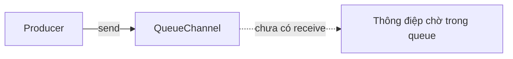
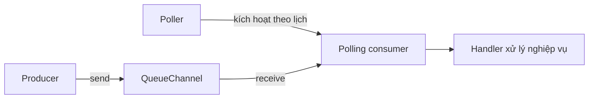

# Queue không có consumer

## 1. Mục tiêu và tình huống

Trong module **SPRING_INTEGRATION_CORE**, chương **Queue và pollable channel**, bài này giải thích điều xảy ra khi producer gửi `Message` vào `QueueChannel` nhưng không có thành phần lấy thông điệp ra. Kiến thức này giúp thiết kế luồng có endpoint, gateway và Java DSL mà không nhầm việc nhận vào hàng đợi với việc hoàn thành nghiệp vụ.

Sau bài học, bạn có thể:

- Giải thích vì sao gửi vào queue vẫn thành công khi chưa có consumer.
- Dự đoán hành vi khi queue còn chỗ, đầy hoặc hết thời gian chờ.
- Phân biệt khai báo channel với khai báo endpoint tiêu thụ channel.
- Chẩn đoán backlog và bổ sung polling consumer phù hợp.
- Thiết kế phản hồi, xử lý lỗi và các phép kiểm chứng cho luồng có hàng đợi.

Giả sử API nhận yêu cầu xuất báo cáo rồi gửi vào `reportQueue`. API báo đã tiếp nhận, nhưng không có báo cáo nào được tạo. Một khả năng cần kiểm tra là ứng dụng chỉ khai báo queue và producer, chưa khai báo endpoint đọc queue. Đây là vấn đề về cấu trúc hoặc trạng thái hoạt động của luồng; không nhất thiết là lỗi trong logic tạo báo cáo.

## 2. Queue lưu thông điệp, consumer thực hiện công việc

`QueueChannel` là một triển khai của `PollableChannel`. Producer gọi `send(...)` để đưa thông điệp vào; bên nhận gọi `receive(...)` để lấy thông điệp ra. Với channel chuẩn dùng hàng đợi trong bộ nhớ, thiếu consumer không làm thao tác gửi thất bại ngay nếu queue còn chỗ. Xem [Message Channel Implementations](https://docs.spring.io/spring-integration/reference/channel/implementations.html).



Một bean queue không tự tạo nghiệp vụ xử lý, cũng không tự khởi tạo consumer chỉ vì có thông điệp mới. Khi sử dụng endpoint của Spring Integration, cần nối endpoint đó với queue và cung cấp poller thích hợp.



Trong sơ đồ thứ hai:

- **Message** mang payload và headers, chẳng hạn mã yêu cầu và mã tương quan.
- **QueueChannel** giữ thông điệp đang chờ.
- **Polling consumer** là endpoint chủ động lấy thông điệp theo cơ chế polling.
- **Handler** thực hiện nghiệp vụ, ví dụ gọi dịch vụ tạo báo cáo.

Handler và consumer không phải hai tên gọi hoàn toàn đồng nghĩa. Có thể đã tạo bean dịch vụ xử lý nhưng chưa có endpoint kết nối bean đó với queue.

## 3. Những trạng thái cần phân biệt

Khi quan sát thấy thông điệp tồn đọng, đừng kết luận ngay rằng hệ thống không có consumer.

| Trạng thái | Ví dụ nguyên nhân | Hướng xác minh |
|---|---|---|
| Chưa cấu hình consumer | Chỉ có bean `QueueChannel` | Tìm endpoint có input channel là queue đó |
| Consumer chưa chạy | Endpoint bị dừng hoặc không tự khởi động | Kiểm tra lifecycle và cấu hình khởi động |
| Polling chưa hoạt động | Scheduler bị nghẽn hoặc lịch chưa đến | Kiểm tra lịch, tài nguyên và lần poll gần nhất |
| Consumer đọc nhầm queue | Producer và endpoint dùng hai instance khác nhau | Đối chiếu bean được inject và channel của endpoint |
| Consumer đang chậm | Handler gọi dịch vụ ngoài lâu | Đo tốc độ xử lý và thời gian thực thi |
| Đã lấy ra nhưng xử lý lỗi | Handler ném exception | Theo dõi lỗi và trạng thái nghiệp vụ theo mã yêu cầu |

Ví dụ, `new QueueChannel(100)` trong producer và một lệnh `new QueueChannel(100)` khác trong cấu hình endpoint tạo ra hai hàng đợi độc lập. Việc chúng có cùng dung lượng không khiến chúng chia sẻ thông điệp.

## 4. Gửi thành công có ý nghĩa gì?

Đối với lời gọi trực tiếp `QueueChannel.send(message, timeout)`, kết quả thành công chỉ xác nhận thao tác đưa thông điệp vào queue đã thành công. Nó không xác nhận handler đã đọc, cơ sở dữ liệu đã cập nhật hoặc tác vụ đã hoàn tất.

Nên phân biệt ba mốc trong thiết kế nghiệp vụ:

1. **Đã tiếp nhận:** producer đưa được yêu cầu vào hàng đợi.
2. **Đang xử lý:** consumer đã bắt đầu thực hiện yêu cầu.
3. **Hoàn tất hoặc thất bại:** kết quả nghiệp vụ được ghi nhận.

Chẳng hạn, API xuất báo cáo có thể trả một mã yêu cầu khi đã tiếp nhận. Giao diện dùng mã này để truy vấn trạng thái sau đó. Nếu giao diện hiển thị “Báo cáo đã tạo” ngay sau khi `send(...)` trả về `true`, ý nghĩa phản hồi đã vượt quá điều thao tác gửi thực sự bảo đảm.

### Queue còn chỗ và queue đầy

Với `QueueChannel` tiêu chuẩn có dung lượng hữu hạn:

| Lời gọi | Queue còn chỗ | Queue đầy, không có consumer |
|---|---|---|
| `send(message, 0)` | Đưa vào queue và trả `true` | Trả `false`, không đợi chỗ trống |
| `send(message, 500)` | Đưa vào queue và trả `true` | Chờ chỗ trống tối đa theo timeout, rồi trả `false` nếu vẫn đầy |
| `send(message)` | Đưa vào queue và trả `true` | Chờ chỗ trống không có timeout hữu hạn |

Đơn vị timeout là mili giây. Timeout hữu hạn là giới hạn chờ trong thao tác, không phải cam kết thời gian phản hồi chính xác đến từng mili giây của cả ứng dụng. Tham khảo hợp đồng API trong [QueueChannel Javadoc](https://docs.spring.io/spring-integration/docs/current/api/org/springframework/integration/channel/QueueChannel.html).

Các kết quả trong bảng mô tả tình huống queue hoạt động bình thường. Exception do interceptor, gián đoạn luồng hoặc thành phần tùy biến vẫn cần được xử lý theo ngữ cảnh sử dụng. Ngoài ra, template hay gateway có thể chuyển thất bại gửi thành exception; không suy rằng mọi API bao quanh channel đều trả boolean.

## 5. Ví dụ quan sát queue không có consumer

Ví dụ sau dùng Spring Integration Core trên classpath và chạy như một chương trình Java thông thường. Không cần Spring application context cho thao tác queue trực tiếp. Tên lớp công khai tương ứng với tên tệp khi bạn tự chạy ví dụ.

```java
import org.springframework.integration.channel.QueueChannel;
import org.springframework.messaging.Message;
import org.springframework.messaging.support.MessageBuilder;

public class QueueWithoutConsumerDemo {

    public static void main(String[] args) {
        QueueChannel queue = new QueueChannel(2);

        boolean first = queue.send(request("REPORT-001"), 0);
        boolean second = queue.send(request("REPORT-002"), 0);
        boolean third = queue.send(request("REPORT-003"), 0);

        System.out.println("first=" + first);
        System.out.println("second=" + second);
        System.out.println("third=" + third);
        System.out.println("queued=" + queue.getQueueSize());

        // Từ đây main mới đóng vai trò bên nhận thủ công.
        Message<?> received = queue.receive(0);
        System.out.println("received="
                + (received == null ? "none" : received.getPayload()));

        boolean retried = queue.send(request("REPORT-003"), 0);
        System.out.println("retried=" + retried);
        System.out.println("queuedAfterRetry=" + queue.getQueueSize());
    }

    private static Message<String> request(String requestId) {
        return MessageBuilder.withPayload(requestId)
                .setHeader("requestId", requestId)
                .build();
    }
}
```

Kết quả dự kiến trong ví dụ một luồng, không có bên nhận khác:

```text
first=true
second=true
third=false
queued=2
received=REPORT-001
retried=true
queuedAfterRetry=2
```

Hai lần gửi đầu thành công dù chưa có consumer. Lần thứ ba thất bại vì queue đầy. Sau khi `receive(0)` lấy một thông điệp ra, queue có chỗ cho lần gửi tiếp theo.

Chú ý rằng `REPORT-001` mới được lấy ra và in ra màn hình; ví dụ chưa thực hiện nghiệp vụ tạo báo cáo. Thao tác dequeue và thao tác hoàn thành nghiệp vụ vẫn là hai sự kiện riêng.

Nếu đổi lần gửi thứ ba thành `send(request("REPORT-003"))`, chương trình có thể dừng chờ ngay tại đó. Vì lệnh `receive(...)` nằm phía sau trên cùng luồng, chương trình không đi đến được đoạn giải phóng chỗ trống. Đây là ví dụ dễ thấy của việc producer bị chặn khi thiết kế sai thứ tự thực thi.

## 6. Bổ sung polling consumer bằng Java DSL

Giải pháp là khai báo endpoint đọc đúng queue, thay vì chỉ tăng dung lượng. Cấu hình minh họa dưới đây dùng các API Java DSL của Spring Integration 6.x/7.x; ứng dụng cần dependency Spring Integration Core tương thích với phiên bản Spring đang dùng.

```java
import org.springframework.context.annotation.Bean;
import org.springframework.context.annotation.Configuration;
import org.springframework.integration.channel.QueueChannel;
import org.springframework.integration.config.EnableIntegration;
import org.springframework.integration.dsl.IntegrationFlow;
import org.springframework.integration.dsl.Pollers;

@Configuration
@EnableIntegration
public class ReportIntegrationConfiguration {

    @Bean
    public QueueChannel reportQueue() {
        return new QueueChannel(100);
    }

    @Bean
    public IntegrationFlow reportConsumerFlow(QueueChannel reportQueue) {
        return IntegrationFlow.from(reportQueue)
                .handle(String.class, (requestId, headers) -> {
                    System.out.println("Processing " + requestId);
                    // Gọi dịch vụ tạo báo cáo tại đây.
                    return null;
                }, endpoint -> endpoint
                        .id("reportConsumer")
                        .poller(Pollers.fixedDelay(200)
                                .receiveTimeout(0)
                                .maxMessagesPerPoll(5)))
                .get();
    }
}
```

Cấu hình này cần được nạp vào Spring application context đang chạy. Bean `IntegrationFlow` tạo endpoint tiêu thụ từ `reportQueue`; poller được cấu hình trực tiếp trên endpoint đó. Lambda trả `null` vì đây là ví dụ xử lý một chiều, không tạo reply.

Các giá trị được chọn để dễ quan sát:

- `fixedDelay(200)`: đặt khoảng trễ giữa các lượt polling; thời gian thực tế còn chịu ảnh hưởng bởi công việc trong lượt trước và tài nguyên thực thi.
- `receiveTimeout(0)`: khi queue rỗng, không giữ lượt poll để chờ thông điệp mới.
- `maxMessagesPerPoll(5)`: giới hạn số thông điệp xử lý trong một lượt; không tạo năm consumer song song.

Không suy ra cấu hình này chắc chắn xử lý được 25 thông điệp/giây. Nếu mỗi báo cáo cần hai giây thì thời gian handler sẽ chi phối tốc độ. Muốn tăng tính song song cần thiết kế thêm, đồng thời xem xét thứ tự xử lý và tính an toàn của dịch vụ nghiệp vụ.

Một poller mặc định chỉ cung cấp cấu hình dùng chung cho những endpoint cần polling. Nó không tự tìm mọi queue rồi tiêu thụ chúng. Cần có endpoint kết nối với queue trước; ở đây endpoint được tạo bởi bước `.handle(...)` sau `.from(reportQueue)`.

Nếu có nhiều bean `QueueChannel`, nên dùng `@Qualifier("reportQueue")` ở điểm inject để chỉ rõ bean. Producer cũng phải nhận cùng bean này từ Spring, thay vì tự tạo queue mới.

## 7. Tác động đến gateway, transformer, router và filter

Queue thường nằm giữa nhiều thành phần của luồng tích hợp. Khi queue không có consumer, ảnh hưởng phụ thuộc vị trí của nó:

| Vị trí queue | Biểu hiện có thể quan sát |
|---|---|
| Trước transformer | Payload đã vào queue nhưng chưa được chuyển đổi |
| Trước router | Thông điệp chưa được phân nhánh |
| Trước filter | Chưa có quyết định chấp nhận hoặc loại bỏ |
| Trước aggregator | Các phần dữ liệu chưa đến aggregator để được gom nhóm |
| Sau gateway gửi yêu cầu | Yêu cầu có thể đã vào queue nhưng chưa có thành phần tạo reply |

Các thành phần phía sau queue không chạy chỉ nhờ producer gọi `send(...)`. Chúng cần một đường tiêu thụ đang hoạt động từ queue tới endpoint tương ứng.

### Gateway có request-reply

Ví dụ một phương thức gateway trả về kết quả báo cáo sẽ cần cả đường gửi yêu cầu và đường nhận reply. Nếu yêu cầu nằm mãi trong queue, không có handler để tạo reply. Caller có thể phải chờ đến khi timeout hoặc theo chính sách chờ đã cấu hình.

Vì vậy phải phân biệt:

- **Thời gian chờ gửi:** đợi queue có chỗ để nhận yêu cầu.
- **Thời gian chờ reply:** đợi kết quả sau khi yêu cầu đã được tiếp nhận.

Tăng reply timeout không khắc phục được việc thiếu consumer. Với tác vụ dài, có thể thiết kế phương thức gửi một chiều và theo dõi trạng thái bằng mã yêu cầu; hoặc duy trì request-reply nếu nghiệp vụ thực sự cần kết quả trong thời hạn xác định.

### Aggregator không có đủ dữ liệu

Nếu một nhánh gửi thông điệp vào queue không được tiêu thụ trước aggregator, nhóm tổng hợp có thể thiếu một phần dữ liệu. Việc aggregator không phát kết quả khi đó có thể bắt nguồn từ queue phía trước, chứ không chỉ từ release strategy. Khi điều tra, theo dõi cùng mã tương quan xuyên qua các nhánh.

## 8. Backlog, dung lượng và thời gian chịu đựng

Trong tình huống xuất báo cáo, giả sử queue có dung lượng `C = 1.000`, hiện chứa `Q0 = 200` thông điệp và producer gửi đều `λ = 40` thông điệp/giây. Khi không có consumer và mọi lần gửi trước khi đầy đều được chấp nhận, ước lượng thời gian tới lúc đầy là:

```text
T_fill ≈ (C - Q0) / λ
       ≈ (1.000 - 200) / 40
       ≈ 20 giây
```

Đây là phép tính lập kế hoạch cho ví dụ, không phải bảo đảm thời gian của framework. Nó bỏ qua biến động lưu lượng và chi phí thực thi.

Nếu consumer được phục hồi nhưng chỉ xử lý được `μ = 30` thông điệp/giây trong khi đầu vào vẫn là `40`, backlog vẫn tăng. Nếu `μ = 60`, tốc độ giảm backlog xấp xỉ `20` thông điệp/giây trong điều kiện ổn định. Có consumer chưa đủ; năng lực xử lý phải phù hợp với đầu vào.

Dung lượng queue được tính theo số thông điệp, còn bộ nhớ tiêu thụ phụ thuộc payload, headers và các đối tượng liên quan. Một nghìn thông điệp chỉ chứa mã báo cáo và một nghìn thông điệp chứa dữ liệu ảnh lớn có chi phí rất khác nhau.

Queue mặc định không phải kho bền vững qua sự cố tiến trình. Nếu bài toán yêu cầu giữ yêu cầu sau khi khởi động lại, cần thiết kế lưu trữ hoặc broker phù hợp, cùng cơ chế phục hồi. Tăng dung lượng không thay thế yêu cầu này. Xem [QueueChannel Configuration](https://docs.spring.io/spring-integration/reference/channel/configuration.html).

## 9. Thiết kế phản ứng khi queue đầy

Ở phía producer, cần kiểm tra kết quả gửi và gắn nó với chính sách nghiệp vụ. Ví dụ sau là phương thức minh họa ở lớp dịch vụ tiếp nhận:

```java
public boolean tryAccept(
        QueueChannel reportQueue,
        Message<String> request) {

    boolean accepted = reportQueue.send(request, 200);
    if (!accepted) {
        // Ghi metric từ chối tiếp nhận hoặc trả trạng thái bận cho caller.
        // Không ghi nhận yêu cầu này là đã nằm trong queue.
        return false;
    }
    return true;
}
```

Chính sách cụ thể có thể là báo bận để caller thử lại, giảm tốc đầu vào hoặc lưu yêu cầu vào nơi có khả năng phục hồi. Nếu retry, cần có thời gian giãn cách và giới hạn phù hợp. Retry liên tục khi consumer vẫn vắng mặt chỉ tạo thêm áp lực lên hệ thống.

Không tự động chuyển sang một queue khác không được giám sát. Việc đổi nơi tồn đọng không chứng minh rằng yêu cầu sẽ được xử lý.

Nếu caller có thể gửi lại vì chưa nhận được phản hồi, mã yêu cầu nên giúp phát hiện trùng lặp ở tầng nghiệp vụ. Mất phản hồi sau khi đã tiếp nhận và thất bại trước khi tiếp nhận là hai tình huống khác nhau đối với việc retry.

## 10. Xử lý lỗi sau khi có consumer

Thiếu consumer không tự tạo một exception xử lý nghiệp vụ cho từng thông điệp đang chờ. Vì handler chưa chạy, không nên trông đợi `errorChannel` tự thông báo tất cả yêu cầu bị kẹt.

Khi consumer hoạt động và handler ném exception trong tác vụ polling của Spring Integration, lỗi thường được đưa qua cơ chế xử lý lỗi của tác vụ, có thể phát `ErrorMessage` tới error channel tương ứng. Hành vi này khác với việc caller trực tiếp bắt exception của handler trên cùng call stack. Tham khảo [Error Handling](https://docs.spring.io/spring-integration/reference/error-handling.html).

Đối với ví dụ báo cáo, cần trả lời riêng hai câu hỏi vận hành:

1. Yêu cầu nào chưa từng bắt đầu xử lý?
2. Yêu cầu nào đã được lấy ra nhưng tạo báo cáo thất bại?

Nếu chỉ dùng `QueueChannel` trong bộ nhớ, không được giả định rằng lỗi handler sẽ tự đưa thông điệp trở lại queue. Retry, khôi phục sau lỗi và lưu vết thất bại cần được thiết kế rõ ràng. Tương tự, dequeue thành công không tự mang ý nghĩa xác nhận bền vững như trong một cơ chế broker có ack.

Nếu tự thay error channel bằng một `QueueChannel`, cũng phải cung cấp đường tiêu thụ cho hàng đợi lỗi đó. Nếu không, lỗi có thể trở thành một backlog thứ hai, khiến việc điều tra khó hơn.

## 11. Quy trình chẩn đoán theo bằng chứng

### Bước 1: Xác nhận producer gửi vào đâu

Kiểm tra bean channel được inject, tên queue và kết quả lời gọi gửi. Ghi mã yêu cầu ở thời điểm tiếp nhận. Không dùng log “đang gửi” làm bằng chứng rằng gửi đã thành công.

### Bước 2: Xác nhận có endpoint đọc queue

Đối chiếu cấu hình `.from(reportQueue)` hoặc cấu hình input channel tương đương. Một bean `ReportService` nằm trong application context chưa chứng minh rằng queue đã được nối với dịch vụ đó.

### Bước 3: Kiểm tra endpoint và poller đang chạy

Xem trạng thái lifecycle, cấu hình tự khởi động, lịch poll và tài nguyên scheduler/executor. Nếu endpoint bị dừng có chủ đích trong bảo trì, cần biết giới hạn backlog cho khoảng thời gian đó.

### Bước 4: Theo dõi độ sâu queue cùng tiến độ nghiệp vụ

Trong hệ thống chạy đồng thời, một lần đọc `getQueueSize()` chỉ là ảnh chụp tại thời điểm quan sát. Không dùng điều kiện `getQueueSize() < capacity` rồi gửi như một bảo đảm còn chỗ; producer khác có thể gửi xen vào. Kết quả `send(...)` mới quyết định lần gửi đó có được chấp nhận hay không.

Các tín hiệu nên thu thập cho tình huống báo cáo:

| Tín hiệu | Câu hỏi được giải đáp |
|---|---|
| Độ sâu queue theo thời gian | Số yêu cầu chờ có tăng liên tục không? |
| Số lần gửi bị từ chối hoặc timeout | Đầu vào đã chịu ảnh hưởng chưa? |
| Thời điểm bắt đầu xử lý gần nhất | Consumer có còn tiến triển không? |
| Thời gian chờ từ tiếp nhận tới bắt đầu | Yêu cầu đang đợi bao lâu? |
| Số tác vụ hoàn tất và thất bại | Có tiến độ nghiệp vụ hay chỉ có hoạt động dequeue? |

Đây là các tín hiệu cần thiết kế thu thập, không phải khẳng định mọi tên metric đều có sẵn. Ngưỡng cảnh báo nên dựa trên lưu lượng, dung lượng và thời hạn nghiệp vụ của ứng dụng.

### Bước 5: Kiểm tra kết quả phía sau queue

Queue giảm không đồng nghĩa xử lý thành công. Thông điệp có thể được filter loại bỏ, router đưa sang nhánh khác hoặc handler xử lý lỗi. Dùng mã yêu cầu và mã tương quan để xác nhận toàn bộ hành trình.

## 12. Các phép kiểm chứng nên tự thực hiện

Các ví dụ trong bài là tài liệu minh họa; khi áp dụng vào dự án, cần chạy trên bộ dependency và cấu hình thực tế của dự án đó.

| Tình huống | Cách bố trí | Kết quả cần xác nhận |
|---|---|---|
| Queue không có consumer, còn chỗ | Queue dung lượng 2, gửi một thông điệp với timeout 0 | Gửi thành công, thông điệp còn chờ |
| Queue không có consumer, đầy | Gửi ba thông điệp vào queue dung lượng 2 | Hai lần đầu thành công, lần ba trả `false` |
| Giải phóng chỗ thủ công | Lấy một thông điệp bằng `receive(0)` rồi gửi lại | Lần gửi lại được chấp nhận |
| Consumer hoạt động | Nạp cấu hình DSL và gửi mã yêu cầu xác định | Handler nhận đúng mã trong thời hạn kiểm chứng |
| Consumer dừng | Dừng endpoint rồi tiếp tục gửi trong giới hạn dung lượng | Backlog tăng, chưa có xử lý mới |
| Handler thất bại | Tạo lỗi có chủ đích trong môi trường kiểm thử | Quan sát được lỗi và trạng thái nghiệp vụ tương ứng |

Khi kiểm chứng bất đồng bộ, nên dùng tín hiệu xác nhận từ handler, chẳng hạn latch có timeout, thay vì chỉ ngủ một khoảng cố định. Không gọi `receive(...)` trên queue đầu vào từ mã kiểm chứng đồng thời với consumer rồi mặc nhiên coi đó là quan sát thụ động: lời gọi ấy lấy thông điệp khỏi queue và có thể giành mất công việc của handler.

## 13. Tự kiểm tra hiểu biết

**Vì sao producer báo thành công nhưng nghiệp vụ không chạy?**

Vì queue có thể đã tiếp nhận thông điệp trong khi chưa có endpoint lấy ra. Cần kiểm tra consumer và tiến độ xử lý.

**Tăng dung lượng từ 100 lên 10.000 có sửa lỗi thiếu consumer không?**

Không. Nó chỉ kéo dài khoảng thời gian trước khi queue đầy và có thể làm tăng chi phí bộ nhớ, độ trễ chờ.

**Có thể khai báo poller mặc định rồi bỏ qua endpoint không?**

Không. Poller là cấu hình phục vụ endpoint cần polling; vẫn phải có endpoint kết nối với queue.

**Queue đã rỗng có đủ để kết luận mọi yêu cầu thành công không?**

Không. Cần đối chiếu trạng thái nghiệp vụ, đường đi sau dequeue và lỗi xử lý.

**Consumer có thể được bổ sung sau khi đã gửi thông điệp không?**

Có thể, nếu thông điệp vẫn còn trong queue đó và endpoint đọc đúng instance. Với queue trong bộ nhớ, cần lưu ý tiến trình vẫn phải tồn tại; không suy rằng dữ liệu tự còn sau khi khởi động lại.

## 14. Nguyên tắc áp dụng

Trong luồng có `QueueChannel`, hãy xác định rõ ai gửi, ai nhận, nhận khi nào, đầy thì xử lý ra sao và điều gì chứng minh nghiệp vụ đã hoàn tất. Dùng dung lượng hữu hạn và timeout phù hợp để giới hạn thời gian chờ của producer. Theo dõi backlog cùng tiến độ nghiệp vụ, đồng thời thiết kế cơ chế lưu trữ và xử lý lỗi theo yêu cầu thực tế.

Điểm cốt lõi của tình huống **queue không có consumer** là khả năng tiếp nhận vẫn có thể tồn tại trong khi khả năng xử lý bằng không. Sự tách biệt này giúp các thành phần tích hợp hoạt động độc lập, nhưng cũng đòi hỏi cấu hình endpoint và giám sát đầy đủ.
