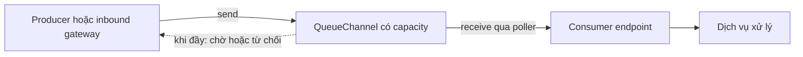
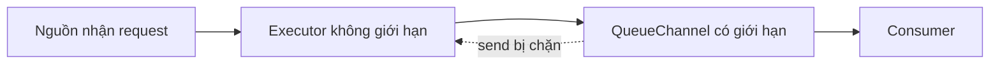

# Queue đầy và backpressure

## 1. Bài toán: producer nhanh hơn consumer

Trong Spring Integration Core, `QueueChannel` lưu các `Message<?>` để một consumer lấy ra xử lý sau. Vì đây là một `PollableChannel`, consumer chủ động gọi `receive()`; trong một integration flow, việc này thường do endpoint có poller thực hiện.

Ví dụ, một hệ thống nhận đơn hàng có thể tiếp nhận 150 thông điệp/giây nhưng dịch vụ phía sau chỉ xử lý được 100 thông điệp/giây. Queue giúp hấp thụ những đợt tăng tải ngắn. Nếu chênh lệch kéo dài, số thông điệp chờ vẫn tăng khoảng 50 thông điệp mỗi giây.

Khi queue đạt giới hạn, hệ thống phải quyết định: chờ thêm chỗ, từ chối thông điệp mới, giảm tải đầu vào hay chuyển sang một nơi lưu trữ khác. Quyết định này là một phần của hợp đồng tiếp nhận thông điệp, không chỉ là cấu hình kỹ thuật của channel.

Sau bài này, bạn có thể:

- Giải thích hành vi gửi thông điệp vào một `QueueChannel` có giới hạn.
- Phân biệt queue có giới hạn với cơ chế backpressure hoàn chỉnh.
- Kết hợp capacity, send timeout, poller và chính sách quá tải.
- Phân biệt lỗi tiếp nhận với lỗi xử lý tại endpoint.
- Kiểm thử tình huống queue đầy mà không để test treo vô hạn.

## 2. QueueChannel tạo ranh giới giữa tiếp nhận và xử lý



Ở mô hình này, gửi thành công có nghĩa là channel đã chấp nhận thông điệp vào queue. Điều đó không chứng minh consumer đã xử lý xong hoặc tác vụ nghiệp vụ đã thành công.

Consumer chạy theo lịch của poller, thường ở thread khác với thread gửi. Nếu consumer gặp lỗi sau khi lấy thông điệp, lỗi đó không tự quay lại lời gọi `send()` đã kết thúc trước đó.

Đây là khác biệt quan trọng với `DirectChannel`: với `DirectChannel` và consumer xử lý đồng bộ thông thường, thread gửi thực thi chuỗi xử lý trực tiếp. Với `QueueChannel`, queue tạo một điểm đệm và tách thời điểm gửi khỏi thời điểm xử lý.

### 2.1. Đặt giới hạn tường minh

```java
QueueChannel orders = new QueueChannel(100);
```

Queue này chỉ giữ tối đa 100 thông điệp đang chờ. Một `QueueChannel` dùng constructor không tham số có capacity mặc định rất lớn, nên không phù hợp nếu mục tiêu là đặt một giới hạn bộ nhớ có ý nghĩa vận hành.

Capacity tính theo số thông điệp, không tính theo byte. Một trăm thông điệp chứa chuỗi nhỏ khác xa một trăm thông điệp giữ tham chiếu tới các mảng byte lớn. Khi chọn giới hạn, cần tính cả payload, headers và các đối tượng mà chúng giữ lại trong bộ nhớ.

### 2.2. Capacity không đếm toàn bộ công việc đang tồn tại

Khi consumer lấy một thông điệp ra khỏi queue, một chỗ được giải phóng ngay. Thông điệp đó có thể vẫn đang được xử lý.

Vì vậy:

```text
Công việc chưa hoàn tất
  = thông điệp đang chờ trong channel
  + thông điệp đang xử lý
  + thông điệp đang chờ ở các bộ đệm khác
```

Một queue có capacity 100 không bảo đảm toàn bộ ứng dụng chỉ giữ 100 công việc. Executor, kết nối mạng, retry và các channel phía sau đều có thể giữ thêm công việc.

## 3. Queue đầy: send() sẽ làm gì?

Khi thao tác trực tiếp với một `QueueChannel` có giới hạn, có thể chọn ba cách gửi:

| Cách gọi | Khi không còn chỗ | Ý nghĩa đối với producer |
|---|---|---|
| `send(message, 0)` | Không chờ; trả về `false` nếu chưa thể nhận | Producer phải xử lý từ chối ngay |
| `send(message, timeoutMillis)` với timeout dương | Chờ tối đa khoảng thời gian đã cho; trả về `false` nếu vẫn không gửi được | Giới hạn thời gian chờ ở điểm gửi |
| `send(message)` hoặc timeout âm | Có thể chờ vô hạn cho đến khi có chỗ | Thread gửi có thể bị giữ trong thời gian không xác định |

Các mô tả này giả định thao tác không gặp exception hoặc bị gián đoạn. Timeout gửi là giới hạn chờ để channel tiếp nhận, không phải thời gian xử lý nghiệp vụ.

Ví dụ:

```java
QueueChannel queue = new QueueChannel(1);

Message<String> first = MessageBuilder.withPayload("order-001").build();
Message<String> second = MessageBuilder.withPayload("order-002").build();

boolean acceptedFirst = queue.send(first, 0);   // true
boolean acceptedSecond = queue.send(second, 0); // false: queue đang đầy
```

Thông điệp thứ hai chưa được đưa vào queue. Thông điệp thứ nhất vẫn nằm trong queue; channel không tự loại nó để nhận thông điệp mới.

### 3.1. Không bỏ qua giá trị trả về

Đoạn code dưới đây có thể làm ứng dụng báo thành công dù thông điệp chưa được tiếp nhận:

```java
// Sai nếu phía gọi hiểu phương thức này là tiếp nhận thành công.
queue.send(message, 0);
return;
```

Cách xử lý rõ ràng hơn:

```java
boolean accepted = queue.send(message, 200);
if (!accepted) {
    throw new IntakeOverloadedException("Queue chưa thể nhận thêm đơn hàng");
}
```

Với thao tác trực tiếp trên channel, hết timeout thường được thể hiện bằng `false`. Các lớp trung gian như messaging template hoặc endpoint có thể chuyển kết quả gửi không thành công thành exception. Khi đọc log hoặc thiết kế xử lý lỗi, cần biết mình đang gọi API nào.

### 3.2. Mỗi tầng có thể có timeout riêng

Một request đi qua nhiều tầng:

```text
Client → HTTP endpoint → messaging gateway → QueueChannel → consumer
```

Timeout của HTTP client, timeout gửi request vào channel và timeout chờ reply không đồng nghĩa với nhau.

- Send timeout giới hạn việc chờ channel chấp nhận thông điệp.
- Reply timeout giới hạn việc đợi thông điệp trả lời trong mô hình request/reply.
- Timeout của client giới hạn thời gian phía gọi chờ phản hồi qua mạng.

Không nên đặt send timeout dài hơn đáng kể so với thời gian chờ còn lại của request. Nếu client đã bỏ cuộc nhưng server vẫn cố gửi, công việc vẫn có thể được tiếp nhận sau đó. Client retry có thể tạo yêu cầu trùng; cần định danh nghiệp vụ và cơ chế idempotency khi điều đó quan trọng.

## 4. Queue có giới hạn chưa đủ tạo backpressure hoàn chỉnh

Backpressure là cách thông tin về khả năng tiếp nhận của downstream tác động ngược lên upstream để hạn chế lượng công việc mới.

Với `QueueChannel`, tín hiệu có thể là:

- `send()` phải chờ lâu hơn vì queue gần hoặc đã đầy.
- `send()` trả về `false` sau thời gian chờ.
- Lớp trung gian báo lỗi gửi, rồi phía gọi giảm tốc độ hoặc từ chối yêu cầu.

Nhưng tín hiệu chỉ có tác dụng nếu upstream phản ứng. Nếu producer tiếp tục tạo task rồi dồn chúng vào một executor không giới hạn trước khi gọi `send()`, backlog chỉ chuyển từ channel sang executor.



Trong sơ đồ này, giới hạn của channel không tự giới hạn số task đang chờ ở executor. Muốn kiểm soát tải đầu cuối, phải xem xét các bộ đệm và mức đồng thời trên toàn tuyến.

`QueueChannel` cũng không tự cung cấp giao thức yêu cầu từng phần tử theo nhu cầu như Reactive Streams. Không nên suy ra rằng chọn một queue có capacity là đã có cơ chế reactive backpressure.

## 5. Chọn chính sách khi quá tải

| Chính sách | Phù hợp khi | Điều phải thiết kế kèm |
|---|---|---|
| Chờ trong thời gian ngắn, có giới hạn | Tải thường tăng theo đợt ngắn | Ngân sách latency và giới hạn thread chờ |
| Từ chối ngay | Nguồn gửi có thể retry hoặc tự điều tiết | Phản hồi rõ ràng, retry có giới hạn |
| Giảm tốc độ nhận từ nguồn | Có thể điều khiển tốc độ đọc hoặc phát sinh công việc | Rate limit, mức đồng thời, cơ chế tạm dừng phù hợp adapter |
| Chuyển sang nơi lưu trữ bền vững | Công việc quan trọng cần tồn tại qua restart | Xác nhận lưu thành công, xử lý trùng, phục hồi |
| Bỏ thông điệp theo chính sách | Dữ liệu có thể mất, chẳng hạn một số dữ liệu đo lường | Quy tắc bỏ rõ ràng và số liệu quan sát |

### 5.1. Chờ có giới hạn

Cho producer chờ một khoảng ngắn có thể hấp thụ dao động nhỏ. Tuy nhiên, 500 request cùng chờ queue vẫn có thể giữ 500 thread hoặc các tài nguyên gắn với request, tùy kiến trúc thực thi.

Không chọn chờ vô hạn chỉ vì muốn tránh trả lỗi. Nếu downstream ngừng hoạt động, các lời gọi có thể chờ mãi và kéo theo cạn pool của phía nhận request.

### 5.2. Từ chối rõ ràng

Nếu queue chưa nhận thông điệp, trả kết quả từ chối tới nguồn gửi theo hợp đồng của hệ thống. Trong một API, tầng HTTP có thể ánh xạ lỗi quá tải thành phản hồi phù hợp với quy ước của API; không trả thành công trước khi biết có tiếp nhận hay chưa.

Retry nên có số lần hoặc thời hạn tối đa, backoff và jitter. Retry tức thì từ nhiều producer có thể làm hệ thống chịu thêm tải đúng lúc downstream đang quá tải.

### 5.3. Chuyển sang broker hoặc persistent message store

Một `QueueChannel` lưu trong bộ nhớ mặc định không phải là hàng đợi bền vững. Nếu ứng dụng dừng, thông điệp còn nằm trong queue có thể mất.

Có thể thiết kế lưu trữ qua message store phù hợp hoặc dùng broker, nhưng đây là một quyết định kiến trúc khác. Cần xác định lúc nào được xem là đã nhận bền vững, cách phục hồi, thứ tự xử lý và khả năng xử lý trùng. Không chỉ thay một cấu hình rồi kết luận rằng đã có exactly-once.

### 5.4. Bỏ thông điệp là quyết định nghiệp vụ

`QueueChannel` không tự bỏ thông điệp cũ khi đầy. Nếu muốn bỏ dữ liệu mới hoặc thay dữ liệu cũ, phải triển khai chính sách có chủ đích.

Không áp dụng chính sách bỏ ngầm cho đơn hàng, thanh toán hoặc công việc bắt buộc phải xử lý. Ngay cả khi được phép bỏ một số dữ liệu telemetry, vẫn nên đo số lần bỏ để biết mức suy giảm chất lượng.

## 6. Ví dụ Java DSL: queue có giới hạn và ingress có timeout

Ví dụ sau dùng các API của Spring Integration Java DSL và cú pháp `record` của Java 17 trở lên. Ứng dụng cần có Spring Integration Core, component scan cho lớp ingress và cấu hình thông thường để khởi động Spring context.

Mục tiêu:

- Chỉ giữ tối đa 100 đơn hàng chờ trong channel.
- Mỗi lần gửi chờ tối đa 200 ms.
- Poller lấy tối đa 10 thông điệp trong một lượt poll.
- Nếu queue chưa nhận được thông điệp, báo lỗi tiếp nhận cho tầng gọi.

### 6.1. Payload và dịch vụ xử lý

Các khai báo dưới đây đặt trong các file Java riêng, dùng cùng package theo cấu trúc ứng dụng.

```java
public record Order(String id) {
}
```

```java
public interface OrderProcessor {
    void process(Order order);
}
```

Ứng dụng cung cấp một bean triển khai `OrderProcessor`. Ví dụ thực tế có thể gọi dịch vụ kho hoặc ghi trạng thái xử lý vào cơ sở dữ liệu.

### 6.2. Khai báo QueueChannel và consumer

```java
import org.springframework.context.annotation.Bean;
import org.springframework.context.annotation.Configuration;
import org.springframework.integration.channel.QueueChannel;
import org.springframework.integration.config.EnableIntegration;
import org.springframework.integration.dsl.IntegrationFlow;
import org.springframework.integration.dsl.Pollers;

@Configuration
@EnableIntegration
public class OrderIntegrationConfiguration {

    @Bean
    public QueueChannel ordersQueue() {
        return new QueueChannel(100);
    }

    @Bean
    public IntegrationFlow orderFlow(
            QueueChannel ordersQueue,
            OrderProcessor processor) {

        return IntegrationFlow
                .from(ordersQueue, endpoint -> endpoint.poller(
                        Pollers.fixedDelay(100)
                                .maxMessagesPerPoll(10)))
                .handle(Order.class, (order, headers) -> {
                    processor.process(order);
                    return null;
                })
                .get();
    }
}
```

Handler trả về `null` vì ví dụ kết thúc bằng xử lý một chiều, không tạo reply cho upstream. Nếu có nhiều bean cùng kiểu `QueueChannel`, nên thêm `@Qualifier("ordersQueue")` vào tham số tương ứng.

`maxMessagesPerPoll(10)` là số thông điệp tối đa được lấy trong một lượt poll. Nó không tạo ra 10 consumer chạy đồng thời và cũng không bảo đảm đạt 100 thông điệp/giây.

Trong cấu hình xử lý đồng bộ này, thời gian thực hiện handler nằm trong thời gian chạy lượt poll. Với fixed delay, lượt chạy tiếp theo có thêm khoảng nghỉ sau khi lượt hiện tại kết thúc. Thời gian xử lý từng đơn hàng vì thế ảnh hưởng trực tiếp đến tốc độ rút queue.

### 6.3. Giới hạn thời gian gửi tại ingress

```java
public class IntakeOverloadedException extends RuntimeException {
    public IntakeOverloadedException(String message) {
        super(message);
    }
}
```

```java
import org.springframework.beans.factory.annotation.Qualifier;
import org.springframework.messaging.Message;
import org.springframework.messaging.MessageChannel;
import org.springframework.messaging.support.MessageBuilder;
import org.springframework.stereotype.Service;

@Service
public class OrderIngress {

    private final MessageChannel ordersQueue;

    public OrderIngress(
            @Qualifier("ordersQueue") MessageChannel ordersQueue) {
        this.ordersQueue = ordersQueue;
    }

    public void submit(Order order) {
        Message<Order> message = MessageBuilder
                .withPayload(order)
                .setHeader("orderId", order.id())
                .build();

        boolean accepted = ordersQueue.send(message, 200);
        if (!accepted) {
            throw new IntakeOverloadedException(
                    "Hệ thống đang bận; chưa tiếp nhận đơn " + order.id());
        }
    }
}
```

Khi `submit()` kết thúc bình thường, đơn hàng đã được channel tiếp nhận. Nếu `processor.process()` thất bại sau đó, ingress không tự biết kết quả này.

Code trên xử lý kết quả `false` do gửi không thành công trong thời gian chờ. Các exception khác từ quá trình gửi vẫn được truyền ra; không nên gom mọi lỗi thành “queue đầy”.

Các con số 100, 200 ms và 10 là lựa chọn minh họa. Chúng cần được điều chỉnh theo tải thực tế, kích thước message, latency mục tiêu và khả năng xử lý của dịch vụ phía sau.

### 6.4. Nếu dùng messaging gateway

Gateway giúp phía nghiệp vụ làm việc với một interface thay vì tự tạo `Message`. Khi thay ingress bằng gateway, vẫn phải cấu hình rõ thời gian gửi request tới channel và, nếu có reply, thời gian chờ reply.

Không nhầm việc gateway đã gửi thành công vào queue với việc xử lý đơn hàng đã hoàn tất. Với hợp đồng một chiều, nên mô tả kết quả là “đã tiếp nhận”. Với hợp đồng chờ kết quả xử lý, cần thiết kế reply channel, timeout và hành vi khi client hết thời gian chờ.

## 7. Điều chỉnh poller và mức đồng thời

### 7.1. Tần suất poll chỉ giải quyết một phần

Giảm fixed delay giúp consumer kiểm tra queue thường xuyên hơn. Nếu bottleneck là lời gọi downstream mất 200 ms, việc giảm delay từ 100 ms xuống 10 ms không làm lời gọi đó nhanh hơn.

Tăng `maxMessagesPerPoll` giúp xử lý nhiều thông điệp hơn trong một lượt. Giá trị quá lớn cũng có thể khiến một lượt poll kéo dài và giữ tài nguyên lâu hơn dự kiến.

### 7.2. Tăng mức đồng thời có điều kiện

Có thể thiết kế nhiều tác vụ xử lý song song, nhưng cần kiểm tra:

- Handler và các thành phần dùng chung có an toàn khi chạy đồng thời không.
- Database pool và dịch vụ downstream có chịu được lượng request tăng thêm không.
- Nghiệp vụ có yêu cầu thứ tự theo đơn hàng hoặc theo khách hàng không.
- Executor có giới hạn queue và chính sách từ chối phù hợp không.

Nếu bổ sung task executor cho poller hoặc thêm một ranh giới bất đồng bộ, phải xem lại toàn bộ nơi giữ backlog. Một executor có queue không giới hạn có thể khiến `ordersQueue` trông ít đầy trong khi ứng dụng vẫn tích lũy công việc ở nơi khác.

Khi xử lý song song, thứ tự lấy thông điệp khỏi queue cũng không bảo đảm thứ tự hoàn tất nghiệp vụ.

### 7.3. Không tạo vòng chờ khép kín

Một tình huống dễ bị bỏ sót:

1. Consumer duy nhất lấy một thông điệp từ queue.
2. Producer khác nhanh chóng lấp lại chỗ vừa trống.
3. Consumer gặp lỗi và cố gửi lại thông điệp vào chính queue đó với thời gian chờ vô hạn.
4. Queue đang đầy, còn consumer duy nhất đang bị chặn ở thao tác gửi lại.

Không còn consumer để giải phóng queue, nên luồng có thể mắc kẹt. Hãy dùng retry có giới hạn, đường phục hồi riêng và timeout thích hợp; không gửi lại vô hạn vào chính queue mà consumer hiện tại chịu trách nhiệm rút.

## 8. Phân biệt lỗi tiếp nhận và lỗi xử lý

| Tình huống | Thông điệp đã vào queue? | Nơi cần phản ứng |
|---|---|---|
| `send(message, 0)` trả về `false` vì queue đầy | Chưa | Producer hoặc ingress |
| Gửi chờ hết timeout mà không thành công | Chưa | Producer hoặc lớp trung gian đang gửi |
| Handler lỗi sau khi poller lấy message | Đã vào, rồi được lấy ra | Cơ chế xử lý lỗi của endpoint/poller |
| Ứng dụng dừng khi queue trong bộ nhớ còn message | Đã vào nhưng chưa chắc được xử lý | Thiết kế lưu trữ và phục hồi |

Với polling endpoint sử dụng cơ chế xử lý lỗi mặc định của framework, lỗi bất đồng bộ trong quá trình poll/xử lý thường được công bố dưới dạng `ErrorMessage` tới error channel thích hợp. Có thể định cấu hình error handler hoặc error channel của poller để áp dụng chính sách riêng.

Tuy nhiên, `send()` trực tiếp trả về `false` không tự tạo một `ErrorMessage` trên `errorChannel`. Producer phải xử lý kết quả này. Không nên kỳ vọng một flow bắt lỗi ở downstream sẽ bắt được mọi tình huống queue đầy ở ingress.

Ngoài ra, khi một thông điệp đã được lấy khỏi queue trong bộ nhớ, handler thất bại không tự đưa thông điệp đó trở lại queue. Nếu cần retry hoặc phục hồi, phải thiết kế rõ cơ chế tương ứng. Việc đặt transaction quanh xử lý cũng không tự biến `QueueChannel` trong bộ nhớ thành hàng đợi có khả năng rollback bền vững.

Đường xử lý lỗi cần có capacity và chính sách quá tải riêng. Nếu cả error flow cũng bị chặn vô hạn, lỗi ban đầu có thể kéo theo tắc nghẽn toàn tuyến.

## 9. Chọn capacity bằng số liệu

Giả sử trong một đợt tăng tải:

```text
Tốc độ vào:             150 message/giây
Tốc độ xử lý thực tế:    100 message/giây
Thời gian tăng tải:       10 giây
Backlog tăng thêm:        (150 - 100) × 10 = 500 message
```

Nếu queue ban đầu rỗng và không chấp nhận từ chối trong đợt tải này, cần chỗ cho khoảng 500 message tích lũy, cộng biên dự phòng cho biến động. Đây là ước lượng đơn giản, chưa tính phân bố thời gian xử lý và các khoảng downstream bị ngừng.

Với queue capacity 100, nếu producer vẫn tiếp tục đưa vào đúng 150 message/giây trong khi consumer xử lý 100 message/giây, queue có thể đầy sau khoảng:

```text
100 / (150 - 100) = 2 giây
```

Khi producer bắt đầu bị chặn hoặc từ chối, tốc độ tiếp nhận thực tế sẽ thay đổi; không tiếp tục áp dụng phép tính tuyến tính như thể mọi message vẫn vào được queue.

### 9.1. Queue lớn làm tăng thời gian chờ

Nếu phía trước một message có khoảng 500 message và hệ thống rút đều 100 message/giây, thời gian chờ sơ bộ có thể vào khoảng 5 giây, chưa kể thời gian xử lý chính message đó.

Queue lớn có thể giảm từ chối ngắn hạn nhưng làm tăng latency và lượng dữ liệu tồn đọng. Nếu tốc độ vào trung bình luôn lớn hơn tốc độ ra, không có capacity hữu hạn nào giải quyết được sự mất cân bằng kéo dài.

### 9.2. Little's Law cho trạng thái ổn định

Trong một hệ thống ổn định, có thể dùng quan hệ:

```text
L = λ × W
```

Trong đó `L` là số công việc trung bình trong phạm vi đang đo, `λ` là throughput trung bình qua phạm vi đó và `W` là thời gian trung bình công việc ở trong phạm vi đó.

Nếu chỉ đo phần chờ trong queue, phải dùng thời gian chờ trong queue. Nếu đo toàn bộ hệ thống, phải tính cả công việc đang xử lý. Không dùng công thức này với một queue đang tăng không ngừng rồi xem đó là trạng thái ổn định.

## 10. Kiểm thử queue đầy

Hai test nhỏ sau tập trung vào hợp đồng tiếp nhận. Không khởi động poller để tránh một consumer nền lấy message làm tình huống queue đầy biến mất ngoài ý muốn.

```java
import org.junit.jupiter.api.Test;
import org.springframework.integration.channel.QueueChannel;
import org.springframework.messaging.Message;
import org.springframework.messaging.support.MessageBuilder;

import static org.junit.jupiter.api.Assertions.*;

class QueueCapacityTest {

    @Test
    void rejectsNewMessageWhenQueueIsFull() {
        QueueChannel queue = new QueueChannel(1);
        Message<String> first = MessageBuilder.withPayload("first").build();
        Message<String> second = MessageBuilder.withPayload("second").build();

        assertTrue(queue.send(first, 0));
        assertFalse(queue.send(second, 0));

        // Message đã nhận vẫn còn; message bị từ chối không được chèn vào.
        assertSame(first, queue.receive(0));
        assertNull(queue.receive(0));
    }

    @Test
    void acceptsNewMessageAfterConsumerFreesCapacity() {
        QueueChannel queue = new QueueChannel(1);
        Message<String> first = MessageBuilder.withPayload("first").build();
        Message<String> second = MessageBuilder.withPayload("second").build();

        assertTrue(queue.send(first, 0));
        assertSame(first, queue.receive(0));

        assertTrue(queue.send(second, 0));
        assertSame(second, queue.receive(0));
    }
}
```

Các test này dùng timeout bằng 0, nên không chờ vô hạn. Chúng kiểm tra trực tiếp hai hành vi cần thiết: từ chối khi đầy và tiếp nhận trở lại khi có chỗ.

Để kiểm thử ingress, có thể tạo `QueueChannel(1)`, lấp đầy queue, rồi gọi `OrderIngress.submit()` và xác nhận có `IntakeOverloadedException`. Để kiểm thử gửi có chờ, dùng worker thread cùng tín hiệu đồng bộ như `CountDownLatch` và giới hạn thời gian chờ cho cả test; không dựa vào một chuỗi `Thread.sleep()` với thời điểm quá chặt.

Đối với integration test có poller, cần thêm trường hợp handler chậm hoặc thất bại để xác nhận rằng phản hồi tiếp nhận và kết quả xử lý được quan sát độc lập.

## 11. Quan sát và chẩn đoán

Nên đo đồng thời các nhóm tín hiệu sau:

| Tín hiệu | Câu hỏi được trả lời |
|---|---|
| Số message đang chờ và capacity | Queue đang dùng bao nhiêu phần giới hạn? |
| Tốc độ gửi được chấp nhận và tốc độ xử lý xong | Backlog có xu hướng tăng hay giảm? |
| Số lần từ chối, timeout gửi và thời gian chờ gửi | Producer đang chịu áp lực tới mức nào? |
| Tuổi message chờ và latency xử lý | Queue đang làm công việc chậm bao lâu? |
| Số task đang chờ ở executor, số worker bận | Backlog có đang chuyển sang nơi khác? |
| Lỗi downstream, timeout kết nối, mức dùng connection pool | Thành phần nào đang giới hạn throughput? |

`QueueChannel.getQueueSize()` hỗ trợ quan sát độ dài queue tại một thời điểm. Đó là ảnh chụp có thể thay đổi ngay khi có producer hoặc consumer khác hoạt động. Không dùng cách “kiểm tra size rồi mới gửi” để bảo đảm có chỗ; kết quả của thao tác `send()` mới quyết định việc tiếp nhận.

Một queue luôn gần đầy là dấu hiệu cần xem xét. Một queue trống cũng chưa đủ chứng minh hệ thống khỏe: consumer có thể đã chuyển nhiều công việc sang một executor khác hoặc đang xử lý chúng rất chậm.

Khi downstream bị lỗi, tránh log nguyên payload lớn cho từng lần queue đầy. Hãy lưu mã nghiệp vụ, channel, thời gian chờ và bộ đếm phù hợp để vừa chẩn đoán được vừa không tạo thêm áp lực I/O.

## 12. Các lỗi thiết kế thường gặp

- **Tăng capacity mỗi khi có timeout:** chỉ kéo dài thời gian trước khi đầy nếu bottleneck không được xử lý; đồng thời tăng bộ nhớ và latency.
- **Dùng `send()` không timeout trên đường request:** dễ giữ thread quá lâu khi downstream ngừng hoạt động.
- **Bỏ qua kết quả `false`:** có thể báo đã tiếp nhận trong khi thông điệp chưa vào queue.
- **Đặt reply timeout rồi nghĩ đã giới hạn việc gửi:** hai thời gian chờ thuộc hai giai đoạn khác nhau.
- **Tăng poller concurrency mà không kiểm tra downstream:** có thể làm dịch vụ đích quá tải hơn.
- **Retry ngay lập tức và vô hạn:** làm tăng lượng công việc lúc hệ thống đang thiếu khả năng tiếp nhận.
- **Cho rằng lỗi handler tự khôi phục message:** queue trong bộ nhớ không tự tạo cơ chế xử lý lại đáng tin cậy.
- **Cho rằng capacity bảo vệ mọi bộ đệm:** executor hoặc channel khác vẫn có thể tích lũy công việc không giới hạn.
- **Dùng queue trong bộ nhớ như một cam kết lưu bền:** restart có thể làm mất công việc chưa xử lý.

## 13. Bài tập áp dụng

Thiết kế một flow tiếp nhận yêu cầu gửi email với các giả định:

- Bình thường nhận 40 yêu cầu/giây.
- Trong 5 giây cao điểm, nhận 100 yêu cầu/giây.
- Dịch vụ gửi email xử lý ổn định 60 yêu cầu/giây.
- Phía gọi phải nhận kết quả tiếp nhận trong tối đa 300 ms.

Hãy thực hiện:

1. Ước lượng backlog tăng trong đợt cao điểm nếu không từ chối yêu cầu.
2. Chọn capacity dựa trên backlog, kích thước message và latency chấp nhận được.
3. Chọn send timeout nằm trong ngân sách phản hồi và dành thời gian cho các công đoạn khác.
4. Mô tả phản hồi khi queue đầy và quy tắc retry của phía gọi.
5. Nêu cách bảo vệ công việc khi ứng dụng khởi động lại.
6. Viết test queue đầy, test nhận lại khi có chỗ và test lỗi consumer.

Gợi ý định lượng: backlog tăng sơ bộ là `(100 - 60) × 5 = 200` message. Nếu sau cao điểm tốc độ vào trở về 40 yêu cầu/giây, khả năng rút backlog ròng là `60 - 40 = 20` message/giây, nên cần khoảng 10 giây để xử lý hết phần tích lũy trong mô hình đơn giản này.

## 14. Điểm cần nhớ

Một `QueueChannel` có giới hạn giúp xác định lượng message chờ tại một điểm trong flow. Khi queue đầy, timeout gửi quyết định producer chờ bao lâu; kết quả gửi và chính sách của upstream quyết định backpressure có thực sự tác động tới nguồn hay không.

Thiết kế tốt cần kết hợp capacity, send timeout, tốc độ poll, mức đồng thời, giới hạn downstream và cách phản hồi quá tải. Đồng thời phải giữ rõ hai cam kết: “đã tiếp nhận vào channel” và “đã xử lý nghiệp vụ thành công”.
