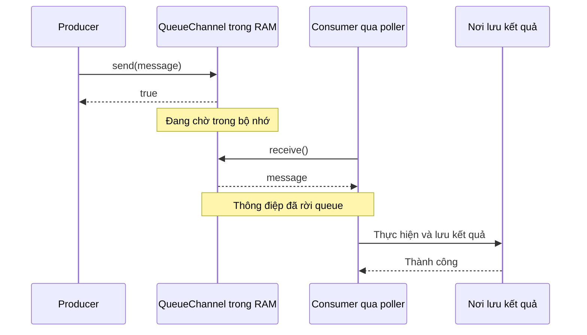

# Độ bền của queue in-memory

## 1. Queue giữ được thông điệp trong điều kiện nào?

Trong module **SPRING_INTEGRATION_CORE**, `Message` biểu diễn dữ liệu và metadata, `MessageChannel` kết nối các thành phần, còn endpoint thực hiện công việc như biến đổi, định tuyến hoặc gọi nghiệp vụ. `QueueChannel` bổ sung một bộ đệm để producer có thể gửi trước và consumer nhận sau.

**`QueueChannel` dùng bộ nhớ mặc định không bảo đảm giữ thông điệp qua lần khởi động lại ứng dụng.** Nó phù hợp để điều hòa tốc độ giữa các bước trong một tiến trình, nhưng không tự tạo ra một nơi lưu công việc bền vững. Spring Integration cho phép thay cơ chế lưu trữ bằng persistent message store khi cần khắc phục giới hạn này. Xem [cấu hình QueueChannel và persistent queue](https://docs.spring.io/spring-integration/reference/channel/configuration.html).

Ví dụ, một dịch vụ nhận yêu cầu tạo ảnh xem trước rồi đưa yêu cầu vào queue. Nếu ảnh có thể tạo lại từ dữ liệu gốc, việc mất một số yêu cầu có thể chấp nhận được. Với yêu cầu trừ tiền hoặc ghi nhận đơn hàng, chỉ giữ công việc trong RAM thường không đáp ứng yêu cầu phục hồi.

Trong bài này, **độ bền** có nghĩa là khả năng khôi phục một thông điệp đã được hệ thống chấp nhận sau sự cố. Cần tách nó khỏi các tính chất khác:

| Tính chất | Câu hỏi cần trả lời |
|---|---|
| Bộ đệm | Có thể giữ công việc trong lúc consumer chưa sẵn sàng không? |
| An toàn luồng | Nhiều thread có thể gửi và nhận đồng thời đúng cách không? |
| Độ bền | Khi tiến trình mất đi, công việc đã nhận còn khôi phục được không? |
| Xử lý lại | Khi xử lý thất bại, ai đưa công việc trở lại để thử tiếp? |
| Chống tác dụng phụ trùng lặp | Nếu xử lý lại, có trừ tiền hoặc gửi hàng hai lần không? |

Một channel có bộ đệm và an toàn luồng vẫn có thể không có độ bền. Cũng không thể suy ra khả năng xử lý lại chỉ từ tên gọi “queue”.

## 2. Vòng đời thông điệp và các cửa sổ mất dữ liệu

Xét một luồng tiếp nhận công việc:



Có ít nhất ba mốc độc lập:

1. **Được queue chấp nhận:** producer đã bàn giao thông điệp cho bộ đệm.
2. **Được consumer nhận:** thông điệp đã được lấy khỏi queue.
3. **Hoàn tất nghiệp vụ:** tác dụng phụ hoặc kết quả đã được xác nhận theo hợp đồng của ứng dụng.

Với một `QueueChannel` thông thường, `send(message)` có thể thành công khi chưa có consumer nhận. `receive()` lấy thông điệp ra khỏi hàng đợi; API không cung cấp một chu kỳ `receive → ack/nack` như một số hệ thống môi giới thông điệp. Các thao tác gửi/nhận và timeout được mô tả trong [Message Channel Implementations](https://docs.spring.io/spring-integration/reference/channel/implementations.html).

Từ vòng đời trên, có thể phân tích các tình huống sau:

| Thời điểm sự cố | Điều đã xảy ra | Hệ quả với queue trong RAM |
|---|---|---|
| Trước khi gửi thành công | Queue chưa nhận công việc | Producer phải biết và xử lý việc bàn giao thất bại |
| Sau khi gửi, trước khi nhận | Công việc đang nằm trong queue | Tiến trình dừng đột ngột làm mất bộ đệm chưa được lưu nơi khác |
| Sau khi nhận, trước khi ghi kết quả | Consumer đã lấy công việc ra | Queue không còn bản chờ để tự phát lại |
| Sau tác dụng phụ, trước khi lưu trạng thái hoàn tất | Một phần nghiệp vụ có thể đã thành công | Phát lại từ nguồn khác có thể gây tác dụng phụ trùng lặp |
| Trong lúc triển khai lại ứng dụng | Instance cũ còn việc chưa xử lý | Instance mới không tự kế thừa queue trong heap của instance cũ |

Ví dụ suy luận: API trả lời “đã nhận” ngay sau khi đưa lệnh thanh toán vào RAM. Nếu ứng dụng chết trước khi consumer nhận lệnh, khách hàng có thể đã thấy một phản hồi thành công nhưng không có bản ghi công việc nào để hệ thống tiếp tục. Đây là vấn đề về hợp đồng tiếp nhận, không thể giải quyết chỉ bằng việc tăng số consumer.

## 3. Thực nghiệm tối thiểu bằng Java

Ví dụ dưới đây dùng các lớp core và không cần Spring container. Nó mô phỏng hai hiện tượng: một lỗi sau `receive()` không làm thông điệp tự quay lại, và một channel mới không có bộ đệm của channel cũ.

```java
import org.springframework.integration.channel.QueueChannel;
import org.springframework.messaging.Message;
import org.springframework.messaging.support.MessageBuilder;

public class InMemoryQueueDurabilityDemo {

    public static void main(String[] args) {
        QueueChannel queue = new QueueChannel(10);

        Message<String> request = MessageBuilder
                .withPayload("create-thumbnail:photo-42")
                .setHeader("jobId", "thumbnail-photo-42-v1")
                .build();

        boolean accepted = queue.send(request, 0);
        System.out.println("accepted=" + accepted);
        System.out.println("queued-before-receive=" + queue.getQueueSize());

        Message<?> received = queue.receive(0);
        if (received == null) {
            throw new IllegalStateException("Expected a queued message");
        }

        try {
            process(received);
        } catch (IllegalStateException ex) {
            System.out.println("processing-error=" + ex.getMessage());
        }

        System.out.println("queued-after-failure=" + queue.getQueueSize());
        System.out.println("next-receive=" + queue.receive(0));

        queue.send(MessageBuilder.withPayload("pending-job").build(), 0);
        QueueChannel recreatedQueue = new QueueChannel(10);

        System.out.println("old-queue-size=" + queue.getQueueSize());
        System.out.println("new-queue-size=" + recreatedQueue.getQueueSize());
    }

    private static void process(Message<?> message) {
        throw new IllegalStateException("Image storage unavailable");
    }
}
```

Kết quả mong đợi:

```text
accepted=true
queued-before-receive=1
processing-error=Image storage unavailable
queued-after-failure=0
next-receive=null
old-queue-size=1
new-queue-size=0
```

Trong chương trình, queue cũ vẫn tồn tại để quan sát. Việc tạo đối tượng mới chỉ minh họa rằng bộ đệm thuộc về từng đối tượng; nó **không phải phép thử crash/restart thực tế**. Để kiểm tra khởi động lại, phải chạy hai tiến trình liên tiếp như bài thực hành ở cuối bài.

Ngoài ra, `catch` ở đây do chính mã demo viết. Ví dụ không có poller, `errorChannel`, retry advice hay cơ chế phục hồi tự động nào.

## 4. Đặt queue vào một luồng Java DSL

Ví dụ sau đưa bộ đệm vào giữa producer và một endpoint xử lý. `MessageHandler` được dùng làm bước cuối để không tạo thông điệp trả lời ngoài ý muốn.

```java
import org.springframework.context.annotation.Bean;
import org.springframework.context.annotation.Configuration;
import org.springframework.integration.channel.QueueChannel;
import org.springframework.integration.config.EnableIntegration;
import org.springframework.integration.dsl.IntegrationFlow;
import org.springframework.integration.dsl.Pollers;
import org.springframework.messaging.MessageHandler;

@Configuration
@EnableIntegration
public class ThumbnailFlowConfiguration {

    @Bean
    public QueueChannel thumbnailJobs() {
        return new QueueChannel(100);
    }

    @Bean
    public IntegrationFlow thumbnailFlow(QueueChannel thumbnailJobs) {
        MessageHandler worker = message -> {
            String job = (String) message.getPayload();
            // Thay bằng lời gọi dịch vụ tạo ảnh xem trước.
            System.out.println("Processing " + job);
        };

        return IntegrationFlow.from(thumbnailJobs)
                .handle(worker, endpoint -> endpoint.poller(
                        Pollers.fixedDelay(200)
                                .maxMessagesPerPoll(10)))
                .get();
    }
}
```

Đây là cấu hình Java để nạp trong một Spring application context có thư viện Spring Integration; nó không bao gồm cấu hình build hay chương trình khởi động ứng dụng. Producer gửi payload chuỗi theo hợp đồng của ví dụ.

Ở đây:

- `thumbnailJobs` là điểm đệm, tối đa 100 thông điệp đang chờ.
- Poller kích hoạt việc nhận và gọi handler theo lịch; cấu hình endpoint không bổ sung nơi lưu bền vững.
- `maxMessagesPerPoll(10)` giới hạn số thông điệp lấy trong một lần polling, không tạo thêm 10 consumer và không cam kết mọi thông điệp hoàn tất trong 200 ms.
- Nếu worker ném lỗi sau khi thông điệp đã rời queue, cần chính sách xử lý lỗi riêng.

Cấu hình poller và endpoint được trình bày trong [Message Endpoints](https://docs.spring.io/spring-integration/reference/endpoint.html).

Nếu thay worker bằng transformer, router hoặc filter, cần tiếp tục hỏi thông điệp nào là kết quả hợp lệ và thông điệp nào phải được lưu để xử lý tiếp. Chẳng hạn, filter chủ động loại dữ liệu không hợp lệ là quyết định nghiệp vụ; nó khác với việc mất công việc ngoài ý muốn khi tiến trình chết.

Một gateway đặt trước queue có thể cung cấp giao diện Java thuận tiện. Tuy vậy, giao diện gọi hàm không thay đổi nơi lưu thông điệp. Nếu thiết kế một chiều, cần định nghĩa rõ “gọi thành công” là đã tiếp nhận vào RAM hay đã ghi một công việc bền vững. Nếu thiết kế request/reply, cần xác định phản hồi chứng minh mốc nghiệp vụ nào đã hoàn tất.

## 5. Capacity và timeout bảo vệ tài nguyên, không tạo độ bền

Queue không giới hạn theo mặc định vẫn bị giới hạn bởi bộ nhớ thực tế. Javadoc khuyến nghị dùng queue có capacity để tránh nguy cơ hết bộ nhớ; có thể quan sát số phần tử chờ qua `getQueueSize()`. Xem [QueueChannel API](https://docs.spring.io/spring-integration/api/org/springframework/integration/channel/QueueChannel.html).

Ví dụ đặt capacity bằng 1:

```java
QueueChannel queue = new QueueChannel(1);

boolean first = queue.send(
        MessageBuilder.withPayload("job-1").build(), 0);
boolean second = queue.send(
        MessageBuilder.withPayload("job-2").build(), 0);

System.out.println(first);  // true
System.out.println(second); // false vì queue đầy
```

`send(message, 0)` thử gửi ngay, không chờ có chỗ. Timeout dương giới hạn thời gian chờ; đó không phải thời gian sống của thông điệp đã được đưa vào queue. Với queue mặc định, overload không truyền timeout có thể chờ khi đầy; tương tự, `receive()` có thể chờ khi queue rỗng. Trong mã demo nên dùng timeout rõ ràng để tránh treo ngoài ý muốn.

Một cách ước lượng cho thiết kế thử nghiệm:

```text
Producer: 500 công việc/giây
Consumer: 300 công việc/giây
Tốc độ tăng backlog: 200 công việc/giây
Capacity: 2.000 công việc, ban đầu rỗng
Thời gian đến khi đầy: xấp xỉ 2.000 / 200 = 10 giây
```

Đây là phép tính trung bình, giả định tốc độ ổn định và bỏ qua dao động. Nó giúp nhận ra rằng tăng queue chỉ kéo dài thời gian chịu tải vượt năng lực. Payload lớn còn có thể làm ứng dụng thiếu bộ nhớ trước khi chạm capacity dự kiến.

Producer phải xử lý kết quả `false` hoặc lỗi gửi theo hợp đồng của mình. Ví dụ, có thể từ chối tiếp nhận để caller thử lại, hoặc lưu công việc vào nơi bền vững. Bỏ qua kết quả gửi có thể làm mất công việc ngay cả khi ứng dụng không khởi động lại.

## 6. Vì sao transaction, errorChannel và retry chưa đủ?

### 6.1. Transaction nghiệp vụ không tự rollback bộ đệm RAM

Xét một worker lấy thông điệp rồi ghi dữ liệu bằng một phương thức `@Transactional`. Nếu ghi database thất bại, transaction có thể rollback các thay đổi database đã tham gia. Điều đó không đồng nghĩa thao tác lấy khỏi `QueueChannel` mặc định được hoàn tác.

Lý do cần kiểm tra là **tài nguyên nào thực sự tham gia transaction**, chứ không chỉ có annotation hay không. Spring Integration hỗ trợ bao thao tác polling trong transaction, nhưng việc rollback thao tác nhận cần nguồn nhận có tính chất transactional tương ứng. Transaction gắn với thread cũng không tự bao trùm phần xử lý được bàn giao sang thread khác. Xem [Transaction Support](https://docs.spring.io/spring-integration/reference/transactions.html).

Suy luận cho thiết kế: nếu queue nằm trong RAM và database là nơi duy nhất tham gia transaction, rollback database không phải bằng chứng cho khả năng phát lại công việc. Cần quan sát lại queue hoặc nguồn công việc có thẩm quyền.

### 6.2. errorChannel mang thông tin lỗi

Với tác vụ polling theo cấu hình thông thường, Spring Integration có thể chuyển lỗi thành `ErrorMessage` và gửi tới kênh xử lý lỗi. `errorChannel` mặc định dùng `PublishSubscribeChannel` cùng subscriber ghi log ở mức lỗi. Chi tiết nằm trong [Error Handling](https://docs.spring.io/spring-integration/reference/error-handling.html).

Ghi nhận được lỗi giúp vận hành biết chuyện gì xảy ra, nhưng không tự tạo một bản sao công việc có thể phát lại. Nếu tự cấu hình kênh lỗi bằng một `QueueChannel` trong RAM, dữ liệu lỗi đang chờ cũng có cùng giới hạn về khởi động lại.

Ví dụ suy luận: sau khi đọc lệnh gửi email, worker gặp lỗi SMTP và chỉ ghi log. Queue đầu vào đã rỗng; một dòng log không phải danh sách công việc chưa hoàn thành. Muốn phục hồi, ứng dụng cần lưu đủ thông tin công việc và có đường phát lại được thiết kế rõ ràng.

### 6.3. Retry xử lý lỗi tạm thời trong phạm vi đã cấu hình

Retry có thể gọi lại thao tác thất bại khi tiến trình vẫn hoạt động. Nếu toàn bộ trạng thái đang thử lại chỉ nằm trong RAM, tiến trình chết sẽ làm mất cả trạng thái đó.

Khi thiết kế retry, cần xác định:

- Thao tác nào được gọi lại và có thể đã tạo tác dụng phụ gì?
- Sau khi hết lượt thử, công việc đi đâu?
- Nơi giữ công việc thất bại có sống qua restart không?
- Ai có quyền phát lại và dùng khóa nào để tránh tác dụng phụ trùng lặp?

Tự gửi lại vô hạn vào queue ban đầu không phải một chính sách phục hồi hoàn chỉnh. Ví dụ, một payload sai định dạng có thể liên tục quay lại và chiếm tài nguyên; một hàng đợi đầy có thể khiến chính thao tác gửi lại bị chặn hoặc thất bại.

## 7. Khi cần lưu bền vững, phải thay đổi điểm lưu công việc

### 7.1. Persistent message store

Spring Integration có các triển khai message store khác nhau. Một store ở bộ nhớ như `SimpleMessageStore` không trở thành bền vững chỉ vì có tên “store”. Khi dùng persistent store, cần xét cả khả năng serialize payload và header. Một đối tượng phản hồi tạm thời thuộc tiến trình cũ cũng không tự trở thành đường trả lời hợp lệ sau restart. Xem [Message Store](https://docs.spring.io/spring-integration/reference/message-store.html).

Với JDBC, `JdbcChannelMessageStore` là triển khai chuyên cho channel. Cần chuẩn bị schema và query provider phù hợp database theo [JDBC Message Store](https://docs.spring.io/spring-integration/reference/jdbc/message-store.html).

Kế hoạch chuyển đổi có thể bắt đầu bằng các bước:

1. Chọn database được lưu ngoài vòng đời của tiến trình ứng dụng; database chỉ ở RAM không đáp ứng phép thử restart này.
2. Chuẩn bị schema phù hợp thư viện đang sử dụng và cấu hình store.
3. Dùng một định danh nhóm queue ổn định giữa các lần khởi động để tìm lại đúng công việc.
4. Bao thao tác nhận và các bước nghiệp vụ cần nguyên tử trong transaction phù hợp.
5. Kiểm tra payload, header và dữ liệu nghiệp vụ có thể đọc lại sau khi triển khai phiên bản mới.

Với persistent store hỗ trợ transaction như JDBC và poller được cấu hình transaction phù hợp, việc lấy thông điệp có thể rollback khi xử lý thất bại. Đây là thay đổi về cơ chế lưu và transaction; không phải thuộc tính sẵn có của queue RAM. Xem [Persistent QueueChannel Configuration](https://docs.spring.io/spring-integration/reference/channel/configuration.html).

Không nên suy ra rằng một database hoặc broker bất kỳ đều đáp ứng mọi mức độ bền. Ví dụ suy luận: nếu thay database ngoài tiến trình bằng database chỉ lưu trong RAM, tên lớp Java giữ nguyên nhưng khả năng phục hồi sau khi mất database đã khác.

### 7.2. Broker và nguồn công việc có thể phát lại

Một hướng khác là đặt công việc tại broker và kết nối bằng adapter/channel phù hợp. Khi đánh giá hướng này, cần xác định cấu hình lưu trữ, thời điểm xác nhận nhận và cách phát lại. Việc chọn sản phẩm cụ thể nằm ngoài bài học về queue RAM.

Ứng dụng cũng có thể coi một bảng công việc hoặc nguồn sự kiện đã lưu là nơi có thẩm quyền. Khi đó queue RAM chỉ giữ danh sách gợi ý xử lý; mất queue có thể được khắc phục bằng cách dựng lại từ công việc chưa hoàn thành.

Ví dụ thiết kế cho hệ thống tạo báo cáo:

```text
Transaction tiếp nhận:
  Lưu report_job(job_id, trạng thái=PENDING)
  Commit

Bước lập lịch:
  Tìm các job PENDING
  Đưa job_id vào queue RAM để worker xử lý

Worker:
  Nhận job_id
  Kiểm tra/nhận quyền xử lý công việc
  Tạo báo cáo theo khóa nghiệp vụ
  Lưu trạng thái hoàn tất

Sau restart:
  Đọc lại các công việc còn cần xử lý từ database
```

Đây là phác thảo kiến trúc, chưa phải thuật toán hoàn chỉnh cho nhiều worker. Khi triển khai cần xử lý tranh chấp nhận việc, worker chết giữa chừng và thời hạn giữ quyền xử lý. Giá trị chính của thiết kế là queue không còn là bản duy nhất của yêu cầu.

### 7.3. Lưu bền vững không đồng nghĩa tác dụng phụ đúng một lần

Ví dụ suy luận: worker gửi email thành công rồi chết trước khi lưu trạng thái hoàn tất. Khi nguồn công việc phát lại, email có thể được gửi lần nữa. Queue có thể đã làm đúng nhiệm vụ bảo toàn công việc, nhưng nghiệp vụ vẫn cần chống trùng.

Dùng khóa nghiệp vụ ổn định như `jobId`, `orderId + operationType` hoặc khóa idempotency của dịch vụ đích để nhận diện lần xử lý lại. Không mặc định coi `MessageHeaders.ID` là khóa của cùng một yêu cầu qua mọi lần tái tạo thông điệp.

Nếu một transaction vừa ghi nghiệp vụ vừa cần công bố công việc sang hệ thống khác, có thể cân nhắc mẫu transactional outbox: lưu công việc cần công bố cùng transaction với dữ liệu nghiệp vụ, sau đó có tiến trình phát đi. Đây là lựa chọn thiết kế để thu hẹp cửa sổ mất dữ liệu, vẫn cần xử lý khả năng phát trùng.

## 8. Shutdown, nhiều instance và quan sát vận hành

Dừng có trật tự giúp giảm số công việc dang dở. Một trình tự vận hành có thể là:

1. Ngừng nhận yêu cầu mới hoặc ngừng producer.
2. Cho consumer xử lý tiếp phần backlog trong khoảng thời gian cho phép.
3. Theo dõi công việc đang xử lý bên cạnh số phần tử trong queue.
4. Khi hết thời gian, xử lý phần còn lại theo hợp đồng mất dữ liệu hoặc nguồn phục hồi đã chọn.

Đây là trình tự cần được cấu hình và kiểm tra cho ứng dụng cụ thể, không phải cam kết tự động của mọi Spring context. Nó cũng không xử lý được mất điện hay kill cưỡng bức giữa chừng.

Ví dụ suy luận với hai instance: A có 50 công việc trong queue RAM; B có queue RAM rỗng. Nếu A chết, B không thể đọc heap của A để tiếp quản. Việc tăng replica làm tăng năng lực xử lý nhưng không tự biến các queue cục bộ thành một queue chia sẻ bền vững.

Để quan sát, nên phân biệt các số liệu:

| Số liệu | Giúp nhận ra điều gì? |
|---|---|
| Số công việc đang chờ | Bộ đệm có đang tăng hay không |
| Số công việc đang xử lý | Queue rỗng nhưng worker vẫn có thể chưa hoàn tất |
| Tuổi công việc cũ nhất | Một nhóm công việc có đang bị bỏ đói không |
| Số lần gửi bị từ chối hoặc timeout | Producer đã gặp giới hạn tiếp nhận |
| Số lỗi và công việc chờ phục hồi | Xử lý thất bại có đang tích lũy không |
| Số hoàn tất theo khóa nghiệp vụ | Có thể đối chiếu đầu vào với kết quả không |

`getQueueSize() == 0` chỉ cho biết không còn phần tử đang chờ tại thời điểm quan sát; nó không chứng minh toàn bộ nghiệp vụ đã hoàn tất. Một thông điệp vừa được lấy ra rồi xử lý lỗi cũng làm kích thước queue giảm.

## 9. Bài thực hành kiểm tra giả định về độ bền

### Thực hành A: công việc đang chờ có sống qua restart không?

1. Tạo ứng dụng với một `QueueChannel(10)` và tạm chưa bật consumer.
2. Gửi ba thông điệp có `jobId` lần lượt là `job-1`, `job-2`, `job-3`; ghi nhận kết quả gửi.
3. Xác nhận queue có ba phần tử và sau đó dừng tiến trình.
4. Chạy lại ứng dụng, bảo đảm mã khởi động không tự gửi lại ba thông điệp.
5. Quan sát queue mới và đối chiếu các `jobId` với kết quả nghiệp vụ.

Kết quả mong đợi của queue RAM: queue mới rỗng. Nếu thấy thông điệp xuất hiện lại, cần tìm nguồn đã gửi lại, chẳng hạn logic khởi động hoặc hệ thống đầu vào. Không kết luận queue RAM đã lưu bền vững chỉ từ kết quả đó.

### Thực hành B: lỗi sau khi nhận có tự phát lại không?

1. Gửi một công việc có khóa riêng.
2. Cho worker nhận rồi cố ý ném lỗi trước khi ghi kết quả.
3. Quan sát queue và đường xử lý lỗi thực tế.
4. Kiểm tra có thành phần nào chủ động retry, gửi lại hoặc lưu công việc thất bại không.

Với queue mặc định và không thêm cơ chế phục hồi, thông điệp đã được lấy ra sẽ không tự xuất hiện lại chỉ vì handler lỗi. Với cấu hình khác, cần giải thích được thành phần nào tạo hành vi phát lại.

### Thực hành C: đối chiếu với persistent store

Sau khi có cấu hình persistent store phù hợp, lặp lại phép thử A với cùng định danh queue và cùng database bền vững. Với phép thử B, cấu hình transaction cho poller rồi xác minh rằng lỗi thực sự làm transaction rollback.

Ghi riêng ba quan sát: công việc còn trong store hay không, nghiệp vụ đã commit hay chưa, và tác dụng phụ bên ngoài đã xảy ra chưa. Không gộp ba câu hỏi thành một nhận xét “không mất message”.

Các bài thực hành trên là hướng dẫn cho người học; mã và kết quả mong đợi trong tài liệu không thay thế việc chạy thử trên ứng dụng thật.

## 10. Chọn queue RAM theo hợp đồng của công việc

| Loại công việc | Queue RAM có thể phù hợp khi nào? | Điều cần làm rõ |
|---|---|---|
| Tạo cache hoặc ảnh xem trước | Có dữ liệu gốc và có thể dựng lại | Ai phát hiện và tạo lại phần thiếu? |
| Xử lý tạm trong cùng tiến trình | Chấp nhận mất công việc khi tiến trình mất | Producer được thông báo thế nào khi queue đầy? |
| Chạy job đã lưu trong database | Queue chỉ là bộ đệm, có thể nạp lại | Cách nhận quyền xử lý và khôi phục job dang dở |
| Nhận đơn hàng hoặc lệnh thanh toán | Không dùng RAM làm bản duy nhất nếu phải giữ yêu cầu đã nhận | Điểm ghi bền vững, transaction và khóa chống trùng |

Trước khi đưa một `QueueChannel` trong RAM vào luồng, cần trả lời được: **nếu tiến trình chết ngay sau phản hồi tiếp nhận, hệ thống sẽ tìm lại công việc từ đâu?** Nếu câu trả lời chỉ là “từ queue của tiến trình vừa chết”, thiết kế chưa có đường phục hồi cho công việc đó.