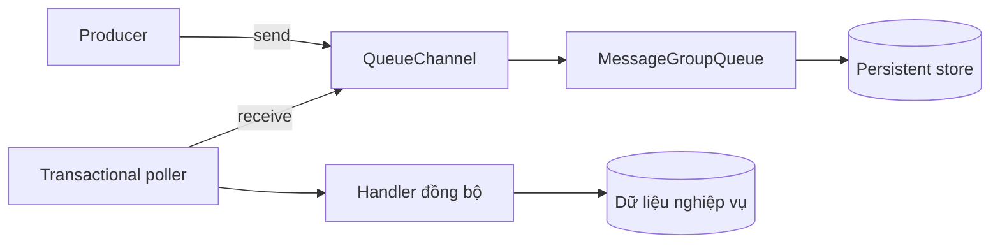

# Khi cần MessageStore-backed channel

## 1. Bài toán: thông điệp đã nhận phải sống qua lần khởi động lại

Trong chương **Queue và pollable channel** của module **SPRING_INTEGRATION_CORE**, bài này giải thích khi nào cần lưu hàng đợi ra kho bền vững và cách kết nối kho đó với endpoint dùng Java DSL. Trọng tâm là quyết định thiết kế, ranh giới transaction và khả năng phục hồi của luồng thông điệp.

Giả sử hệ thống bán hàng tiếp nhận yêu cầu lập hóa đơn. Khách hàng đã nhận mã yêu cầu, nhưng worker chưa xử lý hết thì ứng dụng phải triển khai lại. Nếu yêu cầu chỉ tồn tại trong RAM, hệ thống không còn dữ liệu để tiếp tục công việc sau khi khởi động.

`QueueChannel` mặc định giữ thông điệp trong bộ nhớ. Nó cung cấp bộ đệm và cơ chế consumer chủ động nhận qua `receive()`, nhưng không tự đem lại khả năng khôi phục sau khi tiến trình mất. Khi cần lưu bền, có thể dùng channel được hỗ trợ bởi persistent message store hoặc một hệ thống messaging bên ngoài. [Tài liệu về các loại channel](https://docs.spring.io/spring-integration/reference/channel/implementations.html).

Mục tiêu sau bài học:

- Nhận diện yêu cầu nào thực sự cần một hàng đợi lưu bền.
- Phân biệt channel, queue adapter và message store.
- Cấu hình một luồng JDBC có transactional poller.
- Giải thích được tình huống mất hoặc xử lý lặp thông điệp.
- Thiết kế phép kiểm chứng restart, rollback và lỗi dữ liệu.

## 2. MessageStore-backed channel hoạt động thế nào?

MessageStore-backed channel là channel sử dụng message store để giữ các thông điệp đang chờ. Tính bền vững phụ thuộc implementation của store và hạ tầng bên dưới; tên gọi `MessageStore` không tự chứng minh dữ liệu đã được ghi xuống thiết bị lưu trữ.

Các vai trò cần tách biệt:

| Thành phần | Trách nhiệm |
|---|---|
| `Message<?>` | Mang payload và headers qua luồng tích hợp |
| `QueueChannel` | Cung cấp giao diện gửi và nhận theo mô hình point-to-point |
| `MessageGroupQueue` | Ánh xạ thao tác queue sang thao tác trên một nhóm trong store |
| Message store | Giữ và truy xuất dữ liệu thông điệp |
| Polling consumer | Lấy thông điệp rồi gọi handler theo lịch poller |

`MessageGroupQueue` triển khai `BlockingQueue<Message<?>>` trên nền `BasicMessageGroupStore`. `groupId` xác định hàng đợi logic; phải giữ cùng giá trị qua các lần khởi động để đọc lại đúng nhóm dữ liệu. Khả năng rollback đòi hỏi store hỗ trợ transaction; khả năng sống qua sự cố tiến trình đòi hỏi store lưu bền. [API MessageGroupQueue](https://docs.spring.io/spring-integration/api/org/springframework/integration/store/MessageGroupQueue.html).



Sơ đồ biểu diễn các vai trò, không phải hai bản sao độc lập của hàng đợi. Trong cấu hình dùng `MessageGroupQueue`, dữ liệu chờ được thao tác thông qua store.

## 3. Khi nào nên chọn?

Hãy bắt đầu bằng câu hỏi nghiệp vụ: **Nếu ứng dụng dừng ngay sau khi tiếp nhận, yêu cầu này có được phép biến mất không?** Nếu câu trả lời là không, cần xác định nơi lưu bền trước khi xác nhận đã tiếp nhận.

| Tình huống | Hướng thiết kế cần xem xét |
|---|---|
| Tác vụ lập hóa đơn phải tiếp tục sau deployment | Hàng đợi lưu bền và định danh yêu cầu ổn định |
| Sự kiện giao diện có thể dựng lại từ dữ liệu gốc | Queue trong RAM có thể đủ |
| Không cần chờ; công việc ngắn, chạy đồng bộ | `DirectChannel` có thể phù hợp |
| Nhiều dịch vụ độc lập trao đổi với lưu lượng lớn | Đánh giá broker và adapter JMS/AMQP |
| Dữ liệu nghiệp vụ và hàng đợi cùng một RDBMS | Đánh giá JDBC store với local transaction |
| Chỉ cần chạy handler trên thread khác | Chưa đủ lý do để đưa dữ liệu vào database |

Đây là bảng gợi ý thiết kế, không phải kết luận áp dụng cho mọi tải. Ví dụ, một hệ thống hóa đơn chỉ nhận vài chục yêu cầu mỗi phút có thể chấp nhận thêm thao tác JDBC, còn nền tảng phân phối sự kiện cho hàng chục dịch vụ thường cần đánh giá kiến trúc messaging riêng.

Tài liệu Spring Integration khuyến nghị cân nhắc JMS hoặc AMQP thay cho việc dùng cơ sở dữ liệu như hàng đợi. Với JDBC channel store, cần chọn query provider theo database và đánh giá khả năng polling đồng thời của hệ quản trị. [JDBC Message Store](https://docs.spring.io/spring-integration/reference/jdbc/message-store.html).

## 4. Chọn đúng loại store

Không hoán đổi các store chỉ vì tên gần giống nhau:

| Lựa chọn | Mục đích trong bài |
|---|---|
| `SimpleMessageStore` | Store trong RAM; không giải quyết yêu cầu sống qua restart |
| `JdbcMessageStore` | Store tổng quát, dùng được cho các thành phần giữ nhóm như aggregator |
| `JdbcChannelMessageStore` | Store JDBC chuyên cho message channel |

`JdbcChannelMessageStore` triển khai các giao diện dành cho channel và dùng truy vấn SQL đặc thù database. Nó không phải lựa chọn thay thế trực tiếp cho store của aggregator. Cấu hình phải cung cấp `DataSource` và `ChannelMessageStoreQueryProvider`. [API JdbcChannelMessageStore](https://docs.spring.io/spring-integration/api/org/springframework/integration/jdbc/store/JdbcChannelMessageStore.html).

Một luồng có queue lưu bền rồi đến aggregator vẫn có hai nơi giữ trạng thái: backlog của queue và nhóm đang gom của aggregator. Bảo vệ nơi thứ nhất không tự bảo vệ nơi thứ hai. Phải xác định riêng dữ liệu nào cần khôi phục tại từng điểm đệm.

Payload và headers cũng phải phù hợp với chiến lược serialization của store. Đối tượng channel tạm trong `replyChannel` hoặc `errorChannel` là một ví dụ cần chú ý khi lưu thông điệp. Việc biến channel thành tên để tra cứu không làm thread đang đợi của gateway tồn tại qua restart. [Message Store và giới hạn serialization](https://docs.spring.io/spring-integration/reference/message-store.html).

## 5. Ví dụ: hàng đợi lập hóa đơn dùng PostgreSQL

Ví dụ dùng chuỗi `orderId` làm payload để tập trung vào cơ chế hàng đợi. Giả định ứng dụng có:

- `spring-integration-core`, `spring-integration-jdbc`, Spring JDBC và PostgreSQL driver tương thích trong cùng hệ dependency management.
- Một `DataSource` kết nối PostgreSQL có dữ liệu được giữ qua restart.
- Schema message store được tạo từ script tương ứng trong JAR `spring-integration-jdbc` của phiên bản đang dùng.
- Bảng nghiệp vụ `invoice_job(order_id varchar(100) primary key, status varchar(30) not null)`.

Schema của store phải được quản lý như schema ứng dụng: triển khai trước khi chạy consumer, kiểm soát migration và giữ dữ liệu khi restart. Không dùng chế độ tạo lại hoặc xóa bảng mỗi lần khởi động cho phép thử phục hồi.

```java
package example.integration;

import javax.sql.DataSource;

import org.springframework.beans.factory.annotation.Qualifier;
import org.springframework.context.annotation.Bean;
import org.springframework.context.annotation.Configuration;
import org.springframework.integration.annotation.IntegrationComponentScan;
import org.springframework.integration.annotation.MessagingGateway;
import org.springframework.integration.channel.QueueChannel;
import org.springframework.integration.config.EnableIntegration;
import org.springframework.integration.dsl.IntegrationFlow;
import org.springframework.integration.dsl.Pollers;
import org.springframework.integration.jdbc.store.JdbcChannelMessageStore;
import org.springframework.integration.jdbc.store.channel
        .PostgresChannelMessageStoreQueryProvider;
import org.springframework.integration.store.MessageGroupQueue;
import org.springframework.jdbc.core.JdbcTemplate;
import org.springframework.jdbc.datasource.DataSourceTransactionManager;
import org.springframework.messaging.PollableChannel;
import org.springframework.transaction.PlatformTransactionManager;

@Configuration
@EnableIntegration
@IntegrationComponentScan(basePackageClasses = InvoiceFlowConfig.class)
public class InvoiceFlowConfig {

    @Bean
    public JdbcChannelMessageStore invoiceStore(DataSource dataSource) {
        JdbcChannelMessageStore store =
                new JdbcChannelMessageStore(dataSource);
        store.setChannelMessageStoreQueryProvider(
                new PostgresChannelMessageStoreQueryProvider());
        store.setRegion("billing");
        return store;
    }

    @Bean
    public PollableChannel invoiceRequests(
            JdbcChannelMessageStore invoiceStore) {
        return new QueueChannel(
                new MessageGroupQueue(invoiceStore, "invoice-requests-v1"));
    }

    @Bean
    public PlatformTransactionManager invoiceTransactionManager(
            DataSource dataSource) {
        return new DataSourceTransactionManager(dataSource);
    }

    @Bean
    public IntegrationFlow invoiceFlow(
            @Qualifier("invoiceRequests") PollableChannel invoiceRequests,
            @Qualifier("invoiceTransactionManager")
                    PlatformTransactionManager transactionManager,
            DataSource dataSource) {
        JdbcTemplate jdbc = new JdbcTemplate(dataSource);

        return IntegrationFlow.from(invoiceRequests)
                .handle(String.class, (orderId, headers) -> {
                    jdbc.update("""
                            insert into invoice_job(order_id, status)
                            values (?, 'READY')
                            on conflict (order_id) do nothing
                            """, orderId);
                    return null;
                }, endpoint -> endpoint
                        .id("invoiceWorker")
                        .poller(Pollers.fixedDelay(500)
                                .receiveTimeout(0)
                                .maxMessagesPerPoll(1)
                                .transactional(transactionManager)))
                .get();
    }

    @MessagingGateway(defaultRequestChannel = "invoiceRequests")
    public interface InvoiceGateway {
        void submit(String orderId);
    }
}
```

Đây là cấu hình minh họa để tích hợp vào ứng dụng đã có datasource và schema, không phải dự án độc lập. Text block cần mức Java phù hợp; câu SQL `on conflict` dành riêng cho PostgreSQL.

Gateway trả `void`, diễn đạt hợp đồng tiếp nhận công việc để xử lý sau. Handler trả `null` để kết thúc luồng một chiều. Mã trên ghi nhận một job sẵn sàng; chưa thực hiện phát hành hóa đơn hoặc gọi dịch vụ bên ngoài.

`region = "billing"` và `groupId = "invoice-requests-v1"` được chọn cố định. Khi deployment mới cần tiếp tục backlog cũ, phải dùng lại các giá trị đó và cùng database. Nếu chủ ý đổi nhóm, cần kế hoạch chuyển hoặc tiêu thụ dữ liệu cũ.

Poller dùng một thông điệp mỗi lượt để dễ quan sát ví dụ. `receiveTimeout(0)` không chờ khi queue rỗng; `fixedDelay(500)` điều khiển nhịp poll; `.transactional(transactionManager)` áp dụng transaction cho polling task. Đây là các điều khiển khác nhau, không phải bảo đảm xử lý đúng một thông điệp mỗi 500 ms. [API PollerSpec](https://docs.spring.io/spring-integration/api/org/springframework/integration/dsl/PollerSpec.html).

### Biến thể khai báo channel bằng Java DSL

Có thể thay riêng bean `invoiceRequests` bằng cách khai báo sau, giữ các bean khác. Không khai báo đồng thời hai bean cùng tên:

```java
import org.springframework.integration.dsl.MessageChannels;
import org.springframework.integration.dsl.QueueChannelSpec;

@Bean
public QueueChannelSpec.MessageStoreSpec invoiceRequests(
        JdbcChannelMessageStore invoiceStore) {
    return MessageChannels.queue(
            invoiceStore, "invoice-requests-v1");
}
```

Bean spec được Spring dùng để tạo channel. `MessageChannels.queue(store, groupId)` là API DSL thể hiện cùng quan hệ giữa store và hàng đợi logic. [API MessageChannels](https://docs.spring.io/spring-integration/api/org/springframework/integration/dsl/MessageChannels.html).

## 6. Transaction quyết định khả năng phục hồi

Lưu bền chỉ bảo vệ dữ liệu đã ghi thành công. Cần xem riêng hai giai đoạn: producer đưa vào queue và consumer lấy ra xử lý.

### Phía producer

Nếu thao tác gửi tham gia một transaction đang mở, `send()` hoàn thành chưa có nghĩa transaction đã commit. Hợp đồng “đã tiếp nhận bền vững” phải gắn với commit thành công. Nếu vừa ghi đơn hàng vừa đưa thông điệp vào cùng database, có thể thiết kế chúng dùng cùng local transaction; phải bảo đảm cùng tài nguyên và transaction manager.

Ví dụ cần phân tích: ghi đơn hàng thành công rồi tiến trình chết trước khi enqueue. Queue lưu bền không tự tạo lại thông điệp chưa từng được ghi. Thiết kế cần transaction chung hoặc một cơ chế outbox và chuyển tiếp phù hợp.

### Phía consumer

Thông điệp được lấy khỏi store khi poll. Với store có transaction và transactional poller, thao tác loại bỏ chỉ có hiệu lực cuối cùng khi transaction commit; rollback cho phép thông điệp được nhận lại. [Cấu hình persistent QueueChannel](https://docs.spring.io/spring-integration/reference/channel/configuration.html).

Trong ví dụ, timeline mong muốn là:

```text
BEGIN
  nhận orderId từ invoiceRequests
  ghi invoice_job qua cùng DataSource
COMMIT
```

Nếu handler ném lỗi và transaction rollback, cả việc lấy thông điệp lẫn thay đổi nghiệp vụ trong transaction đó được hoàn tác. Nếu handler bắt lỗi rồi trả bình thường, transaction có thể commit và thông điệp không còn trong queue dù nghiệp vụ chưa xong.

Transaction của Spring gắn với thread trong mô hình này. Các bước đồng bộ tiếp theo có thể tham gia cùng transaction; chuyển sang thread khác bằng một ranh giới bất đồng bộ không tự chuyển transaction theo. Vì vậy, thêm một `ExecutorChannel` giữa poller và thao tác nghiệp vụ sẽ thay đổi phạm vi bảo vệ cần phân tích. [Transaction Support](https://docs.spring.io/spring-integration/reference/transactions.html).

Một lệnh HTTP cũng không trở thành tài nguyên của local JDBC transaction. Ví dụ, bên ngoài đã phát hành hóa đơn nhưng ứng dụng chết trước commit: lần nhận lại có thể gọi phát hành thêm lần nữa. Cần định danh nghiệp vụ và hợp đồng chống xử lý lặp ở phía có tác dụng phụ.

## 7. Lưu bền không đồng nghĩa exactly-once

Trong thiết kế có rollback hoặc retry, nên chuẩn bị cho thông điệp được xử lý lại. `orderId` trong ví dụ vừa định danh công việc vừa là khóa duy nhất của bảng `invoice_job`. Câu `on conflict ... do nothing` ngăn tạo hai job cùng đơn hàng; nó không chứng minh mọi thao tác phát hành hóa đơn về sau đều idempotent.

Một chiến lược cho công việc thực tế:

1. Xác định khóa nghiệp vụ như `invoiceRequestId` do producer cấp và giữ ổn định khi retry.
2. Ghi nhận trạng thái công việc bằng ràng buộc duy nhất trong database.
3. Nếu có API bên ngoài, truyền cùng khóa idempotency khi gọi lại nếu API hỗ trợ.
4. Chỉ coi công việc hoàn tất khi có bằng chứng nghiệp vụ tương ứng.

Không dùng riêng `MessageHeaders.ID` làm khóa chống lặp nếu producer có thể dựng message mới cho cùng yêu cầu: message mới có thể mang ID khác.

## 8. Xử lý lỗi và thông điệp không thể xử lý

Lỗi của handler chạy qua poller xảy ra sau thời điểm producer enqueue; không thể coi chúng là exception trả đồng bộ về lời gọi gửi ban đầu. Spring Integration có cơ chế tạo `ErrorMessage` và định tuyến đến error channel cho tác vụ bất đồng bộ, bao gồm lỗi của scheduled poller. [Error Handling](https://docs.spring.io/spring-integration/reference/error-handling.html).

Tách hai mục tiêu khi thiết kế:

| Mục tiêu | Ví dụ |
|---|---|
| Quan sát lỗi | Log, metric, cảnh báo theo mã yêu cầu |
| Quyết định số phận thông điệp | Rollback để thử lại, hoặc chuyển sang nơi cách ly |

Việc có log trên `errorChannel` không chứng minh đã có retry hữu hạn hay nơi cách ly lưu bền. Cấu hình ví dụ chưa có các chính sách đó.

Một payload hỏng luôn làm rollback có thể xuất hiện lại liên tục và cản trở tiến độ. Hãy đặt giới hạn retry phù hợp, phân loại lỗi tạm thời với lỗi dữ liệu, và thiết kế đường chuyển công việc lỗi sang nơi kiểm tra thủ công. Nếu cần thao tác “bỏ khỏi queue gốc và ghi vào queue lỗi” là nguyên tử, phải kiểm chứng cả hai cùng tham gia transaction tương ứng.

Không kỳ vọng biến đếm trong RAM sống qua restart. Cũng không mặc định sửa một header rồi rollback sẽ lưu được số lần thử; cần một thiết kế lưu trạng thái retry rõ ràng.

## 9. Chi phí và giới hạn vận hành

Đưa backlog ra database làm thay đổi chi phí từ giữ đối tượng trong RAM sang ghi, đọc, serialization và transaction. Đây là lựa chọn đổi tài nguyên, không phải mở rộng vô hạn.

Ví dụ giả định producer đưa vào 120 thông điệp/giây và consumer chỉ xử lý 80 thông điệp/giây trong 10 phút:

```text
Backlog tăng = (120 - 80) × 600 = 24.000 thông điệp
```

Nếu mỗi bản ghi trung bình 4 KiB, riêng dữ liệu thông điệp đã xấp xỉ 94 MiB; chưa tính index, log transaction và overhead database. Các con số này là giả định để tập ước lượng, không phải benchmark Spring Integration.

Nên theo dõi độ sâu queue, tuổi thông điệp cũ nhất, tốc độ enqueue/dequeue, tỷ lệ rollback, thời gian truy vấn và mức sử dụng connection pool. Tuổi backlog giúp nhận ra công việc bị treo dù tổng số bản ghi còn nhỏ.

Không suy từ constructor `new QueueChannel(100)` rằng cấu hình store cũng có giới hạn tương đương. Cú pháp XML `<queue message-store="...">` không cho kết hợp thuộc tính `capacity`. Nếu cần backpressure, phải thiết kế giới hạn tiếp nhận theo đúng API và cơ chế phối hợp giữa các instance, rồi đo dưới tải. [Cấu hình QueueChannel](https://docs.spring.io/spring-integration/reference/channel/configuration.html).

Khi nhiều consumer cùng xử lý, thứ tự lấy ra không đảm bảo thứ tự hoàn tất: công việc lấy trước có thể chạy chậm hơn. Nếu nghiệp vụ cần thứ tự theo từng khách hàng, hãy thiết kế phân vùng hoặc cơ chế tuần tự riêng thay vì suy từ chữ FIFO.

## 10. Các phép kiểm chứng cần thực hiện

Các bước dưới đây là kế hoạch thực hành cho người học; bài viết không khẳng định đã chạy các phép thử này. Dùng database riêng và đúng engine mục tiêu cho kiểm thử tích hợp.

### 10.1. Kiểm chứng sống qua restart

1. Dừng endpoint `invoiceWorker` để chưa tiêu thụ thông điệp.
2. Gửi `ORDER-001`, `ORDER-002`; bảo đảm các lần ghi đã commit.
3. Đóng ứng dụng, giữ nguyên database và dữ liệu.
4. Khởi động lại với cùng region và group ID, cho endpoint chạy.
5. Xác minh có hai job nghiệp vụ và backlog được tiêu thụ.

Đối chứng bằng một queue trong RAM giúp thấy khác biệt. Phép thử restart êm chỉ xác nhận một phần; nên có thêm thử nghiệm chấm dứt tiến trình sau khi enqueue đã commit.

### 10.2. Kiểm chứng rollback của consumer

Trong môi trường thử nghiệm, thêm exception ngay sau câu `jdbc.update(...)`. Khi lần xử lý thất bại kết thúc, dừng endpoint và quan sát:

- Không có bản ghi nghiệp vụ được commit từ lần thử đó.
- Thông điệp vẫn có thể được nhận lại.
- Sau khi bỏ lỗi mô phỏng, công việc được xử lý thành công.

Không lấy thông điệp bằng một lần `receive()` ngoài transaction rồi mới gọi handler để kiểm tra khả năng rollback của poller: thao tác đó đã thay đổi ranh giới đang cần kiểm chứng.

### 10.3. Kiểm chứng chống lặp và lỗi khó

| Phép thử | Điều cần chứng minh |
|---|---|
| Gửi hai message khác nhau cùng `orderId` | Chỉ tạo một job nghiệp vụ theo khóa duy nhất |
| Đổi group ID khi còn backlog | Dữ liệu cũ chưa được chuyển sang queue mới một cách tự động |
| Gửi payload không tương thích với store | Không xác nhận tiếp nhận thành công khi lưu thất bại |
| Database ngừng kết nối lúc gửi | Producer nhận được kết quả lỗi phù hợp với hợp đồng |
| Handler luôn thất bại | Có cách phát hiện, dừng hoặc cách ly công việc lỗi |
| Hai instance cùng xử lý | Không sinh kết quả nghiệp vụ trùng ngoài chính sách cho phép |

Kiểm tra cả trạng thái queue lẫn kết quả nghiệp vụ. Chỉ thấy log “handler đã chạy” không đủ để chứng minh commit, phục hồi hoặc chống lặp.

## 11. Tự kiểm tra quyết định thiết kế

Trước khi chọn MessageStore-backed channel, hãy trả lời:

- Dữ liệu nào không được phép mất và producer xác nhận tiếp nhận ở thời điểm nào?
- Store thực sự lưu bền ở đâu, dùng schema và chính sách backup nào?
- Region và group ID có được giữ ổn định qua deployment không?
- Poller và nghiệp vụ có nằm trong transaction mong muốn không?
- Tác dụng phụ nào nằm ngoài transaction JDBC?
- Khóa chống lặp, giới hạn retry và nơi cách ly lỗi được thiết kế ra sao?
- JDBC queue có phù hợp với tải, hay cần đánh giá broker?

Chọn channel lưu bền khi cần phục hồi công việc đã tiếp nhận. Để đạt yêu cầu nghiệp vụ, phải kết hợp nơi lưu bền với transaction đúng phạm vi, hợp đồng tiếp nhận rõ ràng, xử lý lặp an toàn và phép thử quan sát được kết quả sau sự cố.
