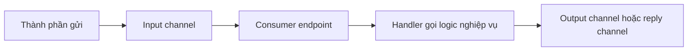
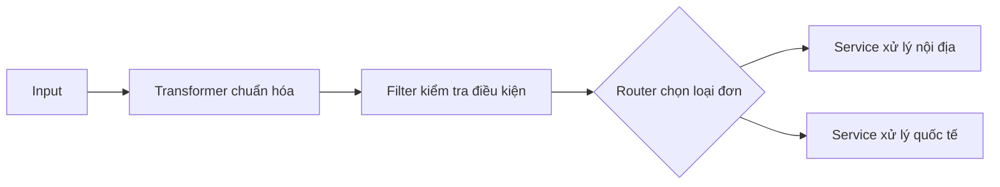

# Message endpoint là gì?

## 1. Mục tiêu bài học

Trong module **SPRING_INTEGRATION_CORE**, message endpoint là khái niệm giúp nối mô hình `Message` và `MessageChannel` với công việc xử lý thực tế. Khi hiểu endpoint, bạn có thể đọc một flow Java DSL và giải thích được message đi đâu, ai xử lý, xử lý trên thread nào và lỗi được chuyển tới đâu.

Sau bài học, bạn có thể:

- Phân biệt message, channel, handler, endpoint và gateway.
- Giải thích vì sao cùng một hàm nghiệp vụ có thể được gọi theo cơ chế event-driven hoặc polling.
- Tạo endpoint bằng Java DSL hoặc annotation.
- Nhận biết vai trò của transformer, filter, router, splitter và aggregator trong một flow.
- Kiểm tra kết quả xử lý, vòng đời và các tình huống lỗi cơ bản.

Ví dụ xuyên suốt là luồng chuẩn hóa mã đơn hàng: nhận chuỗi `"  order-42  "`, loại bỏ khoảng trắng đầu cuối, chuyển thành `"ORDER-42"`, rồi chuyển kết quả tới channel đầu ra.

## 2. Endpoint là điểm kết nối ứng dụng với luồng thông điệp

**Message endpoint là thành phần tích hợp giúp ứng dụng gửi, nhận hoặc xử lý message tại một điểm trong hệ thống messaging.**

Ở một bước xử lý điển hình, endpoint nối một channel đầu vào với logic xử lý. Nếu bước đó tạo kết quả, kết quả có thể được gửi tiếp tới channel đầu ra hoặc đường phản hồi phù hợp.



Đây là sơ đồ khái niệm. Nó không có nghĩa handler và endpoint luôn là hai bean mà người viết ứng dụng phải tự khởi tạo. Spring Integration thường tạo và kết nối các thành phần đó từ cấu hình.

Với consumer endpoint, có thể hình dung:

```text
Consumer endpoint
  = liên kết với input channel
  + cơ chế nhận message
  + quản lý vòng đời việc nhận
  + handler thực hiện xử lý
```

Biểu thức trên là mô hình học tập, không phải công thức chung cho mọi endpoint. Một inbound adapter có thể chủ động lấy dữ liệu từ hệ thống ngoài rồi phát vào channel, nên không có input channel nội bộ theo mô hình consumer này.

Tài liệu Spring Integration mô tả endpoint như thành phần kết nối các thành phần messaging với channel; hai cơ chế nhận message quan trọng là event-driven và polling. Xem [Message Endpoints](https://docs.spring.io/spring-integration/reference/endpoint.html).

### Endpoint không nhất thiết là một HTTP endpoint

Trong REST, từ endpoint thường gợi đến một URL như `POST /orders`. Trong Spring Integration, endpoint có thể chỉ tồn tại trong bộ nhớ của ứng dụng: nhận message từ một `DirectChannel` và gọi một phương thức Java. Nó không bắt buộc có URL, cổng mạng hay message broker.

HTTP inbound gateway là một trường hợp có kết nối HTTP; service activator đọc từ channel nội bộ là một trường hợp khác. Cả hai đều nằm trong hệ sinh thái endpoint của Spring Integration.

## 3. Phân biệt các thành phần gần nhau

| Thành phần | Trách nhiệm chính | Ví dụ trong luồng đơn hàng |
|---|---|---|
| `Message<T>` | Mang payload và headers | Payload là `"  order-42  "`, header có mã truy vết |
| `MessageChannel` | Truyền hoặc giữ message theo cơ chế của channel | Channel nhận yêu cầu chuẩn hóa |
| `MessageHandler` | Thực hiện một hành động khi nhận message | Gọi hàm chuẩn hóa mã đơn |
| Consumer endpoint | Kết nối handler với cơ chế nhận từ channel | Subscribe handler hoặc lên lịch lấy message |
| Messaging gateway | Cung cấp giao diện gọi cho code ứng dụng, che API messaging | `orderGateway.normalize(code)` |
| Logic nghiệp vụ | Thực hiện quy tắc của bài toán | `trim()` và chuyển chữ hoa |

`MessageHandler` có phương thức cốt lõi:

```java
void handleMessage(Message<?> message);
```

Kiểu trả về `void` không có nghĩa mọi handler đều là xử lý một chiều. Handler hỗ trợ request-reply có thể xây dựng và gửi message kết quả từ bên trong quá trình xử lý. Với cấu hình thông thường, bạn cung cấp một phương thức hoặc lambda trả về giá trị; framework đảm nhiệm việc thích nghi nó với cơ chế messaging.

Một phương thức Java cũng chưa tự trở thành endpoint chỉ vì tên nó là `handleOrder`. Nó cần được đăng ký trong flow hoặc kết nối bằng cấu hình annotation/XML phù hợp.

Gateway giúp code gọi dùng một interface nghiệp vụ thay cho việc tự tạo message và thao tác trực tiếp với channel. Gateway và service activator có thể cùng tham gia một luồng request-reply: gateway là cửa vào cho bên gọi, service activator là bước gọi dịch vụ xử lý. Xem [Messaging Gateways](https://docs.spring.io/spring-integration/reference/gateway.html).

## 4. Hai cơ chế nhận message của consumer endpoint

### 4.1. Event-driven consumer

Với channel hỗ trợ subscription, endpoint đăng ký handler để channel có thể chuyển message tới handler khi có message được gửi vào.

```text
sender.send(message)
    → channel phân phối message
    → handler được gọi
```

`EventDrivenConsumer` là triển khai phục vụ cơ chế này. Các ví dụ channel quen thuộc gồm `DirectChannel` và `ExecutorChannel`.

**Event-driven không đồng nghĩa với bất đồng bộ.** Với `DirectChannel`, handler thường chạy ngay trên thread đang gọi `send()`. Với `ExecutorChannel`, việc gọi handler được giao cho executor; hành vi thread cụ thể còn phụ thuộc cấu hình và chính sách thực thi của executor.

### 4.2. Polling consumer

Với channel có thao tác nhận chủ động, chẳng hạn `QueueChannel`, endpoint dùng poller để lấy message và chuyển cho handler.

```text
scheduler kích hoạt poll
    → gọi receive() trên channel
    → nếu nhận được message thì gọi handler
```

`PollingConsumer` phục vụ trường hợp này. Không thể suy ra rằng message sẽ được xử lý ngay chỉ vì thao tác gửi vào queue thành công; cần có consumer đang hoạt động và cấu hình poller phù hợp. Cơ chế lựa chọn consumer theo loại channel được trình bày tại [Poller](https://docs.spring.io/spring-integration/reference/6.5/polling-consumer.html).

### 4.3. Bảng đối chiếu

| Tiêu chí | `DirectChannel` | `ExecutorChannel` | `QueueChannel` |
|---|---|---|---|
| Cách chuyển tới handler | Subscription | Subscription và executor | Consumer gọi `receive()` |
| Consumer điển hình | `EventDrivenConsumer` | `EventDrivenConsumer` | `PollingConsumer` |
| Cần poller ở consumer | Không | Không | Có |
| Nơi thực hiện xử lý | Thread gửi | Theo executor | Thread poller hoặc executor của poller |
| Có vùng đệm queue trong chính channel | Không | Không; executor có thể có hàng đợi riêng | Có |

`QueueChannel` mặc định giữ message trong bộ nhớ. Nó không tự cung cấp độ bền sau khi tiến trình dừng. Nếu cần lưu bền, phải thiết kế message store hoặc sử dụng hạ tầng phù hợp.

Ngoài ra, `DirectChannel` phân phối mỗi message cho một subscriber được chọn; nó không phải cơ chế broadcast. Khi muốn phát cho nhiều subscriber, hãy xem xét `PublishSubscribeChannel`. Chi tiết về những khác biệt này có tại [Message Channel Implementations](https://docs.spring.io/spring-integration/reference/channel/implementations.html).

## 5. Endpoint làm gì trong các mẫu tích hợp?

Ở mức thiết kế flow, các tên như transformer hoặc router mô tả ý nghĩa của bước xử lý. Ở mức thực thi, framework kết nối logic đó với cơ chế nhận và chuyển message.

| Loại thành phần | Câu hỏi mà bước xử lý trả lời | Ví dụ |
|---|---|---|
| Service activator | Cần gọi dịch vụ hoặc phương thức nào? | Gọi dịch vụ kiểm tra đơn hàng |
| Transformer | Message cần được đổi thành biểu diễn nào? | Đổi chuỗi JSON thành đối tượng đơn hàng |
| Filter | Message này có được đi tiếp không? | Chỉ nhận đơn có mã hợp lệ |
| Router | Message cần đi tới nhánh nào? | Chọn nhánh nội địa hoặc quốc tế |
| Splitter | Cần tách message thành các phần nào? | Tách đơn hàng thành từng dòng sản phẩm |
| Aggregator | Khi nào các phần liên quan đủ điều kiện gom lại? | Gom kết quả kiểm tra các dòng của cùng một đơn |
| Inbound channel adapter | Dữ liệu từ bên ngoài đi vào channel bằng cách nào? | Đọc file rồi phát message |
| Outbound channel adapter | Message được chuyển ra hệ thống ngoài bằng cách nào? | Ghi dữ liệu ra file |
| Gateway | Tương tác yêu cầu/phản hồi đi qua ranh giới như thế nào? | Gọi HTTP và đưa phản hồi về flow |

Không phải mọi endpoint đều tạo đúng một output cho một input. Filter có thể dừng một message; router có thể chọn nhiều nhánh tùy cấu hình; splitter có thể sinh nhiều message; aggregator có thể giữ trạng thái trước khi phát kết quả.

Ví dụ mở rộng luồng đơn hàng:



Trong bài này, trọng tâm là cách các bước được gắn vào hệ thống messaging. Chiến lược correlation, release và lưu trạng thái của aggregator cần được học riêng trước khi dùng cho luồng gom dữ liệu thực tế.

## 6. Ví dụ Java DSL: cùng logic, hai cơ chế tiếp nhận

### 6.1. Điều kiện sử dụng

Ví dụ sau dùng API Java DSL thuộc `spring-integration-core`, theo cách cấu hình phổ biến ở Spring Integration 6.x trở lên. Dùng JDK phù hợp với phiên bản Spring Framework/Spring Integration của ứng dụng; riêng dòng 6.x yêu cầu Java 17 trở lên. Nếu dự án dùng Spring Boot, nên để BOM của Boot quản lý các phiên bản tương thích.

Để chạy ví dụ độc lập cần có thư viện `org.springframework.integration:spring-integration-core` cùng các dependency bắc cầu. Ví dụ dùng `AnnotationConfigApplicationContext`, không yêu cầu web server hoặc broker.

Java DSL là API cấu hình: các lệnh trong builder được framework diễn giải để đăng ký channel, handler và endpoint vào application context. Khai báo một lambda trong DSL không làm phương thức nghiệp vụ chạy ngay lúc tạo bean. Xem [Java DSL](https://docs.spring.io/spring-integration/reference/dsl.html).

### 6.2. Mã ví dụ đầy đủ

Lưu ví dụ vào `EndpointDemo.java` trong một project Java đã có dependency phù hợp:

```java
import java.util.Locale;

import org.springframework.context.annotation.AnnotationConfigApplicationContext;
import org.springframework.context.annotation.Bean;
import org.springframework.context.annotation.Configuration;
import org.springframework.integration.channel.DirectChannel;
import org.springframework.integration.channel.QueueChannel;
import org.springframework.integration.config.EnableIntegration;
import org.springframework.integration.dsl.IntegrationFlow;
import org.springframework.integration.dsl.Pollers;
import org.springframework.messaging.Message;
import org.springframework.messaging.support.MessageBuilder;

public class EndpointDemo {

    public static void main(String[] args) {
        try (var context =
                new AnnotationConfigApplicationContext(FlowConfig.class)) {

            DirectChannel directInput =
                    context.getBean("directInput", DirectChannel.class);
            QueueChannel directResults =
                    context.getBean("directResults", QueueChannel.class);

            boolean directAccepted = directInput.send(
                    MessageBuilder.withPayload("  order-42  ")
                            .setHeader("traceId", "demo-direct")
                            .build());

            if (!directAccepted) {
                throw new IllegalStateException("Direct input rejected");
            }
            verifyResult(directResults.receive(1000),
                    "ORDER-42", "demo-direct");

            QueueChannel queuedInput =
                    context.getBean("queuedInput", QueueChannel.class);
            QueueChannel queuedResults =
                    context.getBean("queuedResults", QueueChannel.class);

            boolean queuedAccepted = queuedInput.send(
                    MessageBuilder.withPayload("  order-43  ")
                            .setHeader("traceId", "demo-queued")
                            .build(),
                    1000);

            if (!queuedAccepted) {
                throw new IllegalStateException("Queued input timed out");
            }
            verifyResult(queuedResults.receive(3000),
                    "ORDER-43", "demo-queued");

            System.out.println("Both endpoint paths passed");
        }
    }

    private static void verifyResult(
            Message<?> result, String expected, String expectedTraceId) {

        if (result == null) {
            throw new AssertionError("No result before timeout");
        }
        if (!expected.equals(result.getPayload())) {
            throw new AssertionError("Unexpected payload: "
                    + result.getPayload());
        }
        if (!expectedTraceId.equals(result.getHeaders().get("traceId"))) {
            throw new AssertionError("Trace header was not propagated");
        }
    }

    static String normalize(String code) {
        if (code.isBlank()) {
            throw new IllegalArgumentException("Order code must not be blank");
        }
        return code.trim().toUpperCase(Locale.ROOT);
    }

    @Configuration
    @EnableIntegration
    public static class FlowConfig {

        @Bean
        public DirectChannel directInput() {
            return new DirectChannel();
        }

        @Bean
        public QueueChannel directResults() {
            return new QueueChannel(10);
        }

        @Bean
        public QueueChannel queuedInput() {
            return new QueueChannel(100);
        }

        @Bean
        public QueueChannel queuedResults() {
            return new QueueChannel(10);
        }

        @Bean
        public IntegrationFlow directFlow() {
            return IntegrationFlow.from(directInput())
                    .handle(String.class,
                            (payload, headers) -> normalize(payload),
                            endpoint -> endpoint.id("directNormalizeEndpoint"))
                    .channel(directResults())
                    .get();
        }

        @Bean
        public IntegrationFlow queuedFlow() {
            return IntegrationFlow.from(queuedInput())
                    .handle(String.class,
                            (payload, headers) -> normalize(payload),
                            endpoint -> endpoint
                                    .id("queuedNormalizeEndpoint")
                                    .poller(Pollers.fixedDelay(100)
                                            .maxMessagesPerPoll(10)))
                    .channel(queuedResults())
                    .get();
        }
    }
}
```

### 6.3. Đọc luồng direct

```text
main thread
  → directInput.send(...)
  → endpoint kích hoạt handler
  → normalize(...)
  → gửi kết quả vào directResults
  → send(...) trả về
```

Trong cấu hình cụ thể này, bước chuẩn hóa và bước gửi kết quả chạy đồng bộ trên thread gọi. Khi `send()` trả về thành công, kết quả đã được đưa vào queue đầu ra. Điều đó vẫn không có nghĩa một hệ thống bên ngoài đã nhận hay lưu dữ liệu; ví dụ chỉ kết thúc ở queue nội bộ.

`directResults` là `QueueChannel` để đoạn kiểm tra có thể chủ động gọi `receive()`. Nó không cần poller của framework vì chính code kiểm tra là bên nhận. Poller cần được cấu hình khi bạn gắn một consumer endpoint của framework để tự động tiêu thụ từ pollable channel.

### 6.4. Đọc luồng queued

```text
main thread                         poller thread
  → queuedInput.send(...)             → receive() từ queuedInput
  → send(...) trả về                  → normalize(...)
                                      → gửi vào queuedResults
```

Hai cột biểu thị sự tách biệt giữa bên gửi và bên xử lý. Không nên dựa vào thứ tự chạy tuyệt đối: poller có thể xử lý rất nhanh, thậm chí trước khi bên gửi quan sát được kết quả của `send()`.

Trong ví dụ:

- `fixedDelay(100)` cấu hình độ trễ 100 mili giây giữa khi một tác vụ poll kết thúc và khi tác vụ kế tiếp bắt đầu trong cấu hình scheduler đang dùng.
- `maxMessagesPerPoll(10)` đặt giới hạn tối đa 10 message cho một lượt poll; đây không phải số thread hoặc số lần retry.
- Nếu không có message, thao tác nhận còn chịu ảnh hưởng của `receiveTimeout`. Khoảng poll không phải cam kết độ trễ xử lý chính xác cho từng message.
- Queue có giới hạn dung lượng. Khi đầy, thao tác gửi có thể phải chờ; ví dụ đặt timeout cho bên gửi vào `queuedInput`.

Không cấu hình `taskExecutor` cho poller trong ví dụ này. Khi thêm executor, phải xem lại mức song song, dung lượng hàng đợi công việc, thứ tự xử lý và khả năng chịu tải của dịch vụ được gọi.

## 7. Cấu hình tương đương bằng annotation

Có thể giữ nghiệp vụ trong một phương thức và dùng `@ServiceActivator` để nối phương thức đó với các channel. Đây là **phương án thay thế cho `directFlow()`**, không đăng ký thêm vào cùng input channel trong ví dụ trên.

Trong một lớp `@Configuration` có `@EnableIntegration`, cùng hai bean `directInput` và `directResults`, khai báo phương thức sau:

```java
import org.springframework.integration.annotation.ServiceActivator;

@ServiceActivator(
        inputChannel = "directInput",
        outputChannel = "directResults")
public String normalizeOrderCode(String code) {
    return EndpointDemo.normalize(code);
}
```

Đoạn trên là phần cấu hình thay thế, không phải một file Java độc lập. `EndpointDemo.normalize()` được gọi trong cùng package với lớp ví dụ.

Nếu đầu vào là `queuedInput`, annotation có thể chỉ rõ poller:

```java
import org.springframework.integration.annotation.Poller;
import org.springframework.integration.annotation.ServiceActivator;

@ServiceActivator(
        inputChannel = "queuedInput",
        outputChannel = "queuedResults",
        poller = @Poller(fixedDelay = "100", maxMessagesPerPoll = "10"))
public String normalizeQueuedOrderCode(String code) {
    return EndpointDemo.normalize(code);
}
```

Đoạn này thay thế cho `queuedFlow()`. Không tạo đồng thời hai consumer rồi giả định mỗi consumer đều nhận mọi message từ cùng queue.

`@MessageEndpoint` là stereotype dựa trên `@Component`, giúp một lớp được nhận diện qua component scanning. Việc chọn phương thức xử lý và nối channel còn dựa vào annotation như `@ServiceActivator`. Chỉ thêm `@MessageEndpoint` vào lớp không tự tạo đầy đủ một luồng có input/output channel. Xem [Annotation Support](https://docs.spring.io/spring-integration/reference/configuration/annotations.html).

## 8. Kết quả, output channel và reply channel

Với service activator trả về một giá trị, framework có thể dùng giá trị đó để tạo message kết quả. Khi có output channel được cấu hình, kết quả được chuyển tới đó. Khi không có output channel, thành phần hỗ trợ reply có thể dùng header `replyChannel` của request để tìm nơi gửi phản hồi.

```text
Phương thức trả về String
  → handler tạo reply message
  → output channel được cấu hình
     hoặc replyChannel của request nếu phù hợp
```

Trong ví dụ, output channel đã được khai báo bằng `.channel(...)`, nên không cần tự đặt `replyChannel`.

Một phương thức trả về `void` thường phù hợp với hành động một chiều, chẳng hạn ghi audit. Một phương thức trả về `null` thường không tạo reply. Nếu hợp đồng bắt buộc phải có phản hồi, có thể dùng `requiresReply` để phát hiện việc không có kết quả, thay vì để bên gọi chờ phản hồi không xuất hiện.

`requiresReply` kiểm tra việc handler có tạo phản hồi hay không; nó không thay thế timeout, retry hoặc chính sách phục hồi. Quy tắc trả kết quả của service activator được mô tả tại [Service Activator](https://docs.spring.io/spring-integration/reference/service-activator.html).

## 9. Lỗi đi đâu phụ thuộc ranh giới thực thi

### 9.1. Đường direct

Nếu gửi một chuỗi chỉ có khoảng trắng vào `directInput`, hàm `normalize()` ném `IllegalArgumentException`. Vì handler chạy trên thread gửi, lỗi xử lý có thể truyền ngược về lời gọi `send()`; lỗi gốc thường được bọc trong exception messaging.

Đoạn thử nghiệm sau được đặt trong scope đang có biến `directInput`:

```java
try {
    directInput.send(MessageBuilder.withPayload("   ").build());
    throw new AssertionError("Expected message processing to fail");
}
catch (org.springframework.messaging.MessagingException ex) {
    System.out.println("Processing failed: " + ex.getMessage());
}
```

Không nên mặc định rằng chỉ đặt header `errorChannel` là mọi lỗi đồng bộ từ `DirectChannel` sẽ được tự động chuyển thành error message. Gateway hoặc advice có thể bổ sung hành vi xử lý lỗi riêng.

### 9.2. Đường polling

Với `queuedInput`, bên gửi có thể đã hoàn thành trước khi `normalize()` bị lỗi. Khi đó `try/catch` quanh `queuedInput.send()` không bắt được lỗi nghiệp vụ phát sinh về sau trên thread poller.

Với cơ chế error handler mặc định của poller, lỗi có thể được đóng gói thành `ErrorMessage` và gửi tới error channel. Header `errorChannel` của message được dùng nếu có; nếu không, framework dùng channel lỗi mặc định có tên `errorChannel`.

Đường đi thực tế còn phụ thuộc cấu hình error handler. Nhận một `ErrorMessage` không tự có nghĩa message đã được retry hoặc được khôi phục vào queue. Xem [Error Handling](https://docs.spring.io/spring-integration/reference/error-handling.html).

Đối với luồng đơn hàng, nên xác định rõ:

- Lỗi dữ liệu như mã đơn rỗng sẽ bị từ chối hay chuyển tới nơi kiểm tra thủ công?
- Lỗi tạm thời khi gọi hệ thống ngoài có cần retry và giới hạn retry nào?
- Nếu nghiệp vụ có tác dụng phụ, xử lý lại cùng đơn có gây ghi trùng không?
- Message lỗi cần mang những thông tin nào để truy vết mà không lộ dữ liệu nhạy cảm?

Việc đưa message vào queue và xử lý nghiệp vụ thành công là hai sự kiện khác nhau. Muốn bảo đảm khả năng phục hồi cần thiết kế thêm độ bền, giao dịch và tính idempotent theo hệ thống thực tế.

## 10. Vòng đời của endpoint

Consumer endpoint có vòng đời để bắt đầu hoặc dừng việc tiếp nhận. Trong ví dụ Java DSL, `.id("queuedNormalizeEndpoint")` đặt tên cho endpoint, thuận tiện khi cần quản lý hoặc quan sát nó.

Có thể thử trong scope đang có `context`:

```java
import org.springframework.integration.endpoint.AbstractEndpoint;

AbstractEndpoint endpoint = context.getBean(
        "queuedNormalizeEndpoint", AbstractEndpoint.class);

endpoint.stop();
boolean runningAfterStop = endpoint.isRunning();
endpoint.start();
```

`stop()` dừng cơ chế nhận mới của endpoint; không nên diễn giải nó thành cam kết hủy mọi handler đang chạy hoặc chờ toàn bộ công việc đã hoàn tất.

Khi polling endpoint dừng, message chưa được lấy có thể tiếp tục nằm trong queue. Khi event-driven endpoint dừng, handler của endpoint bị hủy subscription; với `DirectChannel` không còn subscriber nào, gửi message có thể phát sinh lỗi phân phối.

Nếu cần điều khiển endpoint khi vận hành, hãy đặt tên rõ theo ý nghĩa nghiệp vụ, ví dụ `validateOrderEndpoint`. Tên của `IntegrationFlow` và tên endpoint bên trong flow phục vụ những đối tượng khác nhau; một flow có thể chứa nhiều endpoint.

## 11. Kiểm thử theo ba mức

### 11.1. Kiểm tra logic nghiệp vụ

Kiểm tra trực tiếp `normalize()` để xác nhận quy tắc chuẩn hóa:

| Đầu vào | Kết quả mong đợi |
|---|---|
| `"  order-42  "` | `"ORDER-42"` |
| `"ORDER-42"` | `"ORDER-42"` |
| `"   "` | Ném `IllegalArgumentException` |

Mức này giúp tách lỗi quy tắc xử lý khỏi lỗi cấu hình messaging.

### 11.2. Kiểm tra kết nối endpoint

Ví dụ `main()` đã minh họa một smoke check cho hai đường xử lý: gửi message thật qua input channel rồi nhận kết quả ở output channel. Nó kiểm tra cả payload và một header tùy chỉnh.

Khi chuyển thành bài kiểm thử JUnit, nên kiểm tra:

1. Message đi đến đúng handler và đúng output channel.
2. Header nghiệp vụ cần thiết được truyền theo hợp đồng.
3. Lỗi trên đường direct được quan sát tại phía gọi.
4. Lỗi trên đường polling được quan sát tại channel lỗi đã cấu hình.

`receive(timeout)` trả về `null` có nghĩa chưa nhận được kết quả trước thời hạn, không tự chứng minh endpoint đã bỏ message. Cần kiểm tra thêm trạng thái endpoint, queue, log và nhánh lỗi.

### 11.3. Kiểm tra hành vi vận hành

Với polling endpoint, có thể dừng endpoint, gửi một message vào queue, xác nhận chưa có kết quả trong khoảng kiểm tra, rồi khởi động lại và chờ kết quả xuất hiện. Tránh phụ thuộc vào một giá trị `Thread.sleep()` ngắn để kết luận bất đồng bộ đã hoàn tất.

Spring Integration cung cấp thêm các tiện ích mock và hỗ trợ kiểm thử flow trong `spring-integration-test` cùng `spring-integration-test-support`. Chỉ cần dùng chúng khi bài kiểm thử cần cô lập hoặc thay thế các thành phần tích hợp. Xem [Testing Support](https://docs.spring.io/spring-integration/reference/testing.html).

Các đoạn kiểm tra ở đây là hướng dẫn thực hành. Việc tạo tài liệu không đồng nghĩa các ví dụ đã được biên dịch hoặc chạy trong project của người học.

## 12. Những nhầm lẫn thường gặp

| Nhầm lẫn | Cách hiểu và xử lý đúng |
|---|---|
| Endpoint là URL của dịch vụ | Endpoint của messaging có thể chỉ kết nối các đối tượng trong cùng JVM |
| Handler và endpoint luôn là cùng một đối tượng | Phân biệt logic xử lý với thành phần quản lý việc tiếp nhận |
| Dùng event-driven thì chắc chắn khác thread | Xem loại channel và cấu hình executor |
| Đưa message vào `QueueChannel` là handler tự chạy | Cần consumer đang hoạt động và poller phù hợp |
| Mọi `QueueChannel` đều cần khai báo poller | Code ứng dụng hoặc bài test có thể tự gọi `receive()` |
| `send()` trả về `true` nghĩa là nghiệp vụ đã hoàn tất | Với queue, kết quả này chỉ xác nhận gửi thành công vào channel |
| Thêm poller vào `DirectChannel` sẽ làm xử lý định kỳ | Muốn polling phải dùng nguồn/channel có cơ chế nhận phù hợp |
| `maxMessagesPerPoll(10)` tạo 10 worker | Đây là giới hạn số message mỗi lượt poll |
| Có error channel là có retry | Cần cấu hình retry và chính sách phục hồi riêng |
| Dừng endpoint sẽ xóa message đang chờ | Việc dừng consumer không tự xóa queue |

## 13. Bài tập thực hành

### Bài 1: Xác định thành phần

Với luồng `input → normalize → output`, hãy chỉ ra message, hai channel, handler và endpoint. Sau đó thay `DirectChannel` đầu vào bằng `QueueChannel` và giải thích vì sao cần bổ sung poller.

**Tiêu chí đạt:** giải thích được sự thay đổi cơ chế tiếp nhận trong khi hàm `normalize()` vẫn giữ nguyên.

### Bài 2: Thêm transformer và filter

Tạo một flow riêng, dùng transformer để chuẩn hóa mã đơn, sau đó dùng filter chỉ cho mã bắt đầu bằng `ORDER-` đi tiếp. Cấu hình một discard channel để quan sát message không đạt điều kiện.

**Tiêu chí đạt:** mã hợp lệ tới output, mã không hợp lệ tới discard channel; người học giải thích được tại sao bước filter có thể không phát phản hồi về đường thành công.

### Bài 3: Quan sát lỗi bất đồng bộ

Với đường queued, dùng một `QueueChannel` riêng làm nơi nhận lỗi và đặt channel đó vào header `errorChannel` của message thử nghiệm. Gửi payload chỉ có khoảng trắng, rồi dùng `receive(timeout)` để chờ error message.

**Tiêu chí đạt:** bên gửi quan sát thao tác enqueue thành công, còn phép kiểm tra lỗi quan sát được exception phát sinh ở bước chuẩn hóa. Không dùng `try/catch` quanh thao tác enqueue làm bằng chứng rằng nghiệp vụ đã thành công.

### Bài 4: Giải thích quyết định thiết kế

Giả sử bước tiếp theo phải gọi API có thời gian đáp ứng vài giây. Hãy chọn cơ chế channel, số worker và dung lượng vùng đệm, rồi giải thích cách tránh tồn đọng không giới hạn. Nêu thêm việc xử lý trùng đơn khi một lời gọi API bị timeout nhưng hệ thống bên ngoài có thể đã xử lý.

**Tiêu chí đạt:** phân biệt được tiếp nhận message, thực thi nghiệp vụ và xác nhận kết quả; không suy ra bảo đảm xử lý đúng một lần chỉ từ việc có endpoint hoặc queue.

## 14. Các ý cần ghi nhớ

- Endpoint đưa logic xử lý vào một vị trí cụ thể trong hệ thống messaging.
- Channel quyết định cách message được chuyển hoặc lưu; handler quyết định hành động xử lý; consumer endpoint kết nối hai phía và quản lý việc nhận.
- `DirectChannel` thường dẫn đến xử lý trên thread gửi; `QueueChannel` thường cần polling consumer để tự động xử lý.
- Java DSL và annotation là các cách khai báo những thành phần tích hợp do Spring quản lý.
- Hiểu một endpoint cần nhìn cả đầu vào, kết quả, ranh giới thread, lỗi và vòng đời.
