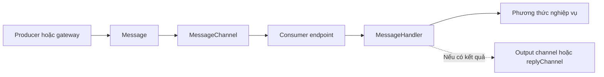
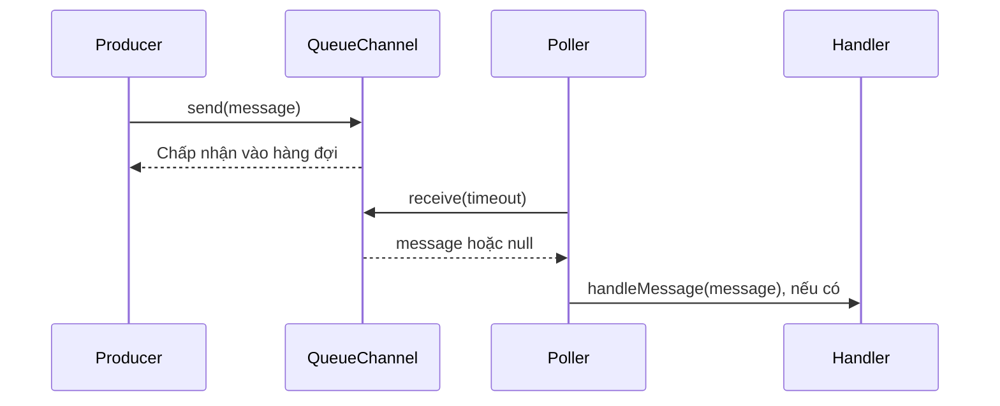

# MessageConsumer

## 1. Mục tiêu và phạm vi

Trong chương **Message endpoint** của module **SPRING_INTEGRATION_CORE**, MessageConsumer là vai trò tiếp nhận thông điệp từ channel để thực hiện một bước xử lý. Bài học giúp bạn chọn cách nhận thông điệp, cấu hình endpoint bằng Java DSL, xác định nơi chạy nghiệp vụ và kiểm thử đường thành công lẫn đường lỗi.

Sau bài học, bạn cần giải thích được luồng `Message → MessageChannel → consumer endpoint → MessageHandler`, chọn giữa tiếp nhận theo sự kiện và polling, đồng thời phân biệt việc chấp nhận thông điệp với việc hoàn tất nghiệp vụ.

Các ví dụ dùng API phổ biến trong Spring Integration 6.x/7.x và cú pháp Java 17. Chúng giả định dự án đã có `spring-integration-core`; phần kiểm thử cần `spring-test`, JUnit Jupiter và bộ chạy JUnit tương ứng. Dùng BOM hoặc dependency management của dự án để giữ các phiên bản Spring tương thích.

## 2. MessageConsumer là vai trò gì?

Tên bài **MessageConsumer** mô tả vai trò consumer. Khi cấu hình Spring Integration Core, các kiểu cần nhận diện là `MessageHandler`, `EventDrivenConsumer` và `PollingConsumer`; không suy ra rằng phải tự tạo một lớp hoặc import một interface tên `MessageConsumer`.

Endpoint nối channel với handler. Handler quyết định xử lý thông điệp như thế nào; endpoint đảm nhiệm cơ chế nhận và vòng đời. Nhờ đó, cùng nghiệp vụ có thể được đặt sau channel đăng ký nhận hoặc channel cần polling. Xem [Message Endpoints](https://docs.spring.io/spring-integration/reference/endpoint.html).

| Thành phần | Câu hỏi mà thành phần trả lời | Ví dụ |
| --- | --- | --- |
| `Message<?>` | Dữ liệu và ngữ cảnh nào được truyền? | Payload mã đơn hàng, header `correlationId` |
| `MessageChannel` | Thông điệp đi qua đâu? | `DirectChannel`, `QueueChannel` |
| Consumer endpoint | Nhận thông điệp và quản lý hoạt động bằng cách nào? | `EventDrivenConsumer`, `PollingConsumer` |
| `MessageHandler` | Thực hiện bước xử lý nào? | Gọi dịch vụ xác nhận đơn |
| Phương thức nghiệp vụ | Quy tắc miền cụ thể là gì? | Kiểm tra tồn kho, cập nhật trạng thái |



## 3. Consumer theo sự kiện

`EventDrivenConsumer` nối một `SubscribableChannel` với một `MessageHandler`. Khi endpoint chạy, handler được đăng ký; khi dừng, đăng ký được gỡ. Không cần lịch gọi `receive()`. API và vòng đời được thể hiện trong [EventDrivenConsumer Javadoc](https://docs.spring.io/spring-integration/api/org/springframework/integration/endpoint/EventDrivenConsumer.html).

Ví dụ cấp thấp dưới đây chỉ nhằm thấy cơ chế đăng ký. Trong ứng dụng, ưu tiên bean hoặc DSL để Spring quản lý vòng đời:

```java
import org.springframework.integration.channel.DirectChannel;
import org.springframework.integration.endpoint.EventDrivenConsumer;
import org.springframework.messaging.MessageHandler;
import org.springframework.messaging.support.MessageBuilder;

DirectChannel channel = new DirectChannel();
MessageHandler handler = message ->
        System.out.println("Đã nhận: " + message.getPayload());
EventDrivenConsumer endpoint = new EventDrivenConsumer(channel, handler);

endpoint.start();
try {
    channel.send(MessageBuilder.withPayload("ORDER-101").build());
} finally {
    endpoint.stop();
}
```

**Theo sự kiện không đồng nghĩa với bất đồng bộ.** Với `DirectChannel`, handler chạy trên luồng gọi `send()`. `ExecutorChannel` có thể giao việc qua executor. Cơ chế luồng thuộc cấu hình channel/executor; tên consumer chưa đủ để kết luận.

`DirectChannel` chuyển mỗi thông điệp cho một subscriber. `PublishSubscribeChannel` phát thông điệp đến các subscriber. Thêm consumer vào `DirectChannel` không biến nó thành broadcast. Xem [Message Channel Implementations](https://docs.spring.io/spring-integration/reference/channel/implementations.html).

## 4. Consumer polling

`PollingConsumer` nối `PollableChannel`, chẳng hạn `QueueChannel`, với handler. Tác vụ polling gọi nhận, rồi chuyển thông điệp đã lấy cho handler. `receiveTimeout` giới hạn thời gian một lần nhận chờ khi hàng đợi rỗng; đây không phải timeout xử lý nghiệp vụ. Xem [PollingConsumer Javadoc](https://docs.spring.io/spring-integration/api/org/springframework/integration/endpoint/PollingConsumer.html).



Một `PollingConsumer` nhận từ channel nội bộ; `SourcePollingChannelAdapter` lấy dữ liệu từ `MessageSource` rồi phát vào channel. Cả hai có thể dùng poller nhưng đứng ở hai vị trí khác nhau. Khi khai báo consumer trên pollable channel, cấu hình poller tại endpoint hoặc cung cấp global default poller. Xem [Poller](https://docs.spring.io/spring-integration/reference/polling-consumer.html).

| Yếu tố | Cách hiểu để cấu hình |
| --- | --- |
| `fixedDelay` | Khoảng nghỉ sau khi tác vụ hoàn tất, trong cấu hình polling đồng bộ đơn giản |
| `fixedRate` | Chu kỳ dựa trên các thời điểm bắt đầu theo lịch |
| `maxMessagesPerPoll` | Giới hạn số thông điệp trong một chu kỳ, không phải số luồng |
| `receiveTimeout` | Thời gian chờ cho từng lần nhận, không phải toàn chu kỳ |
| Executor | Có thể thay đổi việc thực thi tác vụ và mức cạnh tranh tài nguyên |

`Pollers` cung cấp các cấu hình lịch như `fixedDelay`, `fixedRate` và `cron`. Khi thêm executor, phải đánh giá lại việc xếp hàng tác vụ thay vì coi chu kỳ là giới hạn tốc độ cứng. Xem [Pollers Javadoc](https://docs.spring.io/spring-integration/api/org/springframework/integration/dsl/Pollers.html).

Với `maxMessagesPerPoll`, số dương đặt giới hạn, số âm cho phép tiếp tục đến khi lần nhận không có dữ liệu, còn `0` tạm ngừng nhận. Nếu nguồn luôn có thông điệp, giá trị âm có thể làm một chu kỳ kéo dài. Xem [AbstractPollingEndpoint Javadoc](https://docs.spring.io/spring-integration/api/org/springframework/integration/endpoint/AbstractPollingEndpoint.html).

Ví dụ tính toán thiết kế: nếu một chu kỳ xử lý tối đa 5 thông điệp, mỗi thông điệp mất khoảng 40 ms, rồi nghỉ 100 ms, thì khi liên tục có dữ liệu, tốc độ ước lượng là `5 / (0,2 + 0,1) ≈ 16,7 thông điệp/giây`. Con số này giả định một tác vụ đồng bộ, bỏ qua chi phí khác; không phải bảo đảm thông lượng.

## 5. Handler và kết quả trả về

Giao diện callback nền tảng có phương thức `void handleMessage(Message<?> message)`. Kiểu trả về `void` của callback không có nghĩa mọi endpoint đều kết thúc luồng: các handler tạo reply tự gửi kết quả tiếp. Đây là cơ chế đứng sau nhiều transformer, router, filter và aggregator. Xem [Message Handler](https://docs.spring.io/spring-integration/reference/endpoint.html#message-handler).

Với service activator, một phương thức trả kết quả khác `null` có thể tạo reply. Đích là output channel đã cấu hình hoặc `replyChannel` của request khi không có output cố định. Phương thức `void` phù hợp với bước chỉ tạo tác dụng phụ. Khi cần bắt buộc có kết quả, xem cấu hình `requiresReply`; một giá trị `null` ngoài dự kiến có thể khiến bên chờ reply hết thời gian. Xem [Service Activator](https://docs.spring.io/spring-integration/reference/service-activator.html).

Ví dụ đơn hàng: consumer ghi nhận thanh toán có thể trả trạng thái mới để luồng tiếp tục; consumer ghi audit có thể kết thúc bằng `void`. Nếu một gateway chờ trạng thái mà bước cuối chỉ ghi audit, hợp đồng request–reply cần được thiết kế lại.

## 6. Thực hành Java DSL: cùng nghiệp vụ, hai cách nhận

Ví dụ tự chứa sau chuẩn hóa mã đơn hàng. Nó dùng một đầu vào trực tiếp và một đầu vào có hàng đợi, với hai output riêng để dễ quan sát. `consumerErrors` nhận lỗi polling trong bài thực hành khi request chỉ định header tương ứng.

```java
import java.util.Locale;

import org.springframework.context.annotation.Bean;
import org.springframework.context.annotation.Configuration;
import org.springframework.integration.channel.DirectChannel;
import org.springframework.integration.channel.QueueChannel;
import org.springframework.integration.config.EnableIntegration;
import org.springframework.integration.dsl.IntegrationFlow;
import org.springframework.integration.dsl.Pollers;

@Configuration
@EnableIntegration
public class ConsumerDemoConfig {

    @Bean
    public DirectChannel directOrders() {
        return new DirectChannel();
    }

    @Bean
    public QueueChannel queuedOrders() {
        return new QueueChannel(100);
    }

    @Bean
    public QueueChannel directResults() {
        return new QueueChannel(100);
    }

    @Bean
    public QueueChannel queuedResults() {
        return new QueueChannel(100);
    }

    @Bean
    public QueueChannel consumerErrors() {
        return new QueueChannel(100);
    }

    @Bean
    public IntegrationFlow directOrderFlow() {
        return IntegrationFlow.from(directOrders())
                .handle(String.class,
                        (payload, headers) -> normalize(payload),
                        endpoint -> endpoint.id("directOrderConsumer"))
                .channel(directResults())
                .get();
    }

    @Bean
    public IntegrationFlow queuedOrderFlow() {
        return IntegrationFlow.from(queuedOrders())
                .handle(String.class,
                        (payload, headers) -> normalize(payload),
                        endpoint -> endpoint
                                .id("queuedOrderConsumer")
                                .poller(Pollers.fixedDelay(100)
                                        .maxMessagesPerPoll(5)
                                        .receiveTimeout(0)))
                .channel(queuedResults())
                .get();
    }

    private static String normalize(String input) {
        String orderId = input.trim();
        if (orderId.isEmpty()) {
            throw new IllegalArgumentException("Mã đơn hàng không được rỗng");
        }
        return orderId.toUpperCase(Locale.ROOT);
    }
}
```

Các endpoint được tạo qua cơ chế cấu hình của framework; `ConsumerEndpointFactoryBean` lựa chọn kiểu consumer phù hợp với input channel. Ngoài hai mô hình trong bài, framework còn hỗ trợ consumer reactive. Xem [ConsumerEndpointFactoryBean Javadoc](https://docs.spring.io/spring-integration/docs/7.0.x/api/org/springframework/integration/config/ConsumerEndpointFactoryBean.html).

Trong ví dụ:

- Gửi `" order-101 "` vào `directOrders` tạo `"ORDER-101"` ở `directResults` trước khi lời gọi gửi thành công trả về.
- Gửi vào `queuedOrders` chỉ chờ khả năng nhận của hàng đợi; poller xử lý sau đó. `receiveTimeout(0)` giúp lần nhận kết thúc ngay khi chưa có dữ liệu.
- Output cũng có capacity 100. Trong demo phải đọc output; nếu để output đầy, tác vụ xử lý có thể bị chặn khi gửi kết quả.
- Poller đặt trên `.handle(...)` vì handler này trực tiếp nhận từ `queuedOrders`.

Nếu chèn `.transform(...)` ngay sau `queuedOrders`, transformer trở thành consumer của hàng đợi. Khi đó chuyển cấu hình poller sang endpoint transformer; không giữ poller tại một handler sau channel trực tiếp được DSL tạo giữa các bước.

### Cách biểu đạt tương đương bằng annotation

Đây là **phương án thay thế** cho flow polling phía trên. Không bật đồng thời cả hai trên cùng `queuedOrders` nếu mục tiêu là mỗi thông điệp chạy đúng một phương án.

```java
import org.springframework.integration.annotation.Poller;
import org.springframework.integration.annotation.ServiceActivator;
import org.springframework.messaging.handler.annotation.Header;
import org.springframework.stereotype.Component;

@Component
public class OrderConsumer {

    @ServiceActivator(
            inputChannel = "queuedOrders",
            outputChannel = "queuedResults",
            poller = @Poller(
                    fixedDelay = "100",
                    maxMessagesPerPoll = "5",
                    receiveTimeout = "0"))
    public String accept(
            String payload,
            @Header(name = "tenantId", required = false) String tenantId) {
        return payload.trim().toUpperCase(java.util.Locale.ROOT);
    }
}
```

Lớp cần được component scan và hạ tầng integration cần được bật. Đây là ví dụ binding payload/header, chưa thực hiện kiểm tra mã rỗng như cấu hình DSL. Annotation được xử lý thành endpoint và handler; phương thức nghiệp vụ có thể nhận payload, toàn bộ message hoặc header. Xem [Annotation Support](https://docs.spring.io/spring-integration/reference/configuration/annotations.html).

## 7. Lỗi đi đâu?

Với đường `DirectChannel`, exception của handler truyền trên call stack về bên gửi. Với đường polling dùng hạ tầng scheduler mặc định, lỗi được gửi dưới dạng `ErrorMessage`; header `errorChannel` của request chỉ định đích, nếu thiếu thì dùng global `errorChannel`. Không coi việc thêm header là đủ để mọi lỗi đồng bộ tự chuyển thành message. Xem [Error Handling](https://docs.spring.io/spring-integration/reference/error-handling.html).

```java
import org.springframework.messaging.MessageHeaders;
import org.springframework.messaging.support.MessageBuilder;

// queuedOrders là bean QueueChannel của cấu hình trên.
boolean accepted = queuedOrders.send(
        MessageBuilder.withPayload("   ")
                .setHeader(MessageHeaders.ERROR_CHANNEL, "consumerErrors")
                .setHeader("businessKey", "ORDER-101")
                .build(),
        1_000);
```

Trong tình huống này, `accepted == true` có thể xảy ra trước khi `normalize` ném lỗi. Bên nhận `consumerErrors` cần quyết định lưu sự cố, sửa dữ liệu hoặc chuyển sang quy trình xử lý thủ công. Chỉ ghi log chưa giải quyết đơn hàng đang thất bại.

Retry cũng là quyết định cấu hình riêng. `RequestHandlerRetryAdvice` hỗ trợ thử lại ở handler; cần chọn giới hạn và hành vi khi hết lượt. Nếu nghiệp vụ đã tạo tác dụng phụ trước khi lỗi, thử lại có thể lặp tác dụng phụ. Xem [Provided Advice Classes](https://docs.spring.io/spring-integration/reference/handler-advice/classes.html).

## 8. Kiểm thử hành vi consumer

Kiểm thử dưới đây dùng chính `ConsumerDemoConfig`. Không cần Spring Boot hoặc broker. Nó kiểm tra kết quả trực tiếp, kết quả polling và lỗi bất đồng bộ bằng thời gian chờ hữu hạn.

```java
import org.junit.jupiter.api.Test;
import org.springframework.beans.factory.annotation.Autowired;
import org.springframework.beans.factory.annotation.Qualifier;
import org.springframework.messaging.Message;
import org.springframework.messaging.MessageChannel;
import org.springframework.messaging.MessageHeaders;
import org.springframework.messaging.PollableChannel;
import org.springframework.messaging.support.ErrorMessage;
import org.springframework.messaging.support.MessageBuilder;
import org.springframework.test.context.junit.jupiter.SpringJUnitConfig;

import static org.junit.jupiter.api.Assertions.*;

@SpringJUnitConfig(ConsumerDemoConfig.class)
class ConsumerDemoTest {

    @Autowired
    @Qualifier("directOrders")
    MessageChannel directOrders;

    @Autowired
    @Qualifier("queuedOrders")
    MessageChannel queuedOrders;

    @Autowired
    @Qualifier("directResults")
    PollableChannel directResults;

    @Autowired
    @Qualifier("queuedResults")
    PollableChannel queuedResults;

    @Autowired
    @Qualifier("consumerErrors")
    PollableChannel consumerErrors;

    @Test
    void directConsumerProducesResultBeforeSendReturns() {
        assertTrue(directOrders.send(
                MessageBuilder.withPayload(" order-101 ").build(), 1_000));

        Message<?> result = directResults.receive(0);
        assertNotNull(result);
        assertEquals("ORDER-101", result.getPayload());
    }

    @Test
    void pollingConsumerEventuallyProducesResult() {
        assertTrue(queuedOrders.send(
                MessageBuilder.withPayload(" order-202 ").build(), 1_000));

        Message<?> result = queuedResults.receive(3_000);
        assertNotNull(result);
        assertEquals("ORDER-202", result.getPayload());
    }

    @Test
    void pollingFailureIsPublishedToRequestedErrorChannel() {
        assertTrue(queuedOrders.send(
                MessageBuilder.withPayload("   ")
                        .setHeader(MessageHeaders.ERROR_CHANNEL, "consumerErrors")
                        .build(), 1_000));

        Message<?> error = consumerErrors.receive(3_000);
        assertNotNull(error);
        assertInstanceOf(ErrorMessage.class, error);

        Throwable root = ((ErrorMessage) error).getPayload();
        while (root.getCause() != null) {
            root = root.getCause();
        }
        assertInstanceOf(IllegalArgumentException.class, root);
    }
}
```

`receive(timeout)` là chờ một kết quả cụ thể, giúp tránh `Thread.sleep` với khoảng nghỉ đoán trước. Nếu môi trường CI chậm, chọn timeout theo ngân sách kiểm thử thực tế. Giữ test trên chạy tuần tự vì chúng chia sẻ application context và hàng đợi. Spring Integration có thêm `@SpringIntegrationTest` và `MockIntegrationContext` khi cần điều khiển endpoint hoặc thay handler để cô lập luồng. Xem [Testing support](https://docs.spring.io/spring-integration/reference/testing.html).

Các ca nên mở rộng khi áp dụng cho đơn hàng thật: lỗi đồng bộ trả về caller, endpoint tạm dừng, hàng đợi đầy và cùng business key xuất hiện hai lần. Với thanh toán, kết quả cần kiểm tra là số lần tác dụng phụ được ghi nhận, không chỉ số message được nhận.

## 9. Vòng đời và ranh giới giao dịch

Endpoint có trạng thái chạy; có bean trong context không đồng nghĩa endpoint đang nhận thông điệp. Có thể lấy endpoint theo ID DSL để điều khiển:

```java
import org.springframework.context.ConfigurableApplicationContext;
import org.springframework.integration.endpoint.AbstractEndpoint;

// context là application context đang chạy.
AbstractEndpoint endpoint = context.getBean(
        "queuedOrderConsumer", AbstractEndpoint.class);
endpoint.stop();
// Kiểm tra trạng thái vận hành hoặc bảo trì tại đây.
endpoint.start();
```

Dừng consumer không đồng nghĩa xóa thông điệp trong channel hoặc hủy tức thì một tác vụ đang xử lý. Khi bảo trì, phải xác định cách đợi tác vụ hoàn tất. ID endpoint cũng giúp liên kết log với cấu hình. Xem [EventDrivenConsumer API](https://docs.spring.io/spring-integration/api/org/springframework/integration/endpoint/EventDrivenConsumer.html) và [PollingConsumer API](https://docs.spring.io/spring-integration/api/org/springframework/integration/endpoint/PollingConsumer.html).

Giao dịch gắn với luồng gọi không tự đi qua ranh giới bất đồng bộ. Với poller, có thể cấu hình transaction cho công việc nhận và xử lý; rollback/redelivery còn phụ thuộc tài nguyên tham gia. Không suy ra rằng một `QueueChannel` trong bộ nhớ tự đưa message về hàng đợi khi handler lỗi. Xem [Transaction Support](https://docs.spring.io/spring-integration/reference/transactions.html).

Từ đó, thiết kế ghi nhận thanh toán cần trả lời ba câu hỏi riêng: dữ liệu đầu vào có bền vững không, thao tác nghiệp vụ có giao dịch không, và xử lý lại có an toàn không. Một khóa idempotency như `paymentId` thường phù hợp hơn ID message mới được tạo khi phát lại.

## 10. Chọn cấu hình và chẩn đoán

| Tình huống | Điểm bắt đầu phù hợp | Điều cần kiểm chứng |
| --- | --- | --- |
| Chuẩn hóa dữ liệu nhanh, caller cần kết quả | Consumer sau `DirectChannel` | Độ trễ và lỗi truyền về caller |
| Cần đệm một lượng công việc hữu hạn | Consumer sau queue có capacity và poller | Tốc độ tích lũy, timeout khi đầy |
| Nhiều nhánh cùng nhận sự kiện | Consumer sau publish–subscribe | Mức cô lập lỗi giữa các nhánh |
| Phải sống qua restart | Channel/store hoặc broker bền vững | Cơ chế xác nhận và phát lại |

Queue trong bộ nhớ không tự có độ bền qua restart. `send(message, timeout)` cho phép giới hạn thời gian chờ khi queue đầy; phải xử lý trường hợp trả về `false`. Xem [QueueChannel](https://docs.spring.io/spring-integration/reference/channel/implementations.html#queuechannel).

Khi một đơn hàng không được xử lý, chẩn đoán theo đường đi cụ thể:

1. Xác nhận gửi vào đúng channel và thao tác gửi có thành công.
2. Kiểm tra endpoint đang chạy và poller được đặt tại bước nhận từ queue.
3. Kiểm tra payload/header có đáp ứng hợp đồng của handler.
4. Xem lỗi ở caller hoặc ở error channel tương ứng với ranh giới luồng.
5. Kiểm tra output có bị đầy hoặc reply có thiếu đích.

Đây là trình tự suy luận cho ví dụ, không phải kết luận rằng mọi sự cố đều do poller. Đặc biệt, tăng `maxMessagesPerPoll` chỉ tăng giới hạn công việc mỗi chu kỳ; muốn cải thiện xử lý chậm phải đo thời gian nghiệp vụ và điểm nghẽn tài nguyên.

## 11. Bài tập áp dụng

Dùng cấu hình DSL ở trên làm điểm xuất phát:

1. Gửi 12 mã đơn vào `queuedOrders`, đọc đủ kết quả và quan sát cấu hình tối đa 5 thông điệp mỗi chu kỳ. Không kiểm tra bằng một mốc thời gian tuyệt đối dễ dao động.
2. Chèn transformer sau queue và chuyển poller sang transformer. Giải thích endpoint nào đang thực hiện việc nhận từ queue.
3. Gửi mã rỗng qua hai input. Mô tả khác biệt giữa exception tại caller và `ErrorMessage` nhận qua channel.
4. Thiết kế consumer xác nhận thanh toán có `paymentId`. Nêu cách ngăn ghi nhận trùng khi cùng lệnh được phát lại.

Tiêu chí hoàn thành: chỉ ra được consumer endpoint, handler, channel đầu vào, luồng thực thi và đích lỗi cho từng đường đi; đồng thời chứng minh bằng kết quả kiểm thử rằng việc gửi vào queue và việc hoàn tất nghiệp vụ là hai sự kiện riêng.