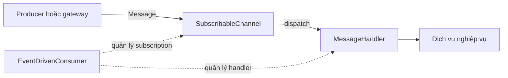

# EventDrivenConsumer

## Mục tiêu và vị trí trong luồng tích hợp

Trong module `SPRING_INTEGRATION_CORE`, bài học này thuộc chương **Message endpoint** và tập trung vào cách một endpoint nhận thông điệp từ channel có khả năng đăng ký subscriber. Sau bài học, bạn có thể giải thích quan hệ giữa `Message`, `MessageChannel`, handler và endpoint; tạo consumer bằng Java DSL; chọn mô hình thực thi phù hợp; xác định đường truyền lỗi và kiểm thử hành vi nhận thông điệp.

Tình huống xuyên suốt là ứng dụng tiếp nhận lệnh tạo đơn hàng. Sau khi lệnh được đưa vào channel nội bộ, ứng dụng cần gọi dịch vụ nghiệp vụ ngay khi có thông điệp. Không cần một lịch chạy định kỳ để tìm lệnh mới.

## 1. EventDrivenConsumer giải quyết vấn đề gì?

`EventDrivenConsumer` là endpoint kết nối một `SubscribableChannel` với một `MessageHandler`. Channel có thể đẩy thông điệp đến handler đã đăng ký; consumer không cần gọi `receive()` theo chu kỳ. Đây là cơ chế callback giữa các thành phần trong ứng dụng. Xem [Message Endpoints](https://docs.spring.io/spring-integration/reference/endpoint.html).

Phân biệt ba trách nhiệm:

| Thành phần | Trách nhiệm | Ví dụ trong bài |
| --- | --- | --- |
| `Message<?>` | Mang payload và headers | Payload là lệnh tạo đơn |
| Channel | Quyết định cách chuyển giao thông điệp | `DirectChannel` chuyển cho một handler |
| Endpoint | Quản lý việc gắn handler vào nguồn nhận thông điệp | `EventDrivenConsumer` quản lý subscription |
| Handler | Thực hiện xử lý khi được gọi | Kiểm tra số lượng và ghi nhận đơn |

Endpoint không phải chính hàm nghiệp vụ. Cùng một loại handler có thể được kết nối bằng endpoint khác nhau tùy loại input channel.



Mũi tên đứt thể hiện quan hệ quản lý. Thông điệp đi qua channel đến handler; không cần hiểu endpoint như một hàng đợi trung gian.

## 2. Cơ chế đăng ký và vòng đời

API khởi tạo cốt lõi có dạng:

```java
new EventDrivenConsumer(inputChannel, handler);
```

Trong đó `inputChannel` phải là `SubscribableChannel`, còn `handler` triển khai `MessageHandler`. Endpoint tham gia vòng đời Spring qua `SmartLifecycle`; việc chỉ gọi constructor chưa đồng nghĩa consumer đã bắt đầu nhận thông điệp. Xem [EventDrivenConsumer API](https://docs.spring.io/spring-integration/api/org/springframework/integration/endpoint/EventDrivenConsumer.html).

Về mặt hoạt động:

1. Spring tạo và khởi tạo các bean liên quan.
2. Khi endpoint được start, handler được subscribe vào input channel.
3. Khi producer gửi thông điệp, dispatcher của channel gọi handler theo quy tắc của channel.
4. Khi endpoint được stop, handler được unsubscribe.

Thông thường nên để Spring quản lý endpoint dưới dạng bean, hoặc để Java DSL tạo endpoint. Không tự gọi `subscribe()` thêm cho một handler đã được endpoint quản lý vì sẽ làm trách nhiệm vòng đời khó theo dõi.

Dừng endpoint có nghĩa là ngừng subscription cho các lần phân phối tiếp theo. Với xử lý bất đồng bộ, tác vụ đã giao cho executor có thể vẫn đang chạy; cần thiết kế shutdown của executor và nghiệp vụ riêng.

## 3. Event-driven và bất đồng bộ là hai lựa chọn khác nhau

Event-driven mô tả **cách kích hoạt handler**. Đồng bộ hay bất đồng bộ mô tả **thread thực thi handler**. Không thể suy ra lựa chọn thứ hai chỉ từ tên `EventDrivenConsumer`.

| Input channel | Cách nhận | Thread xử lý điển hình | Cách phân phối |
| --- | --- | --- | --- |
| `DirectChannel` | Subscription | Thread gọi `send()` | Point-to-point |
| `ExecutorChannel` | Subscription | Do executor quyết định | Point-to-point |
| `PublishSubscribeChannel` không có executor | Subscription | Thread gọi `send()` | Broadcast |
| `PublishSubscribeChannel` có executor | Subscription | Do executor quyết định | Broadcast |
| `QueueChannel` | Polling hoặc gọi `receive()` | Do bên nhận quyết định | Point-to-point |

Với `DirectChannel`, handler được gọi trước khi `send()` hoàn tất. Với `ExecutorChannel` dùng thread pool, sender có thể tiếp tục trước khi nghiệp vụ xong. Một executor chạy trực tiếp hoặc chính sách từ chối kiểu caller-runs có thể làm tác vụ chạy ngay trên thread gửi. Chi tiết channel xem [Message Channel Implementations](https://docs.spring.io/spring-integration/reference/channel/implementations.html).

Hai hệ quả khi thiết kế:

- Nếu handler gọi dịch vụ bên ngoài chậm trên `DirectChannel`, thời gian chờ sẽ cộng vào độ trễ của producer.
- Nếu chuyển sang thread pool, cần quyết định giới hạn hàng đợi tác vụ, mức song song, xử lý quá tải và cách báo kết quả nghiệp vụ.

Không nên đổi channel sang bất đồng bộ chỉ để che độ trễ. Hãy xác định bên gọi cần kết quả cuối cùng hay chỉ cần biết yêu cầu đã được tiếp nhận.

## 4. Ví dụ tối thiểu với endpoint tường minh

Ví dụ sau minh họa cơ chế subscription trực tiếp. Trong ứng dụng thực tế, annotation và Java DSL thường giúp cấu hình gọn hơn.

```java
package example.integration;

import org.springframework.context.annotation.Bean;
import org.springframework.context.annotation.Configuration;
import org.springframework.integration.channel.DirectChannel;
import org.springframework.integration.config.EnableIntegration;
import org.springframework.integration.endpoint.EventDrivenConsumer;
import org.springframework.messaging.MessageHandler;

@Configuration
@EnableIntegration
public class ExplicitConsumerConfig {

    @Bean
    public DirectChannel textInput() {
        return new DirectChannel();
    }

    @Bean
    public EventDrivenConsumer textConsumer(DirectChannel textInput) {
        MessageHandler handler = message ->
                System.out.println("Received: " + message.getPayload());
        return new EventDrivenConsumer(textInput, handler);
    }
}
```

Có thể quan sát việc nhận thông điệp trong một chương trình Java thông thường:

```java
try (var context = new org.springframework.context.annotation
        .AnnotationConfigApplicationContext(ExplicitConsumerConfig.class)) {
    var input = context.getBean("textInput", DirectChannel.class);
    input.send(new org.springframework.messaging.support
            .GenericMessage<>("Xin chào Spring Integration"));
}
```

Khi context được refresh, endpoint được khởi động theo cấu hình vòng đời mặc định. Thông điệp được xử lý trong thread gửi. Ví dụ chỉ dùng `System.out` để quan sát cơ chế; ứng dụng thực tế nên dùng logging và dịch vụ nghiệp vụ phù hợp.

Khai báo handler bean đơn lẻ không tự biến handler đó thành subscriber của một channel bất kỳ. Cần cấu hình mối nối thông qua endpoint, annotation hoặc DSL.

## 5. Luồng tạo đơn hàng bằng Java DSL

Ví dụ dưới đây là cấu hình độc lập với ví dụ ở phần 4. Dùng `spring-integration-core` cùng các dependency Spring tương thích; nếu dùng Spring Boot, có thể dùng `spring-boot-starter-integration` và để Boot quản lý phiên bản. Không trộn thủ công các phiên bản Spring khác dòng. Mẫu dùng Java `record`, vì vậy cần mức Java hỗ trợ cú pháp này và đáp ứng yêu cầu của phiên bản framework đang chọn.

```java
package example.integration;

import java.util.Map;
import java.util.concurrent.ConcurrentHashMap;

import org.springframework.context.annotation.Bean;
import org.springframework.context.annotation.Configuration;
import org.springframework.integration.channel.DirectChannel;
import org.springframework.integration.config.EnableIntegration;
import org.springframework.integration.dsl.IntegrationFlow;

@Configuration
@EnableIntegration
public class OrderFlowConfig {

    public record CreateOrder(String orderId, int quantity) {}

    public static class OrderService {
        private final Map<String, Integer> accepted = new ConcurrentHashMap<>();

        public void accept(CreateOrder command) {
            if (command.orderId() == null || command.orderId().isBlank()) {
                throw new IllegalArgumentException("orderId phải có giá trị");
            }
            if (command.quantity() <= 0) {
                throw new IllegalArgumentException("quantity phải lớn hơn 0");
            }
            accepted.put(command.orderId(), command.quantity());
        }

        public Integer quantityOf(String orderId) {
            return accepted.get(orderId);
        }
    }

    @Bean
    public DirectChannel orderInput() {
        return new DirectChannel();
    }

    @Bean
    public OrderService orderService() {
        return new OrderService();
    }

    @Bean
    public IntegrationFlow orderFlow(
            DirectChannel orderInput, OrderService orderService) {
        return IntegrationFlow.from(orderInput)
                .handle(CreateOrder.class, (command, headers) -> {
                    orderService.accept(command);
                    return null;
                }, endpoint -> endpoint.id("acceptOrderEndpoint"))
                .get();
    }
}
```

Giải thích cấu hình:

- `orderInput` là channel có subscription.
- `.handle(...)` khai báo bước gọi nghiệp vụ; DSL tạo handler thích hợp và endpoint nối handler vào channel.
- Với input là `DirectChannel`, bước xử lý này được phục vụ bởi consumer theo cơ chế event-driven.
- `acceptOrderEndpoint` giúp xác định endpoint khi theo dõi hoặc điều khiển vòng đời.
- Lambda trả `null` vì đây là xử lý một chiều, không phát sinh reply cho bước kế tiếp.

Không gắn `.poller(...)` cho bước đang nhận từ `DirectChannel`. Nếu thay input bằng `QueueChannel`, phải chuyển sang cấu hình polling tương ứng; đó là một mô hình nhận khác.

`ConcurrentHashMap` chỉ làm cho dữ liệu minh họa truy cập an toàn ở mức thao tác map. Dữ liệu sẽ mất khi tiến trình kết thúc, và `put()` không thay thế thiết kế idempotency hay giao dịch lưu đơn thực tế.

### Gửi một Message vào luồng

```java
import org.springframework.messaging.support.MessageBuilder;

var message = MessageBuilder
        .withPayload(new OrderFlowConfig.CreateOrder("ORD-1001", 2))
        .setHeader("traceId", "trace-order-1001")
        .build();

boolean sent = orderInput.send(message);
```

`traceId` là header minh họa do ứng dụng đặt. Handler hiện chỉ dùng payload; có thể đọc header khi cần gắn log nghiệp vụ với nguồn gửi.

Với cấu hình hiện tại, sau khi `send()` trả về bình thường, lời gọi `orderService.accept()` đã hoàn tất. Điều này không bảo đảm dữ liệu bền vững, vì ví dụ chỉ ghi vào bộ nhớ. Nếu thay bằng channel dùng thread pool, kết quả gửi cũng không chứng minh đơn đã được xử lý xong.

Gateway có thể đặt phía trước `orderInput` để bên gọi sử dụng interface Java thay vì tự tạo `Message`. Việc có gateway không tự thay đổi cơ chế subscription ở endpoint phía sau; cần xem channel và hợp đồng request-reply của gateway.

## 6. Biến thể dùng annotation

Nếu muốn gọi trực tiếp phương thức dịch vụ bằng annotation, có thể cấu hình:

```java
@Bean
@org.springframework.integration.annotation.ServiceActivator(
        inputChannel = "orderInput")
public org.springframework.messaging.MessageHandler orderHandler(
        OrderService orderService) {
    return message -> orderService.accept((CreateOrder) message.getPayload());
}
```

Đoạn này đặt trong `OrderFlowConfig` để dùng các kiểu lồng `OrderService`, `CreateOrder` và channel đã khai báo. **Thay thế bean `orderFlow` bằng bean này**, không giữ cả hai để xử lý cùng một nghiệp vụ.

Nếu giữ cả DSL và annotation cùng subscribe vào `DirectChannel`, bạn tạo thêm consumer cạnh tranh. Điều đó có thể làm thông điệp đi đến handler khác với dự kiến. Nếu mục tiêu là mỗi thông điệp đều phải đến nhiều nhánh độc lập, hãy thiết kế luồng broadcast rõ ràng.

## 7. Lỗi đi đâu?

### 7.1. Đường đi đồng bộ

Với `DirectChannel`, lỗi từ handler quay về thread gọi `send()`. Framework có thể bọc lỗi nghiệp vụ trong `MessagingException`, vì vậy khi phân tích cần xem cả exception và chuỗi `cause`.

Ví dụ gửi `CreateOrder("ORD-INVALID", 0)` làm bước kiểm tra số lượng thất bại. Bên gọi có thể bắt lỗi và quyết định phản hồi hoặc rollback theo ranh giới giao dịch đã thiết lập.

Chỉ đặt header `errorChannel` không làm mọi lỗi đồng bộ tự chuyển sang channel lỗi. Gateway hoặc advice có thể bổ sung hành vi xử lý riêng, nhưng phải được cấu hình có chủ đích.

### 7.2. Đường đi bất đồng bộ

Khi handler chạy trên worker thread, sender thường đã rời khỏi lời gọi gửi. Lỗi xử lý cần được quan sát qua cơ chế phù hợp, chẳng hạn `ErrorMessage` và error channel. Với cơ chế publish lỗi tiêu chuẩn, channel trong header `errorChannel` được ưu tiên; nếu không có thì dùng channel lỗi toàn cục. Tham khảo [Error Handling](https://docs.spring.io/spring-integration/reference/error-handling.html).

Khi thiết kế nhánh lỗi, hãy quyết định:

| Loại lỗi của tình huống đơn hàng | Hướng xử lý phù hợp |
| --- | --- |
| Số lượng không hợp lệ | Ghi nhận từ chối và phản hồi theo hợp đồng |
| Dịch vụ phụ thuộc tạm thời không sẵn sàng | Retry có giới hạn và có khoảng chờ |
| Đã hết số lần retry | Lưu dữ liệu đủ để điều tra hoặc xử lý lại |
| Thông điệp được phát lại | Kiểm tra khóa nghiệp vụ để tránh tác dụng phụ lặp |

Đây là các quyết định của ứng dụng. `EventDrivenConsumer` không tự cung cấp retry, kho lưu lỗi bền vững hoặc bảo đảm exactly-once. Không nên coi việc log exception là đã hoàn tất quy trình phục hồi.

## 8. Thread, giao dịch và thứ tự xử lý

Một handler singleton có thể được nhiều thread gọi đồng thời, ngay cả khi dùng `DirectChannel`: nhiều producer có thể cùng gọi `send()`. Tránh lưu dữ liệu riêng của một thông điệp trong field dùng chung của handler.

Đối với luồng đơn hàng, nên kiểm tra ba giả định thiết kế:

1. **Giao dịch:** muốn lưu đơn và cập nhật dữ liệu liên quan trong cùng transaction thì phải thiết lập transaction ở ranh giới thích hợp. Channel đồng bộ không tự mở transaction; thread mới cũng không tự nhận transaction gắn với thread gọi.
2. **Thứ tự:** nếu đơn có nhiều bước cập nhật phụ thuộc nhau, cần thiết kế cách tuần tự hóa theo khóa đơn. Thread pool nhiều worker có thể hoàn tất các thông điệp khác thứ tự gửi.
3. **Tác dụng phụ:** retry sau khi đã gọi hệ thống ngoài có thể lặp thao tác. Cần khóa nghiệp vụ, idempotency hoặc giao thức phối hợp phù hợp với hệ thống đích.

Không dùng `EventDrivenConsumer` như một bảo đảm lưu trữ. Nếu yêu cầu vẫn xử lý được sau khi ứng dụng chết, cần thêm broker hoặc cơ chế lưu thông điệp phù hợp với kiến trúc.

## 9. Kiểm thử hành vi event-driven

Mục tiêu kiểm thử là chứng minh tác dụng của việc gửi thông điệp, không chỉ chứng minh có bean cấu hình. Với cấu hình đồng bộ ở phần 5, không cần `Thread.sleep()`.

Các ví dụ dưới đây dùng JUnit Jupiter và cùng package với `OrderFlowConfig`.

```java
package example.integration;

import org.junit.jupiter.api.Test;
import org.springframework.context.annotation.AnnotationConfigApplicationContext;
import org.springframework.integration.channel.DirectChannel;
import org.springframework.messaging.MessagingException;
import org.springframework.messaging.support.MessageBuilder;

import static org.junit.jupiter.api.Assertions.*;

class OrderFlowTest {

    @Test
    void handlesMessageBeforeSendReturns() {
        try (var context = new AnnotationConfigApplicationContext(
                OrderFlowConfig.class)) {
            var input = context.getBean("orderInput", DirectChannel.class);
            var service = context.getBean(OrderFlowConfig.OrderService.class);
            var message = MessageBuilder.withPayload(
                    new OrderFlowConfig.CreateOrder("ORD-1001", 2)).build();

            assertTrue(input.send(message));
            assertEquals(Integer.valueOf(2), service.quantityOf("ORD-1001"));
        }
    }

    @Test
    void propagatesBusinessFailureToSender() {
        try (var context = new AnnotationConfigApplicationContext(
                OrderFlowConfig.class)) {
            var input = context.getBean("orderInput", DirectChannel.class);
            var service = context.getBean(OrderFlowConfig.OrderService.class);
            var message = MessageBuilder.withPayload(
                    new OrderFlowConfig.CreateOrder("ORD-INVALID", 0)).build();

            MessagingException error = assertThrows(
                    MessagingException.class, () -> input.send(message));

            Throwable root = error;
            while (root.getCause() != null) {
                root = root.getCause();
            }
            assertInstanceOf(IllegalArgumentException.class, root);
            assertEquals("quantity phải lớn hơn 0", root.getMessage());
            assertNull(service.quantityOf("ORD-INVALID"));
        }
    }
}
```

Nếu chuyển sang xử lý trên thread pool, hãy dùng `CountDownLatch`, một queue kết quả hoặc cơ chế đợi điều kiện với timeout hữu hạn. Cần kiểm tra cả kết quả thành công và thông điệp trên nhánh lỗi. Timeout hữu hạn giúp phép thử thất bại rõ ràng khi endpoint không nhận thông điệp.

Có thể bổ sung kiểm thử vòng đời trong cấu hình chỉ có một subscriber: stop endpoint, gửi và quan sát lỗi không có subscriber của `DirectChannel`, sau đó start lại và xác minh xử lý tiếp. Không suy rộng kết quả đó sang channel có nhiều subscriber hoặc channel broadcast với cấu hình khác.

Các đoạn test là mẫu học tập để chạy trong dự án phù hợp; bài viết không coi chúng là kết quả kiểm thử đã thực thi.

## 10. Chẩn đoán các tình huống thường gặp

| Hiện tượng | Giả thuyết cần kiểm tra | Hướng kiểm tra |
| --- | --- | --- |
| `Dispatcher has no subscribers` | Endpoint chưa start, đã stop hoặc trỏ nhầm channel | Xem input channel, lifecycle và cấu hình bean |
| Luồng vẫn chạy trên thread HTTP | Đang dùng `DirectChannel` | Ghi tên thread trước `send()` và trong handler |
| Request chậm khi handler gọi API | Xử lý đồng bộ đang chờ API | Đo thời gian từng bước và xác định hợp đồng phản hồi |
| Một số thông điệp vào handler khác | Có nhiều subscriber trên channel point-to-point | Kiểm tra cấu hình DSL và annotation bị khai báo đồng thời |
| Không thấy lỗi tại `try/catch` của sender | Xử lý đã chuyển sang worker thread | Kiểm tra executor, error channel và nhánh quan sát lỗi |
| Đơn được lưu hai lần khi chạy lại | Thiếu cơ chế chống lặp ở nghiệp vụ | Kiểm tra khóa đơn, ràng buộc lưu trữ và chính sách retry |
| Thay `DirectChannel` bằng queue rồi không xử lý | Thiếu cấu hình polling thích hợp | Xác định lại loại endpoint và poller |

Khi log, ưu tiên endpoint id, khóa nghiệp vụ, correlation/trace id và nguyên nhân lỗi. Chỉ log payload đầy đủ khi phù hợp với dữ liệu thực tế và nhu cầu chẩn đoán.

## 11. Bài thực hành

1. Dùng cấu hình Java DSL ở phần 5, gửi hai đơn hợp lệ và xác minh số lượng được lưu đúng theo mã đơn.
2. Gửi một đơn có số lượng bằng `0`. Xác định exception bên gọi nhận và nguyên nhân nghiệp vụ bên trong.
3. Ghi tên thread trước lời gọi gửi và trong handler để quan sát đặc tính của `DirectChannel`.
4. Tạo biến thể dùng `ExecutorChannel` với thread pool có giới hạn. Bổ sung cách chờ hoàn tất và quan sát lỗi trước khi đánh giá kết quả.
5. Mô tả điều phải thay đổi nếu yêu cầu nghiệp vụ trở thành “mỗi đơn cần được cả nhánh lưu trữ và nhánh kiểm toán tiếp nhận”.

Tiêu chí hoàn thành: giải thích được ai kích hoạt handler, thread nào thực thi, bên gọi biết được điều gì sau `send()`, lỗi được quan sát ở đâu và dữ liệu nào còn tồn tại sau khi ứng dụng dừng.
