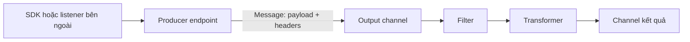
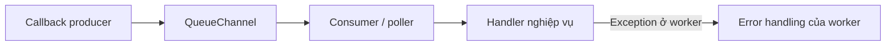

# MessageProducer

## 1. Mục tiêu và bối cảnh

Trong module **SPRING_INTEGRATION_CORE**, chương **Message endpoint**, bài này giải thích cách một thành phần đưa thông điệp vào luồng Spring Integration. Sau bài học, bạn có thể:

- Phân biệt hợp đồng `MessageProducer` với nguồn được polling, handler và gateway.
- Dùng `MessageProducerSupport` để chuyển callback thành `Message<?>.`
- Kết nối producer với `MessageChannel` và Java DSL.
- Quản lý đăng ký callback theo lifecycle của endpoint.
- Dự đoán vị trí phát sinh lỗi và viết kiểm thử cho đường thành công, lỗi, dừng endpoint.

Bối cảnh xuyên suốt là ứng dụng nhận sự kiện tạo đơn hàng từ một SDK có callback. SDK chỉ biết gọi listener; Spring Integration phụ trách lọc, biến đổi và chuyển thông điệp đến bước tiếp theo.

Ví dụ sử dụng Java 17 và các API có trong Spring Integration 6.5.0. Cần `spring-integration-core`; phần kiểm thử dùng JUnit Jupiter. Với Spring Boot, có thể dùng `spring-boot-starter-integration` và `spring-boot-starter-test`, để BOM của Boot quản lý các phiên bản tương thích. Bài không yêu cầu broker hay dịch vụ bên ngoài.

## 2. MessageProducer là hợp đồng về đầu ra

`org.springframework.integration.core.MessageProducer` mô tả thành phần có khả năng gửi thông điệp đến một `MessageChannel`. Các phương thức cấu hình chính là `setOutputChannel(MessageChannel)`, `getOutputChannel()` và `setOutputChannelName(String)`. Interface không khai báo thao tác `produce()` hay `send()` công khai. Tên channel được phân giải thế nào phụ thuộc implementation. [Javadoc MessageProducer](https://docs.spring.io/spring-integration/docs/6.2.9/api/org/springframework/integration/core/MessageProducer.html).

Điều đó dẫn tới hai câu hỏi riêng:

1. **Thông điệp xuất hiện khi nào?** Có thể khi SDK gọi callback, khi giao thức nhận dữ liệu hoặc khi một handler tạo kết quả.
2. **Thông điệp đi đâu?** Producer phát nó đến output channel đã cấu hình.

Producer không cần biết lớp xử lý nghiệp vụ phía sau channel.



Không nên đồng nhất “producer” với “đầu vào từ hệ thống bên ngoài”. Một handler tạo reply cũng có thể triển khai `MessageProducer`; interface này thể hiện khả năng có đầu ra. Ngược lại, chỉ viết `channel.send(message)` trong một service không tự biến service thành một endpoint có lifecycle do Spring Integration quản lý.

## 3. Phân biệt các vai trò gần nhau

| Thành phần | Hợp đồng hoặc vai trò chính | Điều gì kích hoạt? |
| --- | --- | --- |
| `MessageProducer` | Cấu hình nơi phát thông điệp | Tùy implementation; interface không quy định |
| `MessageProducerSupport` | Lớp nền cho producer endpoint, có tiện ích gửi | Callback/listener do lớp con nối vào |
| `MessageSource<T>` | Cung cấp `Message<T>` qua `receive()` | Adapter hoặc thành phần khác gọi lấy |
| `SourcePollingChannelAdapter` | Kết nối source với channel | Poller theo lịch |
| `MessageHandler` | Xử lý thông điệp qua `handleMessage(...)` | Nhận thông điệp từ upstream |
| Messaging gateway | Đưa giao diện Java vào giao tiếp bằng message | Lời gọi phương thức của ứng dụng |

Một `MessageSource` không tự lập lịch. Trong cấu hình inbound kiểu polling, `SourcePollingChannelAdapter` gọi source rồi gửi kết quả khác `null` vào channel. SDK chủ động gọi listener là tình huống khác: không cần thêm poller chỉ để nhận callback. [Channel Adapter](https://docs.spring.io/spring-integration/reference/channel-adapter.html).

Ví dụ lựa chọn:

- “Mỗi 5 giây hỏi API xem có đơn mới không”: cân nhắc source và polling adapter.
- “SDK thông báo ngay khi có đơn mới”: cân nhắc adapter dựa trên listener.
- “Mã nghiệp vụ muốn gọi `submit(order)` để đi vào flow”: cân nhắc messaging gateway.
- “Đã có message và cần chuẩn hóa mã đơn”: dùng transformer.

Trước khi tự viết producer, hãy kiểm tra adapter có sẵn cho giao thức cần dùng. Adapter chuẩn thường đã giải quyết những vấn đề khó hơn ví dụ học tập như quản lý kết nối, acknowledgment, reconnect và cấu hình transport.

## 4. MessageProducerSupport cung cấp gì?

`org.springframework.integration.endpoint.MessageProducerSupport` kế thừa `AbstractEndpoint` và triển khai `MessageProducer`. Lớp con thường gọi `sendMessage(Message<?>)` khi nhận callback, dùng `doStart()` để đăng ký nguồn và `doStop()` để hủy đăng ký. Các cấu hình hữu ích gồm output channel, error channel và send timeout. [Javadoc MessageProducerSupport](https://docs.spring.io/spring-integration/docs/7.0.x/api/org/springframework/integration/endpoint/MessageProducerSupport.html).

| API | Cách dùng trong một producer tùy chỉnh |
| --- | --- |
| `setOutputChannel(channel)` | Truyền trực tiếp channel đầu ra |
| `setOutputChannelName(name)` | Để framework phân giải bean channel |
| `sendMessage(message)` | Gửi message qua cơ chế hỗ trợ của lớp nền |
| `setErrorChannel(channel)` | Chỉ định kênh nhận lỗi gửi ở producer |
| `setSendTimeout(milliseconds)` | Giới hạn thời gian chờ khi thao tác gửi hỗ trợ timeout |
| `doStart()`, `doStop()` | Nối hoặc tháo listener theo lifecycle |
| `onInit()` | Bổ sung khởi tạo; gọi `super.onInit()` khi override |

Không gửi thông điệp trong constructor: khi đó wiring và lifecycle của context chưa hoàn tất. Cũng không gọi `doStart()` trực tiếp từ mã ứng dụng; dùng `start()`, `stop()` hoặc để context quản lý.

`MessageProducer` là interface cấu hình đầu ra, nên không thể giả định mọi implementation của nó đều kế thừa `MessageProducerSupport` hoặc có cùng cơ chế xử lý lỗi.

## 5. Ví dụ hoàn chỉnh: chuyển callback tạo đơn thành message

### 5.1. Các thành phần

Ví dụ dưới đây đặt các kiểu hỗ trợ bên trong một lớp cấu hình để dễ sao chép và chạy trong một context nhỏ.

- `OrderCreated` là payload bất biến.
- `LocalOrderEventClient` mô phỏng SDK có đúng một listener.
- `OrderEventProducer` đăng ký listener và tạo message.
- Flow chỉ nhận đơn có số lượng dương, chuẩn hóa mã đơn thành chữ hoa và đẩy kết quả vào queue.

```java
package example.integration;

import java.util.Locale;
import java.util.concurrent.atomic.AtomicReference;
import java.util.function.Consumer;

import org.springframework.beans.factory.annotation.Qualifier;
import org.springframework.context.annotation.Bean;
import org.springframework.context.annotation.Configuration;
import org.springframework.integration.channel.QueueChannel;
import org.springframework.integration.config.EnableIntegration;
import org.springframework.integration.dsl.IntegrationFlow;
import org.springframework.integration.endpoint.MessageProducerSupport;
import org.springframework.messaging.support.MessageBuilder;

@Configuration
@EnableIntegration
public class ProducerDemoConfig {

    public record OrderCreated(
            String eventId, String orderId, int quantity) {
    }

    public interface Registration {
        void cancel();
    }

    public interface OrderEventClient {
        Registration listen(Consumer<OrderCreated> listener);
    }

    public static final class LocalOrderEventClient
            implements OrderEventClient {

        private final AtomicReference<Consumer<OrderCreated>> listener =
                new AtomicReference<>();

        @Override
        public Registration listen(Consumer<OrderCreated> candidate) {
            if (!listener.compareAndSet(null, candidate)) {
                throw new IllegalStateException("Listener already registered");
            }
            return () -> listener.compareAndSet(candidate, null);
        }

        public void publish(OrderCreated event) {
            Consumer<OrderCreated> current = listener.get();
            if (current == null) {
                throw new IllegalStateException("No active listener");
            }
            current.accept(event);
        }

        public boolean hasListener() {
            return listener.get() != null;
        }
    }

    public static final class OrderEventProducer
            extends MessageProducerSupport {

        private final OrderEventClient client;
        private Registration registration;

        public OrderEventProducer(OrderEventClient client) {
            this.client = client;
        }

        @Override
        protected void doStart() {
            registration = client.listen(this::onEvent);
        }

        @Override
        protected void doStop() {
            try {
                Registration current = registration;
                registration = null;
                if (current != null) {
                    current.cancel();
                }
            }
            finally {
                super.doStop();
            }
        }

        private void onEvent(OrderCreated event) {
            sendMessage(MessageBuilder.withPayload(event)
                    .setHeader("sourceSystem", "local-order-sdk")
                    .setHeader("eventId", event.eventId())
                    .build());
        }
    }

    @Bean
    public LocalOrderEventClient orderEventClient() {
        return new LocalOrderEventClient();
    }

    @Bean
    public OrderEventProducer orderEventProducer(
            LocalOrderEventClient client) {
        OrderEventProducer producer = new OrderEventProducer(client);
        producer.setSendTimeout(500);
        return producer;
    }

    @Bean
    public QueueChannel acceptedOrders() {
        return new QueueChannel(20);
    }

    @Bean
    public IntegrationFlow ordersFlow(
            OrderEventProducer producer,
            @Qualifier("acceptedOrders") QueueChannel acceptedOrders) {

        return IntegrationFlow.from(producer)
                .filter(OrderCreated.class, order -> order.quantity() > 0)
                .<OrderCreated, OrderCreated>transform(order ->
                        new OrderCreated(
                                order.eventId(),
                                order.orderId().toUpperCase(Locale.ROOT),
                                order.quantity()))
                .channel(acceptedOrders)
                .get();
    }
}
```

`Registration` là abstraction của ví dụ, không phải API của Spring. Với SDK thật, nó có thể được thay bằng subscription, handle hủy listener hoặc một cặp phương thức register/unregister.

### 5.2. Message được tạo ở đâu?

Trong `onEvent()`, callback được chuyển thành message có:

- Payload: đối tượng `OrderCreated`.
- Header `sourceSystem`: nhãn nguồn phục vụ truy vết.
- Header `eventId`: định danh sự kiện nghiệp vụ.

`MessageBuilder` ở đây thuộc Spring Messaging: `org.springframework.messaging.support.MessageBuilder`.

Không dùng message ID do framework sinh làm khóa chống trùng của hệ thống nguồn. Cùng một sự kiện được giao lại có thể được đóng gói thành message khác; khóa nghiệp vụ như `eventId` giúp xác định hai lần nhận đó có cùng ý nghĩa hay không.

### 5.3. Java DSL nối producer ra sao?

`IntegrationFlow.from(producer)` có overload nhận `MessageProducerSupport`. DSL nối output của producer với phần tiếp theo của flow; vì thế ví dụ không gọi `setOutputChannel()` bằng tay. Đừng cấu hình thêm một output độc lập rồi mặc định rằng producer sẽ phát tới cả hai nơi. [Javadoc IntegrationFlow 6.5.0](https://docs.spring.io/spring-integration/docs/6.5.0/api/org/springframework/integration/dsl/IntegrationFlow.html).

Luồng trên có hai điểm cần quan sát:

1. Filter có thể bỏ đơn số lượng không hợp lệ mà không phát sinh exception.
2. `acceptedOrders` chỉ lưu kết quả để bên khác nhận; bài dùng `receive(timeout)` trong kiểm thử.

Không cần poller cho producer dựa trên callback này. Nếu sau đó thêm một consuming endpoint đọc từ `acceptedOrders`, endpoint đó cần cấu hình polling phù hợp vì đầu vào của nó là queue.

Ở đây kết quả được đệm trong bộ nhớ. Muốn tồn tại qua restart cần thiết kế lưu trữ bền vững hoặc dùng transport phù hợp; việc có một queue trong flow không tự cung cấp đặc tính đó.

## 6. Nối output channel thủ công

Khi không dùng producer làm điểm bắt đầu DSL, có thể wiring bằng channel tường minh:

```java
@Bean
public DirectChannel incomingOrders() {
    return new DirectChannel();
}

@Bean
public OrderEventProducer orderEventProducer(
        LocalOrderEventClient client,
        @Qualifier("incomingOrders") DirectChannel incomingOrders) {

    OrderEventProducer producer = new OrderEventProducer(client);
    producer.setOutputChannel(incomingOrders);
    return producer;
}

@Bean
public IntegrationFlow ordersFlow(
        @Qualifier("incomingOrders") DirectChannel incomingOrders,
        @Qualifier("acceptedOrders") QueueChannel acceptedOrders) {

    return IntegrationFlow.from(incomingOrders)
            .filter(OrderCreated.class, order -> order.quantity() > 0)
            .channel(acceptedOrders)
            .get();
}
```

Đây là **phương án thay thế** cho hai bean producer và flow ở ví dụ trước; cần thêm import `org.springframework.integration.channel.DirectChannel`. Không khai báo đồng thời hai bộ bean cùng tên trong một context.

Nếu chỉ biết tên bean ở cấu hình producer, có thể dùng `producer.setOutputChannelName("incomingOrders")`. Với cấu hình Java trong cùng context, truyền channel trực tiếp thường làm quan hệ phụ thuộc dễ thấy hơn.

## 7. Channel quyết định ranh giới xử lý

Producer không tự tạo một thread mới chỉ vì kế thừa `MessageProducerSupport`.

| Channel đầu ra | Hệ quả cần tính đến ở callback |
| --- | --- |
| `DirectChannel` | Handler được gọi trên thread gửi; nghiệp vụ chậm giữ thread callback |
| `ExecutorChannel` | Chuyển xử lý sang executor; phải tính giới hạn tải và chính sách từ chối |
| `QueueChannel` | Đệm message; bên nhận lấy ra riêng, có thể làm gửi chờ nếu queue đầy |
| `PublishSubscribeChannel` | Broadcast đến subscriber; có hoặc không dùng executor tùy cấu hình |

`DirectChannel` là point-to-point, không phải broadcast. `QueueChannel` mặc định lưu trong bộ nhớ; timeout gửi có ý nghĩa khi phải chờ chỗ trống. [Message Channel Implementations](https://docs.spring.io/spring-integration/reference/channel/implementations.html).

Trong ví dụ, các bước trước queue chạy trên thread gọi `publish()`. Vì vậy `setSendTimeout(500)` không có nghĩa toàn bộ flow bị ngắt sau 500 ms. Timeout của thao tác gửi không hủy một handler đang chạy chậm trên `DirectChannel`.

Ví dụ thiết kế công suất: SDK có thể phát 200 sự kiện/giây nhưng nghiệp vụ chỉ xử lý 50 sự kiện/giây. Việc thêm queue chỉ trì hoãn thời điểm quá tải. Cần xác định giới hạn queue, số worker, hành vi khi đầy và cơ chế nguồn phát lại hoặc giảm tốc; nếu không, producer vẫn có thể nghẽn hoặc dữ liệu vẫn có thể mất.

## 8. Lifecycle: đăng ký đúng lúc và tháo đúng nguồn

Với endpoint do context quản lý, lifecycle kết nối hoạt động nhận sự kiện với thời điểm start/stop. Trong lớp ví dụ:

- `doStart()` đăng ký listener.
- `doStop()` hủy registration hiện tại và gọi lớp cha.
- Nếu đăng ký listener ném exception, không nên giả vờ endpoint đã kết nối thành công.
- Tài nguyên dùng chung do nơi tạo ra nó sở hữu; producer không nên đóng toàn bộ SDK client dùng bởi nhiều flow chỉ để gỡ listener riêng.

Không chèn `if (!isRunning()) return;` vào callback như một cách giải quyết đầy đủ vấn đề đồng thời. Một SDK có thể gọi listener ngay trong lúc đăng ký, trước khi quá trình start hoàn tất; một callback khác có thể đang chạy khi stop xảy ra.

Ví dụ local có chủ ý giữ cơ chế đơn giản: `cancel()` xóa listener cho các lần publish tiếp theo. Nó không chờ một callback đã lấy tham chiếu listener chạy xong. Trong môi trường thật, hãy kiểm tra SDK có đảm bảo dừng nhận, chờ callback đang chạy hoặc acknowledgment khi shutdown hay không.

Nếu SDK cần mở kết nối tốn thời gian, không giấu việc mở kết nối ấy trong constructor. Thiết kế start/stop, timeout kết nối và giải phóng tài nguyên theo hợp đồng cụ thể của SDK.

## 9. Xử lý lỗi ở producer và sau ranh giới bất đồng bộ

### 9.1. Lỗi khi gửi từ producer

Với implementation `MessageProducerSupport` 6.5.0, `sendMessage()` bắt `RuntimeException` từ việc gửi. Nếu producer có error channel, lớp nền thử gửi `ErrorMessage` đến đó; nếu không có, exception được ném lại. Việc gửi error message cũng có thể thất bại. [Mã nguồn MessageProducerSupport 6.5.0](https://raw.githubusercontent.com/spring-projects/spring-integration/v6.5.0/spring-integration-core/src/main/java/org/springframework/integration/endpoint/MessageProducerSupport.java).

Có thể cấu hình producer trong ví dụ:

```java
@Bean
public QueueChannel producerErrors() {
    return new QueueChannel(20);
}

@Bean
public OrderEventProducer orderEventProducer(
        LocalOrderEventClient client,
        @Qualifier("producerErrors") QueueChannel producerErrors) {

    OrderEventProducer producer = new OrderEventProducer(client);
    producer.setErrorChannel(producerErrors);
    producer.setSendTimeout(500);
    return producer;
}
```

Đoạn này thay bean producer ban đầu. Để quan sát lỗi, phải có bên đọc `producerErrors`; một queue lỗi không có người đọc sẽ đầy dần.

Không suy rằng chỉ cần tồn tại bean toàn cục tên `errorChannel` thì mọi lỗi của producer tùy chỉnh đều tự đến đó. Cũng không áp dụng máy móc quy tắc header `errorChannel` của cơ chế lỗi bất đồng bộ cho lời gọi `sendMessage()` này.

### 9.2. Lỗi ở thread khác

Nếu message đã được đưa thành công vào queue, lỗi xảy ra sau đó trong consumer không thể quay ngược thời gian để làm lời gọi callback ban đầu thất bại. Error handler của poller hoặc executor tại ranh giới đó phải chịu trách nhiệm báo lỗi. Spring Integration có cơ chế xuất bản `ErrorMessage` cho xử lý bất đồng bộ; cần cấu hình ở đúng nơi thực thi. [Error Handling](https://docs.spring.io/spring-integration/reference/error-handling.html).



Trong sơ đồ này, đặt error channel trên producer chỉ giải quyết những lỗi producer quan sát khi gửi vào queue, chẳng hạn queue đầy và gửi hết thời gian chờ. Nó không thay thế error handling cho handler phía worker.

### 9.3. Những lỗi nằm ngoài sendMessage()

Nếu chuyển đổi dữ liệu hoặc tạo message ném exception trước khi `sendMessage()` được gọi, cơ chế bắt lỗi bên trong phương thức ấy chưa chạy.

Ví dụ, nếu callback nhận một kiểu sự kiện khác rồi parse chuỗi thành `OrderCreated`, lỗi parse phải có chính sách riêng. Có thể chủ động dùng `sendErrorMessageIfNecessary(message, exception)` trong lớp con khi đã có message liên quan, hoặc xử lý theo hợp đồng SDK.

Tránh bọc tùy tiện cả `sendMessage()` trong một `catch` rồi gửi lại lỗi lần nữa: lỗi gửi hoặc lỗi gửi error message có thể đã được lớp nền xử lý.

## 10. Kiểm thử bằng context nhỏ

Kiểm thử nên kiểm tra hành vi quan sát được: listener có được gắn, payload và header đi ra đúng, filter loại đúng trường hợp, stop có gỡ listener. Không cần broker để xác minh những điều đó.

Ví dụ sau dùng chính `ProducerDemoConfig` ở mục 5:

```java
package example.integration;

import org.junit.jupiter.api.Test;
import org.springframework.context.annotation.AnnotationConfigApplicationContext;
import org.springframework.integration.channel.DirectChannel;
import org.springframework.integration.channel.QueueChannel;
import org.springframework.messaging.Message;
import org.springframework.messaging.MessagingException;
import org.springframework.messaging.support.ErrorMessage;

import example.integration.ProducerDemoConfig.LocalOrderEventClient;
import example.integration.ProducerDemoConfig.OrderCreated;
import example.integration.ProducerDemoConfig.OrderEventProducer;

import static org.junit.jupiter.api.Assertions.*;

class MessageProducerTest {

    @Test
    void producesTransformsFiltersAndUnregisters() {
        try (var context = new AnnotationConfigApplicationContext(
                ProducerDemoConfig.class)) {

            var client = context.getBean(LocalOrderEventClient.class);
            var producer = context.getBean(OrderEventProducer.class);
            var accepted = context.getBean(
                    "acceptedOrders", QueueChannel.class);

            assertTrue(producer.isRunning());
            assertTrue(client.hasListener());

            client.publish(new OrderCreated("evt-001", "od-001", 2));

            Message<?> result = accepted.receive(1000);
            assertNotNull(result);
            assertEquals(
                    new OrderCreated("evt-001", "OD-001", 2),
                    result.getPayload());
            assertEquals("local-order-sdk",
                    result.getHeaders().get("sourceSystem"));
            assertEquals("evt-001", result.getHeaders().get("eventId"));

            client.publish(new OrderCreated("evt-002", "od-002", 0));
            assertNull(accepted.receive(0));

            producer.stop();
            assertFalse(producer.isRunning());
            assertFalse(client.hasListener());
            assertThrows(IllegalStateException.class, () ->
                    client.publish(new OrderCreated(
                            "evt-003", "od-003", 1)));

            producer.start();
            assertTrue(client.hasListener());
            client.publish(new OrderCreated("evt-004", "od-004", 1));
            assertNotNull(accepted.receive(1000));
        }
    }

    @Test
    void publishesErrorMessageForSynchronousDownstreamFailure() {
        try (var context = new AnnotationConfigApplicationContext()) {
            var client = new LocalOrderEventClient();
            var input = new DirectChannel();
            var errors = new QueueChannel(10);

            input.subscribe(message -> {
                throw new IllegalStateException("Inventory unavailable");
            });

            context.registerBean("orderEventProducer",
                    OrderEventProducer.class, () -> {
                        var producer = new OrderEventProducer(client);
                        producer.setOutputChannel(input);
                        producer.setErrorChannel(errors);
                        producer.setSendTimeout(100);
                        return producer;
                    });
            context.refresh();

            assertDoesNotThrow(() -> client.publish(
                    new OrderCreated("evt-error", "od-error", 1)));

            Message<?> received = errors.receive(1000);
            assertInstanceOf(ErrorMessage.class, received);

            ErrorMessage error = (ErrorMessage) received;
            MessagingException failure = assertInstanceOf(
                    MessagingException.class, error.getPayload());
            assertInstanceOf(
                    IllegalStateException.class, failure.getCause());
            assertEquals("Inventory unavailable",
                    failure.getCause().getMessage());
        }
    }
}
```

Kiểm thử thứ hai nối producer với `DirectChannel` có handler ném lỗi. Nó kiểm tra ranh giới gửi đồng bộ của producer, không kiểm tra lỗi bất đồng bộ sau queue.

Những điểm nên thử thêm khi chuyển sang SDK thật:

| Tình huống | Điều cần xác minh |
| --- | --- |
| Khởi động nguồn thất bại | Lỗi thể hiện rõ; không rò listener hoặc kết nối |
| Dừng khi đang có callback | Hợp đồng chờ/hủy và dữ liệu đang xử lý được xác định |
| Queue đầu ra đầy | Timeout hoặc chính sách giảm tải hoạt động đúng |
| Error channel cũng đầy | Không mất lỗi âm thầm; nguồn nhận được tín hiệu phù hợp |
| Sự kiện bị giao lại | Cùng `eventId` được xử lý theo chính sách chống trùng |
| Restart endpoint nhiều lần | Không đăng ký trùng và không phát một sự kiện nhiều lần |

Các đoạn kiểm thử là mã thực hành của bài; việc viết tài liệu không đồng nghĩa chúng đã được biên dịch và thực thi trong dự án đích.

## 11. Quan hệ với các mẫu tích hợp khác

Producer chỉ cần làm tốt việc đưa message vào flow; phần nghiệp vụ được ghép phía sau:

- **Transformer:** chuẩn hóa payload như cách đổi `orderId` ở ví dụ.
- **Filter:** chấp nhận hoặc loại sự kiện theo điều kiện.
- **Router:** phân luồng theo loại đơn hoặc tenant; một producer không tự thay router.
- **Aggregator:** gom nhiều message dựa trên khóa tương quan và điều kiện giải phóng; việc producer phát nhiều sự kiện không tự tạo ra một nhóm.
- **Gateway:** cung cấp cách gọi vào luồng hoặc giao tiếp request-reply khi tình huống cần kết quả trả về.

Với aggregator, hãy thiết kế header hoặc payload chứa khóa tương quan nghiệp vụ ngay từ biên nhận. `eventId` định danh một sự kiện; nhiều sự kiện thuộc cùng đơn có thể cần `orderId` làm khóa gom. Hai vai trò này khác nhau.

Callback `void` như ví dụ phù hợp với thông báo một chiều. Nếu SDK yêu cầu câu trả lời hoặc acknowledgment, cần mô hình hóa hợp đồng ấy rõ ràng. Việc `sendMessage()` kết thúc bình thường không tự chứng minh toàn bộ nghiệp vụ đã hoàn tất: message có thể vừa được xếp hàng, bị filter loại, hoặc lỗi đã được chuyển sang error channel.

## 12. Lỗi thiết kế thường gặp

| Biểu hiện | Nguyên nhân có thể | Hướng điều chỉnh |
| --- | --- | --- |
| Không thấy callback | Producer chưa start hoặc SDK chưa kết nối | Kiểm tra lifecycle và registration |
| Callback chạy nhưng không có kết quả | Filter loại, sai channel hoặc downstream lỗi | Quan sát lần lượt đầu ra producer và từng bước |
| Lỗi không có subscriber | Gửi vào `DirectChannel` khi consumer chưa được nối | Kiểm tra wiring, tên bean, thứ tự lifecycle |
| Thread SDK bị giữ lâu | Nghiệp vụ đồng bộ chậm hoặc queue đầy | Đo thời gian handler, xem giới hạn queue và mô hình worker |
| Sự kiện bị xử lý lặp sau restart | Listener cũ chưa được tháo hoặc nguồn giao lại | Quản lý registration, bổ sung idempotency |
| Dừng vẫn còn sự kiện đi qua | Callback đã bắt đầu trước khi cancel | Xác định drain/cancel theo hợp đồng SDK |
| Có queue lỗi nhưng không thấy cảnh báo | Không có bên tiêu thụ lỗi | Nối flow giám sát và lưu thông tin lỗi cần thiết |
| Gắn poller nhưng không có phương thức lấy dữ liệu | Nhầm callback producer với polling source | Chọn đúng adapter theo cơ chế nguồn |

Không log toàn bộ payload như phản xạ mặc định. Với sự kiện đơn hàng, ưu tiên event ID, order ID, tên nguồn, tên endpoint và loại lỗi; dữ liệu nhạy cảm nên được xử lý theo quy định của ứng dụng.

## 13. Bài tập thực hành

1. Thêm header `receivedAt` khi callback đến; kiểm tra header còn tồn tại sau transformer.
2. Thêm router chia đơn theo số lượng, dùng hai queue đầu ra để quan sát.
3. Thay queue đầu ra bằng queue có sức chứa 1, dùng send timeout hữu hạn và phát hai sự kiện mà chưa đọc queue. Giải thích lỗi gửi xảy ra ở đâu.
4. Dùng một endpoint có poller đọc queue rồi cố ý ném lỗi. So sánh đường lỗi với producer gửi trực tiếp vào handler.
5. Phát cùng một `eventId` hai lần. Xác định nơi đặt cơ chế chống trùng và chính sách khi lần xử lý đầu tiên thất bại.
6. Viết fake SDK có callback đang chạy trong lúc stop để làm rõ hợp đồng shutdown cần cho môi trường thật.

## 14. Tự kiểm tra kiến thức

- `MessageProducer` có phương thức nào bắt framework định kỳ lấy dữ liệu không? **Không; đó không phải hợp đồng polling.**
- Mọi producer có tạo thread riêng không? **Không; phải xem nguồn, channel và executor.**
- Vì sao dùng `MessageProducerSupport`? **Để tái sử dụng cơ chế endpoint, cấu hình channel và tiện ích gửi thay vì tự xây toàn bộ.**
- Tại sao queue nhận message thành công chưa đủ để kết luận xử lý đơn thành công? **Bên xử lý có thể chưa chạy.**
- Vì sao phải tháo listener khi stop? **Để ngừng nguồn nhận mới và tránh registration còn tồn tại qua các lần khởi động.**
- Có cần triển khai cả router, filter và aggregator trong producer không? **Không; ghép chúng thành các endpoint theo trách nhiệm ở phía sau.**

Khi thiết kế một producer, hãy trả lời được bốn câu: sự kiện đến bằng cơ chế nào, channel nào nhận message, tài nguyên nào được quản lý khi start/stop và lỗi được quan sát ở thread nào. Bốn câu trả lời đó quyết định cách producer tham gia an toàn và rõ ràng vào luồng tích hợp.