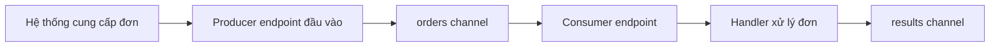

# Consumer endpoint và producer endpoint

Trong chương **Message endpoint** của module `SPRING_INTEGRATION_CORE`, việc phân biệt consumer endpoint với producer endpoint giúp trả lời ba câu hỏi khi thiết kế luồng: thông điệp đi vào từ đâu, ai nhận thông điệp từ channel và thành phần nào quản lý việc nhận/gửi đó. Đây là nền tảng để ghép Message, MessageChannel, endpoint, gateway và Java DSL thành một luồng tích hợp có thể vận hành và kiểm thử.

Bài học tập trung vào mô hình messaging thông thường với `SubscribableChannel`, `PollableChannel` và nguồn đầu vào. Các endpoint reactive có cơ chế subscription riêng, không được suy ra chỉ bằng quy tắc chọn endpoint trong bài này.

## 1. Mục tiêu học tập

Sau bài học, bạn có thể:

- Tách trách nhiệm của endpoint, handler và channel trong một luồng.
- Phân biệt `EventDrivenConsumer`, `PollingConsumer` và `SourcePollingChannelAdapter`.
- Nhận diện producer đầu vào theo cơ chế polling hoặc listener/callback.
- Đọc cấu hình DSL để xác định vị trí poller, ranh giới thread và đường đi của lỗi.
- Kiểm thử riêng việc gửi vào channel, xử lý tại consumer và phát thông điệp từ source.

## 2. Consumer và producer là vai trò đối với channel

Xét hệ thống nhận đơn hàng:



**Producer endpoint** đưa thông điệp vào channel. Nó có thể định kỳ lấy dữ liệu từ một source, hoặc nhận callback từ thư viện giao tiếp rồi chuyển dữ liệu thành message nội bộ.

**Consumer endpoint** nối một channel đầu vào với logic xử lý. Nó quản lý cách handler nhận message: đăng ký nhận sự kiện từ channel hoặc chủ động lấy message bằng poller. Đây là cách phân chia trách nhiệm được trình bày trong [Message Endpoints](https://docs.spring.io/spring-integration/reference/endpoint.html).

Hai vai trò này không đồng nghĩa với hai tập thành phần loại trừ nhau ở mọi mức nhìn. Một transformer tiêu thụ message từ channel A rồi tạo kết quả cho channel B. Nhìn theo dữ liệu, nó vừa nhận vừa phát; nhìn theo endpoint đầu vào, handler transformer vẫn được gắn với một consumer endpoint.

Tương tự, một outbound adapter gửi dữ liệu ra hệ thống ngoài nhưng thường là **consumer của channel nội bộ**. Từ “outbound” chỉ hướng qua biên của ứng dụng tích hợp, không có nghĩa đó là producer endpoint của channel nội bộ.

### 2.1. Endpoint khác handler như thế nào?

| Thành phần | Trách nhiệm | Ví dụ trong luồng đơn hàng |
| --- | --- | --- |
| `Message<?>` | Mang payload và metadata | Payload đơn hàng, header `orderId` |
| `MessageChannel` | Cung cấp điểm nối để trao đổi message | `DirectChannel`, `QueueChannel` |
| Handler | Thực hiện thao tác xử lý một message | Chuẩn hóa mã đơn, kiểm tra điều kiện, gọi dịch vụ |
| Consumer endpoint | Nối channel đầu vào với handler, quản lý subscription hoặc polling | `EventDrivenConsumer`, `PollingConsumer` |
| Producer endpoint đầu vào | Lấy/nhận dữ liệu nguồn rồi gửi message vào channel | `SourcePollingChannelAdapter`, adapter nhận callback |

Mô hình nên nhớ:

```text
Consumer: input channel --[endpoint quản lý nhận]--> handler
Producer: source/listener --[endpoint quản lý phát]--> output channel
```

Không nên đặt scheduler trong phương thức nghiệp vụ chỉ vì channel sử dụng cơ chế polling. Endpoint đảm nhận phần điều phối đó; handler tập trung vào dữ liệu và hành vi nghiệp vụ.

## 3. Hai consumer endpoint thường gặp

### 3.1. EventDrivenConsumer: channel chủ động chuyển message

`EventDrivenConsumer` kết nối một `SubscribableChannel` với `MessageHandler`. Khi endpoint chạy, handler được đăng ký vào channel; khi endpoint dừng, subscription được gỡ. Ở mức ý tưởng, thao tác nhận dựa trên `subscribe(handler)`, thay vì một vòng lặp gọi `receive()`. Xem [API các endpoint](https://docs.spring.io/spring-integration/docs/6.2.6/api/org/springframework/integration/endpoint/package-summary.html).

Các channel thường gặp thuộc nhóm này:

- `DirectChannel`: chuyển một message tới một subscriber được chọn.
- `ExecutorChannel`: sử dụng executor để giao việc xử lý.
- `PublishSubscribeChannel`: chuyển message tới các subscriber theo cơ chế phát tới nhiều nơi.

Điểm cần chú ý là **event-driven không tự động có nghĩa là bất đồng bộ**. Với `DirectChannel` thông thường, handler chạy trên thread gọi `send()`. Thay bằng `ExecutorChannel` sẽ tạo ranh giới giao việc sang executor. Với `PublishSubscribeChannel`, cần xem có cấu hình executor hay không. Chi tiết nằm trong [Message Channel Implementations](https://docs.spring.io/spring-integration/reference/6.5/channel/implementations.html).

Ví dụ suy luận:

```text
Thread HTTP -> DirectChannel -> handler kiểm tra đơn -> DirectChannel -> handler lưu đơn
```

Nếu các bước đều đồng bộ, thread HTTP còn bận cho tới khi chuỗi xử lý kết thúc. Lợi ích của message channel ở đây là tách cấu trúc các thành phần, dù chưa có sự tách thread.

### 3.2. PollingConsumer: endpoint chủ động lấy message

`PollingConsumer` nối một `PollableChannel`, chẳng hạn `QueueChannel`, với handler. Poller kích hoạt công việc nhận; endpoint gọi `receive()` trên channel và chuyển message nhận được tới handler.

```text
Producer -> QueueChannel
                 ^
                 | receive()
              PollingConsumer -> handler
```

Có hai cấu hình cần đọc riêng:

| Cấu hình | Câu hỏi nó trả lời |
| --- | --- |
| Trigger/fixed delay/cron | Khi nào kích hoạt một lượt polling? |
| `maxMessagesPerPoll` | Tối đa bao nhiêu message được xử lý trong một lượt? |
| `receiveTimeout` | Chờ bao lâu khi thao tác nhận trên channel chưa có message? |
| Task executor, nếu có | Công việc polling có được giao cho executor không? |

`maxMessagesPerPoll(5)` không tạo năm thread, cũng không có nghĩa channel chỉ giữ được năm message. Sức chứa queue và số lượng công việc đồng thời là các vấn đề khác. Phần [Poller](https://docs.spring.io/spring-integration/reference/6.5/polling-consumer.html) phân biệt polling channel với polling nguồn đầu vào.

Ví dụ: poller fixed delay 200 ms, tối đa 5 message/lượt. Với công việc polling đồng bộ, khoảng nghỉ bắt đầu sau khi lượt hiện tại hoàn tất. Nếu mỗi message cần 100 ms và queue luôn có dữ liệu, một lượt có thể mất khoảng 500 ms trước khi đến khoảng nghỉ. Không thể tính throughput chỉ bằng `5 / 0,2` mà bỏ qua thời gian xử lý.

### 3.3. Chọn consumer theo channel đầu vào

| Đầu vào trong mô hình thông thường | Endpoint nhận message | Poller tại bước nhận |
| --- | --- | --- |
| `DirectChannel` | `EventDrivenConsumer` | Không |
| `ExecutorChannel` | `EventDrivenConsumer` | Không |
| `PublishSubscribeChannel` | `EventDrivenConsumer` cho từng handler đăng ký | Không |
| `QueueChannel` | `PollingConsumer` | Có, cục bộ hoặc lấy cấu hình poller mặc định |

Chọn handler theo chức năng nghiệp vụ và chọn consumer theo cách channel cung cấp message. Đổi `.transform(...)` thành `.handle(...)` không tự biến polling thành event-driven nếu channel đầu vào vẫn là queue.

## 4. Producer endpoint đầu vào

### 4.1. Nguồn được polling: SourcePollingChannelAdapter

Một source có thể là phương thức đọc bản ghi chờ xử lý, bộ đọc file hoặc một `Supplier` tạo dữ liệu. Với kiểu nguồn này, `SourcePollingChannelAdapter` quản lý việc gọi source và gửi message tới output channel.

```text
Scheduler -> SourcePollingChannelAdapter -> source.receive()
                            |
                            +-> outputChannel.send(message)
```

`MessageSource<T>` cung cấp thao tác nhận một `Message<T>`; cấu hình DSL `fromSupplier(...)` cho phép cung cấp payload ở mức tiện dụng hơn. Nếu một lần lấy không có dữ liệu và trả về `null`, adapter không phát message cho lần đó. Xem [Channel Adapter](https://docs.spring.io/spring-integration/reference/6.5/channel-adapter.html).

Phân biệt hai loại polling:

| Endpoint | Đối tượng được polling | Sau khi nhận được dữ liệu |
| --- | --- | --- |
| `PollingConsumer` | Channel nội bộ có khả năng `receive()` | Gọi handler |
| `SourcePollingChannelAdapter` | Nguồn dữ liệu đầu vào | Gửi message vào output channel |

Vì vậy, hai endpoint có thể cùng có poller nhưng giữ hai vị trí khác nhau trong topology. API của [SourcePollingChannelAdapter](https://docs.spring.io/spring-integration/api/org/springframework/integration/endpoint/SourcePollingChannelAdapter.html) thể hiện rõ cả source và output channel.

### 4.2. Nguồn đẩy dữ liệu bằng listener/callback

Một số giao thức hoặc thư viện cung cấp callback khi dữ liệu tới. Adapter có thể đăng ký listener, nhận sự kiện, xây dựng message rồi gửi vào channel nội bộ.

```text
Sự kiện giao thức -> callback của adapter -> Message<?> -> output channel
```

`MessageProducerSupport` là lớp hỗ trợ cho nhiều producer endpoint loại này: cung cấp cấu hình output channel và thao tác gửi message. Lớp hỗ trợ không tự cung cấp kết nối giao thức; adapter cụ thể vẫn phải quản lý listener, kết nối và vòng đời thích hợp. Xem [MessageProducerSupport API](https://docs.spring.io/spring-integration/api/org/springframework/integration/endpoint/MessageProducerSupport.html).

Không cần thêm poller chỉ vì dữ liệu đi vào ứng dụng. Trước hết hãy xác định thư viện nguồn có push/callback hay cần chủ động hỏi dữ liệu.

### 4.3. Một lời gọi send không nhất thiết tạo producer endpoint

Đoạn mã ứng dụng sau đóng vai trò người gửi message:

```java
orders.send(MessageBuilder.withPayload("ORDER-42").build());
```

Tuy nhiên, chỉ gọi `send()` không có nghĩa Spring đã tạo một bean producer endpoint có vòng đời listener/poller riêng. Một gateway cũng cung cấp lối vào messaging cho mã Java; cần đọc topology thực tế thay vì đồng nhất mọi điểm gửi với `SourcePollingChannelAdapter`.

Trong DSL, flow có thể bắt đầu từ một interface gateway. Đây là một cách đưa lời gọi Java vào flow, được mô tả trong [IntegrationFlow as a Gateway](https://docs.spring.io/spring-integration/reference/6.5/dsl/integration-flow-as-gateway.html).

## 5. Thực hành với ba flow Java DSL

Ví dụ dưới đây dùng API của Spring Integration 6.x, Java 17 trở lên. Cần `spring-integration-core` cùng các dependency Spring tương thích; phần kiểm thử cần JUnit Jupiter. Nếu dùng Spring Boot, để bộ quản lý dependency của Boot chọn các phiên bản Spring đồng bộ.

Ba flow độc lập giúp quan sát từng cơ chế mà không cần broker hoặc cơ sở dữ liệu:

1. Gửi đơn vào `DirectChannel`, chuẩn hóa mã đơn rồi đưa kết quả vào queue.
2. Gửi đơn vào `QueueChannel`, để polling consumer xử lý.
3. Đặt đơn vào nguồn giả lập, để producer đầu vào polling và phát tới queue.

Các result queue là điểm kết thúc để kiểm thử gọi `receive()`, không có consumer endpoint đăng ký tiếp trên chúng.

### 5.1. Cấu hình đầy đủ

```java
package example.integration;

import java.time.Duration;
import java.util.Locale;
import java.util.Queue;
import java.util.concurrent.ConcurrentLinkedQueue;

import org.springframework.context.annotation.Bean;
import org.springframework.context.annotation.Configuration;
import org.springframework.integration.channel.DirectChannel;
import org.springframework.integration.channel.QueueChannel;
import org.springframework.integration.config.EnableIntegration;
import org.springframework.integration.dsl.IntegrationFlow;
import org.springframework.integration.dsl.Pollers;

@Configuration
@EnableIntegration
public class EndpointRolesConfig {

    public record Order(String id) {
    }

    // Giả lập nguồn bên ngoài; không phải MessageChannel của Spring.
    public static class PendingOrderSource {
        private final Queue<Order> pending = new ConcurrentLinkedQueue<>();

        public void offer(Order order) {
            pending.add(order);
        }

        public Order next() {
            return pending.poll();
        }
    }

    @Bean
    public DirectChannel directOrders() {
        return new DirectChannel();
    }

    @Bean
    public QueueChannel queuedOrders() {
        return new QueueChannel(20);
    }

    @Bean
    public QueueChannel normalizedOrders() {
        return new QueueChannel(20);
    }

    @Bean
    public QueueChannel queuedResults() {
        return new QueueChannel(20);
    }

    @Bean
    public QueueChannel sourceResults() {
        return new QueueChannel(20);
    }

    @Bean
    public PendingOrderSource pendingOrderSource() {
        return new PendingOrderSource();
    }

    @Bean
    public IntegrationFlow directOrderFlow() {
        return IntegrationFlow.from(directOrders())
                .transform(Order.class,
                        order -> order.id().trim().toUpperCase(Locale.ROOT),
                        endpoint -> endpoint.id("normalizeOrderEndpoint"))
                .channel(normalizedOrders())
                .get();
    }

    @Bean
    public IntegrationFlow queuedOrderFlow() {
        return IntegrationFlow.from(queuedOrders())
                .transform(Order.class,
                        order -> "ACCEPTED:" + order.id(),
                        endpoint -> endpoint
                                .id("queuedOrderEndpoint")
                                .poller(Pollers.fixedDelay(Duration.ofMillis(100))
                                        .maxMessagesPerPoll(5)
                                        .receiveTimeout(0)))
                .channel(queuedResults())
                .get();
    }

    @Bean
    public IntegrationFlow sourceOrderFlow() {
        return IntegrationFlow.fromSupplier(
                        () -> pendingOrderSource().next(),
                        endpoint -> endpoint
                                .id("orderSourceEndpoint")
                                .autoStartup(false)
                                .poller(Pollers.fixedDelay(Duration.ofMillis(100))
                                        .maxMessagesPerPoll(1)))
                .channel(sourceResults())
                .get();
    }
}
```

DSL xây dựng và đăng ký các thành phần của flow vào application context; chuỗi builder không phải một vòng lặp thực thi do người dùng tự viết. Xem [Java DSL](https://docs.spring.io/spring-integration/reference/6.5/dsl.html).

### 5.2. Đọc cấu hình theo endpoint

| ID đã đặt | Loại endpoint dự kiến | Lý do |
| --- | --- | --- |
| `normalizeOrderEndpoint` | `EventDrivenConsumer` | Transformer nhận từ `DirectChannel` |
| `queuedOrderEndpoint` | `PollingConsumer` | Transformer nhận từ `QueueChannel` và có poller |
| `orderSourceEndpoint` | `SourcePollingChannelAdapter` | Flow bắt đầu từ supplier được polling |

Flow thứ nhất cho thấy consumer endpoint vẫn có thể chứa handler tạo đầu ra. Kết quả String đi tới `normalizedOrders`; điều đó không đổi cơ chế nhận đầu vào của endpoint transformer.

Flow thứ hai đặt poller tại endpoint transformer, ngay sau `queuedOrders`. Đặt poller ở một producer phía trước sẽ không thay thế poller cần thiết để đọc queue này.

Flow thứ ba chủ động dùng `autoStartup(false)` để kiểm thử nạp dữ liệu nguồn trước khi bật adapter. Trong ứng dụng thực, có thể cho nguồn tự khởi động nếu đó là hành vi mong muốn. Việc trả `null` khi nguồn hết dữ liệu tránh tạo message giả hoặc phát lại cùng một đơn ở mỗi chu kỳ.

Trong cấu hình annotation tương đương, `@ServiceActivator` gắn phương thức xử lý với input channel; `@InboundChannelAdapter` dùng phương thức nguồn để đưa dữ liệu vào channel. Các annotation thực hiện hai vai trò khác nhau, theo [Annotation Support](https://docs.spring.io/spring-integration/reference/6.5/configuration/annotations.html).

## 6. Kiểm thử hành vi của endpoint

Không chỉ kiểm tra giá trị biến đổi; cần kiểm tra đúng điểm vào và điểm ra của từng flow. Các bài kiểm thử sau dùng cùng package với cấu hình ở trên, mỗi test tạo một context riêng và đóng context sau khi hoàn tất.

```java
package example.integration;

import org.junit.jupiter.api.Test;
import org.springframework.context.annotation.AnnotationConfigApplicationContext;
import org.springframework.integration.channel.DirectChannel;
import org.springframework.integration.channel.QueueChannel;
import org.springframework.integration.endpoint.EventDrivenConsumer;
import org.springframework.integration.endpoint.PollingConsumer;
import org.springframework.integration.endpoint.SourcePollingChannelAdapter;
import org.springframework.messaging.Message;
import org.springframework.messaging.support.MessageBuilder;

import static org.junit.jupiter.api.Assertions.*;

class EndpointRolesTest {

    @Test
    void directChannelUsesEventDrivenConsumer() {
        try (var context = new AnnotationConfigApplicationContext(
                EndpointRolesConfig.class)) {
            var endpoint = context.getBean(
                    "normalizeOrderEndpoint", EventDrivenConsumer.class);
            assertTrue(endpoint.isRunning());

            var input = context.getBean("directOrders", DirectChannel.class);
            var output = context.getBean("normalizedOrders", QueueChannel.class);

            assertTrue(input.send(MessageBuilder.withPayload(
                    new EndpointRolesConfig.Order("  order-42  ")).build(), 100));

            // Flow đồng bộ đã đưa kết quả vào queue trước khi send() trả về.
            Message<?> result = output.receive(0);
            assertNotNull(result);
            assertEquals("ORDER-42", result.getPayload());
        }
    }

    @Test
    void queueChannelUsesPollingConsumer() {
        try (var context = new AnnotationConfigApplicationContext(
                EndpointRolesConfig.class)) {
            var endpoint = context.getBean(
                    "queuedOrderEndpoint", PollingConsumer.class);
            assertTrue(endpoint.isRunning());

            var input = context.getBean("queuedOrders", QueueChannel.class);
            var output = context.getBean("queuedResults", QueueChannel.class);

            assertTrue(input.send(MessageBuilder.withPayload(
                    new EndpointRolesConfig.Order("order-43")).build(), 100));

            // Cho poller thời gian xử lý, nhưng luôn giới hạn thời gian chờ.
            Message<?> result = output.receive(3000);
            assertNotNull(result);
            assertEquals("ACCEPTED:order-43", result.getPayload());
        }
    }

    @Test
    void sourceAdapterProducesMessageAfterStart() {
        try (var context = new AnnotationConfigApplicationContext(
                EndpointRolesConfig.class)) {
            var source = context.getBean(
                    EndpointRolesConfig.PendingOrderSource.class);
            var endpoint = context.getBean(
                    "orderSourceEndpoint", SourcePollingChannelAdapter.class);
            var output = context.getBean("sourceResults", QueueChannel.class);

            assertFalse(endpoint.isRunning());
            source.offer(new EndpointRolesConfig.Order("order-44"));
            assertNull(output.receive(0));

            endpoint.start();
            try {
                Message<?> result = output.receive(3000);
                assertNotNull(result);
                assertEquals(new EndpointRolesConfig.Order("order-44"),
                        result.getPayload());
            }
            finally {
                endpoint.stop();
            }
        }
    }
}
```

Các test kiểm tra cả loại endpoint và hành vi observable của flow. Không dùng `Thread.sleep()` để đoán khi nào poller chạy; `receive(timeout)` chờ kết quả ở đúng ranh giới thông điệp. Mốc 3 giây là giới hạn của ví dụ, có thể điều chỉnh theo môi trường chạy kiểm thử.

Chưa thể suy ra khả năng chịu lỗi từ ba test này. Muốn kiểm chứng xử lý trùng hoặc khôi phục sau sự cố, cần kịch bản riêng với nguồn, message store và chính sách retry thực tế.

## 7. Thread, lỗi và ý nghĩa của việc gửi thành công

### 7.1. Ranh giới thread quyết định nơi bắt lỗi

Với chuỗi đồng bộ qua `DirectChannel`, exception của handler có thể truyền về bên gọi `send()`. Với polling consumer, handler thường chạy trong công việc do scheduler hoặc executor thực thi; bên gửi vào queue không còn giữ cùng call stack. Cơ chế lỗi tổng quát này được trình bày trong [Error Handling](https://docs.spring.io/spring-integration/reference/6.5/error-handling.html).

Trong ví dụ, nếu mã đơn null khiến transformer của `directOrderFlow` ném lỗi, bên gọi trực tiếp có thể nhận exception. Nếu transformer của flow queue ném lỗi sau khi message đã vào queue, một `try/catch` quanh thao tác enqueue không bắt được lỗi xử lý xảy ra sau đó.

Đối với lỗi trong polling task, framework có thể dùng error handler để tạo `ErrorMessage` và chuyển tới error channel. Cấu hình cụ thể quyết định đường đi: header `errorChannel` của message hoặc channel lỗi mặc định khi dùng cơ chế error handling tương ứng. Adapter giao thức có thể có thêm cơ chế lỗi riêng. Không suy luận rằng mọi lỗi ở mọi producer tự động quay về người gửi ban đầu.

### 7.2. send trả về true chưa đủ để kết luận nghiệp vụ thành công

Trong flow dùng queue, `send()` thành công thể hiện message được channel chấp nhận theo cơ chế của nó. Nó không phải xác nhận rằng consumer đã ghi dữ liệu ra hệ thống ngoài.

Nếu ứng dụng cần biết đơn đã hoàn tất, thiết kế thêm kết quả nghiệp vụ rõ ràng: reply qua gateway, sự kiện `OrderAccepted`/`OrderRejected`, hoặc bản ghi trạng thái có correlation ID. Tránh dùng kết quả enqueue làm phản hồi “đơn đã được xử lý xong”.

### 7.3. Queue và poller không tự cung cấp đảm bảo giao nhận

`QueueChannel` thông thường lưu trong bộ nhớ. Nó không tự bảo toàn message khi tiến trình dừng. Sau khi consumer lấy message khỏi queue rồi handler thất bại, việc phục hồi phụ thuộc vào message store, transaction, nguồn và chính sách retry được thiết kế.

Nguồn giả lập trong bài dùng thao tác `pending.poll()` để xóa đơn khỏi nguồn. Nếu phát sang output channel thất bại sau thao tác này, ví dụ không có cơ chế đưa đơn trở lại. Vì vậy, đây là mô hình học vai trò endpoint, chưa phải thiết kế giao nhận bền vững cho dữ liệu đơn hàng.

Một thiết kế thực tế cần xác định chính xác thời điểm acknowledge/xóa nguồn, mức bảo toàn dữ liệu và cách tránh tác dụng phụ trùng. Chỉ thêm poller không giải quyết những quyết định đó.

## 8. Các lỗi thiết kế thường gặp

| Hiện tượng hoặc cách hiểu | Nguyên nhân cần kiểm tra | Hướng xử lý |
| --- | --- | --- |
| Message nằm trong queue nhưng handler không chạy | Endpoint đọc queue chưa chạy hoặc thiếu cấu hình polling cần thiết | Kiểm tra endpoint, lifecycle và poller tại consumer |
| Gửi vào `DirectChannel` bị lỗi không có subscriber | Consumer chưa được đăng ký hoặc đã dừng | Kiểm tra flow và trạng thái endpoint trước khi gửi |
| Handler chặn thread HTTP lâu | Flow đi qua `DirectChannel` và thực hiện tác vụ chậm | Đánh giá ranh giới executor/queue cùng yêu cầu phản hồi |
| Tăng `maxMessagesPerPoll` nhưng không tăng số thread | Tham số đang giới hạn số message trong một lượt | Thiết kế concurrency riêng và kiểm tra thứ tự xử lý |
| Inbound adapter phát lặp lại cùng một bản ghi | Source không đánh dấu đã xử lý, supplier luôn trả cùng dữ liệu | Thiết kế trạng thái nguồn và xử lý idempotent |
| Outbound adapter bị gọi là producer của channel đầu vào | Nhầm hướng qua biên hệ thống với vai trò đối với channel | Xác định rõ channel mà thành phần đang nhận từ đó |
| Bắt lỗi quanh enqueue nhưng không thấy lỗi handler | Handler chạy sau đó trên thread khác | Theo dõi error channel và kết quả nghiệp vụ |
| Dừng consumer nhưng producer vẫn đưa message vào queue | Lifecycle các thành phần không đồng nghĩa với nhau | Lập thứ tự dừng nguồn, xử lý backlog và giới hạn thời gian chờ |

Một số lỗi cấu hình có thể khiến context không khởi động thay vì chỉ làm message nằm lại trong queue. Cần phân biệt lỗi lúc khởi tạo với endpoint hợp lệ nhưng đang dừng khi chẩn đoán.

## 9. Áp dụng vào các mẫu tích hợp khác

Transformer, filter, router và aggregator có logic riêng nhưng đều cần được nối với cơ chế nhận message phù hợp. Trong topology thông thường, channel đầu vào quyết định consumer dùng subscription hay polling; chức năng của handler quyết định dữ liệu đi tiếp như thế nào.

Ví dụ tự thiết kế:

```text
Nguồn đơn được polling
    -> orders: DirectChannel
    -> filter kiểm tra mã đơn
    -> transformer chuẩn hóa
    -> router theo khu vực
    -> các channel giao cho dịch vụ xử lý
```

Producer đầu vào là adapter polling nguồn. Filter, transformer và router là các bước tiêu thụ message; nếu các đoạn nối tương ứng là `DirectChannel`, chúng được kích hoạt theo cơ chế event-driven trong cùng chuỗi gọi đồng bộ.

Nếu cần gom các phản hồi thành một kết quả bằng aggregator, ngoài vai trò consumer của nó còn phải thiết kế correlation key, release strategy và lưu trạng thái nhóm. Không thể dùng nhận định “có poller nên sẽ gom đủ” để thay thế các quy tắc của aggregator.

Gateway giải quyết ranh giới giữa lời gọi Java và messaging; endpoint giải quyết cách các thành phần hoạt động tại channel hoặc nguồn. Khi xem một flow lớn, nên đánh dấu riêng điểm vào từ gateway, producer giao tiếp bên ngoài và từng consumer trên channel nội bộ.

## 10. Bài tập vận dụng

1. Thay `directOrders` bằng `QueueChannel`. Xác định endpoint nào phải có poller và thay đổi nào cần thực hiện trong test đang dùng `receive(0)`.
2. Thêm một handler cố ý ném lỗi vào flow queue. Thiết kế nơi thu lỗi và giải thích vì sao bên enqueue không bắt được lỗi ấy bằng cùng call stack.
3. Đưa output của source vào `queuedOrders` thay cho `sourceResults`. Vẽ hai vị trí polling khác nhau và giải thích mỗi poller đang đọc đối tượng nào.
4. Cho nguồn giả lập trả lại cùng một đơn ở nhiều chu kỳ. Đề xuất khóa idempotency phù hợp và thời điểm ghi nhận đã xử lý.
5. Thêm gateway nhận yêu cầu chuẩn hóa mã đơn. Xác định lời gọi cần kết quả đồng bộ và vị trí nào sẽ làm thay đổi giả định về thread.

Tiêu chí tự đánh giá: với mỗi thành phần trên sơ đồ, bạn chỉ ra được nó nhận từ đâu, phát đi đâu, được kích hoạt bằng cơ chế nào và lỗi được quan sát ở đâu. Nếu trả lời đủ bốn điểm này, bạn đã có cơ sở để ghép endpoint thành luồng tích hợp có thể kiểm thử và vận hành.