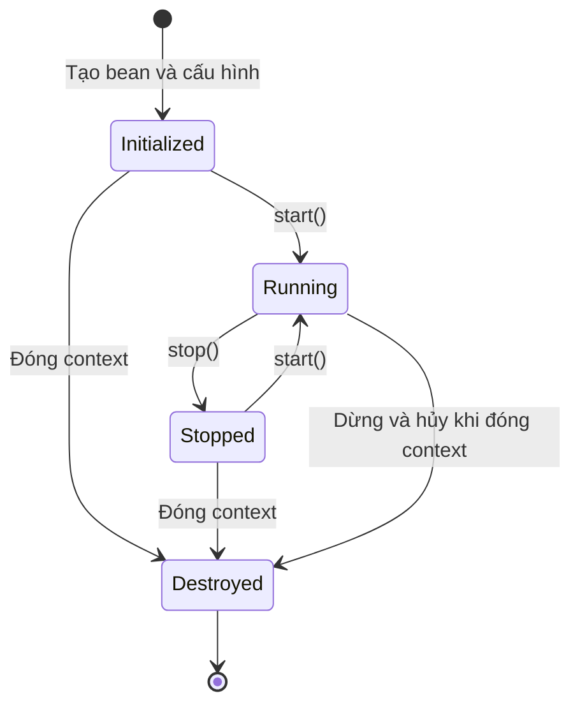

# Endpoint lifecycle — Vòng đời của message endpoint

## 1. Mục tiêu và tình huống sử dụng

Trong module `SPRING_INTEGRATION_CORE`, message endpoint là thành phần nối hoạt động tiếp nhận thông điệp với logic xử lý trong một integration flow. Bài này thuộc chương **Message endpoint**, tập trung vào cách khởi động, dừng và phối hợp vòng đời endpoint khi xây dựng luồng bằng Java DSL.

Sau bài học, bạn có thể:

- Phân biệt bean đã được tạo với endpoint đang chạy.
- Điều khiển một endpoint qua `SmartLifecycle` và tên bean ổn định.
- Dùng `autoStartup` và `phase` để chuẩn bị thứ tự vận hành.
- Dự đoán ảnh hưởng của `stop()` đối với consumer dùng `DirectChannel` hoặc `QueueChannel`.
- Thiết kế thao tác bảo trì có kiểm soát và chọn các quan sát cần thiết khi kiểm thử.

Giả sử một hệ thống nhận đơn hàng phải tạm dừng bước ghi dữ liệu trong lúc bảo trì kho lưu trữ. Nếu chỉ nhìn thấy `OrderService` đã được Spring khởi tạo, ta chưa biết endpoint gọi dịch vụ đó đã sẵn sàng nhận thông điệp hay chưa. Ngược lại, dừng endpoint cũng chưa chứng minh rằng mọi đơn hàng đã được xử lý xong.

## 2. Endpoint, handler và channel có vai trò khác nhau

Một consumer endpoint có thể được hình dung như sau:

```text
MessageChannel --> endpoint quản lý việc nhận --> MessageHandler --> nghiệp vụ
```

Handler thực hiện công việc như transformer, filter, router hoặc service activator. Endpoint quản lý cơ chế gắn handler vào nguồn đầu vào, chẳng hạn đăng ký subscriber hoặc chạy poller. `EventDrivenConsumer` là endpoint kết nối một `MessageHandler` với `SubscribableChannel`. Xem [API EventDrivenConsumer](https://docs.spring.io/spring-integration/docs/current/api/org/springframework/integration/endpoint/EventDrivenConsumer.html).

| Thành phần trong ví dụ đơn hàng | Trách nhiệm | Có thể suy ra gì từ trạng thái của nó? |
| --- | --- | --- |
| `orders.input` | Truyền thông điệp vào bước xử lý | Channel tồn tại chưa chứng minh có consumer đang nhận |
| `orders.endpoint` | Kích hoạt hoặc ngừng cơ chế nhận cho handler | Trạng thái lifecycle mô tả endpoint này |
| `OrderService.process()` | Xử lý nghiệp vụ đơn hàng | Bean dịch vụ tồn tại chưa chứng minh endpoint đang chạy |
| `orderFlow` | Khai báo cấu trúc integration flow | Tên flow không mặc nhiên là tên endpoint cần điều khiển |

Trong Java DSL, đặt `id()` ở cấu hình endpoint giúp tránh phụ thuộc tên tự sinh. Cấu hình endpoint và cấu hình handler có thể xuất hiện trong cùng một lời gọi DSL, nhưng chúng vẫn đại diện cho các đối tượng có trách nhiệm riêng. Xem [DSL and Endpoint Configuration](https://docs.spring.io/spring-integration/reference/dsl/java-endpoints.html).

Vì vậy, thao tác bảo trì bước xử lý đơn hàng nên nhắm vào `orders.endpoint`. Gọi trực tiếp `OrderService.process()` bỏ qua cơ chế tiếp nhận mà endpoint quản lý, nên không phù hợp để chứng minh endpoint đã dừng nhận.

## 3. Các giai đoạn của vòng đời

Nhiều endpoint Spring Integration kế thừa `AbstractEndpoint`, có hỗ trợ quản lý vòng đời, khởi động tự động và hủy bean. Mô hình khái niệm sau giúp phân biệt các giai đoạn; đây không phải một enum trạng thái của framework:



Khởi tạo chuẩn bị đối tượng cùng các phụ thuộc. `start()` kích hoạt cơ chế vận hành của endpoint; `stop()` ngừng cơ chế đó nhưng vẫn giữ bean để có thể khởi động lại. Đóng application context còn dẫn tới hủy bean và thu hồi tài nguyên. Không giữ một endpoint từ context đã đóng rồi gọi `start()` để tái sử dụng nó. Các phương thức nền tảng được mô tả tại [API AbstractEndpoint](https://docs.spring.io/spring-integration/docs/current/api/org/springframework/integration/endpoint/AbstractEndpoint.html).

Một điểm dễ nhầm là `autoStartup(false)` không tương đương trì hoãn tạo bean. Endpoint và phụ thuộc vẫn có thể được khởi tạo trong quá trình chuẩn bị context, trong khi cơ chế nhận thông điệp chưa được bật.

## 4. Hợp đồng SmartLifecycle

`SmartLifecycle` mở rộng `Lifecycle` để hỗ trợ khởi động khi context refresh, thứ tự theo phase và callback khi dừng. Các phương thức cần hiểu gồm:

| Phương thức | Cách đọc trong vận hành |
| --- | --- |
| `start()` | Yêu cầu component bắt đầu hoạt động |
| `stop()` | Yêu cầu component dừng theo cơ chế của implementation |
| `isRunning()` | Đọc trạng thái chạy do component công bố |
| `isAutoStartup()` | Xác định có tự khởi động lúc context refresh hay không |
| `getPhase()` | Xác định nhóm thứ tự khởi động và dừng |
| `stop(Runnable callback)` | Thông báo hoàn tất dừng cho lifecycle processor |

Spring dùng biến thể có callback trong quá trình điều phối dừng các `SmartLifecycle` component. Với implementation tự viết, callback phải được gọi sau khi component thực sự hoàn tất thao tác dừng theo hợp đồng của nó. Xem [API SmartLifecycle](https://docs.spring.io/spring-framework/docs/6.2.x/javadoc-api/org/springframework/context/SmartLifecycle.html).

`isRunning()` không phải phép đo sức khỏe nghiệp vụ. Ví dụ, endpoint có thể báo đang chạy nhưng dịch vụ thanh toán đang timeout. Endpoint đã dừng cũng không tự chứng minh rằng một yêu cầu đang chạy trên thread khác đã hoàn tất. Cần quan sát riêng lỗi, số tác vụ đang xử lý và trạng thái tài nguyên phụ thuộc.

## 5. Ví dụ Java DSL: khởi động và dừng một endpoint

Ví dụ sau dùng Java 17 và API Java DSL của Spring Integration 6.x. Dự án cần có `spring-integration-core` cùng các phụ thuộc Spring tương thích; nếu dùng Spring Boot, nên để dependency management của Boot quản lý phiên bản. Đây là ví dụ standalone, không cần tạo ứng dụng Boot.

Lưu nội dung Java dưới tên `EndpointLifecycleDemo.java` trong một dự án đã có các phụ thuộc đó:

```java
import org.springframework.context.SmartLifecycle;
import org.springframework.context.annotation.AnnotationConfigApplicationContext;
import org.springframework.context.annotation.Bean;
import org.springframework.context.annotation.Configuration;
import org.springframework.integration.channel.DirectChannel;
import org.springframework.integration.config.EnableIntegration;
import org.springframework.integration.dsl.IntegrationFlow;
import org.springframework.messaging.MessageChannel;
import org.springframework.messaging.MessageDeliveryException;
import org.springframework.messaging.support.MessageBuilder;

@Configuration
@EnableIntegration
public class EndpointLifecycleDemo {

    public record Order(String id) {
    }

    public static class OrderService {
        public void process(Order order) {
            System.out.println("Processed: " + order.id());
        }
    }

    @Bean(name = "orders.input")
    public DirectChannel ordersInput() {
        return new DirectChannel();
    }

    @Bean
    public OrderService orderService() {
        return new OrderService();
    }

    @Bean
    public IntegrationFlow orderFlow(OrderService orderService) {
        return IntegrationFlow.from("orders.input")
                .handle(orderService, "process", endpoint -> endpoint
                        .id("orders.endpoint")
                        .autoStartup(false)
                        .phase(100))
                .get();
    }

    public static void main(String[] args) {
        try (var context = new AnnotationConfigApplicationContext(
                EndpointLifecycleDemo.class)) {

            SmartLifecycle endpoint = context.getBean(
                    "orders.endpoint", SmartLifecycle.class);
            MessageChannel input = context.getBean(
                    "orders.input", MessageChannel.class);

            System.out.println("Initially running: " + endpoint.isRunning());

            endpoint.start();
            input.send(MessageBuilder.withPayload(new Order("ORD-001")).build());

            endpoint.stop();
            System.out.println("After stop: " + endpoint.isRunning());

            try {
                input.send(MessageBuilder.withPayload(new Order("ORD-002")).build());
                throw new IllegalStateException("Expected delivery to fail");
            }
            catch (MessageDeliveryException expected) {
                System.out.println("No active consumer for ORD-002");
            }

            endpoint.start();
            input.send(MessageBuilder.withPayload(new Order("ORD-003")).build());
        }
    }
}
```

Ý nghĩa cấu hình:

- `orders.input` là `DirectChannel` và chỉ có consumer được khai báo trong ví dụ.
- `orders.endpoint` là ID đặt rõ cho endpoint của bước `.handle(...)`.
- `autoStartup(false)` giữ endpoint chưa chạy sau context refresh; lệnh `start()` đầu tiên bật nó lên.
- `phase(100)` được chọn minh họa. Khi chỉ có một endpoint cần điều phối, con số này không tạo ra lợi ích thứ tự đáng kể.
- `process()` trả về `void`, nên bước xử lý kết thúc tại đây, không cần một output channel để nhận reply.

Các dòng nghiệp vụ dự kiến, ngoài log của framework:

```text
Initially running: false
Processed: ORD-001
After stop: false
No active consumer for ORD-002
Processed: ORD-003
```

`ORD-002` không được đệm lại để tự xử lý khi endpoint chạy trở lại. Ứng dụng gửi phải quyết định lưu, retry hay trả lỗi. Ví dụ cố ý xử lý xong `ORD-001` rồi mới gọi `stop()`; nó không mô phỏng tình huống gửi và dừng đồng thời.

## 6. Khi dừng endpoint, thông điệp đi đâu?

### 6.1. Consumer dùng DirectChannel

Trong đường đi thông thường của ví dụ, caller gửi và handler xử lý trên cùng thread. Endpoint event-driven đăng ký handler khi chạy và hủy đăng ký khi dừng. Nếu endpoint đó là subscriber duy nhất, lần gửi sau khi dừng thất bại do không có subscriber.

Nếu có consumer khác đang đăng ký vào cùng `DirectChannel`, dừng một endpoint không đồng nghĩa toàn bộ channel ngừng chuyển thông điệp. Đồng thời, hủy đăng ký không thu hồi được một lần gọi handler mà thread khác đã bắt đầu trước đó. Cần phối hợp phía gửi nếu muốn tạo ranh giới bảo trì rõ ràng.

### 6.2. Consumer dùng QueueChannel

Với một consumer đọc từ `QueueChannel`, endpoint thường là `PollingConsumer`. Poller định kỳ lấy thông điệp rồi chuyển cho handler; `AbstractPollingEndpoint` quản lý cơ chế polling. Xem [API AbstractPollingEndpoint](https://docs.spring.io/spring-integration/docs/current/api/org/springframework/integration/endpoint/AbstractPollingEndpoint.html).

Một cấu hình thay thế cho flow ở trên là:

```java
// Bổ sung import:
// import java.time.Duration;
// import org.springframework.integration.channel.QueueChannel;
// import org.springframework.integration.dsl.Pollers;

@Bean(name = "orders.queue")
public QueueChannel ordersQueue() {
    return new QueueChannel(100);
}

@Bean
public IntegrationFlow queuedOrderFlow(OrderService orderService) {
    return IntegrationFlow.from("orders.queue")
            .handle(orderService, "process", endpoint -> endpoint
                    .id("orders.queue.endpoint")
                    .autoStartup(false)
                    .poller(Pollers.fixedDelay(Duration.ofMillis(200))
                            .maxMessagesPerPoll(5)))
            .get();
}
```

Đây là biến thể dùng hàng đợi, có tên endpoint riêng. Dừng endpoint ngừng cơ chế polling của nó; thông điệp đang nằm trong queue không tự biến mất. Sender vẫn có thể gửi khi queue còn chỗ. Khi đầy, hành vi phụ thuộc timeout gửi; có thể dùng `send(message, 0)` để tránh chờ chỗ trống và kiểm tra kết quả boolean. `QueueChannel(100)` thông thường lưu trong bộ nhớ, không tự bảo đảm giữ dữ liệu khi tiến trình chết. Xem [Message Channel Implementations](https://docs.spring.io/spring-integration/reference/channel/implementations.html).

Một tác vụ polling đã bắt đầu có thể đang thực thi handler tại thời điểm dừng. Không coi `stop()` là cam kết hủy tức thời toàn bộ công việc đã nhận, và không coi `maxMessagesPerPoll(5)` là giới hạn toàn bộ backlog hay số thread.

| Điều quan sát | DirectChannel trong ví dụ | QueueChannel trong biến thể |
| --- | --- | --- |
| Consumer đã dừng, gửi thêm | Thất bại nếu không còn subscriber | Có thể vào queue nếu còn chỗ |
| Thông điệp chờ sẵn | Channel không có bộ đệm chờ consumer | Có thể còn trong queue |
| Consumer khởi động lại | Nhận những lần gửi mới | Có thể tiếp tục lấy backlog |
| Cần theo dõi khi bảo trì | Caller đang gọi handler, lỗi gửi | Backlog, tác vụ đang xử lý, lỗi poller |

Đây là so sánh hai cấu hình cụ thể. Với `PublishSubscribeChannel`, executor hoặc adapter giao thức ngoài, cần đọc chính sách tương ứng thay vì suy rộng hành vi của `DirectChannel`.

## 7. autoStartup và phase giải quyết những việc nào?

### 7.1. autoStartup: chọn thời điểm bắt đầu

`autoStartup(false)` hữu ích khi phải kiểm tra một điều kiện rồi mới mở tiếp nhận, chẳng hạn xác minh migration hoàn tất. Nó kiểm soát khởi động tự động khi refresh, không tạo cơ chế khóa ngăn mọi lời gọi `start()` về sau. Theo hợp đồng `AbstractEndpoint`, mặc định endpoint được tự khởi động; nên cấu hình rõ khi có yêu cầu vận hành đặc biệt.

Không xem `@Lazy` là thay thế tương đương. Với `SmartLifecycle`, cơ chế khởi động tự động khiến lazy initialization có tác dụng hạn chế, như mô tả trong [API SmartLifecycle](https://docs.spring.io/spring-framework/docs/6.2.x/javadoc-api/org/springframework/context/SmartLifecycle.html).

### 7.2. phase: chuẩn bị thứ tự lifecycle

Khi container điều phối các component, phase nhỏ khởi động trước và dừng sau. Phase lớn khởi động sau và dừng trước. Các component cùng phase không có thứ tự tương đối được bảo đảm; quan hệ `depends-on` tường minh được ưu tiên so với phase. Quy tắc này thuộc [hợp đồng SmartLifecycle](https://docs.spring.io/spring-framework/docs/6.2.x/javadoc-api/org/springframework/context/SmartLifecycle.html).

Ví dụ thiết kế thứ tự cho một flow có hai đầu:

```text
Khởi động: consumer xử lý (phase 100) --> nguồn nhận bên ngoài (phase 200)
Dừng:      nguồn nhận bên ngoài (phase 200) --> consumer xử lý (phase 100)
```

Mục tiêu là chuẩn bị nơi nhận trước khi mở nguồn, rồi đóng nguồn trước khi dừng nơi nhận. Những số này là lựa chọn thiết kế, không phải giá trị mặc định của mọi loại endpoint.

Phase không sắp xếp từng thông điệp và không tự chờ queue rỗng. Nó cũng không trì hoãn việc tạo bean đến khi một dịch vụ ngoài đã sẵn sàng. Nếu gọi trực tiếp `start()` trên từng bean, chính mã điều phối phải tuân thủ thứ tự mong muốn.

## 8. Dừng endpoint và dừng hệ thống có kiểm soát

Giả sử ứng dụng có đường đi:

```text
Nguồn nhận --> kiểm tra --> orders.queue --> ghi kho --> gửi thông báo
```

Nếu dừng bước ghi kho trước trong khi nguồn vẫn nhận đơn, queue có thể tiếp tục tăng. Một quy trình bảo trì phù hợp cho tình huống này là:

1. Ngừng hoặc giới hạn tiếp nhận tại nguồn, có chính sách trả lỗi hay lưu chờ rõ ràng.
2. Giữ các consumer phía sau hoạt động để xử lý thông điệp đã nhận.
3. Chờ với hạn thời gian, theo dõi cả backlog và số tác vụ đang xử lý.
4. Dừng consumer khi đạt điều kiện đã định; nếu hết hạn, áp dụng chính sách lưu bền, retry hoặc xử lý thủ công.
5. Đóng các tài nguyên sau khi công việc phụ thuộc vào chúng đã kết thúc theo chính sách.

Queue bằng 0 vẫn có thể đi cùng một giao dịch đang thực hiện. Với aggregator, còn phải xét các nhóm đang tích lũy trong message store, thời điểm release/expiry và khả năng khôi phục. Với router, cần xác định nhánh nào còn chạy; với filter, cần phân biệt thông điệp bị loại theo điều kiện và thông điệp chưa tới được endpoint.

Spring Integration có cơ chế orderly shutdown thông qua `IntegrationMBeanExporter.stopActiveComponents(...)`, cùng hợp đồng `OrderlyShutdownCapable` cho các thành phần hỗ trợ. Cơ chế này chuẩn bị dừng đầu vào và dành thời gian cho thông điệp đang đi qua hệ thống; nó không mặc nhiên xảy ra chỉ vì gọi `stop()` trên một consumer bất kỳ. Xem [Orderly Shutdown](https://docs.spring.io/spring-integration/reference/shutdown.html).

Timeout là giới hạn chờ, không phải bằng chứng mọi nghiệp vụ hoàn tất. Thiết kế shutdown cần gắn với semantics của adapter, transaction, executor và kho lưu trữ đang dùng.

## 9. Điều khiển nhóm endpoint

Khi nhiều endpoint cùng phục vụ một chức năng, có thể gán role và dùng `SmartLifecycleRoleController` để điều khiển theo nhóm:

```java
// Trong phần cấu hình endpoint của một bước DSL:
endpoint -> endpoint
        .id("orders.import.endpoint")
        .role("orders-import")
        .autoStartup(false)
```

```java
import org.springframework.integration.support.SmartLifecycleRoleController;

SmartLifecycleRoleController controller = context.getBean(
        SmartLifecycleRoleController.class);

controller.startLifecyclesInRole("orders-import");
controller.stopLifecyclesInRole("orders-import");
```

Tên role gom các endpoint để điều khiển; nó không phải quyền truy cập. Framework cũng hỗ trợ dùng role cùng sự kiện cấp hoặc thu hồi leadership. Khi muốn leadership quyết định thời điểm chạy, cấu hình `autoStartup(false)` tránh việc context tự mở endpoint trước khi có leadership. Xem [Endpoint Roles](https://docs.spring.io/spring-integration/reference/6.3/endpoint-roles.html).

Trong ứng dụng đơn giản, tham chiếu trực tiếp endpoint theo ID thường dễ hiểu hơn. Chỉ thêm cơ chế nhóm khi quy trình vận hành cần điều khiển nhiều component cùng lúc.

## 10. Lifecycle, lỗi xử lý và retry

Trạng thái chạy và kết quả xử lý là hai trục khác nhau. Một đơn hàng không hợp lệ có thể khiến handler báo lỗi mà endpoint vẫn tiếp tục nhận đơn tiếp theo. Không thiết kế logic giám sát theo giả định mỗi exception tự động dừng endpoint.

Với đường đi đồng bộ, lỗi có thể quay về caller gửi thông điệp. Với poller hay đường đi qua executor, cần xác định cơ chế báo lỗi của cấu hình đó và nơi xử lý error message. Nếu endpoint chưa nhận được thông điệp, advice retry đặt quanh handler không nhất thiết có cơ hội chạy.

Ví dụ `ORD-002` thất bại ở bước delivery do không còn subscriber. Retry nghiệp vụ bên trong `OrderService.process()` không giải quyết được lỗi này. Phía gửi phải có cơ chế lưu chờ hoặc retry delivery nếu đó là yêu cầu của hệ thống. Khi retry có khả năng gửi lại một đơn đã từng được xử lý, cần dùng định danh nghiệp vụ để tránh ghi trùng.

## 11. Kiểm thử các ranh giới lifecycle

Không chỉ kiểm tra `isRunning()`. Hãy quan sát cả thông điệp thực sự đi qua flow và kết quả nghiệp vụ.

| Kịch bản | Thao tác | Điều cần xác minh |
| --- | --- | --- |
| Tắt tự khởi động | Refresh context với `autoStartup(false)` | Endpoint chưa chạy, handler chưa được gọi |
| Khởi động thủ công | `start()` rồi gửi một đơn | Có kết quả hoặc dấu vết xử lý của đúng đơn |
| Dừng consumer đồng bộ duy nhất | `stop()` rồi gửi qua DirectChannel | Có lỗi delivery, không gọi handler cho lần gửi đó |
| Khởi động lại | `start()` rồi gửi đơn mới | Endpoint tiếp tục xử lý mà không cần tạo context mới |
| Tạm dừng polling | Dừng consumer rồi đưa đơn vào queue | Đơn còn chờ; consumer lấy nó sau khi chạy lại |
| Có tác vụ đang chạy | Chặn handler bằng latch, điều phối dừng từ thread khác | Biết rõ tác vụ đã bắt đầu kết thúc thế nào |
| Dừng đầu vào trước | Đóng nguồn trong khi vẫn giữ consumer | Không nhận thêm từ nguồn, backlog giảm theo chính sách |

Với polling hoặc executor, dùng điều kiện chờ có timeout hoặc `CountDownLatch` để đồng bộ phép kiểm tra. Tránh dùng một khoảng `Thread.sleep()` cố định rồi kết luận tác vụ chắc chắn đã hoàn tất. Với thí nghiệm dừng đồng thời, luôn có hạn chờ và đóng context sau cùng để tránh giữ thread của bài thực hành.

Các quan sát vận hành hữu ích gồm trạng thái endpoint, số thông điệp xử lý thành công/thất bại, độ dài queue, số công việc đang chạy và thời điểm hoàn tất thao tác dừng. Một dashboard chỉ hiển thị `running=true` sẽ không phản ánh được backlog tăng hay downstream đang lỗi.

## 12. Bài thực hành và điểm ghi nhớ

Thực hiện trên ví dụ Java DSL:

1. Chạy flow dùng `DirectChannel`, giải thích vì sao `ORD-002` không xuất hiện trong log xử lý.
2. Chuyển sang biến thể `QueueChannel`; gửi hai đơn khi consumer chưa chạy, sau đó khởi động consumer và quan sát backlog.
3. Đặt capacity nhỏ, dừng consumer và dùng `send(message, 0)` để quan sát trường hợp queue đầy.
4. Bổ sung bộ đếm hoặc latch trong handler để phân biệt queue rỗng với không còn công việc đang xử lý.
5. Mô tả thứ tự dừng nguồn và consumer nếu phải bảo trì kho dữ liệu trong 30 giây; nêu rõ hành động khi hết thời gian chờ.

Endpoint lifecycle quản lý thời điểm một thành phần tham gia tiếp nhận thông điệp. Khi thiết kế flow, hãy đặt ID rõ ràng, chọn chính sách khởi động phù hợp, hiểu cơ chế channel và kiểm chứng riêng việc hoàn tất nghiệp vụ. Những lựa chọn này giúp vận hành được các bước transformer, router, filter, aggregator và gateway trong một quy trình tích hợp có ranh giới tiếp nhận và dừng rõ ràng.