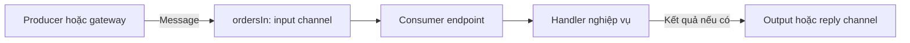
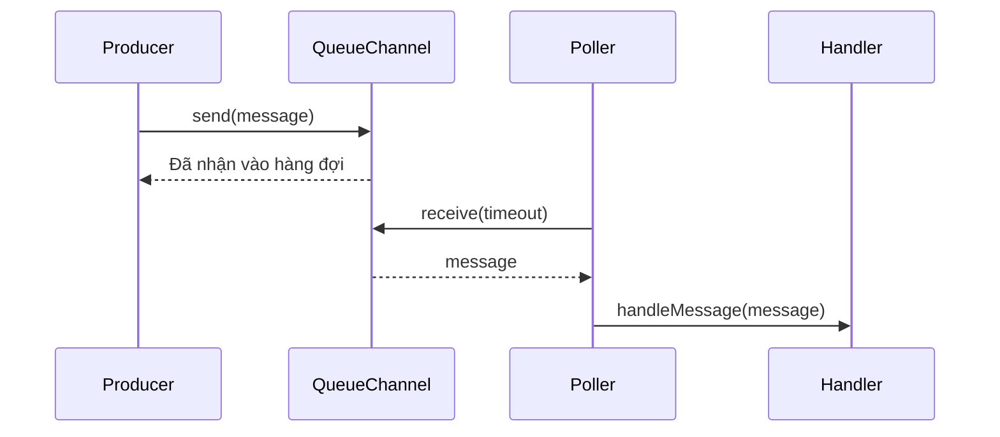

# Endpoint input-channel

Trong chương **Message endpoint** của **SPRING_INTEGRATION_CORE**, bài này giải thích cách nối một endpoint vào luồng thông điệp thông qua `input-channel`. Đây là điểm kết nối giữa hạ tầng truyền thông điệp và logic xử lý: cùng một handler nghiệp vụ có thể được gọi ngay khi thông điệp đến hoặc được gọi sau khi một poller lấy thông điệp khỏi hàng đợi.

Mục tiêu là đọc được cấu hình XML, annotation và Java DSL; chọn channel phù hợp; đồng thời dự đoán được thread thực thi, phản hồi và lỗi khi endpoint hoạt động.

## 1. Input channel là gì?

**Input channel của một endpoint là channel mà endpoint nhận thông điệp từ đó để giao cho handler xử lý.** Trong XML, `input-channel` thường chứa tên bean channel. Trong annotation, thuộc tính tương ứng là `inputChannel`.

Ví dụ:

```xml
<int:service-activator id="orderConsumer"
                       input-channel="ordersIn"
                       ref="orderService"
                       method="process"/>
```

Ở đây:

- `orderConsumer` là endpoint nhận thông điệp.
- `ordersIn` là tên channel đầu vào.
- `orderService` là bean chứa logic nghiệp vụ.
- `process` là phương thức được gọi sau khi endpoint nhận được thông điệp.

Tên `ordersIn` chỉ có ý nghĩa tham chiếu trong cấu hình. Nó không phải URL, tên thread hoặc một lời gọi phương thức. Gửi thông điệp vào một channel cũng không tự tạo một endpoint xử lý nghiệp vụ.



Một thông điệp vẫn gồm payload và headers khi đi qua channel. Việc khai báo input channel không tự biến đổi payload; transformer hoặc handler mới thực hiện công việc đó.

Có thể hình dung endpoint là bộ phận điều phối việc nhận thông điệp, còn handler là bộ phận thực hiện tác vụ. Cách phân chia này giúp giữ logic nghiệp vụ độc lập với cơ chế tiếp nhận. Xem [Message Endpoints trong tài liệu Spring Integration](https://docs.spring.io/spring-integration/reference/endpoint.html).

## 2. Phân biệt các tên thường bị nhầm

| Thành phần | Vai trò | Ví dụ |
|---|---|---|
| Input channel | Nơi endpoint nhận thông điệp | `ordersIn` |
| Endpoint ID | Định danh endpoint để quản lý, theo dõi vòng đời | `normalizeOrderEndpoint` |
| Handler hoặc service bean | Đối tượng thực hiện xử lý | `orderService` |
| Output channel | Đích tường minh cho kết quả của endpoint | `normalizedOrders` |
| Header `replyChannel` | Địa chỉ phản hồi gắn với từng thông điệp | Channel do gateway thiết lập |
| Header `errorChannel` | Địa chỉ lỗi cho các cơ chế có hỗ trợ công bố lỗi | `orderErrors` |

Với một service activator trả về kết quả, `output-channel` được dùng nếu đã cấu hình; khi không có output channel, endpoint có thể dùng `replyChannel` của thông điệp. Nếu phương thức trả về `void`, endpoint không sinh phản hồi từ giá trị trả về. Quy tắc này được mô tả trong [Service Activator](https://docs.spring.io/spring-integration/reference/7.0/service-activator.html).

Do đó, `input-channel` không quyết định nơi trả kết quả. Một endpoint nhận đúng thông điệp nhưng cấu hình đích phản hồi sai vẫn có thể xử lý nghiệp vụ rồi thất bại khi gửi kết quả.

## 3. Loại input channel quyết định cách tiếp nhận

Hai nhóm giao diện quan trọng là `SubscribableChannel` và `PollableChannel`.

| Input channel | Cơ chế nhận | Consumer điển hình | Poller |
|---|---|---|---|
| `DirectChannel` | Đăng ký handler và được gọi khi gửi | `EventDrivenConsumer` | Không dùng |
| `ExecutorChannel` | Đăng ký handler, chuyển tác vụ qua executor | `EventDrivenConsumer` | Không dùng |
| `PublishSubscribeChannel` | Phát cho các subscriber | `EventDrivenConsumer` cho mỗi endpoint đăng ký | Không dùng |
| `QueueChannel` | Gọi `receive()` để lấy từ hàng đợi | `PollingConsumer` | Cần cấu hình poller phù hợp |

### 3.1. SubscribableChannel: nhận theo sự kiện

Endpoint đăng ký handler với channel. Khi producer gửi thông điệp, channel dispatch đến handler đã đăng ký; endpoint không phải liên tục kiểm tra có dữ liệu mới hay chưa.

Với `DirectChannel`, handler chạy trên thread gọi `send()`. Vì vậy, handler chậm sẽ kéo dài lời gọi gửi. Với `ExecutorChannel`, executor tạo ranh giới thực thi; lựa chọn executor và chính sách từ chối tác vụ cần được xem xét riêng.

**Event-driven không đồng nghĩa với bất đồng bộ.** Một `DirectChannel` là ví dụ nhận theo sự kiện nhưng xử lý đồng bộ.

### 3.2. PollableChannel: nhận bằng polling

Với `QueueChannel`, producer đưa thông điệp vào hàng đợi. Polling consumer chạy theo lịch và gọi `receive()` để lấy thông điệp cho handler.



`send()` thành công với hàng đợi không chứng minh nghiệp vụ đã hoàn tất. Đồng thời, hàng đợi trong bộ nhớ mặc định không bảo đảm khôi phục thông điệp sau khi tiến trình dừng. Các đặc tính channel được trình bày trong [Message Channel Implementations](https://docs.spring.io/spring-integration/reference/channel/implementations.html).

Khi cấu hình consumer có đầu vào pollable, hãy khai báo poller tại endpoint hoặc cung cấp default poller. Đừng suy luận rằng chỉ cần tạo `QueueChannel` là framework đã biết lịch đọc mong muốn. Xem [Polling Consumer và Global Default Poller](https://docs.spring.io/spring-integration/reference/endpoint.html).

## 4. Ví dụ XML: giữ logic, thay cơ chế nhận

Các đoạn XML dưới đây nằm trong cấu hình Spring có namespace `int` của Spring Integration. Đây là các phương án thay thế; không khai báo trùng hai bean `ordersIn` trong cùng context.

### 4.1. Nhận trực tiếp

```xml
<int:channel id="ordersIn"/>

<int:channel id="normalizedOrders">
    <int:queue capacity="100"/>
</int:channel>

<int:transformer id="normalizeOrderEndpoint"
                 input-channel="ordersIn"
                 output-channel="normalizedOrders"
                 expression="payload.trim().toUpperCase()"/>
```

Channel `ordersIn` không có phần tử `<int:queue>`, nên cấu hình này dùng `DirectChannel`. Khi gửi một chuỗi vào `ordersIn`, transformer chuẩn hóa và gửi kết quả vào `normalizedOrders`.

Channel đầu ra là hàng đợi để chương trình minh họa có thể đọc kết quả chủ động. Điều này không làm cho bước transformer trước nó tự chuyển sang thread khác.

### 4.2. Nhận từ hàng đợi

```xml
<int:channel id="ordersIn">
    <int:queue capacity="100"/>
</int:channel>

<int:channel id="normalizedOrders">
    <int:queue capacity="100"/>
</int:channel>

<int:transformer id="normalizeOrderEndpoint"
                 input-channel="ordersIn"
                 output-channel="normalizedOrders"
                 expression="payload.trim().toUpperCase()">
    <int:poller fixed-delay="200"
                max-messages-per-poll="5"
                receive-timeout="0"/>
</int:transformer>
```

Lần này transformer nhận từ `QueueChannel`, nên endpoint có poller:

- `fixed-delay="200"`: khoảng nghỉ tính bằng mili giây sau khi một tác vụ polling hoàn tất, trước lần tiếp theo trong cấu hình đơn giản này.
- `max-messages-per-poll="5"`: mỗi tác vụ polling lấy tối đa năm thông điệp; không phải tạo năm thread.
- `receive-timeout="0"`: nếu hàng đợi rỗng, lần nhận trả về ngay.

Việc đổi input channel đã thay đổi thời điểm và thread gọi handler. Khi áp dụng vào nghiệp vụ thực tế, cần xem lại xử lý lỗi, transaction và khả năng tồn đọng thay vì chỉ đổi tên lớp channel.

## 5. Annotation: tham chiếu inputChannel

Một phương án tương đương là đặt annotation lên phương thức của bean do Spring quản lý:

```java
import java.util.Locale;

import org.springframework.integration.annotation.MessageEndpoint;
import org.springframework.integration.annotation.ServiceActivator;

@MessageEndpoint
public class OrderNormalizer {

    @ServiceActivator(
        inputChannel = "ordersIn",
        outputChannel = "normalizedOrders"
    )
    public String normalize(String orderCode) {
        return orderCode.trim().toUpperCase(Locale.ROOT);
    }
}
```

Cấu hình này cần hạ tầng Spring Integration được bật và bean `OrderNormalizer` được đăng ký, chẳng hạn qua component scanning. Hai channel nên được khai báo tường minh để người đọc biết chắc loại channel đang dùng.

Nếu `ordersIn` là `QueueChannel`, có thể thay annotation trên bằng:

```java
@ServiceActivator(
    inputChannel = "ordersIn",
    outputChannel = "normalizedOrders",
    poller = @Poller(
        fixedDelay = "200",
        maxMessagesPerPoll = "5",
        receiveTimeout = "0"
    )
)
```

Bổ sung import:

```java
import org.springframework.integration.annotation.Poller;
```

Tham số `String orderCode` nhận payload; nếu cần headers, handler có thể dùng `Message<?>` hoặc các annotation ánh xạ tham số phù hợp. Các thuộc tính input, output và poller được mô tả trong [Annotation Support](https://docs.spring.io/spring-integration/reference/configuration/annotations.html).

Không đăng ký đồng thời endpoint annotation này và endpoint XML trước đó chỉ để “bổ sung” cấu hình. Chúng tạo các consumer riêng. Với channel point-to-point, các consumer có thể cạnh tranh thông điệp thay vì tạo chuỗi xử lý.

## 6. Java DSL: ví dụ tự chứa

Ví dụ sau dùng API `IntegrationFlow` của Spring Integration 6 trở lên và Java 17 trở lên. Cần thư viện `spring-integration-core` cùng các dependency Spring tương thích; phiên bản được quản lý thống nhất bởi dự án hoặc BOM. Đây là chương trình Spring thuần, không cần Spring Boot để chạy.

Lưu lớp ví dụ dưới tên `InputChannelDemo.java` trong dự án thực hành:

```java
import java.util.Locale;

import org.springframework.context.annotation.AnnotationConfigApplicationContext;
import org.springframework.context.annotation.Bean;
import org.springframework.context.annotation.Configuration;
import org.springframework.integration.channel.DirectChannel;
import org.springframework.integration.channel.QueueChannel;
import org.springframework.integration.config.EnableIntegration;
import org.springframework.integration.dsl.IntegrationFlow;
import org.springframework.messaging.Message;
import org.springframework.messaging.support.MessageBuilder;

@Configuration
@EnableIntegration
public class InputChannelDemo {

    @Bean
    public DirectChannel ordersIn() {
        return new DirectChannel();
    }

    @Bean
    public QueueChannel normalizedOrders() {
        return new QueueChannel(100);
    }

    @Bean
    public IntegrationFlow normalizationFlow() {
        return IntegrationFlow.from(ordersIn())
            .handle(String.class,
                (payload, headers) -> {
                    if (payload.isBlank()) {
                        throw new IllegalArgumentException("Mã đơn hàng rỗng");
                    }
                    return payload.trim().toUpperCase(Locale.ROOT);
                },
                endpoint -> endpoint.id("normalizeOrderEndpoint"))
            .channel(normalizedOrders())
            .get();
    }

    public static void main(String[] args) {
        try (var context =
                 new AnnotationConfigApplicationContext(InputChannelDemo.class)) {

            var input = context.getBean("ordersIn", DirectChannel.class);
            var output = context.getBean("normalizedOrders", QueueChannel.class);

            Message<String> request = MessageBuilder
                .withPayload("  order-009  ")
                .setHeader("sourceSystem", "lesson")
                .build();

            boolean accepted = input.send(request, 1000);
            if (!accepted) {
                throw new IllegalStateException("Không gửi được thông điệp");
            }

            Message<?> reply = output.receive(1000);
            if (reply == null) {
                throw new IllegalStateException("Không nhận được kết quả");
            }

            System.out.println(reply.getPayload());
        }
    }
}
```

Kết quả mong đợi:

```text
ORDER-009
```

Trong luồng này:

1. `.from(ordersIn())` chọn input channel của endpoint đầu tiên.
2. `.handle(...)` tạo service activator thực hiện chuẩn hóa.
3. `.id("normalizeOrderEndpoint")` đặt tên endpoint, không đổi tên input channel.
4. `.channel(normalizedOrders())` chỉ định nơi gửi kết quả.
5. `output.receive(1000)` đọc kết quả từ hàng đợi; đây là thao tác của chương trình minh họa, không phải poller của endpoint chuẩn hóa.

Các cấu hình XML, annotation và DSL là các cách biểu đạt thay thế. Ví dụ chương trình này không cần nạp thêm `OrderNormalizer` ở phần annotation. Cách dùng `.handle()` để biểu đạt service activator có trong [tài liệu Java DSL của Service Activator](https://docs.spring.io/spring-integration/reference/7.0/service-activator.html).

### 6.1. Chuyển ví dụ sang đầu vào có hàng đợi

Trong cùng lớp, thay bean `ordersIn()` và bean `normalizationFlow()` bằng hai phương thức sau; giữ nguyên `normalizedOrders()`:

```java
@Bean
public QueueChannel ordersIn() {
    return new QueueChannel(100);
}

@Bean
public IntegrationFlow normalizationFlow() {
    return IntegrationFlow.from(ordersIn())
        .handle(String.class,
            (payload, headers) -> {
                if (payload.isBlank()) {
                    throw new IllegalArgumentException("Mã đơn hàng rỗng");
                }
                return payload.trim().toUpperCase(Locale.ROOT);
            },
            endpoint -> endpoint
                .id("normalizeOrderEndpoint")
                .poller(Pollers.fixedDelay(200)
                    .maxMessagesPerPoll(5)
                    .receiveTimeout(0)))
        .channel(normalizedOrders())
        .get();
}
```

Thêm import `org.springframework.integration.dsl.Pollers`. Trong `main`, đổi cách lấy input bean thành:

```java
var input = context.getBean("ordersIn", QueueChannel.class);
```

Poller được cấu hình trên endpoint `.handle(...)` ngay sau channel đầu vào có hàng đợi. Nó không phải thuộc tính của `QueueChannel`.

Timeout `1000` ở `output.receive(1000)` là giới hạn chờ của chương trình ví dụ, không phải cam kết rằng hệ thống luôn hoàn tất trong một giây. Khi tải cao hoặc handler chậm, cần chọn giới hạn dựa trên yêu cầu vận hành.

## 7. Số consumer và ý nghĩa phân phối

Giả sử hai endpoint cùng dùng `ordersIn`. Kết quả phụ thuộc vào channel:

- Với `DirectChannel`, hai handler là các subscriber của channel point-to-point, không tạo thành hai bước liên tiếp.
- Với `QueueChannel`, các polling consumer cạnh tranh nhận phần tử trong hàng đợi.
- Với `PublishSubscribeChannel`, thông điệp được phát đến các subscriber.

Nếu cần **chuẩn hóa rồi ghi dữ liệu**, thiết kế hai endpoint theo chuỗi:

```text
ordersIn -> normalizeEndpoint -> normalizedOrders -> persistEndpoint
```

Nếu cần **thông báo cho cả bộ phận email và thống kê**, dùng một nhánh publish-subscribe với yêu cầu lỗi và cô lập xử lý được xác định rõ.

Ví dụ sai về ý đồ xử lý tuần tự:

```text
ordersIn -> normalizeEndpoint
ordersIn -> persistEndpoint
```

Hai mũi tên này không thể hiện phụ thuộc “ghi sau khi chuẩn hóa”. Khi vẽ luồng, hãy ghi rõ channel trung gian thay vì chỉ liệt kê tên endpoint. Tham khảo [đặc tính phân phối của các channel](https://docs.spring.io/spring-integration/reference/channel/implementations.html).

## 8. Lỗi, vòng đời và transaction

### 8.1. Lỗi với đầu vào trực tiếp

Trong ví dụ `DirectChannel`, gửi payload chỉ chứa khoảng trắng làm handler ném lỗi. Lời gọi `send()` có thể ném một ngoại lệ messaging bọc nguyên nhân nghiệp vụ. Producer có thể bắt ngoại lệ ở ranh giới gọi.

Không nên kiểm tra riêng giá trị boolean rồi kết luận đã xử lý mọi tình huống lỗi. `send()` có thể không trả về bình thường.

### 8.2. Lỗi khi polling

Với `QueueChannel`, producer có thể đã gửi xong trước khi handler thất bại. Lỗi từ tác vụ polling cần được quan sát qua cơ chế xử lý lỗi của poller, thường bằng `ErrorMessage` gửi đến error channel. Khi dùng hạ tầng mặc định, header `errorChannel` của thông điệp có thể chỉ định đích lỗi; nếu không có, cơ chế xử lý lỗi dùng đích mặc định được cấu hình.

Việc tồn tại error channel không có nghĩa mọi ngoại lệ đồng bộ đều tự chuyển vào đó. Phân biệt hai ranh giới thực thi được giải thích trong [Error Handling](https://docs.spring.io/spring-integration/reference/error-handling.html).

Lỗi cũng không tự tạo chính sách retry hoặc đưa thông điệp trở lại hàng đợi trong bộ nhớ. Nếu nghiệp vụ cần khôi phục, phải thiết kế retry, lưu lỗi và phát lại một cách tường minh.

### 8.3. Endpoint phải hoạt động

Một channel tồn tại không chứng minh endpoint đang chạy. Khi endpoint dừng, hành vi gửi còn phụ thuộc vào loại channel và các consumer còn lại: đầu vào trực tiếp có thể không có subscriber, còn hàng đợi có thể tiếp tục nhận cho đến khi chạm dung lượng.

Khi điều tra, kiểm tra cả trạng thái endpoint lẫn lượng thông điệp đang chờ. Thông điệp tồn trong queue và thông điệp đã xử lý thành công là hai trạng thái khác nhau.

### 8.4. Input channel không tự thiết lập transaction

Việc handler chạy cùng thread qua `DirectChannel` cho phép tham gia transaction hiện có nếu các thành phần liên quan được cấu hình thích hợp. Tạo thêm queue hoặc executor thường làm xuất hiện ranh giới thread; transaction gắn với thread của producer không tự truyền qua ranh giới đó.

Poller có thể được cấu hình transaction riêng, nhưng điều này không biến một `QueueChannel` trong bộ nhớ thành hàng đợi bền vững hoặc tự bảo đảm rollback thao tác lấy thông điệp. Cần kiểm tra khả năng transaction của kho thông điệp, tài nguyên nghiệp vụ và transaction manager được sử dụng.

## 9. Quan sát hành vi bằng các tình huống nhỏ

Có thể dùng ví dụ ở phần 6 để thực hành các kiểm tra sau. Luôn đặt timeout hữu hạn khi gửi vào queue hoặc chờ phản hồi để bài thực hành không treo vô hạn.

| Tình huống | Điều cần quan sát |
|---|---|
| Gửi `"  order-009  "` | Nhận `ORDER-009` từ output channel |
| Gửi chuỗi trắng qua `DirectChannel` | Caller quan sát được ngoại lệ; không có phản hồi chuẩn hóa |
| Gửi chuỗi trắng qua đầu vào queue | Lời gọi gửi có thể đã thành công; lỗi xuất hiện ở phía polling |
| Dừng endpoint rồi gửi vào queue còn chỗ | Queue có thể nhận, nhưng chưa có kết quả xử lý |
| Gửi nhanh hơn tốc độ xử lý | Queue tăng, producer có thể chờ hoặc hết timeout khi queue đầy |
| Gắn hai endpoint vào channel point-to-point | Không được suy luận cả hai đều là các bước của mỗi thông điệp |

Để quan sát thread, tạm ghi `Thread.currentThread().getName()` tại producer trước khi gửi và trong handler. So sánh biến thể `DirectChannel` với biến thể queue có poller. Không dựa vào tên thread cụ thể để viết khẳng định vì tên phụ thuộc cấu hình.

Ở biến thể queue, nên chờ một kết quả có timeout thay vì chèn một khoảng `sleep()` cố định rồi đoán rằng handler đã chạy. Nếu kiểm tra trường hợp lỗi bất đồng bộ, thu nhận thông điệp từ error channel riêng của bài thực hành để có bằng chứng lỗi đã đến đúng nơi.

## 10. Chẩn đoán cấu hình input channel

| Hiện tượng | Hướng kiểm tra |
|---|---|
| Context không khởi tạo được consumer | Tên bean, loại channel và poller của endpoint |
| Gửi vào channel trực tiếp nhưng không có subscriber | Endpoint đã đăng ký, đã start và dùng đúng channel chưa |
| Queue tăng liên tục | Poller có chạy không; handler có chậm, lỗi hoặc bị chặn ở output không |
| Có xử lý nhưng không có kết quả ở nơi chờ | Giá trị trả về, `outputChannel` và `replyChannel` |
| Chỉ một trong hai tác vụ nhận mỗi thông điệp | Có dùng point-to-point cho ý đồ phát đến nhiều nơi không |
| Caller chờ lâu dù không thấy polling | Có dùng `DirectChannel` với handler chạy đồng bộ không |

Với lỗi tham chiếu, hãy đọc tên bean thực tế thay vì đoán từ tên lớp. Khai báo channel tường minh giúp dễ thấy sai khác giữa `ordersIn`, `orderIn` và tên endpoint, đồng thời tránh phụ thuộc ngoài ý muốn vào cơ chế tự tạo channel của một số kiểu cấu hình.

Khi chọn input channel, cần trả lời bốn câu hỏi: endpoint nhận ngay hay đọc theo lịch; nghiệp vụ chạy trên thread nào; thông điệp được phân phối cho ai; và producer quan sát thành công hoặc thất bại bằng cơ chế nào. Bốn quyết định này tạo nền tảng để nối transformer, filter, router, aggregator và gateway thành một luồng tích hợp có hành vi dự đoán được.