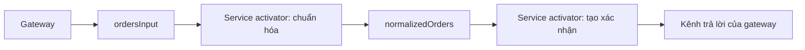
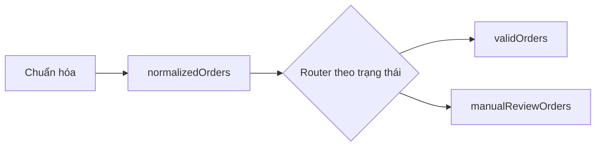

# Endpoint output-channel

## Mục tiêu

Trong Spring Integration Core, một message endpoint nối hành vi xử lý với hạ tầng truyền thông điệp. Endpoint có thể nhận message, chuyển đổi payload, gọi dịch vụ nghiệp vụ, rồi gửi kết quả sang bước kế tiếp. `output-channel` xác định nơi kết quả được gửi đến.

Sau bài này, bạn có thể:

- Phân biệt kênh nhận, kênh xuất và địa chỉ trả lời của một message.
- Cấu hình đầu ra bằng annotation và Java DSL.
- Thiết kế chuỗi endpoint vừa chuyển tiếp kết quả nội bộ vừa trả lời gateway.
- Giải thích điều gì xảy ra khi handler không trả kết quả, không tìm được kênh trả lời hoặc kênh đích không nhận được message.
- Chọn cách kiểm thử để phát hiện sai cấu hình đầu ra.

Phạm vi bài học là cơ chế đầu ra của các endpoint tạo reply, tiêu biểu là service activator và transformer. Không phải mọi endpoint đều tạo reply hoặc đều sử dụng đúng một thuộc tính `output-channel` theo cùng cách; router và các endpoint xử lý nhiều message có quy tắc riêng.

## 1. Vai trò của kênh đầu ra

Giả sử ứng dụng tiếp nhận mã đơn hàng, chuẩn hóa rồi tạo chuỗi xác nhận:



Đối với endpoint chuẩn hóa:

- `ordersInput` là input channel.
- Hàm xử lý nhận payload, chẳng hạn `"  order-42  "`.
- Hàm trả về `"ORDER-42"`.
- `normalizedOrders` là output channel.

Kết quả xử lý trở thành payload của message đầu ra nếu hàm trả về một đối tượng thông thường. Nếu hàm trả về `Message<?>`, handler có thể dùng cả payload và headers của message đó theo cơ chế tạo reply tương ứng.

Kênh đầu ra là một `MessageChannel`, không phải giá trị mà hàm nghiệp vụ phải trả về. Hàm trả về dữ liệu; hạ tầng Spring Integration chịu trách nhiệm tạo và gửi message tiếp theo.

| Khái niệm | Câu hỏi được giải đáp | Ví dụ |
|---|---|---|
| Input channel | Endpoint nhận message từ đâu? | `ordersInput` |
| Hàm xử lý | Endpoint làm gì với dữ liệu? | Chuẩn hóa mã đơn hàng |
| Output channel | Kết quả được gửi tiếp đến đâu? | `normalizedOrders` |
| Header `replyChannel` | Reply của yêu cầu này có thể được gửi về đâu? | Kênh trả lời tạm do gateway thiết lập |
| Giá trị trả về | Kết quả nghiệp vụ là gì? | `"ORDER-42"` |

Một kênh được dùng làm đầu ra của endpoint trước thường đồng thời là đầu vào của endpoint sau. Vai trò “input” hay “output” phụ thuộc vào endpoint đang xét.

## 2. Tên cấu hình thay đổi theo cách khai báo

Trong tài liệu và cấu hình XML, khái niệm này thường xuất hiện dưới tên `output-channel`. Annotation sử dụng thuộc tính Java `outputChannel`. Java DSL thường nối các bước bằng `.channel(...)` hoặc để framework tạo các kênh nội bộ giữa các bước.

Ví dụ XML tương đương về ý tưởng:

```xml
<int:service-activator
        input-channel="ordersInput"
        output-channel="normalizedOrders"
        ref="orderNormalizer"
        method="normalize" />
```

Đoạn XML là ví dụ cấu hình riêng, giả định các bean và namespace Spring Integration đã được khai báo. Không cần khai báo đồng thời XML và annotation cho cùng một handler.

Các ví dụ Java trong bài dùng Spring Integration với Java configuration, cơ chế annotation đã được bật và các dependency phù hợp trong ứng dụng. Không cần một transport bên ngoài như Kafka hay AMQP để quan sát cơ chế này.

## 3. Cấu hình bằng annotation

Khai báo hai kênh và hai service activator:

```java
import java.util.Locale;

import org.springframework.context.annotation.Bean;
import org.springframework.context.annotation.Configuration;
import org.springframework.integration.annotation.IntegrationComponentScan;
import org.springframework.integration.annotation.ServiceActivator;
import org.springframework.integration.channel.DirectChannel;
import org.springframework.integration.config.EnableIntegration;
import org.springframework.messaging.MessageChannel;

@Configuration
@EnableIntegration
@IntegrationComponentScan(basePackageClasses = OrderGateway.class)
public class OrderIntegrationConfiguration {

    @Bean
    public MessageChannel ordersInput() {
        return new DirectChannel();
    }

    @Bean
    public MessageChannel normalizedOrders() {
        return new DirectChannel();
    }

    @ServiceActivator(
        inputChannel = "ordersInput",
        outputChannel = "normalizedOrders",
        requiresReply = "true"
    )
    public String normalize(String orderCode) {
        return orderCode.strip().toUpperCase(Locale.ROOT);
    }

    @ServiceActivator(
        inputChannel = "normalizedOrders",
        requiresReply = "true"
    )
    public String acknowledge(String normalizedCode) {
        return "ACCEPTED:" + normalizedCode;
    }
}
```

Gateway được đặt trong một tệp Java riêng, cùng package để ví dụ quét component hoạt động:

```java
import org.springframework.integration.annotation.Gateway;
import org.springframework.integration.annotation.MessagingGateway;

@MessagingGateway
public interface OrderGateway {

    @Gateway(requestChannel = "ordersInput", replyTimeout = 3000)
    String submit(String orderCode);
}
```

Khi gọi:

```java
String result = orderGateway.submit("  order-42  ");
// result: "ACCEPTED:ORDER-42"
```

Luồng xử lý gồm các bước:

1. Gateway tạo request message, kèm thông tin kênh trả lời trong headers.
2. Endpoint `normalize` nhận payload từ `ordersInput`.
3. Vì đã có `outputChannel = "normalizedOrders"`, kết quả chuẩn hóa đi đến kênh này.
4. Endpoint `acknowledge` nhận kết quả, tạo chuỗi xác nhận.
5. Endpoint cuối không khai báo output channel nên sử dụng địa chỉ trả lời của request để trả kết quả về gateway.

`replyTimeout = 3000` quy định thời gian chờ reply của gateway theo đơn vị mili giây; nó không phải cơ chế tự động hủy công việc nghiệp vụ đang chạy. Đặc biệt, với chuỗi `DirectChannel`, việc gọi handler diễn ra đồng bộ ngay trên luồng gọi.

`@IntegrationComponentScan` phục vụ việc phát hiện interface gateway. Hai phương thức xử lý nằm trên bean cấu hình và được hạ tầng annotation của Spring Integration nhận diện. Nếu chuyển chúng sang một lớp dịch vụ riêng, lớp đó cũng cần được đăng ký làm Spring bean.

## 4. Output channel và `replyChannel`: thứ tự lựa chọn

Với endpoint tạo reply thông thường như service activator, hãy dùng quy tắc thực hành sau:

1. Nếu endpoint được cấu hình output channel, kết quả được gửi đến kênh đó.
2. Nếu không có output channel, framework tìm địa chỉ trả lời, điển hình là header `replyChannel` trên request.
3. Nếu có kết quả cần gửi nhưng không phân giải được đích trả lời, quá trình gửi reply thất bại.

Header `replyChannel` có thể chứa một đối tượng `MessageChannel` hoặc tên kênh có thể được phân giải. Đây là địa chỉ trả lời theo từng message, trong khi output channel thường là cấu hình của handler.

```text
Request headers:
    replyChannel = địa chỉ trả lời của bên gọi

Endpoint:
    outputChannel = normalizedOrders

Kết quả:
    đi đến normalizedOrders
```

Cấu hình output channel không đồng nghĩa với xóa header `replyChannel`. Với chuỗi endpoint thông thường, header này được truyền tiếp để endpoint cuối có thể trả lời người gọi.

Đó là lý do một gateway có thể chờ kết quả cuối cùng của nhiều bước xử lý. Các endpoint trung gian chuyển dữ liệu qua những output channel cụ thể; endpoint cuối trả reply về gateway.

### Khi tự tạo message mới

Cẩn thận khi thay toàn bộ message hoặc dùng code tự gửi sang một nhánh mới. Nếu chỉ tạo message từ payload rồi gửi mà không mang theo các headers cần thiết, nhánh mới có thể mất địa chỉ trả lời và thông tin tương quan.

Khi cần giữ headers của message đầu vào trong code xây dựng message, có thể bắt đầu từ:

```java
import org.springframework.messaging.Message;
import org.springframework.messaging.support.MessageBuilder;

Message<?> forwarded = MessageBuilder.fromMessage(incoming)
    .setHeader("processingStage", "normalized")
    .build();
```

Ví dụ này minh họa việc giữ ngữ cảnh message khi tự xây dựng message. Các reply-producing handler thông thường có cơ chế truyền headers riêng; không cần viết lại cơ chế đó cho mọi phương thức chỉ trả payload. Với các endpoint đặc biệt hoặc cơ chế loại bỏ headers, cần kiểm tra hành vi truyền headers tương ứng.

## 5. Không cấu hình output channel có phải là kết thúc luồng?

Không thể kết luận chỉ từ việc thiếu thuộc tính này. Cần xét cả giá trị trả về và địa chỉ reply.

| Kết quả xử lý | Có output channel? | Có địa chỉ reply phù hợp? | Hành vi điển hình |
|---|---|---|---|
| Trả payload hoặc `Message<?>` | Có | Có hoặc không | Gửi kết quả đến output channel |
| Trả payload hoặc `Message<?>` | Không | Có | Gửi reply đến địa chỉ trả lời |
| Trả payload hoặc `Message<?>` | Không | Không | Lỗi khi xác định đích gửi reply |
| Trả `null` hoặc phương thức `void` | Có hoặc không | Có hoặc không | Không có reply để gửi nếu không bắt buộc reply |
| Trả `null` khi `requiresReply = true` | Có hoặc không | Có hoặc không | Báo lỗi thiếu reply |

Ví dụ endpoint chỉ ghi nhận nghiệp vụ:

```java
@ServiceActivator(inputChannel = "auditInput")
public void audit(String event) {
    auditService.record(event);
}
```

Đây là ví dụ độc lập, giả định `auditInput` và `auditService` đã được khai báo. Vì phương thức trả `void`, thêm `outputChannel` cũng không tự tạo một message đầu ra. Nếu bên gọi cần một xác nhận, handler phải trả kết quả xác nhận phù hợp.

`requiresReply = "true"` có ý nghĩa kiểm tra handler có tạo reply hay không. Nó không đảm bảo reply đã được xử lý thành công ở tất cả các bước tiếp theo và không thay thế việc cấu hình kênh đích.

Nếu yêu cầu có kết quả nhưng nghiệp vụ có thể bỏ qua dữ liệu, hãy làm rõ hợp đồng: dùng filter với discard channel, trả một kết quả thể hiện trạng thái bị từ chối, hoặc thiết kế luồng một chiều. Không nên dùng `null` để che giấu một trường hợp lỗi mà gateway vẫn đang chờ phản hồi.

## 6. Nối đầu ra bằng Java DSL

Java DSL diễn tả cùng ý tưởng dưới dạng chuỗi bước:

```java
import org.springframework.context.annotation.Bean;
import org.springframework.integration.dsl.IntegrationFlow;

@Bean
public IntegrationFlow orderFlow() {
    return IntegrationFlow.from("ordersInput")
        .<String, String>transform(
            value -> value.strip().toUpperCase(Locale.ROOT)
        )
        .channel("normalizedOrders")
        .<String, String>transform(
            value -> "ACCEPTED:" + value
        )
        .get();
}
```

Đây là cách triển khai thay thế cho hai phương thức `@ServiceActivator` ở phần trước. Nếu dùng cùng ví dụ gateway và các bean channel, hãy bỏ hai phương thức xử lý annotation trước khi đăng ký flow này. Không để hai cách triển khai cùng tiêu thụ một input channel nếu mục tiêu là một pipeline duy nhất.

Trong flow này:

- `.channel("normalizedOrders")` đặt một kênh tại ranh giới giữa hai transformer.
- Output của transformer đầu được chuyển đến kênh đó.
- Transformer tiếp theo nhận message từ kênh đó.
- Transformer cuối tạo reply; khi không có kênh đầu ra tiếp theo được cấu hình, địa chỉ trả lời của request được sử dụng.

Java DSL có thể tạo kênh nội bộ giữa các endpoint liên tiếp. Vì vậy, không cần đặt tên kênh cho mọi bước:

```java
@Bean
public IntegrationFlow compactOrderFlow() {
    return IntegrationFlow.from("ordersInput")
        .<String, String>transform(
            value -> value.strip().toUpperCase(Locale.ROOT)
        )
        .<String, String>transform(
            value -> "ACCEPTED:" + value
        )
        .get();
}
```

Đây lại là một cách triển khai thay thế, không đăng ký đồng thời với `orderFlow`. Kênh có tên hữu ích khi cần nối các flow, gắn monitoring hoặc đặt một ranh giới xử lý có chủ đích. Với các bước nội bộ ngắn, để DSL nối tự động thường dễ đọc hơn.

Một flow kết thúc bằng `.channel("someChannel")` vẫn gửi message sang kênh đó. Kết thúc phần khai báo flow không đồng nghĩa với kết thúc vòng đời message. Kênh đích phải có consumer phù hợp hoặc được sử dụng theo đúng thiết kế hàng đợi.

## 7. Loại output channel quyết định điều gì?

Khai báo output channel mới chỉ xác định đích đến. Loại channel quyết định cách chuyển giao message.

### `DirectChannel`

Với `DirectChannel`, handler kế tiếp thường được gọi trên chính luồng gửi. Trong chuỗi ví dụ, việc chuẩn hóa, tạo xác nhận và trả kết quả có thể diễn ra trong cùng call stack.

Nếu bước kế tiếp ném exception, lỗi có thể truyền ngược về bên gọi. Khi send hoàn tất mà không có lỗi, điều đó phản ánh việc xử lý đồng bộ của subscriber; không nên suy rộng thành bảo đảm giao dịch với mọi hệ thống bên ngoài.

`DirectChannel` có nhiều subscriber không phải là cơ chế broadcast. Một lần gửi được dispatch đến một subscriber; cấu hình nhiều consumer có thể làm các yêu cầu đi vào những handler khác nhau thay vì chạy qua tất cả handler.

### `QueueChannel`

Nếu output channel là `QueueChannel`, kết quả được đưa vào hàng đợi. Để xử lý tiếp bằng endpoint, cần một consumer có poller phù hợp.

```java
import org.springframework.integration.channel.QueueChannel;

@Bean
public QueueChannel normalizedOrders() {
    return new QueueChannel(100);
}
```

Đây là ví dụ thay thế loại kênh, không khai báo thêm một bean trùng tên. Consumer annotation có thể có dạng:

```java
import org.springframework.integration.annotation.Poller;

@ServiceActivator(
    inputChannel = "normalizedOrders",
    poller = @Poller(fixedDelay = "100")
)
public String acknowledge(String normalizedCode) {
    return "ACCEPTED:" + normalizedCode;
}
```

Việc send thành công vào queue chỉ cho biết message đã được tiếp nhận vào queue theo cơ chế của channel. Nó không cho biết xử lý nghiệp vụ cuối cùng đã hoàn tất. Queue trong bộ nhớ cũng không tự cung cấp tính bền vững khi tiến trình dừng.

Nếu gateway vẫn chờ kết quả, poller và thời gian xử lý phải phù hợp với thời gian chờ reply. Việc tách luồng không làm mất nhu cầu bảo toàn `replyChannel` và ngữ cảnh tương quan.

### `ExecutorChannel` và `PublishSubscribeChannel`

`ExecutorChannel` tạo ranh giới thực thi qua executor. Không nên kỳ vọng exception của công việc chạy trên luồng khác sẽ quay về nguyên vẹn qua call stack của người gửi như với `DirectChannel`.

`PublishSubscribeChannel` phục vụ việc phân phối tới nhiều subscriber. Khi có executor, cách thực thi và xử lý lỗi khác trường hợp đồng bộ. Nếu nhiều nhánh cùng giữ địa chỉ reply của một gateway, có thể có nhiều reply cạnh tranh; cần thiết kế nhánh nào tạo câu trả lời, hoặc tổng hợp kết quả trước khi trả lời.

Tên output channel không cho biết các đặc tính trên. Khi đọc cấu hình, luôn kiểm tra cả bean channel thực tế.

## 8. Output channel không phải router hay error channel

### Chọn đích theo nội dung message

Một output channel cố định phù hợp khi mọi kết quả đi cùng tuyến. Nếu đích thay đổi theo trạng thái đơn hàng, loại payload hoặc header, dùng router để thể hiện quyết định đó.



Đừng nhầm header `replyChannel` với kết quả định tuyến nghiệp vụ. Một cái mô tả địa chỉ trả lời cho request; cái còn lại lựa chọn bước xử lý tiếp theo.

### Chuyển lỗi

Output channel của một handler thông thường nhận kết quả xử lý thành công. Nó không tự trở thành nơi nhận exception.

Ví dụ, `normalize()` ném exception trước khi tạo kết quả thì không có reply thành công nào để gửi tới `normalizedOrders`.

Cách xử lý lỗi phụ thuộc ranh giới thực thi:

- Với chuỗi đồng bộ qua `DirectChannel`, lỗi thường truyền về người gọi hoặc gateway.
- Với endpoint được poll theo lịch, hạ tầng poller xử lý lỗi theo cơ chế error handler đã cấu hình; cấu hình thông thường có thể xuất bản `ErrorMessage` tới error channel.
- Với xử lý qua executor, cần xem cơ chế error handling của channel/executor và flow tương ứng.

Chỉ gắn header `errorChannel` không biến mọi lời gọi đồng bộ trực tiếp thành việc tự động xuất bản lỗi. Header này chỉ phát huy tác dụng khi thành phần xử lý lỗi tương ứng sử dụng nó.

## 9. Các lỗi thường gặp

### Có kết quả nhưng không có đích reply

**Biểu hiện:** endpoint xử lý xong rồi báo lỗi không phân giải được kênh trả lời, thường dưới dạng `DestinationResolutionException` hoặc exception được bọc trong ngữ cảnh messaging.

**Nguyên nhân:** gửi message trực tiếp bằng `send()` không kèm địa chỉ trả lời, trong khi handler trả kết quả và không có output channel.

**Cách xử lý:** cấu hình output channel, sử dụng gateway/request-reply phù hợp, hoặc làm endpoint một chiều nếu đó là hợp đồng nghiệp vụ thực sự.

### Output channel không có subscriber

**Biểu hiện:** gửi tới một `DirectChannel` nhưng không có subscriber và nhận lỗi delivery.

**Nguyên nhân:** thiếu endpoint kế tiếp, cấu hình không được nạp hoặc endpoint đích đã dừng.

**Cách xử lý:** kiểm tra bean channel, lifecycle của consumer và việc đăng ký flow. Chỉ đặt đúng tên kênh chưa đủ để có một pipeline hoạt động.

### Queue nhận message nhưng không được xử lý

**Biểu hiện:** bên gửi không báo lỗi, số message trong queue tăng, gateway không nhận được reply.

**Nguyên nhân:** thiếu poller, consumer chưa chạy hoặc tốc độ xử lý thấp hơn tốc độ nhận.

**Cách xử lý:** kiểm tra poller, dung lượng queue, nhịp poll, thời gian xử lý và send timeout có liên quan. Không vội kết luận rằng output channel đã mất message.

### Gateway chỉ nhận kết quả trung gian

**Biểu hiện:** gateway nhận `ORDER-42` thay vì `ACCEPTED:ORDER-42`.

**Nguyên nhân có thể có:** endpoint chuẩn hóa thiếu output channel nên trả lời trực tiếp qua `replyChannel`, bỏ qua bước tạo xác nhận.

**Cách xử lý:** kiểm tra tuyến nối giữa các bước và bảo đảm chỉ bước tạo kết quả cuối trả lời gateway trong thiết kế này.

### Handler trả `null` dù có output channel

**Biểu hiện:** consumer tiếp theo không nhận được message.

**Nguyên nhân:** không có kết quả để gửi; thuộc tính output channel không tự tạo dữ liệu.

**Cách xử lý:** xác định lại hợp đồng trả về. Bật `requiresReply` cho service activator nếu việc không có reply phải được coi là lỗi.

## 10. Kiểm thử hành vi đầu ra

Kiểm thử nên xác nhận message đi đúng nơi và người gọi nhận đúng kết quả. Chỉ kiểm tra hàm `normalize()` trả đúng chuỗi chưa chứng minh được endpoint có cấu hình output channel đúng.

Các tình huống có ích:

| Tình huống | Điều cần xác nhận |
|---|---|
| Gateway gọi chuỗi hai bước | Nhận `ACCEPTED:ORDER-42`, không phải kết quả trung gian |
| Endpoint có output channel và request có `replyChannel` | Kết quả trung gian đến output channel đã cấu hình |
| Endpoint cuối không có output channel | Reply quay về gateway qua địa chỉ trả lời |
| Handler trả `null`, `requiresReply = true` | Nhận lỗi thiếu reply |
| Kênh đích là `QueueChannel` | Có thể lấy message bằng `receive(timeout)` tại ranh giới đang kiểm thử |
| Không có output channel và không có địa chỉ reply | Lỗi xác định đích trả lời |
| Handler ném lỗi với chuỗi `DirectChannel` | Bên gọi quan sát được lỗi, không có kết quả thành công giả |

Đối với bài kiểm tra cô lập đầu ra, có thể dùng `QueueChannel` làm kênh đích và nhận message với timeout hữu hạn. Trong context kiểm thử đó, không gắn thêm consumer đang chạy vào cùng queue, vì consumer có thể lấy mất message trước phần assertion.

Với flow có queue và poller, dùng thao tác chờ có giới hạn thay vì `Thread.sleep()` cố định. Đối với trường hợp một chiều, kiểm tra hiệu ứng hoặc message ở kênh đích thay vì chờ một reply mà thiết kế không cung cấp.

Không đăng ký cả bản annotation và bản DSL của cùng ví dụ trong một context kiểm thử. Trên `DirectChannel`, các subscriber bổ sung có thể khiến test đi qua một pipeline khác với dự kiến.

## 11. Bài tập thực hành

1. Triển khai bản annotation với hai `DirectChannel`. Gọi gateway bằng `"  order-42  "` và kiểm tra kết quả cuối cùng.
2. Bỏ `outputChannel` khỏi endpoint chuẩn hóa. Quan sát bước nào trả lời gateway và endpoint nào không còn nhận dữ liệu.
3. Khôi phục tuyến nối, rồi thay `normalizedOrders` bằng `QueueChannel` và bổ sung poller cho consumer.
4. Cho endpoint chuẩn hóa trả `null`. So sánh hành vi khi `requiresReply` được bật và khi không bắt buộc reply.
5. Tạo một lần gửi trực tiếp không có header `replyChannel` tới endpoint trả kết quả nhưng không có output channel. Giải thích vì sao hàm xử lý có thể chạy thành công mà việc hoàn tất request vẫn thất bại.
6. Viết lại pipeline bằng Java DSL, chỉ đăng ký một cách triển khai tại một thời điểm, rồi kiểm tra cùng hợp đồng đầu vào và đầu ra.

## 12. Điểm cần ghi nhớ

- `output-channel` xác định đích gửi kết quả của endpoint tạo reply; nó không tạo ra kết quả thay cho handler.
- Với service activator thông thường, output channel đã cấu hình được ưu tiên trước địa chỉ trả lời của request.
- Không có output channel vẫn có thể trả kết quả qua `replyChannel`, đặc biệt ở cuối luồng được gọi bằng gateway.
- `void` hoặc `null` thường không tạo reply; `requiresReply` giúp phát hiện trường hợp thiếu reply trái với hợp đồng.
- Loại channel quyết định đồng bộ, bất đồng bộ, hàng đợi hay phân phối tới nhiều subscriber.
- Một tuyến thông điệp đúng cần cả đích gửi hợp lệ, consumer hoạt động và hợp đồng trả lời rõ ràng.