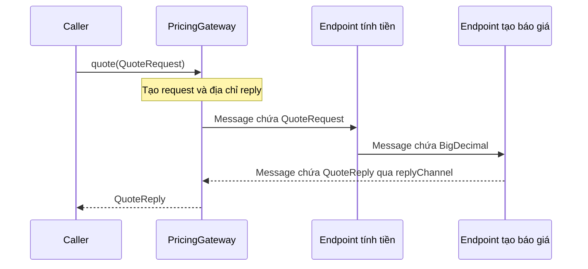

# Endpoint với reply

## 1. Mục tiêu và tình huống sử dụng

Trong chương **Message endpoint** của module **SPRING_INTEGRATION_CORE**, bài này giải thích cách một endpoint tiếp nhận thông điệp và tạo phản hồi để bước tiếp theo hoặc bên gửi tiếp tục xử lý. Trọng tâm là mối quan hệ giữa `Message`, `MessageChannel`, service activator, gateway và Java DSL.

Sau bài học, bạn có thể:

- Phân biệt kết quả trả về của phương thức nghiệp vụ với reply message trong luồng tích hợp.
- Xác định nơi nhận reply khi có `outputChannel`, header `replyChannel` hoặc gateway.
- Thiết kế hợp đồng phản hồi với `requiresReply`, kết quả nghiệp vụ và lỗi kỹ thuật.
- Nhận diện tình huống mất reply do filter, router, aggregator hoặc cấu hình kênh.
- Viết kiểm thử quan sát được payload, header và đường đi của phản hồi.

Giả sử hệ thống bán hàng nhận yêu cầu tính giá gồm mã sản phẩm và số lượng. Một endpoint tính tổng tiền, endpoint tiếp theo tạo kết quả báo giá, rồi caller nhận lại kết quả. Caller cần một kết quả cụ thể cho mỗi yêu cầu; việc ghi log rằng yêu cầu đã được nhận chưa đáp ứng hợp đồng này.

Ví dụ dùng Java 17 trở lên và API cấu hình phổ biến trong Spring Integration 6.x. Chúng cần thư viện `spring-integration-core`; phần kiểm thử cần JUnit Jupiter. Trong ứng dụng Spring Boot, có thể dùng `spring-boot-starter-integration` và bộ dependency do Boot quản lý. Các đoạn cấu hình thay thế trong bài được dùng độc lập, tránh đăng ký hai consumer xử lý cùng một request ngoài ý muốn.

## 2. Endpoint tạo reply như thế nào?

Một message gồm payload và các header. Channel vận chuyển message; endpoint kết nối channel với logic xử lý. Với endpoint có khả năng tạo reply, kết quả của logic được chuyển thành message để gửi tiếp.

```text
request Message
      |
      v
input channel -> endpoint gọi nghiệp vụ
                              |
                              v
                     kết quả nghiệp vụ
                              |
                              v
                         reply Message
                              |
                              v
                    kênh đầu ra / kênh reply
```

Ví dụ nghiệp vụ thuần Java:

```java
public String normalizeSku(String sku) {
    return sku.trim().toUpperCase(java.util.Locale.ROOT);
}
```

Khi phương thức được gọi qua service activator, chuỗi kết quả trở thành payload của message đầu ra. Reply có thể đi sang một transformer, router hoặc một service activator khác. Nó chỉ trở thành kết quả của lời gọi gateway khi tới đúng đường trả lời mà gateway đang chờ.

Một chi tiết quan trọng: `MessageHandler.handleMessage(Message<?>)` có kiểu trả về `void`. Khả năng reply do implementation và cơ chế gửi message bên trong handler cung cấp. Vì vậy, một lambda kiểu `MessageHandler` chỉ ghi log không tự tạo reply; phương thức POJO được service activator gọi có thể trả về dữ liệu để framework tạo reply.

`AbstractReplyProducingMessageHandler` là lớp nền cho nhiều handler có khả năng phản hồi. Endpoint có khả năng tạo reply cũng chưa đồng nghĩa mọi nhánh xử lý đều tạo được reply. [Javadoc về handler tạo reply](https://docs.spring.io/spring-integration/api/org/springframework/integration/handler/AbstractReplyProducingMessageHandler.html).

### Các khái niệm cần tách biệt

| Khái niệm | Trách nhiệm | Ví dụ trong luồng báo giá |
|---|---|---|
| Request payload | Mang dữ liệu đầu vào | Mã sản phẩm và số lượng |
| Input channel | Đưa request đến endpoint | `quoteRequests` |
| Endpoint/handler | Thực hiện bước xử lý | Tính thành tiền |
| Reply payload | Mang kết quả của một bước | Số tiền hoặc kết quả báo giá |
| Output channel | Đích đầu ra cấu hình tại handler | `quoteFormatting` |
| Header `replyChannel` | Mang địa chỉ trả lời của lượt trao đổi | Kênh tạm do gateway tạo |
| Gateway | Chuyển lời gọi Java thành trao đổi message | `gateway.quote(request)` |

## 3. Quy tắc chọn nơi gửi reply

Đối với service activator thông thường, khi phương thức trả về kết quả khác `null`, framework tìm nơi gửi theo thứ tự sau:

1. Dùng `outputChannel` được cấu hình tại handler, nếu có.
2. Nếu không có, dùng header `replyChannel` của **request**.
3. Nếu request không có địa chỉ trả lời và kết quả là một `Message<?>`, xét header `replyChannel` của message kết quả.
4. Nếu vẫn không xác định được đích, việc gửi reply thất bại; thông báo thường thể hiện không có output channel hoặc reply channel.

Header có thể chứa đối tượng `MessageChannel` hoặc tên kênh dạng chuỗi để framework phân giải. Tên không phân giải được dẫn đến lỗi xác định đích. [Quy tắc định tuyến reply của service activator](https://docs.spring.io/spring-integration/reference/6.5/service-activator.html).

| `outputChannel` | `replyChannel` trong request | Đích được chọn trước |
|---|---|---|
| Có | Có | `outputChannel` |
| Có | Không | `outputChannel` |
| Không | Có | `replyChannel` trong request |
| Không | Không | Xét header trong kết quả nếu kết quả là `Message<?>`; nếu không có đích thì lỗi |

Ví dụ request có `replyChannel = callerReplies`, nhưng endpoint đặt `outputChannel = quoteFormatting`. Kết quả của endpoint đi đến `quoteFormatting`. Endpoint cuối của luồng có thể tiếp tục dùng địa chỉ trả lời được truyền theo request để trả kết quả hoàn chỉnh cho caller.

Điều này tạo ra hai kiểu thiết kế:

- **Đầu ra cố định:** cấu hình output channel để xác định bước tiếp theo của pipeline.
- **Địa chỉ trả lời theo request:** để endpoint cuối phản hồi theo header do caller hoặc gateway cung cấp.

Không cần gắn output channel của mọi bước vào kênh trả lời của caller. Làm vậy dễ kết thúc luồng quá sớm, khi dữ liệu chưa qua các bước bắt buộc.

## 4. Ví dụ đầy đủ bằng Java DSL và gateway

### 4.1. Hợp đồng nghiệp vụ

Luồng dưới đây nhận yêu cầu mua sản phẩm có đơn giá giả lập là 120.000 đồng. Endpoint đầu tính tổng, endpoint sau đóng gói kết quả. Đơn vị tiền trong ví dụ là VND nguyên; đây chỉ là mô hình học tập, chưa triển khai bảng giá, thuế hoặc chiết khấu.



### 4.2. Cấu hình hoàn chỉnh

Toàn bộ đoạn sau có thể đặt trong `ReplyEndpointConfig.java` của một dự án đã có dependency phù hợp:

```java
package demo.reply;

import java.math.BigDecimal;

import org.springframework.context.annotation.Bean;
import org.springframework.context.annotation.Configuration;
import org.springframework.integration.annotation.Gateway;
import org.springframework.integration.config.EnableIntegration;
import org.springframework.integration.dsl.IntegrationFlow;

@Configuration
@EnableIntegration
public class ReplyEndpointConfig {

    public record QuoteRequest(String sku, int quantity) {
    }

    public record QuoteReply(BigDecimal total, String currency) {
    }

    public interface PricingGateway {

        @Gateway(requestTimeout = "1000", replyTimeout = "2000")
        QuoteReply quote(QuoteRequest request);
    }

    public static class PricingService {

        public BigDecimal calculate(QuoteRequest request) {
            if (request.sku() == null || request.sku().isBlank()) {
                throw new IllegalArgumentException("sku phải có giá trị");
            }
            if (request.quantity() <= 0) {
                throw new IllegalArgumentException("quantity phải lớn hơn 0");
            }
            return new BigDecimal("120000")
                    .multiply(BigDecimal.valueOf(request.quantity()));
        }
    }

    @Bean
    public PricingService pricingService() {
        return new PricingService();
    }

    @Bean
    public IntegrationFlow quoteFlow(PricingService pricingService) {
        return IntegrationFlow.from(PricingGateway.class)
                .handle(pricingService, "calculate",
                        endpoint -> endpoint.requiresReply(true))
                .<BigDecimal>handle((total, headers) ->
                        new QuoteReply(total, "VND"),
                        endpoint -> endpoint.requiresReply(true))
                .get();
    }
}
```

`IntegrationFlow.from(PricingGateway.class)` đăng ký proxy gateway và kênh đầu vào nội bộ cho flow. Trong cách cấu hình này, không cần thêm `@MessagingGateway` hay quét gateway riêng cho cùng interface. Các annotation `@Gateway` trên phương thức có thể cung cấp thuộc tính timeout. [Tạo gateway từ IntegrationFlow](https://docs.spring.io/spring-integration/reference/dsl/integration-flow-as-gateway.html).

Diễn biến của một lời gọi:

1. Caller truyền `new QuoteRequest("BOOK-01", 2)`.
2. Gateway chuyển lời gọi thành request message và cung cấp đường nhận reply.
3. Service activator gọi `calculate`, nhận tổng tiền `240000`.
4. Java DSL nối kết quả sang handler tiếp theo, nơi tạo `QuoteReply`.
5. Handler cuối không có output channel cố định, nên gửi theo đường reply của request.
6. Gateway lấy payload trả về và cung cấp `QuoteReply` cho caller.

Khi dùng Spring thuần, có thể quan sát kết quả như sau:

```java
try (var context = new org.springframework.context.annotation
        .AnnotationConfigApplicationContext(ReplyEndpointConfig.class)) {

    var gateway = context.getBean(ReplyEndpointConfig.PricingGateway.class);
    var reply = gateway.quote(
            new ReplyEndpointConfig.QuoteRequest("BOOK-01", 2));

    System.out.println(reply.total());    // 240000
    System.out.println(reply.currency()); // VND
}
```

Với ứng dụng Boot, inject `PricingGateway` vào bean cần sử dụng. Gateway là bean proxy do cấu hình tạo ra; không gọi phương thức nghiệp vụ trực tiếp nếu mục tiêu là đi qua toàn bộ flow.

## 5. Biến thể dùng annotation và output channel cố định

Khi cần tên kênh rõ ràng để nhiều flow nối vào, có thể dùng service activator với annotation. Đoạn dưới là cấu hình **thay thế** cho ví dụ Java DSL trước; nó tái sử dụng các kiểu dữ liệu và `PricingService` đã định nghĩa.

```java
package demo.reply;

import java.math.BigDecimal;

import org.springframework.context.annotation.Bean;
import org.springframework.context.annotation.Configuration;
import org.springframework.integration.annotation.ServiceActivator;
import org.springframework.integration.channel.DirectChannel;
import org.springframework.integration.config.EnableIntegration;
import org.springframework.messaging.MessageChannel;

@Configuration
@EnableIntegration
public class NamedChannelConfig {

    @Bean
    public MessageChannel quoteRequests() {
        return new DirectChannel();
    }

    @Bean
    public MessageChannel quoteFormatting() {
        return new DirectChannel();
    }

    @Bean
    public QuoteEndpoints quoteEndpoints() {
        return new QuoteEndpoints();
    }

    public static class QuoteEndpoints {

        private final ReplyEndpointConfig.PricingService pricingService =
                new ReplyEndpointConfig.PricingService();

        @ServiceActivator(
                inputChannel = "quoteRequests",
                outputChannel = "quoteFormatting",
                requiresReply = "true")
        public BigDecimal calculate(
                ReplyEndpointConfig.QuoteRequest request) {
            return pricingService.calculate(request);
        }

        @ServiceActivator(
                inputChannel = "quoteFormatting",
                requiresReply = "true")
        public ReplyEndpointConfig.QuoteReply format(BigDecimal total) {
            return new ReplyEndpointConfig.QuoteReply(total, "VND");
        }
    }
}
```

Ở đây, endpoint `calculate` gửi tổng tiền vào `quoteFormatting`, dù request có header `replyChannel`. Endpoint `format` tạo phản hồi cuối cùng theo địa chỉ trả lời còn được truyền theo message.

Cấu hình này chưa đăng ký gateway; caller có thể tạo request và kênh reply như phần tiếp theo. Trong ứng dụng thực tế, `PricingService` thường được inject để thay thế bảng giá hoặc kiểm thử độc lập; việc khởi tạo trực tiếp ở đây chỉ giữ ví dụ cấu hình kênh ngắn gọn.

## 6. Quan sát trực tiếp reply bằng Message và QueueChannel

Dùng `NamedChannelConfig`, tạo một `QueueChannel` riêng làm nơi nhận phản hồi của request:

```java
try (var context = new org.springframework.context.annotation
        .AnnotationConfigApplicationContext(NamedChannelConfig.class)) {

    var input = context.getBean(
            "quoteRequests", org.springframework.messaging.MessageChannel.class);
    var replies = new org.springframework.integration.channel.QueueChannel(1);

    var request = org.springframework.messaging.support.MessageBuilder
            .withPayload(new ReplyEndpointConfig.QuoteRequest("BOOK-01", 2))
            .setHeader("businessRequestId", "quote-101")
            .setReplyChannel(replies)
            .build();

    boolean accepted = input.send(request, 1000);
    var response = replies.receive(1000);

    if (!accepted || response == null) {
        throw new IllegalStateException("Không nhận được báo giá");
    }

    var quote = (ReplyEndpointConfig.QuoteReply) response.getPayload();
    System.out.println(quote.total());
    System.out.println(response.getHeaders().get("businessRequestId"));
}
```

`QueueChannel` này chứa message trả lời để caller gọi `receive`. Nó không phải input queue, nên không cần poller cho endpoint trong ví dụ: cả hai input channel của endpoint vẫn là `DirectChannel`. Đối tượng kênh reply được đặt trực tiếp vào request, không cần đăng ký thành bean để cơ chế này hoạt động.

`input.send(...)` trả về boolean về thao tác gửi, không trả về payload báo giá. Với kênh đồng bộ, xử lý và gửi reply có thể diễn ra ngay trong lời gọi `send`, trước khi caller gọi `receive`. `QueueChannel` có thể giữ sẵn kết quả này. Với input queue trong một thiết kế khác, gửi thành công mới chỉ cho biết message đã vào hàng đợi, chưa chứng minh nghiệp vụ hoàn tất. [Đặc tính của DirectChannel và QueueChannel](https://docs.spring.io/spring-integration/reference/channel/implementations.html).

Không dùng một reply queue dùng chung rồi để nhiều caller tự gọi `receive()` và mặc định mỗi caller lấy đúng kết quả của mình. Nếu cùng chờ trên queue đó, caller có thể nhận kết quả của request khác. Gateway hoặc cơ chế correlation được thiết kế rõ ràng sẽ phù hợp hơn cho nhiều lời gọi đồng thời.

## 7. Payload trả về, Message trả về và header

### 7.1. Khi chỉ trả về payload

Trong ví dụ, `calculate` trả về `BigDecimal`. Framework xây message đầu ra và thông thường truyền tiếp các request header thích hợp; một số header có thể bị loại theo cấu hình propagation. Không giả định message đầu ra giữ cùng `id` hoặc `timestamp` với request: đó là metadata do framework quản lý, không phải mã nghiệp vụ dùng để nối các bước xử lý.

Với handler tạo reply thông thường, việc giữ các header nghiệp vụ như `businessRequestId` giúp truy vết. Việc giữ được đường `replyChannel` đặc biệt quan trọng ở các bước trung gian của request–reply.

### 7.2. Khi cần đặt thêm header vào reply

Có thể trả về `Message<?>` để diễn đạt cả dữ liệu lẫn metadata. Ví dụ một phương thức có thể dùng làm service activator:

```java
public org.springframework.messaging.Message<ReplyEndpointConfig.QuoteReply>
        addQuoteMetadata(
                org.springframework.messaging.Message<BigDecimal> request) {

    return org.springframework.messaging.support.MessageBuilder
            .withPayload(new ReplyEndpointConfig.QuoteReply(
                    request.getPayload(), "VND"))
            .copyHeaders(request.getHeaders())
            .setHeader("quoteSource", "local-catalog")
            .build();
}
```

Đây là reply message có payload `QuoteReply`, không phải một payload lồng thêm `Message` nữa. Các header chỉ đọc như `id` và `timestamp` được builder quản lý. `copyHeaders` giúp biểu đạt rõ việc giữ ngữ cảnh, nhưng với flow lớn cần chọn lọc header theo hợp đồng để tránh phát tán dữ liệu không cần thiết.

Địa chỉ reply trong request vẫn được ưu tiên trước địa chỉ trong message kết quả khi endpoint không có output channel. Vì vậy, chỉ đặt một `replyChannel` khác lên reply message không phải cách đáng tin cậy để đổi tuyến của một request vốn đã có địa chỉ trả lời.

Đối tượng kênh trong header là tham chiếu nội bộ tiến trình. Khi message đi qua JSON, broker hoặc ranh giới lưu trữ, cần cấu hình ánh xạ header và cơ chế request–reply phù hợp với transport; không giả định có thể serialize rồi khôi phục nguyên tham chiếu kênh Java. Mã nghiệp vụ như `businessRequestId` có thể hỗ trợ đối chiếu, nhưng tự nó chưa tạo ra cơ chế vận chuyển phản hồi.

## 8. `null`, `void` và `requiresReply`

Một hợp đồng request–reply cần quy định điều gì xảy ra nếu không tìm được dữ liệu. Với service activator mặc định, trả về `null` hoặc dùng phương thức `void` có thể kết thúc xử lý mà không tạo reply. Nếu `requiresReply` được bật và handler không tạo kết quả, framework báo `ReplyRequiredException`. Thuộc tính này kiểm tra đầu ra của handler, không cam kết caller chắc chắn nhận được kết quả cuối cùng. [Hợp đồng requiresReply](https://docs.spring.io/spring-integration/reference/service-activator.html).

| Kết quả xử lý | `requiresReply` | Ý nghĩa cần dự kiến |
|---|---|---|
| Đối tượng khác `null` | `true` hoặc `false` | Tạo reply và tìm đích gửi |
| `null` | `false` | Không tạo reply |
| `null` | `true` | Báo lỗi thiếu reply |
| Phương thức `void` | Thường dùng cho một chiều | Không phù hợp với endpoint bắt buộc trả dữ liệu |
| Ném exception | Bất kỳ | Đi vào cơ chế xử lý lỗi tương ứng |

Không kết hợp phương thức `void` với kỳ vọng bắt buộc trả dữ liệu. Tùy cách chọn phương thức và cấu hình, cấu hình này có thể bị từ chối ngay khi khởi tạo.

### Mô hình hóa trường hợp không tìm thấy

Nếu không có báo giá là kết quả nghiệp vụ hợp lệ, có thể định nghĩa kết quả tường minh:

```java
public record QuoteOutcome(
        boolean available,
        BigDecimal total,
        String reason) {
}
```

Ví dụ `new QuoteOutcome(false, BigDecimal.ZERO, "SKU_NOT_FOUND")` vẫn là payload khác `null`. Hợp đồng quy định `total` chỉ có ý nghĩa khi `available` là `true`. Caller không phải đoán việc không nhận reply có nghĩa là không tìm thấy sản phẩm hay hệ thống đã gặp lỗi.

Nếu endpoint cố ý kết thúc luồng một chiều dù hàm nghiệp vụ có giá trị trả về, có thể gửi kết quả vào `nullChannel`. Tuy nhiên, một caller đang chờ báo giá sẽ không nhận được kết quả từ nhánh này. Cần chọn hợp đồng một chiều hoặc request–reply nhất quán ngay từ điểm vào.

`requiresReply(true)` ở bước tính tiền cũng không phát hiện được việc một filter phía sau loại bỏ message, router chọn nhánh không có đầu ra, hay aggregator chưa đủ điều kiện release. Phải xem xét đường đi đến phản hồi cuối cùng.

## 9. Reply và ranh giới thread

Request–reply mô tả mối quan hệ giữa request và kết quả, không bắt buộc toàn bộ flow chạy trên cùng thread.

| Cách nối các bước | Điều cần hiểu khi chờ reply |
|---|---|
| `DirectChannel` thông thường | Handler chạy trong thread gửi; caller còn ở call stack xử lý |
| `ExecutorChannel` với executor bất đồng bộ | Có thể chuyển xử lý sang worker; cần dự kiến chờ và xử lý lỗi |
| `QueueChannel` làm input endpoint | Cần consumer có poller để lấy message ra xử lý |

Một request nằm trong input queue mà không có poller sẽ không tự được xử lý. Ngược lại, reply queue trong ví dụ phần 6 được caller nhận trực tiếp bằng `receive`, nên không cần dựng thêm một poller chỉ để caller đọc kết quả.

### Phân biệt các loại thời gian chờ

- **Thời gian gửi request:** giới hạn chờ gửi vào kênh nếu implementation hỗ trợ thao tác gửi có timeout, chẳng hạn hàng đợi đang đầy.
- **Gateway reply timeout:** giới hạn giai đoạn gateway chờ reply, không phải deadline cưỡng chế cho mọi bước nghiệp vụ.
- **Timeout của I/O:** giới hạn kết nối, đọc HTTP, truy vấn hoặc thao tác ngoài tiến trình tại client tương ứng.

Ví dụ `replyTimeout = "2000"` đặt thời gian chờ reply là 2.000 ms. Nếu một handler chạy trực tiếp trên thread caller và gọi dịch vụ ngoài mất 8 giây, gateway không tự ngắt handler ở giây thứ hai. Khi có bàn giao xử lý bất đồng bộ, gateway có thể hết thời gian chờ trước khi worker tạo reply. Hết thời gian chờ cũng không tự hủy tác vụ hoặc hoàn tác tác động nghiệp vụ. [Gateway khi không nhận được phản hồi](https://docs.spring.io/spring-integration/reference/6.5/gateway.html).

Với gateway đồng bộ trả về đối tượng như ví dụ, trường hợp không nhận được reply có thể dẫn đến kết quả `null`; đừng mặc định mọi timeout đều ném cùng một exception. Tùy gateway, kiểu trả về và chính sách cấu hình, hành vi quan sát được có thể khác. Vì vậy bài đặt timeout tường minh và yêu cầu kiểm thử tình huống thiếu reply thay vì dựa vào giá trị mặc định của một phiên bản.

Nếu xử lý tạo tác động như trừ tiền hoặc giữ chỗ, caller retry sau timeout có thể gây thực hiện hai lần. Một thiết kế phù hợp cần mã yêu cầu nghiệp vụ và tính idempotent tại nơi tạo tác động; điều này độc lập với việc flow có nhận được reply đúng hạn hay không.

## 10. Phản hồi lỗi và kết quả nghiệp vụ

Với flow đồng bộ dùng `DirectChannel`, exception có thể truyền về caller qua call stack. Gateway có thể đưa exception về người gọi, với exception gốc được bao bởi ngoại lệ messaging tùy ngữ cảnh. Không nên viết hợp đồng chỉ dựa trên một lớp wrapper duy nhất.

Khi đã chuyển sang worker hoặc poller, lỗi không tự nhảy ngược qua call stack đã kết thúc. Cơ chế xử lý lỗi của tác vụ Spring Integration có thể tạo `ErrorMessage`, ưu tiên đích trong header `errorChannel`, rồi tới kênh lỗi mặc định khi phù hợp. Một gateway cũng có thể cung cấp đường nhận lỗi để hoàn tất lời gọi đang chờ. Chỉ ghi log ở kênh lỗi chưa chắc tạo được phản hồi nghiệp vụ cho caller. [Cơ chế xử lý lỗi của Spring Integration](https://docs.spring.io/spring-integration/reference/error-handling.html).

Phân biệt ba trường hợp:

| Tình huống | Hợp đồng có thể chọn | Điều caller cần biết |
|---|---|---|
| Sản phẩm không còn bán | Trả `QuoteOutcome` biểu diễn không khả dụng | Đây là kết quả nghiệp vụ đã xác định |
| Mã sản phẩm rỗng | Từ chối đầu vào bằng lỗi validation | Cần sửa request |
| Dịch vụ bảng giá mất kết nối | Lỗi kỹ thuật hoặc fallback được quy định | Có thể cần retry theo chính sách |

Không bắt mọi exception rồi trả `null`: cách này biến lỗi đã có nguyên nhân thành tình trạng chờ thiếu reply. Cũng không chuyển mọi lỗi thành báo giá bằng 0 vì caller có thể hiểu là miễn phí.

## 11. Khi flow có transformer, filter, router hoặc aggregator

Khả năng reply cần được xét trên toàn đường xử lý:

- **Transformer:** đầu ra phải phù hợp với kiểu dữ liệu mà bước kế tiếp hoặc gateway chờ nhận.
- **Filter:** nhánh bị loại cần có hành vi được quyết định trước. Với request–reply, có thể chọn báo lỗi hoặc tạo kết quả từ chối; bỏ lặng message khiến caller thiếu phản hồi.
- **Router:** mọi nhánh có thể được chọn phải có đường hoàn tất phù hợp. Nhánh phụ ghi audit không nhất thiết là nhánh trả kết quả.
- **Aggregator:** chỉ tạo kết quả sau khi nhóm được release. Phải quy định correlation, điều kiện release và chính sách cho nhóm không hoàn chỉnh.

Ví dụ yêu cầu báo giá phải hỏi ba nhà cung cấp: router hoặc publish-subscribe tạo nhiều nhánh, mỗi nhánh trả một báo giá riêng. Một lời gọi gateway thông thường không tự đợi đủ ba message để ghép thành danh sách. Cần bước tổng hợp có quy tắc rõ ràng để tạo **một** kết quả cuối cho request đó.

Không dùng chung khái niệm correlation nghiệp vụ với địa chỉ reply. `businessRequestId` trả lời câu hỏi “kết quả thuộc yêu cầu nào”; `replyChannel` trả lời câu hỏi “gửi kết quả đi đâu”. Một flow cần cả hai khi có phân nhánh và tổng hợp, nhưng chúng không thay thế trách nhiệm của nhau.

## 12. Kiểm thử hành vi có reply

Ví dụ JUnit sau dùng cấu hình DSL ở phần 4. Nó kiểm tra kết quả hoàn chỉnh và lỗi validation, không chỉ kiểm tra input channel chấp nhận message:

```java
package demo.reply;

import java.math.BigDecimal;

import org.junit.jupiter.api.Test;
import org.springframework.context.annotation.AnnotationConfigApplicationContext;

import static org.junit.jupiter.api.Assertions.*;

class ReplyEndpointTest {

    @Test
    void returnsCompletedQuote() {
        try (var context = new AnnotationConfigApplicationContext(
                ReplyEndpointConfig.class)) {

            var gateway = context.getBean(
                    ReplyEndpointConfig.PricingGateway.class);
            var reply = gateway.quote(
                    new ReplyEndpointConfig.QuoteRequest("BOOK-01", 2));

            assertNotNull(reply);
            assertEquals(0,
                    new BigDecimal("240000").compareTo(reply.total()));
            assertEquals("VND", reply.currency());
        }
    }

    @Test
    void rejectsInvalidQuantity() {
        try (var context = new AnnotationConfigApplicationContext(
                ReplyEndpointConfig.class)) {

            var gateway = context.getBean(
                    ReplyEndpointConfig.PricingGateway.class);
            RuntimeException error = assertThrows(RuntimeException.class,
                    () -> gateway.quote(
                            new ReplyEndpointConfig.QuoteRequest("BOOK-01", 0)));

            Throwable root = error;
            while (root.getCause() != null) {
                root = root.getCause();
            }
            assertInstanceOf(IllegalArgumentException.class, root);
            assertEquals("quantity phải lớn hơn 0", root.getMessage());
        }
    }
}
```

Dùng `BigDecimal.compareTo` vì kiểm thử quan tâm giá trị tiền, không yêu cầu cùng scale. Kiểm tra nguyên nhân gốc giúp assertion không phụ thuộc chặt vào cách framework bao ngoại lệ.

Các tình huống thực hành tiếp theo nên có kết quả mong đợi cụ thể:

| Tình huống | Quan sát cần kiểm tra |
|---|---|
| Request có cả output channel và địa chỉ reply | Kết quả trung gian đi vào output channel; endpoint cuối mới trả cho caller |
| Handler trả `null`, `requiresReply=true` | Có lỗi thiếu reply thay vì kết thúc lặng |
| Header nghiệp vụ đi qua hai bước | `businessRequestId` còn nguyên trong phản hồi ở flow đã cấu hình |
| Handler tạo dữ liệu nhưng không có đích gửi | Có lỗi xác định đường reply |
| Filter từ chối request | Caller nhận lỗi/kết quả từ chối theo hợp đồng đã chọn |
| Input queue không được tiêu thụ | Không có kết quả; kiểm thử có thời gian chờ hữu hạn |
| Hai request đồng thời | Mỗi caller nhận đúng dữ liệu của mình |
| Worker hoàn tất sau timeout | Hành vi reply muộn và tác động nghiệp vụ được quan sát rõ |

Các đoạn kiểm thử là ví dụ để người học thực hành trong dự án có dependency tương ứng; chúng chưa được thực thi trong phạm vi biên soạn bài này.

## 13. Chẩn đoán những lỗi thường gặp

| Triệu chứng | Nguyên nhân có thể có | Cách kiểm tra |
|---|---|---|
| Hàm nghiệp vụ chạy nhưng caller thiếu kết quả | `null`, `void`, filter loại bỏ hoặc kết quả đi nhánh khác | Theo dõi từng endpoint đến đầu ra cuối |
| Lỗi không có output/reply channel | Message đầu vào thiếu địa chỉ, endpoint không có đích cố định | Xem cấu hình handler và header request thực tế |
| Caller nhận dữ liệu quá sớm | Endpoint trung gian trả thẳng về reply channel | Nối output đến các bước còn lại |
| Gateway không cắt tác vụ chậm sau timeout | Tác vụ vẫn nằm trên thread caller | Xác định ranh giới thread và timeout I/O |
| Có request trong queue nhưng không xử lý | Thiếu consumer/poller hoặc endpoint chưa chạy | Kiểm tra poller và lifecycle endpoint |
| Có log lỗi nhưng caller vẫn thiếu reply | Nhánh lỗi chỉ ghi log, không hoàn tất hợp đồng | Kiểm tra đầu ra của error flow |
| Kết quả sai caller khi tải đồng thời | Nhiều caller đọc chung một reply queue | Dùng gateway hoặc cơ chế correlation phù hợp |

Khi chẩn đoán, ghi nhận mã yêu cầu nghiệp vụ, tên endpoint, kiểu payload, thread và đích gửi. Tránh ghi toàn bộ payload có dữ liệu nhạy cảm chỉ để tìm lỗi reply. Một dấu vết hữu ích là: request đã tới bước nào, bước đó tạo kết quả gì, kết quả được gửi đến đâu và ai đang chờ ở đích ấy.

## 14. Bài tập củng cố

1. Chạy ví dụ báo giá với số lượng 1, 2 và 5; xác minh tổng tiền thay đổi đúng.
2. Thêm một header `businessRequestId` vào request của cấu hình named channel, rồi kiểm tra header trong reply.
3. Tạo một phương thức trả `null` cho mã sản phẩm không biết. So sánh hành vi khi bật và tắt `requiresReply`, luôn dùng thời gian chờ hữu hạn ở phía caller.
4. Đổi hợp đồng thành `QuoteOutcome` để trường hợp không tìm thấy vẫn có phản hồi rõ ràng.
5. Thêm bước kiểm tra số lượng tối đa. Chọn trả kết quả từ chối hoặc ném lỗi và giải thích cách caller phân biệt hai trường hợp.
6. Thiết kế luồng hỏi nhiều nguồn giá rồi tổng hợp. Chỉ ra nơi đặt correlation, điều kiện release và endpoint trả kết quả cuối cùng.

Một lời giải đạt yêu cầu phải chỉ ra đường đi của cả request, reply và lỗi. Chỉ chứng minh `send()` trả về `true` chưa đủ để khẳng định hợp đồng báo giá đã hoàn tất.

## 15. Tài liệu tham khảo

- [Service Activator — Spring Integration 6.5](https://docs.spring.io/spring-integration/reference/6.5/service-activator.html): cấu hình endpoint và chọn đích reply.
- [IntegrationFlow as a Gateway](https://docs.spring.io/spring-integration/reference/dsl/integration-flow-as-gateway.html): tạo gateway từ interface bằng DSL.
- [Messaging Gateways — Spring Integration 6.5](https://docs.spring.io/spring-integration/reference/6.5/gateway.html): lời gọi gateway, đường phản hồi và thời gian chờ.
- [Message Channel Implementations](https://docs.spring.io/spring-integration/reference/channel/implementations.html): đặc tính gửi/nhận và ranh giới xử lý của các loại channel.
- [Error Handling](https://docs.spring.io/spring-integration/reference/error-handling.html): truyền exception và error message.
- [AbstractReplyProducingMessageHandler Javadoc](https://docs.spring.io/spring-integration/api/org/springframework/integration/handler/AbstractReplyProducingMessageHandler.html): API nền cho handler tạo phản hồi.