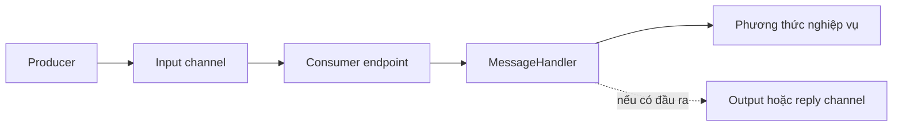

# Endpoint và MessageHandler

## 1. Mục tiêu và bối cảnh

Trong chương **Message endpoint** của module **SPRING_INTEGRATION_CORE**, bài này giải thích cách một thành phần xử lý được nối vào luồng thông điệp. Hiểu quan hệ giữa endpoint và handler giúp bạn đọc cấu hình Java DSL, tìm đúng nơi đặt poller, kiểm soát vòng đời và xác định vì sao thông điệp chưa được xử lý.

Sau bài học, bạn có thể:

- Phân biệt `Message`, channel, consumer endpoint và `MessageHandler`.
- Nhận diện cơ chế nhận thông điệp qua subscription hoặc polling.
- Kết nối phương thức nghiệp vụ bằng Java DSL và `@ServiceActivator`.
- Phân biệt xử lý một chiều với xử lý tạo reply.
- Thiết kế kiểm thử cho logic nghiệp vụ và cho liên kết channel–endpoint–handler.

Giả sử hệ thống nhận mã đơn hàng, chuẩn hóa mã, kiểm tra hợp lệ rồi tạo xác nhận. Khi chuyển từ lời gọi Java trực tiếp sang luồng thông điệp, cần trả lời hai câu hỏi: **ai nhận thông điệp từ channel**, và **ai thực hiện công việc trên thông điệp ấy**. Hai trách nhiệm này có liên quan nhưng cần được phân biệt.

Ví dụ dùng Java 17 trở lên và API cấu hình của Spring Integration hiện đại. Chọn phiên bản dependency tương thích theo BOM của ứng dụng; các đoạn cấu hình thay thế trong bài không được bật đồng thời nếu dùng chung tên channel.

## 2. Bốn thành phần cần phân biệt

| Thành phần | Vai trò | Ví dụ trong luồng đơn hàng |
| --- | --- | --- |
| `Message<T>` | Mang payload và metadata trong headers | Payload `"ord-42"`, header `tenantId` |
| `MessageChannel` | Là điểm trao đổi thông điệp giữa các thành phần | `ordersInput` |
| Consumer endpoint | Nối channel đầu vào với handler; quản lý cơ chế tiếp nhận và vòng đời | `EventDrivenConsumer`, `PollingConsumer` |
| `MessageHandler` | Thực hiện hành vi khi được giao một thông điệp | Gọi dịch vụ xác nhận đơn hàng |

Theo nghĩa của Enterprise Integration Patterns, endpoint là điểm ứng dụng tham gia hệ thống messaging. Trong cấu hình Spring Integration, từ “endpoint” cũng thường chỉ toàn bộ một bước như transformer hoặc service activator. Khi xem các bean runtime, cần phân biệt **consumer endpoint** với **handler nằm phía sau nó**. [Nguồn: Overview of Spring Integration](https://docs.spring.io/spring-integration/reference/overview.html).

Sơ đồ sau mô tả một consumer endpoint thông thường; nó không nhằm bao quát inbound adapter hoặc endpoint reactive:



Endpoint phối hợp việc tiếp nhận. Handler quyết định hành vi xử lý. Một phương thức nghiệp vụ như `confirm(String orderId)` có thể hoàn toàn không biết channel, poller hay `Message` tồn tại.

## 3. Hợp đồng của MessageHandler

Interface nằm trong package `org.springframework.messaging`:

```java
package org.springframework.messaging;

public interface MessageHandler {
    void handleMessage(Message<?> message) throws MessagingException;
}
```

Đây là callback mà hạ tầng dùng để giao thông điệp. Trong ứng dụng, thường nên dùng handler có sẵn hoặc để framework thích nghi phương thức POJO, thay vì tự triển khai interface. [Nguồn: Message Endpoints](https://docs.spring.io/spring-integration/reference/endpoint.html).

Kiểu trả về `void` chỉ mô tả hợp đồng callback. Một implementation vẫn có thể tạo thông điệp mới rồi gửi sang channel khác. Vì vậy, `void handleMessage(...)` không có nghĩa mọi handler đều kết thúc luồng.

Ví dụ tối giản về handler một chiều:

```java
import org.springframework.messaging.MessageHandler;

MessageHandler auditHandler = message -> {
    Object payload = message.getPayload();
    System.out.println("Received: " + payload);
};
```

Đoạn này chỉ tạo handler. Nó chưa có liên kết với channel và chưa được kích hoạt qua một endpoint. Khai báo một bean kiểu `MessageHandler` cũng không tự cho framework biết cần lấy thông điệp từ đâu.

## 4. Channel quyết định cách endpoint tiếp nhận

Với consumer channel thông thường, hai tổ hợp quan trọng là:

| Input channel | Consumer endpoint | Cách nhận |
| --- | --- | --- |
| `SubscribableChannel` | `EventDrivenConsumer` | Handler được đăng ký làm subscriber |
| `PollableChannel` | `PollingConsumer` | Poller gọi `receive()` rồi chuyển message cho handler |

Java DSL và annotation thường để hạ tầng tạo consumer phù hợp; `ConsumerEndpointFactoryBean` là thành phần quan trọng trong quá trình này. [Nguồn: Message Endpoints](https://docs.spring.io/spring-integration/reference/endpoint.html).

### 4.1. Event-driven không đồng nghĩa với bất đồng bộ

`DirectChannel` gọi subscriber trên thread gửi. Với `ExecutorChannel`, việc dispatch được giao cho executor; thông thường handler chạy trên thread khác. Cả hai đều là subscribable channel. `PublishSubscribeChannel` phục vụ nhu cầu phát tới các subscriber, còn `DirectChannel` có ngữ nghĩa point-to-point. [Nguồn: Message Channel Implementations](https://docs.spring.io/spring-integration/reference/channel/implementations.html).

Do đó, khi handler chậm, cần xem channel và executor trước khi kết luận endpoint “chưa chạy bất đồng bộ”. Đổi tên bean hoặc thêm `@ServiceActivator` không tạo ra ranh giới thread.

### 4.2. QueueChannel cần một phía chủ động nhận

`QueueChannel` giữ thông điệp cho đến khi có consumer nhận. Trong mô hình polling của bài này, endpoint cần poller cục bộ hoặc poller mặc định phù hợp. Gửi thành công vào queue chỉ chứng minh message đã được chấp nhận, chưa chứng minh nghiệp vụ hoàn tất.

Queue mặc định lưu trong bộ nhớ. Muốn phục hồi thông điệp sau khi ứng dụng dừng, cần thiết kế lưu trữ hoặc dùng hệ thống messaging phù hợp. [Nguồn: QueueChannel và lưu trữ thông điệp](https://docs.spring.io/spring-integration/reference/channel/implementations.html).

## 5. Ví dụ hoàn chỉnh bằng Java DSL

Ví dụ đầu tiên dùng `DirectChannel` làm đầu vào. Dịch vụ nhận mã đơn hàng và trả về chuỗi xác nhận. `QueueChannel` ở đầu ra giúp quan sát kết quả bằng `receive()`.

Dependency cần có `spring-integration-core`; trong ứng dụng Spring Boot có thể dùng starter Integration do BOM quản lý. Ví dụ dưới dùng context Java độc lập, không cần khởi động web server.

### 5.1. Cấu hình flow

```java
import java.util.Locale;

import org.springframework.beans.factory.annotation.Qualifier;
import org.springframework.context.annotation.Bean;
import org.springframework.context.annotation.Configuration;
import org.springframework.integration.channel.DirectChannel;
import org.springframework.integration.channel.QueueChannel;
import org.springframework.integration.config.EnableIntegration;
import org.springframework.integration.dsl.IntegrationFlow;

@Configuration
@EnableIntegration
public class OrderFlowConfig {

    public static class OrderService {
        public String confirm(String rawOrderId) {
            String orderId = rawOrderId.trim().toUpperCase(Locale.ROOT);
            if (!orderId.matches("ORD-\\d+")) {
                throw new IllegalArgumentException("Invalid order id: " + orderId);
            }
            return "CONFIRMED:" + orderId;
        }
    }

    @Bean
    public DirectChannel ordersInput() {
        return new DirectChannel();
    }

    @Bean
    public QueueChannel ordersOutput() {
        return new QueueChannel(20);
    }

    @Bean
    public OrderService orderService() {
        return new OrderService();
    }

    @Bean
    public IntegrationFlow orderFlow(
            @Qualifier("ordersInput") DirectChannel input,
            @Qualifier("ordersOutput") QueueChannel output,
            OrderService service) {

        return IntegrationFlow.from(input)
                .handle(service, "confirm",
                        endpoint -> endpoint.id("confirmOrderEndpoint"))
                .channel(output)
                .get();
    }
}
```

`.handle(service, "confirm", ...)` biểu diễn bước service activator. Framework nối phương thức POJO với cơ chế xử lý thông điệp; biến `service` không phải consumer endpoint. [Nguồn: Service Activator](https://docs.spring.io/spring-integration/reference/service-activator.html).

Trong ví dụ này:

- `ordersInput` là nơi nhận request.
- `confirmOrderEndpoint` là tên consumer endpoint được đặt tường minh.
- Handler của bước `.handle(...)` gọi `OrderService.confirm(...)`.
- `ordersOutput` là nơi nhận message kết quả, không phải channel đầu vào cần poller của bước xác nhận.

DSL tạo các bean channel, endpoint và handler tương ứng. `IntegrationFlow` mô tả cách ghép chúng; nó không phải một vòng lặp Java tự đi qua danh sách bước cho mỗi message. [Nguồn: DSL Basics](https://docs.spring.io/spring-integration/reference/dsl/java-basics.html).

### 5.2. Gửi và nhận thông điệp

Đặt lớp sau trong cùng package với `OrderFlowConfig`:

```java
import org.springframework.context.annotation.AnnotationConfigApplicationContext;
import org.springframework.integration.channel.QueueChannel;
import org.springframework.messaging.Message;
import org.springframework.messaging.MessageChannel;
import org.springframework.messaging.support.MessageBuilder;

public class OrderFlowDemo {
    public static void main(String[] args) {
        try (var context =
                     new AnnotationConfigApplicationContext(OrderFlowConfig.class)) {
            MessageChannel input =
                    context.getBean("ordersInput", MessageChannel.class);
            QueueChannel output =
                    context.getBean("ordersOutput", QueueChannel.class);

            Message<String> request = MessageBuilder
                    .withPayload(" ord-42 ")
                    .setHeader("tenantId", "shop-a")
                    .build();

            if (!input.send(request, 1_000)) {
                throw new IllegalStateException("Request was not accepted");
            }

            Message<?> reply = output.receive(1_000);
            if (reply == null) {
                throw new IllegalStateException("No confirmation received");
            }
            System.out.println(reply.getPayload());
        }
    }
}
```

Kết quả mong đợi:

```text
CONFIRMED:ORD-42
```

Ở cấu hình này, việc gọi `confirm(...)` và gửi kết quả vào output diễn ra trong lời gọi `input.send(...)`. Lệnh `output.receive(...)` chỉ lấy kết quả đã được xếp vào queue; không có consumer endpoint ở đầu ra trong ví dụ.

Tham số timeout của `send(...)` không đặt thời hạn thực thi cho `confirm(...)`. Nếu cần giới hạn thời gian một lời gọi HTTP trong nghiệp vụ, phải cấu hình timeout cho HTTP client hoặc cơ chế thực thi tương ứng.

## 6. Chuyển đầu vào sang polling mà giữ nguyên nghiệp vụ

Để thấy rõ sự tách biệt trách nhiệm, giữ `OrderService` và `ordersOutput`, thay bean `ordersInput` bằng:

```java
@Bean
public QueueChannel ordersInput() {
    return new QueueChannel(100);
}
```

Sau đó thay phương thức `orderFlow(...)` bằng cấu hình dưới. Cần thêm import `java.time.Duration` và `org.springframework.integration.dsl.Pollers`:

```java
@Bean
public IntegrationFlow orderFlow(
        @Qualifier("ordersInput") QueueChannel input,
        @Qualifier("ordersOutput") QueueChannel output,
        OrderService service) {

    return IntegrationFlow.from(input)
            .handle(service, "confirm", endpoint -> endpoint
                    .id("confirmOrderEndpoint")
                    .poller(Pollers.fixedDelay(Duration.ofMillis(200))
                            .maxMessagesPerPoll(5)
                            .receiveTimeout(0)))
            .channel(output)
            .get();
}
```

`fixedDelay` quy định nhịp thực hiện các lượt poll; `maxMessagesPerPoll(5)` giới hạn số message trong một lượt, không tạo ra năm worker song song. `receiveTimeout(0)` khiến thao tác nhận không chờ khi queue rỗng. Thời gian thực thi handler vẫn ảnh hưởng thời lượng lượt poll. [Nguồn: cấu hình Polling Consumer](https://docs.spring.io/spring-integration/reference/endpoint.html).

Kết quả nghiệp vụ vẫn là `CONFIRMED:ORD-42`, nhưng thời điểm có kết quả đã thay đổi: `send()` có thể trả về trước khi phương thức `confirm(...)` chạy. Đoạn demo vẫn nhận bằng timeout hữu hạn để không chờ vô thời hạn.

Đây là lý do không đặt vòng lặp `while` gọi `receive()` trong `OrderService`. Cùng một nghiệp vụ có thể được dùng với hai cơ chế tiếp nhận khác nhau mà không phải sửa phương thức `confirm(...)`.

## 7. Cấu hình tương đương bằng annotation

Đây là một cách cấu hình thay thế cho ví dụ DSL, không phải thành phần cần thêm vào flow đang có. Tạo một cấu hình Java với `@EnableIntegration`, khai báo `ordersInput`, `ordersOutput`, rồi đăng ký lớp sau thành bean hoặc quét component:

```java
import org.springframework.integration.annotation.ServiceActivator;
import org.springframework.messaging.handler.annotation.Header;
import org.springframework.stereotype.Component;

@Component
public class OrderEndpoint {

    @ServiceActivator(
            inputChannel = "ordersInput",
            outputChannel = "ordersOutput",
            requiresReply = "true")
    public String confirm(
            String orderId,
            @Header("tenantId") String tenantId) {

        return tenantId + ":CONFIRMED:" + orderId;
    }
}
```

Tham số `String orderId` nhận payload; `@Header` lấy một giá trị metadata. Tên lớp `OrderEndpoint` chỉ là tên do ứng dụng đặt. Cơ chế xử lý annotation tạo phần liên kết messaging cần thiết quanh phương thức. [Nguồn: Annotation Support](https://docs.spring.io/spring-integration/reference/configuration/annotations.html).

Nếu đầu vào là `QueueChannel`, bổ sung poller vào annotation và thêm import tương ứng:

```java
import org.springframework.integration.annotation.Poller;

// Áp dụng annotation này cho phương thức confirm ở trên.
@ServiceActivator(
        inputChannel = "ordersInput",
        outputChannel = "ordersOutput",
        requiresReply = "true",
        poller = @Poller(fixedDelay = "200", maxMessagesPerPoll = "5"))
```

`@MessageEndpoint` là stereotype giúp đăng ký component; bản thân annotation cấp lớp không xác định phương thức xử lý, input channel hoặc lịch polling. Trong ví dụ này `@Component` đã đảm nhiệm đăng ký bean. [Nguồn: Annotation Support](https://docs.spring.io/spring-integration/reference/configuration/annotations.html).

Không bật cả cấu hình annotation lẫn DSL trên cùng `ordersInput` khi chỉ muốn một bước xác nhận. Hai consumer cùng lắng nghe một channel có thể gây hành vi phân phối ngoài dự kiến; chúng không mặc nhiên tạo thành hai bước tuần tự.

## 8. MessageHandler, GenericHandler và phương thức POJO

Khi đọc `.handle(...)`, hãy xem overload thực sự được dùng:

| Cách khai báo | Dữ liệu đầu vào | Cách biểu diễn kết quả |
| --- | --- | --- |
| `MessageHandler` | Toàn bộ `Message<?>` | Callback trả `void`; implementation tự thực hiện hành vi |
| `GenericHandler<P>` | Payload và `MessageHeaders` | Trả đối tượng kết quả hoặc `null` |
| Phương thức POJO | Payload, header hoặc message theo chữ ký | Framework thích nghi giá trị trả về |

Ví dụ `GenericHandler` nhận payload và headers:

```java
.handle(String.class, (payload, headers) ->
        headers.get("tenantId") + ":" + payload.trim())
```

Đối số `String.class` giúp biểu đạt kiểu payload cho overload tương ứng. Lambda hai tham số ở đây không phải `MessageHandler.handleMessage(...)`. [Nguồn: Service Activators and the .handle() method](https://docs.spring.io/spring-integration/reference/dsl/java-handle.html).

Muốn dùng custom handler một chiều, có thể đăng ký rõ ràng như sau:

```java
@Bean
public org.springframework.messaging.MessageHandler orderAuditHandler() {
    return message -> System.out.println("AUDIT: " + message.getPayload());
}

@Bean
public IntegrationFlow auditFlow(
        @Qualifier("ordersInput") DirectChannel input,
        @Qualifier("orderAuditHandler")
        org.springframework.messaging.MessageHandler handler) {

    return IntegrationFlow.from(input)
            .handle(handler, endpoint -> endpoint.id("orderAuditEndpoint"))
            .get();
}
```

Đây cũng là flow thay thế. Callback audit không tạo reply, nên thích hợp ở cuối một luồng một chiều. Nếu cần gửi audit đồng thời với xác nhận, hãy thiết kế nhánh bằng publish-subscribe hoặc wire tap, thay vì ghép thêm consumer vào `DirectChannel` rồi kỳ vọng cả hai đều được gọi.

## 9. Đầu ra và hợp đồng request–reply

Đối với service activator thông thường:

- Phương thức trả kết quả khác `null`: handler có thể tạo reply message.
- Có output channel cấu hình tường minh: kết quả đi tới output đó.
- Không có output channel: framework tìm `replyChannel` theo quy tắc trả lời.
- Trả `void` hoặc `null`: mặc định không phát reply; `requiresReply=true` yêu cầu có kết quả, nếu thiếu sẽ phát sinh `ReplyRequiredException`.

Nếu có kết quả nhưng không tìm được đích gửi, đó là lỗi cấu hình. `nullChannel` phù hợp khi chủ động loại bỏ đầu ra. [Nguồn: Service Activator](https://docs.spring.io/spring-integration/reference/service-activator.html).

Ví dụ một gateway chờ xác nhận sẽ không phù hợp với handler audit chỉ ghi log rồi kết thúc. Khi thiết kế bước cuối, cần quyết định rõ caller cần kết quả hay chỉ cần gửi một sự kiện.

Không giả định mọi EIP có đúng một reply cho mỗi input: filter có thể loại bỏ message, router chọn đích, splitter tạo nhiều phần, aggregator có thể giữ trạng thái chờ nhóm đủ điều kiện. Java DSL cung cấp các toán tử riêng để biểu đạt những vai trò này. [Nguồn: các EIP trong DSL Basics](https://docs.spring.io/spring-integration/reference/dsl/java-basics.html).

## 10. Vòng đời thuộc cấu hình endpoint

Java DSL cho phép đặt `id`, `autoStartup` và các tùy chọn endpoint thông qua callback cấu hình. `id("confirmOrderEndpoint")` đặt tên endpoint bean, không đổi tên bean nghiệp vụ `orderService`. [Nguồn: DSL and Endpoint Configuration](https://docs.spring.io/spring-integration/reference/dsl/java-endpoints.html).

Ví dụ cấu hình để chủ động khởi động bước xử lý:

```java
.handle(service, "confirm", endpoint -> endpoint
        .id("confirmOrderEndpoint")
        .autoStartup(false))
```

Với context đã khởi tạo, có thể điều khiển endpoint qua `Lifecycle`:

```java
import org.springframework.context.Lifecycle;

Lifecycle endpoint = context.getBean(
        "confirmOrderEndpoint", Lifecycle.class);

endpoint.start();
// Gửi thông điệp trong giai đoạn endpoint hoạt động.
endpoint.stop();
```

Khi bước xử lý chưa được khởi động, đầu vào có queue có thể tích lũy message, còn channel dispatch trực tiếp cần subscriber đang hoạt động. Khi triển khai thực tế, hãy kiểm tra trạng thái endpoint cùng lượng message tồn để phân biệt “chưa nhận” với “đang xử lý chậm”.

Dừng endpoint không phải thao tác hủy bean nghiệp vụ. Cũng không nên coi `stop()` là cơ chế ngắt ngay một tác vụ bên ngoài đang chạy; cần chính sách dừng và timeout phù hợp với tác vụ đó.

## 11. Lỗi xuất hiện ở đâu?

Đổi đầu vào sang polling cũng làm thay đổi đường lỗi:

| Tình huống trong bài | Caller quan sát điều gì? | Hướng kiểm tra |
| --- | --- | --- |
| `DirectChannel`, handler ném lỗi | `send(...)` có thể ném exception | Xem exception và nguyên nhân gốc |
| `QueueChannel`, poller xử lý sau | `send(...)` có thể đã thành công | Quan sát luồng lỗi của poller |
| Endpoint chưa hoạt động | Message không đến nghiệp vụ | Kiểm tra vòng đời và kiểu channel |
| Handler không tạo reply | Caller chờ có thể hết timeout | Kiểm tra hợp đồng đầu ra |

Trong luồng đồng bộ mặc định, lỗi handler được truyền về thread gọi. Với tác vụ bất đồng bộ do Spring Integration quản lý, cơ chế xử lý lỗi có thể phát `ErrorMessage`, ưu tiên header `errorChannel` rồi tới channel lỗi chung. Chỉ thêm header `errorChannel` không tự chuyển exception của lời gọi `DirectChannel` thành xử lý bất đồng bộ. [Nguồn: Error Handling](https://docs.spring.io/spring-integration/reference/error-handling.html).

Với cấu hình polling ở mục 6, có thể dùng một channel riêng để quan sát lỗi trong bài thực hành:

```java
QueueChannel failures = new QueueChannel(10);

Message<String> invalid = MessageBuilder
        .withPayload("invalid")
        .setErrorChannel(failures)
        .build();

boolean accepted = input.send(invalid, 1_000);
Message<?> error = failures.receive(2_000);
```

Trong ví dụ này, `input` là bean `ordersInput` kiểu `QueueChannel`, và poller vẫn dùng cơ chế xử lý lỗi mặc định. `accepted` có thể là `true` đồng thời `error` chứa một `ErrorMessage`. Bên trong, payload lỗi thường là exception messaging bọc nguyên nhân nghiệp vụ; cần xem chuỗi `cause` và failed message khi chẩn đoán. [Nguồn: Error Handling](https://docs.spring.io/spring-integration/reference/error-handling.html).

Việc có message lỗi không tự bảo đảm nghiệp vụ đã rollback hoặc thông điệp được đưa lại queue. Nếu `confirm(...)` ghi cơ sở dữ liệu hay gọi dịch vụ ngoài, cần thiết kế transaction, retry và tính idempotent theo tài nguyên thực tế. Không đặt retry một cách mặc định cho thao tác có thể tạo tác dụng phụ hai lần.

## 12. Kiểm thử đúng ranh giới

Nên tách hai mục tiêu: xác minh nghiệp vụ và xác minh việc kết nối messaging.

### 12.1. Unit test nghiệp vụ

```java
import static org.junit.jupiter.api.Assertions.assertEquals;
import static org.junit.jupiter.api.Assertions.assertThrows;

import org.junit.jupiter.api.Test;

class OrderServiceTest {
    private final OrderFlowConfig.OrderService service =
            new OrderFlowConfig.OrderService();

    @Test
    void confirmsNormalizedOrderId() {
        assertEquals("CONFIRMED:ORD-42", service.confirm(" ord-42 "));
    }

    @Test
    void rejectsInvalidOrderId() {
        assertThrows(IllegalArgumentException.class,
                () -> service.confirm("invalid"));
    }
}
```

Unit test này không chứng minh endpoint đã subscribe, output channel đúng tên hay poller đã được cấu hình.

### 12.2. Integration test cho liên kết flow

Ví dụ JUnit 5 dưới dùng nguyên cấu hình `OrderFlowConfig` ở mục 5:

```java
import static org.junit.jupiter.api.Assertions.assertEquals;
import static org.junit.jupiter.api.Assertions.assertNotNull;
import static org.junit.jupiter.api.Assertions.assertTrue;

import org.junit.jupiter.api.Test;
import org.springframework.context.annotation.AnnotationConfigApplicationContext;
import org.springframework.integration.channel.QueueChannel;
import org.springframework.messaging.Message;
import org.springframework.messaging.MessageChannel;
import org.springframework.messaging.support.MessageBuilder;

class OrderFlowTest {
    @Test
    void deliversConfirmationThroughConfiguredEndpoint() {
        try (var context =
                     new AnnotationConfigApplicationContext(OrderFlowConfig.class)) {
            MessageChannel input =
                    context.getBean("ordersInput", MessageChannel.class);
            QueueChannel output =
                    context.getBean("ordersOutput", QueueChannel.class);

            assertTrue(input.send(MessageBuilder
                    .withPayload(" ord-42 ")
                    .setHeader("tenantId", "shop-a")
                    .build(), 1_000));

            Message<?> reply = output.receive(2_000);
            assertNotNull(reply);
            assertEquals("CONFIRMED:ORD-42", reply.getPayload());
        }
    }
}
```

Test gửi vào channel thật và quan sát đầu ra thật nên có thể phát hiện lỗi nối flow. Nếu gọi `service.confirm(...)` trực tiếp trong test tích hợp, bạn sẽ bỏ qua chính endpoint cần kiểm tra.

Với biến thể polling, giữ assertion đầu ra và dùng thời hạn nhận hữu hạn phù hợp với môi trường test. Không thay bằng `Thread.sleep(...)` rồi giả định poller chắc chắn đã chạy. Với nhánh lỗi, quan sát error channel chuyên biệt; với bài toán một chiều, quan sát tác dụng phụ có kiểm soát thay vì chờ một reply không tồn tại.

Các đoạn kiểm thử là mẫu để người học chạy trong dự án có dependency phù hợp; bài viết không kèm kết quả thực thi kiểm thử.

## 13. Tình huống thực hành và cách chẩn đoán

| Hiện tượng | Giả thuyết cần kiểm tra | Bước kiểm tra cụ thể |
| --- | --- | --- |
| Có bean handler nhưng không thấy log | Handler chưa được nối vào input | Tìm `.handle(...)` hoặc `@ServiceActivator(inputChannel=...)` |
| Đưa message vào queue nhưng không xử lý | Thiếu poller hoặc endpoint chưa chạy | Kiểm tra cấu hình poller và `isRunning()` |
| Gửi message làm caller chậm | Handler đang chạy trên thread gọi | Xem input có phải `DirectChannel` không |
| Gateway chờ rồi timeout | Bước cuối không trả reply | Kiểm tra `void`, `null`, output và reply channel |
| Chỉ một trong hai bước được gọi | Hai consumer được gắn vào cùng đầu vào point-to-point | Vẽ lại channel giữa các bước nếu muốn xử lý nối tiếp |
| Exception không về caller sau khi thêm queue | Đã xuất hiện ranh giới xử lý bất đồng bộ | Quan sát error channel và thông tin message thất bại |

Thực hành trên ví dụ đơn hàng theo thứ tự:

1. Chạy flow dùng `DirectChannel`, ghi lại tên thread trong phương thức `confirm(...)` và nơi gọi `send(...)`.
2. Chuyển đầu vào sang `QueueChannel` có poller, so sánh tên thread và thời điểm trả về của `send(...)`.
3. Đặt `autoStartup(false)`, gửi message vào queue rồi chủ động `start()` endpoint; quan sát khi nào xuất hiện kết quả.
4. Gửi payload không hợp lệ, so sánh exception đồng bộ với `ErrorMessage` của biến thể polling.
5. Tách bước chuẩn hóa thành `.transform(...)` trước bước xác nhận. Xác định endpoint và handler của từng bước trên sơ đồ.

Ở bước 5, mục tiêu là giữ phương thức nghiệp vụ dễ kiểm thử và dùng các thành phần Spring Integration để thể hiện luồng. Khi mở rộng sang filter, router hoặc aggregator, tiếp tục phân biệt **cơ chế nhận thông điệp** với **hành vi của bước xử lý**, đồng thời xác định rõ đầu ra và đường lỗi của từng nhánh.
