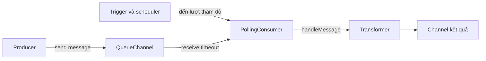

# Poller và PollingConsumer

## 1. Mục tiêu và tình huống sử dụng

Trong Spring Integration Core, thông điệp gồm payload và headers được chuyển qua `MessageChannel` đến các endpoint. Tuy nhiên, việc gửi message vào channel chưa trả lời câu hỏi: **ai lấy message ra, vào lúc nào và bằng thread nào?**

Giả sử một dịch vụ nhận yêu cầu chuẩn hóa mã đơn hàng. Producer đẩy yêu cầu vào hàng đợi nhanh hơn tốc độ xử lý; ứng dụng muốn chủ động lấy từng nhóm nhỏ để bảo vệ hệ thống phía sau. Với tình huống này, cần phân biệt:

- **Poller**: cách cấu hình việc thăm dò, bao gồm lịch chạy và giới hạn mỗi lượt.
- **PollingConsumer**: endpoint lấy message từ một `PollableChannel`, sau đó giao cho `MessageHandler`.
- **Handler**: thành phần thực hiện công việc như transformer, filter, router hoặc service activator.

Sau bài học, bạn có thể chọn endpoint theo loại channel, đặt poller đúng vị trí, giải thích các tham số cơ bản và kiểm thử một flow bất đồng bộ. Bài thuộc chương **Poller** của module **SPRING_INTEGRATION_CORE**, tập trung vào nền tảng để thiết kế luồng thông điệp bằng Java DSL.

## 2. Tách ba trách nhiệm: channel, endpoint và handler

Xét luồng:



`QueueChannel` giữ message đang chờ. `PollingConsumer` quản lý việc nhận message theo lịch. Transformer chỉ chuyển đổi nội dung sau khi message đã được nhận; nó không cần tự viết vòng lặp đọc hàng đợi.

Nhìn ở mức API, `PollingConsumer` nối một `PollableChannel` với một `MessageHandler`. Trong ứng dụng, thông thường bạn khai báo endpoint bằng annotation hoặc DSL và để framework tạo loại consumer thích hợp. [Javadoc PollingConsumer](https://docs.spring.io/spring-integration/api/org/springframework/integration/endpoint/PollingConsumer.html).

Một service activator không tự mang ý nghĩa “chạy định kỳ”. Cùng logic xử lý đó, loại input channel quyết định cơ chế nhận message:

| Input channel | Cơ chế nhận thông thường | Endpoint tương ứng | Cần poller cho việc nhận? |
| --- | --- | --- | --- |
| `DirectChannel` | Channel gọi handler đã đăng ký | `EventDrivenConsumer` | Không |
| `ExecutorChannel` | Channel phân phối cho handler qua executor | `EventDrivenConsumer` | Không |
| `QueueChannel` | Endpoint chủ động gọi `receive(...)` | `PollingConsumer` | Có |

`ExecutorChannel` cho thấy **bất đồng bộ** và **polling** là hai khái niệm riêng. Chuyển xử lý sang executor không biến channel thành một hàng đợi được đọc theo lịch. Cách phân biệt consumer theo `SubscribableChannel` và `PollableChannel` được mô tả trong [tài liệu Poller](https://docs.spring.io/spring-integration/reference/polling-consumer.html).

## 3. PollingConsumer và SourcePollingChannelAdapter

Hai endpoint đều có thể dùng poller, nhưng chúng nhận message từ hai nơi khác nhau:

```text
Đọc channel nội bộ:
Producer -> QueueChannel -> PollingConsumer -> Handler

Đọc một nguồn dữ liệu:
MessageSource -> SourcePollingChannelAdapter -> MessageChannel -> Handler
```

`PollingConsumer` nhận một message đã có trong channel. `SourcePollingChannelAdapter` gọi `MessageSource.receive()` để lấy message từ nguồn, rồi gửi vào channel đích. Nguồn có thể đọc dữ liệu bên ngoài hoặc lấy dữ liệu do logic Java cung cấp. Đây là hai biến thể polling được framework phân biệt rõ trong [Pollable Message Source](https://docs.spring.io/spring-integration/reference/polling-consumer.html#pollable-message-source).

Ví dụ, một source lấy mã đơn hàng từ danh sách chờ có thể trả `null` khi không còn dữ liệu. `null` biểu thị lượt nhận không có message; không phải một `Message` với payload `null`.

Nếu source đẩy vào `DirectChannel`, handler phía sau được gọi trên thread đang thực thi source poll. Không cần đặt thêm poller vào handler này. Nếu source đẩy vào `QueueChannel`, cần một polling consumer khác để lấy dữ liệu ra khỏi queue. Khi đó tồn tại hai nhịp độc lập: nhịp đọc nguồn và nhịp tiêu thụ queue.

Trong thiết kế, hãy vẽ nơi dữ liệu được giữ lại trước. Mỗi ranh giới queue cần cơ chế tiêu thụ rõ ràng; mỗi nguồn được thăm dò cần lịch đọc nguồn rõ ràng.

## 4. Một lượt poll thực hiện những gì?

Có thể hình dung hoạt động bình thường của `PollingConsumer` bằng mã giả sau. Đây là mô hình giải thích, không phải mã nguồn đầy đủ của framework:

```text
khi trigger cho phép thực thi một lượt:
    lặp tối đa maxMessagesPerPoll lần:
        message = inputChannel.receive(receiveTimeout)
        nếu message là null:
            kết thúc lượt
        handler.handleMessage(message)
    chờ lần kích hoạt tiếp theo
```

Một lượt poll có thể xử lý nhiều message. Nếu queue chỉ có hai message và giới hạn là mười, poller không phải chờ đủ mười mới xử lý. Từng message được giao cho handler ngay sau khi nhận.

Nếu handler ném exception, không được hiểu mã giả là mọi message còn lại vẫn chắc chắn được xử lý trong lượt đó. Cần xét cơ chế lỗi và advice đang cấu hình. Tương tự, có giới hạn mười message không có nghĩa handler sẽ nhận một `List` chứa mười phần tử.

### 4.1. Lịch chạy: fixed delay, fixed rate và cron

| Kiểu lịch | Cách xác định thời điểm | Ví dụ phù hợp |
| --- | --- | --- |
| Fixed delay | Tính khoảng nghỉ sau khi tác vụ trước hoàn thành | Để hệ thống có khoảng nghỉ giữa các lượt |
| Fixed rate | Tính theo các mốc bắt đầu đã lên lịch | Duy trì nhịp thăm dò mong muốn |
| Cron | Tính theo biểu thức lịch | Chỉ đọc dữ liệu ở các khung giờ nghiệp vụ |

Trong trường hợp xử lý đồng bộ, một lượt mất 300 ms và fixed delay là 1.000 ms thì khoảng cách giữa hai lần bắt đầu xấp xỉ 1.300 ms. Với fixed rate 1.000 ms, các mốc mong muốn cách nhau 1.000 ms; scheduler vẫn có thể thực thi trễ khi thiếu tài nguyên. Fixed rate tự nó không phải cấu hình số luồng xử lý song song. Ý nghĩa hai kiểu chu kỳ được định nghĩa trong [PeriodicTrigger](https://docs.spring.io/spring-framework/docs/current/javadoc-api/org/springframework/scheduling/support/PeriodicTrigger.html).

Java DSL cung cấp các factory như:

```java
Pollers.fixedDelay(Duration.ofSeconds(1));
Pollers.fixedRate(Duration.ofSeconds(1));
Pollers.cron("0 */5 * * * *"); // giây 0, mỗi 5 phút
```

Biểu thức trên có sáu trường theo cú pháp cron của Spring. Với lịch theo giờ nghiệp vụ, hãy cấu hình múi giờ một cách chủ đích thay vì mặc nhiên phụ thuộc vào môi trường chạy. Các factory này tạo cấu hình `PollerSpec`; chúng không tự tạo một flow hay tự kích hoạt xử lý. [Javadoc Pollers](https://docs.spring.io/spring-integration/api/org/springframework/integration/dsl/Pollers.html).

### 4.2. maxMessagesPerPoll

`maxMessagesPerPoll` giới hạn số message nhận trong **một lượt**, không phải số message mỗi giây và cũng không phải kích thước batch nghiệp vụ.

- Giá trị dương: nhận tối đa số lượng đó; kết thúc sớm nếu nhận được `null`.
- Giá trị âm, thường dùng `-1`: không đặt giới hạn số lượng; tiếp tục cho đến khi lần nhận trả `null`.
- Giá trị `0`: bỏ qua việc nhận ở endpoint polling trên các phiên bản hỗ trợ cơ chế này, được bổ sung từ 5.5.

Mặc định khác nhau giữa `PollingConsumer` (`-1`) và `SourcePollingChannelAdapter` (`1`). Source luôn trả dữ liệu mới có thể khiến một lượt không kết thúc nếu đặt giới hạn âm. Khi học và khi cần kiểm soát tải, nên đặt giới hạn dương rõ ràng. [Cấu hình poller và các giá trị mặc định](https://docs.spring.io/spring-integration/reference/endpoint.html).

Ví dụ queue có 23 message, không có producer mới, `maxMessagesPerPoll=10` và không có lỗi:

| Lượt | Số message nhận được | Số còn lại |
| --- | --- | --- |
| 1 | 10 | 13 |
| 2 | 10 | 3 |
| 3 | 3 | 0 |

Ở lượt 3, sau message thứ ba, lần nhận tiếp theo có thể chờ đến hết `receiveTimeout` trước khi trả `null`. Vì vậy, thời gian của một lượt không chỉ gồm thời gian xử lý những message đã nhận.

### 4.3. receiveTimeout

`receiveTimeout` là thời gian chờ trong một thao tác nhận từ `PollableChannel`, tính bằng millisecond khi dùng cấu hình trong các ví dụ dưới. Nó không phải timeout gọi HTTP, timeout của transformer hay khoảng nghỉ giữa hai lượt.

Với `receiveTimeout(0)`, lần nhận trả về ngay nếu chưa có message. Với timeout dương, thread có thể chờ và nhận ngay khi message đến trong khoảng đó. Tham số này không tự giới hạn thời gian một `MessageSource.receive()` tùy ý thực hiện I/O; timeout của nguồn phải được cấu hình tại nguồn hoặc client tương ứng. [Cơ chế nhận của PollingConsumer](https://docs.spring.io/spring-integration/api/org/springframework/integration/endpoint/PollingConsumer.html).

Giả sử fixed delay là 500 ms, timeout nhận là 0 và queue rỗng. Message đến ngay sau lượt nhận sẽ phải chờ lượt kế tiếp. Nếu timeout nhận là 1.000 ms, thread đang chờ có thể lấy message sớm hơn, đổi lại thread bị chiếm trong lúc queue rỗng.

## 5. Ví dụ Java DSL: chuẩn hóa mã đơn hàng từ queue

### 5.1. Điều kiện và cấu hình

Ví dụ dùng Java 17 trở lên, Spring Integration 6.x và API Java DSL nằm trong `spring-integration-core`. Trong dự án Spring Boot tương thích, có thể dùng starter `spring-boot-starter-integration`; để Boot quản lý phiên bản thay vì tự ghép các thư viện Spring khác phiên bản.

Đây là một lớp cấu hình có thể được nạp vào Spring context. Ví dụ chủ động đặt `autoStartup(false)` để kiểm thử quyết định thời điểm bắt đầu; khi dùng cho ứng dụng tự xử lý ngay sau startup, hãy bỏ cấu hình này hoặc đổi thành `true`.

```java
package example.poller;

import java.time.Duration;
import java.util.Locale;

import org.springframework.context.annotation.Bean;
import org.springframework.context.annotation.Configuration;
import org.springframework.integration.channel.QueueChannel;
import org.springframework.integration.config.EnableIntegration;
import org.springframework.integration.dsl.IntegrationFlow;
import org.springframework.integration.dsl.Pollers;

@Configuration
@EnableIntegration
public class PollingOrderConfig {

    @Bean
    public QueueChannel incomingOrders() {
        return new QueueChannel(100);
    }

    @Bean
    public QueueChannel normalizedOrders() {
        return new QueueChannel(100);
    }

    @Bean
    public IntegrationFlow normalizeOrdersFlow() {
        return IntegrationFlow.from(incomingOrders())
                .<String, String>transform(
                        value -> value.trim().toUpperCase(Locale.ROOT),
                        endpoint -> endpoint
                                .id("normalizeOrderEndpoint")
                                .autoStartup(false)
                                .poller(Pollers
                                        .fixedDelay(Duration.ofMillis(200))
                                        .maxMessagesPerPoll(5)
                                        .receiveTimeout(0)))
                .channel(normalizedOrders())
                .get();
    }
}
```

Poller gắn vào endpoint transformer vì **input của endpoint này** là `incomingOrders`, một `QueueChannel`. Framework tạo polling consumer để nhận message rồi gọi transformer. Hai bean channel được quản lý bởi lớp `@Configuration` với cơ chế proxy mặc định.

`normalizedOrders` là queue kết quả. Trong kiểm thử, test gọi `receive(...)` trực tiếp để lấy kết quả nên chưa cần một consumer tự động cho queue này. Nếu nối tiếp một router, filter hoặc aggregator đọc queue đó, endpoint kế tiếp cũng cần poller riêng hoặc poller mặc định.

Giới hạn queue là 100 chỉ để minh họa vùng đệm hữu hạn. Nó độc lập với giới hạn năm message mỗi lượt. `QueueChannel` lưu message trong queue và hỗ trợ cấu hình capacity; API cũng cung cấp số lượng đang chờ để quan sát. [Javadoc QueueChannel](https://docs.spring.io/spring-integration/api/org/springframework/integration/channel/QueueChannel.html).

### 5.2. Đọc đúng hành vi của flow

Với payload `"  ord-001  "`, kết quả là `"ORD-001"`. Producer gửi xong vào `incomingOrders` chưa có nghĩa transformer đã hoàn thành.

Khi endpoint được start, poller thử lấy tối đa năm message trong mỗi lượt. Transformer được gọi lần lượt trên thread thực thi lượt poll nếu không bổ sung ranh giới executor. Việc gửi kết quả vào queue đầu ra hoàn tất trước khi xử lý message kế tiếp trong mô hình đơn giản này.

Khi queue đầu ra đầy, downstream có thể làm chậm lượt poll. Trong ứng dụng thực tế, cần xác định chính sách timeout gửi và cách xử lý quá tải; chỉ giảm chu kỳ poll không giải quyết được nghẽn ở hệ thống nhận.

### 5.3. Kiểm thử có kiểm soát vòng đời

Đoạn kiểm thử dùng JUnit Jupiter. `AnnotationConfigApplicationContext` nạp đúng cấu hình trên; không cần khởi động toàn bộ ứng dụng Boot.

```java
package example.poller;

import org.junit.jupiter.api.Test;
import org.springframework.context.annotation.AnnotationConfigApplicationContext;
import org.springframework.integration.channel.QueueChannel;
import org.springframework.integration.endpoint.AbstractEndpoint;
import org.springframework.messaging.Message;
import org.springframework.messaging.support.GenericMessage;

import static org.junit.jupiter.api.Assertions.assertEquals;
import static org.junit.jupiter.api.Assertions.assertNotNull;
import static org.junit.jupiter.api.Assertions.assertNull;
import static org.junit.jupiter.api.Assertions.assertTrue;

class PollingOrderConfigTest {

    @Test
    void normalizesOnlyAfterConsumerStarts() {
        try (var context = new AnnotationConfigApplicationContext(
                PollingOrderConfig.class)) {
            QueueChannel input = context.getBean(
                    "incomingOrders", QueueChannel.class);
            QueueChannel output = context.getBean(
                    "normalizedOrders", QueueChannel.class);
            AbstractEndpoint endpoint = context.getBean(
                    "normalizeOrderEndpoint", AbstractEndpoint.class);

            assertTrue(input.send(new GenericMessage<>("  ord-001  "), 0));
            assertNull(output.receive(0));
            assertEquals(1, input.getQueueSize());

            endpoint.start();
            try {
                Message<?> result = output.receive(3000);
                assertNotNull(result);
                assertEquals("ORD-001", result.getPayload());
            }
            finally {
                endpoint.stop();
            }
        }
    }
}
```

Test chứng minh một message có thể chờ trong queue trước khi consumer chạy, rồi được biến đổi sau khi consumer bắt đầu. `receive(3000)` trả về ngay khi có kết quả và chỉ chờ tối đa ba giây; không bắt buộc test ngủ đủ ba giây.

Test này không chứng minh chu kỳ chính xác 200 ms, throughput hay giới hạn năm message trong từng lượt. Kiểm thử các thuộc tính đó cần quan sát riêng ranh giới lượt poll hoặc trigger có thể điều khiển; không nên suy ra chúng chỉ từ số message cuối cùng.

## 6. Hai cách cấu hình khác cần nhận biết

### 6.1. Annotation cho handler đọc từ queue

Đoạn dưới là **phương án thay thế** endpoint transformer ở ví dụ trước, dùng một service activator không trả kết quả. Đặt method trong một bean được Spring quản lý và giữ bean `incomingOrders`:

```java
import org.springframework.integration.annotation.Poller;
import org.springframework.integration.annotation.ServiceActivator;

@ServiceActivator(
        inputChannel = "incomingOrders",
        poller = @Poller(fixedDelay = "200", maxMessagesPerPoll = "5"))
public void processOrder(String orderCode) {
    System.out.println("Processing " + orderCode);
}
```

Không bật đồng thời hai endpoint đọc cùng `incomingOrders` nếu mục tiêu là mỗi message đi qua đúng logic chuẩn hóa của ví dụ. Nhiều consumer trên một queue cạnh tranh nhận message; không tự tạo cơ chế phát bản sao cho tất cả handler.

### 6.2. Poller mặc định

Có thể khai báo một poller mặc định trong application context:

```java
import java.time.Duration;

import org.springframework.context.annotation.Bean;
import org.springframework.integration.dsl.Pollers;
import org.springframework.integration.scheduling.PollerMetadata;

@Bean(name = PollerMetadata.DEFAULT_POLLER)
public PollerMetadata defaultPoller() {
    return Pollers.fixedDelay(Duration.ofSeconds(1))
            .maxMessagesPerPoll(5)
            .receiveTimeout(0)
            .getObject();
}
```

Endpoint polling không có cấu hình riêng có thể sử dụng default này. Một endpoint có poller riêng vẫn giữ cấu hình riêng. Đặt poller mặc định giúp giảm lặp cấu hình nhưng cũng khiến tác động thay đổi rộng hơn; nên dùng poller riêng cho nguồn hoặc consumer có yêu cầu tải đặc biệt. [Global Default Poller](https://docs.spring.io/spring-integration/reference/endpoint.html#global-default-poller).

## 7. Ví dụ đọc nguồn bằng SourcePollingChannelAdapter

Đây là cấu hình độc lập, không nối với `incomingOrders` ở phần trước. Nó minh họa polling một nguồn giả lập bằng bộ đệm trong bộ nhớ:

```java
package example.poller;

import java.time.Duration;
import java.util.Queue;
import java.util.concurrent.ConcurrentLinkedQueue;

import org.springframework.context.annotation.Bean;
import org.springframework.context.annotation.Configuration;
import org.springframework.integration.config.EnableIntegration;
import org.springframework.integration.core.MessageSource;
import org.springframework.integration.dsl.IntegrationFlow;
import org.springframework.integration.dsl.Pollers;
import org.springframework.messaging.support.GenericMessage;

@Configuration
@EnableIntegration
public class SourcePollingConfig {

    @Bean
    public MessageSource<String> pendingOrderSource() {
        Queue<String> pending = new ConcurrentLinkedQueue<>();
        pending.add("ord-101");
        pending.add("ord-102");

        return () -> {
            String order = pending.poll();
            return order == null ? null : new GenericMessage<>(order);
        };
    }

    @Bean
    public IntegrationFlow readPendingOrdersFlow() {
        return IntegrationFlow.from(
                        pendingOrderSource(),
                        endpoint -> endpoint
                                .id("pendingOrdersSourceEndpoint")
                                .poller(Pollers
                                        .fixedDelay(Duration.ofSeconds(1))
                                        .maxMessagesPerPoll(1)))
                .handle(message -> System.out.println(message.getPayload()))
                .get();
    }
}
```

Poller đặt ở **source endpoint**, ngay trong `IntegrationFlow.from(...)`. Mỗi lượt source trả tối đa một message do giới hạn được đặt rõ ràng. Sau hai lượt nhận được dữ liệu, các lần đọc tiếp theo trả `null` cho đến khi có dữ liệu mới; ở ví dụ này không có producer bổ sung.

Consumer phía sau source không đọc từ một `QueueChannel` trong flow này, nên không đặt poller vào `.handle(...)`. Đây là khác biệt thực hành quan trọng nhất so với flow đọc queue.

## 8. Thread, lỗi và giới hạn bảo đảm

### 8.1. Biên bất đồng bộ thay đổi nơi nhận lỗi

Với `DirectChannel` chạy trên thread người gửi, exception từ handler có thể truyền về lời gọi gửi. Với queue, producer đã giao message vào bộ đệm; handler chạy sau đó trên thread polling nên `try/catch` quanh `send(...)` không bắt được lỗi nghiệp vụ phát sinh ở thời điểm ấy.

Trong cơ chế xử lý lỗi chuẩn của Spring Integration, lỗi tác vụ polling được biểu diễn bằng `ErrorMessage` và chuyển đến error channel thích hợp. Cấu hình theo message có thể dùng header `errorChannel`; nếu không, framework có global `errorChannel`. Nếu tùy biến scheduler hoặc error handler, cần giữ cơ chế xuất bản lỗi mà flow mong đợi. [Error Handling](https://docs.spring.io/spring-integration/reference/error-handling.html).

Một flow xử lý lỗi có thể ghi nhận mã đơn hàng, loại exception và quyết định chuyển đến kênh xử lý thủ công. Tuy nhiên, nhận một `ErrorMessage` không tự đồng nghĩa message nguồn đã được đưa lại vào queue.

### 8.2. Polling không tự tạo độ bền dữ liệu

Trong ví dụ, `QueueChannel` dùng bộ nhớ. Nếu tiến trình dừng, dữ liệu trong bộ đệm không có bảo đảm tồn tại sau khởi động lại. Nếu handler lỗi sau khi message được lấy ra, việc retry hay phát lại phải được thiết kế riêng.

Khi cần độ bền, cần chọn message store hoặc hạ tầng nguồn phù hợp, xác định transaction boundary, retry và xử lý trùng lặp theo yêu cầu nghiệp vụ. Ví dụ thu tiền cần một mã thao tác ổn định để tránh cùng yêu cầu gây nhiều lần trừ tiền khi retry.

Poller có thể tham gia cơ chế transaction của Spring, nhưng một transaction không tự bảo đảm rollback tất cả tác dụng phụ bên ngoài. Chuyển sang executor còn tạo ranh giới thread cần được xét riêng. Phần transaction chuyên sâu nên được học sau khi đã xác định rõ nơi nhận message và nơi thực hiện nghiệp vụ.

### 8.3. Scheduler và executor là hai vai trò

Scheduler quyết định lúc kích hoạt. Executor, nếu được cấu hình cho poller, nhận công việc thực thi. Khi tách hai vai trò này, thời điểm tác vụ được submit không còn đồng nghĩa xử lý nghiệp vụ đã xong.

Trước khi thêm executor, hãy xác định source có an toàn khi truy cập đồng thời không, handler có phụ thuộc thứ tự không và downstream chịu được bao nhiêu yêu cầu cùng lúc. Đừng suy từ `maxMessagesPerPoll(10)` rằng có mười thread hoặc mười request chạy song song.

## 9. Tính thử năng lực xử lý

Với một polling consumer xử lý đồng bộ, luôn có backlog, không có lỗi và mỗi lượt xử lý đủ `B` message, có thể ước lượng:

```text
thời gian một lượt ≈ B × thời gian xử lý trung bình mỗi message
throughput fixed delay ≈ B / (thời gian một lượt + khoảng nghỉ)
```

Ví dụ giả định `B=5`, mỗi message mất 40 ms và fixed delay là 200 ms:

```text
thời gian xử lý một lượt ≈ 5 × 40 ms = 200 ms
khoảng cách giữa hai lần bắt đầu ≈ 200 + 200 = 400 ms
throughput xấp xỉ ≈ 5 / 0,4 = 12,5 message/giây
```

Đây là phép ước lượng từ mô hình đã nêu, không phải cam kết của framework. Nó bỏ qua overhead, chờ I/O, timeout nhận khi queue rỗng và nghẽn đầu ra. Nếu producer liên tục gửi 30 message/giây trong khi consumer chỉ đạt khoảng 12,5 message/giây, backlog sẽ tăng.

Từ đó, đo ít nhất độ sâu queue, tuổi message chờ lâu nhất, thời gian xử lý và tần suất lỗi. Đổi một tham số rồi đo lại; giảm khoảng nghỉ chỉ hữu ích khi downstream vẫn còn khả năng xử lý.

## 10. Lỗi cấu hình thường gặp

| Biểu hiện | Điều cần kiểm tra | Hướng xử lý |
| --- | --- | --- |
| Message nằm trong queue mãi | Endpoint đã start chưa; poller riêng hoặc mặc định có tồn tại không | Kiểm tra lifecycle và cấu hình consumer |
| Nghĩ `fixedDelay(1000)` giới hạn handler chạy một lần/giây | Một lượt có thể nhận nhiều message | Đặt `maxMessagesPerPoll` rõ ràng |
| Tăng `receiveTimeout` để sửa HTTP timeout | Đây là thời gian chờ nhận từ channel | Đặt timeout tại HTTP client/adapter |
| Gắn poller vào handler đọc `DirectChannel` | Input không phải pollable channel | Dùng consumer theo cơ chế subscribe |
| Nguồn bị đọc liên tục trong một lượt | Source luôn trả message và giới hạn là số âm | Dùng giới hạn dương, kiểm tra điều kiện hết dữ liệu |
| Producer không bắt được lỗi handler | Xử lý nằm sau queue trên thread khác | Quan sát error flow |
| Message không đi qua đủ hai handler | Hai consumer đang cạnh tranh đọc cùng queue | Nối tiếp các bước nếu cần xử lý tuần tự |
| Queue ngày càng lớn | Tốc độ nhận vào cao hơn tốc độ xử lý | Đo backlog và giới hạn downstream trước khi chỉnh poller |

## 11. Tự thực hành

1. Với flow chuẩn hóa, gửi ba message trước khi start endpoint. Kiểm tra input queue có ba phần tử rồi nhận đủ ba kết quả sau khi start.
2. Đổi `maxMessagesPerPoll` thành một và đặt khoảng nghỉ dài hơn để dễ quan sát. Phân biệt điều bạn quan sát trong demo với điều được chứng minh bởi test tự động.
3. Đổi đầu vào sang `DirectChannel`, bỏ poller và cấu hình dừng tự động; giải thích vì sao handler có thể chạy ngay trong lời gọi gửi.
4. Cho transformer ném exception ở một mã đơn hàng nhất định. Theo dõi error flow và xác định message có thực sự được retry hay không.
5. Trong source flow, đổi giới hạn từ một sang hai. Dự đoán hai mã đơn hàng sẽ được phát trong cùng một lượt nhận trước khi chạy thử.

Khi đọc một flow bất kỳ, hãy xác định lần lượt: dữ liệu đang ở channel hay source, endpoint nào chủ động nhận, lịch nào kích hoạt, mỗi lượt có giới hạn gì và lỗi được quan sát ở đâu. Trả lời được các câu đó là nền tảng để đặt transformer, router, filter và aggregator vào đúng ranh giới xử lý.