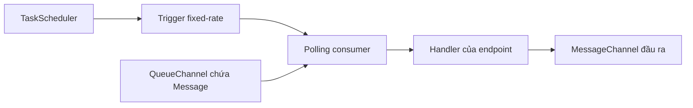

# fixed-rate: lập lịch poller theo chu kỳ cố định

Trong chương **Poller** của module **SPRING_INTEGRATION_CORE**, `fixed-rate` dùng để yêu cầu một endpoint thăm dò dữ liệu theo nhịp định kỳ. Hiểu đúng nhịp này giúp thiết kế luồng thông điệp có tốc độ phù hợp với nguồn dữ liệu, hàng đợi và hệ thống nhận.

Bài học tập trung vào ba câu hỏi: poller dự kiến chạy lúc nào, mỗi lượt lấy bao nhiêu thông điệp, và điều gì xảy ra khi xử lý lâu hơn chu kỳ. Các ví dụ nối lịch polling với `Message`, `MessageChannel`, endpoint và Java DSL; phần kiểm thử giúp quan sát cả kết quả lẫn lỗi.

## 1. fixed-rate đo khoảng cách nào?

`fixed-rate` đo chu kỳ giữa **các thời điểm bắt đầu theo lịch**. Nó khác với việc đợi một khoảng cố định sau khi công việc trước hoàn thành. Với `PeriodicTrigger`, chế độ fixed rate được bật bằng `setFixedRate(true)`; mặc định của một `PeriodicTrigger` tự tạo là fixed delay. [Javadoc PeriodicTrigger](https://docs.spring.io/spring-framework/docs/current/javadoc-api/org/springframework/scheduling/support/PeriodicTrigger.html).

Đặt:

- `P`: chu kỳ polling.
- `D`: độ trễ trước lượt đầu.
- `t0`: mốc lịch bắt đầu hoạt động.
- `S(n)`: thời điểm dự kiến bắt đầu lượt thứ `n`, đánh số từ `0`.

Mô hình lý tưởng:

```text
S(n) = t0 + D + n × P
```

Ví dụ `P = 1 giây`, `D = 0`, mỗi lượt mất `300 ms`:

```text
Thời gian:       0          1          2          3 giây
Theo lịch:       |          |          |          |
Xử lý:           [0--0,3]   [1--1,3]   [2--2,3]   [3--3,3]
```

Nếu cùng công việc dùng fixed delay `1 giây`, lượt kế tiếp được tính từ khi lượt trước kết thúc:

```text
Bắt đầu:         0          1,3          2,6          3,9 giây
Xử lý:           [0--0,3]   [1,3--1,6]   [2,6--2,9]   ...
```

Đây là mô hình giải thích lịch, không phải cam kết thời gian thực. Khi máy bận, thời điểm chạy thực tế có thể muộn hơn thời điểm dự kiến. Vì vậy, log nên phân biệt thời điểm theo lịch, thời điểm bắt đầu thật và thời điểm hoàn thành.

| Tiêu chí | fixed-rate | fixed-delay |
|---|---|---|
| Mốc tính chu kỳ | Thời điểm bắt đầu theo lịch | Thời điểm hoàn thành lượt trước |
| Mục đích thường gặp | Duy trì nhịp thăm dò | Dành khoảng nghỉ sau công việc |
| Khi công việc kéo dài | Có thể chậm so với lịch | Thời điểm bắt đầu tiếp theo tự lùi |
| Có tự tăng số luồng không? | Không | Không |
| Có quy định số thông điệp mỗi lượt không? | Không | Không |

## 2. Poller nằm ở đâu trong luồng thông điệp?

Có hai tình huống chính:

1. **Inbound channel adapter** gọi `MessageSource.receive()` để lấy dữ liệu từ bên ngoài và tạo thông điệp.
2. **Polling consumer** lấy thông điệp từ `PollableChannel`, chẳng hạn `QueueChannel`, rồi chuyển cho handler của endpoint.

Một endpoint nhận từ `DirectChannel` thường được gọi theo sự kiện gửi thông điệp. Không gắn poller vào endpoint đó chỉ để làm nó chạy định kỳ. Poller phù hợp khi đầu vào là nguồn cần thăm dò hoặc kênh có cơ chế nhận chủ động. [Spring Integration — Message Endpoints](https://docs.spring.io/spring-integration/reference/endpoint.html).



Trong luồng này, trigger quyết định lịch; channel giữ thông điệp; handler thực hiện nghiệp vụ. Tăng nhịp polling không làm handler xử lý nhanh hơn.

Ví dụ thực tế: một hệ thống nhận yêu cầu chuẩn hóa mã đơn hàng vào hàng đợi. Producer gửi `Message<String>` bất kỳ lúc nào. Cứ khoảng một giây, endpoint lấy tối đa năm thông điệp đang chờ, chuẩn hóa rồi chuyển kết quả sang kênh đầu ra.

## 3. Cấu hình bằng Java DSL

### 3.1. Luồng xử lý QueueChannel

Ví dụ sử dụng Java 17+, Spring Integration 6.x với Spring Framework 6.x tương thích; các API `Duration` cũng có trong các thế hệ tiếp theo. Dùng bộ phiên bản do dự án quản lý, chẳng hạn BOM của Spring Boot. Dependency chính là `org.springframework.integration:spring-integration-core`; phần kiểm thử bên dưới cần thêm Spring Test và JUnit Jupiter.

Đây là cấu hình Spring độc lập, được nạp vào `ApplicationContext` của ứng dụng hoặc bài kiểm thử. Không cần `@EnableScheduling` để kích hoạt poller Spring Integration; ví dụ dùng `@EnableIntegration` để đăng ký hạ tầng tích hợp.

```java
import java.time.Duration;
import java.util.Locale;

import org.springframework.context.annotation.Bean;
import org.springframework.context.annotation.Configuration;
import org.springframework.integration.channel.QueueChannel;
import org.springframework.integration.config.EnableIntegration;
import org.springframework.integration.dsl.IntegrationFlow;
import org.springframework.integration.dsl.Pollers;

@Configuration
@EnableIntegration
public class FixedRatePollerConfig {

    @Bean
    public QueueChannel jobs() {
        return new QueueChannel(100);
    }

    @Bean
    public QueueChannel results() {
        return new QueueChannel(100);
    }

    @Bean
    public QueueChannel pollerErrors() {
        return new QueueChannel(100);
    }

    @Bean
    public IntegrationFlow normalizeFlow() {
        return IntegrationFlow.from(jobs())
                .handle(String.class, (payload, headers) -> {
                    String normalized = payload.trim();
                    if (normalized.isEmpty()) {
                        throw new IllegalArgumentException(
                                "Mã đơn hàng không được rỗng");
                    }
                    return normalized.toUpperCase(Locale.ROOT);
                }, endpoint -> endpoint
                        .id("normalizeEndpoint")
                        .poller(Pollers.fixedRate(Duration.ofSeconds(1))
                                .maxMessagesPerPoll(5)
                                .receiveTimeout(0)
                                .errorChannel("pollerErrors")))
                .channel(results())
                .get();
    }
}
```

Các cấu hình cần đọc cùng nhau:

| Thành phần | Vai trò trong ví dụ |
|---|---|
| `jobs()` | Hàng đợi đầu vào có sức chứa 100 thông điệp |
| `fixedRate(Duration.ofSeconds(1))` | Nhịp polling theo lịch một giây |
| `maxMessagesPerPoll(5)` | Giới hạn tối đa năm thông điệp trong một lượt |
| `receiveTimeout(0)` | Khi hàng đợi rỗng, nhận trả về ngay |
| `errorChannel("pollerErrors")` | Chọn kênh nhận thông điệp lỗi của poller |
| `results()` | Hàng đợi nhận kết quả chuẩn hóa |

Trong Java DSL, `Pollers.fixedRate(...)` tạo cấu hình poller; overload nhận `long` dùng mili giây. Overload nhận `Duration` thể hiện đơn vị ngay tại nơi gọi. [Javadoc Pollers](https://docs.spring.io/spring-integration/api/org/springframework/integration/dsl/Pollers.html).

Poller gắn vào endpoint `.handle(...)` vì endpoint này nhận trực tiếp từ `jobs`, một `QueueChannel`. Với luồng nhiều bước, phải đặt poller ở endpoint có đầu vào pollable; các bước transformer, filter hoặc router phía sau qua kênh trực tiếp không cần mỗi bước một poller.

Có thể gửi dữ liệu bằng:

```java
boolean accepted = jobs.send(
        new org.springframework.messaging.support.GenericMessage<>("  ord-001  "),
        1000);
```

Trong đoạn này, `jobs` là `QueueChannel` lấy từ context. `accepted == true` nghĩa là hàng đợi đã nhận thông điệp; nó chưa chứng minh xử lý nghiệp vụ thành công. Tham số `1000` là thời gian chờ gửi khi kênh đầy, không phải chu kỳ polling. Kết quả mong đợi ở `results` là payload `ORD-001`.

Các hàng đợi bộ nhớ trong ví dụ phục vụ học tập. Cần có consumer cho cả kênh kết quả và kênh lỗi khi dùng lâu dài; nếu chúng đầy, việc gửi xuống các kênh này có thể giữ luồng xử lý và kéo dài lượt polling.

### 3.2. Độ trễ lượt đầu

Nếu muốn chờ ba giây trước lượt đầu, sau đó duy trì nhịp một giây, thay cấu hình trigger bằng:

```java
Pollers.fixedRate(
        Duration.ofSeconds(1),
        Duration.ofSeconds(3))
    .maxMessagesPerPoll(5)
    .receiveTimeout(0);
```

Đối số thứ nhất là chu kỳ; đối số thứ hai là initial delay. Trong mô hình lý tưởng, các lượt bắt đầu tại `3, 4, 5, 6...` giây kể từ mốc lập lịch. Initial delay chỉ tác động lượt đầu, không trở thành khoảng nghỉ bổ sung sau từng lượt.

### 3.3. Inbound adapter bằng annotation

Ví dụ thay thế sau minh họa việc thăm dò một nguồn đơn giản. Không cần nạp cùng cấu hình ở mục 3.1:

```java
import java.util.concurrent.atomic.AtomicLong;

import org.springframework.context.annotation.Bean;
import org.springframework.context.annotation.Configuration;
import org.springframework.integration.annotation.InboundChannelAdapter;
import org.springframework.integration.annotation.Poller;
import org.springframework.integration.channel.QueueChannel;
import org.springframework.integration.config.EnableIntegration;

@Configuration
@EnableIntegration
public class HeartbeatConfig {

    private final AtomicLong sequence = new AtomicLong();

    @Bean
    public QueueChannel heartbeats() {
        return new QueueChannel(100);
    }

    @InboundChannelAdapter(
            channel = "heartbeats",
            poller = @Poller(
                    fixedRate = "1000",
                    maxMessagesPerPoll = "1"))
    public String nextHeartbeat() {
        return "heartbeat-" + sequence.incrementAndGet();
    }
}
```

`fixedRate = "1000"` dùng mili giây. Những thuộc tính dạng chuỗi của `@Poller` hỗ trợ placeholder, nên có thể dùng `fixedRate = "${integration.heartbeat.period-ms:1000}"`. Khi cần cấu hình phức tạp như initial delay hoặc advice, có thể khai báo bean `PollerMetadata` rồi tham chiếu bằng `@Poller("tenBeanPoller")`. [Javadoc @Poller](https://docs.spring.io/spring-integration/api/org/springframework/integration/annotation/Poller.html).

Nguồn heartbeat luôn trả về giá trị. Vì vậy phải giữ giới hạn mỗi lượt hữu hạn. Việc tăng bộ đếm chỉ mô phỏng nguồn dữ liệu; trong ứng dụng thật, phương thức này có thể đọc bản ghi chờ hoặc trạng thái từ một hệ thống khác.

### 3.4. Cú pháp XML tương đương về lịch

Đoạn XML dưới đây giả định namespace Spring Integration đã được khai báo và bean `normalizer` có phương thức `normalize`:

```xml
<int:channel id="jobs">
    <int:queue capacity="100"/>
</int:channel>

<int:channel id="results">
    <int:queue capacity="100"/>
</int:channel>

<int:service-activator input-channel="jobs"
                       output-channel="results"
                       ref="normalizer"
                       method="normalize">
    <int:poller fixed-rate="1000"
                max-messages-per-poll="5"
                receive-timeout="0"/>
</int:service-activator>
```

Không khai báo đồng thời `fixed-rate` và `fixed-delay` cho cùng một poller. Nếu dùng `trigger` tùy biến hoặc tham chiếu poller có sẵn, chọn cách cấu hình tương ứng thay vì trộn nhiều cơ chế lịch. [Spring Integration — cấu hình endpoint](https://docs.spring.io/spring-integration/reference/endpoint.html).

## 4. Một lượt poll khác một thông điệp

`fixed-rate` điều khiển nhịp **lượt poll**; `maxMessagesPerPoll` giới hạn số thông điệp trong một lượt. Nguồn hoặc kênh hết dữ liệu có thể kết thúc lượt sớm.

Hai loại endpoint có mặc định khác nhau: `SourcePollingChannelAdapter` mặc định tối đa một thông điệp mỗi lượt, còn `PollingConsumer` mặc định `-1`, tức không giới hạn số thông điệp cho tới khi nhận không còn dữ liệu. Nếu nguồn luôn trả về dữ liệu, giới hạn không hữu hạn có thể khiến một lượt không kết thúc. [Spring Integration — Channel Adapter](https://docs.spring.io/spring-integration/reference/channel-adapter.html).

Với ví dụ mục 3.1:

```text
Hàng đợi trước lượt: A, B, C, D, E, F, G
maxMessagesPerPoll:  5

Lượt 1:             lấy A, B, C, D, E
Còn lại:            F, G
Lượt 2:             lấy F, G; lần nhận tiếp theo thấy rỗng nên kết thúc
```

Không có khoảng nghỉ một giây giữa `A` và `B`. Cả năm thông điệp có thể được xử lý liên tiếp trong cùng lượt.

Để ước lượng sơ bộ, giả sử một worker đồng bộ, luôn có dữ liệu, chi phí nhận/gửi nhỏ và mỗi thông điệp mất `h` giây:

```text
Trần do lịch và giới hạn mỗi lượt ≈ M / P
Trần do xử lý tuần tự            ≈ 1 / h
Thông lượng dài hạn khả thi      ≤ min(M / P, 1 / h)
```

Với `M = 5`, `P = 1 giây`, `h = 0,1 giây`, trần theo lịch là khoảng `5 thông điệp/giây`. Nếu `h = 0,4 giây`, một lượt đủ năm thông điệp mất khoảng hai giây; xử lý tuần tự chỉ đạt khoảng `2,5 thông điệp/giây`.

Đây là phép tính lập kế hoạch từ các giả định của ví dụ, không phải bảo đảm hiệu năng. I/O, lỗi, retry, chờ kênh đầu ra và tải dùng chung có thể làm kết quả thấp hơn. Nếu nguồn liên tục đưa vào `4 thông điệp/giây` nhưng khả năng xử lý chỉ là `2,5`, backlog sẽ tăng dù poller vẫn được cấu hình một giây.

## 5. Khi xử lý lâu hơn chu kỳ

Cần phân biệt **lịch**, **luồng thực thi poller** và **ranh giới bất đồng bộ trong flow**.

### 5.1. Xử lý đồng bộ trên scheduler

Với `ThreadPoolTaskScheduler` thông thường, công việc chạy trên luồng scheduler. Nếu một lượt mất nhiều thời gian, nó giữ luồng đó trong suốt thời gian thực thi. Tăng pool scheduler giúp các tác vụ khác có thêm luồng, nhưng không tự làm nghiệp vụ bên trong một lượt thành nhiều phần song song. [Javadoc ThreadPoolTaskScheduler](https://docs.spring.io/spring-framework/docs/current/javadoc-api/org/springframework/scheduling/concurrent/ThreadPoolTaskScheduler.html).

Giả sử một poller dùng scheduler này, không có `taskExecutor` riêng, và mỗi lượt luôn mất `1,6 giây` trong khi chu kỳ là `1 giây`:

```text
Lượt                    0          1          2
Bắt đầu theo lịch       0          1          2 giây
Bắt đầu thực tế         0          1,6        3,2 giây
Hoàn thành thực tế      1,6        3,2        4,8 giây
```

Khi lượt trước hoàn tất, lịch kế tiếp có thể đã ở quá khứ, nên lượt sau có thể chạy ngay khi scheduler cho phép. Đây là ví dụ suy ra từ cách tính fixed rate và giả định xử lý đồng bộ; không nên hiểu là hệ thống tạo sẵn một thông điệp hoặc một worker riêng cho từng nhịp bị trễ.

### 5.2. Giao polling task cho executor

Poller có thể dùng `taskExecutor` để chuyển việc thực thi polling task sang executor. Khi executor bất đồng bộ, các lượt có thể cùng đang chạy hoặc đang chờ; thứ tự hoàn thành không còn được bảo đảm chỉ bởi lịch fixed rate. [Spring Integration — TaskExecutor Support](https://docs.spring.io/spring-integration/reference/endpoint.html).

Nếu lựa chọn mô hình này, cần thiết kế cùng lúc số worker, sức chứa hàng đợi executor, hành vi khi đầy và tính an toàn luồng của nguồn dữ liệu. Đặc biệt, nhiều worker cùng nhận từ một nguồn không có nghĩa nguồn đó đã hỗ trợ truy cập đồng thời.

Một ranh giới như `ExecutorChannel` ở giữa flow cũng có thể khiến poller hoàn tất phần chuyển giao trước khi nghiệp vụ phía sau kết thúc. Khi đó thời lượng poll thấp không đủ để kết luận toàn bộ luồng đang theo kịp dữ liệu. Hãy đo cả độ dài hàng đợi và số tác vụ đang chờ.

## 6. receiveTimeout, lỗi và ý nghĩa thành công

### 6.1. Thời gian chờ nhận là một tham số riêng

`receiveTimeout` quy định thời gian chờ thông điệp khi nhận từ channel, tính bằng mili giây; nó không đặt lại chu kỳ trigger. `taskExecutor`, `errorChannel` và `maxMessagesPerPoll` cũng là các tùy chọn riêng của `PollerSpec`. [Javadoc PollerSpec](https://docs.spring.io/spring-integration/api/org/springframework/integration/dsl/PollerSpec.html).

Ví dụ `fixed-rate = 1000 ms` nhưng một lần nhận đợi tới `5000 ms` khi hàng đợi rỗng: lượt polling có thể kéo dài chỉ vì đang chờ dữ liệu. Khi muốn mỗi nhịp chỉ kiểm tra nhanh dữ liệu sẵn có, `receiveTimeout(0)` giúp mô hình dễ quan sát hơn. Khi muốn chờ dữ liệu, hãy tính thời gian chờ vào ngân sách của một lượt.

Không dùng tham số này làm timeout cho câu SQL, HTTP request hay handler. Những thao tác đó cần timeout tại thành phần thực hiện I/O.

### 6.2. Poller chạy nền nên lỗi cũng phải quan sát qua luồng nền

Với hàng đợi, producer có thể đã gửi xong trước khi handler chạy. Ngoại lệ xử lý không thể tự quay lại call stack đã kết thúc của producer. Spring Integration biểu diễn lỗi nền bằng `ErrorMessage`, có payload là ngoại lệ, rồi chuyển tới kênh lỗi phù hợp. [Spring Integration — Error Handling](https://docs.spring.io/spring-integration/reference/error-handling.html).

Trong cấu hình mục 3.1, chuỗi chỉ chứa khoảng trắng làm handler ném `IllegalArgumentException`; cần đọc `pollerErrors` để quan sát lỗi. Không coi việc lượt polling tiếp theo vẫn chạy là bằng chứng thông điệp lỗi đã được xử lý lại.

Cần phân biệt ba sự kiện:

- Producer gửi vào hàng đợi thành công.
- Poller đã lấy thông điệp ra khỏi hàng đợi.
- Nghiệp vụ hoàn tất và kết quả được tiếp nhận.

`QueueChannel` bộ nhớ trong ví dụ không tự đưa thông điệp trở lại hàng đợi khi handler ném lỗi. Khi nghiệp vụ cần khôi phục, phải thiết kế retry, nơi lưu thông điệp lỗi hoặc cơ chế nhận có hỗ trợ giao dịch phù hợp. Việc thay `fixed-rate` không thay thế thiết kế khôi phục.

## 7. Kiểm thử lịch và kiểm thử flow

Các đoạn dưới là mã kiểm thử tham khảo để đưa vào dự án. Chúng tách việc tính lịch khỏi việc chờ một scheduler thật, nhờ đó tránh dùng `Thread.sleep()` để đoán lúc xử lý xong.

### 7.1. Kiểm tra mốc fixed rate bằng TriggerContext

`SimpleTriggerContext` cho phép cung cấp thời điểm theo lịch, thời điểm thực chạy và thời điểm hoàn thành của lượt trước. [Javadoc SimpleTriggerContext](https://docs.spring.io/spring-framework/docs/current/javadoc-api/org/springframework/scheduling/support/SimpleTriggerContext.html).

```java
import java.time.Duration;
import java.time.Instant;

import org.junit.jupiter.api.Test;
import org.springframework.scheduling.support.PeriodicTrigger;
import org.springframework.scheduling.support.SimpleTriggerContext;

import static org.junit.jupiter.api.Assertions.assertEquals;

class FixedRateTriggerTest {

    @Test
    void fixedRateUsesScheduledStartInsteadOfCompletion() {
        Instant scheduled = Instant.parse("2026-01-01T00:00:00Z");
        Instant actual = scheduled.plusMillis(100);
        Instant completed = scheduled.plusMillis(600);

        SimpleTriggerContext context = new SimpleTriggerContext();
        context.update(scheduled, actual, completed);

        PeriodicTrigger rate = new PeriodicTrigger(Duration.ofSeconds(1));
        rate.setFixedRate(true);

        PeriodicTrigger delay = new PeriodicTrigger(Duration.ofSeconds(1));
        delay.setFixedRate(false);

        assertEquals(scheduled.plusSeconds(1), rate.nextExecution(context));
        assertEquals(completed.plusSeconds(1), delay.nextExecution(context));
    }
}
```

Kiểm thử này xác minh mốc dùng để tính lịch tiếp theo. Nó không chứng minh hệ điều hành sẽ chạy tác vụ chính xác tại thời điểm đó, cũng không đo thông lượng của flow.

### 7.2. Kiểm tra kết quả và kênh lỗi

Nạp lớp `FixedRatePollerConfig` ở mục 3.1; các lớp ví dụ cần đặt trong package phù hợp của dự án:

```java
import org.junit.jupiter.api.Test;
import org.springframework.beans.factory.annotation.Autowired;
import org.springframework.beans.factory.annotation.Qualifier;
import org.springframework.integration.channel.QueueChannel;
import org.springframework.messaging.Message;
import org.springframework.messaging.support.ErrorMessage;
import org.springframework.messaging.support.GenericMessage;
import org.springframework.test.context.junit.jupiter.SpringJUnitConfig;

import static org.junit.jupiter.api.Assertions.*;

@SpringJUnitConfig(FixedRatePollerConfig.class)
class FixedRateFlowTest {

    @Autowired
    @Qualifier("jobs")
    private QueueChannel jobs;

    @Autowired
    @Qualifier("results")
    private QueueChannel results;

    @Autowired
    @Qualifier("pollerErrors")
    private QueueChannel pollerErrors;

    @Test
    void processesQueuedMessage() {
        assertTrue(jobs.send(new GenericMessage<>("  ord-001  "), 1000));

        Message<?> result = results.receive(5000);

        assertNotNull(result);
        assertEquals("ORD-001", result.getPayload());
    }

    @Test
    void publishesProcessingFailure() {
        assertTrue(jobs.send(new GenericMessage<>("   "), 1000));

        Message<?> error = pollerErrors.receive(5000);

        assertNotNull(error);
        assertInstanceOf(ErrorMessage.class, error);
        assertInstanceOf(Throwable.class, error.getPayload());
    }
}
```

Timeout `5000 ms` là ngân sách chờ kết quả trong kiểm thử, không phải kiểm tra rằng poller luôn chạy sau đúng một giây. Bài kiểm thử thành công khi kết quả hoặc lỗi xuất hiện trong khoảng chờ cho phép. Với trường hợp lỗi, có thể mở rộng kiểm tra chuỗi nguyên nhân và thông điệp thất bại để xác minh đúng quy tắc nghiệp vụ.

Khi cần kiểm tra giới hạn năm thông điệp mỗi lượt, nên kiểm soát việc kích hoạt từng lượt trong bộ kiểm thử chuyên biệt. Chỉ đếm kết quả sau một lần ngủ một giây dễ vô tình đếm cả lượt đầu tức thời và lượt sau.

## 8. Chọn fixed-rate qua một tình huống

Một dịch vụ kiểm tra danh sách tác vụ chờ, mục tiêu thăm dò khoảng mỗi hai giây. Mỗi tác vụ mất trung bình `100 ms`, cần xử lý tối đa mười tác vụ mỗi lượt, không đòi hỏi nghỉ thêm sau khi hoàn tất.

Cấu hình khởi đầu để thử nghiệm:

```java
Pollers.fixedRate(Duration.ofSeconds(2))
    .maxMessagesPerPoll(10)
    .receiveTimeout(0);
```

Theo giả định trên, một lượt đầy mất khoảng một giây và trần theo lịch là khoảng năm tác vụ mỗi giây. Trước khi giảm chu kỳ, hãy quan sát lượng vào, backlog và độ trễ từ lúc nhận đến lúc hoàn tất. Nếu handler gọi hệ thống đang chậm, tăng nhịp có thể chỉ tăng số yêu cầu chờ.

| Yêu cầu của nghiệp vụ | Lựa chọn để cân nhắc |
|---|---|
| Giữ nhịp kiểm tra tương đối đều | `fixed-rate` |
| Sau mỗi lần gọi đối tác cần nghỉ ít nhất một khoảng | `fixed-delay`, với điều kiện lần gọi nằm trong phần xử lý đồng bộ được đo |
| Chạy vào giờ xác định trong ngày | Lịch `cron` phù hợp múi giờ |
| Dữ liệu đến có thể chủ động phát sự kiện | Luồng nhận sự kiện thay cho thăm dò liên tục |

Với nhiều instance ứng dụng, mỗi instance có thể có poller riêng. Chu kỳ một giây trong cấu hình không tự bảo đảm chỉ một instance đọc hoặc xử lý một bản ghi. Cách claim tác vụ, khóa, phân vùng và tính idempotent phải được quyết định ở mức nguồn dữ liệu và nghiệp vụ.

## 9. Những nhầm lẫn cần tránh

| Nhầm lẫn | Cách hiểu và xử lý |
|---|---|
| `fixed-rate=1000` nghĩa là mỗi giây xử lý đúng một thông điệp | Số thông điệp còn phụ thuộc giới hạn mỗi lượt, dữ liệu sẵn có và thời gian xử lý |
| `maxMessagesPerPoll=5` nghĩa là năm worker | Đây là giới hạn nhận trong một lượt; muốn song song phải thiết kế executor và nguồn phù hợp |
| Chu kỳ ngắn luôn giảm độ trễ | Khi hệ thống quá tải, backlog có thể tăng và độ trễ đầu cuối vẫn cao |
| Handler lỗi thì lượt sau tự thử lại cùng thông điệp | Cần cơ chế retry hoặc khôi phục riêng |
| Poller nhanh nghĩa là toàn bộ flow nhanh | Phải đo cả các bước bất đồng bộ và hàng đợi phía sau |
| Dùng `@Scheduled(fixedRate=...)` là đủ để endpoint thành poller | Endpoint Spring Integration cần cấu hình poller và hạ tầng tích hợp tương ứng |
| Đổi fixed rate làm tác vụ an toàn khi nhiều instance cùng chạy | Phải giải quyết quyền sở hữu tác vụ và xử lý trùng ở tầng nghiệp vụ |

Khi đọc một cấu hình fixed rate, hãy xác định được đầu vào là gì, chu kỳ tính từ mốc nào, mỗi lượt nhận tối đa bao nhiêu, phần nào chạy đồng bộ, và lỗi được quan sát ở đâu. Năm câu trả lời đó quyết định cấu hình có phù hợp với luồng thông điệp đang thiết kế hay không.