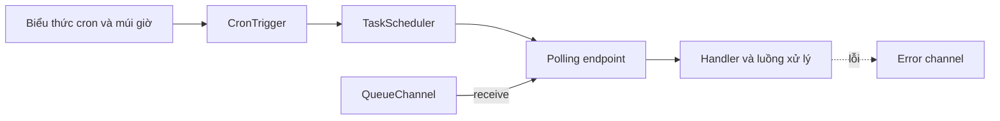

# Cron trigger trong Spring Integration

## 1. Mục tiêu và tình huống sử dụng

Trong chương Poller của module `SPRING_INTEGRATION_CORE`, cron trigger giúp một endpoint lấy thông điệp theo lịch: chẳng hạn mỗi năm phút trong giờ làm việc hoặc lúc 02:30 hằng ngày. Đây là phần kết nối giữa yêu cầu thời gian của nghiệp vụ với luồng `Message` → `MessageChannel` → endpoint.

Sau bài này, bạn có thể:

- Đọc và viết biểu thức cron sáu trường của Spring.
- Gắn lịch vào polling consumer hoặc nguồn thông điệp bằng annotation và Java DSL.
- Chọn múi giờ, giới hạn số thông điệp mỗi lượt và phân biệt lịch với thời gian chờ nhận.
- Dự đoán điều gì xảy ra khi lượt xử lý kéo dài hoặc ứng dụng ngừng chạy.
- Kiểm tra các mốc lịch bằng thời gian giả lập thay vì chờ đồng hồ thực.

Tình huống xuyên suốt: đơn hàng chờ trong `QueueChannel`. Nhóm vận hành muốn lấy tối đa 20 đơn mỗi lượt, tại phút 00, 05, 10, …, 55 của các giờ từ 08 đến 17, thứ Hai đến thứ Sáu, theo giờ Việt Nam. Transformer, router hoặc aggregator có thể nối tiếp sau endpoint nhận đơn; cron chỉ quyết định thời điểm bắt đầu lấy dữ liệu.

Các ví dụ Java dùng Java 17, Spring Integration 6.x trở lên và các API tương ứng của Spring Framework. Ứng dụng cần `spring-integration-core`; nếu dùng Spring Boot, có thể dùng `spring-boot-starter-integration` và để cơ chế quản lý dependency của Boot chọn phiên bản tương thích. Đoạn kiểm thử dùng JUnit Jupiter. Không cần Quartz để dùng `CronTrigger` của Spring.

## 2. Cron nằm ở đâu trong một poller?

Một poller có nhiều trách nhiệm cấu hình riêng biệt. **Trigger trả lời khi nào được bắt đầu một lượt poll; endpoint thực hiện nhận và chuyển thông điệp.**



Spring Integration dùng `PollingConsumer` cho endpoint đọc từ `PollableChannel`, điển hình là `QueueChannel`. Với nguồn được kéo chủ động như nguồn tệp hoặc truy vấn dữ liệu, endpoint có thể là `SourcePollingChannelAdapter`. `DirectChannel` đưa thông điệp tới subscriber khi được gửi và không cần poller để nhận. Xem [mô hình Poller của Spring Integration](https://docs.spring.io/spring-integration/reference/polling-consumer.html).

Ví dụ có hai cách tổ chức khác nhau:

| Luồng | Endpoint nào cần lịch? | Ý nghĩa của một lần nhận |
| --- | --- | --- |
| `QueueChannel` → service activator | Service activator đọc queue | Lấy một `Message` có sẵn trong queue |
| `MessageSource` → `DirectChannel` → handler | Inbound channel adapter đọc source | Gọi source để tìm hoặc tạo một `Message` |

Một lần trigger kích hoạt có thể dẫn tới nhiều lần nhận. Vì vậy “chạy mỗi năm phút” không đồng nghĩa với “xử lý đúng một thông điệp mỗi năm phút”.

## 3. Cú pháp cron sáu trường

Spring dùng thứ tự sau:

```text
 giây   phút   giờ   ngày-trong-tháng   tháng   ngày-trong-tuần
   0    */5   8-17          *            *        MON-FRI
```

| Trường | Giá trị thường dùng | Ví dụ |
| --- | --- | --- |
| Giây | `0`–`59` | `0`: tại giây đầu của phút |
| Phút | `0`–`59` | `*/5`: các phút 00, 05, …, 55 |
| Giờ | `0`–`23` | `8-17`: gồm cả giờ 08 và giờ 17 |
| Ngày trong tháng | `1`–`31` | `1`: ngày đầu tháng |
| Tháng | `1`–`12`, hoặc `JAN`–`DEC` | `JAN,MAR`: tháng Một và tháng Ba |
| Ngày trong tuần | `0`–`7`, hoặc `MON`–`SUN` | `MON-FRI`: thứ Hai đến thứ Sáu |

Với Spring, `0` và `7` đều chỉ Chủ nhật. Nên dùng tên thứ để giảm nhầm lẫn khi chuyển biểu thức giữa các hệ thống. Cron Linux thông dụng có năm trường; Spring thêm trường giây ở đầu. Không thêm trường năm thứ bảy như một số cấu hình Quartz. Xem [cú pháp cron của Spring Framework](https://docs.spring.io/spring-framework/reference/integration/scheduling.html#scheduling-cron-expression).

### 3.1. Các ký hiệu hay gặp

| Ký hiệu | Cách đọc | Ví dụ tự diễn giải |
| --- | --- | --- |
| `*` | Mọi giá trị hợp lệ của trường | `*` ở trường giờ: mọi giờ |
| `,` | Danh sách | `9,14` ở trường giờ: 09 giờ và 14 giờ |
| `-` | Khoảng bao gồm hai đầu | `8-10` ở trường giờ: 08, 09, 10 |
| `/` | Bước trong miền giá trị của trường | `10/20` ở trường phút: 10, 30, 50 |
| `?` | Không ràng buộc cụ thể ngày | Có thể dùng ở ngày trong tháng hoặc ngày trong tuần |
| `L` | Giá trị cuối theo ngữ cảnh ngày | `L` ở ngày trong tháng: ngày cuối tháng |
| `W` | Ngày thứ Hai–thứ Sáu gần ngày được chỉ định | `15W` ở ngày trong tháng |
| `#` | Lần xuất hiện của một thứ trong tháng | `MON#2`: thứ Hai thứ hai của tháng |

`W` không biết lịch nghỉ lễ của doanh nghiệp. Với lịch ngân hàng hoặc lịch làm việc đặc thù, nên giữ điều kiện lịch nghiệp vụ trong một thành phần riêng.

### 3.2. Ví dụ gắn với yêu cầu nghiệp vụ

| Yêu cầu | Biểu thức |
| --- | --- |
| Tại giây 00 và 30 của mỗi phút | `*/30 * * * * *` |
| Tại phút 00, 10, …, 50 của mọi giờ | `0 */10 * * * *` |
| 06:45 hằng ngày | `0 45 6 * * *` |
| 09:15 thứ Hai đến thứ Sáu | `0 15 9 * * MON-FRI` |
| Mỗi năm phút trong các giờ 08–17 của ngày làm việc | `0 */5 8-17 * * MON-FRI` |
| 01:20 ngày đầu tháng | `0 20 1 1 * *` |
| 23:40 ngày cuối tháng | `0 40 23 L * *` |
| 08:00 thứ Hai thứ hai của tháng | `0 0 8 ? * MON#2` |

Các ký hiệu ngày đặc biệt và hàm phân tích biểu thức được mô tả tại [API CronExpression](https://docs.spring.io/spring-framework/docs/current/javadoc-api/org/springframework/scheduling/support/CronExpression.html).

Hai lỗi diễn giải dễ gặp:

- `0 */5 8-17 * * MON-FRI` vẫn có lần chạy lúc **17:55**. Nếu chỉ muốn đến trước 17:00, khoảng giờ phải là `8-16`; nếu muốn thêm đúng 17:00, cần biểu diễn mốc đó riêng.
- `0 */7 * * * *` khớp các phút 00, 07, …, 56 rồi quay lại phút 00 của giờ sau. Khoảng 56 → 00 là bốn phút, nên không thể xem đây là khoảng cách bảy phút liên tục.

Cron phù hợp khi yêu cầu nói về mốc trên lịch. Nếu yêu cầu là “nghỉ năm phút sau khi lượt trước kết thúc”, hãy dùng fixed delay.

## 4. Java DSL: lấy đơn từ QueueChannel theo giờ Việt Nam

Ví dụ sau là một cấu hình độc lập. Đưa nó vào ứng dụng có quét cấu hình Spring hoặc đăng ký trực tiếp vào application context. Queue và handler chỉ phục vụ minh họa; queue này nằm trong bộ nhớ.

```java
package example.integration;

import java.time.ZoneId;
import java.util.TimeZone;

import org.springframework.context.annotation.Bean;
import org.springframework.context.annotation.Configuration;
import org.springframework.integration.channel.DirectChannel;
import org.springframework.integration.channel.QueueChannel;
import org.springframework.integration.config.EnableIntegration;
import org.springframework.integration.dsl.IntegrationFlow;
import org.springframework.integration.dsl.Pollers;
import org.springframework.messaging.MessageChannel;
import org.springframework.messaging.MessageHandler;

@Configuration
@EnableIntegration
public class OrderCronConfiguration {

    @Bean
    public QueueChannel pendingOrders() {
        return new QueueChannel(100);
    }

    @Bean
    public MessageChannel pollingErrors() {
        return new DirectChannel();
    }

    @Bean
    public IntegrationFlow processOrders() {
        TimeZone businessZone = TimeZone.getTimeZone(
                ZoneId.of("Asia/Ho_Chi_Minh"));

        return IntegrationFlow.from("pendingOrders")
                .handle(String.class, (orderId, headers) -> {
                    System.out.println("Processing order " + orderId);
                    return null;
                }, endpoint -> endpoint.poller(
                        Pollers.cron("0 */5 8-17 * * MON-FRI", businessZone)
                                .maxMessagesPerPoll(20)
                                .receiveTimeout(0)
                                .errorChannel("pollingErrors")))
                .get();
    }

    @Bean
    public IntegrationFlow observePollingErrors() {
        return IntegrationFlow.from("pollingErrors")
                .handle((MessageHandler) message ->
                        System.err.println(message.getPayload()))
                .get();
    }
}
```

`Pollers.cron(expression, timeZone)` tạo cấu hình poller với lịch và múi giờ được chỉ định. Có thể dùng `Pollers.trigger(customTrigger)` khi muốn cung cấp một đối tượng `Trigger` riêng. Xem [API Pollers](https://docs.spring.io/spring-integration/api/org/springframework/integration/dsl/Pollers.html).

Để đưa một đơn vào ví dụ, gọi đoạn sau ở thành phần đã được inject bean `pendingOrders`:

```java
import org.springframework.messaging.MessageChannel;
import org.springframework.messaging.support.MessageBuilder;

// pendingOrders là bean MessageChannel được inject từ application context.
boolean accepted = pendingOrders.send(
        MessageBuilder.withPayload("ORDER-20261118-001").build(),
        1_000);

if (!accepted) {
    throw new IllegalStateException("Queue đang đầy");
}
```

Đơn chưa được xử lý ngay sau lệnh `send`. Nó đợi một lượt poll khớp lịch. Nếu ứng dụng chạy buổi tối, cuối tuần, hoặc bạn vừa bỏ qua một mốc năm phút, việc chưa thấy log là phù hợp với cấu hình.

Trong flow này, handler trả `null` để kết thúc xử lý thông điệp mà không tạo reply. Nếu cần transformer hoặc router tiếp theo, handler trước đó phải trả dữ liệu phù hợp hoặc dùng các bước DSL tương ứng trước handler kết thúc.

### 4.1. Đọc cấu hình theo từng trách nhiệm

| Thành phần | Trách nhiệm trong ví dụ |
| --- | --- |
| Cron expression | Chọn các mốc thời gian được phép bắt đầu poll |
| `businessZone` | Diễn giải các mốc theo giờ Việt Nam |
| `maxMessagesPerPoll(20)` | Giới hạn tối đa 20 lần nhận thành công trong lượt poll bình thường |
| `receiveTimeout(0)` | Không đợi khi queue chưa có thông điệp |
| `pollingErrors` | Nhận thông điệp lỗi từ cơ chế xử lý lỗi của poller |
| Handler | Thực hiện công việc với payload đã nhận |

Trong luồng đồng bộ không lỗi, poller dừng lượt khi chạm giới hạn hoặc lần nhận trả về không có thông điệp. Do đó có thể xử lý ít hơn 20 đơn. `receiveTimeout` áp dụng cho polling consumer đọc channel; với nguồn bên ngoài, thời gian chờ còn phụ thuộc adapter hoặc client truy cập nguồn. Chi tiết thuộc tính được nêu tại [API annotation Poller](https://docs.spring.io/spring-integration/docs/current/api/org/springframework/integration/annotation/Poller.html).

Không đồng nhất `maxMessagesPerPoll` với batch size của một API từ xa. Một adapter có thể truy vấn hoặc tải trước nhiều bản ghi trong một lần truy cập, rồi phát từng `Message`; cần xem cấu hình của adapter đó.

## 5. Annotation và poller dùng lại

### 5.1. Cron khai báo trực tiếp

Đây là phương án thay thế flow DSL xử lý đơn, không đăng ký cùng lúc hai consumer lên `pendingOrders` nếu bạn muốn chỉ có một consumer.

Trong một lớp `@Configuration` có `@EnableIntegration` và bean `pendingOrders`, có thể khai báo:

```java
import org.springframework.context.annotation.Bean;
import org.springframework.integration.annotation.Poller;
import org.springframework.integration.annotation.ServiceActivator;
import org.springframework.messaging.MessageHandler;

@Bean
@ServiceActivator(
        inputChannel = "pendingOrders",
        poller = @Poller(
                cron = "${orders.poll.cron:0 */5 8-17 * * MON-FRI}",
                maxMessagesPerPoll = "20",
                receiveTimeout = "0"))
public MessageHandler orderHandler() {
    return message -> System.out.println(message.getPayload());
}
```

`@Poller.cron` nhận placeholder cấu hình. Tuy nhiên, annotation `@Poller` không có thuộc tính `zone` tương tự `@Scheduled`. Nếu cần một múi giờ riêng, hãy tham chiếu bean poller có `CronTrigger` được cấu hình rõ ràng; không tự thêm `zone` vào `@Poller`.

### 5.2. Bean poller có múi giờ rõ ràng

Thay phần khai báo lịch trực tiếp phía trên bằng bean và tham chiếu sau:

```java
import java.time.ZoneId;

import org.springframework.context.annotation.Bean;
import org.springframework.integration.annotation.Poller;
import org.springframework.integration.annotation.ServiceActivator;
import org.springframework.integration.dsl.PollerSpec;
import org.springframework.integration.dsl.Pollers;
import org.springframework.messaging.MessageHandler;
import org.springframework.scheduling.support.CronTrigger;

@Bean
public PollerSpec ordersCronPoller() {
    return Pollers.trigger(new CronTrigger(
                    "0 */5 8-17 * * MON-FRI",
                    ZoneId.of("Asia/Ho_Chi_Minh")))
            .maxMessagesPerPoll(20)
            .receiveTimeout(0);
}

@Bean
@ServiceActivator(
        inputChannel = "pendingOrders",
        poller = @Poller(value = "ordersCronPoller"))
public MessageHandler orderHandler() {
    return message -> System.out.println(message.getPayload());
}
```

Khi trả `PollerSpec` từ `@Bean`, để Spring quản lý việc tạo `PollerMetadata`; không gọi thủ công `getObject()` trong phương thức khai báo bean. Xem [hướng dẫn Pollers với Java DSL](https://docs.spring.io/spring-integration/reference/dsl/java-pollers.html).

Một bean poller dùng lại giúp tập trung cấu hình lịch. Nó không hợp nhất các endpoint thành một tác vụ duy nhất và không tạo khóa giữa chúng.

Không phối hợp `cron`, `fixedDelay`, `fixedRate` hoặc một tham chiếu trigger như thể chúng là nhiều điều kiện lịch cho cùng poller. Chọn một cơ chế lịch; dùng logic nghiệp vụ riêng nếu cần thêm điều kiện. Xem [cấu hình poller trong Message Endpoints](https://docs.spring.io/spring-integration/reference/endpoint.html).

## 6. Múi giờ và thời điểm thực thi

Biểu thức `0 30 2 * * *` chưa đủ để trả lời “02:30 ở đâu?”. Nếu bỏ múi giờ tường minh, lịch chịu ảnh hưởng bởi múi giờ mà scheduler hoặc ngữ cảnh trigger sử dụng. Máy phát triển và máy triển khai có thể cho các thời điểm thực khác nhau.

Trong ví dụ, `Asia/Ho_Chi_Minh` diễn đạt lịch nghiệp vụ tại Việt Nam. Với múi giờ này, mốc 08:00 ngày 18/11/2026 tương ứng 01:00 UTC cùng ngày. Nên ghi log cả thời điểm UTC và ngày nghiệp vụ khi điều tra một đợt chạy.

Dùng `ZoneId.of(...)` để xác thực tên múi giờ trước khi chuyển sang `TimeZone`; cách này giúp phát hiện sớm tên không hợp lệ. Với vùng có đổi giờ mùa hè, hãy liệt kê các lần chạy quanh ngày chuyển giờ và kiểm thử theo yêu cầu của nghiệp vụ. Không nên suy ra rằng “một lần mỗi ngày theo giờ địa phương” luôn cách nhau đúng 24 giờ.

Đối với ví dụ đơn hàng, nên làm rõ thêm ba câu hỏi trước khi triển khai:

1. Đơn phát sinh sau 17:55 sẽ đợi sáng hôm sau hay được xử lý bằng luồng khác?
2. Các ngày lễ có được xem là ngày làm việc không?
3. Ngày nghiệp vụ lấy từ thời gian chạy, thời gian tạo đơn hay một trường dữ liệu riêng?

Cron chỉ biểu diễn được phần lịch đã khai báo. Nó không tự biết câu trả lời cho những câu hỏi nghiệp vụ này.

## 7. Một lượt poll dài có làm mất mốc lịch không?

`CronTrigger` tạo bằng constructor thông thường dùng cơ chế lenient: tính mốc tiếp theo dựa trên thời điểm hoàn tất tác vụ trước. Trong trường hợp scheduler chạy tác vụ đồng bộ trên pool thông thường, các mốc rơi vào lúc tác vụ còn chạy có thể bị bỏ qua. Spring Framework còn có `CronTrigger.forFixedExecution(...)` từ phiên bản 6.1.3 để tính theo mốc đã lên lịch; hành vi thực tế vẫn cần xét scheduler. Xem [API CronTrigger 6.2.15](https://docs.spring.io/spring-framework/docs/6.2.15/javadoc-api/org/springframework/scheduling/support/CronTrigger.html).

Ví dụ tự phân tích cho lịch `0 * * * * *`, không cấu hình executor riêng và handler chạy đồng bộ:

```text
09:00:00  Bắt đầu lượt poll A
09:01:00  A vẫn đang chạy
09:02:00  A vẫn đang chạy
09:02:20  A kết thúc
09:03:00  Mốc tiếp theo của CronTrigger thông thường
```

Trong tình huống này, không nên kỳ vọng hai lượt chạy bù cho 09:01 và 09:02.

Nếu cần chính sách fixed execution, có thể truyền trigger riêng:

```java
// Chỉ minh họa lựa chọn chính sách; yêu cầu Spring Framework >= 6.1.3.
Pollers.trigger(CronTrigger.forFixedExecution("0 * * * * *"))
        .maxMessagesPerPoll(20)
        .receiveTimeout(0);
```

Đoạn trên không chỉ định múi giờ nghiệp vụ; nó dùng ngữ cảnh thời gian của scheduler. Không xem nó là bản thay thế nguyên trạng cho cấu hình giờ Việt Nam ở phần trước.

Cũng cần phân biệt ba phạm vi hoàn thành:

- Poller hoàn tất lượt gọi nhận và chuyển thông điệp.
- Handler đồng bộ hoàn tất công việc của mình.
- Toàn bộ xử lý bất đồng bộ phía sau hoàn tất.

Nếu handler gửi sang `ExecutorChannel`, hoặc poller giao tác vụ cho một executor riêng, các thời điểm này có thể khác nhau. Do đó lịch cron không đủ để đảm bảo không có hai công việc nghiệp vụ chạy đồng thời.

## 8. Lịch không thay thế độ tin cậy của xử lý

### 8.1. Giới hạn thông lượng

Giả sử mỗi đơn cần 200 ms, flow hoàn toàn đồng bộ và một lượt xử lý đủ 20 đơn. Thời gian xử lý handler xấp xỉ:

```text
20 × 200 ms = 4 giây
```

Đây là phép ước lượng từ giả thiết của ví dụ, chưa tính I/O, giao dịch, nhận thông điệp hoặc lỗi. Nếu nguồn luôn còn dữ liệu, cấu hình 20 đơn mỗi năm phút cho mức phục vụ danh nghĩa khoảng 240 đơn mỗi giờ trong cửa sổ lịch. Nếu lượng đến là 500 đơn mỗi giờ, queue sẽ tích tụ dù cron chạy đúng.

Giải pháp phải xét đồng thời lịch, giới hạn lượt poll, năng lực handler và cách lưu backlog. Tăng `maxMessagesPerPoll` có thể khiến mỗi lượt kéo dài và chiếm scheduler lâu hơn.

### 8.2. Lỗi và nhận lại thông điệp

`errorChannel` tạo đường quan sát hoặc xử lý lỗi; nó không tự định nghĩa retry hay khôi phục thông điệp đã lấy ra khỏi queue. Với `QueueChannel` trong bộ nhớ, không được giả định rằng handler ném exception sẽ tự đưa đơn trở lại queue.

Ví dụ `System.err` chỉ giúp nhìn thấy lỗi khi học. Với đơn hàng thật, cần thiết kế rõ điểm ghi nhận thành công, chỗ lưu lỗi, chính sách retry và khóa idempotency. Có thể dùng mã đơn làm một phần khóa nghiệp vụ nếu phù hợp với miền dữ liệu.

### 8.3. Khởi động lại và nhiều replica

Cron trigger trong bộ nhớ không phải nhật ký bền vững của những lần chạy đã bỏ lỡ. Nếu ứng dụng tắt lúc 09:00 và mở lại lúc 10:00, cấu hình thông thường không tự khôi phục đầy đủ các công việc đáng lẽ chạy trong giờ đó. Các API resumption chỉ hữu ích khi ứng dụng chủ động cung cấp trạng thái thời gian cần tiếp tục; không có persistence tự động đi kèm chỉ vì đã dùng cron.

Thiết kế bù dữ liệu có thể dựa trên watermark lưu bền vững: mỗi lượt tìm các bản ghi chưa xử lý kể từ mốc đã xác nhận, thay vì chỉ lấy dữ liệu của “phút hiện tại”. Với nhiều replica, cần xác định cơ chế claim bản ghi, chia partition hoặc điều phối chủ sở hữu lịch. Cùng một biểu thức cron không tạo singleton trên toàn cụm.

Riêng queue của bài học, dữ liệu chưa xử lý mất khi tiến trình kết thúc. Muốn bảo toàn backlog phải chọn nơi lưu thông điệp phù hợp và thiết kế giao dịch tương ứng.

## 9. Kiểm thử lịch bằng thời gian xác định

Không cần chờ đến thứ Hai hoặc dùng `Thread.sleep` nhiều phút để kiểm tra biểu thức. Nên tách việc kiểm tra lịch khỏi kiểm tra endpoint.

### 9.1. Kiểm tra cú pháp và mốc sau cuối tuần

```java
package example.integration;

import java.time.ZoneId;
import java.time.ZonedDateTime;

import org.junit.jupiter.api.Test;
import org.springframework.scheduling.support.CronExpression;

import static org.junit.jupiter.api.Assertions.assertEquals;
import static org.junit.jupiter.api.Assertions.assertFalse;

class OrderCronExpressionTest {

    @Test
    void nextSlotAfterFridayClosingIsMondayMorning() {
        CronExpression cron = CronExpression.parse(
                "0 */5 8-17 * * MON-FRI");
        ZoneId zone = ZoneId.of("Asia/Ho_Chi_Minh");
        ZonedDateTime fridayLastSlot = ZonedDateTime.of(
                2026, 11, 20, 17, 55, 0, 0, zone);
        ZonedDateTime expected = ZonedDateTime.of(
                2026, 11, 23, 8, 0, 0, 0, zone);

        assertEquals(expected, cron.next(fridayLastSlot));
    }

    @Test
    void rejectsFiveFieldExpression() {
        assertFalse(CronExpression.isValidExpression("*/5 * * * *"));
    }
}
```

`next(...)` tìm mốc sau giá trị đầu vào. Vì mốc đầu vào trong test chính là 17:55 thứ Sáu, kết quả cần là 08:00 thứ Hai chứ không phải lặp lại 17:55. Có thể bổ sung trường hợp 17:54:59 để xác nhận mốc 17:55 vẫn nằm trong lịch.

### 9.2. Kiểm tra tác động của thời điểm hoàn tất

```java
package example.integration;

import java.time.Clock;
import java.time.Instant;
import java.time.ZoneId;

import org.junit.jupiter.api.Test;
import org.springframework.scheduling.support.CronTrigger;
import org.springframework.scheduling.support.SimpleTriggerContext;

import static org.junit.jupiter.api.Assertions.assertEquals;

class OrderCronTriggerTest {

    @Test
    void ordinaryTriggerSkipsSlotsBeforeLastCompletion() {
        ZoneId zone = ZoneId.of("Asia/Ho_Chi_Minh");
        Clock clock = Clock.fixed(
                Instant.parse("2026-11-18T02:00:00Z"), zone);
        SimpleTriggerContext context = new SimpleTriggerContext(clock);

        Instant started = Instant.parse("2026-11-18T02:00:00Z");
        Instant completed = Instant.parse("2026-11-18T02:02:20Z");
        context.update(started, started, completed);

        CronTrigger trigger = new CronTrigger("0 * * * * *", zone);

        assertEquals(
                Instant.parse("2026-11-18T02:03:00Z"),
                trigger.nextExecution(context));
    }
}
```

Test này chứng minh cách trigger tính mốc kế tiếp từ context được cung cấp. Nó chưa chứng minh hành vi của executor, router, giao dịch hoặc toàn bộ ứng dụng đang chạy.

Ở mức kiểm thử tích hợp, có thể dùng lịch ngắn hơn qua cấu hình test, đưa vài thông điệp vào queue và chờ một kết quả quan sát được với timeout hữu hạn. Cần đảm bảo test không vô tình đăng ký cả hai phiên bản endpoint DSL và annotation của bài. Ngoài kết quả xử lý, nên kiểm tra giới hạn mỗi lượt và đường đi của lỗi theo yêu cầu cụ thể của flow.

Các đoạn kiểm thử ở đây là mã mẫu để đưa vào dự án có dependency thích hợp; bài học không kèm kết quả chạy build hay test của dự án.

## 10. Chẩn đoán các tình huống thường gặp

| Hiện tượng | Điều cần kiểm tra | Hướng xử lý |
| --- | --- | --- |
| Lỗi phân tích cron khi khởi động | Số trường, giá trị giây/phút, placeholder | Dùng biểu thức sáu trường và kiểm tra giá trị đã resolve |
| Chạy lệch giờ mong muốn | Múi giờ scheduler và trigger | Chỉ định múi giờ nghiệp vụ, đối chiếu thời điểm UTC |
| Không xử lý ngay khi gửi đơn | Mốc cron kế tiếp và cửa sổ thứ/giờ | Kiểm tra đó có phải hành vi đã yêu cầu không |
| 17:55 vẫn có đơn được xử lý | Khoảng giờ `8-17` | Sửa biểu thức theo ranh giới nghiệp vụ thực tế |
| Queue tăng liên tục | Tốc độ đến, giới hạn lượt poll, thời gian handler | Ước lượng năng lực phục vụ và theo dõi backlog |
| Lượt sau cách xa hơn dự kiến | Lượt trước chạy lâu hoặc scheduler bận | Đo thời gian lượt poll và xem chính sách trigger |
| Công việc chạy trùng | Replica, nhiều endpoint, xử lý bất đồng bộ | Xác định chủ sở hữu và cơ chế idempotency/claim |
| Có log lỗi nhưng mất đơn | Queue trong bộ nhớ, không có cơ chế khôi phục | Thiết kế độ bền, retry và lưu lỗi rõ ràng |

Khi ghi nhận sự cố, nên lưu tên endpoint, cron expression, múi giờ, thời điểm bắt đầu/kết thúc, số thông điệp đã nhận và độ sâu backlog nếu đo được. Những dữ liệu này giúp phân biệt “không đến lịch”, “không có dữ liệu” và “xử lý bị chậm”.

## 11. Bài thực hành

1. Dùng flow DSL và đổi lịch trong môi trường học thành `*/10 * * * * *`. Đưa ba đơn vào queue, đặt `maxMessagesPerPoll(2)`, rồi quan sát đơn còn lại sang lượt sau khi handler xử lý đủ nhanh.
2. Giữ lịch giờ làm việc và tính năm mốc kế tiếp từ tối thứ Sáu bằng `CronExpression.next`. Ghi cả giờ Việt Nam và UTC.
3. Dùng context giả lập để so sánh kết quả khi lượt trước kết thúc sau 10 giây và sau 140 giây với lịch mỗi phút.
4. Cho handler ném exception với một mã đơn cố định. Quan sát error channel và kiểm tra lại giả định về việc đơn có tự xuất hiện trong queue hay không.
5. Viết phương án cho trường hợp ứng dụng dừng hai giờ: dữ liệu cần lưu ở đâu, chọn bản ghi chưa xử lý thế nào và xác nhận thành công ở bước nào?

Kết quả cần giải thích được cả lịch bắt đầu lẫn vòng đời của thông điệp. Một biểu thức cron đúng chỉ là một phần của flow tích hợp có hành vi đúng.