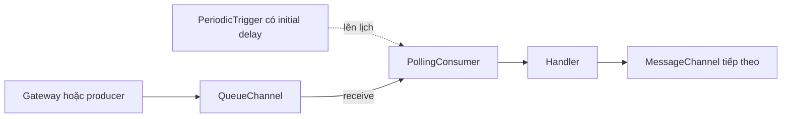

# initial-delay: trì hoãn lần poll đầu tiên

Trong Spring Integration, `initial-delay` xác định khoảng chờ trước **lần thực thi đầu tiên của một lịch polling**. Nó giúp giãn thời điểm luồng bắt đầu lấy dữ liệu khi ứng dụng khởi động hoặc khi endpoint được đưa vào hoạt động. Giá trị mặc định của `PeriodicTrigger` là không trì hoãn lần đầu. [Javadoc PeriodicTrigger](https://docs.spring.io/spring-framework/docs/current/javadoc-api/org/springframework/scheduling/support/PeriodicTrigger.html).

Bài này thuộc chương **Poller** của module `SPRING_INTEGRATION_CORE`. Trọng tâm là đặt khoảng chờ đúng vị trí trong luồng `Message` → `MessageChannel` → endpoint, cấu hình bằng Java DSL và XML, rồi quan sát và kiểm thử hành vi khởi đầu của poller. Các ví dụ dùng Java 17+, Spring Integration 6.2+ cùng phiên bản Spring Framework tương thích do dependency management của dự án quản lý; dự án đã có dependency `spring-integration-core`. Phần kiểm thử dùng JUnit Jupiter.

## 1. Tình huống cần giải quyết

Một dịch vụ nhận yêu cầu đối soát qua gateway và đưa chúng vào hàng đợi nội bộ. Sau khi dịch vụ khởi động, nhóm vận hành muốn dành khoảng 10 giây cho hoạt động làm nóng tài nguyên trước khi consumer bắt đầu lấy yêu cầu. Sau đó consumer kiểm tra hàng đợi theo chu kỳ 2 giây.

Hai yêu cầu thời gian độc lập là:

- **Chờ khởi đầu:** 10 giây trước lần poll đầu tiên.
- **Nhịp hoạt động:** với fixed delay, chờ 2 giây sau khi một tác vụ poll hoàn tất rồi mới thực hiện tác vụ tiếp theo.

Nếu chỉ đặt chu kỳ 10 giây, ta làm chậm cả các lần poll về sau. Nếu chèn `Thread.sleep(10_000)` vào handler, message đã được nhận rồi mới chờ, đồng thời chiếm thread thực thi. `initial-delay` biểu đạt trực tiếp yêu cầu trì hoãn việc bắt đầu polling.

Khoảng chờ 10 giây là chính sách vận hành trong ví dụ. Nếu điều kiện bắt buộc là “dịch vụ đối tác đã sẵn sàng”, cần kiểm tra điều kiện đó và điều khiển lifecycle hoặc bỏ qua poll phù hợp; thời gian trôi qua tự nó không chứng minh được sự sẵn sàng.

## 2. Poller nằm ở đâu trong luồng?

Spring Integration dùng polling ở hai vị trí điển hình: `PollingConsumer` lấy message từ `PollableChannel`, chẳng hạn `QueueChannel`; `SourcePollingChannelAdapter` gọi `MessageSource` để lấy dữ liệu từ nguồn. Với `SubscribableChannel`, chẳng hạn `DirectChannel`, endpoint nhận message theo cơ chế đăng ký, không dùng poller tại đầu vào đó. [Tài liệu Poller](https://docs.spring.io/spring-integration/reference/polling-consumer.html).



Trong sơ đồ này, khoảng chờ nằm trước lần `receive` đầu tiên do lịch polling kích hoạt. Nó không trì hoãn thao tác gửi vào `QueueChannel`: producer vẫn có thể đưa message vào hàng đợi trong lúc consumer chưa poll. Cần có giới hạn dung lượng và chính sách gửi thích hợp nếu lượng yêu cầu đến sớm có thể lớn.

Với nguồn dữ liệu được poll trực tiếp, cấu trúc tương ứng là:

```text
PeriodicTrigger → SourcePollingChannelAdapter → MessageSource.receive()
                                              ↓
                                    MessageChannel → xử lý
```

Việc trì hoãn adapter này chỉ trì hoãn lần gọi nguồn theo lịch. Các thao tác tạo bean, mở kết nối khi khởi tạo hoặc khởi động tài nguyên khác vẫn phụ thuộc vào lifecycle của thành phần cụ thể.

## 3. Đọc lịch thực thi cho chính xác

Gọi `t0` là thời điểm trigger tính lịch đầu trong một ngữ cảnh scheduling mới, `I` là initial delay và `P` là chu kỳ. Với ví dụ `I = 10 s`, `P = 2 s`, mỗi tác vụ poll mất `0,5 s`, lịch minh họa là:

| Mốc | Fixed delay | Fixed rate |
|---|---:|---:|
| Lần poll đầu được lên lịch | `t0 + 10 s` | `t0 + 10 s` |
| Lần đầu hoàn tất theo giả định | `t0 + 10,5 s` | `t0 + 10,5 s` |
| Lần poll thứ hai được lên lịch | `t0 + 12,5 s` | `t0 + 12 s` |
| Lần poll thứ ba được lên lịch | `t0 + 15 s` | `t0 + 14 s` |

Công thức của trigger là:

```text
Lần đầu:      thời gian hiện tại của clock + I
Fixed delay:  thời điểm hoàn tất lần trước + P
Fixed rate:   thời điểm được lên lịch lần trước + P
```

`initial-delay` không được cộng thêm vào mọi chu kỳ. Khi có lịch sử thực thi, trigger tính lần tiếp theo từ lịch sử đó. Với ngữ cảnh scheduling mới không có lịch sử, khoảng chờ khởi đầu được áp dụng lại; vì vậy không nên hiểu nó là cờ “chỉ một lần trong toàn bộ vòng đời triển khai”. [Mã nguồn PeriodicTrigger của Spring Framework 6.2](https://raw.githubusercontent.com/spring-projects/spring-framework/v6.2.0/spring-context/src/main/java/org/springframework/scheduling/support/PeriodicTrigger.java).

Các con số trong bảng là thời điểm lịch dự kiến, với giả định scheduler có tài nguyên và xử lý đồng bộ. Thời điểm handler thực sự chạy còn phụ thuộc vào thread, thời gian lấy message và các bước trong luồng. `t0` cũng không nhất thiết trùng lúc tiến trình Java được tạo hoặc lúc ứng dụng phát tín hiệu ready.

## 4. Cấu hình bằng Java DSL

### 4.1. Consumer lấy message từ QueueChannel

Ví dụ sau có một hàng đợi đầu vào và một hàng đợi kết quả. Mỗi lần poll lấy tối đa một message, chuẩn hóa payload rồi chuyển sang hàng đợi kết quả để dễ quan sát.

```java
package example.integration;

import java.time.Duration;
import java.util.Locale;

import org.springframework.context.annotation.Bean;
import org.springframework.context.annotation.Configuration;
import org.springframework.integration.channel.QueueChannel;
import org.springframework.integration.config.EnableIntegration;
import org.springframework.integration.dsl.IntegrationFlow;
import org.springframework.integration.dsl.Pollers;

@Configuration
@EnableIntegration
public class InitialDelayFlowConfiguration {

    @Bean
    public QueueChannel pendingRequests() {
        return new QueueChannel(100);
    }

    @Bean
    public QueueChannel processedRequests() {
        return new QueueChannel(100);
    }

    @Bean
    public IntegrationFlow delayedConsumerFlow(
            QueueChannel pendingRequests,
            QueueChannel processedRequests) {

        return IntegrationFlow.from(pendingRequests)
                .<String, String>transform(
                        payload -> payload.trim().toUpperCase(Locale.ROOT),
                        endpoint -> endpoint
                                .id("delayedRequestTransformer")
                                .poller(Pollers.fixedDelay(
                                                Duration.ofSeconds(2),
                                                Duration.ofSeconds(10))
                                        .maxMessagesPerPoll(1)
                                        .receiveTimeout(0)))
                .channel(processedRequests)
                .get();
    }
}
```

`Pollers.fixedDelay(period, initialDelay)` nhận chu kỳ ở tham số thứ nhất và khoảng chờ khởi đầu ở tham số thứ hai; `fixedRate` cũng có overload tương ứng. Dùng `Duration` giúp nhìn rõ đơn vị. Ví dụ `Pollers.fixedDelay(2_000, 10_000)` dùng overload số nguyên với đơn vị mili giây. [Javadoc Pollers](https://docs.spring.io/spring-integration/api/org/springframework/integration/dsl/Pollers.html).

Ở đây poller được đặt trên endpoint transformer vì transformer đọc trực tiếp từ `pendingRequests`, một `QueueChannel`. `processedRequests` là nơi lưu kết quả cho ví dụ; một ứng dụng thực tế có thể nối tiếp handler hoặc các endpoint khác.

Để quan sát trong ứng dụng đã nạp cấu hình này:

```java
// Hai bean được lấy từ ApplicationContext hoặc được inject vào mã gọi.
boolean accepted = pendingRequests.send(
        new org.springframework.messaging.support.GenericMessage<>("  order-42  "),
        0);

if (!accepted) {
    throw new IllegalStateException("Hàng đợi đầu vào đã đầy");
}

org.springframework.messaging.Message<?> result =
        processedRequests.receive(15_000);

if (result == null) {
    throw new IllegalStateException("Chưa nhận được kết quả trong cửa sổ quan sát");
}

System.out.println(result.getPayload()); // ORDER-42
```

Gửi message ngay sau khi flow được khởi động để thấy rõ khoảng chờ đầu. Nếu gửi sau khi poller đã chạy được một thời gian, message được xử lý theo nhịp poll hiện hành; nó không nhận thêm một initial delay riêng.

Hai tùy chọn bổ sung giúp ví dụ dễ quan sát:

- `maxMessagesPerPoll(1)` giới hạn mỗi tác vụ poll ở một message. Initial delay không tự giới hạn kích thước lô.
- `receiveTimeout(0)` khiến lần lấy từ hàng đợi không chờ khi hàng đợi rỗng. Receive timeout là thời gian chờ message trong một lần lấy, độc lập với thời điểm lịch bắt đầu. [Cấu hình endpoint và poller](https://docs.spring.io/spring-integration/reference/endpoint.html).

Nếu thêm `TaskExecutor` vào poller hoặc thêm điểm chuyển luồng bất đồng bộ ở downstream, phải đánh giá lại thời điểm hoàn tất tác vụ được scheduler quan sát. Không dùng bảng thời gian đồng bộ ở trên để suy ra lúc mọi xử lý nghiệp vụ đã hoàn tất trong cấu hình bất đồng bộ.

### 4.2. Poll một nguồn dữ liệu

Khi đầu luồng là supplier, cấu hình poller nằm trên source endpoint:

```java
@Bean
public IntegrationFlow heartbeatFlow() {
    return IntegrationFlow
            .fromSupplier(
                    () -> "heartbeat",
                    endpoint -> endpoint.poller(
                            Pollers.fixedDelay(
                                            Duration.ofSeconds(5),
                                            Duration.ofSeconds(3))
                                    .maxMessagesPerPoll(1)))
            .handle(message ->
                    System.out.println(message.getPayload()))
            .get();
}
```

Đặt phương thức này trong lớp cấu hình đã có `@EnableIntegration` và các import tương ứng ở ví dụ trước. Supplier chỉ được gọi lần đầu theo lịch sau khoảng chờ 3 giây; các lần tiếp theo dùng fixed delay 5 giây. Ví dụ không cần hàng đợi đầu vào vì chính supplier tạo dữ liệu.

Không đặt khoảng chờ của source vào một transformer downstream rồi kỳ vọng nguồn ngừng được gọi: mỗi endpoint có trách nhiệm và lịch hoạt động riêng.

## 5. Cấu hình annotation và XML

### 5.1. Annotation: tham chiếu PollerMetadata

`@Poller` của Spring Integration không có thuộc tính `initialDelay`. Không dùng cú pháp `@Poller(initialDelay = "10000")` và không suy thuộc tính của annotation này từ `@Scheduled`. Để cấu hình khoảng chờ đầu, có thể tạo bean `PollerMetadata`, sau đó tham chiếu bằng tên. Khi dùng `value` để tham chiếu metadata, không kết hợp các thuộc tính cấu hình poller khác trên cùng annotation. [Javadoc @Poller](https://docs.spring.io/spring-integration/api/org/springframework/integration/annotation/Poller.html).

Đây là **cách cấu hình thay thế** cho consumer ở mục 4.1, không đăng ký đồng thời hai consumer trên cùng hàng đợi khi thử hành vi của một consumer:

```java
package example.integration;

import java.time.Duration;

import org.springframework.context.annotation.Bean;
import org.springframework.context.annotation.Configuration;
import org.springframework.integration.annotation.Poller;
import org.springframework.integration.annotation.ServiceActivator;
import org.springframework.integration.channel.QueueChannel;
import org.springframework.integration.config.EnableIntegration;
import org.springframework.integration.scheduling.PollerMetadata;
import org.springframework.scheduling.support.PeriodicTrigger;

@Configuration
@EnableIntegration
public class InitialDelayAnnotationConfiguration {

    @Bean
    public QueueChannel pendingRequests() {
        return new QueueChannel(100);
    }

    @Bean
    public PollerMetadata startupPoller() {
        PeriodicTrigger trigger = new PeriodicTrigger(Duration.ofSeconds(2));
        trigger.setInitialDelay(Duration.ofSeconds(10));
        trigger.setFixedRate(false);

        PollerMetadata metadata = new PollerMetadata();
        metadata.setTrigger(trigger);
        metadata.setMaxMessagesPerPoll(1);
        metadata.setReceiveTimeout(0);
        return metadata;
    }

    @ServiceActivator(
            inputChannel = "pendingRequests",
            poller = @Poller("startupPoller"))
    public void handle(String payload) {
        System.out.println("Received: " + payload);
    }
}
```

`PeriodicTrigger(Duration)` và `setInitialDelay(Duration)` là API của Spring Framework từ 6.0; fixed delay là chế độ mặc định, và `setFixedRate(false)` trong ví dụ làm rõ ý định. Với mã cũ dùng constructor có `TimeUnit` và setter kiểu `long`, cần kiểm tra đơn vị áp dụng cho cả chu kỳ lẫn initial delay. [API PeriodicTrigger](https://docs.spring.io/spring-framework/docs/current/javadoc-api/org/springframework/scheduling/support/PeriodicTrigger.html).

### 5.2. XML: thuộc tính initial-delay

Từ Spring Integration 6.2, namespace XML hỗ trợ trực tiếp `initial-delay` cùng giá trị số theo `time-unit` hoặc chuỗi duration ISO 8601. Ví dụ dưới dùng `PT2S` và `PT10S` để biểu đạt rõ 2 giây và 10 giây. [Message Endpoints — poller](https://docs.spring.io/spring-integration/reference/endpoint.html).

```xml
<?xml version="1.0" encoding="UTF-8"?>
<beans xmlns="http://www.springframework.org/schema/beans"
       xmlns:xsi="http://www.w3.org/2001/XMLSchema-instance"
       xmlns:int="http://www.springframework.org/schema/integration"
       xsi:schemaLocation="
         http://www.springframework.org/schema/beans
         https://www.springframework.org/schema/beans/spring-beans.xsd
         http://www.springframework.org/schema/integration
         https://www.springframework.org/schema/integration/spring-integration.xsd">

    <int:channel id="pendingRequests">
        <int:queue capacity="100"/>
    </int:channel>

    <int:channel id="processedRequests">
        <int:queue capacity="100"/>
    </int:channel>

    <int:transformer input-channel="pendingRequests"
                     output-channel="processedRequests"
                     expression="payload.trim()">
        <int:poller fixed-delay="PT2S"
                    initial-delay="PT10S"
                    max-messages-per-poll="1"
                    receive-timeout="0"/>
    </int:transformer>
</beans>
```

Đây là cấu hình XML độc lập để minh họa thời gian; transformer chỉ gọi `trim()`. Không nạp cùng các lớp cấu hình trên có bean trùng tên. Khi bảo trì bản Spring Integration trước 6.2, kiểm tra schema đang dùng và cấu hình bean `PeriodicTrigger` với `trigger` reference nếu namespace chưa hỗ trợ thuộc tính này.

`cron` dùng lịch `CronTrigger`, nên không coi `initial-delay` là cách tự động cộng thêm độ trễ vào một biểu thức cron. Nếu có yêu cầu “chỉ bắt đầu chạy cron sau khi điều kiện khởi động đạt”, biểu đạt điều kiện bằng lifecycle endpoint hoặc một trigger được thiết kế cho yêu cầu đó.

## 6. Phân biệt với các cơ chế thời gian khác

| Cơ chế | Trả lời câu hỏi nào? | Ví dụ |
|---|---|---|
| Initial delay | Khi nào bắt đầu lịch polling? | Chờ 10 giây trước lần poll đầu |
| Fixed delay | Sau khi một tác vụ poll hoàn tất, chờ bao lâu? | Chờ 2 giây trước tác vụ kế |
| Fixed rate | Các mốc bắt đầu theo lịch cách nhau bao lâu? | Các mốc dự kiến cách nhau 2 giây |
| Receive timeout | Một lần lấy từ pollable channel chờ message bao lâu? | Chờ tối đa 200 ms khi hàng đợi rỗng |
| Retry backoff | Sau một lần xử lý thất bại, chờ bao lâu để thử lại? | Đợi 1 giây rồi retry theo policy |
| Trì hoãn từng message | Message cụ thể được chuyển tiếp khi nào? | Giữ yêu cầu đến thời điểm hẹn |
| Endpoint lifecycle | Thành phần đã được phép hoạt động chưa? | Chỉ start consumer khi dependency sẵn sàng |

Các cơ chế có thể phối hợp nhưng giải quyết các mốc thời gian khác nhau. Ví dụ, một message lỗi ở lần poll thứ mười không tự nhận lại khoảng chờ khởi đầu 10 giây; chính sách retry hoặc nhịp polling tiếp theo quyết định lần xử lý sau.

## 7. Giới hạn khi vận hành

### 7.1. Chờ khởi đầu và readiness

Giả sử API đối tác thường mất 8 giây để sẵn sàng. Chọn initial delay 10 giây có thể giảm số lần gọi lỗi lúc triển khai. Nhưng khi API cần 20 giây, poll đầu vẫn có thể thất bại.

Nếu readiness là điều kiện bắt buộc, có thể giữ endpoint chưa tự khởi động, theo dõi điều kiện bằng cơ chế riêng rồi gọi start khi đạt. Việc start lại cần được cân nhắc cùng khoảng chờ khởi đầu để tránh cộng thêm thời gian chờ ngoài ý muốn. Khi lỗi xuất hiện trong lúc poll, vẫn cần đường xử lý lỗi và chính sách retry phù hợp.

### 7.2. Nhiều instance cùng khởi động

Nếu 20 instance cùng có initial delay 10 giây và khởi động gần nhau, chúng vẫn có thể gọi hệ thống đích cùng lúc sau 10 giây. Khi cần giãn tải, có thể chọn khoảng chờ khác nhau theo instance hoặc lấy ngẫu nhiên một lần khi tạo cấu hình:

```java
Duration startupDelay = Duration.ofMillis(
        java.util.concurrent.ThreadLocalRandom.current()
                .nextLong(5_000, 15_001));

// Dùng startupDelay làm tham số thứ hai của Pollers.fixedDelay(...).
```

Đây là jitter khởi đầu do ứng dụng chọn; không phải cơ chế random mặc định của `initial-delay`. Nó cũng không thay cho distributed lock, phân vùng công việc hoặc cơ chế chống xử lý trùng khi các instance đọc chung nguồn.

### 7.3. Scheduler bận và điểm chuyển thread

Một khoảng chờ hợp lý vẫn có thể đi kèm lần xử lý đầu muộn hơn dự kiến khi scheduler thiếu thread, nguồn đọc chậm hoặc downstream bị nghẽn. Hãy ghi nhận riêng thời điểm endpoint start, thời điểm tác vụ poll bắt đầu, thời điểm nhận message và thời điểm handler hoàn tất.

Đối với luồng có executor, cần biết đoạn nào chạy trên scheduler và đoạn nào được bàn giao cho thread khác. Khoảng cách giữa các log ở handler không đủ để kết luận initial delay hoặc fixed delay bị cấu hình sai.

## 8. Kiểm thử mà không phụ thuộc sleep dài

Có hai tầng cần phân biệt: phép tính lịch của trigger và hành vi của flow khi chạy với scheduler thật. Bài kiểm thử đơn vị dưới đây kiểm tra tầng đầu bằng clock cố định. `SimpleTriggerContext` cho phép cung cấp clock và cập nhật các mốc scheduled, actual, completion. [Javadoc SimpleTriggerContext](https://docs.spring.io/spring-framework/docs/current/javadoc-api/org/springframework/scheduling/support/SimpleTriggerContext.html).

```java
package example.integration;

import java.time.Clock;
import java.time.Duration;
import java.time.Instant;
import java.time.ZoneOffset;

import org.junit.jupiter.api.Test;
import org.springframework.scheduling.support.PeriodicTrigger;
import org.springframework.scheduling.support.SimpleTriggerContext;

import static org.junit.jupiter.api.Assertions.assertEquals;

class InitialDelayTriggerTest {

    @Test
    void appliesInitialDelayBeforeFirstPollOnly() {
        Instant base = Instant.parse("2026-01-01T00:00:00Z");
        Clock clock = Clock.fixed(base, ZoneOffset.UTC);
        SimpleTriggerContext context = new SimpleTriggerContext(clock);

        PeriodicTrigger trigger = new PeriodicTrigger(Duration.ofSeconds(2));
        trigger.setInitialDelay(Duration.ofSeconds(10));

        Instant first = trigger.nextExecution(context);
        assertEquals(base.plusSeconds(10), first);

        // Giả lập lần đầu chạy đúng lịch và xử lý mất 500 ms.
        Instant completed = first.plusMillis(500);
        context.update(first, first, completed);

        // Fixed delay tính từ completion; không cộng lại initial delay.
        assertEquals(completed.plusSeconds(2),
                trigger.nextExecution(context));

        // Fixed rate tính từ mốc scheduled của lần trước.
        trigger.setFixedRate(true);
        assertEquals(first.plusSeconds(2),
                trigger.nextExecution(context));
    }
}
```

Test không đợi 10 giây thật. Nó chứng minh phép tính dự kiến trong ví dụ, nhưng chưa chứng minh endpoint đã tham chiếu đúng poller hoặc scheduler hoạt động đúng trong ứng dụng.

Để kiểm thử tích hợp flow ở mục 4.1, dùng cấu hình thời gian ngắn riêng cho test và thực hiện các bước sau:

1. Khởi tạo context với endpoint chưa tự start; lấy endpoint và hai channel từ context.
2. Đưa một message vào `pendingRequests`, kiểm tra thao tác gửi thành công, rồi start endpoint để kiểm soát mốc bắt đầu.
3. Quan sát `processedRequests` trong một cửa sổ ngắn hơn initial delay; chưa được có kết quả. Chọn khoảng cách đủ rộng, tránh so sánh sát ranh giới mili giây.
4. Chờ có giới hạn cho kết quả sau đó, rồi kiểm tra payload và số message thực nhận.
5. Dừng endpoint và đóng context để giải phóng scheduler. Nếu cần kiểm tra stop/start, thực hiện thành kịch bản riêng.

Ví dụ thời gian cho test có thể là initial delay 1 giây, chu kỳ 100 ms và deadline nhận kết quả vài giây. Tránh kiểm tra “handler phải chạy đúng ở mili giây 1000”: môi trường CI có thể lập lịch muộn. Một test đầy đủ cần đồng thời phát hiện việc chạy quá sớm và phát hiện việc endpoint không bao giờ xử lý message.

## 9. Lỗi thường gặp và cách chẩn đoán

| Hiện tượng | Điểm cần kiểm tra | Hướng xử lý |
|---|---|---|
| Lần đầu chạy ngay | Poller có được gắn vào đúng endpoint không? Có consumer khác đọc cùng hàng đợi không? | Kiểm tra endpoint thực tế và loại channel đầu vào |
| Message gửi muộn không chờ đủ 10 giây | Poller đã qua giai đoạn khởi đầu trước khi message đến chưa? | Dùng cơ chế trì hoãn từng message nếu đó là yêu cầu |
| Mỗi lần xử lý đều chờ lâu | Có `sleep` trong handler, receive timeout dài hoặc fixed delay quá lớn không? | Đo từng giai đoạn và đặt tham số đúng mục đích |
| `@Poller(initialDelay = ...)` không biên dịch | Đang nhầm API với `@Scheduled`? | Tham chiếu bean `PollerMetadata` có `PeriodicTrigger` |
| XML không nhận `initial-delay` | Phiên bản Spring Integration có hỗ trợ thuộc tính không? | Đối chiếu phiên bản, schema hoặc dùng trigger bean |
| Poll đầu vẫn lỗi kết nối | Hệ thống đích đã thực sự ready chưa? | Kiểm tra readiness và xử lý lỗi thay vì chỉ tăng khoảng chờ |
| Nhiều instance cùng gây tải đột biến | Chúng có cùng mốc khởi động và initial delay không? | Dùng jitter khởi đầu và cơ chế phối hợp công việc thích hợp |
| Lần đầu đến muộn hơn dự kiến | Scheduler, nguồn đọc hoặc downstream có bị nghẽn không? | Đối chiếu log tại từng mốc, kiểm tra thread và executor |

## 10. Thực hành củng cố

Dùng flow có `QueueChannel` ở mục 4.1, đặt initial delay 3 giây, fixed delay 1 giây và mỗi poll một message. Gửi ba payload trước khi endpoint start. Dự đoán thời điểm sớm nhất mỗi kết quả có thể xuất hiện khi xử lý gần như tức thời, sau đó đối chiếu log thực tế.

Tiếp theo, gửi message thứ tư sau khi flow đã hoạt động ổn định. Message này chờ nhịp poll tiếp theo chứ không bắt đầu lại khoảng chờ 3 giây. Đổi sang fixed rate, bổ sung xử lý đồng bộ mất khoảng 200 ms và so sánh khoảng cách giữa các lần bắt đầu.

Cuối bài, người học cần giải thích được ba điểm: initial delay gắn với khởi đầu lịch polling; chu kỳ tiếp theo được quyết định bởi fixed delay hoặc fixed rate; việc trì hoãn khởi đầu phải được đặt tại endpoint thực sự đọc nguồn hay hàng đợi. Từ đó có thể chọn đúng công cụ khi yêu cầu là readiness, retry hoặc trì hoãn từng message.
