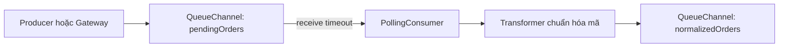

# receive-timeout: thời gian chờ nhận thông điệp của Poller

Trong module **SPRING_INTEGRATION_CORE**, `receive-timeout` giúp điều chỉnh cách một endpoint chờ lấy `Message` từ kênh có khả năng polling. Hiểu tham số này giúp thiết kế luồng thông điệp phản hồi phù hợp khi hàng đợi lúc có dữ liệu, lúc trống, đồng thời sử dụng hợp lý tài nguyên thực thi.

Bài thuộc chương **Poller**, tập trung vào `PollingConsumer`, `PollableChannel` và cấu hình Java DSL. Các ví dụ dùng `QueueChannel` trong bộ nhớ để quan sát hành vi mà không cần broker hoặc cơ sở dữ liệu.

Sau bài này, bạn có thể:

- Giải thích một lần `receive()` chờ ở đâu và kết thúc khi nào.
- Phân biệt `receive-timeout`, `fixed-delay`, `max-messages-per-poll` và timeout của gateway.
- Cấu hình thời gian chờ hữu hạn, nhận ngay và nhận không giới hạn thời gian.
- Phân tích độ trễ, số lần poll rỗng và ảnh hưởng đến thread.
- Viết kiểm thử hành vi mà không phụ thuộc vào thời điểm chính xác của scheduler.

## 1. Vị trí của receive-timeout trong luồng thông điệp

Xét luồng chuẩn hóa mã đơn hàng:



Producer gửi `Message` vào `pendingOrders`. Một endpoint chủ động lấy thông điệp khỏi kênh rồi gọi transformer. Poller điều khiển thời điểm endpoint thử nhận; `receive-timeout` điều khiển thời gian mà **mỗi lần nhận** được phép chờ.

`PollingConsumer` kết nối một `PollableChannel` với một `MessageHandler`. Với giá trị timeout không âm, thao tác nhận sử dụng `inputChannel.receive(timeout)`. Với giá trị âm, implementation gọi `inputChannel.receive()` để chờ không giới hạn thời gian. Xem [mã nguồn PollingConsumer](https://github.com/spring-projects/spring-integration/blob/main/spring-integration-core/src/main/java/org/springframework/integration/endpoint/PollingConsumer.java).

Không gắn poller vào `DirectChannel` để tạo hành vi này: `DirectChannel` chuyển thông điệp cho subscriber khi có lệnh gửi, không cung cấp thao tác lấy thông điệp theo mô hình trên.

### Một lần nhận có ba kết quả đáng chú ý

1. **Thông điệp đã có sẵn:** lấy thông điệp và chuyển sang xử lý ngay.
2. **Kênh đang trống, thông điệp đến trong lúc chờ:** thao tác nhận trả về khi lấy được thông điệp.
3. **Hết thời gian mà chưa nhận được:** thao tác nhận trả về `null`; handler không được gọi cho lần nhận đó.

`null` biểu thị không nhận được thông điệp, không phải một `Message` có payload `null`. Theo hợp đồng [PollableChannel](https://docs.spring.io/spring-framework/docs/current/javadoc-api/org/springframework/messaging/PollableChannel.html), thao tác nhận cũng có thể trả về `null` khi bị gián đoạn.

## 2. Giá trị, đơn vị và tên cấu hình

| Cách cấu hình | Tên dùng trong cấu hình |
|---|---|
| XML | `receive-timeout="800"` |
| Java DSL | `.receiveTimeout(800)` |
| Annotation `@Poller` | `receiveTimeout = "800"` |
| `PollerMetadata` | `setReceiveTimeout(800)` |
| `PollingConsumer` trực tiếp | `setReceiveTimeout(800)` |

Giá trị là **mili giây**. `800` nghĩa là tối đa khoảng `0,8` giây chờ nhận, không phải 800 giây. Java DSL nhận đối số `long`; khai báo annotation nhận chuỗi để hỗ trợ placeholder cấu hình. Tài liệu [PollerSpec.receiveTimeout](https://docs.spring.io/spring-integration/api/org/springframework/integration/dsl/PollerSpec.html#receiveTimeout(long)) xác nhận đơn vị và giá trị mặc định là `1000` ms.

Đối với `QueueChannel` trong bài:

| Giá trị | Ý nghĩa |
|---|---|
| `> 0`, ví dụ `800` | Chờ tối đa khoảng 800 ms nếu chưa có thông điệp |
| `0` | Kiểm tra ngay; trả về `null` nếu hàng đợi đang trống |
| `< 0`, thường dùng `-1` | Chờ không giới hạn thời gian để nhận thông điệp, trừ khi bị gián đoạn |

Trong XML, `time-unit` của poller dành cho các thuộc tính chu kỳ trigger; không dùng nó để đổi đơn vị của `receive-timeout`. Ví dụ bên dưới cố ý dùng số mili giây rõ ràng cho mọi thuộc tính.

Timeout là giới hạn thời gian chờ ở thao tác nhận theo hợp đồng API. Nó không bảo đảm thread được scheduler đánh thức đúng từng mili giây trên mọi môi trường.

## 3. Phân biệt các tham số dễ nhầm

| Tham số | Câu hỏi mà tham số trả lời | Không điều khiển |
|---|---|---|
| `fixed-delay` | Sau khi tác vụ theo lịch kết thúc, chờ bao lâu để lập lịch lần tiếp theo? | Thời gian tối đa của một lần nhận |
| `fixed-rate` | Lịch được xác định theo chu kỳ nào? | Số thread hoặc bảo đảm xử lý song song |
| `receive-timeout` | Mỗi lần lấy thông điệp được chờ bao lâu? | Thời hạn xử lý nghiệp vụ |
| `max-messages-per-poll` | Một lượt poll được nhận tối đa bao nhiêu thông điệp? | Thời hạn hoàn thành cả lượt |
| Gateway `replyTimeout` | Bên gọi gateway chờ phản hồi bao lâu? | Hủy tự động nghiệp vụ đang chạy |
| Timeout của HTTP/JDBC client | Một thao tác I/O được chờ bao lâu theo API tương ứng? | Lịch poll hoặc thời gian chờ ở kênh |

Ví dụ đặt `receiveTimeout(100)` rồi handler gọi dịch vụ bên ngoài trong 5 giây. Sau khi thông điệp đã được lấy, handler vẫn có thể chạy 5 giây hoặc lâu hơn nếu các cơ chế khác không giới hạn nó. Giá trị `100` không tạo deadline cho handler.

Tương tự, `maxMessagesPerPoll(5)` là giới hạn số lượng. Năm thông điệp không được gộp thành một thông điệp batch, và poller không chờ thu đủ năm thông điệp mới giao cho handler.

## 4. Mô hình một lượt poll

Có thể hình dung một lượt poll thông thường bằng mã giả:

```text
khi trigger kích hoạt:
    received = 0
    trong khi chưa chạm giới hạn số thông điệp:
        message = nhận từ channel với receive-timeout
        nếu message là null:
            kết thúc lượt poll
        gọi handler(message)
        received = received + 1
```

Mã giả lược bỏ lifecycle, advice, giao dịch và xử lý lỗi. Điểm quan trọng là gặp `null` thì lượt poll kết thúc, kể cả khi chưa đạt giới hạn số lượng; xem [AbstractPollingEndpoint](https://github.com/spring-projects/spring-integration/blob/main/spring-integration-core/src/main/java/org/springframework/integration/endpoint/AbstractPollingEndpoint.java).

Giả sử:

```text
receive-timeout       = 800 ms
max-messages-per-poll  = 5
hàng đợi ban đầu       = 2 thông điệp
```

Nếu không có thông điệp mới:

- Hai lần nhận đầu lấy hai thông điệp có sẵn.
- Handler xử lý từng thông điệp theo luồng đang cấu hình.
- Lần nhận thứ ba chờ khoảng 800 ms rồi trả về `null`.
- Lượt poll kết thúc; không tiếp tục chờ thêm cho lần thứ tư và thứ năm.

Ngược lại, nếu thông điệp lần lượt đến trước khi mỗi lần nhận hết hạn, một lượt có thể chờ nhiều lần. Vì vậy, `receive-timeout = 800` không giới hạn cả lượt poll trong 800 ms.

Nếu dùng giới hạn âm để nhận liên tục trong một lượt, một hàng đợi luôn có dữ liệu có thể khiến lượt kéo dài. Ghép giới hạn đó với thời gian chờ nhận vô hạn càng làm ranh giới giữa các lượt khó quan sát. Với ví dụ học tập, đặt giới hạn dương rõ ràng để dễ phân tích.

## 5. Timeline: thông điệp đến trong lúc chờ

Giả sử poller dùng executor đồng bộ mặc định, không có advice thay đổi hành vi, với:

```text
fixed-delay           = 200 ms
receive-timeout       = 800 ms
max-messages-per-poll  = 1
```

Tình huống A — một thông điệp đến lúc thread đang nhận:

```text
T =    0 ms: trigger chạy; hàng đợi rỗng; bắt đầu receive(800)
T =  300 ms: producer gửi một thông điệp
T ≈  300 ms: receive trả về; handler bắt đầu
T ≈  320 ms: handler xong; lượt poll kết thúc
T ≈  520 ms: lượt tiếp theo có thể bắt đầu
```

Các mốc là ví dụ lý tưởng hóa, không phải cam kết thời gian. Thông điệp không phải chờ đủ 800 ms. `800` là thời gian chờ tối đa khi chưa nhận được, không phải thời gian trì hoãn bắt buộc.

Tình huống B — hàng đợi tiếp tục rỗng:

```text
T =    0 ms: bắt đầu receive(800)
T ≈  800 ms: hết hạn; nhận null; kết thúc lượt
T ≈ 1000 ms: sau fixed-delay 200 ms, lượt tiếp theo có thể chạy
```

Tình huống C — thông điệp đến trong khoảng nghỉ:

```text
T ≈  800 ms: lượt nhận rỗng vừa kết thúc
T =  850 ms: producer gửi thông điệp
T ≈ 1000 ms: lượt tiếp theo lấy được thông điệp
```

Tăng `receive-timeout` không loại bỏ khoảng nghỉ giữa hai lượt. Muốn đánh giá độ trễ phải xét cả thời gian chờ nhận, trigger, thời gian handler và khả năng phục vụ của scheduler.

Với giả định như trên, khi hàng đợi luôn rỗng:

```text
thời gian giữa hai lần bắt đầu poll ≈ receive-timeout + fixed-delay
```

Công thức là mô hình phục vụ phân tích, không áp dụng nguyên xi khi poller chuyển tác vụ cho một executor bất đồng bộ hoặc khi hệ thống bị tranh chấp tài nguyên.

## 6. Ví dụ Java DSL hoàn chỉnh

Ví dụ sử dụng Java 17+, API Java DSL của Spring Integration 6.x, `spring-integration-core` và các thư viện Spring tương thích. Lớp cấu hình không cần dịch vụ ngoài. Đặt lớp trong file `ReceiveTimeoutConfig.java` của ứng dụng thực hành.

```java
package example.integration;

import java.time.Duration;
import java.util.Locale;

import org.springframework.context.annotation.Bean;
import org.springframework.context.annotation.Configuration;
import org.springframework.integration.channel.QueueChannel;
import org.springframework.integration.config.EnableIntegration;
import org.springframework.integration.dsl.IntegrationFlow;
import org.springframework.integration.dsl.Pollers;

@Configuration
@EnableIntegration
public class ReceiveTimeoutConfig {

    @Bean
    public QueueChannel pendingOrders() {
        return new QueueChannel(100);
    }

    @Bean
    public QueueChannel normalizedOrders() {
        return new QueueChannel(100);
    }

    @Bean
    public QueueChannel pollErrors() {
        return new QueueChannel(100);
    }

    @Bean
    public IntegrationFlow normalizeOrderCodes() {
        return IntegrationFlow.from(pendingOrders())
                .transform(String.class,
                        code -> code.trim().toUpperCase(Locale.ROOT),
                        endpoint -> endpoint
                                .id("normalizeOrderCodeEndpoint")
                                .poller(Pollers.fixedDelay(Duration.ofMillis(200))
                                        .receiveTimeout(800)
                                        .maxMessagesPerPoll(1)
                                        .errorChannel("pollErrors")))
                .channel(normalizedOrders())
                .get();
    }
}
```

Poller được cấu hình trên **endpoint transformer đọc từ `pendingOrders`**. `normalizedOrders` chỉ giữ kết quả để chương trình gọi hoặc kiểm thử lấy ra.

Ví dụ gửi một thông điệp sau khi application context đã khởi động:

```java
boolean sent = pendingOrders.send(
        org.springframework.messaging.support.MessageBuilder
                .withPayload("  order-007  ")
                .setHeader("correlationId", "request-007")
                .build(),
        1000);

if (!sent) {
    throw new IllegalStateException("Không gửi được đơn hàng vào hàng đợi");
}

org.springframework.messaging.Message<?> result =
        normalizedOrders.receive(5000);
```

Đây là đoạn sử dụng các bean đã được lấy từ context. Hai số `1000` và `5000` có vai trò riêng:

- `send(..., 1000)` giới hạn chờ gửi khi kênh đầu vào đầy.
- `normalizedOrders.receive(5000)` giới hạn chờ kết quả ở phía chương trình gọi.

Cả hai không thay đổi `receiveTimeout(800)` của endpoint.

Dung lượng `100` chỉ là lựa chọn cho ví dụ. Với kênh kết quả bị đầy, việc gửi tiếp có thể tạo thêm thời gian chờ tùy cấu hình của handler. Vì vậy, một lượt chậm không đủ để kết luận nguyên nhân nằm ở thao tác nhận đầu vào.

## 7. Cấu hình XML và annotation tương đương

### XML

Fragment sau dùng namespace `int` của Spring Integration; ghép vào tài liệu Spring XML có khai báo namespace và schema tương ứng:

```xml
<int:channel id="pendingOrders">
    <int:queue capacity="100"/>
</int:channel>

<int:channel id="normalizedOrders">
    <int:queue capacity="100"/>
</int:channel>

<int:transformer id="normalizeOrderCodeEndpoint"
                 input-channel="pendingOrders"
                 output-channel="normalizedOrders"
                 expression="payload.trim().toUpperCase(T(java.util.Locale).ROOT)">
    <int:poller fixed-delay="200"
                receive-timeout="800"
                max-messages-per-poll="1"/>
</int:transformer>
```

Các thuộc tính đều là số mili giây trong fragment này. Tài liệu [Message Endpoints](https://docs.spring.io/spring-integration/reference/endpoint.html) mô tả cấu hình poller lồng trong endpoint và cách tham chiếu poller dùng chung.

### Annotation

Đây là phương án thay thế cho flow DSL, không đăng ký đồng thời hai consumer vào cùng hàng đợi khi đang muốn quan sát một consumer:

```java
import java.util.Locale;

import org.springframework.integration.annotation.Poller;
import org.springframework.integration.annotation.Transformer;

public class OrderCodeNormalizer {

    @Transformer(
            inputChannel = "pendingOrders",
            outputChannel = "normalizedOrders",
            poller = @Poller(
                    fixedDelay = "200",
                    receiveTimeout = "${orders.poller.receive-timeout:800}",
                    maxMessagesPerPoll = "1"))
    public String normalize(String code) {
        return code.trim().toUpperCase(Locale.ROOT);
    }
}
```

Đăng ký `OrderCodeNormalizer` thành Spring bean trong ứng dụng đã bật hạ tầng integration và khai báo hai channel tương ứng. Để dùng placeholder, ứng dụng cần cơ chế phân giải property; Spring Boot cung cấp cơ chế này trong cấu hình thông thường. Giá trị cấu hình có thể là:

```properties
orders.poller.receive-timeout=800
```

`@Poller.receiveTimeout` áp dụng cho polling consumer. Với inbound channel adapter đọc từ `MessageSource`, cách thao tác đọc chặn hoặc không chặn phụ thuộc implementation của nguồn; không suy ra timeout HTTP, JDBC hay SFTP chỉ từ thuộc tính này. Xem [Javadoc @Poller](https://docs.spring.io/spring-integration/api/org/springframework/integration/annotation/Poller.html).

## 8. Chọn thời gian chờ theo tình huống

Không có một giá trị tối ưu cho mọi luồng. Những cấu hình sau là điểm xuất phát để thực nghiệm:

| Tình huống giả định | Cấu hình thử nghiệm | Điều cần đo |
|---|---|---|
| Hàng đợi thường rỗng, nhận độ trễ ở mức giây | `receiveTimeout(0)`, `fixedDelay(1000)` | Độ trễ khi thông điệp đến ngay sau một lượt |
| Dữ liệu đến thưa, muốn nhận sớm trong cửa sổ chờ | `receiveTimeout(800)`, `fixedDelay(200)` | Thread chờ và độ trễ ở khoảng nghỉ |
| Hàng đợi thường có backlog | Timeout hữu hạn, tăng giới hạn số thông điệp mỗi lượt có kiểm soát | Tốc độ xử lý và thời gian handler |
| Nhiều endpoint dùng chung tài nguyên thực thi | Timeout hữu hạn và cấu hình pool theo tải đo được | Tác vụ bị trễ, số thread hoạt động, hàng đợi executor |

Đây là giả thuyết thử nghiệm cho các điều kiện đã nêu, không phải cấu hình production mặc định.

Một timeout dài tạo cửa sổ để nhận sớm khi thông điệp xuất hiện trong lúc chờ. Đổi lại, tác vụ vẫn chiếm một vị trí thực thi trong thời gian chờ. Thread bị chặn thường không đốt CPU như vòng lặp bận, nhưng vẫn ảnh hưởng khả năng phục vụ các tác vụ khác.

Nếu không cấu hình executor riêng, việc nhận và xử lý đồng bộ có thể giữ scheduler thread. Nếu chuyển sang executor bất đồng bộ, cần phân biệt hai thời điểm: scheduler hoàn thành việc giao tác vụ và worker hoàn thành việc nhận/xử lý. `fixed-delay` khi đó không tự bảo đảm khoảng cách giữa hai lần xử lý nghiệp vụ của worker.

Đặc biệt, đừng xem `receiveTimeout(-1)` là cách tăng tốc miễn phí. Nếu kênh im lặng lâu, thread có thể chờ lâu tương ứng. Cũng không suy ra thời gian shutdown chỉ bằng giá trị timeout: lifecycle, gián đoạn và implementation của kênh đều có vai trò.

## 9. Hết hạn nhận, lỗi xử lý và giao dịch

Hàng đợi trống đến hết timeout là một tình huống bình thường. Nó không có nghĩa là đơn hàng lỗi và không cần tự tạo `ErrorMessage` cho mỗi lần poll rỗng.

Trong ví dụ DSL, `pollErrors` dành cho lỗi thực sự phát sinh trong tác vụ poll, chẳng hạn transformer nhận payload không phù hợp và ném exception. Hàng đợi lỗi cần được tiêu thụ hoặc giám sát nếu áp dụng vào ứng dụng thật; việc khai báo nó không tự tạo cơ chế retry.

Có thể dùng bảng sau để tránh chọn sai cách xử lý:

| Hiện tượng | Câu hỏi cần kiểm tra |
|---|---|
| Không có message sau một lượt | Kênh có đang trống và đã hết thời gian chờ không? |
| Message có ở đầu vào nhưng chưa ra kết quả | Endpoint đã chạy chưa, worker có bị giữ không, handler có bị chặn không? |
| Có exception trong error channel | Bước nhận hay bước xử lý nào đã ném lỗi? |
| Mất message sau khi handler lỗi | Kênh có hỗ trợ giao dịch và có chính sách phục hồi nào? |

`QueueChannel` trong bộ nhớ của ví dụ không cung cấp bảo đảm tự đưa message trở lại hàng đợi khi handler thất bại. Giảm hoặc tăng thời gian chờ không tạo bảo đảm giao nhận hay tính idempotent.

Nếu advice giao dịch bao quanh cả tác vụ poll, thời gian chờ nhận có thể nằm trong thời gian giao dịch đang mở. Cần xem ranh giới advice và tài nguyên thực tế trước khi tăng timeout. Một poller giao dịch không tự biến mọi channel thành tài nguyên giao dịch.

## 10. Kiểm thử hành vi

Các kiểm thử dưới đây dùng JUnit Jupiter. Hai kiểm thử đầu khảo sát hợp đồng của `QueueChannel`; kiểm thử cuối chạy flow trong application context. Chúng là ví dụ để người học thực hành, không khẳng định dự án hiện tại đã chạy kiểm thử.

```java
package example.integration;

import org.junit.jupiter.api.Test;
import org.springframework.context.annotation.AnnotationConfigApplicationContext;
import org.springframework.integration.channel.QueueChannel;
import org.springframework.messaging.Message;
import org.springframework.messaging.support.MessageBuilder;

import static org.junit.jupiter.api.Assertions.assertEquals;
import static org.junit.jupiter.api.Assertions.assertNotNull;
import static org.junit.jupiter.api.Assertions.assertNull;
import static org.junit.jupiter.api.Assertions.assertTrue;

class ReceiveTimeoutTest {

    @Test
    void emptyQueueReturnsNullAfterFiniteWait() {
        QueueChannel channel = new QueueChannel();

        Message<?> result = channel.receive(20);

        assertNull(result);
    }

    @Test
    void zeroTimeoutStillReceivesAnAvailableMessage() {
        QueueChannel channel = new QueueChannel();
        assertTrue(channel.send(
                MessageBuilder.withPayload("order-007").build(), 0));

        Message<?> result = channel.receive(0);

        assertNotNull(result);
        assertEquals("order-007", result.getPayload());
        assertNull(channel.receive(0));
    }

    @Test
    void pollerDeliversMessageToTransformer() {
        try (AnnotationConfigApplicationContext context =
                     new AnnotationConfigApplicationContext(
                             ReceiveTimeoutConfig.class)) {
            QueueChannel input = context.getBean(
                    "pendingOrders", QueueChannel.class);
            QueueChannel output = context.getBean(
                    "normalizedOrders", QueueChannel.class);
            QueueChannel errors = context.getBean(
                    "pollErrors", QueueChannel.class);

            assertTrue(input.send(MessageBuilder
                    .withPayload("  order-007  ")
                    .setHeader("correlationId", "request-007")
                    .build(), 1000));

            Message<?> result = output.receive(5000);

            assertNotNull(result);
            assertEquals("ORDER-007", result.getPayload());
            assertEquals("request-007",
                    result.getHeaders().get("correlationId"));
            assertNull(errors.receive(0));
        }
    }
}
```

Kiểm thử thứ hai cho thấy timeout bằng `0` vẫn nhận được dữ liệu đã có. Kiểm thử tích hợp xác minh payload và header đi qua endpoint; nó không đo riêng việc thread đã bước vào `receive(800)` tại thời điểm gửi.

Để kiểm tra tình huống “message đến trong lúc đang chờ”, có thể bổ sung một `ChannelInterceptor` báo hiệu bằng `CountDownLatch` tại `preReceive`, rồi mới cho producer gửi. Không dùng `Thread.sleep(100)` làm bằng chứng rằng poller chắc chắn đã bắt đầu nhận.

Nếu mục tiêu là đo thời gian chờ, dùng đồng hồ đơn điệu như `System.nanoTime()` và khoảng sai số phù hợp với môi trường. Tránh assert thời gian chính xác bằng `800` ms: máy CI có thể tạm ngưng thread lâu hơn, trong khi hành vi nhận vẫn đúng.

## 11. Bài thực hành: thay đổi một tham số mỗi lần

Giữ `maxMessagesPerPoll(1)` để dễ quan sát, rồi chạy các thí nghiệm:

1. Đặt timeout bằng `0`, delay bằng `1000`. Gửi thông điệp ở các thời điểm khác nhau và ghi nhận độ trễ từ gửi đến handler.
2. Đổi timeout thành `800`, delay thành `200`. Quan sát thông điệp đến trong cửa sổ nhận và trong khoảng nghỉ.
3. Giữ cấu hình bước 2, thêm xử lý nghiệp vụ mất khoảng 2 giây. Kiểm tra rằng timeout `800` không kết thúc handler sớm.
4. Đặt giới hạn nhận mỗi lượt bằng `3`, nạp trước hai thông điệp. Theo dõi lần nhận thứ ba kết thúc rỗng khi không có dữ liệu mới.
5. Ghi lại cấu hình, số message, độ trễ và tài nguyên thực thi trước khi kết luận cấu hình nào phù hợp.

Các mốc xử lý giả lập chỉ phục vụ thí nghiệm. Trong kiểm thử tự động, ưu tiên tín hiệu đồng bộ và assertion vào kết quả.

Khi đọc kết quả, hãy phân biệt “thời gian producer gửi thành công”, “thời gian message được lấy khỏi kênh” và “thời gian xử lý xong”. Ba mốc này trả lời ba câu hỏi khác nhau; chỉ đo thời gian kết thúc toàn luồng sẽ khó xác định phần chờ nằm ở đâu.

## 12. Câu hỏi tự kiểm tra

**Đặt `receiveTimeout(3000)` có làm mọi message chậm thêm 3 giây không?**

Không. Nếu nhận được message sớm thì thao tác nhận kết thúc sớm. Một message đã nằm trong `QueueChannel` có thể được lấy ngay khi poller thực hiện lệnh nhận.

**Đặt timeout bằng `0` có làm poller chạy liên tục không?**

Không tự động. Trigger vẫn quyết định lịch; giới hạn số lượng vẫn quyết định một lượt có thể nhận bao nhiêu message. Tuy nhiên, lịch quá dày kết hợp nhận không chờ có thể tạo nhiều lượt rỗng.

**Giới hạn mỗi lượt là `10`, timeout là `500` ms, vậy lượt luôn mất 5 giây?**

Không. Nếu lần nhận đầu trả về `null`, lượt kết thúc ngay sau lần chờ đó. Nếu đủ mười message có sẵn, phần nhận có thể rất nhanh. Nếu message đến rải rác, lượt có thể chứa nhiều lần chờ và nhiều lần xử lý.

**Gateway hết thời gian chờ phản hồi thì poller có hủy handler không?**

Không thể suy ra như vậy. Gateway timeout và vòng đời xử lý ở endpoint là những cơ chế khác nhau; muốn hủy công việc phải có thiết kế hỗ trợ riêng.

**Tăng timeout có giải quyết hàng đợi tăng mãi không?**

Không đủ. Khi dữ liệu đã có sẵn, thao tác nhận thường không phải chờ hết timeout. Cần đo tốc độ vào, thời gian xử lý, giới hạn mỗi lượt và khả năng thực thi để tìm nút thắt.
