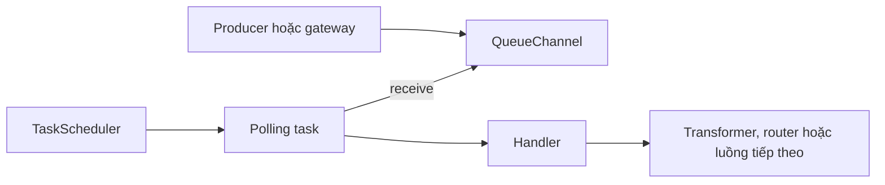

# TaskScheduler trong Spring Integration

## 1. Mục tiêu và phạm vi

Trong Spring Integration Core, một luồng thông điệp không chỉ cần `Message`, channel và endpoint. Với endpoint chủ động lấy dữ liệu, ứng dụng còn cần một cơ chế quyết định **khi nào thực hiện lần lấy tiếp theo**. `TaskScheduler` cung cấp cơ chế lập lịch đó cho poller.

Bài này thuộc chương **Poller** của module `SPRING_INTEGRATION_CORE`, tập trung vào mối liên hệ giữa scheduler, trigger, tác vụ polling và tài nguyên thực thi. Sau bài học, bạn có thể:

- Nhận biết endpoint nào cần scheduler và endpoint nào được kích hoạt trực tiếp bởi message.
- Phân biệt `TaskScheduler`, `Trigger` và `TaskExecutor`.
- Cấu hình scheduler dùng chung và poller trong Java DSL.
- Giải thích vì sao một tác vụ chậm có thể làm các poller khác trễ lịch.
- Chọn cách tách việc lập lịch khỏi xử lý nghiệp vụ, đồng thời kiểm soát backlog và lỗi.
- Kiểm thử hành vi bất đồng bộ mà không phụ thuộc vào một khoảng ngủ cố định.

## 2. TaskScheduler giải quyết vấn đề gì?

Giả sử đơn hàng được ghi vào `QueueChannel`. Handler phía sau không được gọi ngay khi producer gửi message: queue giữ message cho đến khi consumer gọi `receive()`. Một polling consumer phải lặp lại công việc này theo lịch.

Có ba câu hỏi khác nhau:

| Câu hỏi | Thành phần chịu trách nhiệm chính |
|---|---|
| Khi nào cần kích hoạt lần polling tiếp theo? | `Trigger` hoặc cấu hình lịch tương ứng |
| Ai đăng ký và kích hoạt tác vụ đúng lịch? | `TaskScheduler` |
| Khi được kích hoạt thì nhận, gửi hoặc xử lý message như thế nào? | Polling endpoint và các thành phần của integration flow |

`TaskScheduler` là abstraction lập lịch của Spring Framework. Trong Spring Integration, framework dùng scheduler để vận hành các tác vụ theo lịch, trong đó có poller. Bạn thường cấu hình scheduler bằng một Spring bean; không phải tự viết vòng lặp `while`, tự tạo thread hoặc gọi `Thread.sleep()` trong flow.

Scheduler không phải nơi định nghĩa transformer, router, filter hay aggregator. Nó tạo điều kiện để một endpoint chạy; các thành phần trong flow vẫn quyết định nội dung và đường đi của message.

## 3. Endpoint nào cần poller?

### 3.1. Polling consumer trên PollableChannel

`QueueChannel` triển khai `PollableChannel`. Endpoint tiêu thụ từ channel này cần poller để gọi `receive()` và chuyển message tới handler.



Mũi tên `receive` biểu diễn lời gọi chủ động lấy message từ queue. Producer không trực tiếp gọi handler phía sau queue.

### 3.2. Inbound channel adapter có MessageSource

Một `MessageSource` có thể chủ động đọc dữ liệu khi poller gọi `receive()`, rồi gửi message vào output channel. Đây là mô hình thường gặp ở nguồn dữ liệu được thăm dò định kỳ.

```text
TaskScheduler
    -> polling task
        -> MessageSource.receive()
            -> output channel
                -> downstream flow
```

Nguồn không có dữ liệu có thể trả về `null`. Kết quả đó thường kết thúc việc lấy thêm message trong lượt polling hiện tại; không nên biến nó thành một message nghiệp vụ giả chỉ để giữ tác vụ hoạt động.

### 3.3. Event-driven consumer trên SubscribableChannel

`DirectChannel` là một `SubscribableChannel`: message được dispatch đến subscriber khi có thao tác gửi. Endpoint tiêu thụ trực tiếp từ channel này không cần poller để được kích hoạt.

Một gateway gửi vào `DirectChannel` vì thế không tự động tạo nhu cầu về scheduler. Nếu gateway gửi vào queue và một endpoint phía sau polling queue đó, nhu cầu xuất hiện ở đoạn queue → consumer.

> Xác định ranh giới polling trong flow trước khi cấu hình scheduler. Không thêm poller vào mọi endpoint theo thói quen.

## 4. Phân biệt scheduler, trigger và executor

### 4.1. TaskScheduler: quản lý việc chạy theo thời gian

API `TaskScheduler` cho phép đăng ký tác vụ chạy tại một thời điểm, chạy với fixed rate, fixed delay hoặc chạy theo `Trigger`. Các lời gọi lập lịch trả về đối tượng có thể dùng để quản lý việc hủy tác vụ.

Trong cấu hình Spring Integration thông thường, polling endpoint đăng ký tác vụ với scheduler khi khởi động và quản lý tác vụ theo vòng đời endpoint. Không cần gọi trực tiếp API `schedule()` để tạo thêm một vòng polling cho cùng endpoint.

### 4.2. Trigger: chính sách tính lần chạy kế tiếp

Trigger là chính sách thời gian, không phải một thread pool. Hai poller có thể dùng cùng scheduler nhưng có chu kỳ hoặc biểu thức cron khác nhau.

Với trigger phụ thuộc thời điểm hoàn tất tác vụ, cần hiểu tác vụ mà scheduler theo dõi thực sự kết thúc ở đâu. Nếu tác vụ chỉ chuyển công việc sang một executor rồi trả về, thời điểm hoàn tất đó khác thời điểm nghiệp vụ hoàn tất.

### 4.3. TaskExecutor: thực thi công việc được giao

`TaskExecutor` trả lời câu hỏi “giao việc này cho luồng nào thực hiện?”, không tự cung cấp chính sách lịch định kỳ cho poller.

| Thành phần | Vai trò | Ví dụ triển khai |
|---|---|---|
| `TaskScheduler` | Đăng ký và kích hoạt tác vụ theo lịch | `ThreadPoolTaskScheduler` |
| `Trigger` | Xác định lịch chạy | `PeriodicTrigger`, `CronTrigger` |
| `TaskExecutor` | Thực thi công việc được submit | `ThreadPoolTaskExecutor` |
| `PollerMetadata` | Mô tả poller: trigger, giới hạn message, executor và các thuộc tính liên quan | Được tạo từ Java DSL hoặc bean cấu hình |

Với `ThreadPoolTaskScheduler`, chính các thread của scheduler thực thi tác vụ đã lập lịch. Đây là điểm rất quan trọng: nếu tác vụ polling đi xuyên qua một flow đồng bộ và gặp handler chậm, thread scheduler cũng bận trong thời gian đó.

## 5. Fixed delay, fixed rate và cron

### 5.1. Fixed delay

Fixed delay chờ một khoảng thời gian sau khi tác vụ được scheduler theo dõi hoàn tất rồi mới chạy tiếp.

Ví dụ delay là 1 giây, một lượt polling thực hiện trong 400 ms:

```text
0 ms       400 ms                 1400 ms      1800 ms
|-- lượt 1 --|------ chờ 1 s -------|-- lượt 2 --|
```

Không có executor tách riêng, độ dài lượt polling bao gồm cả phần downstream chạy đồng bộ trong lời gọi của poller. Vì vậy cấu hình delay 1 giây không có nghĩa message chắc chắn được xử lý đúng mỗi giây.

### 5.2. Fixed rate

Fixed rate đặt các mốc chạy theo nhịp thời gian. Nếu tác vụ mất nhiều thời gian hoặc scheduler thiếu thread, thời điểm bắt đầu thực tế có thể trễ.

Với một tác vụ định kỳ được đăng ký bằng cơ chế fixed rate của `ThreadPoolTaskScheduler`, việc tăng pool không làm các lần thực thi của chính tác vụ đó tự chạy chồng lên nhau. Tuy nhiên, nếu polling task submit công việc sang executor và kết thúc nhanh, các công việc nghiệp vụ được submit từ những lần kích hoạt khác nhau có thể đồng thời tồn tại hoặc thực thi.

Không dùng fixed rate như một cam kết về tốc độ hoàn tất nghiệp vụ.

### 5.3. Cron

Cron phù hợp khi lịch gắn với đồng hồ: mỗi phút, theo giờ làm việc hoặc tại các thời điểm định sẵn.

Spring dùng biểu thức cron có trường giây. Ví dụ:

```text
0 */5 * * * *
```

Biểu thức trên biểu diễn mốc giây 0, mỗi 5 phút. Khi nghiệp vụ phụ thuộc múi giờ, cần cấu hình múi giờ phù hợp cho trigger và kiểm tra cách phiên bản Spring đang dùng hỗ trợ tùy chọn đó. Không suy ra múi giờ nghiệp vụ chỉ từ cấu hình hệ điều hành ở máy phát triển.

Cron không tự cung cấp cơ chế lưu bền lịch hoặc phát lại mọi mốc đã bỏ lỡ khi ứng dụng dừng.

## 6. Cấu hình scheduler dùng chung

Spring Integration nhận diện scheduler hạ tầng theo tên bean `taskScheduler`. Nếu không cung cấp scheduler phù hợp, hạ tầng Spring Integration có thể đăng ký scheduler mặc định khi được kích hoạt. Trong ứng dụng thực tế, khai báo tường minh giúp kiểm soát tài nguyên và dễ quan sát hơn.

Ví dụ sau sử dụng `ThreadPoolTaskScheduler`:

```java
import org.springframework.context.annotation.Bean;
import org.springframework.context.annotation.Configuration;
import org.springframework.integration.config.EnableIntegration;
import org.springframework.scheduling.concurrent.ThreadPoolTaskScheduler;

@Configuration
@EnableIntegration
public class SchedulingConfiguration {

    @Bean(name = "taskScheduler")
    public ThreadPoolTaskScheduler taskScheduler() {
        ThreadPoolTaskScheduler scheduler = new ThreadPoolTaskScheduler();
        scheduler.setPoolSize(4);
        scheduler.setThreadNamePrefix("si-poller-");
        scheduler.setRemoveOnCancelPolicy(true);
        return scheduler;
    }
}
```

Các điểm cần hiểu:

- `ThreadPoolTaskScheduler` tự tạo bằng cấu hình như trên có pool size mặc định là 1 nếu không gọi `setPoolSize()`. Không suy rộng con số này thành mặc định của mọi scheduler do Spring Integration hoặc Spring Boot cung cấp.
- `poolSize = 4` là lựa chọn minh họa. Nó cho phép nhiều tác vụ khác nhau dùng scheduler có cơ hội thực thi đồng thời, nhưng không bảo đảm độ trễ hay thông lượng cụ thể.
- Prefix thread giúp nhận diện hoạt động trong log và thread dump.
- `removeOnCancelPolicy` giúp loại bỏ tác vụ đã hủy khỏi hàng đợi lập lịch của executor nền. Nó không phải chính sách giới hạn backlog message.
- Spring quản lý khởi tạo và hủy bean. Không cần gọi `initialize()` thủ công trong phương thức `@Bean` này.

Trong Spring Boot, việc có sẵn một bean `TaskScheduler` có thể làm thay đổi điều kiện auto-configuration. Cần kiểm tra tên và bean thực tế được ứng dụng sử dụng khi có nhiều nguồn cấu hình. Chỉ đánh dấu một bean khác tên là `@Primary` không thay thế được việc hiểu lookup theo tên của hạ tầng Spring Integration.

## 7. Ví dụ hoàn chỉnh: polling QueueChannel bằng Java DSL

Cấu hình dưới đây tạo queue nhận đơn hàng và endpoint lấy tối đa 5 message mỗi lượt, với fixed delay 1 giây. Nó dùng scheduler ở phần trước, trong cùng application context.

```java
import org.springframework.context.annotation.Bean;
import org.springframework.context.annotation.Configuration;
import org.springframework.integration.channel.QueueChannel;
import org.springframework.integration.dsl.IntegrationFlow;
import org.springframework.integration.dsl.Pollers;
import org.springframework.messaging.PollableChannel;

@Configuration
public class OrderPollingConfiguration {

    @Bean
    public PollableChannel ordersQueue() {
        return new QueueChannel(100);
    }

    @Bean
    public IntegrationFlow orderPollingFlow() {
        return IntegrationFlow.from("ordersQueue")
                .handle(String.class, (payload, headers) -> {
                    System.out.println(
                            Thread.currentThread().getName()
                                    + " processed " + payload);
                    return null;
                }, endpoint -> endpoint.poller(
                        Pollers.fixedDelay(1000)
                                .maxMessagesPerPoll(5)))
                .get();
    }
}
```

Trong ví dụ, giá trị số của `fixedDelay(1000)` tính bằng mili giây. Ứng dụng cần các dependency Spring Integration Core và Spring Context tương thích với nhau; nếu dùng Spring Boot, nên để cơ chế quản lý dependency của dự án chọn bộ phiên bản tương thích.

Gửi message minh họa từ thành phần producer:

```java
import org.springframework.messaging.support.MessageBuilder;

boolean accepted = ordersQueue.send(
        MessageBuilder.withPayload("ORDER-1001").build(),
        500);

if (!accepted) {
    throw new IllegalStateException("Không gửi được đơn hàng vào queue");
}
```

Ở đoạn producer, `ordersQueue` là `PollableChannel` đã được inject. Timeout 500 ms giới hạn thời gian chờ gửi vào queue khi đầy; nó không phải thời gian chờ consumer xử lý xong.

Cách flow hoạt động:

1. Producer đưa message vào queue có dung lượng 100.
2. Scheduler kích hoạt polling task theo trigger.
3. Poller nhận từng message và gọi handler, tối đa 5 message trong một lượt.
4. Handler trả về `null`, nên không tạo reply message để chuyển tiếp.
5. Khi tác vụ kết thúc, lịch fixed delay xác định lần tiếp theo.

`maxMessagesPerPoll(5)` là mức tối đa, không yêu cầu queue phải có đủ 5 message mới chạy, cũng không tạo ra 5 thread. Một lượt có thể kết thúc sớm khi không nhận được thêm message.

Không cấu hình thêm default poller chỉ để làm ví dụ này hoạt động: endpoint đã có poller riêng.

## 8. Default poller và scheduler là hai cấu hình khác nhau

Default poller giúp các endpoint cần polling nhưng không có cấu hình riêng dùng chung một bộ metadata. Scheduler vẫn là hạ tầng thực thi theo lịch.

Một cấu hình thay thế có thể khai báo:

```java
import org.springframework.context.annotation.Bean;
import org.springframework.integration.dsl.Pollers;
import org.springframework.integration.scheduling.PollerMetadata;

@Bean(name = PollerMetadata.DEFAULT_POLLER)
public PollerMetadata defaultPoller() {
    return Pollers.fixedDelay(1000)
            .maxMessagesPerPoll(5)
            .getObject();
}
```

Đặt phương thức này trong một lớp cấu hình. Nếu muốn endpoint dùng default poller, bỏ cấu hình poller cục bộ tương ứng của endpoint.

| Muốn thay đổi | Nơi cấu hình |
|---|---|
| Số thread scheduler, prefix thread | Bean `taskScheduler` |
| Chu kỳ polling, giới hạn message mỗi lượt | Metadata poller của endpoint hoặc default poller |
| Cách điều phối công việc polling sang worker | `taskExecutor` của poller |
| Dung lượng chờ message | Channel có khả năng lưu trữ, ví dụ `QueueChannel` |

Default poller không phải một queue dùng chung và không phải pool thực thi. Nhiều endpoint dùng chung cấu hình mặc định vẫn có các tác vụ polling của riêng chúng.

## 9. Handler chậm ảnh hưởng scheduler như thế nào?

Giả sử scheduler có một thread. Poller A đọc đơn hàng và gọi API ngoài trong 3 giây; poller B cần quét tác vụ nhẹ mỗi giây.

Nếu A chạy đồng bộ trên thread scheduler, B phải chờ thread rảnh. Dù trigger của B hợp lệ, thời điểm bắt đầu thực tế vẫn trễ.

```text
Scheduler chỉ có một thread:

0 s                    3 s
|--- A gọi API ngoài ---|--- B mới có thể bắt đầu ---|
```

Tăng pool có thể giảm cạnh tranh giữa các tác vụ độc lập. Tuy nhiên, nếu toàn bộ tác vụ thường xuyên chặn hoặc chờ I/O lâu, tăng pool đơn thuần dễ biến thành cách che giấu nút thắt downstream.

Một lượt polling còn có thể giữ thread lâu vì:

- `maxMessagesPerPoll` lớn và mỗi message có nhiều bước xử lý đồng bộ.
- Lời gọi nhận message chờ dữ liệu theo `receiveTimeout` của polling consumer.
- Transformer, filter, router hoặc handler phía sau thực hiện thao tác chặn.
- Aggregator phát kết quả và kích hoạt một đoạn downstream đồng bộ tốn thời gian.
- Các tác vụ hạ tầng khác cùng sử dụng scheduler.

Ước lượng sơ bộ cho lượt polling đồng bộ nhận được `N` message:

```text
T_lượt ≈ tổng thời gian nhận message
         + tổng thời gian xử lý đồng bộ của N message
         + chi phí điều phối
```

Đây là mô hình giải thích, không phải công thức cam kết hiệu năng. Khi đo thực tế, cần tính cả thời gian chờ tài nguyên, retry và thời gian xử lý lỗi.

## 10. Tách polling sang TaskExecutor

Khi công việc polling hoặc downstream có thể kéo dài, có thể cấu hình executor cho poller. Ví dụ biến thể của cấu hình trước:

```java
import org.springframework.context.annotation.Bean;
import org.springframework.scheduling.concurrent.ThreadPoolTaskExecutor;

@Bean
public ThreadPoolTaskExecutor pollingExecutor() {
    ThreadPoolTaskExecutor executor = new ThreadPoolTaskExecutor();
    executor.setCorePoolSize(4);
    executor.setMaxPoolSize(4);
    executor.setQueueCapacity(20);
    executor.setThreadNamePrefix("si-poll-worker-");
    return executor;
}
```

Inject executor vào phương thức khai báo flow, rồi thay phần poller bằng:

```java
endpoint -> endpoint.poller(
        Pollers.fixedDelay(1000)
                .maxMessagesPerPoll(5)
                .taskExecutor(pollingExecutor))
```

Ở đoạn trên, `pollingExecutor` là tham số đã được inject, không phải một biến tự xuất hiện trong mọi flow.

Luồng thực thi trở thành:

```text
Scheduler thread
    -> tác vụ theo lịch
        -> submit công việc polling
            -> worker thread nhận và xử lý message
```

Lợi ích là thread scheduler có thể sớm quay lại phục vụ lịch khác. Đổi lại, cần xử lý các hệ quả sau:

- **Có hai nơi chờ:** message có thể nằm trong `QueueChannel`; công việc polling có thể nằm trong queue của executor.
- **Fixed delay thay đổi ý nghĩa quan sát:** tác vụ mà scheduler theo dõi có thể hoàn tất ngay sau submit. Không diễn giải delay là khoảng nghỉ bắt buộc sau khi nghiệp vụ trên worker đã hoàn tất.
- **Có thể có nhiều công việc polling đồng thời:** kiểm tra thread safety của `MessageSource`, handler và tài nguyên downstream.
- **Thứ tự hoàn tất có thể thay đổi:** nhận từ queue theo một thứ tự không bảo đảm xử lý xong theo thứ tự đó khi có nhiều worker.
- **Saturation cần được nhìn thấy:** khi pool và queue đầy, việc submit có thể bị từ chối. Với chính sách chạy trên caller, công việc lại có thể chiếm thread scheduler.

Không chọn queue executor vô hạn chỉ để tránh lỗi submit. Cách đó có thể khiến độ trễ và lượng công việc đang chờ tăng khó kiểm soát.

Một lựa chọn kiến trúc khác là giữ polling ngắn, sau đó đặt một ranh giới bất đồng bộ trong flow. Khi thay đổi ranh giới thread, phải xem lại transaction, truyền lỗi và yêu cầu thứ tự của toàn bộ đoạn liên quan.

## 11. Phối hợp các tham số để kiểm soát tải

Các tham số thường bị nhầm là có thể thay thế cho nhau:

| Tham số | Kiểm soát điều gì? | Không bảo đảm điều gì? |
|---|---|---|
| Scheduler pool size | Khả năng thực thi đồng thời các tác vụ theo lịch | Không tự tăng số consumer của một polling task đồng bộ |
| Chu kỳ polling | Nhịp kích hoạt mong muốn | Không bảo đảm thời gian bắt đầu hay hoàn tất chính xác |
| `maxMessagesPerPoll` | Số message tối đa được xử lý trong một lượt | Không phải concurrency và không phải tổng dung lượng queue |
| `receiveTimeout` | Thời gian chờ nhận message trên polling consumer | Không phải timeout gọi HTTP hoặc timeout nghiệp vụ |
| Executor pool size | Mức thực thi công việc worker đồng thời | Không làm downstream tự có thêm năng lực |
| Executor queue capacity | Số công việc submit được phép chờ | Không giới hạn trực tiếp số message trong mọi channel |
| Channel capacity | Số message có thể giữ trong channel đó | Không kiểm soát toàn bộ backlog của hệ thống |

Với ví dụ fixed delay 1 giây và tối đa 5 message mỗi lượt, không nên kết luận hệ thống luôn xử lý 5 message/giây. Nếu một lượt đồng bộ mất 2 giây, còn phải chờ thêm delay trước lượt tiếp theo. Nếu nguồn chỉ có một message, lượt đó cũng không tạo ra bốn message còn thiếu.

Cách chọn cấu hình thực tế:

1. Đo thời gian nhận và xử lý message, bao gồm các tình huống chậm.
2. Đặt giới hạn mỗi lượt để một poller không giữ tài nguyên quá lâu.
3. Chọn nhịp polling theo độ trễ chấp nhận được và chi phí truy vấn nguồn rỗng.
4. Tách công việc kéo dài khi cần, với pool và queue hữu hạn.
5. Theo dõi backlog rồi điều chỉnh trong giới hạn downstream chịu được.

## 12. Xử lý lỗi ở ranh giới lịch và message

Scheduler không thay thế cơ chế xử lý lỗi của Spring Integration.

Trong flow đồng bộ, ngoại lệ nghiệp vụ có thể truyền ngược tới polling task. Spring Integration hỗ trợ đưa lỗi của tác vụ polling tới error channel thông qua cơ chế xử lý lỗi của poller. Khi cần một nơi xử lý cụ thể, có thể cấu hình:

```java
Pollers.fixedDelay(1000)
        .maxMessagesPerPoll(5)
        .errorChannel("pollingErrors")
```

Channel `pollingErrors` phải tồn tại và có consumer phù hợp. Nếu không cấu hình channel riêng, cần hiểu cơ chế `errorChannel` và error handler mặc định của ứng dụng thay vì mặc định mọi lỗi đều được xử lý theo yêu cầu nghiệp vụ.

Consumer lỗi thường nhận `ErrorMessage` với payload là ngoại lệ. Không phải mọi ngoại lệ đều có sẵn failed message: lỗi có thể xảy ra ngay khi truy vấn nguồn, trước khi tạo được message đầu vào.

Cần tách ba việc:

- **Ghi nhận lỗi:** log, metric và cảnh báo.
- **Quyết định nghiệp vụ:** retry, bỏ qua, bù trừ hoặc chuyển sang nơi lưu lỗi.
- **Bảo toàn dữ liệu:** transaction, acknowledgment và kho lưu trữ bền vững khi có yêu cầu.

Một `QueueChannel` dùng bộ nhớ không tự phục hồi message đã lấy ra khi handler thất bại. Scheduler cũng không tự biết phải gửi lại đơn hàng nào. Nếu cần xử lý lại đáng tin cậy, phải thiết kế cơ chế tương ứng và tính idempotent.

Nếu flow chuyển qua `ExecutorChannel` hoặc ranh giới bất đồng bộ khác, ngoại lệ downstream có thể được xử lý tại ranh giới đó. Đặt error channel cho poller không có nghĩa mọi lỗi ở mọi thread sau này đều quay về cùng poller.

## 13. Vòng đời và dừng ứng dụng

Polling endpoint có vòng đời riêng. Khi endpoint dừng, framework quản lý việc hủy tác vụ theo lịch của endpoint. Điều đó không đồng nghĩa mọi công việc đã submit hoặc đã bắt đầu đều lập tức dừng an toàn.

Khi thiết kế shutdown, cần xác định:

- Khi nào ngừng nhận thêm message từ producer.
- Khi nào ngừng tạo lượt polling mới.
- Công việc đang chạy được hoàn tất, bị ngắt hay được phục hồi như thế nào.
- Queue trong bộ nhớ còn dữ liệu hay không.
- Scheduler và executor nào là tài nguyên dùng chung, do ai quản lý.

Không gọi `shutdown()` trên scheduler dùng chung chỉ để tắt một flow. Dừng endpoint phù hợp với mục đích đó và giữ việc đóng tài nguyên dùng chung cho vòng đời application context.

Tùy chọn chờ hoàn tất khi shutdown cần được chọn theo thời gian dừng cho phép và tính chất công việc. Chỉ tăng thời gian chờ không giải quyết được một handler bị treo vô hạn; lời gọi bên ngoài vẫn cần timeout.

## 14. Nhiều instance và yêu cầu xử lý đúng một lần

Mỗi application context thường có scheduler và polling endpoint của riêng nó. Nếu triển khai ba instance cùng cấu hình, có thể có ba nguồn kích hoạt polling độc lập.

`TaskScheduler` không tự cung cấp:

- Bầu chọn một instance duy nhất được quyền polling.
- Khóa phân tán cho một tập dữ liệu dùng chung.
- Lưu bền lịch và phát lại các lần chạy bị bỏ lỡ.
- Bảo đảm xử lý nghiệp vụ đúng một lần.

Các yêu cầu đó cần cơ chế phối hợp của nguồn dữ liệu, broker, transaction, khóa hoặc leader election tùy kiến trúc. Ví dụ, nhiều instance cùng đọc bảng đơn hàng phải có cách claim bản ghi an toàn; việc đặt chu kỳ polling lệch nhau không phải cơ chế chống xử lý trùng.

Với flow có aggregator dùng chung trạng thái, còn phải xem xét message store và cơ chế đồng bộ tương ứng. Thêm scheduler thread không thay thế thiết kế trạng thái của aggregator.

## 15. Quan sát và chẩn đoán

Để phân biệt lỗi lịch với lỗi xử lý, nên quan sát ít nhất:

| Tín hiệu | Ý nghĩa có thể có |
|---|---|
| Thời điểm bắt đầu thực tế trễ so với lịch mong muốn | Scheduler thiếu thread, tác vụ chặn hoặc quá tải |
| Một lượt polling kéo dài | Nhận chờ lâu, xử lý chậm, giới hạn mỗi lượt quá lớn |
| Queue message tăng liên tục | Năng lực xử lý thấp hơn tốc độ đầu vào |
| Queue executor tăng | Tác vụ được submit nhanh hơn tốc độ worker xử lý |
| Số lỗi submit tăng | Executor đã bão hòa hoặc đang shutdown |
| Tần suất nguồn trả về rỗng cao | Polling quá dày so với lượng dữ liệu |
| Thời gian xử lý tăng cùng lỗi downstream | Cần kiểm tra tài nguyên và timeout bên ngoài |

Log nên có endpoint hoặc flow id, thread name, thời gian và mã tương quan message. Khi nghi một poller chiếm scheduler, thread dump giúp xác định thread `si-poller-*` đang chờ ở đâu.

Nhớ phân biệt **số lần poll** với **số message**. Một poll nhận được 5 message và một poll rỗng đều là một lần kích hoạt, nhưng tác động nghiệp vụ khác nhau.

## 16. Kiểm thử hành vi polling

Kiểm thử nên xác minh message được xử lý và tài nguyên không bị dùng sai, thay vì khẳng định handler chạy tại đúng một mili giây cụ thể.

Một kiểm thử tích hợp tối thiểu có thể:

1. Khởi động context với scheduler và chu kỳ ngắn dành riêng cho test.
2. Gửi message vào input queue.
3. Chờ một kết quả quan sát được với timeout hữu hạn.
4. Kiểm tra payload hoặc tác dụng phụ mong muốn.
5. Đóng context để dừng scheduler và executor.

Nếu flow test chuyển kết quả vào một `QueueChannel` tên `results`, có thể chờ bằng chính API channel:

```java
ordersQueue.send(MessageBuilder.withPayload("ORDER-1001").build(), 500);

Message<?> result = results.receive(3000);
assertNotNull(result);
assertEquals("ORDER-1001", result.getPayload());
```

Đoạn này minh họa cách chờ kết quả trong một flow test có output. Handler `return null` ở ví dụ chính không tự gửi message vào `results`; cần cấu hình flow test tương ứng hoặc quan sát một tác dụng phụ có đồng bộ phù hợp.

Tránh dùng `Thread.sleep(1000)` rồi suy luận rằng một poller chu kỳ 1 giây chắc chắn đã hoàn tất. Máy CI, thứ tự khởi động và tải scheduler đều có thể làm suy luận đó sai.

Với yêu cầu đồng thời, bổ sung tình huống hai endpoint: một endpoint bị chặn có kiểm soát, endpoint còn lại vẫn hoàn tất trong timeout phù hợp với cấu hình scheduler. Dùng latch hoặc công cụ đồng bộ để kiểm soát thời điểm chặn và giải phóng, tránh tạo một tác vụ treo sau khi test kết thúc.

## 17. Những nhầm lẫn thường gặp

### “Scheduler có 8 thread thì mỗi poller xử lý 8 message cùng lúc”

Pool phục vụ các tác vụ được lập lịch. Một polling task đồng bộ không tự tách mỗi message thành một tác vụ riêng chỉ vì pool lớn hơn.

### “Fixed delay 1 giây luôn chờ sau khi nghiệp vụ hoàn tất”

Điều này phụ thuộc ranh giới thực thi. Khi poller có executor, tác vụ mà scheduler theo dõi có thể hoàn tất sau khi submit, trong khi nghiệp vụ vẫn đang chạy trên worker.

### “Tăng maxMessagesPerPoll sẽ luôn giảm backlog”

Nó có thể tăng lượng công việc trong một lượt, nhưng cũng giữ thread lâu hơn và ảnh hưởng poller khác. Nếu downstream đang bão hòa, thông số này không tạo thêm năng lực.

### “Có scheduler thì ứng dụng restart không mất message”

Scheduler quản lý lịch. Độ bền message phụ thuộc channel, message store, broker hoặc nguồn dữ liệu và cơ chế xác nhận tương ứng.

### “Poller đã có errorChannel thì mọi lỗi sẽ được retry”

Error channel là đường chuyển lỗi để xử lý. Retry phải được cấu hình hoặc triển khai có chủ đích; cần xác định cả phạm vi retry và nguy cơ lặp lại tác dụng phụ.

## 18. Bài tập thực hành

Xây dựng hai flow cùng đọc từ hai `QueueChannel` độc lập:

- Flow A xử lý một message bằng thao tác giả lập kéo dài, có giới hạn thời gian.
- Flow B ghi nhận một message ngắn vào output queue.

Thực hiện lần lượt:

1. Cấu hình `ThreadPoolTaskScheduler` có một thread và quan sát độ trễ của B khi A đang chạy.
2. Tăng pool lên hai thread, giữ nguyên số message và công việc để so sánh.
3. Đưa polling của A sang executor có pool và queue hữu hạn, rồi theo dõi vị trí công việc chờ.
4. Đẩy đầu vào nhanh hơn downstream và xác định thời điểm xuất hiện backlog hoặc rejection.
5. Cho handler A ném ngoại lệ, kiểm tra error channel và xác nhận message có được phục hồi theo thiết kế hay không.

Kết quả cần giải thích được bằng ranh giới thread, chính sách lịch và cơ chế lưu trữ, không chỉ bằng số lượng message đã xử lý.

## 19. Các điểm cần ghi nhớ

`TaskScheduler` cung cấp hạ tầng thời gian cho poller; trigger quy định lịch, còn endpoint thực hiện việc nhận và xử lý message. Với `ThreadPoolTaskScheduler`, tác vụ đồng bộ có thể giữ thread scheduler trong suốt đoạn downstream.

Cấu hình hiệu quả cần phối hợp chu kỳ polling, giới hạn mỗi lượt, thời gian nhận, pool và queue. Nếu chuyển công việc sang executor, phải xem lại backlog, thứ tự, thread safety và cách hiểu fixed delay.

Scheduler không cung cấp độ bền message, khóa phân tán hay bảo đảm nghiệp vụ đúng một lần. Những yêu cầu đó phải được giải quyết cùng thiết kế channel, nguồn dữ liệu, transaction và xử lý lỗi của integration flow.